# 不懂代码也能自由做网页？扣子空间 5 分钟让创意秒落地！

> 来源：[https://my.feishu.cn/docx/BkBWdiW94o0o0XxzPxacCeUZnmh](https://my.feishu.cn/docx/BkBWdiW94o0o0XxzPxacCeUZnmh)

## 🎐前言

一般来说，提到网页设计与制作，大家可能会想到画页面、写代码这类设计师和程序员才能干的活，时常会觉得很头大。

目前市面上主流的AI工具确实可以帮助我们制作网页，但大多数情况下，它们只会丢给你一堆看不懂的代码——你还是需要懂技术才能用。

自7月底扣子空间上新了网页设计功能以后，最近几个月一直在密集使用扣子空间来生成网页。

官方直达👉🏻：从灵感到网站，只要5分钟，扣子空间网页设计功能上线

在经过几个月的深度测评后，今天想来一次性地盘盘扣子空间「一句话生成网页」的能力。

废话不多说，下面就来介绍一下扣子空间强大的网页生成能力，它是如何帮助非技术用户更轻松实现创意落地，更快速地打破传统开发的技术壁垒😉✨

## 一、🚲什么是扣子空间？

在开始之前，还是先来盘盘扣子空间的基础背景信息，让不了解扣子空间的小伙伴可以先熟悉一下。

已经知道了扣子空间的小伙伴，可以直接跳到第三部分进行阅读。

### 1、定位

扣子空间是基于字节跳动自研的豆包模型所推出的一款AI工具。它的定位是一个通用级 AI 智能体平台，旨在为用户提供一个全新的与 AI 交互的方式，让 AI 从传统的简单问答系统进化为能够理解用户需求、自动规划任务步骤、调用多种工具并完成复杂工作的智能协作平台。

### 2、能干什么？

- 自动整理信息与生成报告：它可以自动搜索多渠道的信息，然后对这些信息进行整理、归纳和总结，最终生成各种格式的报告，比如文档、PPT、Excel等。如果你需要做一个行业研究报告，只需要告诉它相关的主题和要求，它就能快速帮你搜集资料并整理成一份详细的报告。

- 网页生成：输入你的需求，它可以自动生成个性化的网页。不管你想创建一个个人展示网页或者一个活动宣传网页，它都能帮你实现，而且还支持添加各种元素，生成后可以一键分享。

- 插件扩展功能：通过 MCP 协议，它可以调用多种插件，比如飞书文档、高德地图、天气查询、语音合成等。结合高德地图和天气插件，它能自动生成带天气预报和交通指南的旅游攻略网页；利用语音合成插件，可以将文本内容转化为语音，方便在不同场景中使用。

- 创建智能体：它提供了直观的界面和强大的工具，让用户可以快速创建 AI 智能体。还能根据你的需求自动创建智能体的相关设置。而且在创建过程中，你还可以实时预览和调试，确保智能体的回复符合你的预期。

## 二、🚥网页设计方面核心亮点

下面我们来聊聊今天要讲的核心功能：网页设计。它都有哪些亮点的？

### 1、好在哪？

- 操作简单，无需代码基础：即使你完全不懂代码，也能轻松制作网页。你只需要在扣子空间中输入自己的需求，比如你想做一个个人简历网站或者一个xx主题的网站，它就能根据你的描述生成相应的网页。

- 支持多种方式输入设计需求：你可以直接上传其他网站的截图，让它参考截图的风格来设计网页；也可以给它一个 Figma 链接，让它复刻网站的设计；还能上传本地的图片，告诉它设计风格参考该图片，然后它就会按照你的要求进行前端网页的开发。

- 实时预览与调试：在生成网页的过程中，你可以通过右侧的预览窗口实时查看网页的效果。如果觉得不满意，可以直接点击编辑按钮，用鼠标选中想要修改的元素，比如文字、图片、布局等，然后输入修改要求，它就能一键修改，非常方便。

- 功能丰富，可制作交互性网页：它不仅能生成普通的展示型网页，还能制作具有交互功能的网页。比如你可以用它制作一个测试 MBTI 的可交互网站，或者一个带有互动问答板块、能根据用户的输入来生成不同内容的网页等。

- 可直接分享网页：当你把网页设计好后，点击分享按钮，就能得到一个网站链接，把这个链接分享给朋友或同事，他们无需注册登录，直接点击链接就能访问你的网页，方便展示你的创意和内容。

### 2、怎么用？

- 第一步：打开扣子空间，网页：`https://space.coze.cn/`，选择网页设计功能。

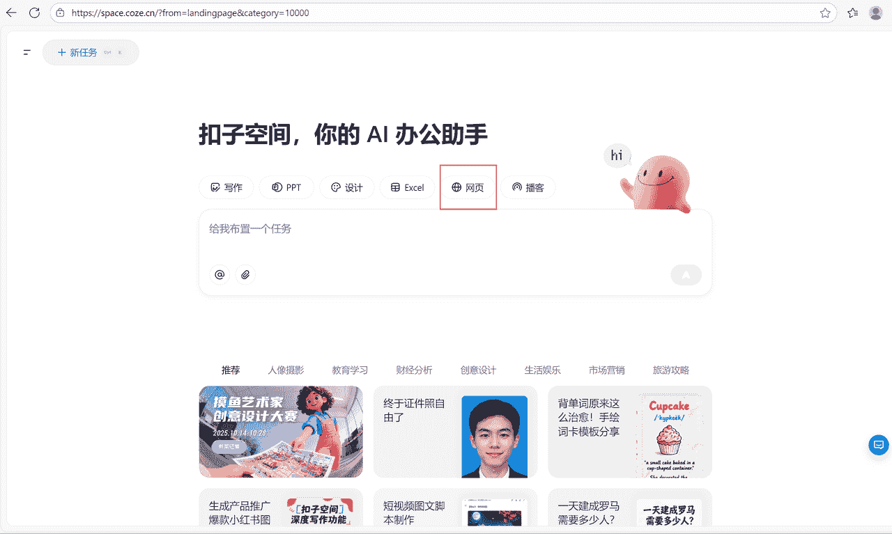

- 第二步：对话框中输入你的需求。


- 第三步：输入需求，等待几分钟即可预览最终效果。

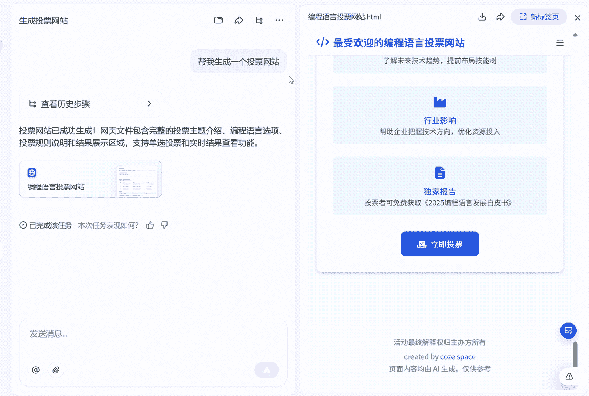

怎么样？是不是又简单又方便？

扣子空间所需要的指令，不需要你有多专业的代码术语，只需要一段普通的对话，它便能精准捕捉你的核心需求。

在用户输入指令后，系统就会开始进行解析指令→资源调用→增量生成这一系列的流程，并且每一步流程都将在右侧的显示框展现，实时预览，所见即所得！

## 三、🚠把你的「大纲」变成「神作」

文章的第三部分，来聊聊网页设计里，3个非常好用的功能。

### 1、一键「优化」功能，帮你省掉一半的思考时间

扣子空间的一键优化功能很值得一提。首先在提示词方面，它能极大减少你的思考时间，你可以将大纲给扣子空间，或者只给一句话，它都能对此展开详细的说明，做出细致的提示词。

比如说：我想让扣子空间优化一下我的某项作业，在对话框仅输入了：

```
帮我提升一下这几个页面的美观性和连贯性
```

便自动给我生成了以下内容👇：


所以，无需担心语言表达能力的欠缺，扣子空间能够为你列举好需要优化的部分，并给予细化的调整方案，在输入环节就确保网页生成质量，可以让生成结果更贴合用户真实意图。

当然，你也可以在它的基础上进一步修改，对你不满意的地方进行修改，或者是添加它未涉及到的角度。

### 2、一键「整容」功能，网页质感直线UP

有时候，我们自己制作的初版网页是不是往往感觉缺少网感？排版生硬？视觉层次不够出彩？因此，当你无从下手之时，我们也可以借助扣子空间的网页优化功能来提升整体美观度。

接下来我们来看看它的网页优化效果。


告诉扣子空间你想要提高这个网页的质感，就能得到如下效果👇：

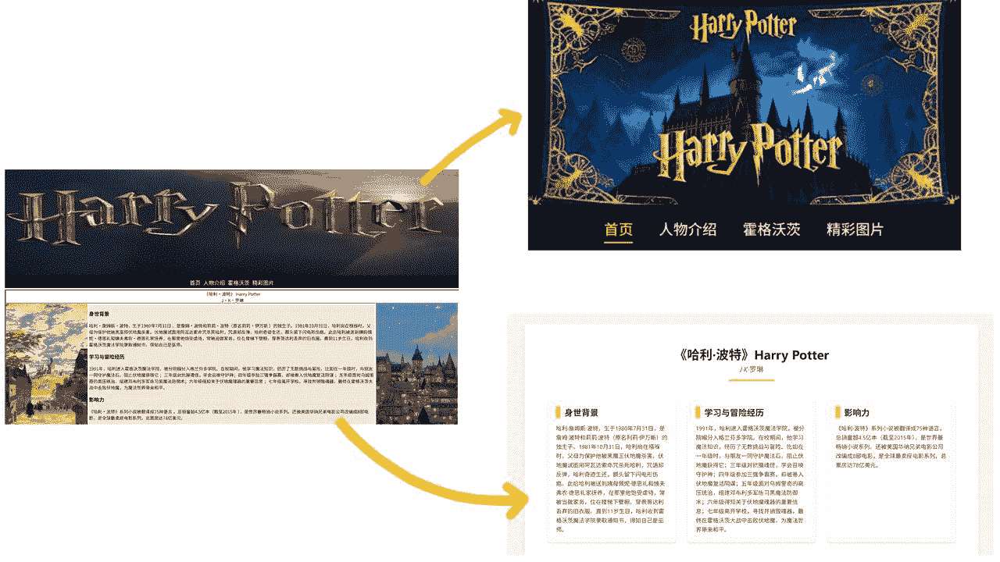

可以看到扣子空间根据提示词进行了优化，在这下面两个方面比较突出：

①导航栏更加精致；

②文字布局排版更加合理美观。

优化效果十分显著！同时网页之间的跳转也更流畅，主题更加统一，一个小小的修改，让网页的质感直线up。

### 3、自由编辑，将「所见即所得」玩到极致

对网页进行「一键整容」后，有时候还是会觉得，生成的网页好像还是缺点什么？或者是经常无法一次性达到理想效果？这时候我们可以用自由编辑功能继续赋能我们的网页。

自由编辑功能怎么处理呢？

比如，我做了一个人物介绍的网页，但它的背景图片稍显无趣，那么我就可以直接点击图片，这样扣子空间就能只对这一部分进行修改，从而快速实现我们对网页的完善构想。


你可以框选出网页中的任意元素，而后会为你提供工具来选择，这边我选择采用对话，用大白话提出我的诉求便能得到一个满意的结果。

从文字的字体、字号、颜色，到布局的间距、排列，扣子空间为我们提供了多样选择，并且当我们做出某项改变，例如修改按钮颜色时，便会自动推荐配套的文本框颜色，保持页面的统一度。

一般来说，在网页生成后的任何时刻，你都可以利用编辑来对其实现持续性优化，在高效创作的同时，又通过可视化的操作赋予用户最终的控制权。

## 四、🚂AI 的两张王牌：「复刻」和「脑补」

前面我们从功能架构层面，聊到了扣子空间三大非常好用的功能点。那当它真正进入实践时，又会呈现怎样的效果呢？

现在就让我们把目光转向实践维度，探究一下当它进入实际应用环节时，会为我们带来哪些惊喜。

### 1、网页「复刻」，神级还原

扣子空间能够对任意网页进行复刻——根据图像识别来进行网页的复制。比如来看下面这个对话👇🏻：

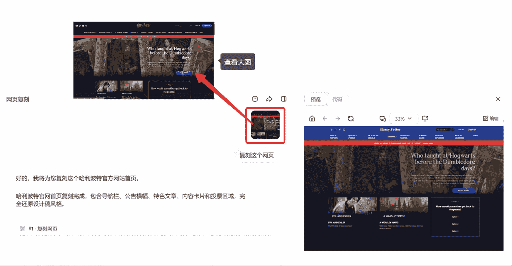

可以发现，不仅页面布局能够对应上，且比例误差也不大。对于导航栏、按钮、输入框也能进行准确的识别，还原度极高。

由此可见，扣子空间对这些视觉元素有着深刻的理解，对于各个组件的识别准确，并且对其交互逻辑及层级关系有着清晰的理解。

### 2、框架「脑补」，内容全包

除了复刻之外，如果我只给扣子空间一个框架和主题，接下来内容全部交给它填充呢？

我给了它如下内容，一个很空的框架和一句简短的提示词：

```
根据这个图片结构做一个关于中医解决健康问题的网页，其他内容你自行添加。
```

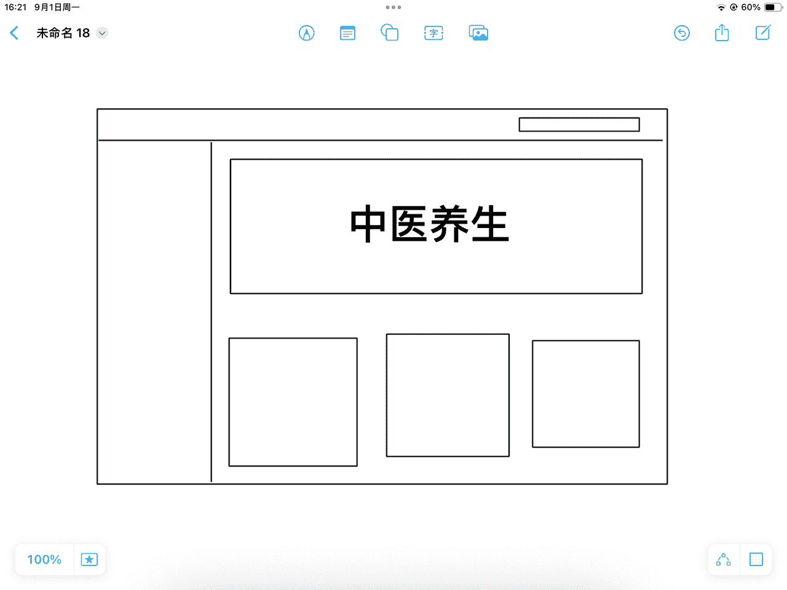

接下来是它生成的结果，如下图所示👇🏻：

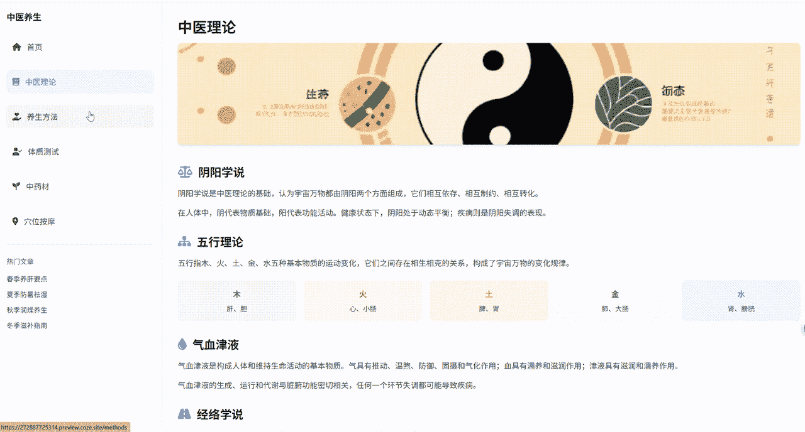

可以看到整个页面虽然比较简洁，且对比我们所给的元素，它已经完善了特别多，填充了许多内容。且分栏清晰，自动划分出了多个功能区，涉及了中医多个知识方面，也增添了问卷，增强了互动性。

这个框架脑补的方法也意味着，只要你在脑海中有个大概的想法时，就能先提交给扣子空间，看看它的扩展与思考，进一步节约了时间，增强了实行的可能性。

现在知道了基本使用方式，将用八个典型的实操场景，来展示保姆级操作过程，帮助大家快速上手。

## 五、实践场景示范💼工作办公

### 1、制作游戏商店网页：快速复刻网页

游戏商店算是最常见的一种网页了，但我们要如何一个人短时间速成一个网页呢？这里就需要用到扣子空间的模仿复刻能力，比如借用Steam，EA等平台的布局设计，然后再填充自己的内容。

```
模仿参考图中EA商店的主页布局制作一个游戏商店页面
去掉所有商品图片与文字，只保留基本布局和框架，方便重新填充内容
```

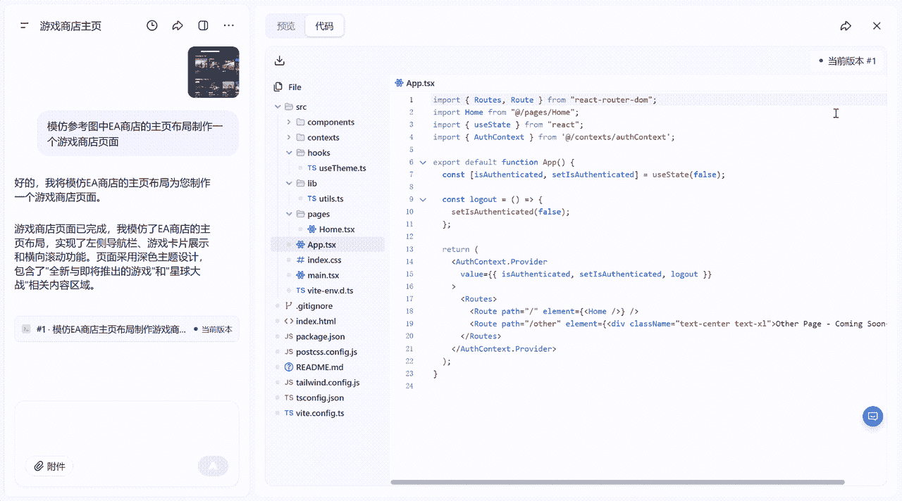

我们可以看到，它几乎完美复刻了原来的布局甚至连图片都一起复刻，同时还给出了完整的代码，接下来只要稍微修改一下商店的名称，更换一下图片，一个新的游戏商店网页就做出来了，生成过程如下图所示：👇🏻

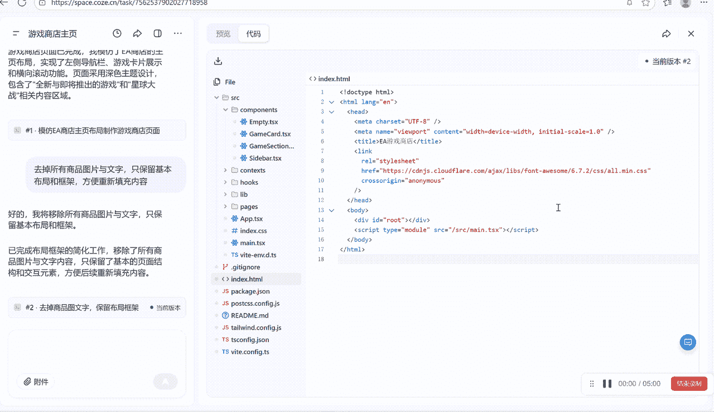

### 2、石材企业官网：轻奢大气，质感拉满

接下来看看综合性要求更高的企业官网，这往往需要一致的色彩搭配和多个页面的相互配合。我们用以下提示词来尝试一下👇🏻：

```
帮我做一个石材企业的官网，要求包含产品展示、案例展示、企业介绍、联系方式，整体风格要求高端大气。

接着，请设计清晰的网站栏目结构，要求有：首页、关于我们（企业简介、企业文化、团队风采）、产品中心（按石材类型、用途等分类）、工程案例（按项目类型、区域等分类）、新闻资讯（行业动态、企业新闻）、联系我们（联系方式、地图位置、在线留言等）。

然后需要有一部分对各类石材进行展示，展示部分要简约高端，能充分展示石材特性。
```

最终生成效果如下👇🏻：

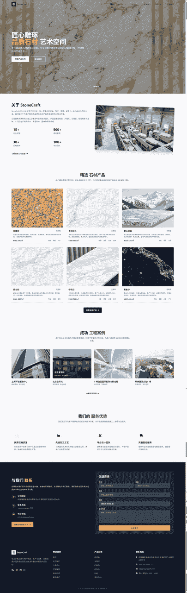

从设计上，确实凸显了石材企业的轻奢大气，视觉效果良好，模块之间划分清晰，各模块过渡自然，但部分功能未完整完成，还需要进行再次生成。

布局排版合理美观，已经达到了较为专业的水准。

### 3、简历生成器：告别社恐，一键出稿

除了企业官网外，我们还可以用在个人应用方面。比如，我们来制作一个简历生成器试试看。

在制作简历时，我们经常会面临着内容提炼难，结构逻辑乱，针对性不足等问题。

因此，我们可以把用户在写简历时，会遇到的这些问题，包装到我们的需求提示词里。进一步地让这个网站能够帮助用户规避这些问题，完成一份不错的简历。

```
首先，请引导用户提供制作简历所需的基本信息，包括但不限于：个人基本信息（姓名、联系方式等）、教育背景、工作/实习经历、项目经验、专业技能等。

根据用户提供的信息类型和职业方向（若用户未明确，请先询问其目标职位或行业），设计一个清晰、专业的简历结构框架。

基于用户提供的原始信息，进行专业的语言润色和内容优化，突出与目标职位相关的核心优势和经历亮点。

选择合适的字体、字号、间距和配色方案，确保简历整体视觉效果简洁、专业且易于阅读。

完成初稿后，请呈现给用户进行审阅，并根据用户反馈进行必要的修改和调整，直至用户满意。

最后，将最终确认的简历导出为PDF格式，确保排版在不同设备上保持一致。
```

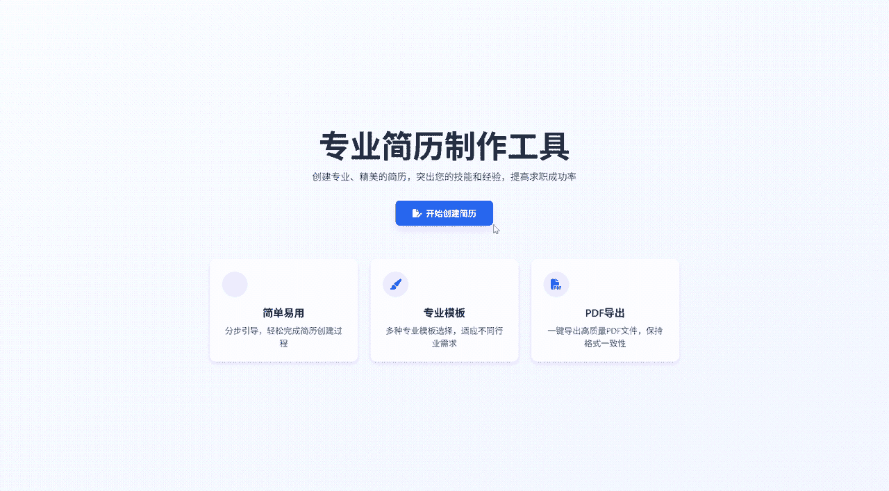

这个网站里能给我们清晰的结构，并且会在输入框加以提示，可以添加多段学习/工作经历，既适配拥有丰富经历的用户，也能帮助经历较少的的用户有条理地梳理信息。解决了用户手动排版耗时、易出错的问题，高效产出符合招聘方阅读习惯的简历。

## 六、实践场景示范🎮娱乐休闲

### 1、美食转盘：选择困难症有救了

你是否经常为中午吃什么的问题导致选择困难症发作？所以我们可以自己制作一个美食转盘，转到什么吃什么，帮助你快速决定。说干就干，开始吧。

提示词如下👇🏻：

```
为我制作一个美食转盘抽奖网页，正上方标题为“中午吃什么？”，转盘采用多种彩色色块，散射布局，抽取内容包含30种常见食物（不显示在转盘上）
```

代码查看：

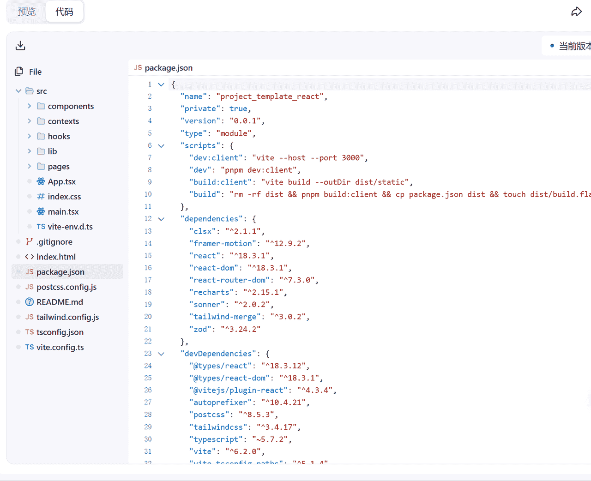

预览效果如下👇🏻：

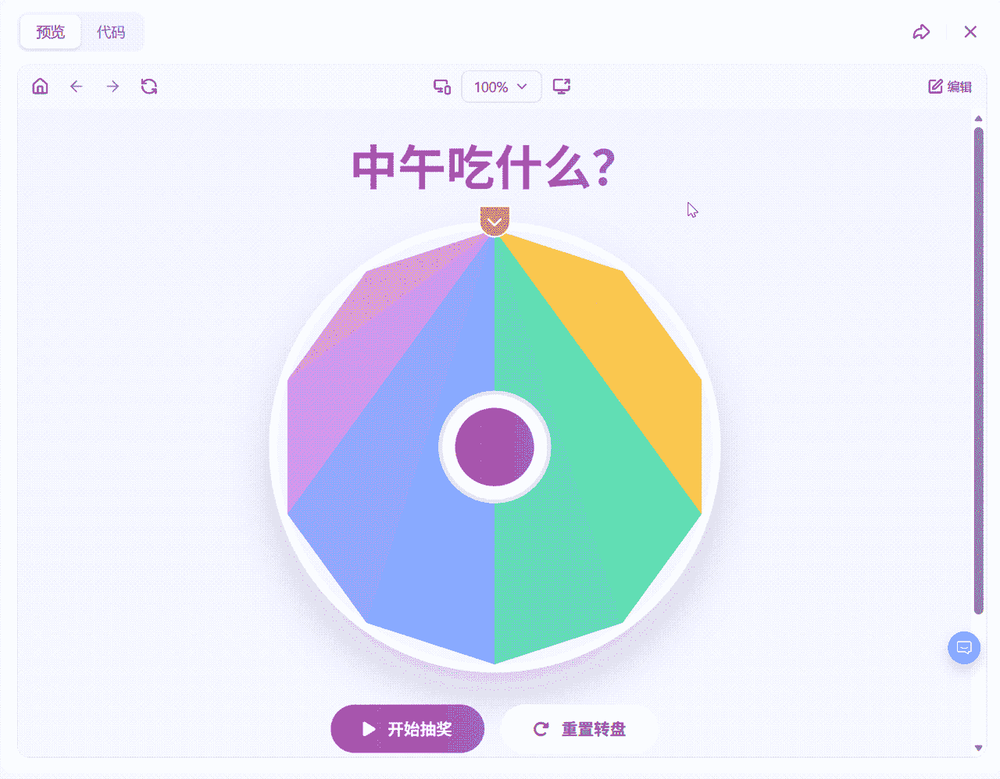

可以看到，我只提出了一些最基本的要求，扣子空间就能自动地帮我们完成网页布局、动态转盘，同时还补充了结果反馈的内容，完全不需要用任何术语，对没有基础的小白相当友好✨

### 2、舒尔特方格：一句话生成可交互页面

相信你一定听过舒尔特方格训练，那么一句话能否生成一个完整的舒尔特训练网站呢？这需要AI同时具有现代化的界面设计，支持不同难度级别的训练，还要包含计时功能，结果统计等，是一个工作量不小的工程，我们来看看它能不能做到。

提示词如下👇🏻：

```
生成一个可以进行舒尔特方格训练的网页
```

代码查看👇🏻：

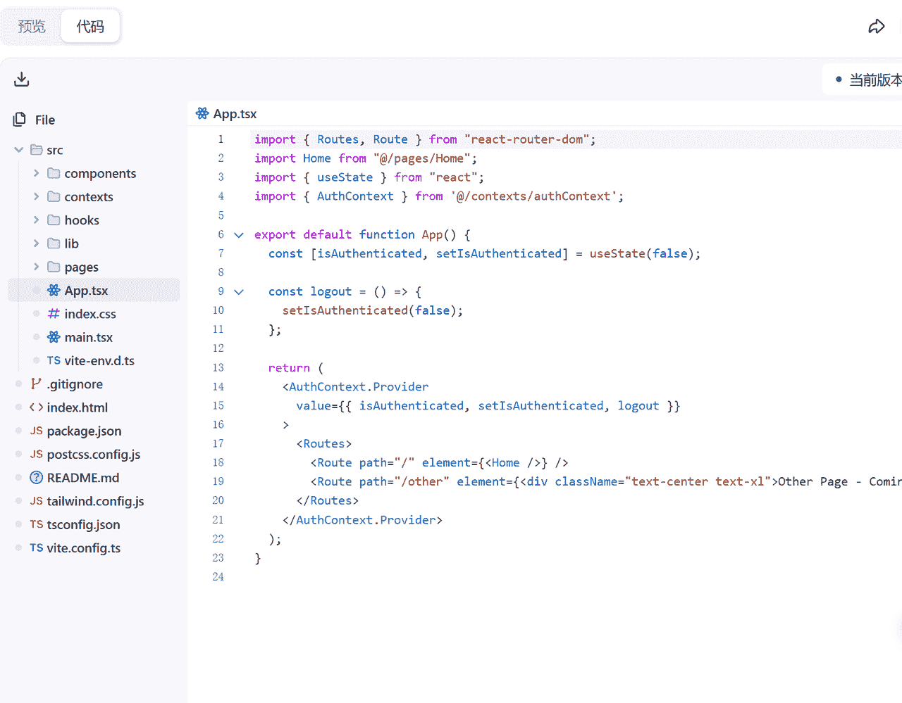

预览效果👇🏻：


我们可以看到，仅仅一句不到二十个字的提示词，成品就做到了支持不同难度级别的训练，计时功能，结果统计，甚至可以自由切换浅色/深色模式，手机电脑双端兼容。

### 3、数独小游戏：逻辑严谨，秒变玩家

小游戏是大众日常休闲的热门选择，考验AI对趣味性、操作性与视觉效果的平衡能力，来看看扣子空间表现如何👇🏻：

```
开发一个数独小游戏，游戏等级按照难易程度分成3个等级。
每一次游戏要有原始的固定数字，玩家根据固定数字填写答案。
```

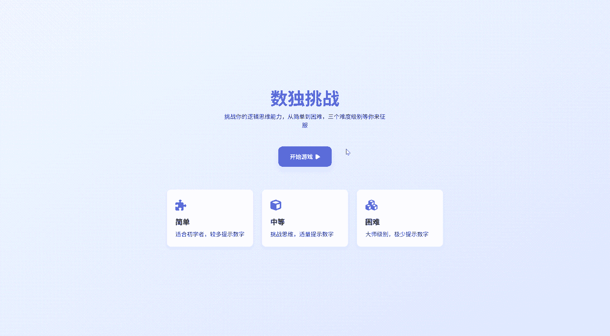

对于这个游戏来说，不需要有太复杂的页面，主要测试的内容点是，看扣子空间能不能完成一个完整的游戏以及游戏规则是否正确。

可以看到的是，这个小游戏对于错误能有明显判断，逻辑正确，且能正常使用（填写错误时及时反馈、重置功能敏捷），可见扣子空间对于这种工具型小游戏的打磨也是有一定能力的。

## 七、实践场景示范📖教育培训

### 1、小学五年级教育网站

做一个教育网站如何呢？

这意味着扣子空间要整合好各种知识点、理好教学大纲，而且要符合学生当下学习能力来设计课程学习，面对低龄学生还应采用丰富的教学形式和简单易懂的教学方法，这将是一个不小的「工程」。

我们先来输入提示词：

```
做一个小学五年级的教育网页，要求覆盖小学五年级的知识点，能够很好的把知识传输给适龄学生。
```

来看看扣子空间的表现如何：

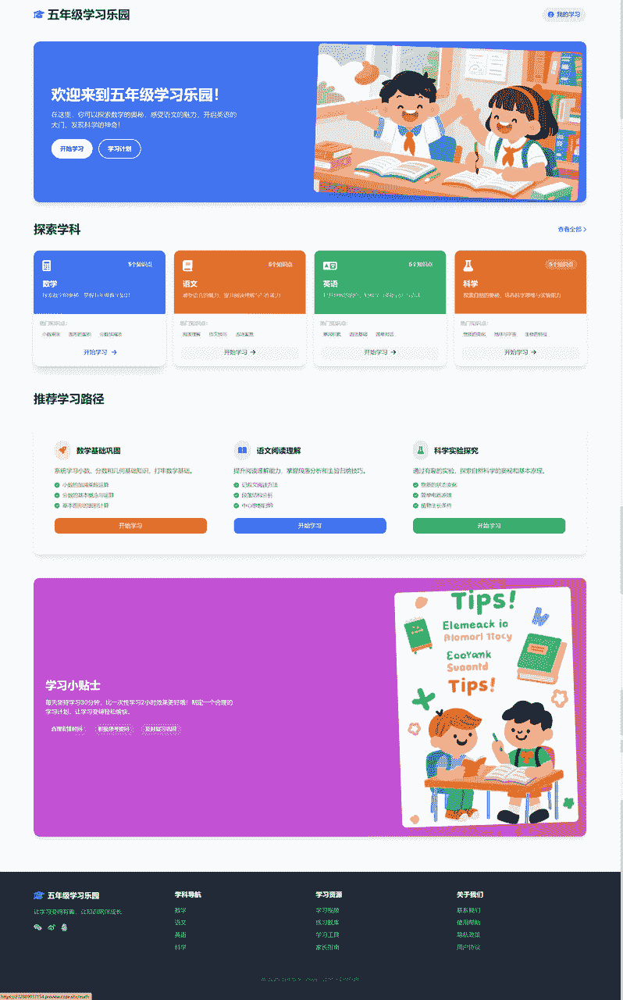

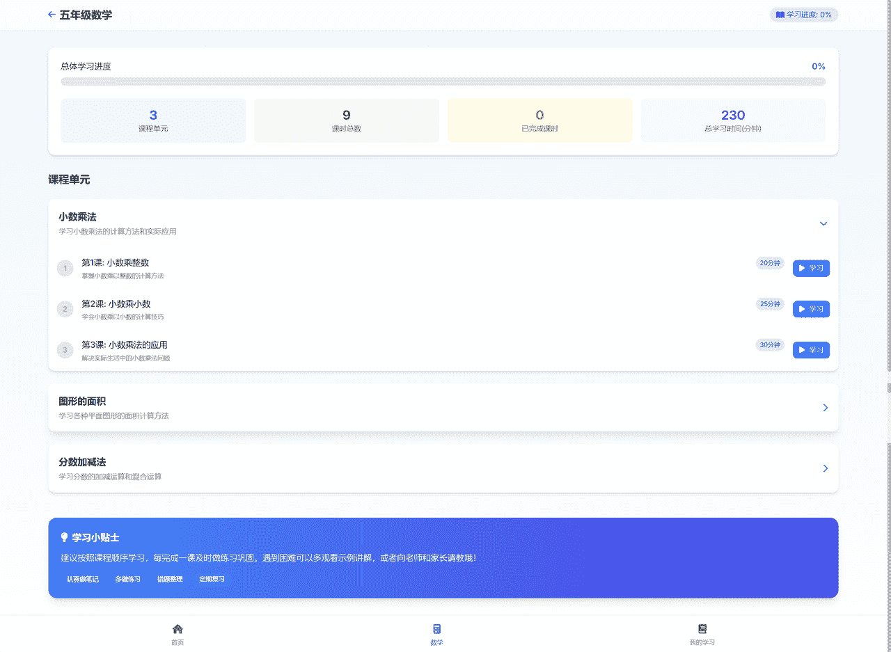

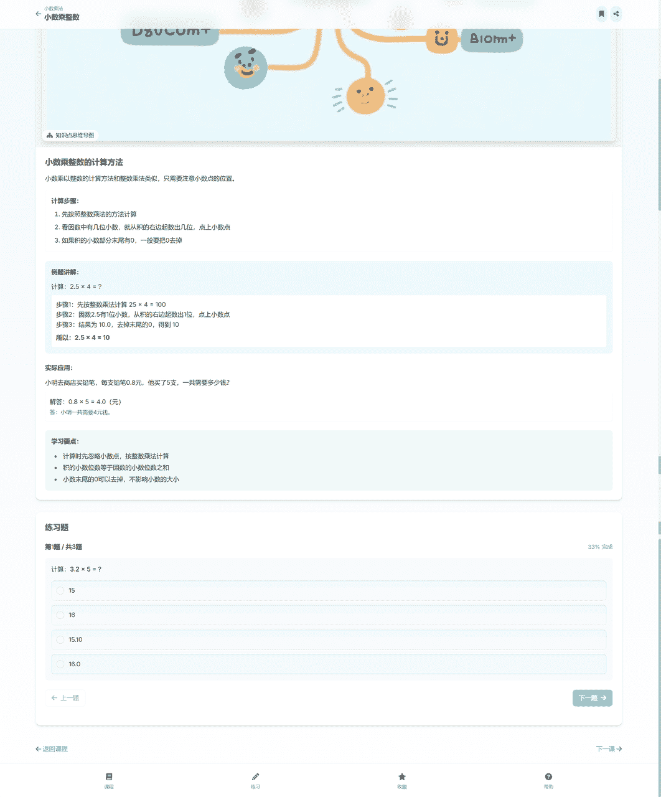

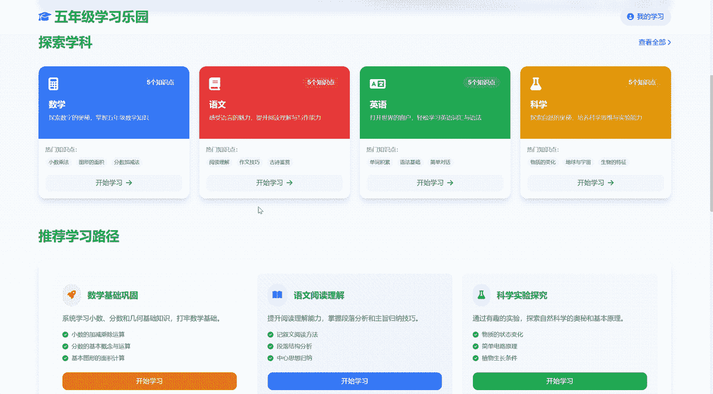

我们来仔细分析下生成后的页面。

---

首先可以看到的是，网页在一开始就很有童趣，非常契合了该年龄段学生学习的氛围，富有童趣，清新活泼的色调也符合教育产品的定位。

进入课程学习后，各元素的设计配合的很巧妙，通过颜色对比和视觉体验来快速地引导用户视线进行流动。

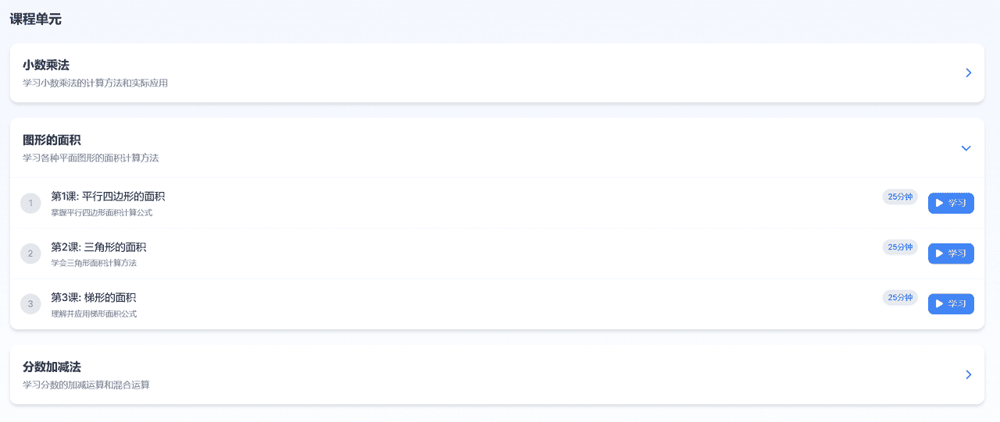


正式进入学习后，它又将课程分为几大部分，每一部分里又有相应课程，框架明确。并且贴心地做了学习时间参考，可以让用户们更合理的安排学习时间，培养时间管理能力。

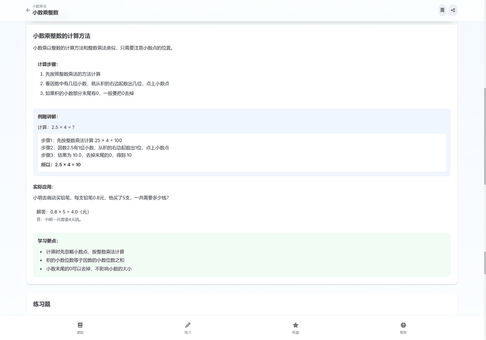

所给的学习内容也是清晰明了，重点突出。模块清晰，逐层递进，有通过色块来区分讲解、示例、要点。

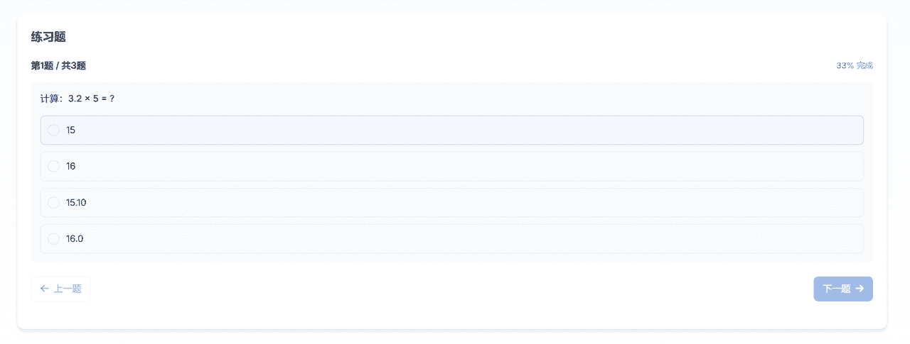


尤其是，它还提供了课后习题，即刻判断正误，能及时给予学习反馈，有效提升练习环节的参与度与纠错效率，形成学习-实践-反馈的完整闭环。


整体设计既保持**教育产品的严谨性**，又通过适龄化设计激发学习兴趣，在愉悦的交互体验中高效获取知识，培养学生的自主学习能力。

可以说是：扣子空间帮你寓教于乐，面面俱到了。

# 学生课程表：随时导入，随时查看

如果你还是学生的话，自然免不了和课程表打交道，你是否有经历过学校一站式平台卡顿，课程表无法加载的尴尬情况😏。下面让我们来做一个响应迅速，可以随时在线编辑以及支持文件导入的课程表网页。

```
我需要你生成一个功能齐全，可以随时编辑的学生课程表网页，支持文件导入与手动编辑
```

**生成过程：**

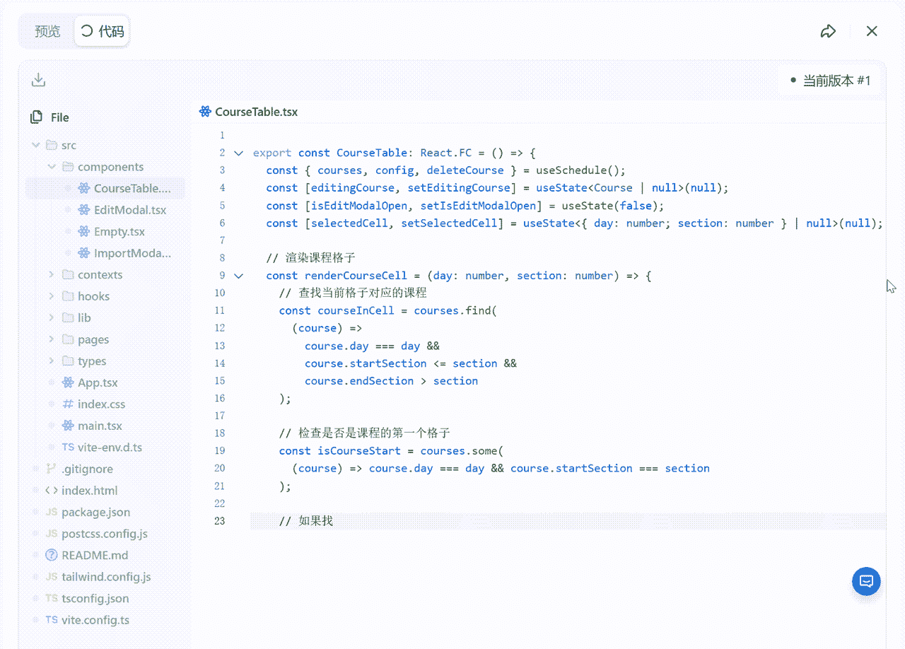

**效果预览：**

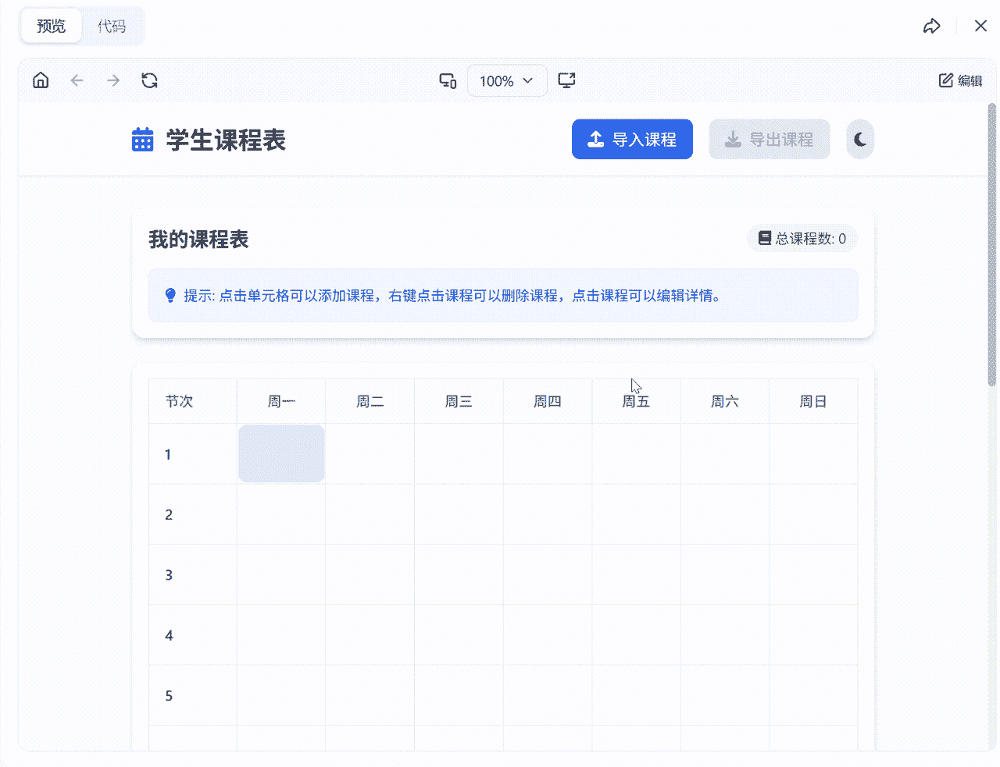

虽然生成时间较长（7-8分钟），但可以看到课程表的功能相当完善，支持导入导出且响应迅速👍，没有任何BUG。

# 七、🌁结束语

**在上面的**文章中，我们显示聊了聊扣子空间的核心亮点。

**接着，在文章的**第三部分，我们又讲了扣子空间三大好用的功能：一键优化、一键整容和自由编辑。

再接着，在文章的第四部分，我们又从应用层面，剖析了扣子空间带来的两张王牌：「神级复刻」和「框架脑补」，这在某个层面上，给创意力较差的小伙伴，能带来非常实质性的突破。

当 AI 帮我想象和脑补出了一些非常好玩的东西时，我们时常会惊诧到：原来 AI 还可以这么玩！

最后，在文章的第「五~七」部分，用了八个实战应用，给大家测试了游戏商店、企业官网、简历生成工具、娱乐休闲应用、教育资料整合等场景，更是让我们看到了扣子空间在不同领域的强大应用功能。

总的来说，**扣子空间**重新定义了我们对网页开发的认知。

它不仅仅是一个工具，更像一个随时待命的AI搭档，能理解**你的想法，填补你的**不足，并用最简单的方式帮你把创意变为现实。

到这里，关于扣子空间最近的新功能挖掘就到这里啦！

以上就是本文的全部内容，我们下期见🍻🍻🍻

# 🐣彩蛋One More Things

## 1、变更记录

多维表格（`Cq48bzJyxa1ANFsOMgIc3auenGb_tblP5hwM7LfjxPqA`）

## 2、作者介绍

经常更新的地方：👸号「星期一研究室」

Zelina的宝藏库：[Zelina的个人说明书](https://pzfqk98jn1.feishu.cn/wiki/wikcnTijikVNdkWdBEKzQpiA6ie)

## 3、知识问答专区

**本文章已上线**至「第25小时」知识库！不想长篇阅读？欢迎到知识问答专区直接进行提问😉

知识库链接：https://ask.feishu.cn/shared-space/7590992675327708381


