# Flowith AI，解锁下一代「知识交易市场」

> 来源：[https://my.feishu.cn/docx/Vsu7duMdHop9Mbxy3becKqivnQg](https://my.feishu.cn/docx/Vsu7duMdHop9Mbxy3becKqivnQg)

> 原文链接：Flowith AI，解锁下一代「知识交易市场」

# 前言

最近几周自媒体号都在疯狂推Manus，看了几篇测评后，突然在某个时间节点，在特工的文章下，发现了很小众的Flowith。

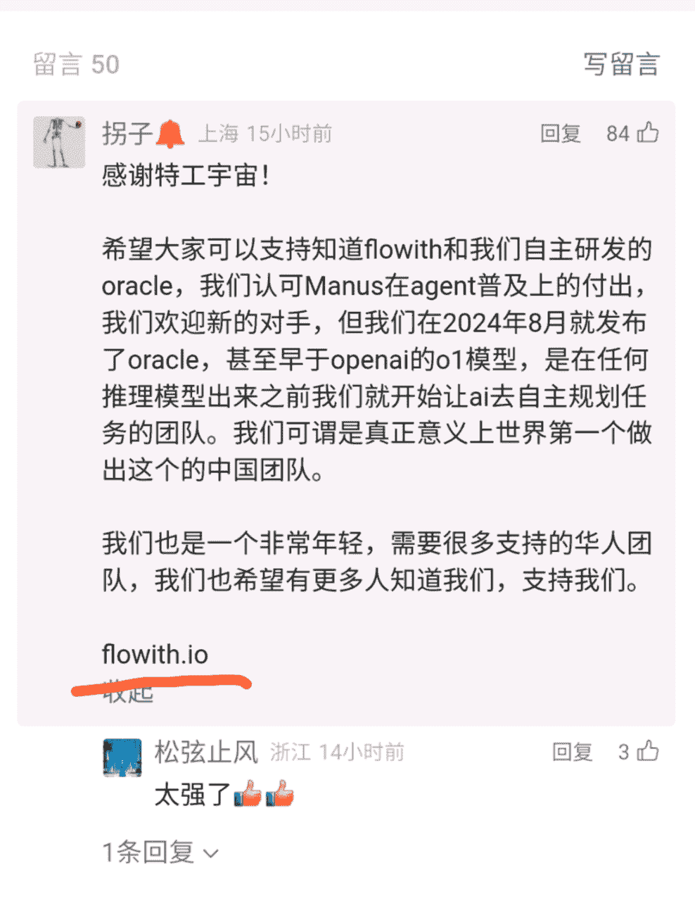

被这段评论给心动到，于是先去注册了下账号。一翻**探索过**后**，发现比我想象中要有趣的多，各**种**工作流、画**布式布局、Oracle 模式、内建知识库等功能琳琅满目，应接不暇。每点击一个入口，进去都有可能是一个很新奇的新大陆。

紧接着，小编再去把官网的doc翻了一遍，继续挖掘到了很多很新奇的玩法。

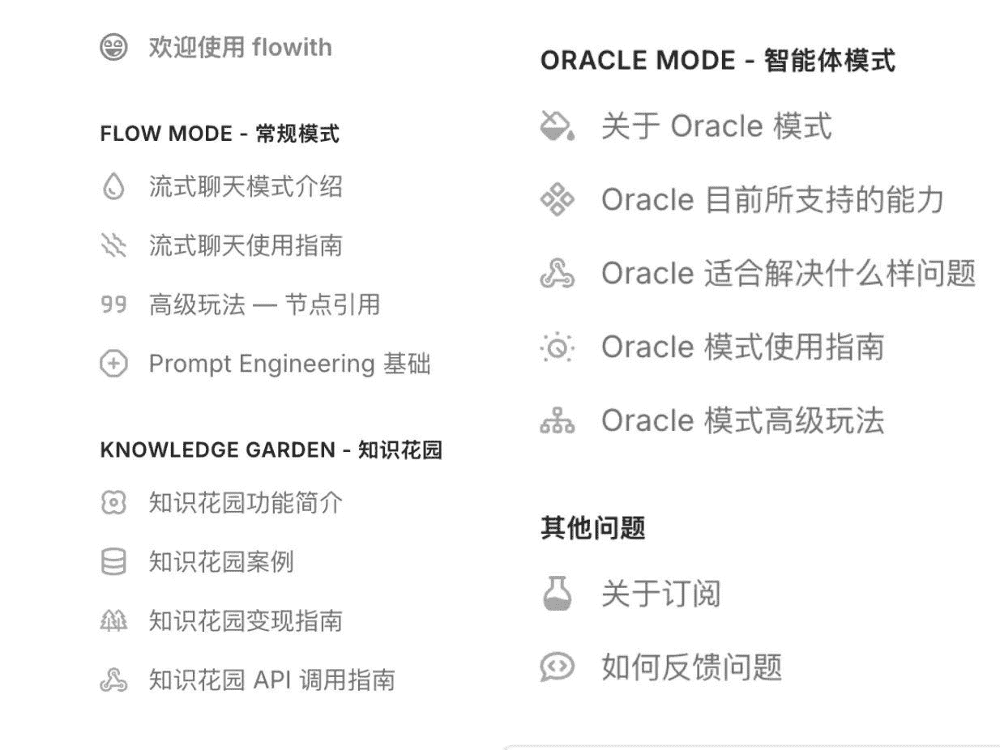

# 一、🦄基础介绍

## 1、什么是flowith

先附上官方介绍文档：https://doc.flowith.net/cn

以及首页访问链接：https://flowith.net/invitation?code=TEODVL

Flowith，是一款**华人开发****的下一代**生产力工具。它摒弃了传统的聊天式界面，基于二维画布设计，让用户能在同一空间中与多个AI模型同时交互，大幅度提升你在创意工作时的效率和心流体验。

官网里面有个「知识花园」的概览阐述的特别好，里面说到：

flowith 「Knowledge Garden」 知识花园，围绕“让 AI 与您的知识自然互动”这一核心理念进行打造。它结合了自动化知识整理、结构化管理和创作协同，能让你的信息资产真正活跃起来，成为可持续生长的“活知识”。它能够自动将你的文件、笔记和在线资源转化为 AI 可理解的最小知识单元（Seeds 知识种子）。

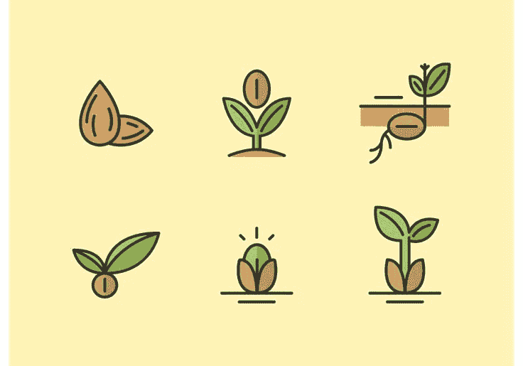

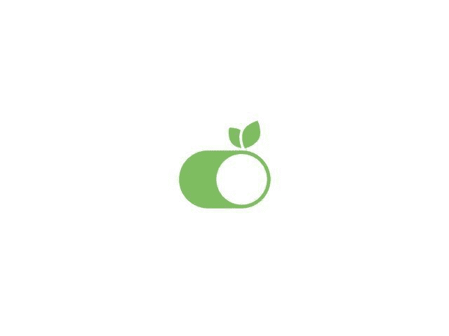

## 2、核心优势

下面先来简单初步地了解下，Flowith有哪些核心优势：

**二维画布** —— 不同于传统聊天式 AI 工具，flowith 基于二维画布的交互，让你可以在一个画布中与多个 AI 模型同时交互，并进行内容生成，更适用于长内容生成、对比 AI 生成结果、调试 Prompt 等场景，让你在创造内容时大幅度提升效率、更容易地进入心流状态。

**Oracle模式** —— Flowith Oracle 是官方自主打造的下一代 AI agent 系统，它可以帮助你完成多步骤、超复杂的任务和需求。支持自主规划、拆分和完成任务、无限的工具调用、和自我优化完善，比传统的 AutoGPT 等架构有着更成熟和稳定的表现。同时，利用 flowith 画布式的交互，Oracle 可以更好地为你呈现具体步骤和全面信息。

**全链路知识管理**** ——** **Flo**with把知识管理，从生产端到消费端，完全地串联了起来。分为三个步骤：

1.  知识库Knowledge Bases → 用Knowledge Bases 构建你的知识库数据；

1.  **知识花**园Knowledge Garden → 将静态信息转化为“活知识”，自动把文件整理为 AI 可理解的知识单元；

1.  知识市场Knowledge Market → 将整理过后的知识，发布到交易市场，可以开启付费订阅和售卖。

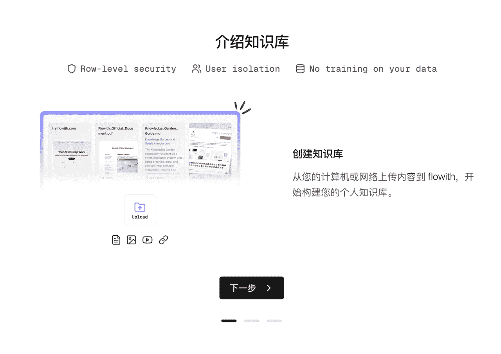

下面，我们就来聊聊，Flowith这一整个工具，各种有趣的入口，以及要怎么去更好地使用。

# 二、🐯Flowith功能拆解

## 1、构建你的第一个知识库

### （1）创建知识库

刚进入页面，映入眼帘的是看起来非常清爽的首页，接近Notion和YourMind的UI风格。

接着，我们可以点击下方红色区域，来开始构建我们的第一个知识库。

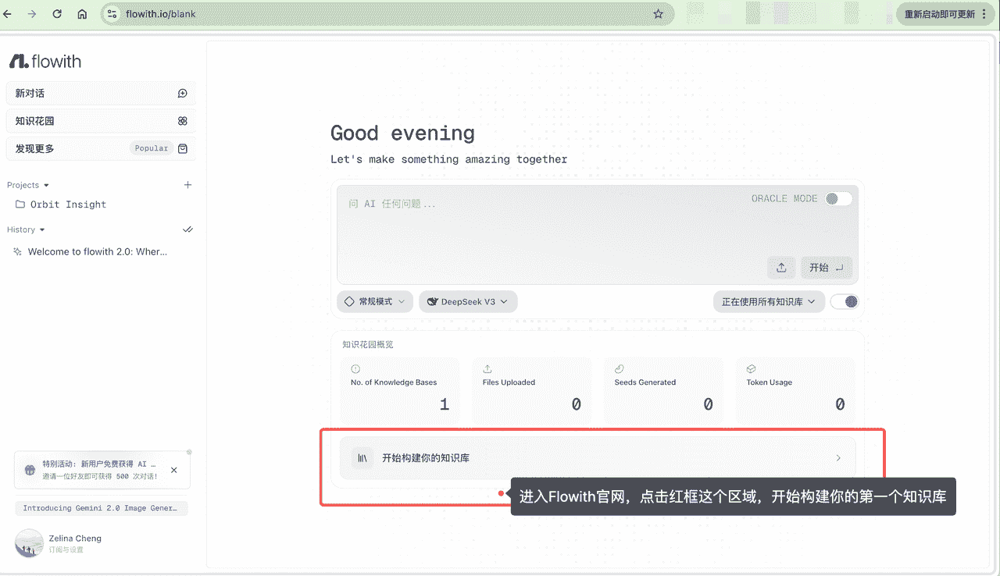

紧接着，会有一个弹窗，这个弹窗是用来给你创建知识库的。我们来创建第一个知识库：

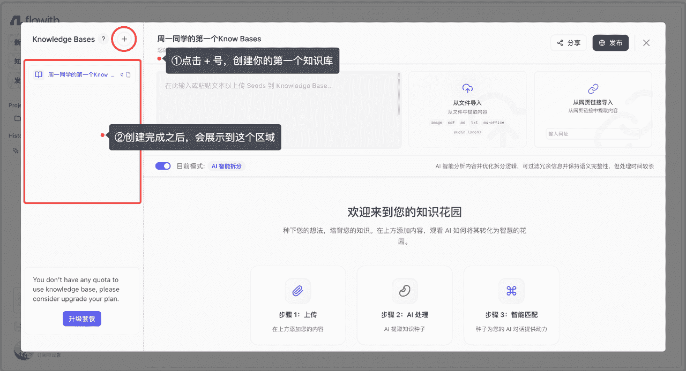

创建完成之后，就需要往我这个知识库上放东西，怎么放呢？具体看下面步骤👇🏻：

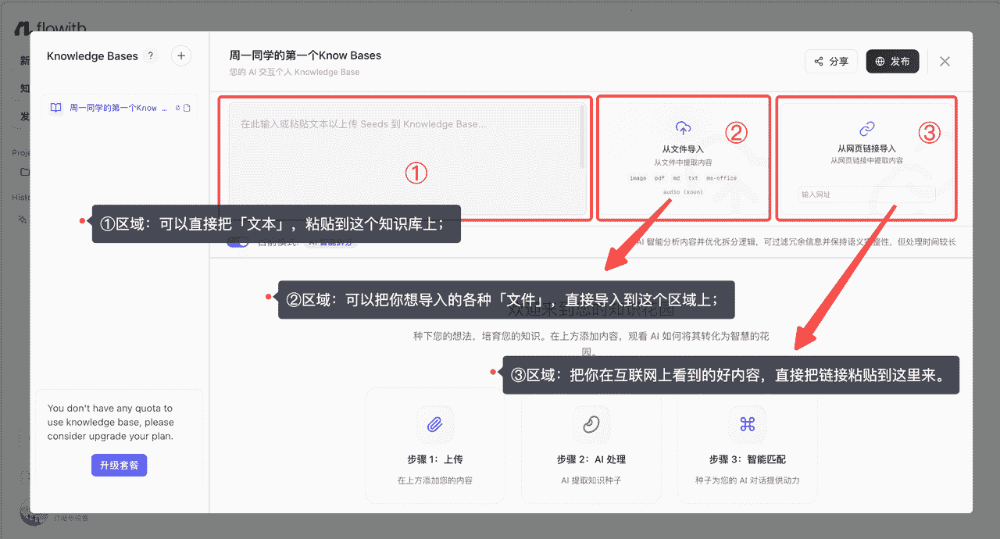

接着，我导入了一个文件进来，它会开始解析：

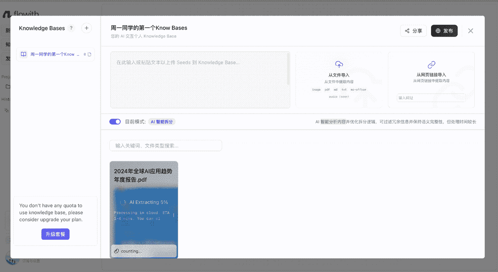

解析完成后，就种下了知识的种子🌱：

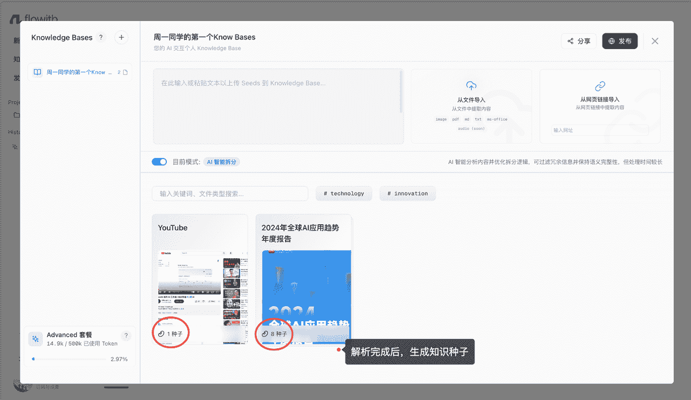

值得注意的是，在对知识库的内容进行解析时，有两种模式可以选择。分别是：

+   **AI 智能拆分****：A**I 智能分析内容并优化拆分逻辑，可过滤冗余信息并保持语义完整性，但处理时间较长；

+   **快速拆分**：按句子直接拆分，完整保留原文，处理速度快但不会做优化。

对于这两种模式的选择，主要看你对**所上传内**容熟悉度的把握。如果你觉得里面重复的内容不多，那**么可以直接选**择快速拆分。如果你觉得里面有很多重复的内容，那么就可以选择AI智能拆分。

### （2）分享到外部

**除此**之外，你还可以将知识库，通过链接的形式，分享到外部。那外部的小伙伴，可以通过这个链接访问到你的内容。具体操作如下：

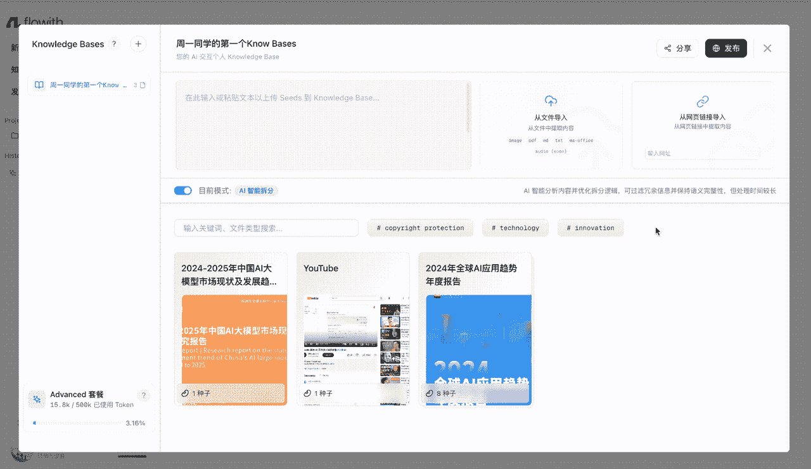

## 2、Chat模式

创建完知识库后，我们回到首页，去使用我们创建的内容。

在首页的聊天框，有一个 KNOWLEDGE BASE 的按钮，我们把这个按钮打开，然后选择我们创建过的知识库。就可以基于我们构建过的内容，来和 AI 开始对话。

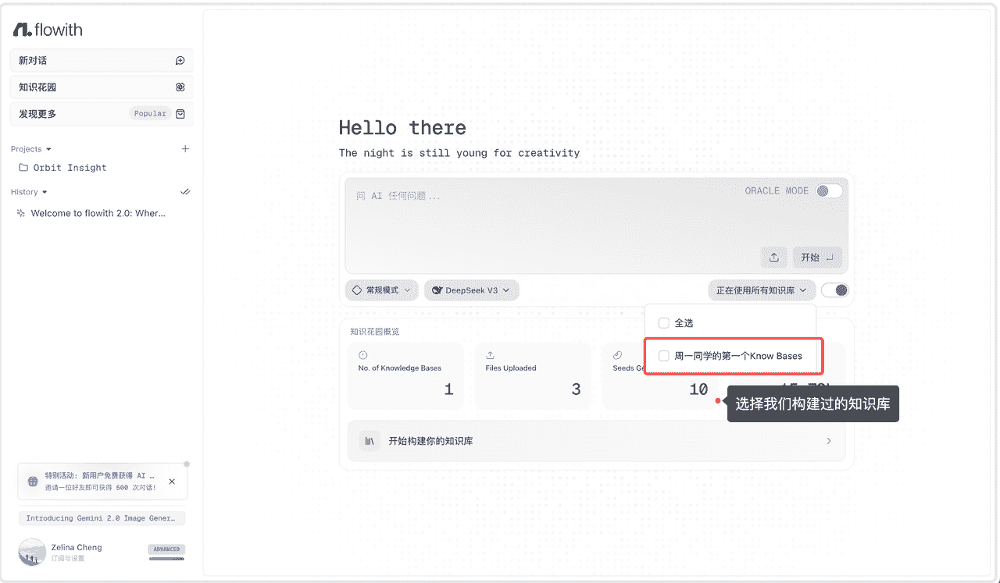

对它**提问问题**，然后点击「开始」，它就会进入一张全新的画布里面去进行创作。

## 3、无限画布交互

比如我问它：

> 刚刚我上传两份报告，分别是：①全球AI应用趋势年度报告；②AI大模型市场现状及发展趋势。

> 接下来请你帮我分析下，在2025年，全球AI应用趋势，有可能是什么样的？

它在第一个分支里面，就开始给我生成了对应的内容：

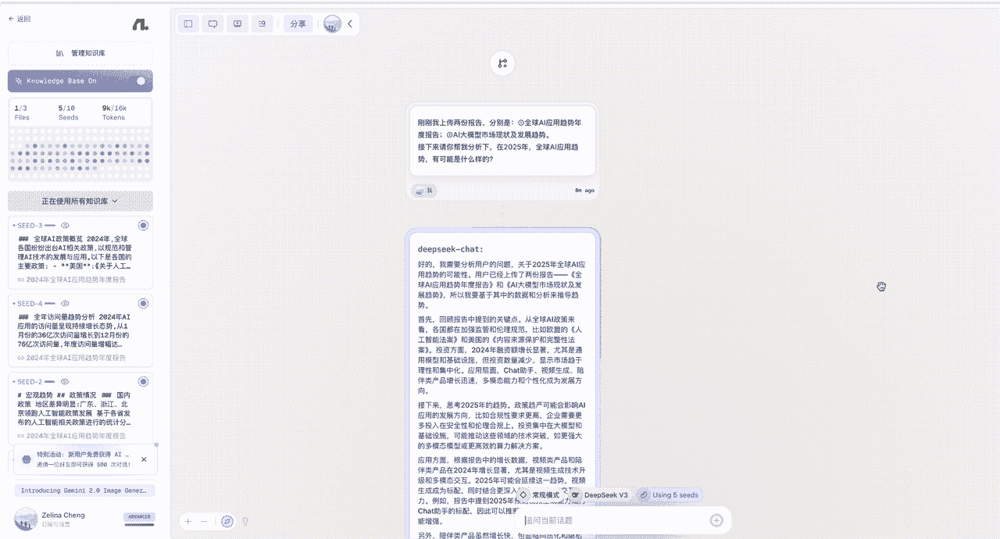

紧接着，我又建了第二个分支，我问它：

> 当然，我也想知道，在2025年，大模型行业，整个市场的现状，有可能是什么样的？

它在第二个分支里面，就生成了我想要的一些内容：

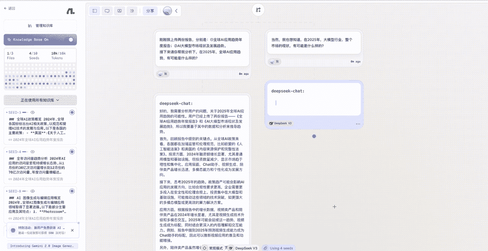

**用到这个功**能的时候**，属实是有**一点小惊艳的🐯。从我传统的单线程创作，变成了多线程创作。在一个页面内，就可以同时对很多聊天的内容，进行对比和交互。

传统AI工具是**线性的**聊天界面，而Flowith提供的是一个无限延展的二维画布：

+   **空间组织信息**：可以自由拖拽、组织内容块

+   **多任务并行处理**：在**同一画布上**同时进行多个不同的创作任务

+   **思维可视化**：直观展示思考过程和创意连接

这种画布式交互特别适合创意工作和复杂项目，让思维不再局限于一问一答的模式。

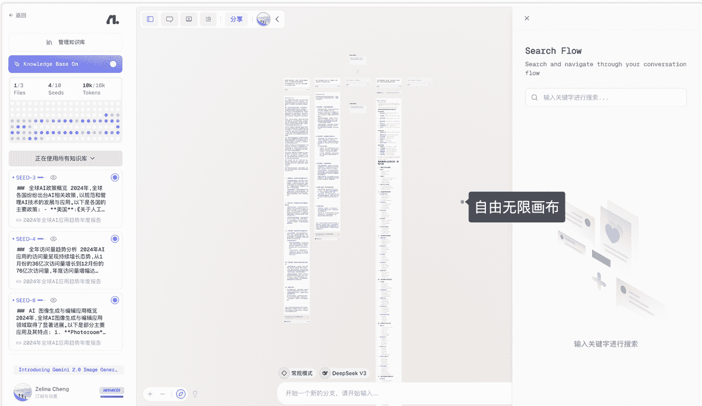

## 4、灵活切换对话模式和模型

**继续，我们**可以看到，最底下的聊天框，左上角有两个可以选择的椭圆形框。

这两个椭圆形框，分别应对的是**对话模式**和**对话模型**。Flowith支持对不同的对话，切换不同的模式，以及用不同的模型来回答。

### （1）主要对话模式

主要对话模式，包含常规模式、联网搜索模式、图片/视频生成模式、提示词生成模式、比较模式、插件模式和Oracle模式。

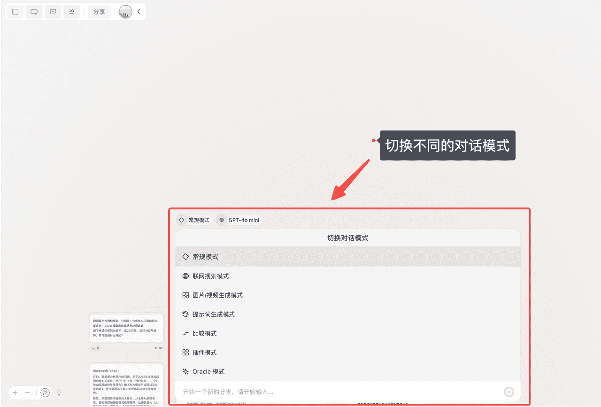

它们的功能分别是：

| **对话模式** | **功能描述** |
| --- | --- |
| 常规模式 | 最常规的AI生成模式，外挂知识库。 |
| 联网搜索模式 | 让 AI 联网搜索，基于实时信息回答你的问题。 |
| 图片/视频生成模式 | 图片或视频生成 AI，通过最顶级的模型。 |
| 提示词生成模式 | 使用 AI 优化您的原始提示词。 |
| 比较模式 | 让多个顶级 AI 模型并行回复你的问题。 |
| 插件模式 | 为 AI 外挂外部插件和专业工具。 |
| Oracle模式 | 处理多步骤任务的 AI Agent 智能体。 ULTRA 模式能够处理更复杂、更长步骤的任务。 |

### （2）支持的对话模型

除此之外，Flowith还支持对不同的对话，选择不同的模型。其中包含更先进的T2模型，以及比较常规的T1模型：

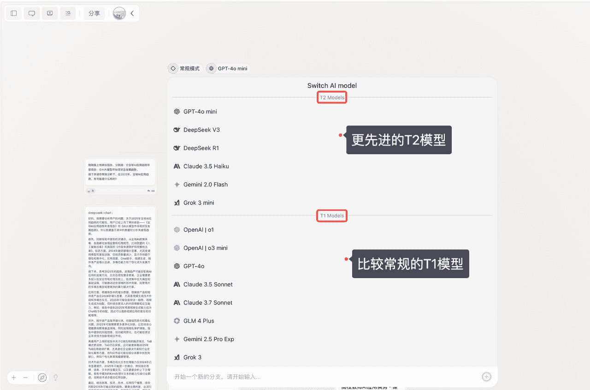

## 5、Oracle模式

### （1）Oracle模式是什么？

**接着上面提到的对**话模式，其中里面有一个很值得探索的模式：Oracle模式。Flowith的Oracle是一个强大的AI Agent框架，它比OpenAI的o1模型上线还要早。具体具有的能力有：

| **功能特点** | **详细说明** |
| --- | --- |
| 自主任务规划 | 能够将**复杂问题**拆解为多个子任务并规划执行路径 |
| 工具调用能力 | 可以调用各种外部工具完成特定任务 |
| 自我优化 | 能够根据执行结果不断调整和改进解决方案 |
| 持续执行 | 遇到问题可以自主寻找解决方法继续执行 |

据相关介绍，Oracle能在**10分钟内****完成许多复杂**任务，截至目前，已经解决了超过2000万次复杂问题。

### （2）如何使用

那如何使用Oracle模式呢？首先，在最下面的聊天框，把模式修改成「Oracle模式」，修改完成之后，就进入到了当前画布**的Oracl**e模式下。在这个模式下，我们可以引用任何一个节点的内容，或者上传文件和图片。之后基于引用的内容，来进行提问。如下图所示：

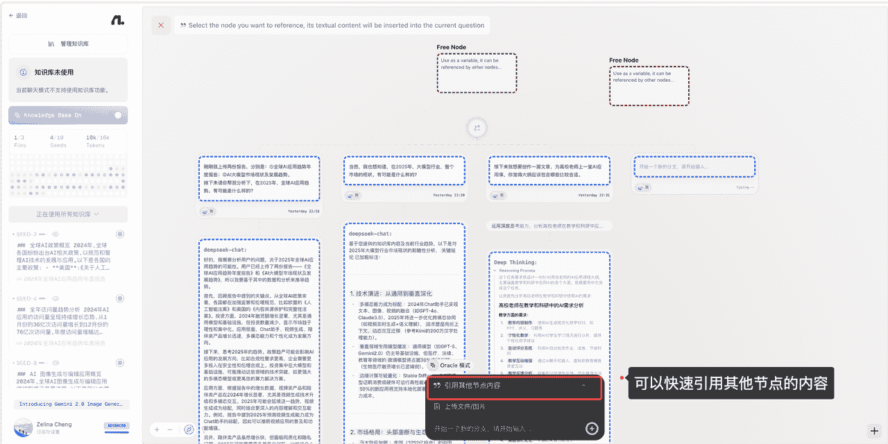

比如我问它：接下来我想要创作一篇文章，为高校老师上一堂 AI 应用课，你觉得大概应该包含哪些内容比较合适？然后Orcle模式，就会开始自主做任务**规划，将多个**复杂的问题拆解为多个子任务，并规划执行路径。同时，如果有需要调用其他外部工具，它自己也会进行思考，并自主调用合适的外部工具，来帮助你完成最终的任务。如下图所示：

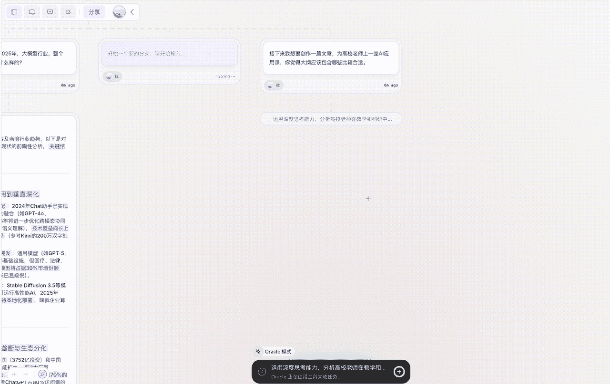

**Orac**le模式的出现，从工具层面来讲， 帮助我们做了更多方法层面的思考，从某种意义上来说，减少了我们做决策的时间。

## 6、支持多种编辑器

**继续，**聊聊Flowith上，还有一个很好玩的功能：编辑器。小编探索着探索着，在画布的右下角，发现有四个小图标。如下图所示：

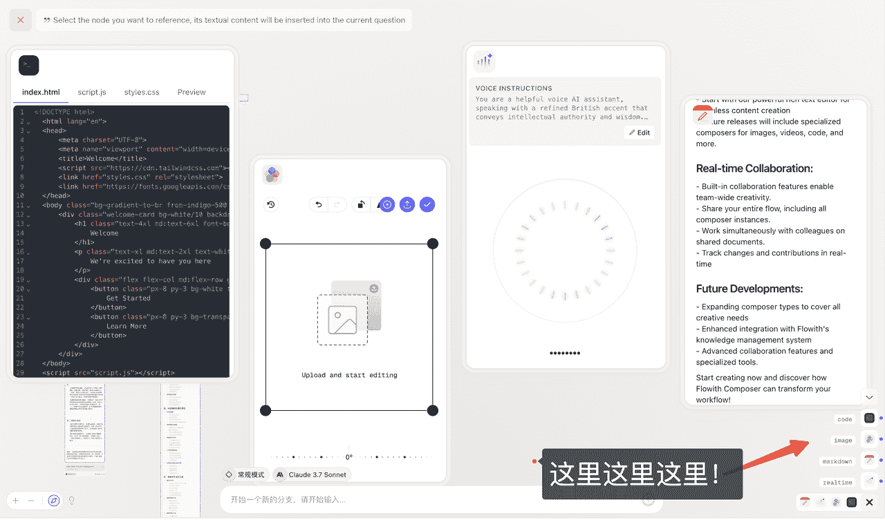

这四个图标的功能，分别对应：文本编辑器、实时聊天、图片编辑器和代码编辑器**。也就**是说，每点击一个，就**会出现**对应类型的编辑器，然后你就可以在这个编辑器上面，填充你想要填充的内容。如下图所示：

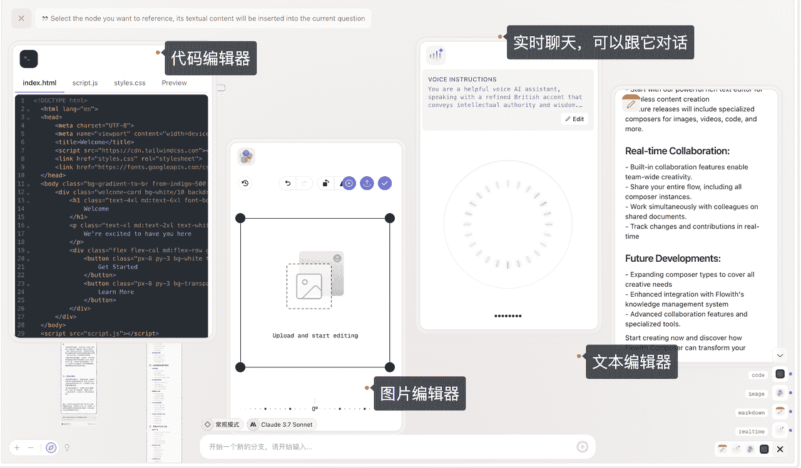

每一个编辑器的内容，都可以把你想写的内容，写到编辑器上。之后可以把编辑器上的内容，直接放到画布上。不过这里目前只有图片编辑器的内容可以添加到画布上，其他类型的编辑器，试了下貌似还不太行，静等官方后续支持。

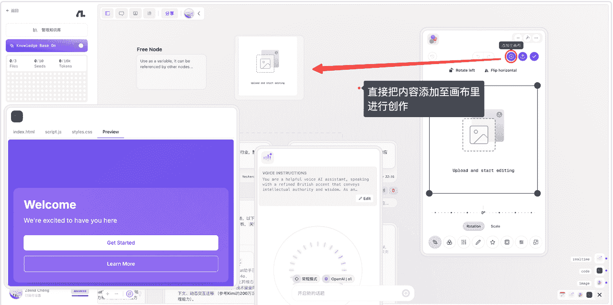

讲到这里，关于Flowith AI的功能拆解，告一段落。算是有一点小惊喜在里面🐯

下面，我们继续来聊聊，Flowith另外一个很重要的概念。

# 三、🐱知识市场

在文章的第「一 2、」这部分，我们有聊到「①知识库Knowledge Bases → ②知识花园Knowledge Garden → ③知识市场Knowledge Market」这三个概念。

前面我们已经讲完了知识库和知识花园的内容，也就是对「Flowith功能拆解」的部分。

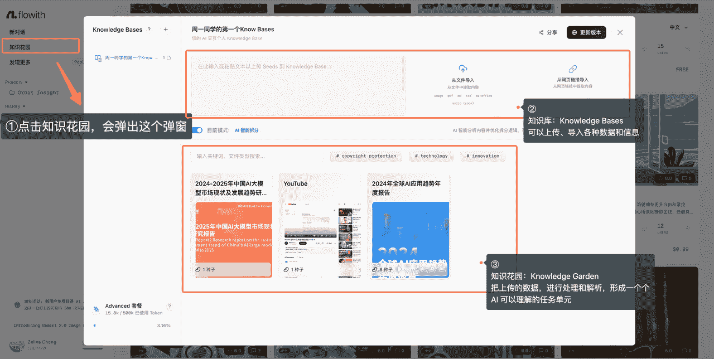

那接下来，我们来聊聊第三个概念：知识交易市场Knowledge Market。

## 1、交易市场解析

首先在首页，点击「发现更多」，进入交易市场。

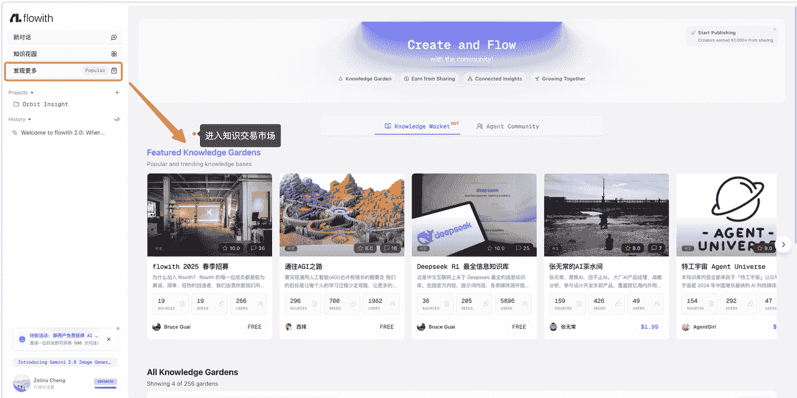

进入到这个页面后，会发现有两个入口：Know**ledg**e** Mark**et 和 Agent Community，也就是知识市场和智能体社区。

在Knowledge **Mark**et上，用户可以把自己**在知识花**园里面创建的内容，发布到知识市场下面。

那也就可以理解为：先有知识库，再有知识花园，最后有知识市场。

ahahhaa…写到这里感觉我很像是Flowith的PM，在写PRD的既视感。不过有可能解析的不对，写的有误欢迎轻喷🙊

Flowith的知识市场，很适合做垂类领域的知识，比如：计算机、法律、会计、环保、经济学、市场营销等等领域。用户构建完自己的内容之后，一方面是给自己创作使用，另一方面，整理完了之后，也可以直接发布出去，分享到外部，受益于更多人。

## 2、内容社区

从知识市场衍生出一个新的概念：**内容社区****。**Flowith**的**知识市场，整体**解**析下来的链路大致是：①内容供给 → ②用户增长 → ③商业价值。

也就是说，当你有了很好的内容，但是又迫于没有流量时，可以把你的知识花园，打包并发布到平台上，售价由你自己定，最终盈利再根据平台平台的计算规则，获取到你应得的报酬。

那怎么发布自己的知识库呢？

**第一步：**点击去发布你在「知识库」创建的内容。

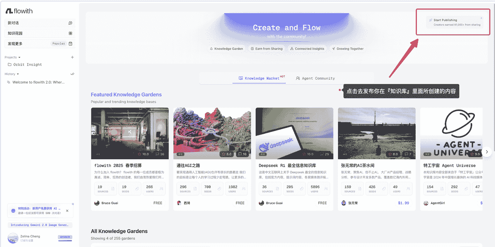

**第二步：**选择对应的「知识库」，填写名称、价格和知识库描述。

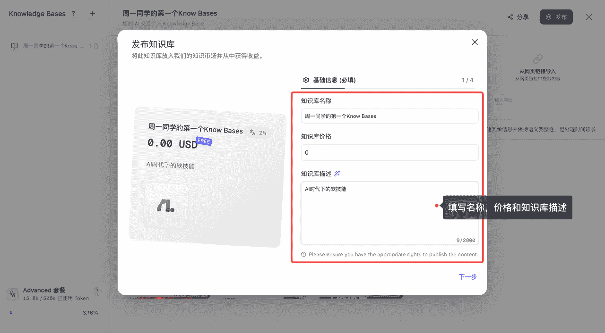

**第三步：**上传知识库的封面，以及博客的链接，这个封面最终会展示在交易市场上。

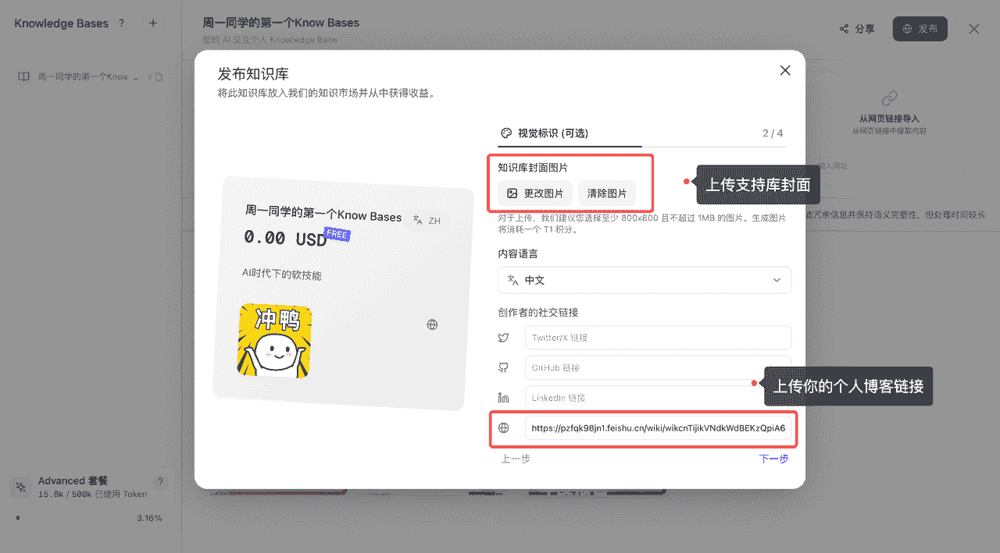

**第四步：**跑通第一个预设问题。

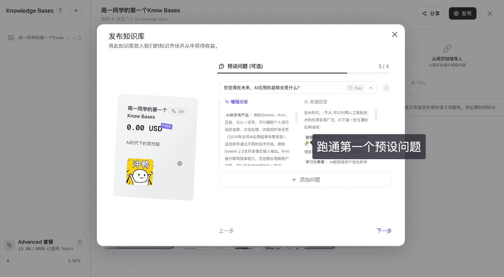

**第五步：**给你的用户，写一个简单的使用指南，告知他们，你这个知识库，是准备用来做什么的。

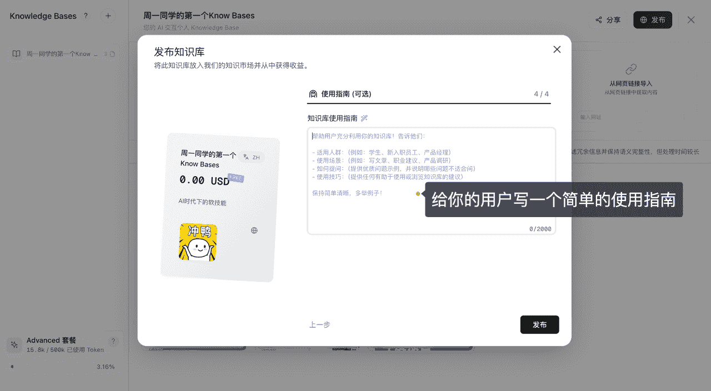

**第六步：**点击发布，然后把**知识库**发布到**交易市场**上，之后可以在知识市场上看到啦！

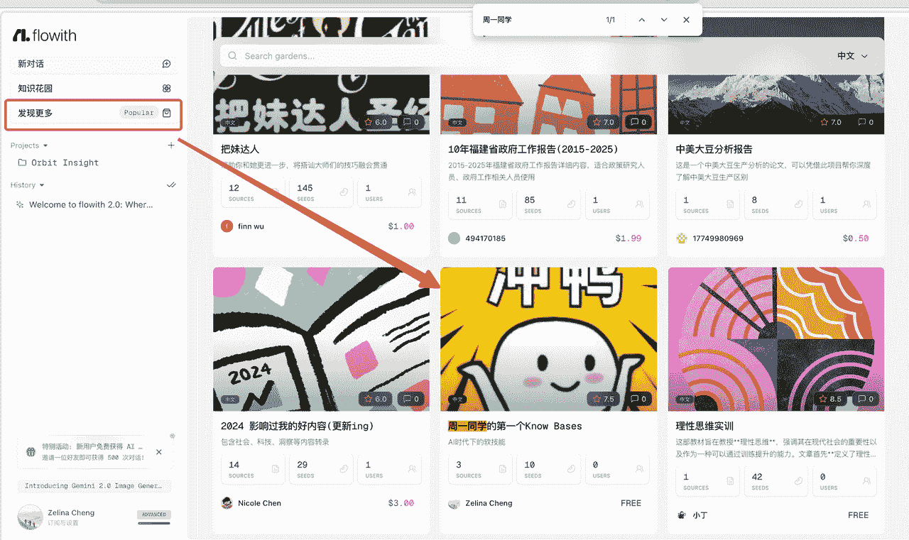

## 3、机制梳理

到这里，我们就梳理完成了「知识库 → 知识花园 → 知识市场」这三个概念。感受一下知识市场的交易模式还蛮快乐的。最后，我们来梳理下，Flowith的知识管理生态系统：

+   **知识整理自动化 **—— 将各种来源的信息自动转化为结构化知识

+   **知识单元Seeds **—— 将信息拆分为最小知识单元(Seeds)

+   **智能关联网络 **—— 自动建立知识点之间的联系

+   **精准调用 **—— 对话时自动调用相关知识，提高回复的准确性

+   Knowledge Marketplace —— 支持在社区中分享和交易高质量的知识库

# 四、🐐使用场景与实际应用

文章的第四部分，我们来聊聊，Flowith一些很实用的场景。

## 1、内容创作与策划

在Flowith的画布上，可以同时进行：

+   主题发散与内容大纲生成

+   多角度内容创作

+   图像生成与排版建议

+   内容优化与校对

例如，我可以在左侧让DeepSeek-R1生成文章大纲，中间用GPT-4o撰写内容，右侧用另一个模型进行审核和改进建议，整个过程都在一个画布上完成，无需切换窗口。

## 2、复杂项目管理

使用**Oracle模式**和**插件**，可以轻松处理如下场景：市场调研与竞品分析、商业计划书撰写、产品发布策略规划、多维度数据分析与可视化。

比如使用Flowith来制作一个**新产品**的所有内容，把所有链路给串联起来。从内容规划、资料收集到排版设计，整个过程会非常高效且流畅。

## 3、创意发想与头脑风暴

Flowith的画布式交互，也很适合：多角度问题分析、创意构思与发散、项目创意可视化、团队协作创意激发。

# 五、🐅周边插件

文章的第五部分，来聊聊：flowith的周边插件。

## 1、强大的插件模式

在文章的「二 4**、（**1）」部分，我们聊到了fl**owit**h的7种对话模式。其中有一个模式是插件模式，在这个模式下，flowith能帮助你，去调用一些外部插件和专业工具，再结合你当前选择的大模型，最终去实现更强大的能力。

### （1）主要插件类别

先来看下这个**插件模式**的具体位置👇🏻：

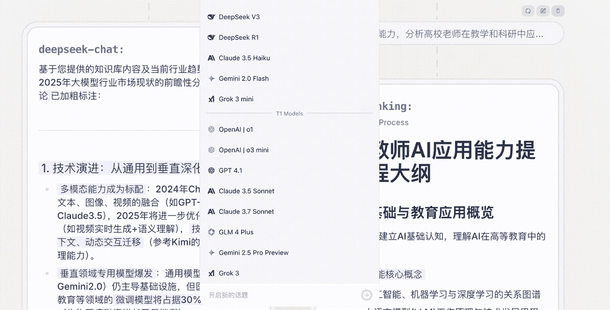

这里我怀疑研发开发的时候，漏了中文的翻译🐱

下面就依据上面的英文描述，来对**插件模式**下的所有插件类别，进行整体归类：

| **插件类型** | **功能描述** |
| --- | --- |
| online search | Conducts realtime searches and web crawlers with keywords using Google |
| generate image | Creates image based on descriptive prompt. |
| summarize and decide | Reasoning, Thinking, and summarize the information completed in other tasks, and provide a detailed informative text result. |
| search products | Search for physical products and selling information using Google Shopping Search. |
| search patents | Search for patents and invention information using Google Patents Search API |
| read website | Reads and retrieves the content of the specified website URL. |
| gen webpage | generate a fully functional webpage, web game, charts.. and render it using codesanbox |
| search images | Searches for images related to the user&#x27;s query. |
| search google scholar | Searches for academic papers and scholarly documents using Google Scholar. |
| search websites | Searches for website links related to the user&#x27;s query using Google Search |
| search twitter | Searches for tweets on Twitter using specified keywords |
| generate posters | Generates design and poster images based on detailed text prompts and infomation using the ideogram API. |
| generate voice assistant | Generate natural, context-aware, and conversational AI voice assistant. |

接着，我们来再用**中文**，进行详细介绍。具体如下表所示👇🏻：

| **插件类型** | **功能描述** | **主要应用场景** |
| --- | --- | --- |
| **网络搜索** (Online Search) | 使用Google实时进行关键词搜索和网络爬取 | 信息收集、市场研究、竞品分析、最新动态了解 |
| **图像生成** (Generate Image) | 基于文字描述来创建各类图像 | 内容创作配图、产品设计、营销素材制作、创意可视化 |
| **总结与决策** (Summarize and Decide) | 对其他任务完成的信息进行推理、思考和总结 | 报告生成、项目总结、数据分析结论、决策辅助 |
| **产品搜索** (Search Products) | 使用Google购物搜索来查找实体产品和销售信息 | 产品调研、价格对比、市场分析、购买决策参考 |
| **专利搜索** (Search Patents) | 使用Google专利搜索API来查询专利和发明信息 | 创新研究、技术调研、知识产权分析、竞争情报收集 |
| **网站阅读** (Read Website) | 读取并获取指定网站URL的内容 | 网页内容分析、信息提取、文章研究、竞品网站调研 |
| **网页生成** (Gen Webpage) | 使用codesandbox来生成功能完整的网页、网页游戏、图表等 | 网页原型设计、交互演示、数据可视化、教育演示 |
| **图片搜索** (Search Images) | 搜索与用户查询相关的图片 | 视觉参考收集、设计灵感获取、视觉市场分析、内容创作辅助 |
| **谷歌学术搜索** (Search Google Scholar) | 使用Google Scholar来搜索学术论文和学术文档 | 学术研究、文献综述、知识更新、专业领域深入探索 |
| **网站搜索** (Search Websites) | 使用Google搜索来查找与用户查询相关的网站链接 | 资源收集、行业研究、参考资料整理、合作伙伴寻找 |
| **推特搜索** (Search Twitter) | 使用指定关键词在Twitter上搜索对应的tweets | 社交媒体监测、舆情分析、趋势追踪、实时信息获取 |
| **海报生成** (Generate Posters) | 使用ideogram API，且基于文本提示词和相关的信息，来生成设计图和海报 | 营销物料制作、活动宣传、社交媒体内容、品牌设计 |
| **语音助手生成** (Generate Voice Assistant) | 生成自然、上下文感知的会话式AI语音助手 | 语音内容制作、演示材料、用户体验设计、多模态创作 |

上面我们大概梳理了下flowith的**13款**插件，知道了他们都是用来干嘛的。同时，在上面这**张表中的最后**一列，也列出了各种插件类型的主要应用场景。最后，我们来总结下插件模式的具体能力。

### （3）插件功能总结

Flowith提供了丰富的**插件生态系统**，大幅度地扩展了平台的功能边界：

+   **多样化工具插件**：支持网页浏览、代码执行、数据分析、文件处理等功能

+   **API集成能力**：可以连接第三方服务和数据源

+   **自定义插件**：允许开发者构建专属工具

+   **工具组合调用****：Ora**cle系统能够智能选择并组合使用多个插件来解决复杂问题

可以说，插件模式让Flowith从单纯的AI助手转变为功能较为全面的生产力中心**，尤其**是在结合了Oracle模式之后，可以更进一步地实现端到端的任务自动化。

## 2、浏览器插件：无处不在的Flowith

除了平台内的功能插件外，Flowith还提供了强大的**浏览器扩展**，让用户能在日常网页浏览中，随时调用Flowith的能力。具体插件地址👉🏻：Flowith Web Clipper。

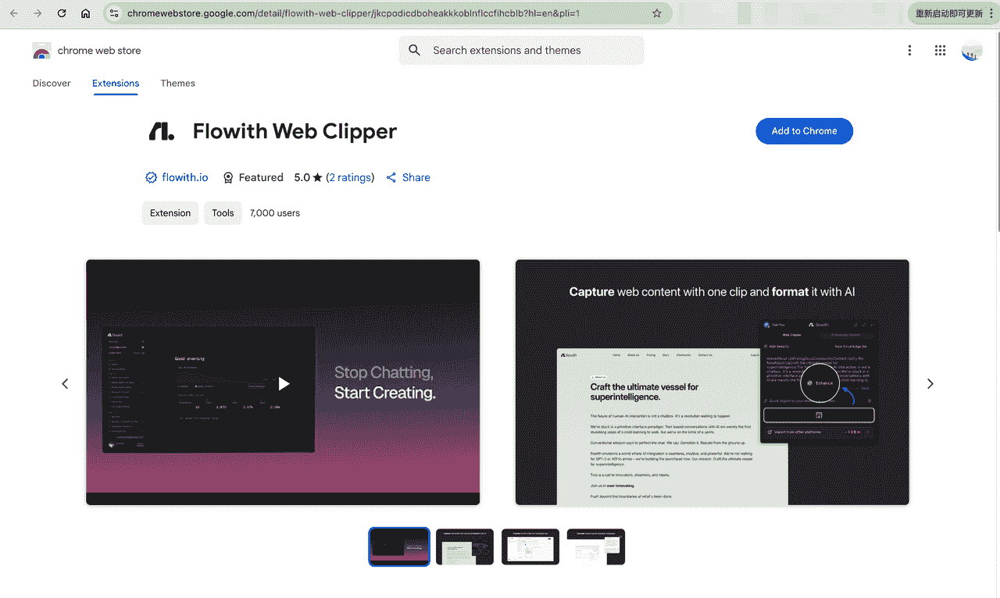

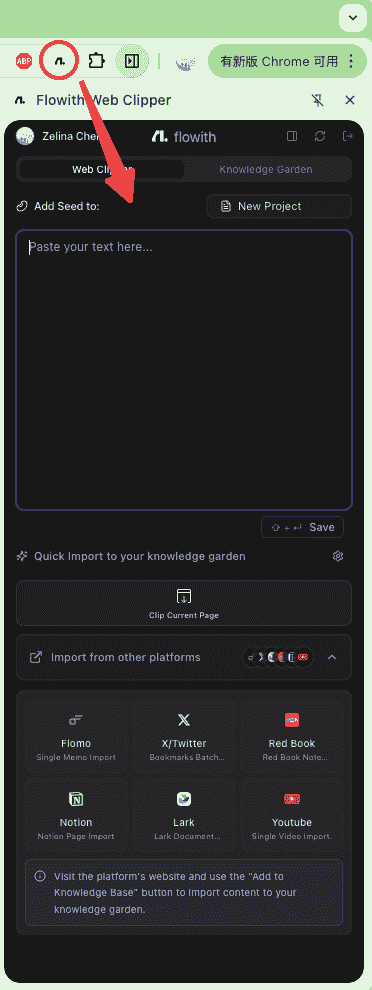

浏览器插件主要提供以下两大能力：

+   Web Clipper：直接把你想要放到知识花园的内容给放进来，通过粘贴文本或者导入文件的形式。

+   Knowledge Garden：直接在插件里面，看到知识花园里的内容，方便快速浏览信息。

从某种意义上来讲，Flowith的浏览器插件更进一步提升了知识管理的连续性和便捷性。

# 六、🐌 对flowith的可能性探索

**文章的最后**一部分，来聊聊，对这款产品的整体优劣势分析，以及沉淀一些使用体验心得。

## 1、优劣势分析

先来分析，整个工具使用下来，整理下来的一些优劣势分析：

## 2、实际体验感受

再来聊聊，对整个产品的一些体验心得，以及未来的可能性思考：

+   以前刚用扣子的时候，会被扣子的各种功能给惊喜到。但用了flowith之后，发现了比扣子更有趣的新大陆。

+   两款工具各有其不同的优点，给用户都带来了很良好的体验。

+   **flo**with产品里的中英互译，感觉没有完全覆盖到，在切换到中文模式下，有些地方会还是英文模式，比如：有时候看的是中文，然后点了某个弹窗，出来突然变成英文。或许这一块未来研发团队会再进一步优化这里的逻辑。

+   知识交易市场里的「知识花园」，感觉还欠缺一些筛选。在知识花园太多的情况下，用户想要去找到自己的分类，要花的时间可能就会比较久一些。

+   有些比较小的交互，可能是悬浮hover上去的时候，会出现操作栏；但是离开的时候，操作栏并不会消失。

+   ……

+   静待flowith团队完善更强大的功能😉

# 七、🦁 结束语

到这里，今天的文章讲解就接近尾声啦。最后来做个小小的结尾~

在上面的文章中，我们先引入了「知识库Bases→ 知识花园Garden → 知识交易市场Market」三个链路，来分别剖析了flowith的整个产品生态。

在此过程中，我们分别体验了flowith生产内容的整个过程：

正如Flowith创始人所说："Chatbot式AI将成为历史。"这个理念也在产品中得到了充分体现。

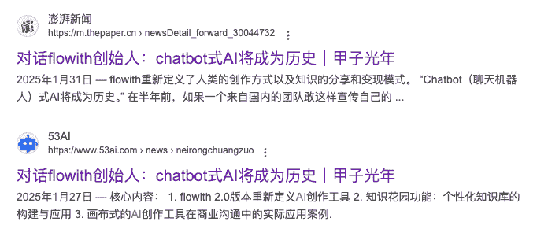

最后引用flowith首页的理念来做个结尾：**潺潺流转，思如泉涌**。写的真好~

我们下期见~🍻🍻🍻

# 🐣彩蛋One More Things

## 变更记录

写完的时候，意识到这篇文章已经历时了1个月。虽然创作过程比较长，但把一些产品链路捋清楚，还是蛮开心的~👻

多维表格（I8EZbHHBtaBeXwsG4mJct281nAh_tbl0VrXCxO8D30e7）

## 作者介绍

Zelina的个人说明书：[Zelina的个人说明书](https://pzfqk98jn1.feishu.cn/wiki/wikcnTijikVNdkWdBEKzQpiA6ie)