# 升级你的Cubox：给你的碎片信息收集加点佐料

> 来源：[https://my.feishu.cn/docx/Mv49dWL8JoWBiRxC5f1c6OtRnVf](https://my.feishu.cn/docx/Mv49dWL8JoWBiRxC5f1c6OtRnVf)

> 原文地址：升级你的Cubox：给你的碎片信息收集加点佐料

# 一、前言

上一篇文章我们详细地拆解了整个**Cubox软件**的**生命周期，以及各种**详尽的功能。然后后来又很多小伙伴来问关于Cubox的其他玩法，于是今天再整理了一篇关于Cubox周边玩法的介绍。

下面开始今天文章的讲解~😉

# 二、智能玩法介绍

## 1、电脑桌面小组件

如果你用的是mac电脑，则可以直接在桌面端添加Cubox的小组件。首先用你的第二指和第三指，双指放在触控板上，然后从最右边到最左边，进行滑动，会出现以下这个界面。

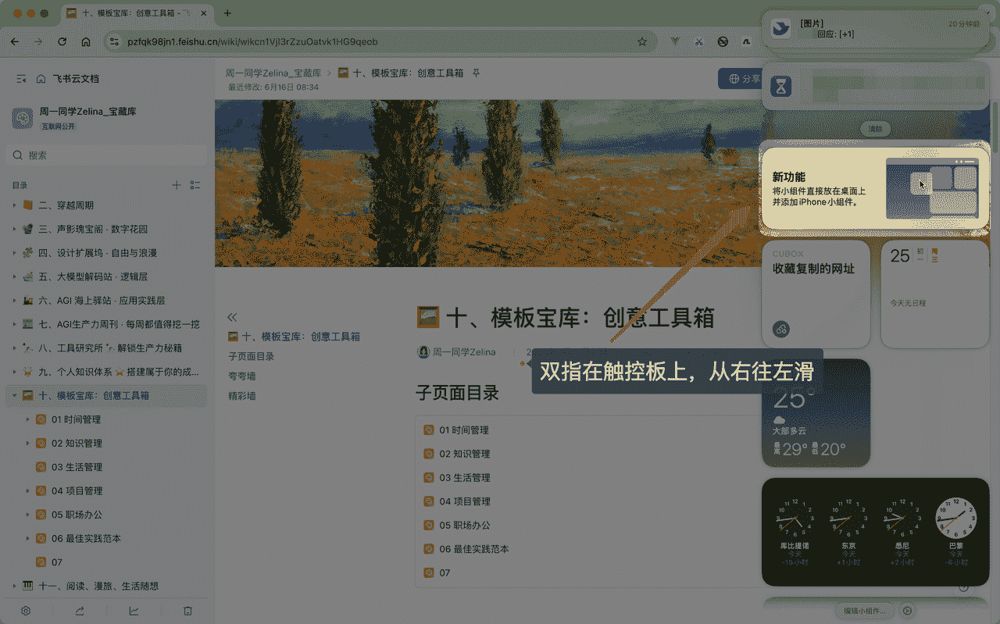

然后点击上图中圈中的这个**毛玻璃区域**，之后进入到下面这个界面。然后在下面这个区域，搜索Cubox：

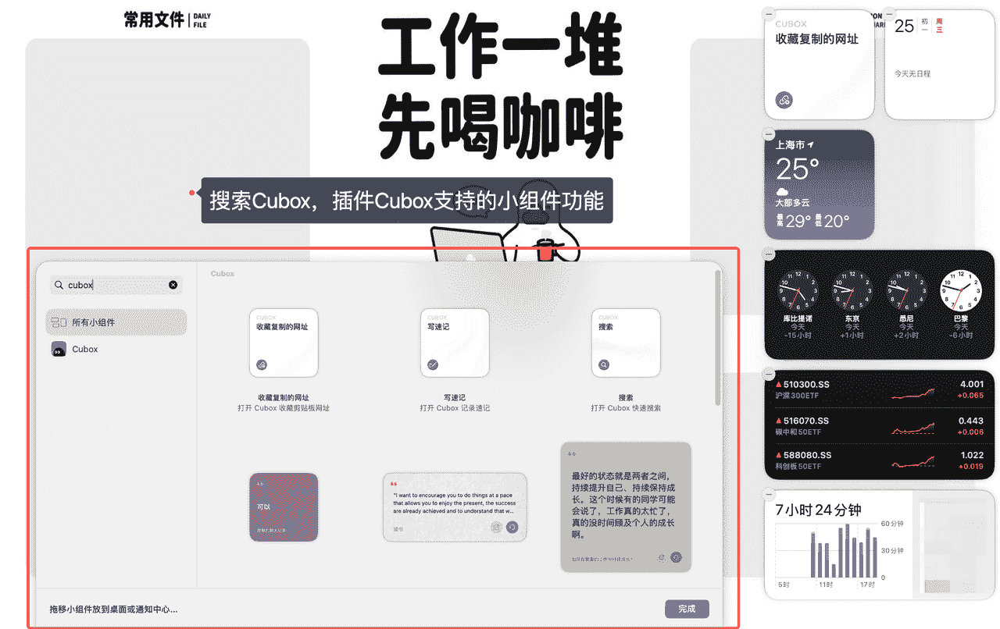

可以看到，cubox在桌面端，有支持很多类型的小组件：

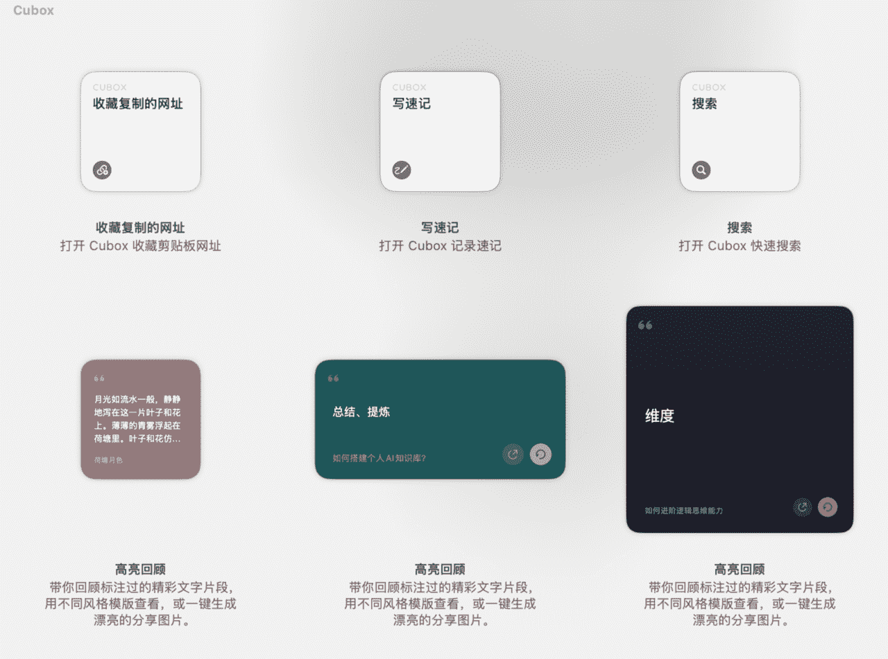

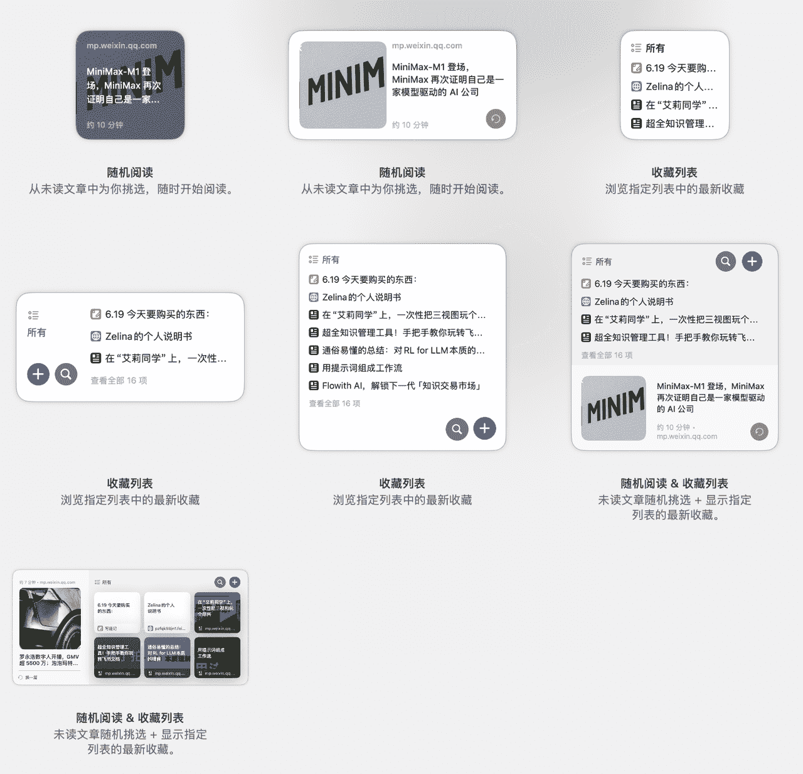

在这些组件中，大家可以根据自己所需要用到的功能进行添加即可。比如我添加了收藏复制的地址：

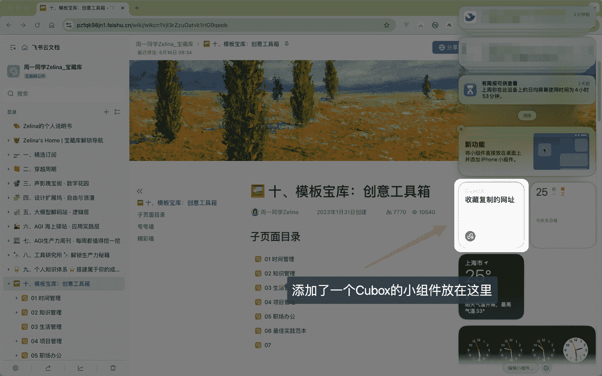

那在之后，**当我想要把复**制的地址给收藏到Cubox里，都可以随时快速唤起桌面的这个小组件，然后快速把我所复制的网址的内容给收藏进来。

## 2、手机桌面小组件

**手机端的小**组件就比较灵活了，且基本上市面上主流的手机都支持。平常我们用手机**的**时间也比较多，所**以**Cubox在手机端的小组件，也能极大地提升我们收藏信息的速度。比如我在自己的手机添加的是下面这两个组件：①收藏复制的网址；②写速记。

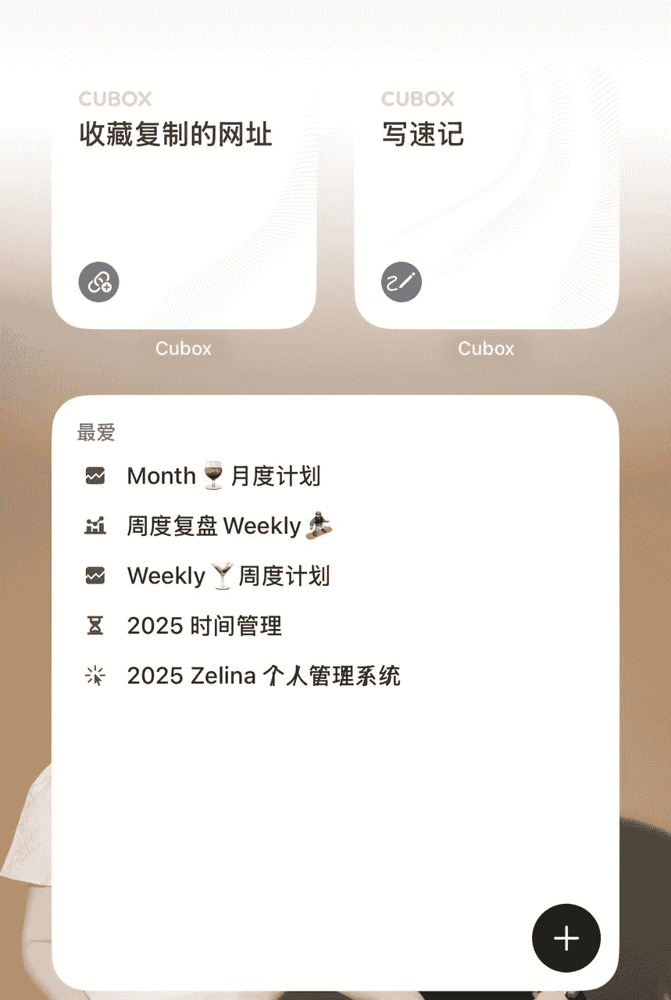

**一般**来说，只要离开电脑的时刻，小编随身携带得最频繁的物件大概就是手机了。所以一般在路上，看飞书、🛰️、各种资讯的时候，如果有需要收集的碎片，就会及时唤起Cubox的小组件来快速收集。

个人认为，手机端小组件，让你可以不受时间和空间的限制，通勤时间随时随地唤起，在地铁上随时唤起，在食堂吃饭的时候也可以随时唤起。

## 3、手机快捷指令

如果你用的是iPhone**手机，可以直**接在手机端的桌面，从上往下滑动，进入搜索框，然后搜索「快捷指令」，进入快捷指令中心。

可以理解为，上面的**桌面小组件**，其实已经是**快捷指令**的一个变种。如果有需要**更高定制化的**指令处理，则可以在指令中心，继续添加更多新的指令，来达到你的提效最大化。

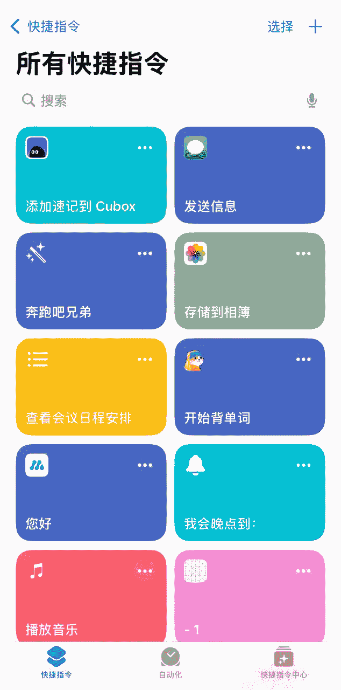

## 4、浏览器插件

每天我们都会在网页上浏览很多信息，有时候会看到一些有趣的内容，可能会想要**直接在网页上，把这**些内容收藏进Cubox。那么就可以借用官方的插件，来实现这个效果。这里以Chrome浏览器为例，来看看怎么实现。

[首先](https://chromewebstore.google.com/detail/cubox/bflmgpechpeohjfomgfdkkfcbhfcjohl?utm_source=ext_app_menu)，你可以用你的chrome浏览器，输入：https://chromewebstore.google.com/detail/cubox/bflmgpechpeohjfomgfdkkfcbhfcjohl?utm_source=ext_app_menu ，访问cubox的扩展程序。

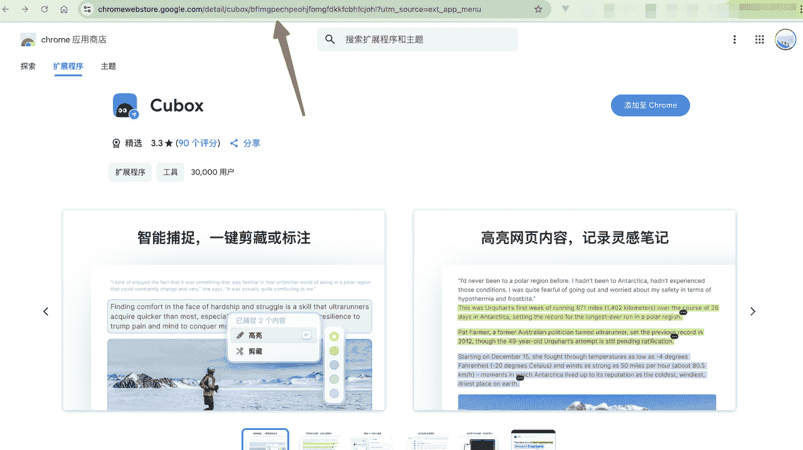

然后点击「添加至Chrome」，将其添加至你的浏览器中：

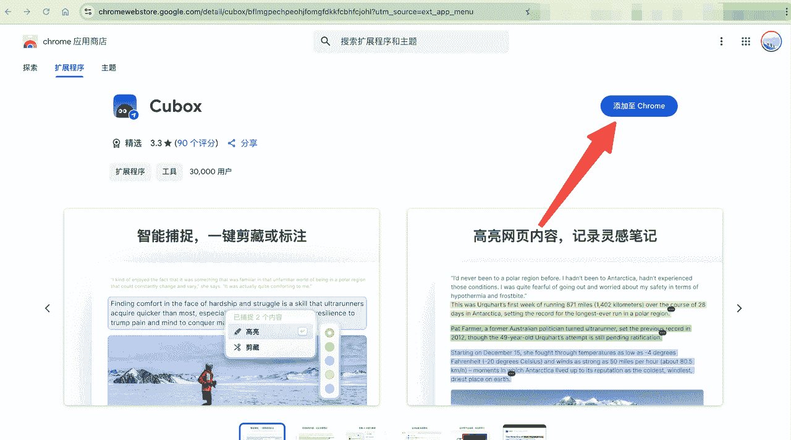

安装完成之后，点击这里进行登录：

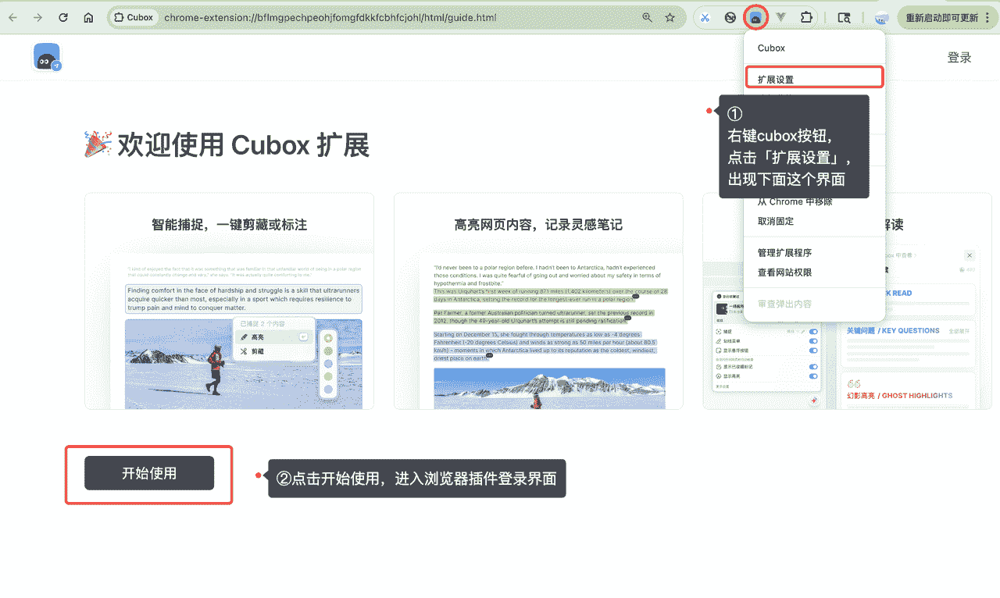

之后进入这个页面，可以直接在下面这个页面，设置浏览器插件的快捷键 or 设置各种收藏的操作：

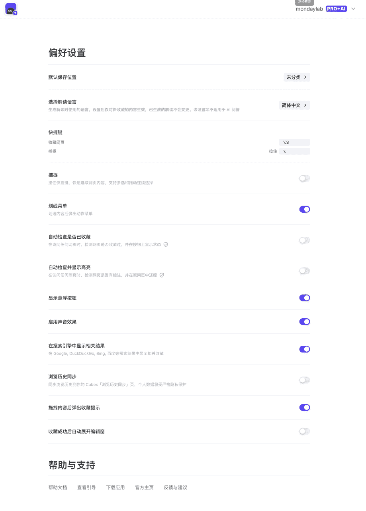

设置完成之后，如果我们在网页看文章，就可以像下面这样唤起：

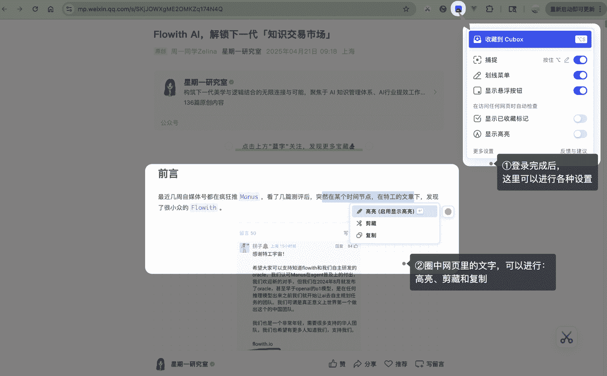

如果不点击上面的这个图标，也可以在浏览器右下角这个地方唤起：

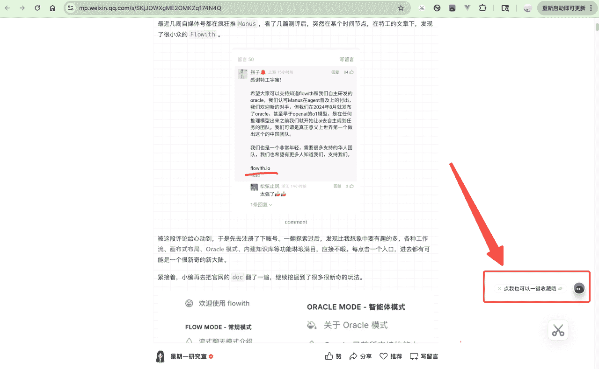

具体根据自己的使用习惯来进行设置即可。

这里可能有小伙伴有疑惑说，如果我用的是其他浏览器，要怎么安装这个插件呢？

这里贴个官方地址的具体介绍：https://help.cubox.pro/save/5f70/

**如果你用的**是其他浏览器，可以访问上面这个地址，来查看其他浏览器的操作。

# 三、结束语

以上几个是小编平常会很常用的几个小功能，尤**其是电脑和手**机端的桌面小组件，减少了很多碎片信息收集的路径。

除此之外，在官方文档也看到了Cubox更多花样玩法，其中不乏包括Cubox与Notion、Readwise、Obsidian的打通，如果对Cubox有更高定制化的需求，可以再挖掘一波。

Notion & Readwise 集成同步：https://help.cubox.pro/share/integrations/

Obsidian 同步插件：https://help.cubox.pro/share/obplugin/

本期的介绍就到这里啦！**我们下期见**🍻🍻🍻

# 🐣彩蛋One More Things

## 1、变更记录

多维表格（NiBRbkX6zaC1Q2s3tV2cAqkanVd_tblYQvEs3KZu0Agw）

## 2、作者介绍

Zelina的个人说明书：[Zelina的个人说明书](https://pzfqk98jn1.feishu.cn/wiki/wikcnTijikVNdkWdBEKzQpiA6ie)