# 0基础解锁新时代「卡片笔记工具」，输入文本秒出精美排版

> 来源：[https://my.feishu.cn/docx/OAqIdZnhUoETzvxjza8c9xT8nRg](https://my.feishu.cn/docx/OAqIdZnhUoETzvxjza8c9xT8nRg)

> 原文链接：0基础解锁新时代「卡片笔记工具」，输入文本秒出精美排版

# 🎉前言

**以前小编在互联网**上冲浪时，经常会看到各大博主做各种酷炫的小卡片，这个时候可能会在想，别人是怎么做出这么酷炫的效果的？是不是有什么样的工具可以进行转换？

然后小编就去进行了一番摸索**，最终找**到了市面上一些比较好用的Markdown转小卡片的工具。在下面的这篇文章中，我们将深入浅出地聊聊卡片笔记是什么，以及如何用正确的卡片笔记工具，来做出更好看、更高效的笔记卡片。

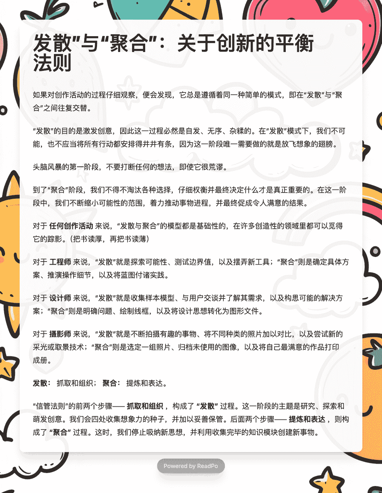

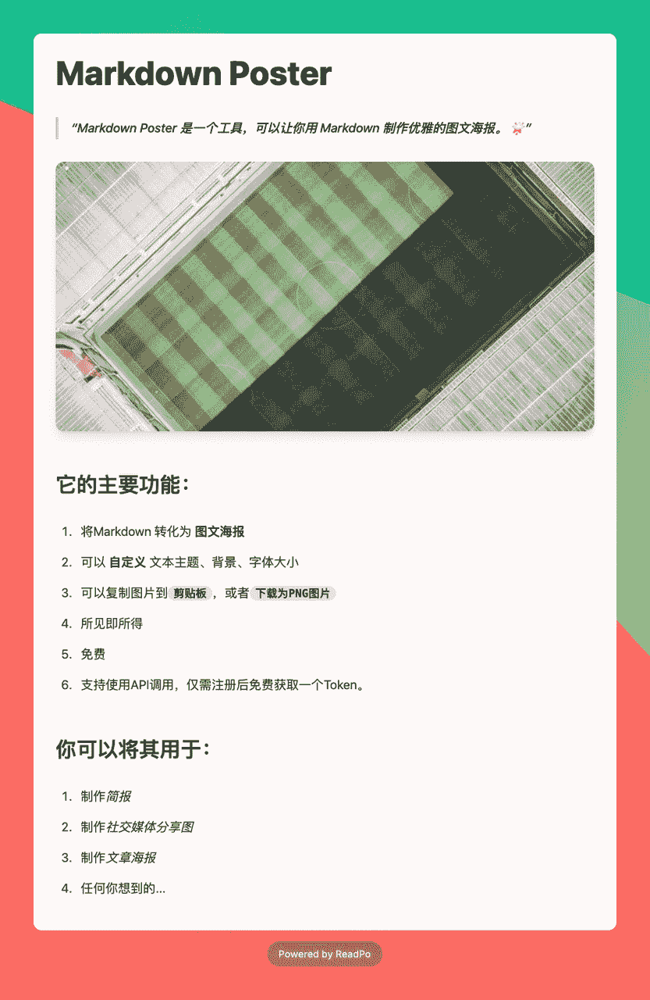

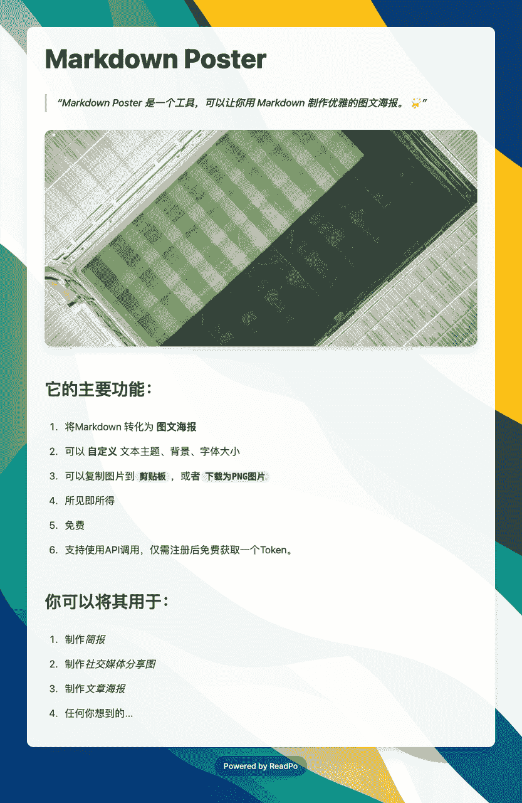

# 一、📸基础介绍

## 1、什么是卡片笔记

**在深入工具之**前，我们先来了解一下「卡片笔记」这个概念。它起源于德国社会学家尼可拉斯·鲁曼（Niklas Luhmann）所实践的 Zettelkasten（德语，意为“卡片盒”）方法。

**鲁曼**一生著述等身，发表了大量学术作品，而他将自己的高产归功于这套独特的笔记系统。

卡片笔记的核心理念是：

| **核心理念** | **理念剖析** |
| --- | --- |
| **原子化** | 每张卡片只承载一个独立的、完整的、可理解的**想法或知**识点，这些知识点是知识的最小单元。 |
| **互联互通** | 卡片之间通过独特的编号和双向链接（或引用）紧密**相连，形**成一个庞大的非线性知识网络。这种连接方式能够帮助我们发现不同知识点之间的深层联系，激发新的思考。 |
| **永久性** | 卡片上的内容是经过你自己的理解和提炼出来的，即使脱离原始语境，也能独立存在并被理解。 |
| **自下而上** | 它鼓励你持续积累和连接这些**原子化****的知**识**点，而不**是预设一个大纲。这样，当你需要写作或解决问题时，相关的卡片就会自然地被组合起来，以此形成新的洞见。 |
| **外部大脑** | 你的卡片盒就像一个“第二大脑”，存储着你的思考和知识，让你不再需要记忆所有细节，而是专注于思考和创造。 |

简而言之，卡片笔记法旨在将**碎片化的信息**转化为互相连接、可复用的知识资产，极大地提升你的学习、思考和写作效率。

## 2、工具介绍

在上面的介绍中，我们了解到卡片笔记具有诸多优点。

那如何将现有的 Markdown 内容或者日常学习中的新知识**转化为这种高效**的卡片形式呢？我们整理了一些市面上常用的MD语法转卡片的工具：①ReadPo；②Any2Card。

接下来，就来详细讲讲这几款工具。

# 二、📃ReadPo

## 1、ReadPo是什么

**具体网址：** https://readpo.com/zh/poster

ReadPo 是一款专注于将内容转化为精美“海报”或“卡片”的工具。虽然它不完全是传统的“卡片笔记”工具，但其“海报”功能可以将你输入的文本或 Mark**down 内容**，快速排版成视觉上更吸引人的图片形式，非常适合社交媒体分享或制作个人知识卡片。你可以输入文字，选择模板，然后生成一张带有设计感的图片，让你的知识点以更酷炫的方式来进行呈现。

## 2、ReadPo场景应用

### （1）工具页面结构解析

先来了解整个工具的页面结构：

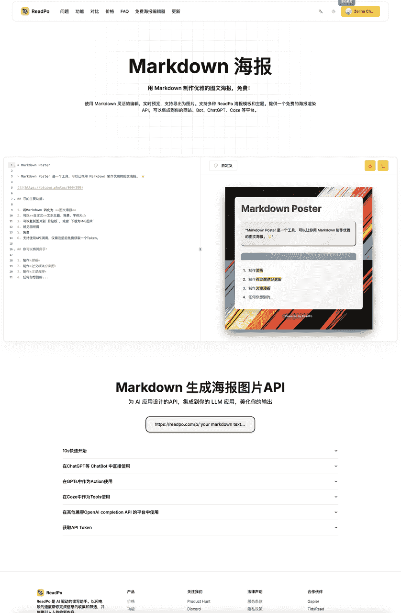

**在上面**这张图中，我们可以发现到，中间有一个编辑器。就在这个编辑器上，我们可以不遗余力地，通过简单的markdown语法，让这些语法转化成不同的主题格式，然后再选择不同的背景排版，最终导出一张好看的笔记卡片。

### （2）小试一刀

接下来我们用一段Markdown文案来试试：

```
## 什么是flowith

先附上官方介绍文档：https://doc.flowith.net/cn 

以及首页访问链接：https://flowith.net/invitation?code=TEODVL

`Flowith`，是一款**华人开发**的下一代生产力工具。它摒弃了传统的聊天式界面，基于**二维画布**设计，让用户能在同一空间中与多个AI模型同时交互，大幅度提升你在创意工作时的效率和心流体验。

官网里面有个「知识花园」的概览阐述的特别好，里面说到：

flowith 「Knowledge Garden」 知识花园，围绕**“让 AI 与您的知识自然互动”**这一核心理念进行打造。它结合了自动化知识整理、结构化管理和创作协同，能让你的信息资产真正活跃起来，成为可持续生长的“活知识”。它能够自动将你的文件、笔记和在线资源转化为 AI 可理解的最小知识单元（Seeds 知识种子）。


```

粘贴进readpo编辑器里面：

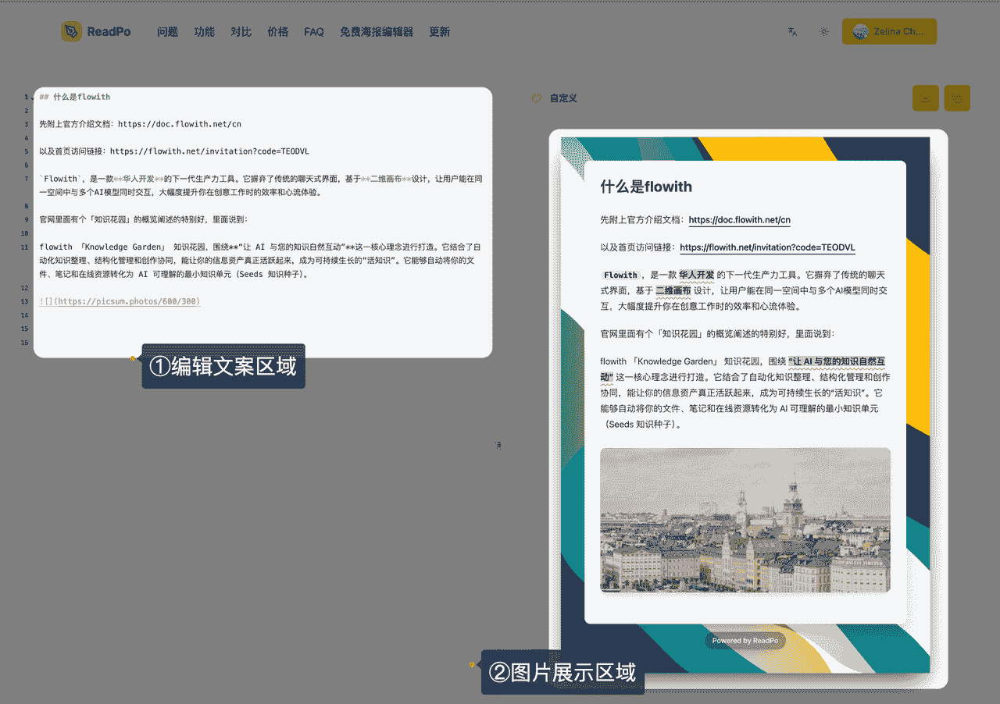

这样，你就获得了一张完美的小卡片。

### （3）切换主题

**那有**时候，你有可能觉得说这**张小卡片**的主题可能不太喜欢，想看看能不能改的更好看一点。那这里，readpo给你提供了N种主题任你挑选：

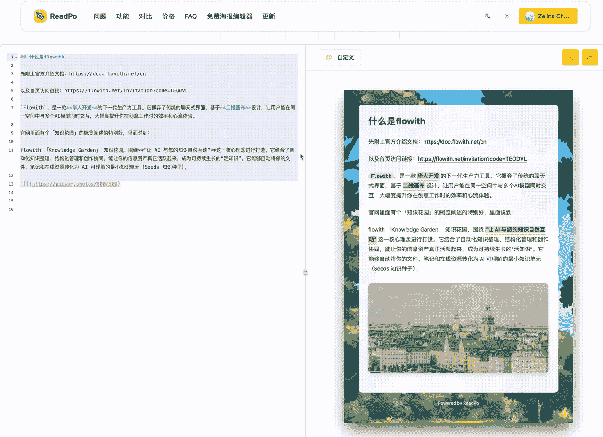

### （4）下载与复制

在确定了最终稿之后，可以直接点击右上角的按钮来进行「下载 or 复制」：

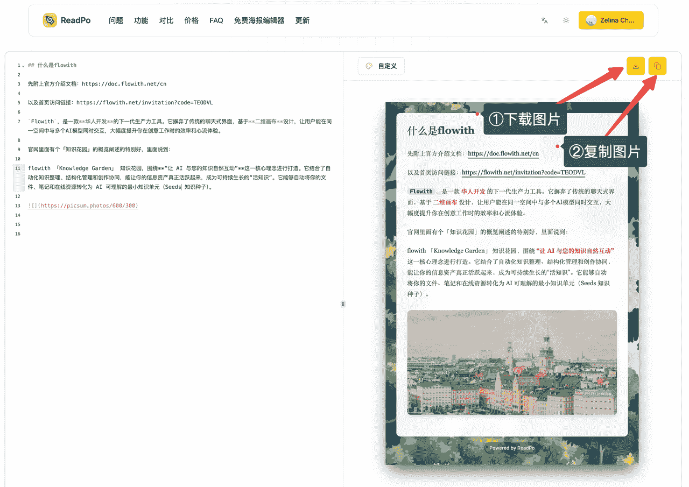

最终，我们就得到一张，符合自己审美的知识小卡片：

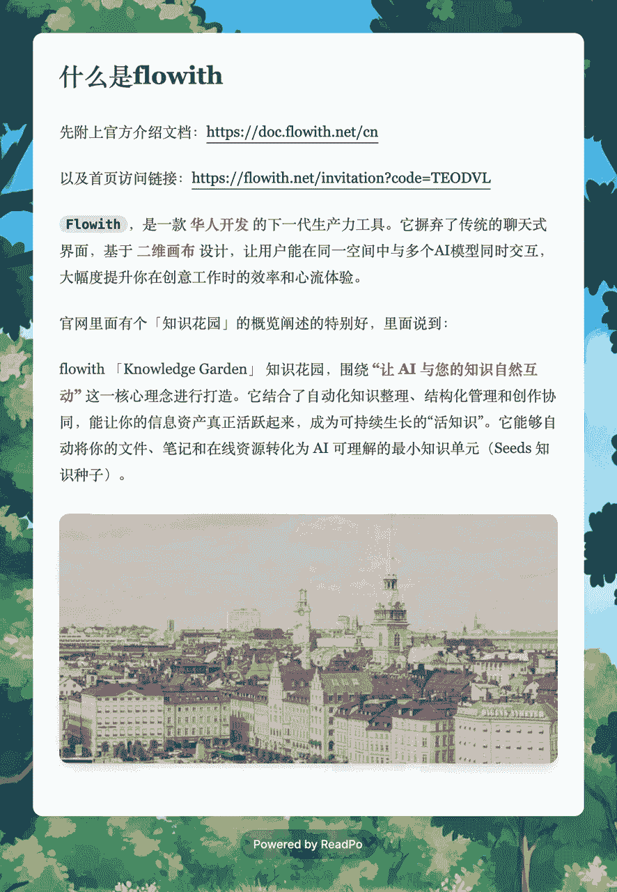

# 三、📰Any2Card

第二个想聊的卡片工具是Any2Card。

## 1、Any2Card是什么

**具体网址：** https://any2card.com/zh

Any2Card 是一款非常实用的 Markdown 转知识卡片工具。它的主要**亮点**在于能够：

+   **网页内容提取与总结：** 你可以直接输入一个网页链接，Any2Card 会自动提取网页内容，并智能地进行总结。

+   **一键生成知识卡片：** **无论是你输**入的 Markdown 文本，还是从网页提取的内容，它都能快速将其转化为排版精美的知识卡片。这对于将长篇文档或网页文章的核心信息快速卡片化非常高效，省去了手动排版和设计的烦恼。

## 2、Any2Card场景应用

### （1）页面结构解析

先来了解整个工具的页面结构：

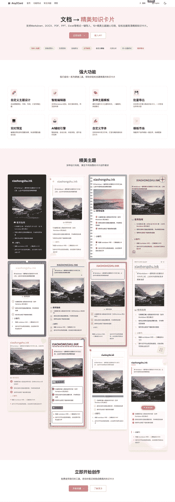

**在上面这张图****中，我们**可以发现到，最顶上我们可以点击「立即创作」，去创作页面进行创作。接着就是第二部分：强大功能，这里主要阐述了Any2Card能帮助我们做什么。

第三部分是：**精选主题**。精选主题主要是为了让我们知道，用Any2Card，能够制作出多么炫酷的卡片，让用户的心理先对这个工具大概能做的东西先有一个预期，然后更快速地做出理想的笔记卡片。

### （2）小试一刀

首先，我先准备一段Markdown文案：

```
## 1、知识管理链路

ima打通了知识管理的链路：收藏知识 → 管理知识 → 应用知识 → 共享知识。

下面我们看看，这四个步骤，分别在里面是怎么应用的。

### （1）收藏知识

在日常生活当中，我们几乎每一天都会看大量的信息。这些信息可能会是`pdf`、`doc`、`png`、`jpeg`、`ppt`等各种各样的格式，那在产生信息的那一刻，我们就可以把这些东西，上传到我们的 `ima` 知识库里面。


那如何上传呢？可以上传到 `ima` 的个人知识库：


也可以上传到 `ima` 的共享知识库：


### （2）管理知识

那有了知识之后，我们就可以给知识打上**标签🏷**。可以对**多个文件**进行批量打标签：


也可以对**单个文件**进行打标签：


打好标签以后，展示在这里：


```

**然后**呢，点击「立即创作」，进入创作页**面，**会进入到下面这个页**面。**然后呢，你**可以把准备好**的Markdown的内**容，**给粘贴到左边的框框里。接着，在右边选择对应的笔记卡片模板。选择完成之后，可以在中间这个框，进行预览。

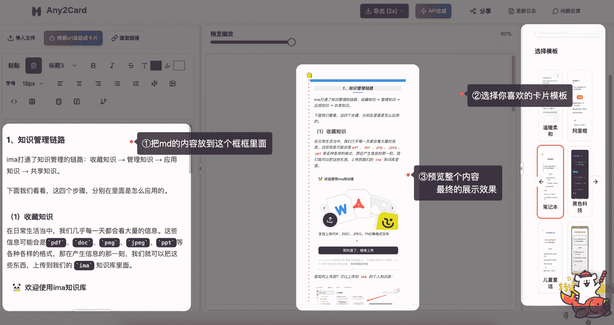

### （3）加装饰画

**如果说**，**你觉得预览后**的内容太单调，还想要加一些元素，那么可以加点装饰画。如下图所示：

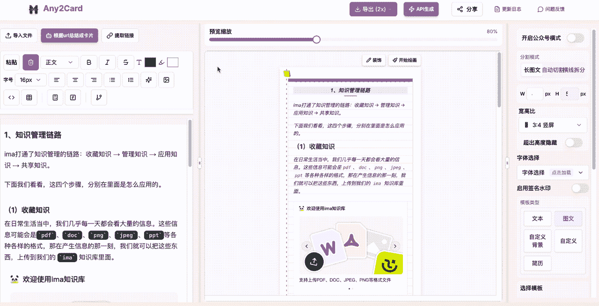

### （4）公众号模式

**如果你**想把写好的内容，原封不动地复制到公众号里面去发布。那Any2Card也提供了这个能力，具体操作如下：

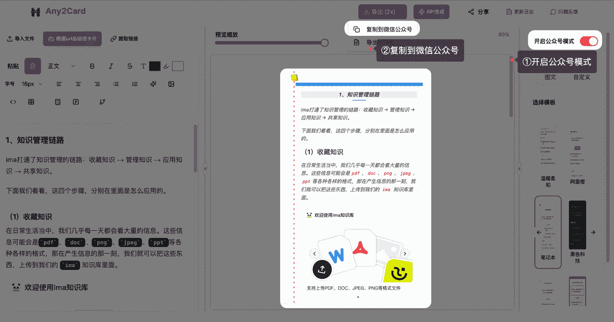

这个对于做**自媒体**的小伙伴来说，属实是**狂喜**了。😁

### （5）波浪线

如果你觉得你的内容里面，有些**文字**可以再来一些波浪线点缀，那么你可以这么处理：

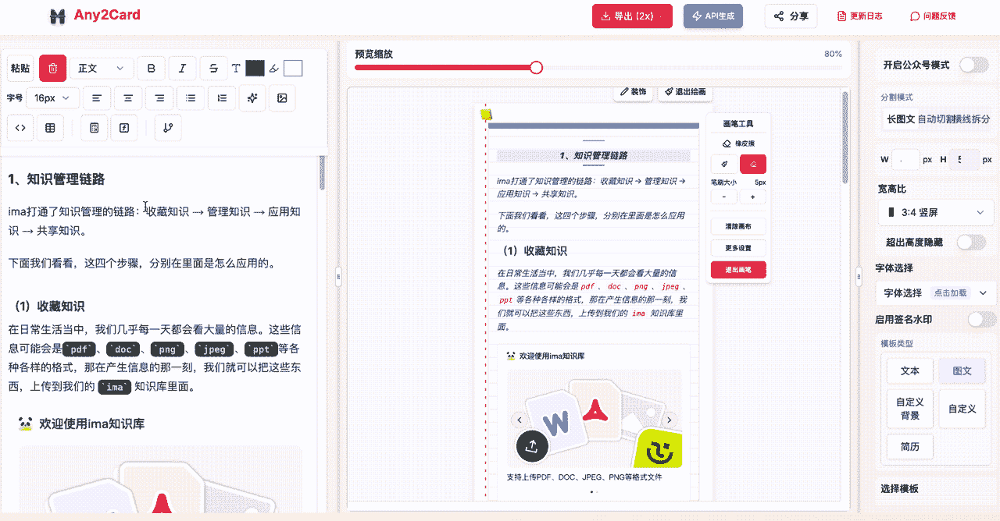

选中对应的**文字**，然后点击**波浪线**，同时，可以对波浪线的颜色进行修改，也可以✖️移除掉波浪线。

## 3、Any2Card高阶应用

### （1）分割模式

除了以上基础排版外，你还可以**对卡片的内容，进**行不同形式的分割，包括：长图文、自动切割和横线切割。具体如下图所示：

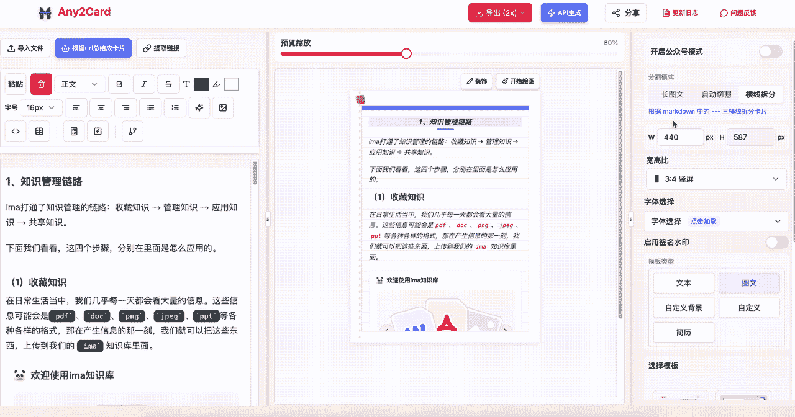

### （2）Url内容提取器

最后，来说一个比较有趣的东西：**Url内容提取器****。A**ny2Ca**rd支持把一个**公开网页的链接，直接丢进来，对内容进行提取。具体操作如下：

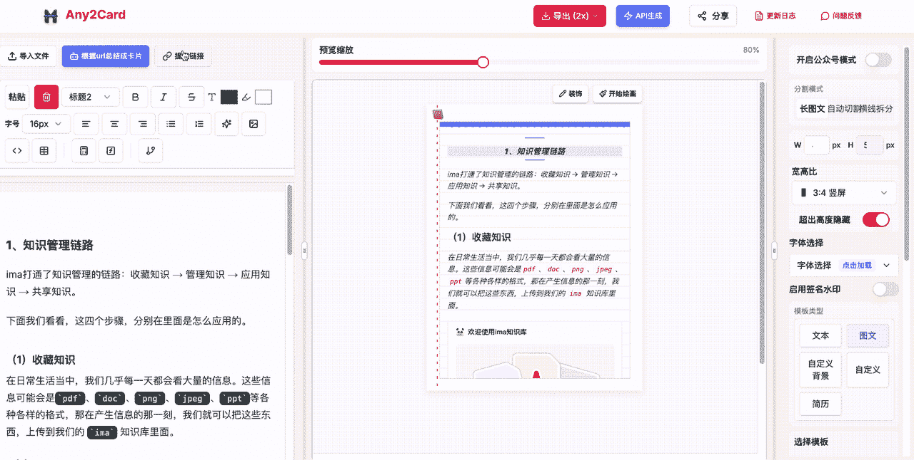

试了一下，维基百科的提取效果可能是最好的，如果是其他类别的公开网页，或者是针对一些复杂的页面，转换效果可能还差了一些。

静待官方支持更多种网站类型的提取，这里先当个小彩蛋看😉

### （3）分享功能

Any2Card还有一个分享功能也很好用，先点击这里，分享链接并复制链接：

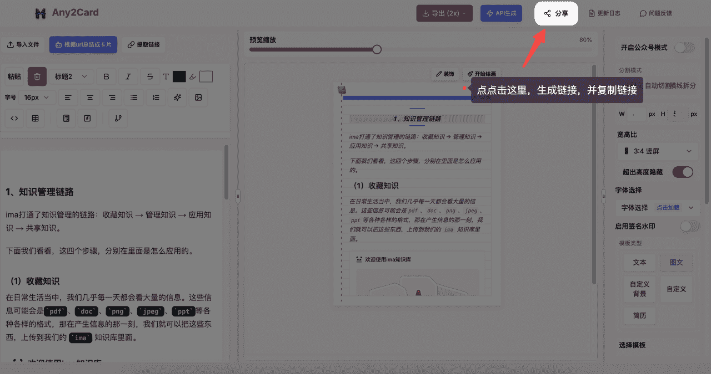

用户访问了你分享的url之后，就可以直接查看到你撰写的内容，并进行二次创作：

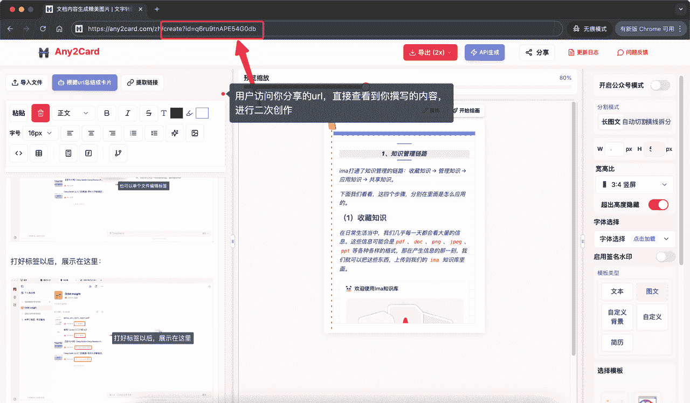

# 四、🗞综合测评

最后，我们用一个表格，来梳理这两个工具的综合能力：

| **功能/特性** | **ReadPo 评分** | **Any2Card 评分** | **对比与说明** |
| --- | --- | --- | --- |
| **Markdown支持度** | **5** | **5** | 两者都支持Markdown，两者在复杂Markdown渲染和功能拓展上都很不错。 |
| **卡片美观度** | **5** | **5** | ReadPo模板简洁，Any2Card提供更多精选主题和高度定制选项（如装饰画、波浪线）等。 |
| **自定义能力** | 3 | **5** | ReadPo主要是选择模板和背景，Any2Card则允许深度定制**字体、颜色**、背景、边距、圆角等，满足更多个性化需求。 |
| **操作便捷性** | 4 | 4 | **两者**都支持粘贴Markdown快速生成卡片， |
| **导出与分享** | **5** | **5** | ReadPo支持下载/复制图片，Any2Card也同样支持，都很方便于二次创作和传播。 |
| **额外功能** | 2 | 4 | ReadPo功能较为单一，Any2Card提供了公众号模式、波浪线装饰等特色小功能，增加了使用乐趣和场景。 |
| **易用性（学习曲线）** | **5** | 4 | ReadPo会更容易上手，Any2Card需要先去摸清它的一些功能展示路径，不过也能很快上手。 |
| **适用场景** | 快速出图，社交分享 | 深度知识管理，多平台内容分发，自媒体创作 | ReadPo偏向于将一段文字快速美化成图片用于传播。Any2Card则更侧重于将结构化的知识点系统性地转化为卡片，并支持多渠道发布，功能更为全面。 |
| **综合推荐** | ⭐⭐⭐⭐ | ⭐⭐⭐⭐⭐ | 如果你只是偶尔需要将简单的文字转换成图片分享，ReadPo足够用。  但如果你想深入进行卡片笔记实践，追求更强的定制性、更丰富的场景应用，以及免费无水印的体验，Any2Card无疑是更全面、更强大的选择。 |

到这里，关于卡片笔记的两款工具介绍就到尾声啦📰

最后我们来做个小小的总结~

# 五、📋结束语

在当下**信息爆炸****的时代，如何高**效地学习、思考和管理知识，变得尤为重要。而卡片笔记法📒，提供了一种强大的解决方案，它鼓励我们将知识原子化、互联化，从而让知识真正地“活”起来。

像 ReadPo、Any2Card 这样的在线工具，则为我们实践**卡片笔记法**提供了便利。它们一一地，帮助我们将零散的 Markdown 内容，转化为更具结构感、更易于理解和复用的知识卡片。

相信通过上文的学习，大家也对ReadPo和Any2Card，有了更深入的了解和认识。

期待你用这两款工具，把「笔记卡片法」玩出更多花样😉

本期的内容到这里介绍结束！我们下期见~🍻🍻🍻

# 🐣彩蛋One More Things

## 1、变更记录

多维表格（Ez8LbcM9uas49LsYYLxcbMtQnzc_tblyNIXjMj6WM73c）

## 2、作者介绍

Zelina的个人说明书：[Zelina的个人说明书](https://pzfqk98jn1.feishu.cn/wiki/wikcnTijikVNdkWdBEKzQpiA6ie)

## 3、知识问答专区

**本文章已上线**至「第25小时」知识库！不想长篇阅读？欢迎到知识问答专区直接进行提问😉

**知识库链接：**[**h**](https://ask.feishu.cn/shared-space/7590992675327708381)ttps://ask.feishu.cn/shared-space/7590992675327708381


