# 年度私藏 | 我的10款2025 AI 工具箱，效率党直接抄作业

> 来源：[https://my.feishu.cn/docx/IuFVdeossoB4mnxO8Vpc2VtpnBg](https://my.feishu.cn/docx/IuFVdeossoB4mnxO8Vpc2VtpnBg)

## （0）前言

想来盘点下今年用的最好用的 10 款 AI 工具，以及聊聊他们是如何帮我在工作和生活中提效的。

## （1）Monica

https://monica.im/home

年初Claude疯狂封号的时候，我注册的10来个号，无一例外地被封了。后来不跟它闹了，随即转向了其他工具，换了monica。

monica虽然不如官方claude的基础条件那么完善，但基础的文本任务做的也算够用了。

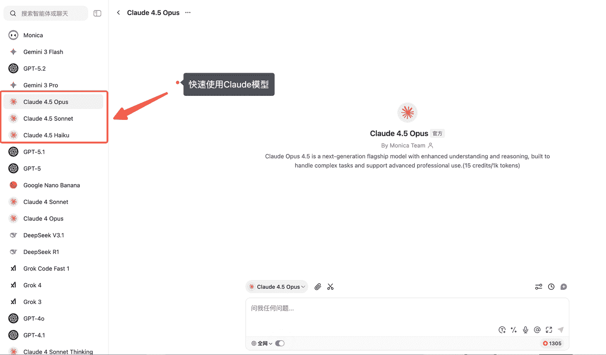

**每个月**会有4500积分，**可以**用**在一些**更长思考的模型，也可以用来生图、生视频等等。

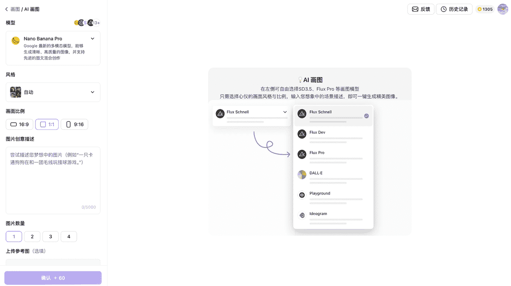

## （2）Gemini Pro

https://gemini.google.com/app

Gemini从3月份用到现在，还没断用过。从NotebookLM到nano banana，再到Gemini 3 pro，G家出品，永远有惊喜。

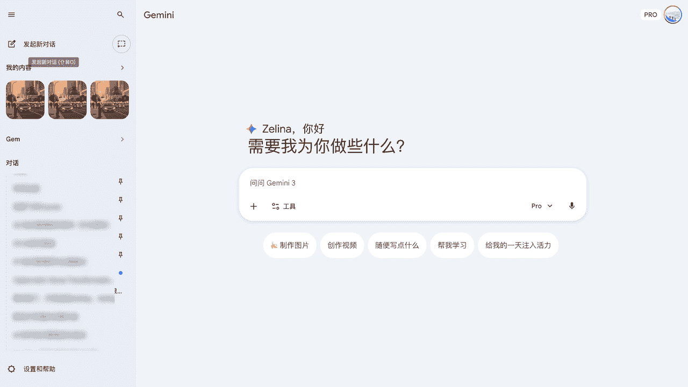

## （3）秒哒

https://www.miaoda.cn/

用秒哒，17:59准时下班（开溜）

秒哒是6月份之后，开始密集使用的产品。以「一句话生成应用」为理念，致力于帮无代码基础的用户快速生成一个满足用户需求的应用。

一般会在需要解决某个问题，但是市面上没法快速找到很匹配的工具时，就用秒哒快速搭建一个应用来解决问题。

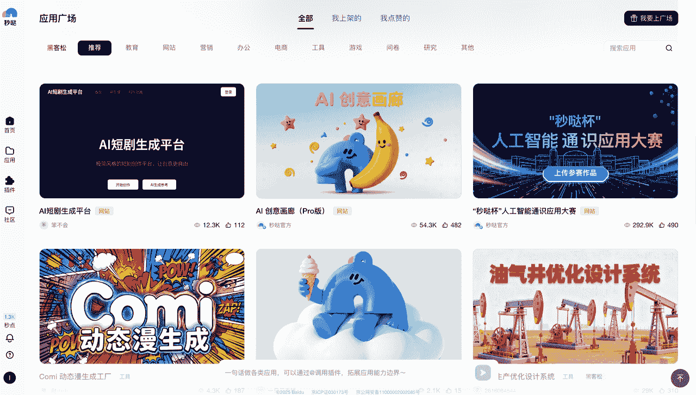

## （4）扣子空间

https://space.coze.cn/

不懂代码也能自由做网页？扣子空间 5 分钟让创意秒落地！

扣子空间是字节今年4月份推出的通用Agent产品，交互设计做的特别好。从出了之后，每每有新功能，就一直在密集地使用。

写作、PPT、设计、Excel、网页、播客、图表等等，在功能和交互上的效果，做的都很OK。

PS：小编经常拿来给同事做系列表情包😀

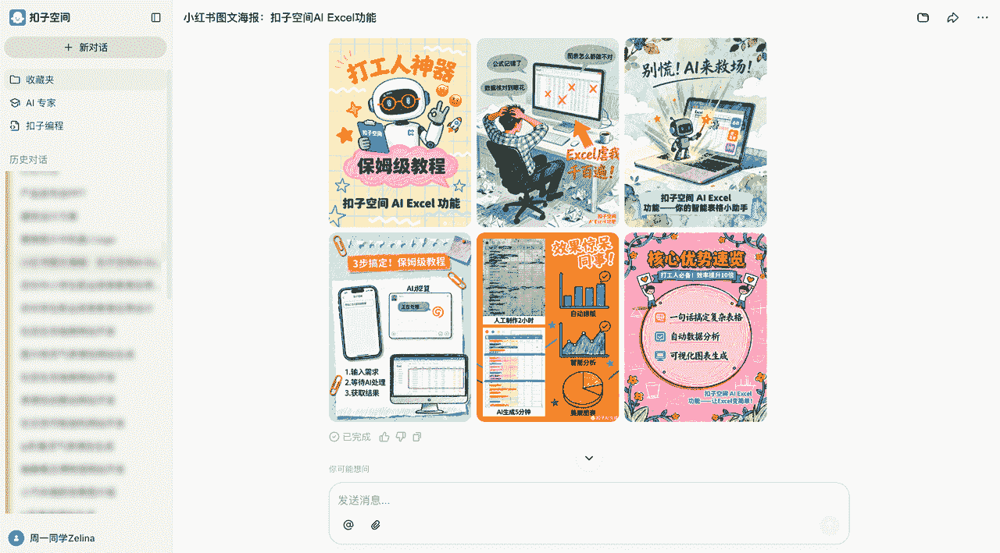

## （5）飞书Aily

https://aily.feishu.cn/ai/agents

**飞书Aily**是飞书的超级助手，作为一个飞书的资深用户，每周每月基本在飞书上8G冲浪。

**久而久之，飞**书上也沉淀了很多的数据**。飞书Aily的好处**在于，可以使用你本身在飞书已有的数据，再结合AI，去处理复杂的任务，最终生成可交付的结果。

## （6）Cursor

https://cursor.com/cn

从24年底就开始密集使用各种Vibe Coding工具，Cursor、Windsurf、Claude Code、Geimini Cli、trae、lingma、codebuddy等等，用下来感觉还是Cursor的交互体验最为丝滑。

于是乎，每月为cursor付费.jpg。

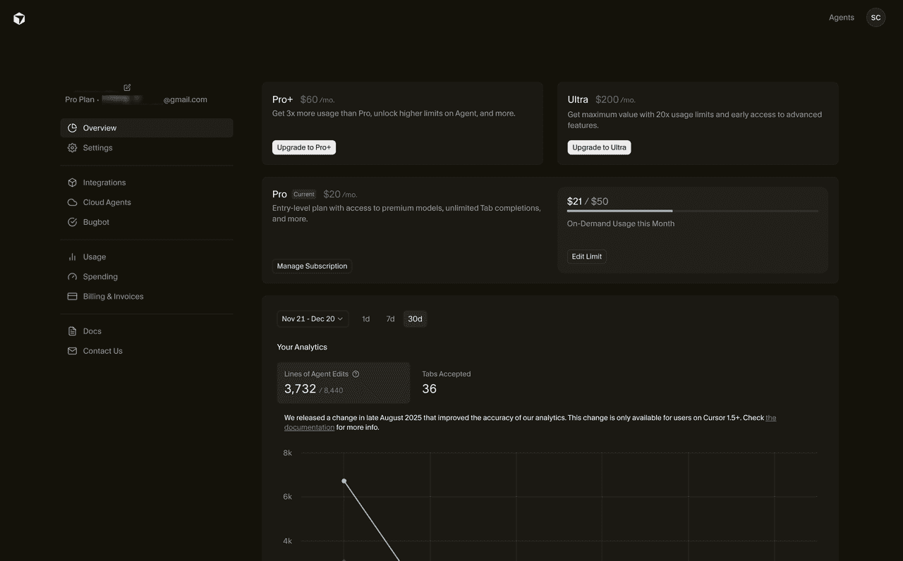

## （7）豆包

https://www.doubao.com/chat/

豆包这两年应该属于月活最突出的明星AI产品了，今年的Seedream 4.5等几波图像模型发布，也是非常革命级的时刻。

于小编而言，一般会在以下场景的时候用豆包：①源数据在字节产品系下；②星期二研究室想生成场景图片的时候。

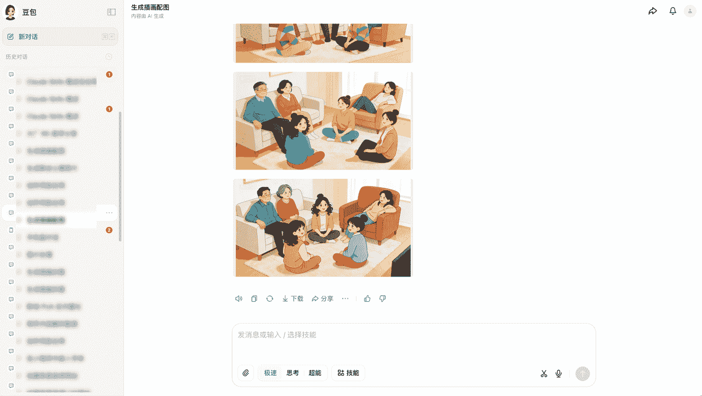

## （8）YouMind

https://youmind.com/

YouMind在年底开始密集探索，一波使用后，就为它展开了一波付费。只能说，YouMind对于多线程创作的人来说，实在太友好。

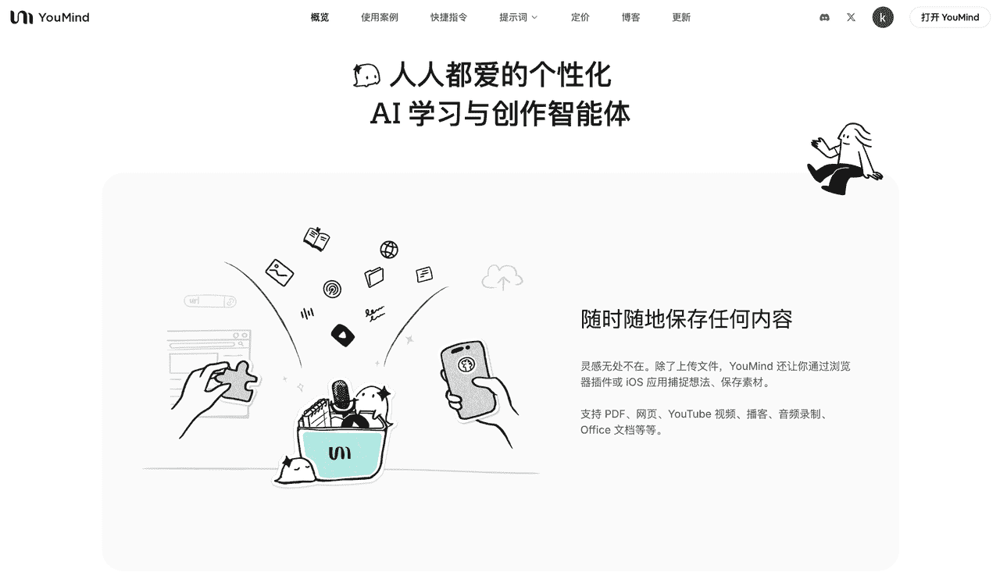

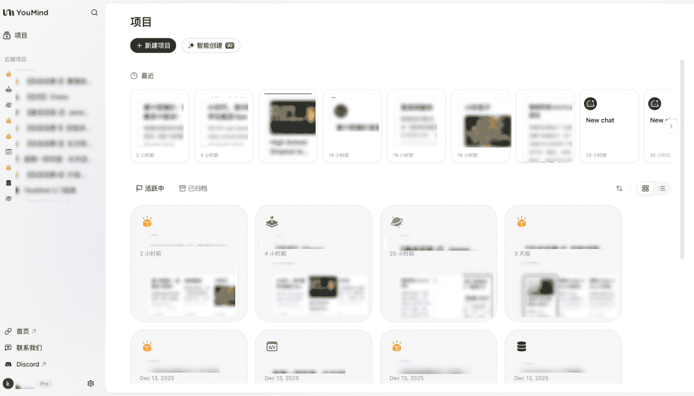

## （9）Flomo

https://v.flomoapp.com/mine

Flomo今年有一些新的更新，加上了一些AI相关的功能。算下来，Flomo用了大概有三四年的时间， 现在依旧会用它来做一些灵感记录，以及随时随地的想法收集，琐事收集。

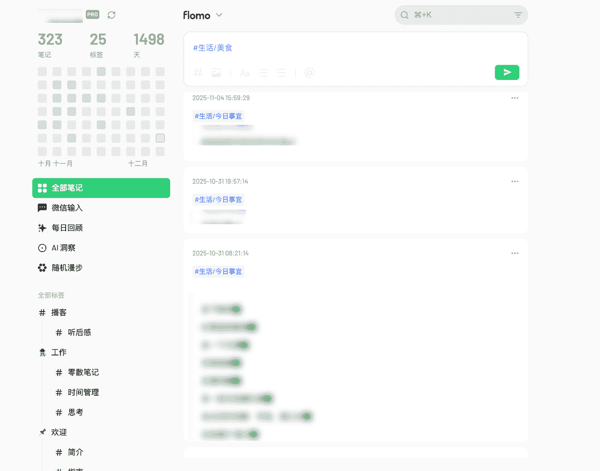

## （10）Cubox

https://cubox.pro/

Cubox也用了有两三年，主要用来做**碎片收集**的处理。

至于具体怎么使用，之前有专门写了一篇文章详细介绍，可以来看看这篇👉🏻：Cubox AI，把碎片收集玩到极致 🧩

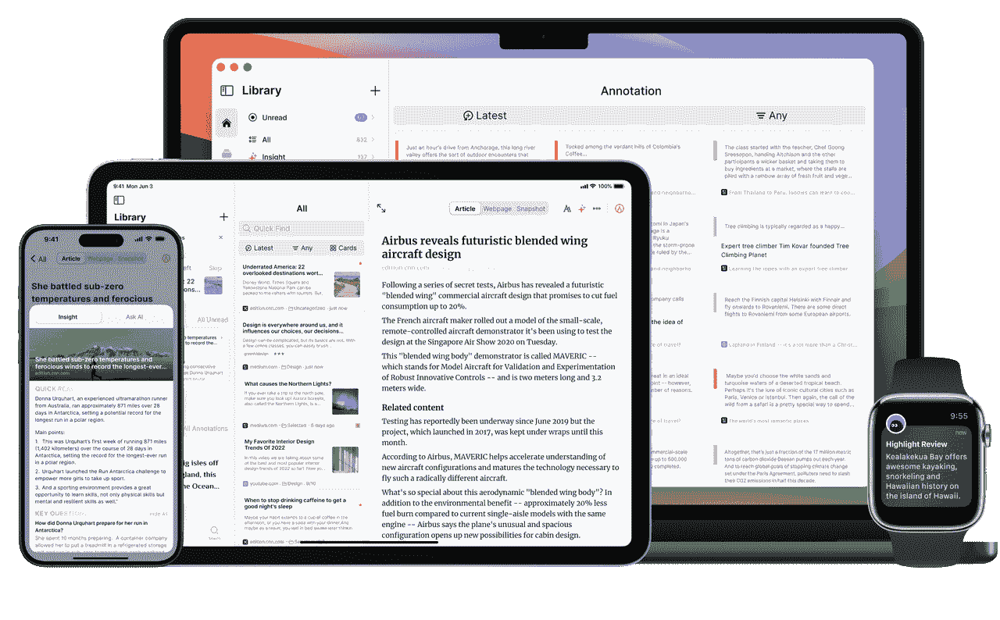

## 4、知识问答专区

**本文章已上线**至「第25小时」知识库！不想长篇阅读？欢迎到知识问答专区直接进行提问😉

**知识库链接：**[**https://ask.feishu.cn/shared-space/75**](https://ask.feishu.cn/shared-space/7590992675327708381?referrer=gzh_mondaylab)90992675327708381?referrer=gzh_mondaylab

