# 又要做PPT了……WPS AIPPT与你的创意直面相逢

> 来源：[https://my.feishu.cn/docx/B0N1d3SC1oiQtnxv3dQcziTen1c](https://my.feishu.cn/docx/B0N1d3SC1oiQtnxv3dQcziTen1c)

# 📜前言

**"又要做PPT了……"**

这可能是职场人和学生党最不想听到的一句话。数据显示，职场人平均每月要制作3-5份PPT，每份耗时2-4小时，其中70%的时间花在排版和美化上。

而WPS推出的**灵犀AI PPT**，则想要改变的，就是这个现状。它的核心能力是：

+   一句话生成完整PPT 🧚‍♂️

+   文档/大纲一键转PPT 🧚‍♂️

+   AI智能优化设计 🧚‍♂️

**但它真的好用吗？** 能否真正解决PPT制作的痛点？在不同场景下表现如何？

我们进行了一次全方位的深度测评，从功能到场景，从效率到质量，给小伙伴们一个真实的答案。

# 一、📒产品介绍

**灵犀AI PPT**是WPS Office旗下的智能演示文稿创作助手。它深度融入AI技术，旨在彻底革新PPT创作体验——只需关注创意与内容，剩下的交给AI。

无论是一句话生成完整PPT，还是一键智能美化设计，灵犀PPT都能帮你从繁琐的排版、文案与设计中解放出来。

无论是商务报告、学术答辩，还是产品发布，灵犀PPT都能作为得力的智能伙伴，高效产出设计精良的PPT。

# 二、📰AIPPT三大创作方式

灵犀AIPPT一共有**三种创作方式**，我们可以：

+   通过直接**输入主题**来生成PPT；

+   直接**上传你的文档**给AI来生成PPT；

+   直接**把大纲喂给AI**，让灵犀来生成PPT。


## 1、输入主题生成

这种是最简单粗暴的方式——也就是直接告诉AI，你要做什么主题的PPT。

### **（1）实测案例1：常规主题**

我们输入一个简单的主题👇：

> 非遗文化传承与创新

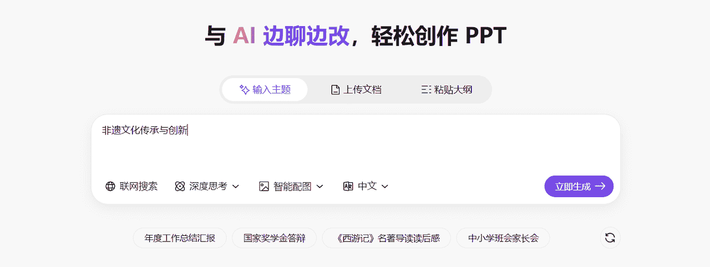

**可以看到**，我们只提供了一个主题，就生成出了六大板块，整体框架从概述、现状到策略与创新途径应有尽有，整个框架层层递进、要素齐备，为专业演示搭建起了坚实的骨架。

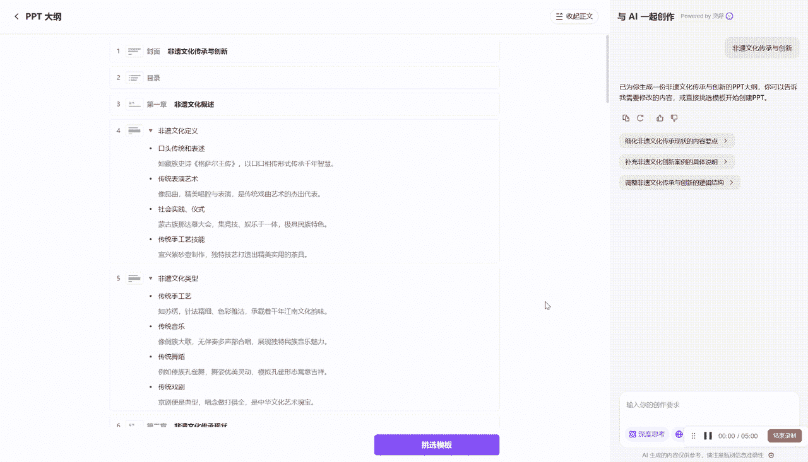

接下来，挑选一个合适的模板👇🏻：


模板栏根据场景分类有许多选择，能满足大部分场景的使用。如果你眼花缭乱之下不知道该如何选择，还可以完全交给AI。

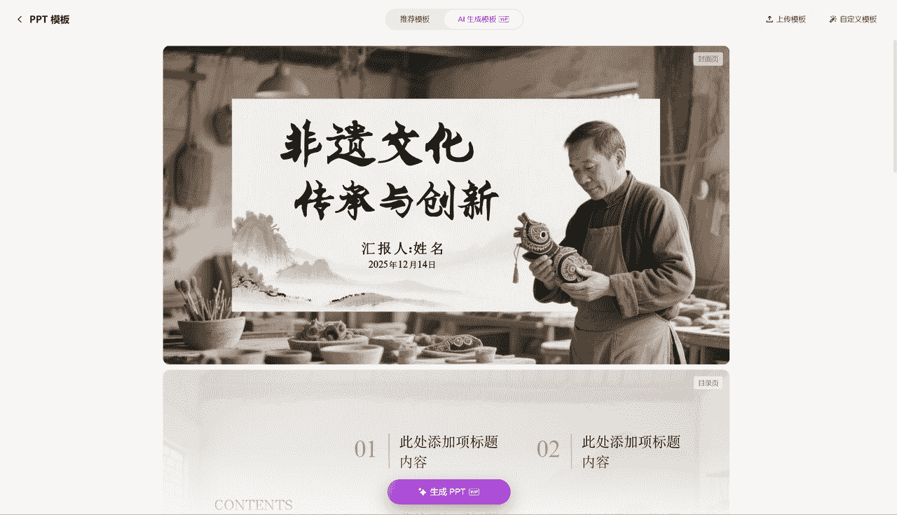

它会根据文字来**自动生成出**合适的风格、背景与字体，让你不用为了找一个契合的模板而头疼。

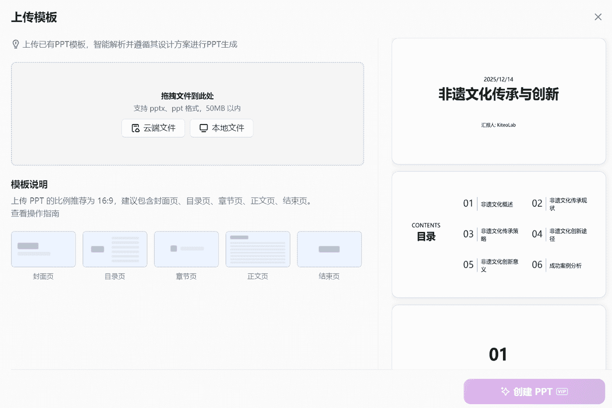

**当然，设计的主**动权始终在你手中。如果你已经有了心仪的模板，灵犀AIPPT同**样能够无缝**衔接。一键导入自有模板后，灵犀PPT将在此框架内智能完成内容的填充、排版与优化，高效实现个性化定制。

### **（2）实测案例2：创意主题**

**灵犀AIPPT**的智能不仅体现在生成的内容上，还在于能深入理解文字背后的真实意图与场景。我们可以用「太空旅行攻略」这一主题来做测试。

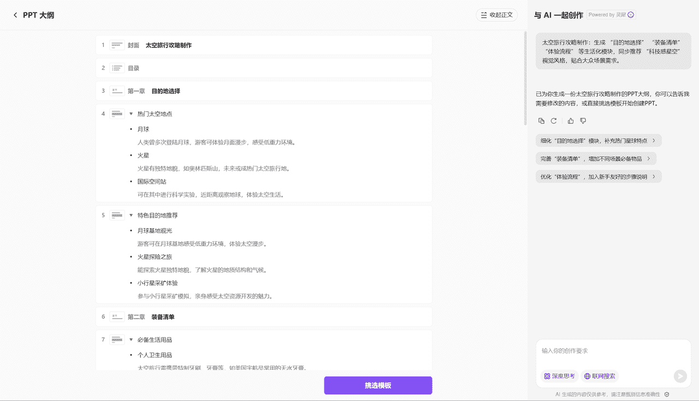

**面对这一略**为「天马行空」的想法，灵犀PPT跳出了办公软件的常规思维，构建了一套生动、具体且具有操作性的生活化框架，符合大众对「攻略」的真实需求。具体如下图所示👇🏻：

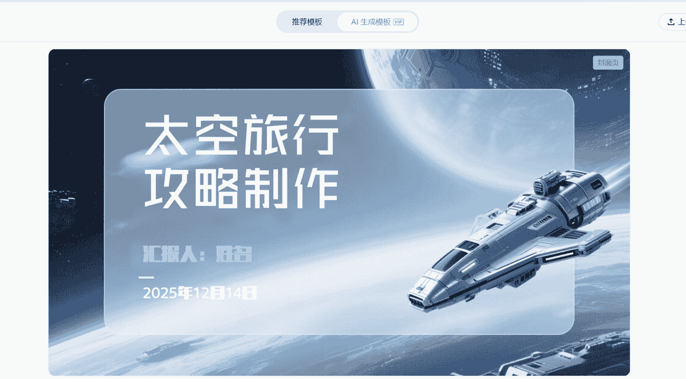

更值得一提的是，其智能的视觉适配，智能生成了这一太空主题，充满未来科技感，将「太空旅行」实现了从概念到视觉的完美统一。

### **（3）实测案例3：专业学术主题**

为了看看灵犀PPT在细分、专业领域的真实能力，我们测试一个高度具体的学术主题—— 「基于多模态大模型的情感计算研究」。

这类主题通常容易因为**概念过于专业**而导致AI生成的内容出现**泛化**的问题

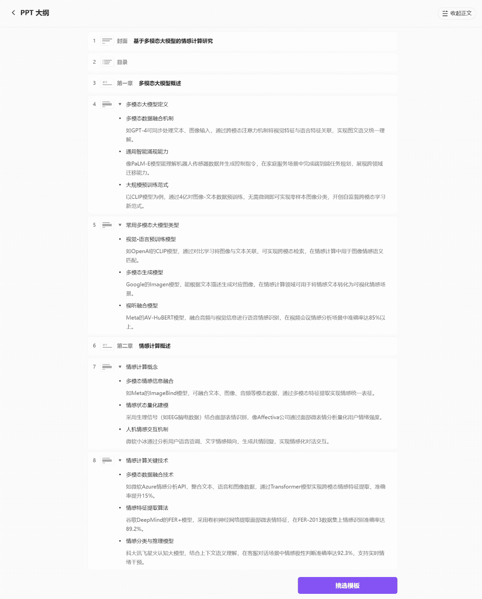

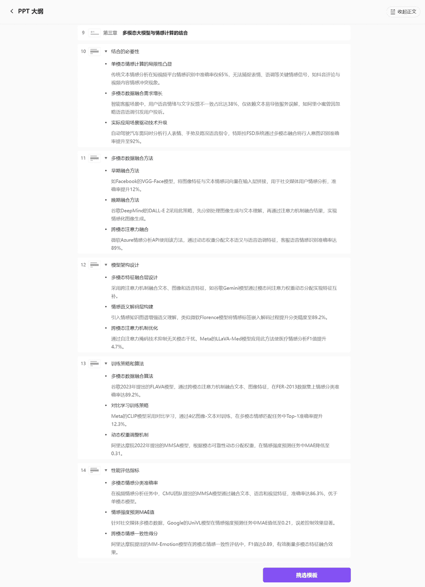

可以看到，灵犀PPT的表现令人惊喜，它不仅准确理解了「多模态」与「情感计算」的核心关联，更在标准框架的基础上，主动补充了几近专业性的细分模块。

面**对高度细**分的专业命题，灵犀PPT展现了强大的场景化架构。它能够快速识别核心学术概念，并基于领域内的知识，主动构建专业模块。

我们来对这部分做个小结。在前面的三类主题测试中，**可以发现，对于**「输入主题生成」这个功能，灵犀AIPPT对常规主题、创意主题、专业主题都能应对自如，理解能力也非常强。

## 2、上传文档生成

第二大创作方式，想聊聊：通过「上传文档」来快速生成PPT。

当你已经有了完整的报告、方案或资料文档时，灵犀PPT的「上传文档」模块，将成为你最高效的转换器。只需Word、PDF、思维导图上传，灵犀PPT便能智能解析其中内容，快速生成结构清晰、重点突出的PPT初稿。


### **（1）支持多种格式**

灵犀PPT具备强大的**格式兼容性**，支持多种主流办公格式。

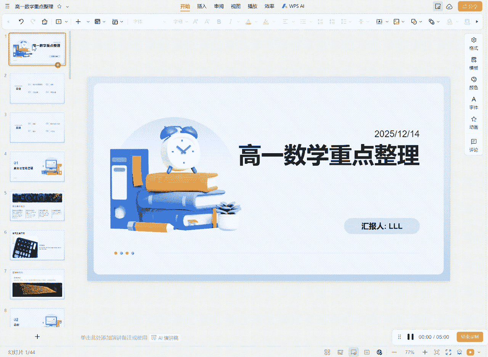

在实际使用中，发现即使包含数据表格、图表、数学公式的多页文档，系统能快速完成解析与内容提取。

灵犀PPT都能够精准识别章节标题、核心段落、列表项及关键数据，但相比于PDF文档，Word文档识别速度会比PDF更快。

同时，如果你的文件是存放在WPS云文档里，可以直接访问云端已储存的文件进行解析，流程无缝衔接，不用重新上传，即可快速调用大体积文件。

### **（2）智能提炼能力测试**

面对内容庞杂、结构松散的原始稿件，灵犀PPT也 展现了它「智能提炼」的强大能力。

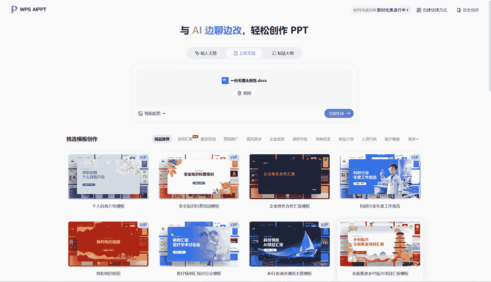

我们上传了一份内容杂乱、结构松散的调研报告，想看看 AI 能不能整理清楚。

最终发现，**灵犀**并不只是进行简单的段落复制，它还给出了严谨的结构👇：

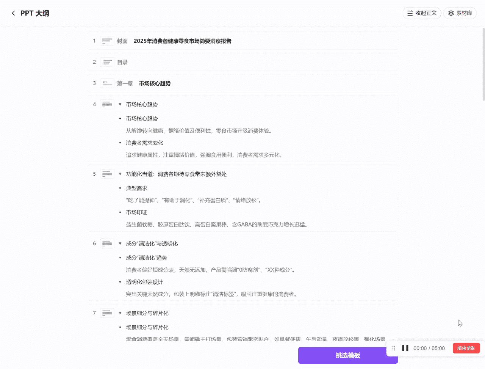

它将大部分零散的信息进行整理归类，作出了「市场核心趋势」「目标用户画像」「竞品对比」「市场分析」等等专业的分类；

并**且主动过滤掉了口语**化的描述，精准提炼出核心内容，这意味着灵犀PPT所带来的不仅是一份简单的文档，且还是能直接用于汇报的演示草案。

## 3、粘贴大纲生成

如果你已经有了清晰的思路和大纲，这个方式最高效。

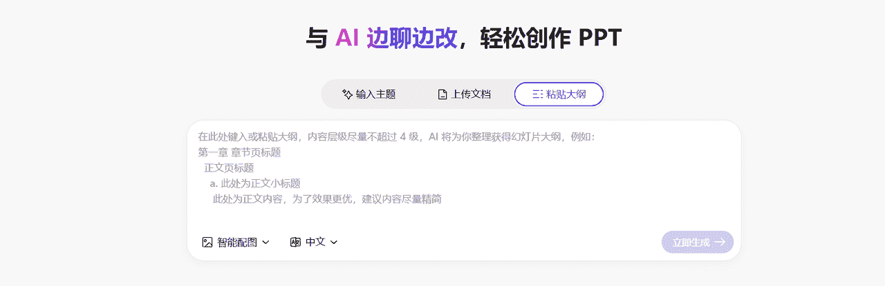

### **（1）格式识别能力**

灵犀PPT支持多种大纲格式：

+   纯文本列表

+   Markdown语法

+   多级标题结构

系统能精准识别层级关系，并将其映射为PPT的页面架构。

我们用了一个**超复杂的水杯市场调研大纲**（包含表格、代码块、引用等多种格式）来测试：

```
#  水杯市场调研分析大纲
 
##  一、 市场全景扫描
### 1.1 规模与增长
| 维度 | 关键数据 | 趋势分析 |
| :--- | :--- | :--- |
| **全球市场** | 约150亿美元 (2023) | 年复合增长率 **6-8%** |
| **中国市场** | 超300亿人民币 (2023) | 近五年CAGR约 **12%**，增速领跑 |
| **线上渗透率** | 约65% | 直播电商、内容种草成为主引擎 |
 
&gt;  **核心洞察**：市场已从“增量竞争”转向“存量升级”，**差异化**与**价值创造**是关键。
 
### 1.2 核心驱动与制约
-  **驱动因素**：
    1.  `健康意识`常态化
    2.  `环保政策`（如“限塑令”）加码
    3.  `消费场景`精细化（办公、健身、户外）
-  **制约因素**：
    1.  产品同质化严重
    2.  原材料成本波动
    3.  低端市场利润空间压缩
 
---
 
##  二、 用户深度画像
### 2.1 五大典型客群
```mermaid
graph LR
    A[水杯消费者] --&gt; B[学生党：重颜值性价比]
    A --&gt; C[办公族：重品质与健康]
    A --&gt; D[运动达人：重功能与便携]
    A --&gt; E[高端客群：重品牌与设计]
    A --&gt; F[宝爸宝妈：重安全与趣味]
```
 
### 2.2 购买决策漏斗
**认知 → 考虑 → 购买 → 忠诚**
1.  **触点**：小红书/抖音种草 &gt; 电商搜索 &gt; 详情页/KOL测评 &gt; 收货体验 &gt; 复购/分享
2.  **关键决策因子**（权重排序）：
    1.  **材质安全**（是否为食品级、Tritan、316不锈钢）
    2.  **核心功能**（保温、防漏、便携）
    3.  **设计颜值**
    4.  **品牌信任度**
    5.  **价格**
 
---
 
##  三、 产品矩阵与竞争格局
### 3.1 产品细分四象限
| | **基础功能** | **创新功能** |
| :--- | :--- | :--- |
| **大众市场** | 传统保温杯&lt;br&gt;**代表品牌：** 哈尔斯、富光 | 智能提醒水杯&lt;br&gt;**代表品牌：** 云饮 |
| **高端市场** | 品质工艺杯&lt;br&gt;**代表品牌：** 膳魔师、虎牌 | 智能生态杯&lt;br&gt;**代表品牌：** HidrateSpark |
 
### 3.2 品牌竞争梯队
- ** 第一梯队（国际高端）**：膳魔师、虎牌、象印
    - **优势**：品牌力、工艺、保温技术
- ** 第二梯队（国产龙头）**：哈尔斯、希诺、富光
    - **优势**：性价比、渠道覆盖、规模化
- ** 第三梯队（新锐品牌）**：Swell、Stanley、moosen
    - **优势**：设计感、社交媒体营销、场景深耕
 
---
 
##  四、 未来趋势与机会点
### 4.1 产品技术趋势
1.  **材料革新**：`可降解材料`、`抗菌涂层`、`自清洁技术`
2.  **智能融合**：`饮水数据化`、`App健康管理`、`IoT互联`
3.  **设计体验**：`模块化`、`情绪化设计`、`轻量化`
 
### 4.2 潜力赛道机会
&gt;  **红海市场**：传统不锈钢保温杯、基础塑料杯
&gt; 
&gt;  **蓝海机会**：
&gt; 1.  **细分场景方案**：`控温冲泡杯`（茶/咖啡）、`健康监测杯`
&gt; 2.  **环保解决方案**：`循环租赁模式`、`以旧换新`体系
&gt; 3.  **情感价值赋能**：`个性化定制`、`IP联名`、`收藏价值`
 
---
 
##  五、 核心结论与战略建议
| 战略方向 | 具体建议 | 风险提示 |
| :--- | :--- | :--- |
| **产品创新** | 聚焦1-2个细分场景，做透“功能+情感”双价值 | 避免技术堆砌，确保用户体验闭环 |
| **品牌建设** | 打造鲜明人设，通过内容构建“品牌社群” | 需长期投入，避免流量依赖 |
| **渠道融合** | 线下做体验，线上做传播与复购 | 解决线上线下价格与货品冲突 |
| **可持续发展** | 将环保从“成本项”转化为“品牌资产” | 需教育市场，短期可能增加成本 |
 
 
```

**生成结果如下👇🏻：**

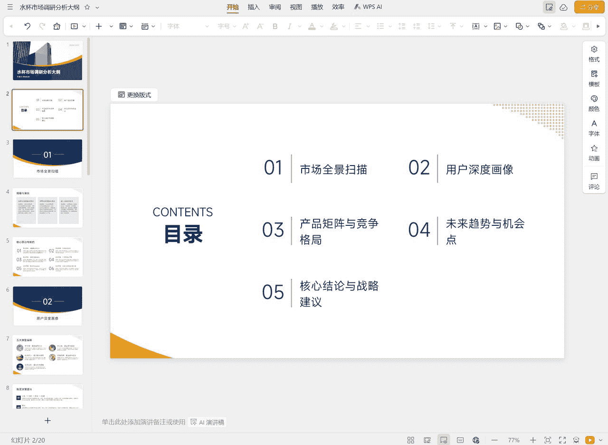

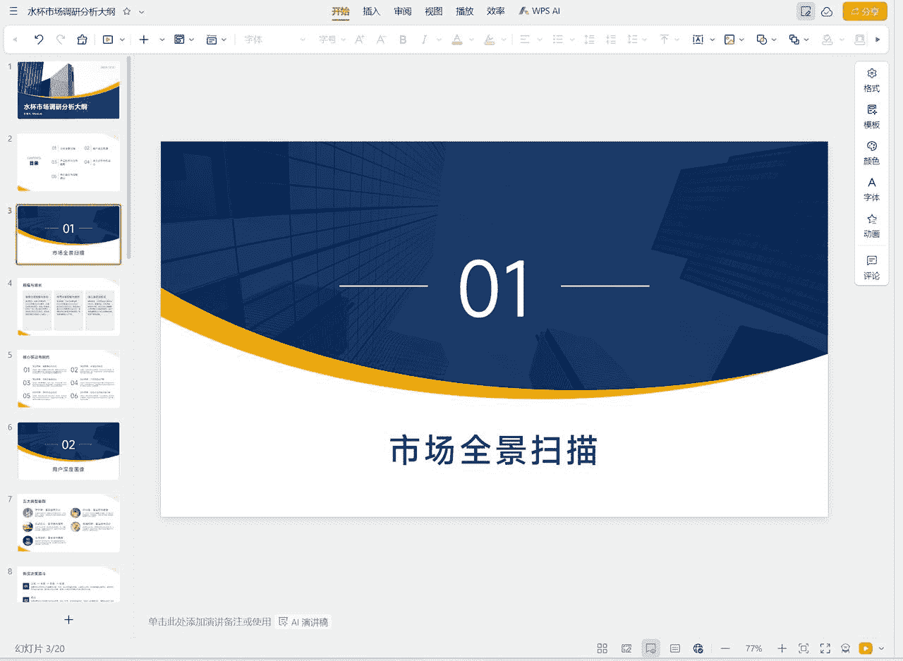

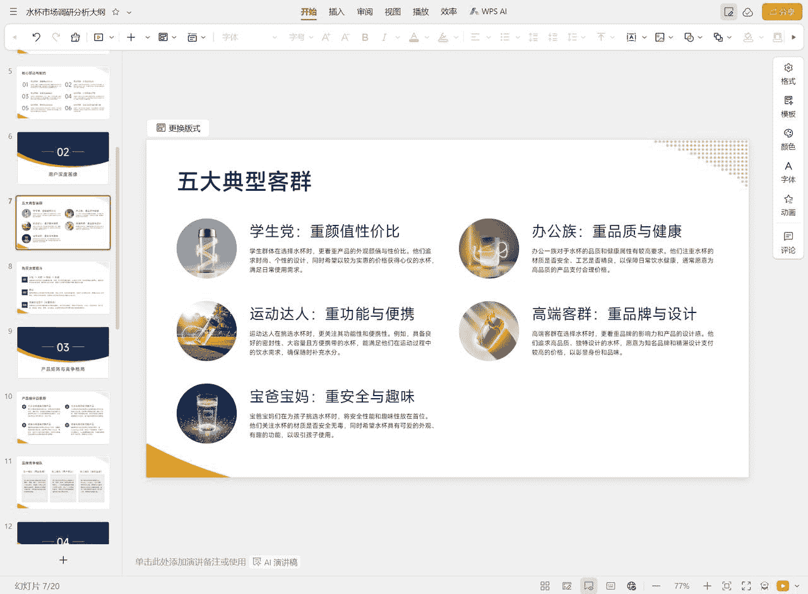

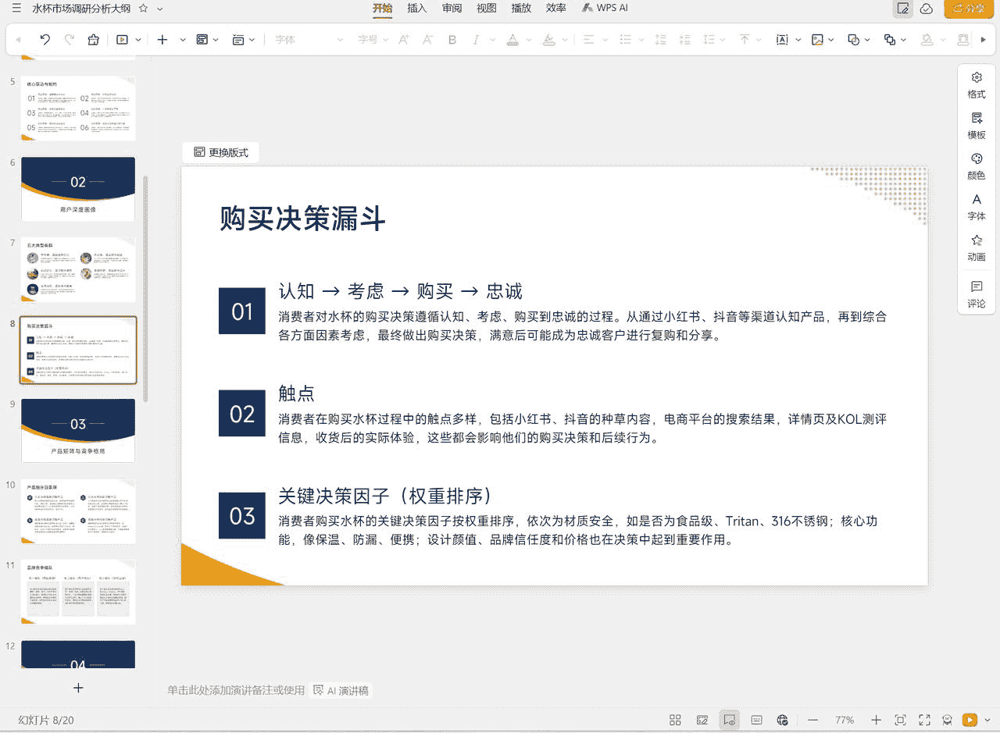

**一级标题**自动生成为章节分隔页，清晰地划分出报告模块；

二级标题及以下内容则展开为具体的阐述页面，每个页面聚焦一个子主题。

因此，利用「粘贴大纲」模式，能确保AI生成的PPT结构与你的逻辑是高度同频的，且逻辑脉络一目了然。

### **（2）内容扩展能力**

灵犀PPT所带来的不仅是大纲的精准识别，还有它合理的细节填充与内容扩展能力。

**除此之外，AI不**只是照搬大纲，还会主动帮你扩展内容：

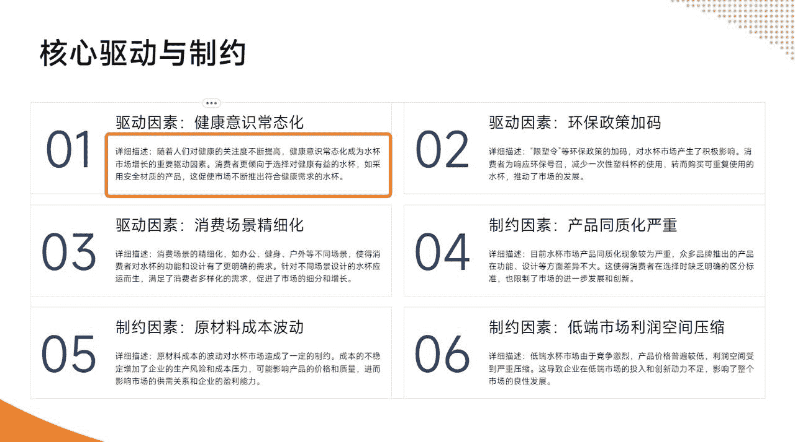

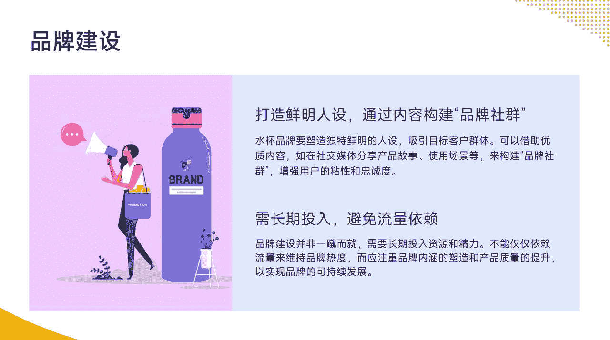

我们可以看到，在「核心驱动」这一部分，它在原本的各个分标题上加了详细的解说，同时也为专业名词做出解释；

在「市场分析」中，则是自动补充了多组数据，并且加以情景导入；不仅是内容上，PPT中的多个图片填充也都恰当合适，提升了整个PPT的可读性。

## 4、小结：三种方式怎么选？

| **创作方式** | **适用场景** | **优势** | **推荐指数** |
| --- | --- | --- | --- |
| **输入主题** | 从零开始，只有个大概想法 | 最简单，AI全包办 | ⭐⭐⭐⭐⭐ |
| **上传文档** | 已有完整文档，想转成PPT | 省去重新整理的时间 | ⭐⭐⭐⭐⭐ |
| **粘贴大纲** | 思路清晰，有详细提纲 | 最精准，完全按你的逻辑来 | ⭐⭐⭐⭐ |

**通过三种方式的测试，我们可以看到**，灵犀PPT在内容生成上确实有两把刷子。

但是，一个真正好用的AI工具，不能只会“生成”，还要：

+   **生成得好**（内容质量高）

+   **改得快**（优化效率高）

+   **用得爽**（操作体验好）

那么，灵犀PPT在这些方面表现如何？我们接着往下测。

# 三、📝深度实测：四大核心能力能否真正解放生产力？

接下来，我们将从指令匹配度、优化效率、视觉效果、操作体验这四个维度，对灵犀PPT进行一波深度测评。

## 1、指令匹配度

**什么是指令匹配度？**

简单说，就是你说一句话，AI能不能准确理解你的意思，并且做出来。

我们测试了两种指令👇🏻：

### （1）清晰指令测试

测试Prompt指令：

```
生成电商 618 促销方案 PPT，需包含 3 个爆款单品分析，用柱状图展示销量预测，风格为赛博朋克风。
```

生成效果如下所示：

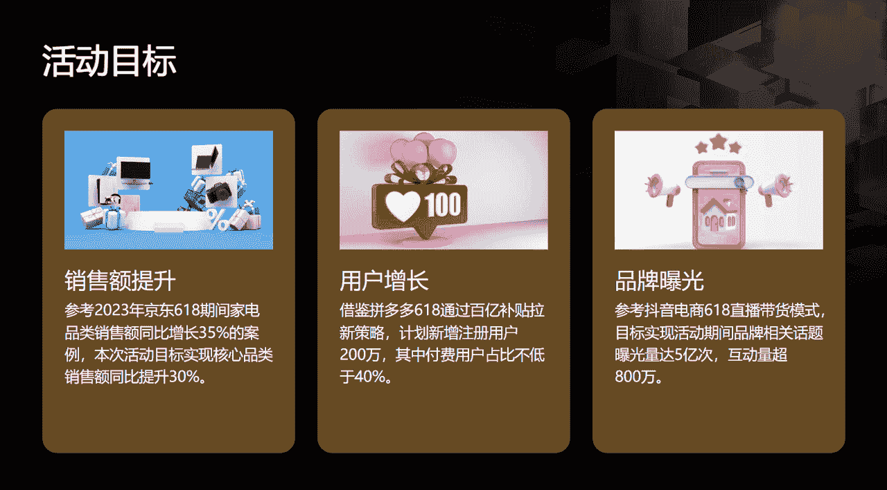

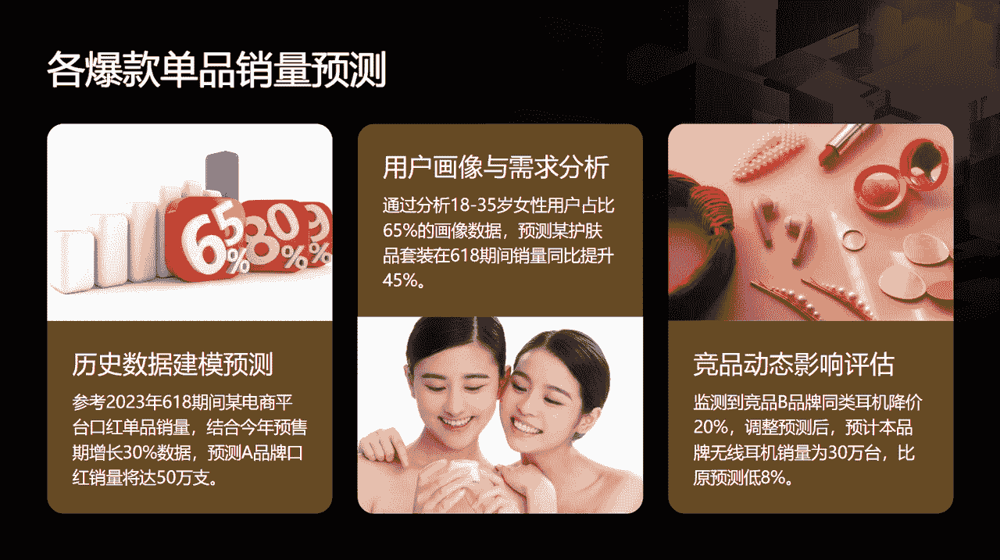

我们来分析下AI生成的效果：

+   ✔️ 结构完整：自动生成促销方案、销售策略、销量预测等模块

+   ✔️ 需求具象化：专门创建3页「爆款单品分析」，每页包含卖点、往年数据、用户画像

+   ✔️ 风格精准匹配：深色背景+霓虹色彩，完全符合赛博朋克风

### （2）模糊指令测试

测试Prompt指令：

```
做一个有创意的环保主题 PPT，让年轻人喜欢。
```

生成效果如下所示：

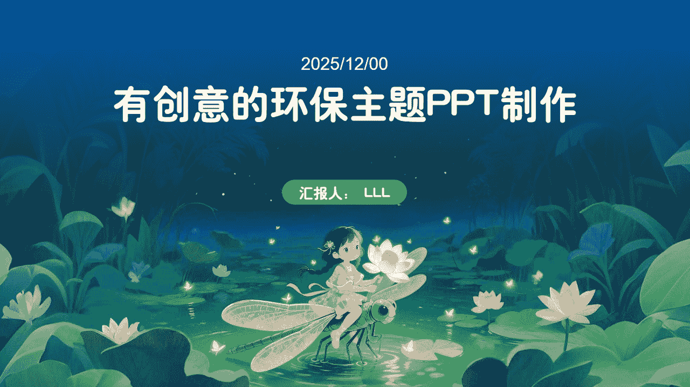

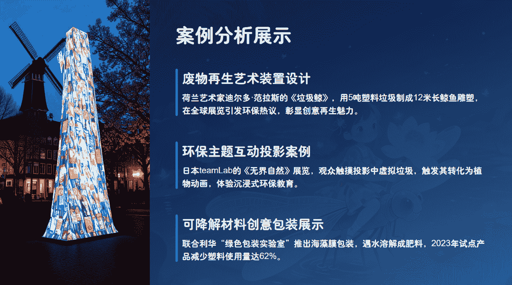

我们来分析下AI生成的效果：

+   ✔️ 解读「创意」和「年轻人」：没有生成传统说教式内容，而是用「潮玩环保」「可持续生活指南」这种年轻化的切入点；

+   ✔️ 结构具象化：输出「废物再生艺术」「环保电影展」「流量挑战赛」等新颖模块；

+   ✔️ 视觉年轻化：自动匹配灵动页面，采用卡通插画风格。

最后我们可以看到，灵犀PPT具备优秀的场景化推理能力。

对于**清晰指令**，它能像一名专业的执行者，一丝不苟地完成所有要求；

而面对**模糊指令**，灵犀PPT也能基于对受众和主题的常识性理解，提供超出预期的、具象化的方案框架，更大幅度地降低沟通成本。

## 2、二次优化

一般来说，一次的生成往往不能得到直接的演示成果，因此高效的修改与专业的可靠性才是其核心。为此，我们对其交互优化能力与内容准确性进行了测试。

**灵犀PPT**支持通过自然语言直接地编辑文档：

### （1）测试1：缩减内容

我要求它对该页的篇幅进行优化，缩减为原篇幅的70%👇

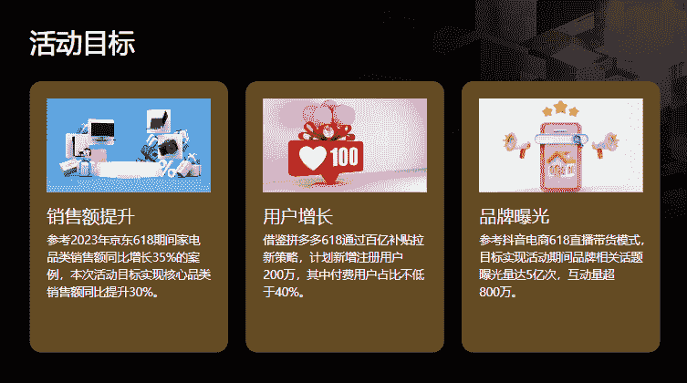

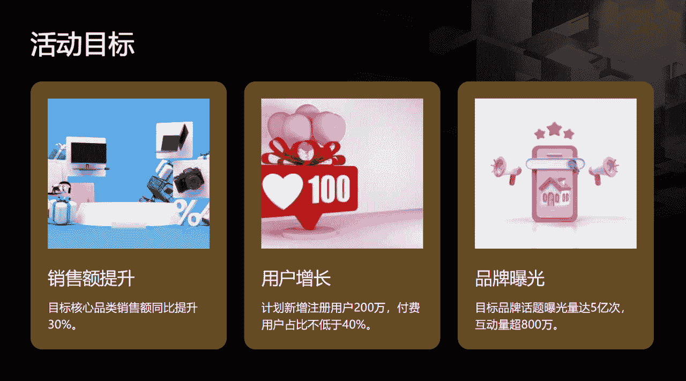

**灵犀PPT**快速识别出核心信息，删除冗余修饰词，保留主干，并且排版上也做了相应的适配。

### （2）测试2：拆分页面

第二个测试，想测下灵犀对**PPT拆分**的能力。

Prompt：

```
把这页内容拆分成两页
```

最终修改效果如下：


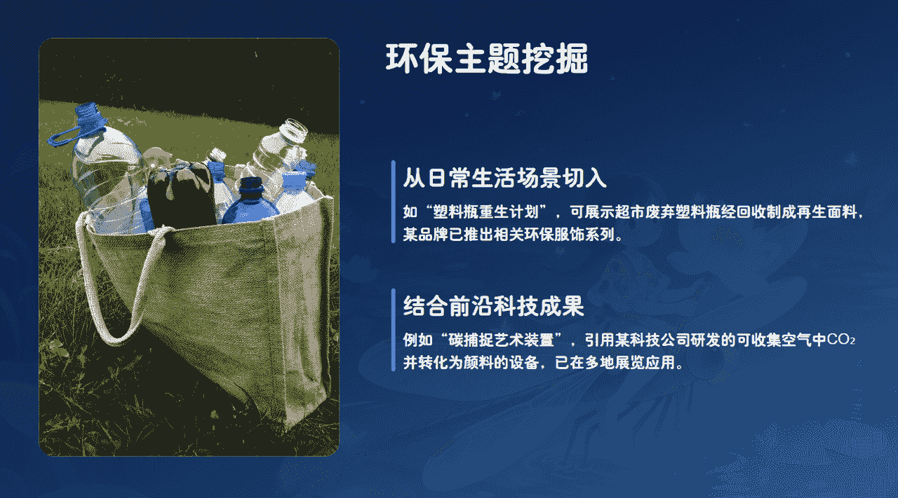

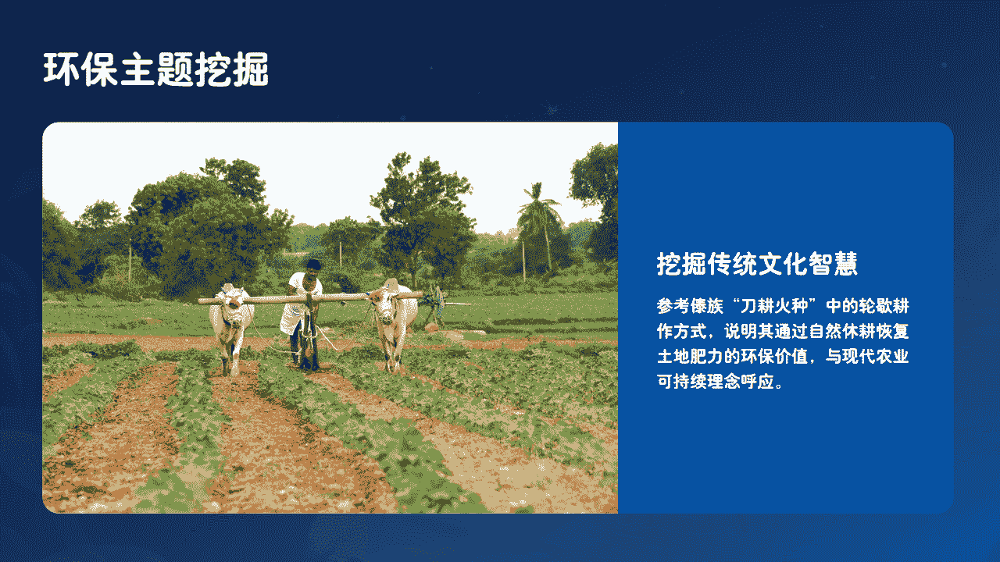

在测试的过程中，发现到：灵犀PPT依旧立即响应，并且将原内容给智能归**类到新的页**面，并且不是普通的拆分，而是智能地匹配出两个全新的页面。在这一方面上，灵犀PPT扮演着一位专业的执行伙伴，大大地提升了工作党的工作效率。

## 3、视觉效果

PPT不仅要内容好，还要颜值高。

### （1）模板库

灵犀PPT拥有**200+套高质量模板**，覆盖8大类场景：商务、教育、创意、汇报……

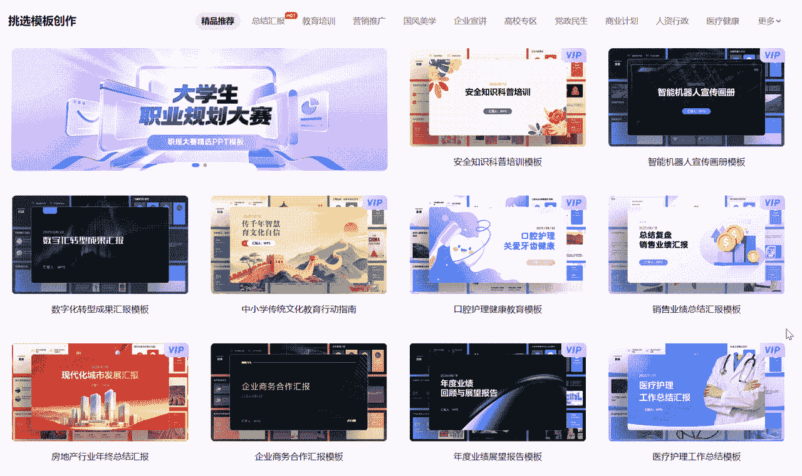

更重要的是，AI还能根据内容进行模板推荐。

### （2）案例1：学术答辩

当生成学术答辩PPT时，AI会自动选用严谨、简约的版式，符合学术场景。👇


### （3）案例2：非遗文化

当主题为**非遗文化**时，系统则会智能搭配出古色古香的风景图库，让形式与内容高度共鸣。👇

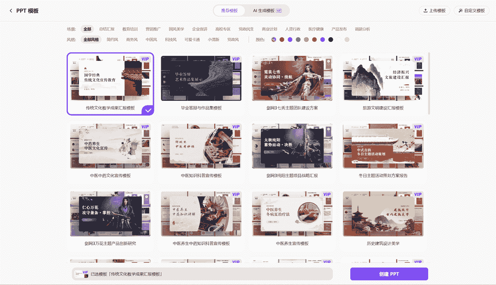

### （4）编辑自由度

除此之外，灵犀PPT还提供了与WPS Office一**脉相**承**的「**拖**拽式**」**可视化编**辑**界面，支**持对字体、颜色、行距、图片尺寸、元素位置等超过12项基础属性进行直观调整。

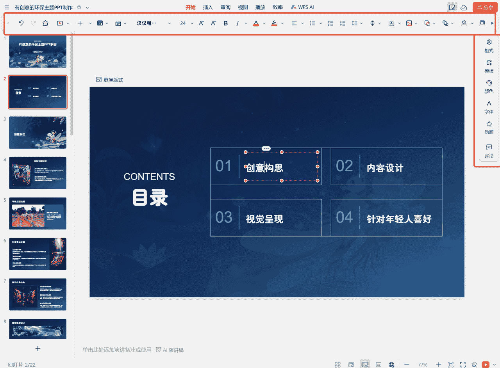

其操作逻辑与用户已有的办公软件习惯一致，基本实现了零学习成本的无缝过渡，让每位用户都能轻松成为自己PPT的最终设计师！

## 4、操作体验

在操作体验方面，灵犀PPT就像一个贴心的助手，将智能**化融入操**作流程的各个细节，不仅能帮你搞定排版设计，也能让团队协作更加顺畅。

用户拥有全部的设计主导权：可以自由切换任**意字**体**、无**限制地增加或删减页面，并且能对背景、配色进行全局统一修改或单页面个性化定制。

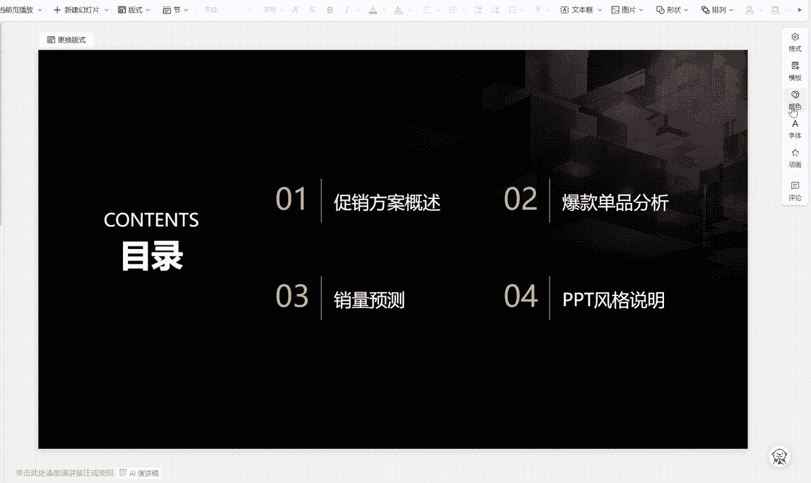

尤为高效的是其**批量处理**功能，如：①一键统一所有页面的字体、②一键刷新全套图表的颜色风格；极大提升了全局和整体优化的效率。

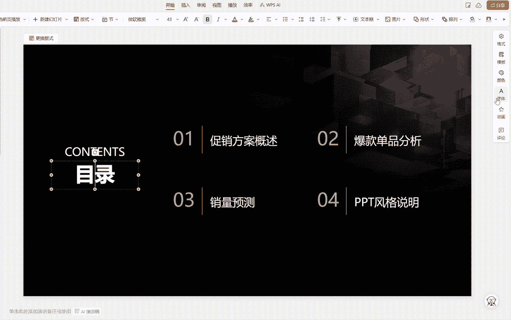

**灵犀PPT**还支持多人实时在线协作，团队成员可以同时编辑一**份演**示文稿，所有人的修改实时可见，并通过评论功能实现高效沟通。

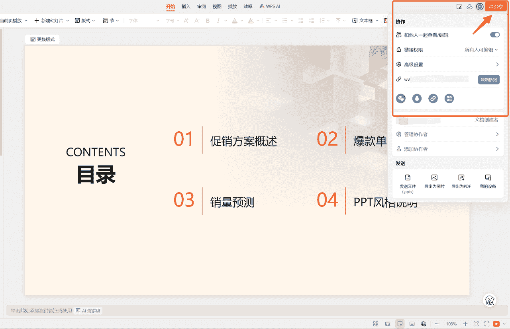

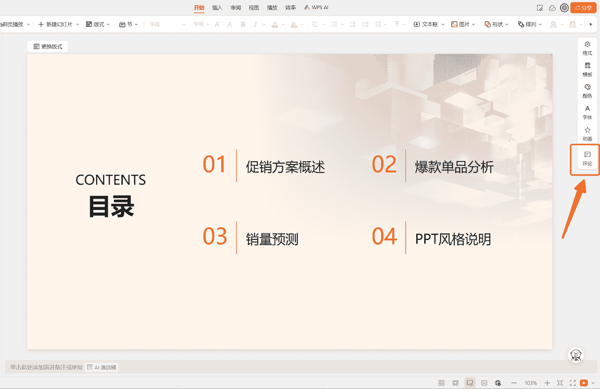

这意味着**灵犀PPT**将PPT从单一的创作工具，进化为连接团队智慧、加速方案产出的协同工作平台。

## 5、测评小结

| **测评维度** | **核心发现** | **评分** |
| --- | --- | --- |
| **指令匹配度** | 精准理解清晰指令，能合理推断模糊需求 | ⭐⭐⭐⭐⭐ |
| **二次优化** | 自然语言交互，响应迅速，理解准确 | ⭐⭐⭐⭐⭐ |
| **视觉设计** | 200+模板，智能推荐，支持深度定制 | ⭐⭐⭐⭐ |
| **操作体验** | 零学习成本，支持协同，批量处理高效 | ⭐⭐⭐⭐⭐ |

**通过四个维度的测试，我们验证了**灵犀PPT在理解力、执行力、设计力、协作力上的综合实力。

**但这还不够。**

一个工具再强大，最终还是要回归到真实的使用场景中接受检验。学生做课程汇报、老师备课、职场人做方案、行业从业者做宣传——在这些具体场景下，灵犀PPT能否真正解决问题？

让我们进入**场景实战测试**环节。

# 四、🧾测评场景

前面我们验证了灵犀PPT「能做什么」，现在我们来看下它在哪些场景下做得更好？

我们选取了**教育、职场、行业****三大领域的7个**典型场景，模拟真实用户需求，测试灵犀AIPPT的场景适配能力。

## 教学场景

### **（1）课程汇报**

当你作为一位营销学的学生，在**灵犀PPT**输入这一「市场营销学：直播电商模式分析」主题时：

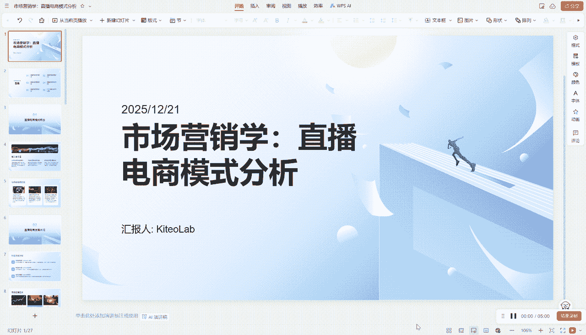

灵犀PPT生成了一份非常清晰的分析报告，同时还自动构建出「模式演变、核心链路、案例分析、趋势展望」的框架，并展现出了一定的专业严谨性——设置了「参考文献」这一页面，整体规范和谐。

### **（2）课程设计**

```
我是一名初中信息技术教师，需要为学生讲解AI，内容涵盖AI概念、生活应用、简单原理及安全使用，包含趣味案例与互动体验
```

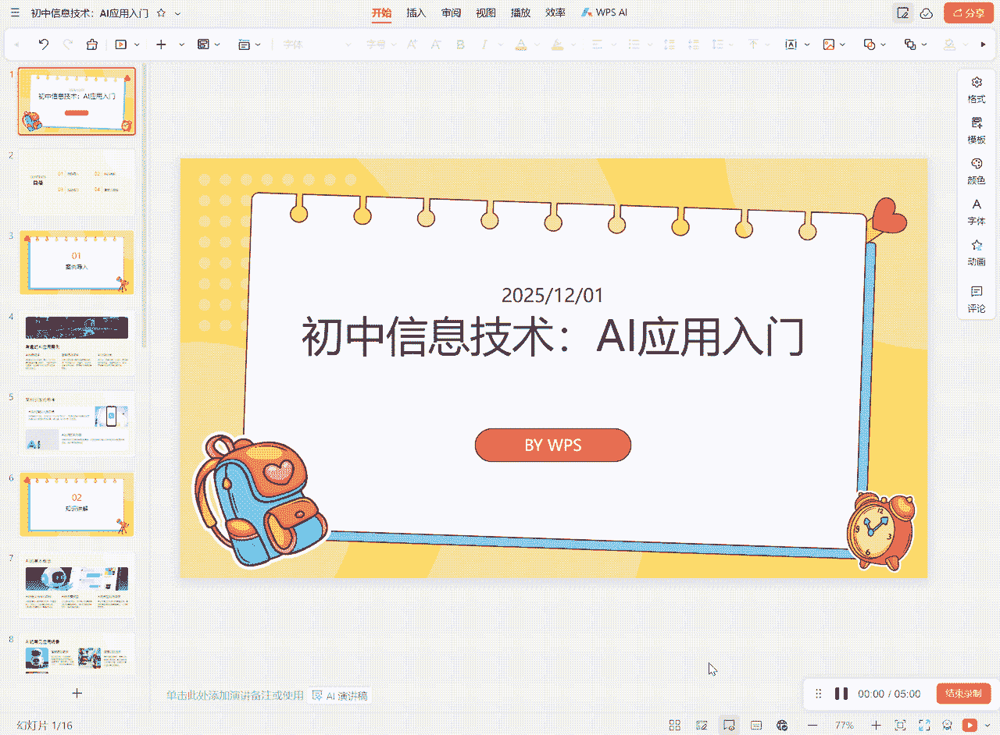

在「课程设计」这一场景下，**灵犀PPT**完美适配了「案例导入-知识讲解-互动练习」的教学逻辑。

它还能自动生成「课堂即时小测验」互动页面，并附上答案与解析，帮助教师轻松实现讲练结合，提升课堂参与度。

## 职场使用

### **（1）校园招聘宣讲**

```
企业招聘宣讲人面向在校学生制作PPT，需包含企业概况、岗位需求、招聘流程及职业发展路径，内容需贴近学生认知水平并排除过度营销化表述。
```

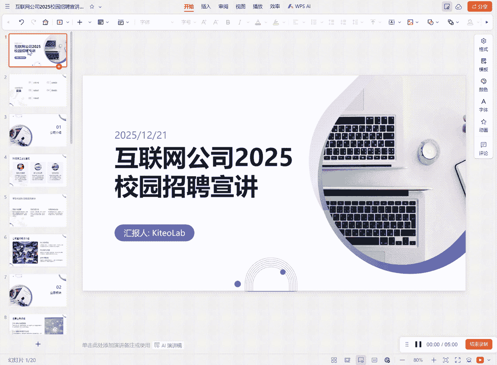

这**一案例，我**们看到灵犀PPT采用了更贴近学生心理的叙事逻辑，加入了「技术沙龙」与「团建实拍」等鲜活元素，这使得宣讲PPT从单向的信息发布，转变为一场精心设计、懂得共情的沟通。

### **（2）员工培训**

```
企业为新员工制作入职培训PPT，内容涵盖企业文化认知、规章制度解读及团队合作，包含案例教学，排除过于理论化的行业趋势分析
```

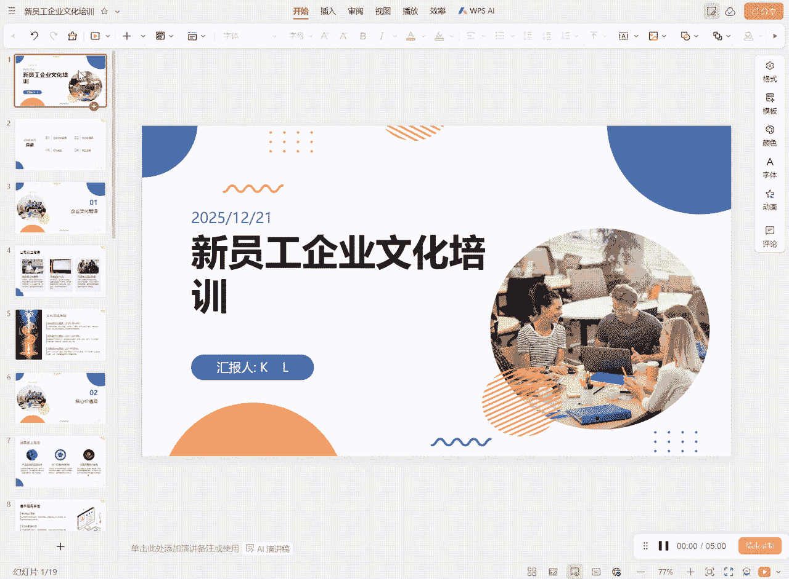

灵**犀PPT基**于「起源-价值观-行为准则-案例」的大纲，填充具有感染力的内容，将抽象的理念与具体的工作场景相结合，让企业新员工能迅速理解公司文化的落地点。

### **（3）活动复盘**

```
618电商活动复盘，内容涵盖销售数据复盘、用户行为分析、营销活动效果评估，聚焦问题诊断与改进策略，风格偏实用专业
```

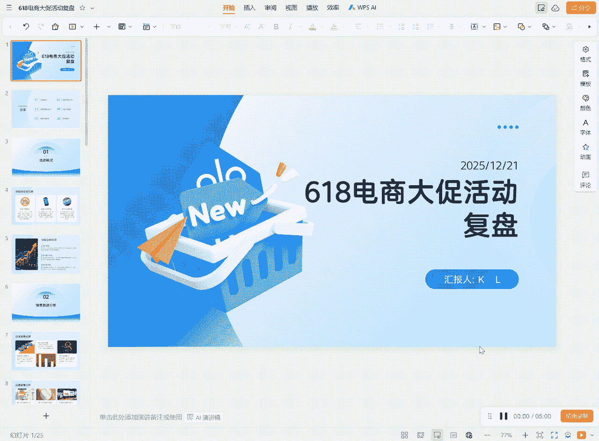

针对「618电商大促活动复盘」，灵犀PPT可以快速整合销售数据、流量分析和用户反馈。将海量数据转化为清晰可视的结构，直接服务于后续的策略优化。

## 行业场景

### **（1）旅游攻略策划**

```
以亲子游规划师身份，为带娃家庭制作云南七天亲子游PPT，内容涵盖行程路线设计、亲子互动项目推荐、安全注意事项及文化体验活动，包含儿童友好型景点选择，排除高强度徒步路线
```

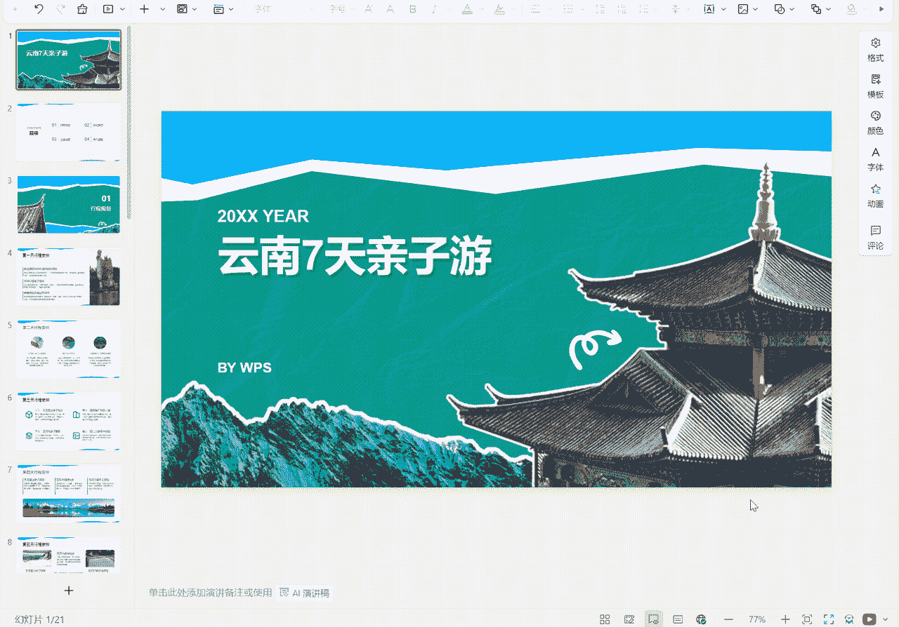

在**旅游场景，灵犀P**PT的输出覆盖了各个方面，其中不乏包含每日行程规划、亲子友好住宿推荐、特色美食地图等实用模块，同时还支持智能插入高原天气温馨提示等贴心组件，生成成果就像是一份专业的旅行手册。

### **（2）非遗宣传**

```
制作苏绣非遗宣传PPT，内容涵盖历史渊源、技艺流派及当代传承，包含传统纹样解析与非遗保护实践案例，风格兼具文化厚重感与视觉艺术性
```

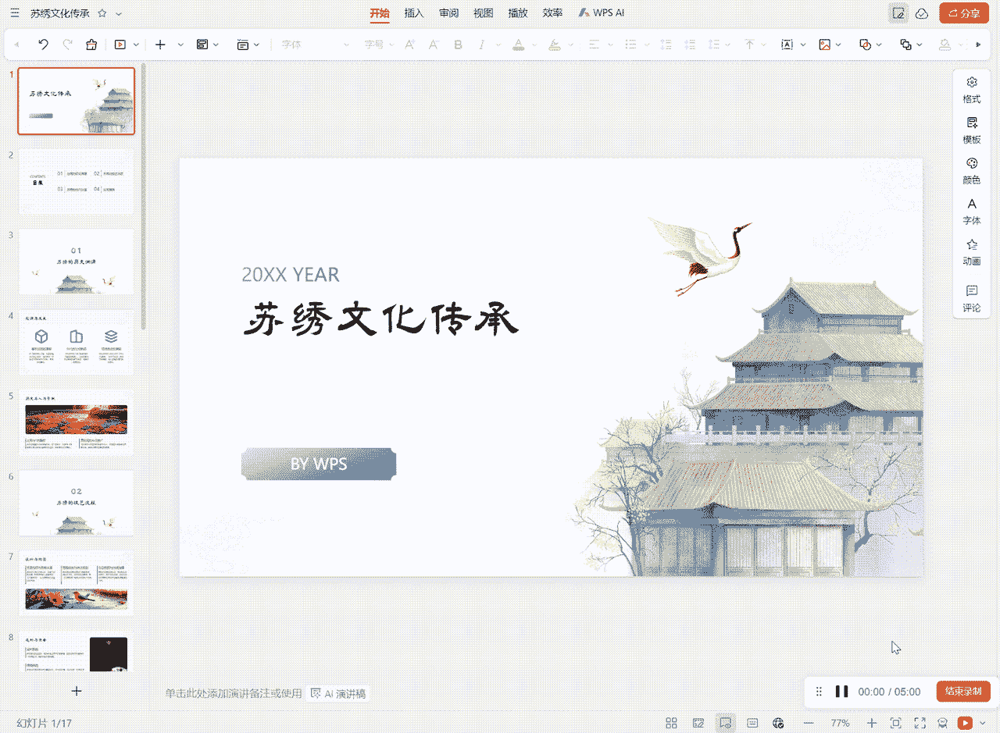

传统文化方面，需要灵犀PPT能够深刻地理解整个主题的文化内核。

在对非遗宣传的场景做了一番测试后，我们发现：

**它不仅在内容**上构建了历史渊源、针法技艺、当代创新的体系，还嵌入了苏绣制作视频等实用信息页，实现了文化深度与美学体验的深度交融。

通过上述7个场景的实测，我们发现到：

**灵犀PPT不止是「万金油**」式的简单工具，且还是具备场景洞察力的智能助理。

它能根据不同角色的核心目标和受众特点，调整其：

+   内容框架

+   叙述逻辑

+   视觉风格

提供高度适配的解决方案。

# 五、✉️结束语

历经从核心功能到场景实测的全面测评，WPS AI灵犀PPT让我们看到，它实现的，不仅仅是在PPT中加入了「智能生成」按钮，而是一次对传统演示的深度革新。

它成功地将自身从一个需要被精确操控的工具，转变为一个能够理解意图、承接任务、并激发创意「智能伙伴」。

**无论你是：**

+   学生，要做课程汇报

+   老师，要准备教学课件

+   职场人，要做商务方案

+   行业从业者，要做宣传推广

**当你需要把**思想、数据或知识进行清晰有力的可视化表达时，灵犀PPT都能成为一个可靠的起点与协作者。

**灵犀PPT**让我们看到一个创作门槛被大幅降低、创作效率被极大提升、而人的创意价值被无限放大的未来。

当AI接手了规范的执行，人便能更专注于不规范的创新。

这，或许就是技术带给创作者最美好的礼物。

# 🐣彩蛋One More Things

## 1、WPS多维表

做了一张年度all-in-one时间管理表，欢迎来挖宝😉

[**30小时做了张WPS多维表，帮你省**](https://mp.weixin.qq.com/s?__biz=Mzg5MDA4NTUyNA==&mid=2247499402&idx=1&sn=5c55df182f50c44d42eb030dbbb9923a&scene=21#wechat_redirect)下2026年80%的时间 | 文末附模板

**关注👸号【星期一研究室】，回复「WPS多维表**」，领取你的2026专属模板🔥🔥🔥

## 2、变更记录

多维表格（NRdebSoLTaawNLszHfmc1XTAn4b_tblogmTl0HNNXEll）

## 3、知识问答专区

**本文章已上线**至「第25小时」知识库！不想长篇阅读？欢迎到知识问答专区直接进行提问😉

**知识库链接：**[**https://ask.feishu.cn/shared-space/75**](https://ask.feishu.cn/shared-space/7590992675327708381?referrer=gzh_mondaylab)90992675327708381?referrer=gzh_mondaylab


> 2025年10月13日，财联社报道了商务部公告附件，首次采用WPS格式（.wps后缀）的相关消息。

> 2025年10月21日，WPS Office表格系列产品的日活用户突破1亿大关。在这个数据的背后，是WPS持续深耕AI技术的战略布局。

> 而今天我们要测评的**灵犀AI PPT**，正是WPS将AI能力注入办公场景的核心产品之一。它能否真正解决PPT制作的痛点？能否让「5分钟做出专业PPT」从营销口号变为现实？

> 带着这些问题，我们进行了一次全方位的深度测评。

> WPS深度用户请来挖宝！！