# 普通人也能拥有的「全能 AI Studio」：NotebookLM 帮你一键开挂

> 来源：[https://my.feishu.cn/docx/QRO7datpIopEncxg5l2cIi6knsh](https://my.feishu.cn/docx/QRO7datpIopEncxg5l2cIi6knsh)

## 🦩前言

NotebookLM 是谷歌推出的一款 AI 驱动的笔记与研究助手。在信息和技能半衰期越来越短的今天，学习能力本身已经成为最核心的竞争力。

高分是阶段性的，学历会过时，技能会被替代。但学习能力、理解世界的能力、解决问题的能力、持续成长的能力，会成为你终身的底气。

NotebookLM 正是帮助我们构建这种能力的最佳工具之一。

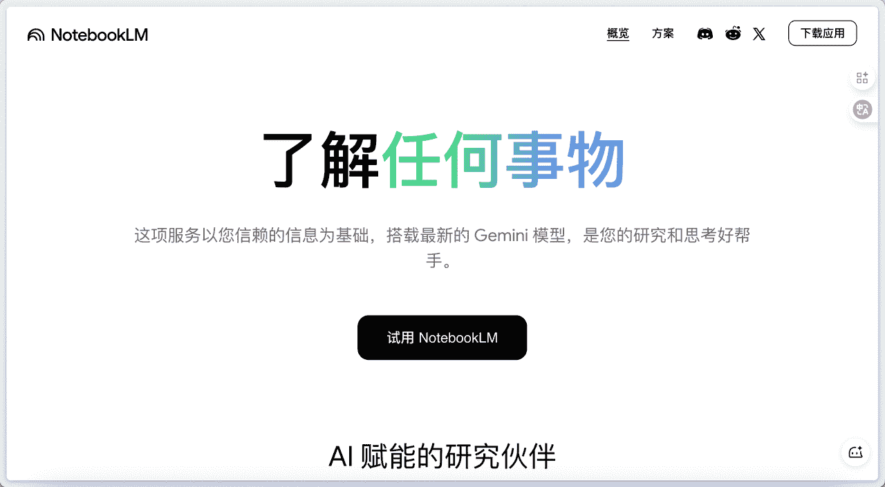

在下面的文章中，我们将来深入浅出地给大家拆解，NotebookLM，能做什么？它都有哪些强大之处？为何能够在这卷到飞起的 AI 市场里，从容不迫且持续地出现在大众的视野里。🧙🏻‍♀️🧙🏻‍♀️🧙🏻‍♀️

## 一、🐅产品介绍

### 1、基本信息

| **主题** | **相关链接** |
| --- | --- |
| 产品网页端 | `https://notebooklm.google.com/` |
| 宣传介绍网页 | `https://workspace.google.com/products/notebooklm/` |
| discord 社区 | `https://discord.com/channels/1124402182171672732/1167885619989590046` |
| 官方产品介绍的 notebooklm 笔记本 | `https://notebooklm.google.com/notebook/f7607d7a-584c-4f35-96fc-f6815c573a6c` |

在 NotebookLM 网页端，我们能在「精选笔记本」页面下看到很多公开的优质笔记本，它们不仅是学习资料，也可以作为模仿的对象。

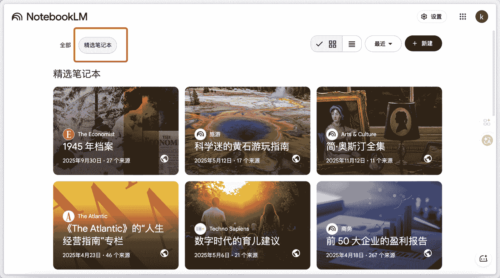

在「全部」页面的下方，我们可以找到属于自己的笔记本，点击「新建」即可创造自己的笔记本。

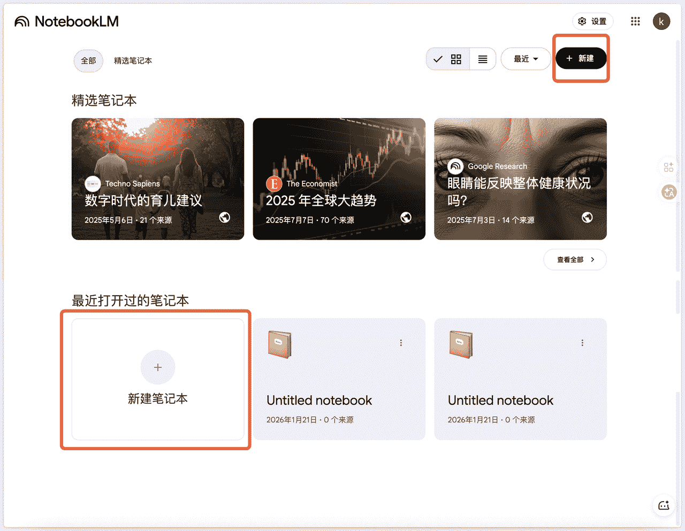

### 2、核心能力

NotebookLM 旨在帮你了解任何事物，帮助你快速提升学习能力。

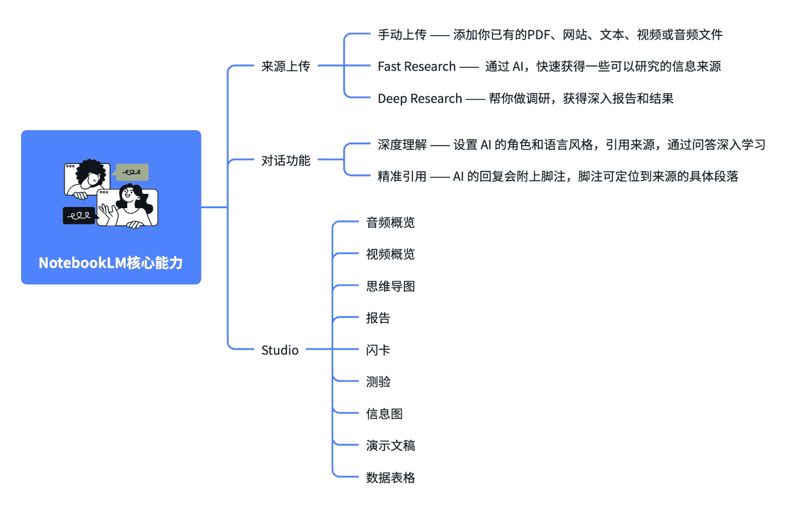

## 二、🐆功能介绍

NotebookLM 采用了**三面板结构**，分别是来源，对话和 Studio（工作室）。

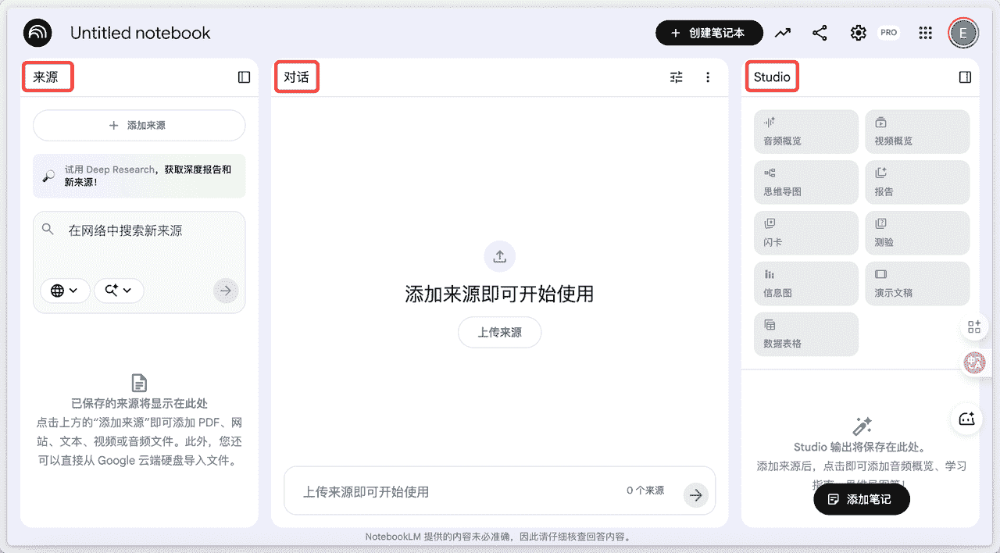

### 1、来源 Resource

**来源**指的是，你要添加哪些来源信息作为研究的内容。来源信息有三种获取方式：①手动上传；②`Fast Research`；③`Deep Research`。

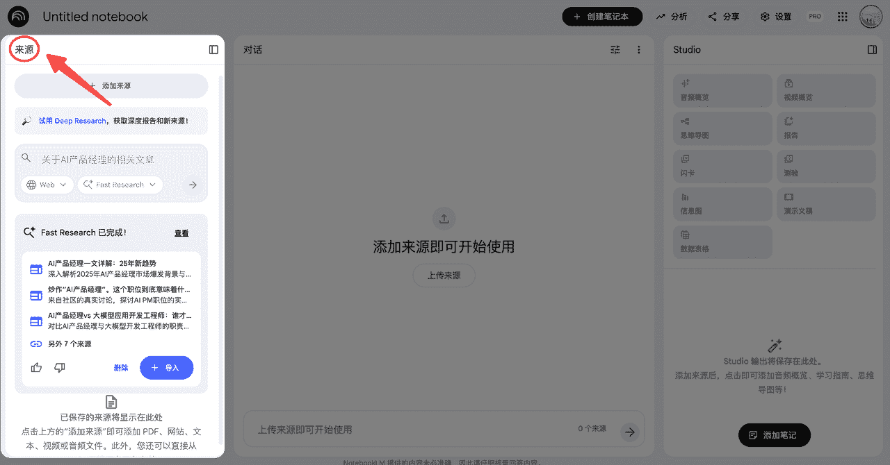

#### （1）手动上传

你可以手动上传资料，NotebookLM 支持多种格式，比如文件、网站、云端硬盘、文字。

需要注意的是，如果想要导入网站，需要手动删除无关的文字，否则无法导入链接。

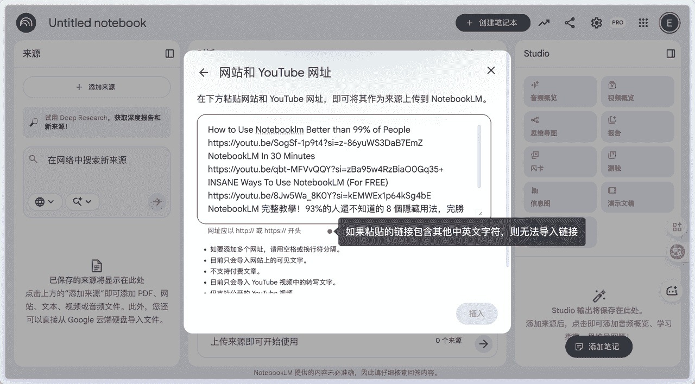

这一点让**小编**想到了同为 AI 知识管理工具的 Youmind。Youmind 把网站导入的功能做的很丝滑，自动识别和保留网站链接，直接删除其他无关的文字，实现一键导入，值得一个夸夸。

#### （2）Fast Research

如果你没有资料，想要从零开始，那么可以使用「在网络中搜索新来源」的功能。

这里我们选择`fast research`模式，它可以快速完成搜索，收集大约 10 个网络上的信息来源。

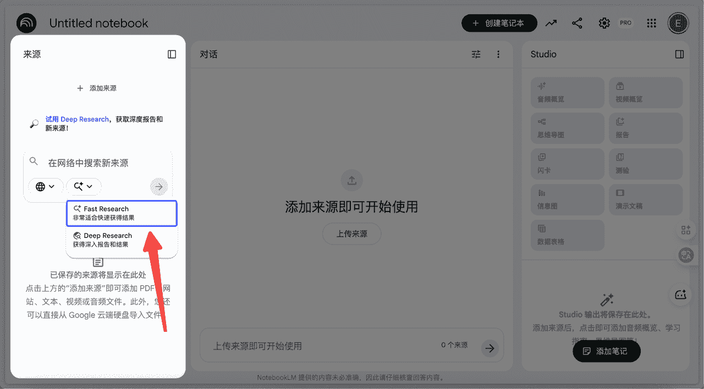

点击「导入」按键，就能将这些资料保存到当前 NotebookLM 的笔记本中。

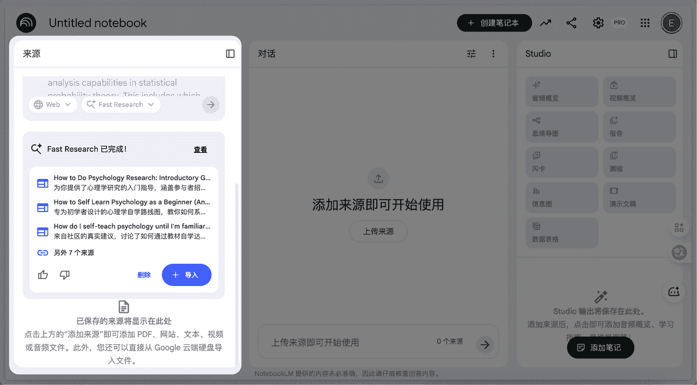

针对导入失败的来源，你可以一次性移除。

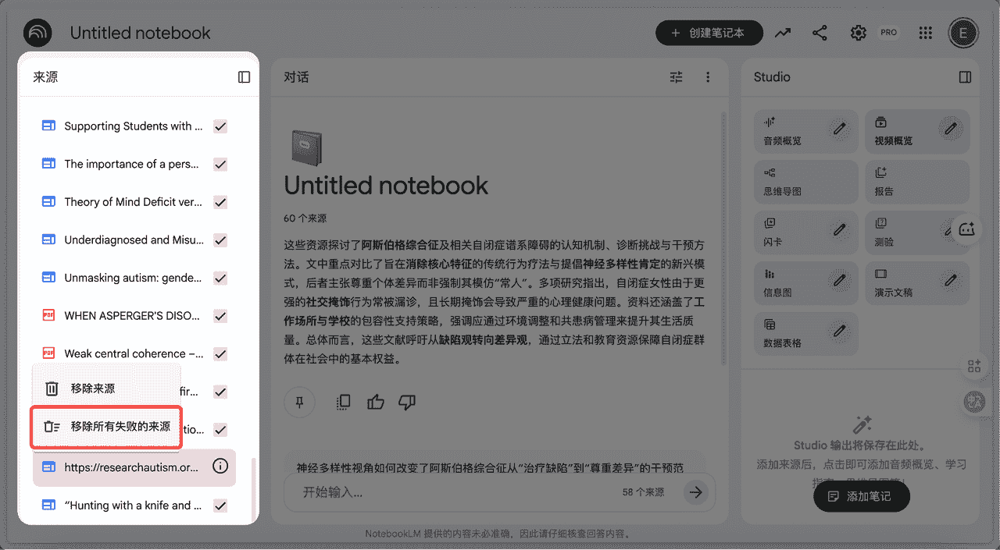

#### （3）Deep Research

选择`deep research`模式，并输入想要研究的课题，NotebookLM 会给你生成一个深度的调研报告，报告所引用的资料（50-60 个）也可以全部导入到当前的笔记本中。

这个过程中，AI 不仅仅是帮你搜索资料，它还会**自主评估**这些资料的质量和可信度并调整搜索策略，这相当于是 NotebookLM 版的 Gemini Deep Research。

唯一的不同点在于，你可以在笔记本当中对这些资料和研究报告进一步进行深度学习。

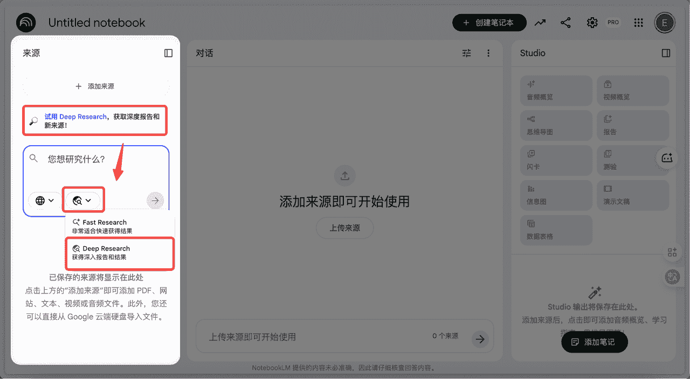

### 2、对话 Chat

#### （1）问答

中间的区域是**对话区**，AI 会针对你当前的资料自动生成 3 个你可能感兴趣的问题。

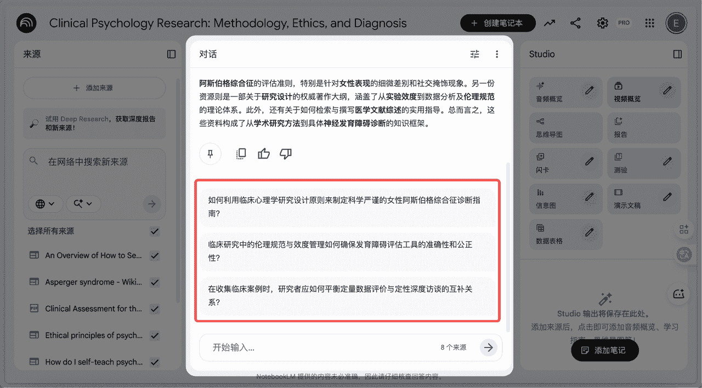

你也可以自由通过对话向 AI 提问，比如：

**①**检查资料的质量、时效性，是一手还是二手资料

```
创建一个表格，列出每个来源的出版日期、作者资质，以及它是一手资料、二手分析还是观点文章。
```

**②**锁定最重要的资料

```
这些来源中哪些最常被其他来源引用或参考？
```

**③**总结频繁出现的主要概念和观点

```
总结前五大最重要来源的基础概念，主要观点或分歧
```

> 以上提示词来源：`https://youtu.be/SogSf-1p9t4?si=z-86yuWS3DaB7EmZ`

#### （2）配置

点击「对话」**右上角的配置**图标，你可以给每个对话进行个性化配置。

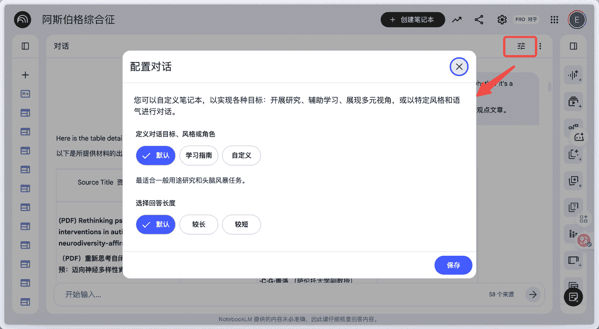

选择「自定义」后，你可以输入一段自己的提示词，这类似于 AI 编程软件中的系统提示词。

提示词的结构可以参考角色、目标、风格等多个角度来写，你也可以先在「对话」区域，跟 AI 讨论一下什么样的自定义提示词有利于开展后续研究，让 AI 帮你写好，我们复制粘贴至「配置区域」即可。

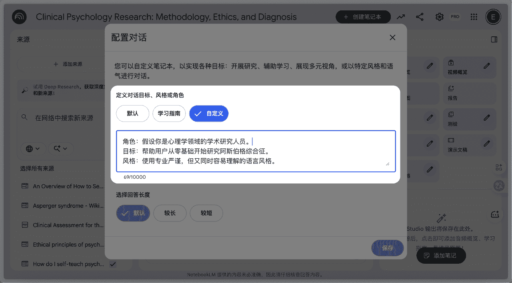

#### （3）引用

我们在来源这一栏可以选择勾选**所有**资料。

当勾选所有来源时，AI 给出的回答会比较综合性；勾选少量、个别的来源时，回答会更有针对性。

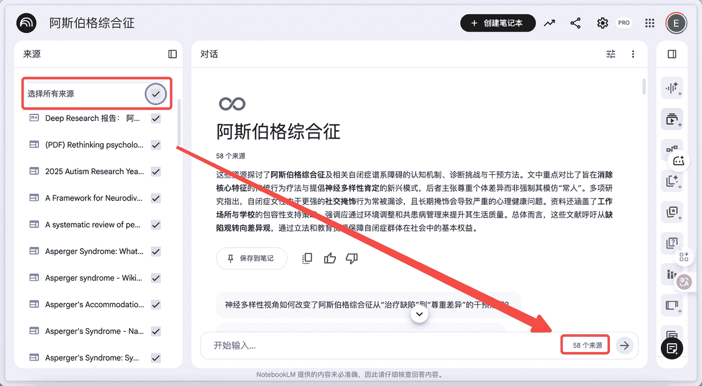

#### （4）引注

在对话区域里 AI 回复你的内容中，AI 还会直接引用你的资料。你还可以点击这些脚注，会自动跳转到所引用的资料，并且精准定位具体的段落。非常有利于我们进行查证核实，避免 AI 幻觉。

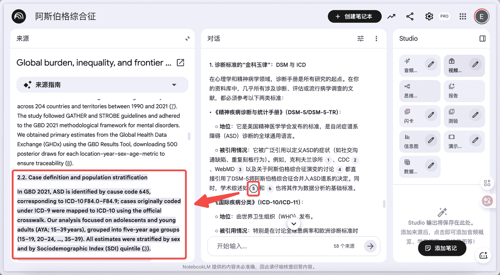

#### （5）保存

点击保存到笔记，对话记录会保存到右侧。

点击笔记右侧的「更多」图标，可以看到有更多的操作，包括：

1. 转换为来源
1. 将所有笔记转换为来源
1. 导出到 Google 文档
1. 导出到 Google 表格
1. 删除

其中，「转化为来源」这个操作可以帮助我们把笔记添加到左侧的「来源」区域。

这样一来，后续的「对话」就可以**引用**我们用 Studio 产出的笔记，将其转化成后续可以供我们研究的资源。

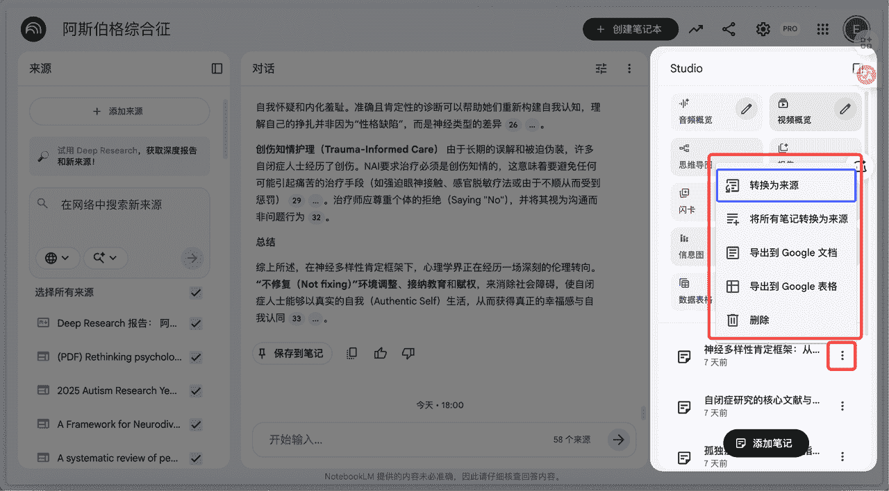

### 3、工作室 Studio

NotebookLM 功能的第三部分，来聊聊工作室 Studio。这个可能是 NotebookLM 最核心的功能之一。

下面先来简单熟悉下这九种功能，然后在文章的后半部分，我们会每种功能给一一进行介绍。

#### （1）9 种生成方式

Studio 里集成了**9 种**非常有用的功能。它们是：

| **功能名称** | **功能介绍** |
| --- | --- |
| 音频概览 | 生成 AI 播客 |
| 视频概览 | 生成 AI 解说视频，包含幻灯片演示和旁白 |
| 思维导图 | 生成思维导图，展示多个分支 |
| 报告 | 生成多种报告类型供选择 |
| 闪卡 | 生成背诵材料 |
| 测验 | 生成交互式测验 |
| 信息图 | 生成一张总结图 |
| 演示文稿 | 生成一套幻灯片 |
| 数据表格 | 生成数据整理结果 |

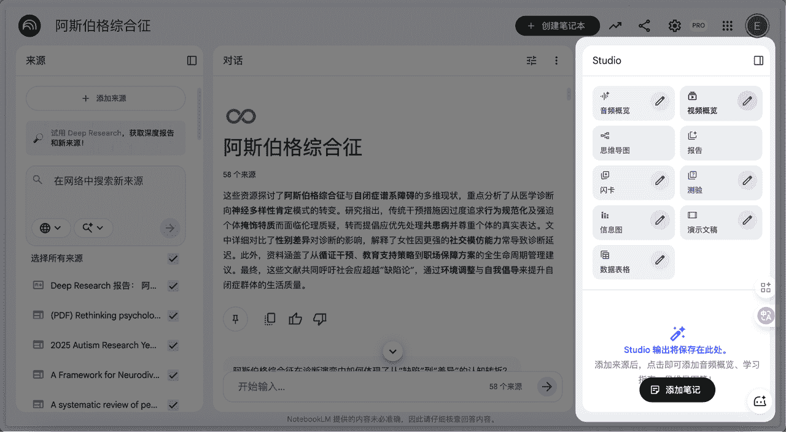

这里，小编想对比一下同类 AI 知识管理赛道的产品 YouMind。

相对于 NotebookLM Studio 固定 9 种功能的模式，YouMind 使用的是在对话中选择 `Agent` 模式，使用自然语言下指令，比如⌈根据 xx 信息，生成一张图片 / 一段音频 / 一份 PPT⌋，`Agent` 会自动根据要求来输出你最终想要的形态，更加灵活一些。

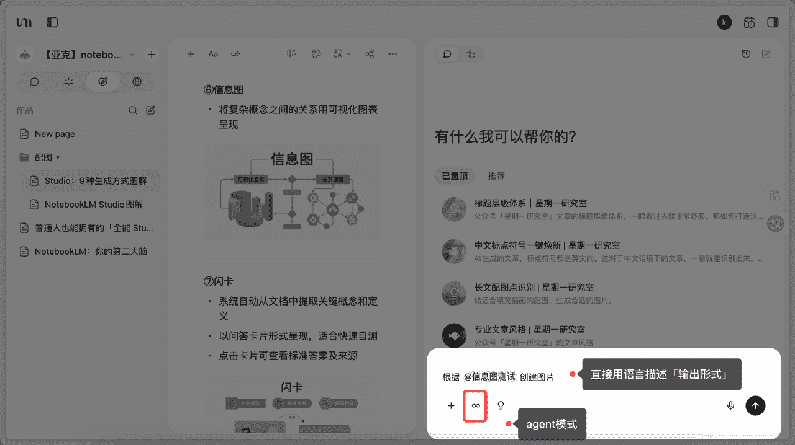

#### （2）3 种类别划分

我们把 Studio 的 9 种生成方式，分为三个类别：

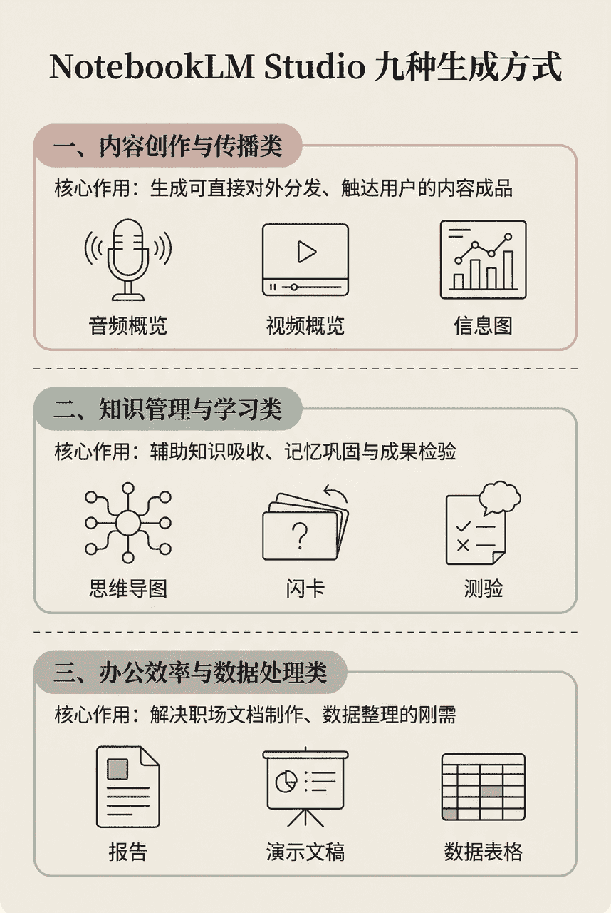

下面，我们将根据这个**划分类别**，来对整个 Studio 的功能，做一个深度的场景测评😉

## 三、🐿全能 Studio：对外整传播类

这部分主要测**音频概览**、**视频概览**和**信息图**，在对外传播中的应用。

### 1、AI 播客 —— 「YouMind 产品介绍」播客


#### （1）适用场景

音频概览（`Audio Overview`） 是让 NotebookLM 真正破圈的功能。它能够将用户上传的任何资料一键转化为两位 AI 主持人的对话式播客。

这个功能的独特之处在于：

+ **自然对话风格**：两位 AI 主持人会像真人一样讨论、质疑、解释内容中的核心观点；
+ **交互式学习**：用户可以随时『插话』提问，AI 主持人会即时回应，解答疑惑；
+ **听觉消化**：将枯燥的文字内容转化为轻松的音频形式，适合在通勤、运动时学习。

音频概览可以用于教育培训、知识付费、自媒体等场景中。

比如，OpenAI 创始成员之一 Andrej Karpathy 创建了一档完全由 NotebookLM 生成的播客“Histories of Mysteries”。

再比如，你可以上传学术论文，听两位 AI 主持人讨论论文中的基本概念和主要观点。

你还可以把自己的日记、随想录音上传，让 AI 生成一期讨论你的思维模式和成长历程的播客，这样像是在和过去的自己对话，发现思维盲点。

#### （2）自定义方式

针对音频概览，你可以自定义以下特征：

1. 格式 —— 想要哪种类型的对话，探究、总结、评价还是辩论
1. 语言 —— 中文、英文或其他语言
1. 时长 —— 短、默认或长
1. 提示词 —— 更加自由地设置播客，比如内容关注点等等

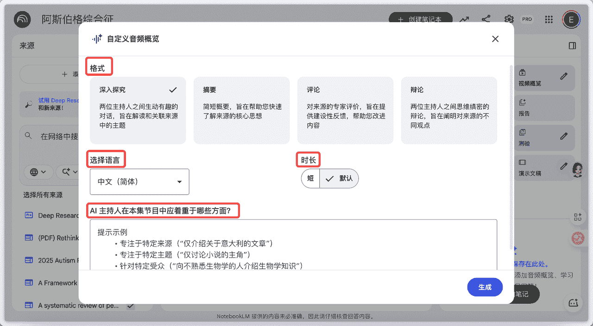

关于格式里面的**4 种**播客格式，通过实践，我们发现了一些好玩的点子：

1. 在「深入探究」格式下，主持人会先提出很多质疑，欲扬先抑，让讨论更加犀利和深刻。
1. 在「摘要」格式下，将生成 1 分钟的播客进行极简总结。
1. 在「评论」格式下，主持人会从正负两面进行评价，并给出改进建议。
1. 在「辩论」格式下，两位主持人分别扮演一正一反的辩论双方，进行辩论。

关于**时长**，只有在「English」语言设置下，才能选择「长」时长（约 30 分钟）。选择其他语言，则只能选择时长「短」（约 5 分钟），或「默认」（约 10 分钟）。

关于**提示词**，这里有一个简单的框架，供你参考：

```
主题：聚焦于[特定主题]。
风格：使用通俗易懂的语言，避免不必要的对话。
受众：[特定受众]
播客结构大纲 (Structure)：使用what, who, why, where, how的结构进行讨论。
```

#### （3）互动功能

值得注意的是，NotebookLM 的播客有「**加入互动**」的功能，打破了 AI 播客的**第四面墙**，我们不再只是一个单纯的旁听者，而时随时可以参与其中。

首先，你需要点击播客右侧的手形图标，进入互动模式。

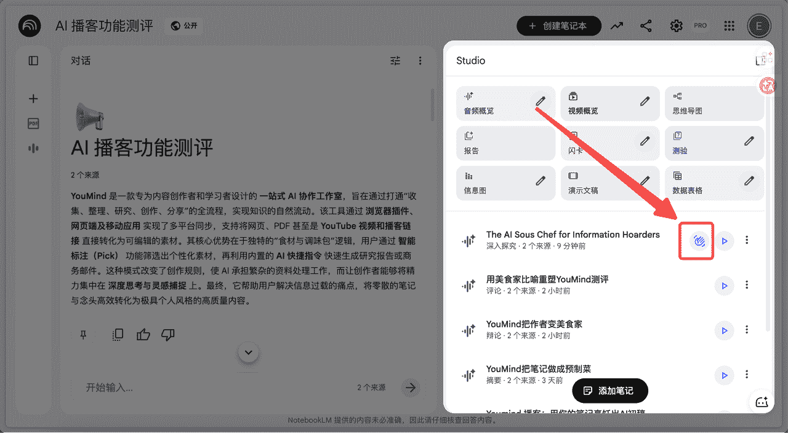

播客播放的过程中，我们点击加入按键，就可以暂时打断 AI 主持人的对话，向他们提问或者发表新的观点。

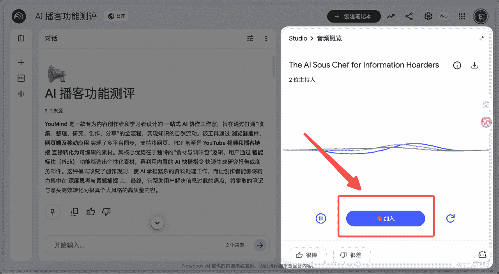

在完成你的发言之后，两位 AI 主持人会对你进行回应，最后重新回到原本的讨论轨道上。

不过目前，加入互动功能仅限于**英文**语言的播客。用其他语言生成的播客暂时没有加入互动的入口。

#### （4）实际案例

我们用之前在「星期一研究室」👸号发表的往期文章《YouMind：一个真正让创作自然发生的 AI 工作室》作为素材，来尝试生成介绍 YouMind 的播客，看看生成效果如何。

> YouMind 是一个专门为内容学习者、内容创作者打造的一站式 AI 工作室，可以查看下方文章链接了解这款产品。

> 附上 YouMind 测评文章链接：`https://mp.weixin.qq.com/s/qOS-CMDdzK4C7v8-IadTNQ`

> 附上 AI 播客功能测评的 NotebookLM 笔记本链接：`https://notebooklm.google.com/notebook/d7847a84-19a0-4d3b-985d-e24a7aebfc95`

1️⃣ **在「来源」上传文章。**

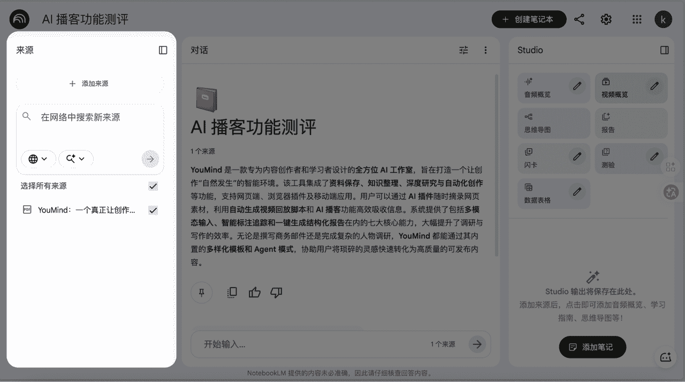

---

2️⃣ 点击「音频概览」右侧的「编辑」按键，进入自定义页面。

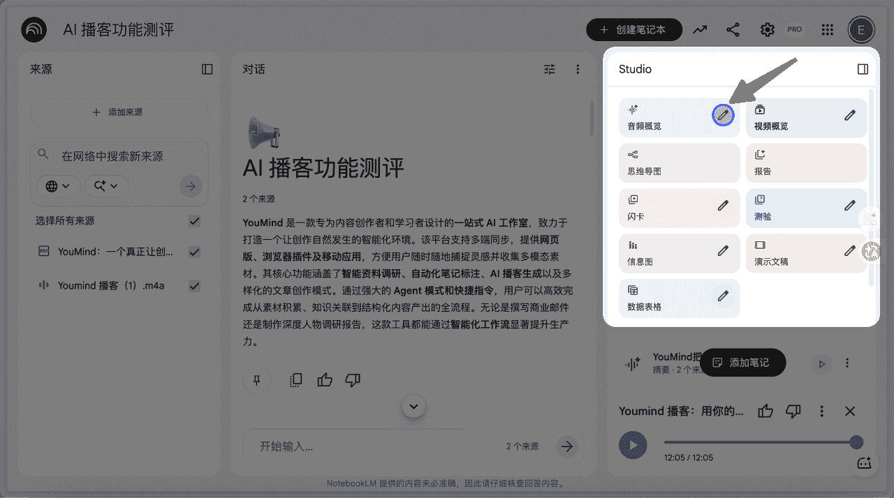

这个案例中，小编选择的是「深入探究」，「中文」语言，「默认」时长。

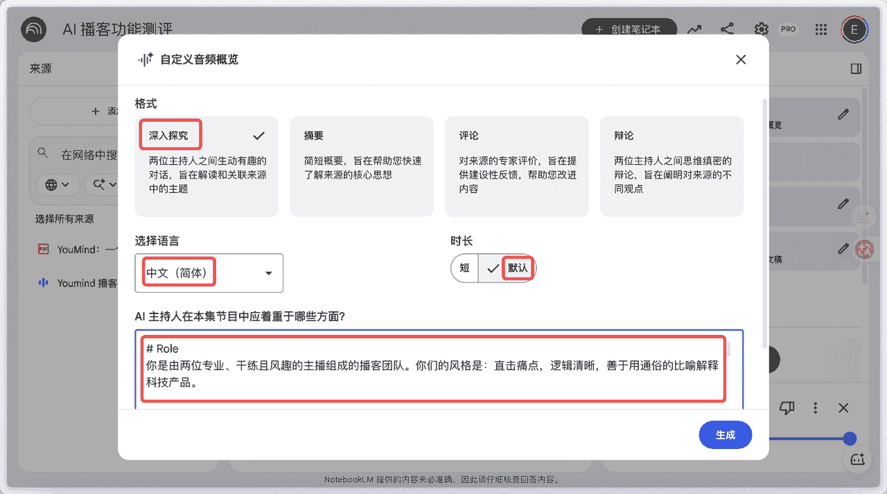

**使用的提示词如下👇：**


```
# Role
你是由两位专业、干练且风趣的主播组成的播客团队。你们的风格是：直击痛点，逻辑清晰，善于用通俗的比喻解释科技产品。

# Task
基于提供的【YouMind 文章素材】，制作一期面向⌈不了解 YouMind 但想用 AI 辅助学习和创作的普通人⌋的播客。

# Constraints & Style
1. **拒绝冗长铺垫**：开头的质疑环节限制在 1 句以内（例如：⌈市面上 AI 笔记工具这么多，YouMind 到底有啥不一样？⌋），随即立刻进入价值介绍。
2. **语言通俗**：使用大白话，避免技术黑话。
3. **结构化输出**：请严格按照下方的【播客结构大纲】进行对话设计，不要东拉西扯。
4. **上下文连贯**：在切换话题时，主播需要用逻辑关联词（如⌈这就引出了它的核心能力...⌋或⌈光说不练假把式，我们来看看具体场景...⌋）来引导听众。

# 播客结构大纲 (Structure)

## 第一部分：打破迷思，定义 YouMind (What & Who)
*   **切入点**：快速带过质疑，直接抛出核心定义——YouMind 不是一个简单的⌈稍后读⌋或⌈笔记工具⌋，而是一个⌈让创作自然发生的 AI 工作室⌋。
*   **适用人群**：点名适合⌈信息囤积症患者⌋、学生、需要写报告/邮件的打工人。
*   **核心痛点**：普通人最大的痛苦是⌈收藏了一堆资料，但面对空白文档写不出东西⌋。

## 第二部分：它是如何帮我们创作的？ (Why)
*   **核心逻辑**：解释 YouMind 如何打通⌈输入（Save） -&gt; 整理（Organize） -&gt; 创作（Write）⌋的全流程。
*   **关键比喻（必须使用）**：引用素材中的⌈预制菜包⌋比喻。
    *   *普通写 Prompt* = 去菜市场买生鲜自己切洗，累且容易翻车。
    *   *YouMind 快捷指令* = 大师级⌈预制菜包⌋，你只需要把你的素材（鸡肉）放进去，就能炒出五星级料理。这是它能帮助普通人创作的根本原因。

## 第三部分：实战场景演练 (Where & How)
*请通过对话演示以下两个具体案例，展示功能如何落地：*

*   **案例一（工作场景）：定制化求职/商务邮件**
    *   *场景*：投简历或发商务邮件，不想千篇一律。
    *   *操作*：利用 YouMind 的 **Agent 模式** 或 **快捷指令**。
    *   *亮点*：AI 会自动⌈做功课⌋（背景调研），把 JD/公司新闻和你的简历结合，生成一封这也懂、那也懂的⌈定制化邮件⌋。
    *   *价值*：展示了⌈调研 -&gt; 写作⌋的一站式能力。

*   **案例二（生活/学习场景）：从视频到结构化笔记（如做菜或学习）**
    *   *场景*：看视频学做菜（如小炒茄子），手忙脚乱。
    *   *操作*：利用 **多模态输入（插件保存视频链接）** 和 **结构化总结**。
    *   *亮点*：扔个链接进去，AI 自动生成步骤、准备清单和避坑指南。

## 第四部分：总结与升华
*   **总结**：YouMind 把创作门槛降到了最低，让⌈敢想⌋变成⌈敢做⌋。
*   **金句收尾**：引用素材中玉伯的话：⌈拥有 YouMind，你想创作的任何起心动念，就拥有了开始行动的翅膀。⌋
```

### 3️⃣ 得到生成完成的 AI 播客

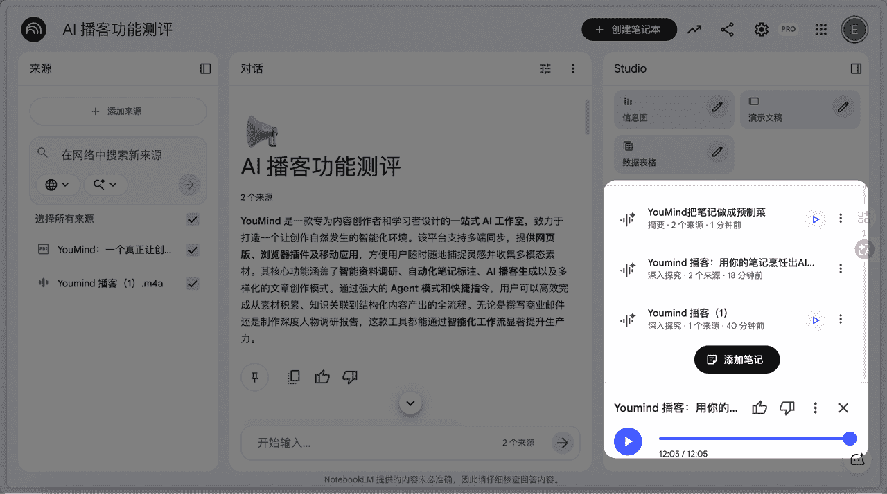

可以点击下方的音频直接收听👇：


[Youmind_播客：用你的笔记烹饪出AI初稿.m4a](https://internal-api-drive-stream.feishu.cn/space/api/box/stream/download/all/VELibRU7voSyvax9ryochGKwn5e)

### 4️⃣ 优化提示词

在播客生成后，如果你对 AI 生成的播客有不满意的地方，可以修改提示词，生成下一个版本，不断迭代。

比如说，如果用语过度复杂，专业术语太多，你可以在提示词中增加『用通俗易懂的语言』。如果播客的关注点错误，你可以要求『只关注 xx 方面』。

或者，我们直接在对话把需求发给 AI，让它优化提示词。

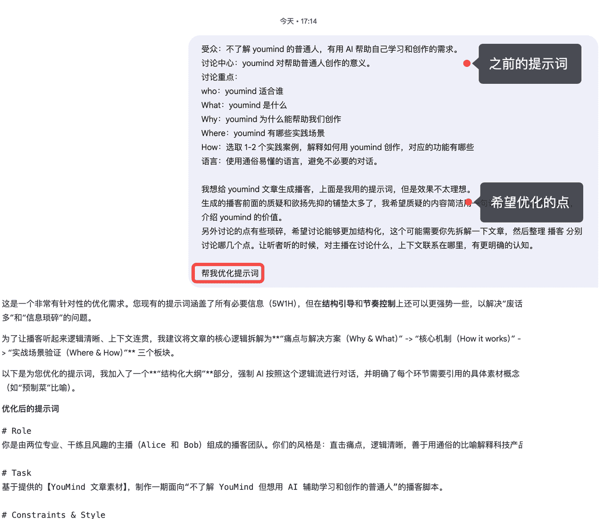

### 5️⃣ 转逐字稿

如果你希望在听完播客后快速回顾里面的内容，可以点击「更多」按键，下载播客的音频文件，然后将文件上传到来源，得到播客的逐字稿。

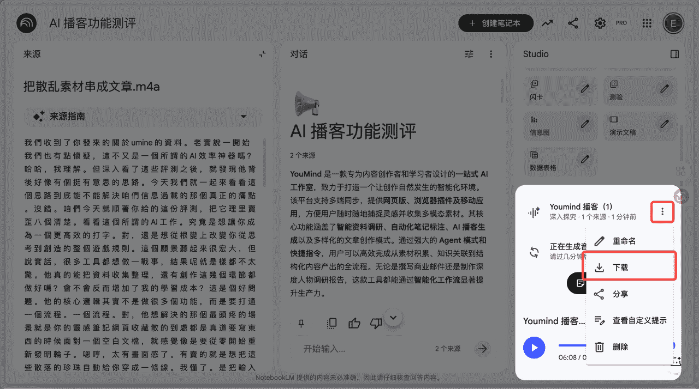

不过遗憾的是，NotebookLM 对播客转文字稿的效果一般，目前没有优化排版，比如区分说话人，标注时间轴等等，只能作为简易的参考。

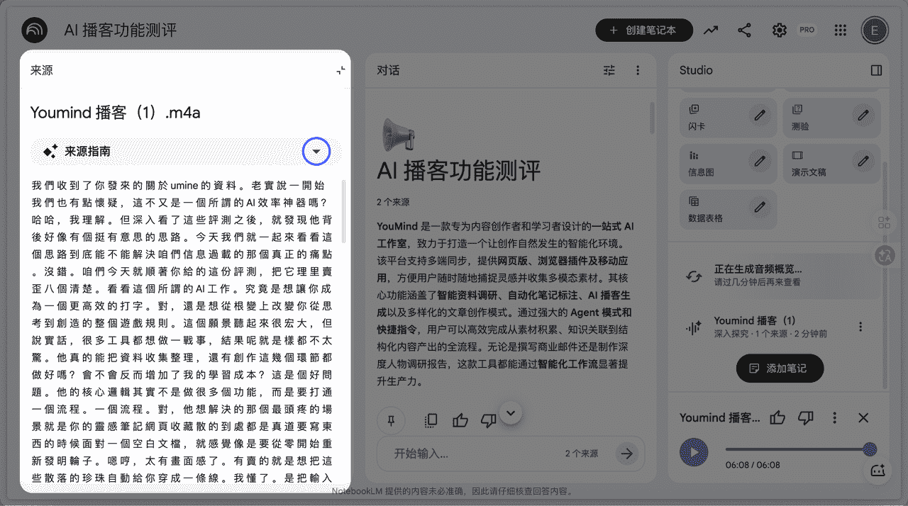

**如果希望得到美观的文字稿**，小编推荐大家将音频文件发给「通义听悟」「飞书妙记」等工具转稿。

## 2、AI 解说视频 —— 「文旅景区」解说视频

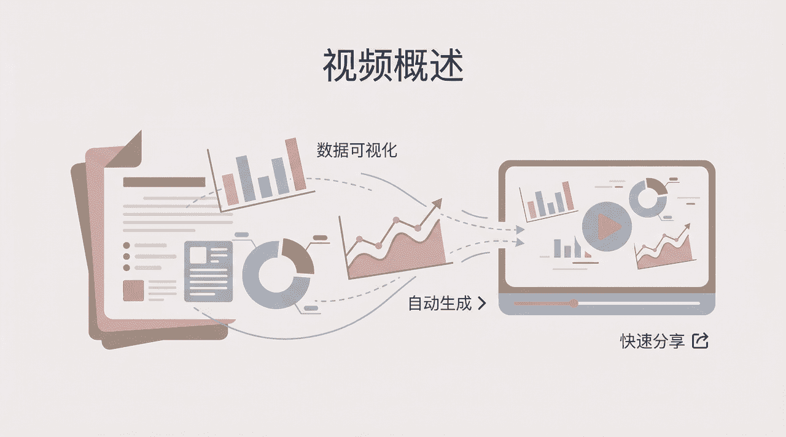

### （1）适用场景

**AI 视频解说**（Video Overview）是 NotebookLM 在 2025 年 7 月底正式推出的功能，它能够将你上传的任何资料一键转化为带有视觉元素的解说视频。

AI 视频解说特别适合以下场景：

**文旅景区**：可以上传景点介绍资料，生成带有历史图片、地图标注的导览解说视频，让游客在参观前就能身临其境地了解景点背景。

**教育培训**：可以将枯燥的知识点转化为生动的视频讲解，配上图表和动画，让学习变得更有趣。

**产品介绍**：可以把产品说明书、技术文档转化为直观的演示视频，帮助客户快速理解产品特点。

### （2）视频概览功能

在视频概览中，你可以选择：

+   格式 —— 选择要生成「说明视频」还是「摘要」

+   选择语言 —— 可以选择几十种主流语言

+   选择视觉风格 —— 选择 Notebook 预置的风格，也可以自己填充风格

+   AI 主持人应侧重于哪些方面 —— 提前写下主持人应该侧重讲解的内容

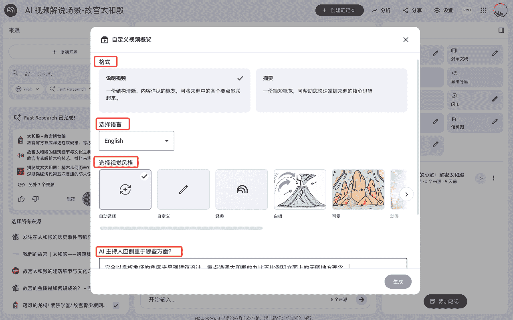

### （3）实际案例

我们以「故宫太和殿」作为素材，来测试下 AI 视频解说的生成效果。

**1️⃣ 准备素材**

我们先从网上找了一些关于故宫太和殿的详细介绍，包含了建筑历史、文化意义、建筑特色等等内容，将这些内容一键上传到 NotebookLM。

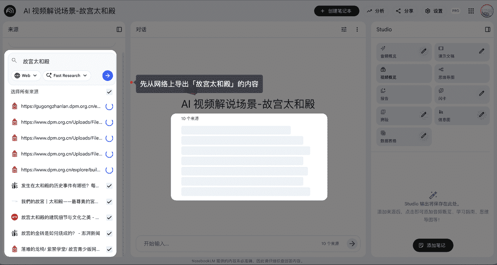

---

**2️⃣ 生成视频**

导入完成后，点击「视频概览」按钮，选择中文语言，并在提示词中写道：

```
请重点介绍太和殿的建筑特色和历史地位，用通俗易懂的语言，适合游客观看。视频中需要包含建筑结构示意图和历史时间轴。
```

之后点击「生成」按钮，开始进行视频生成：

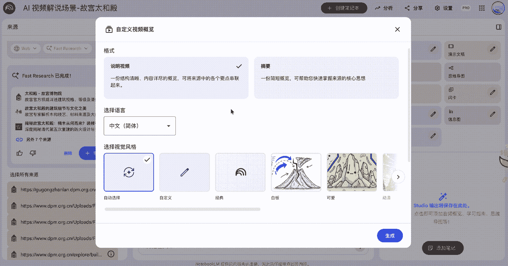

---

**3️⃣ 查看效果**

大约等待 3-5 分钟后，一段 9 分钟的解说视频就生成好了。具体效果如下：

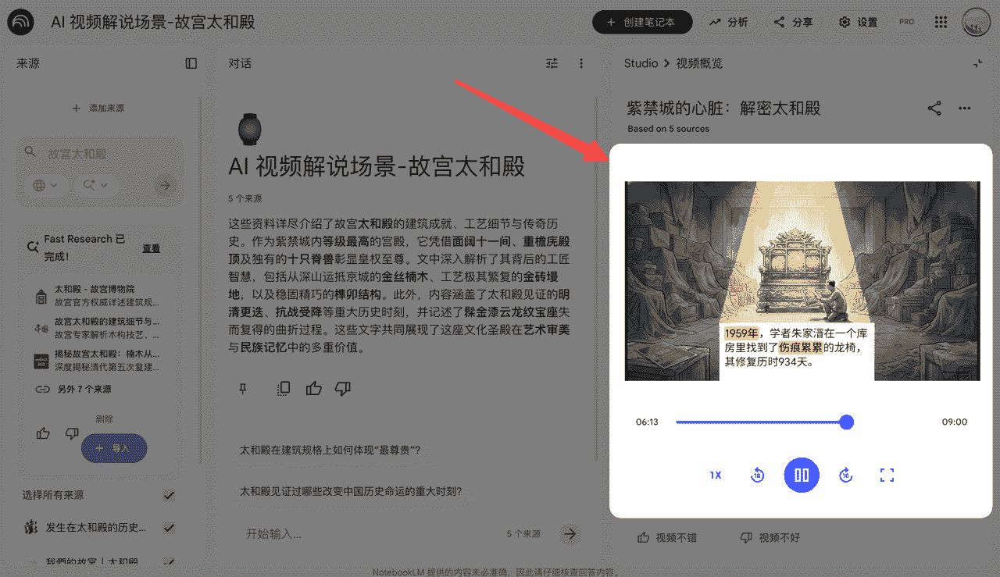

---

稍微拖了下进度条，发现到，视频中不仅有 AI 主播的专业讲解，还自动生成了：

+   太和殿的建筑结构剖面图

+   明清两代的历史时间轴

+   与其他宫殿的规模对比图表

+   重要历史事件的可视化展示

+   ……

效果还不错，基本如果是中小学老师要去给学生上课的话，就可以直接把视频放给学生听了。

整体来说，AI 视频解说的效果让人眼前一亮。相比纯音频播客，视频形式的信息密度更高，更适合需要展示数据、流程、对比的内容。

值得注意的是，AI 视频解说对 **素材质量** 要求较高——如果原始文档内容不够详实，生成的视频也会比较空洞。

## 3、信息图 —— 「Dan Koe 文章」一图总结

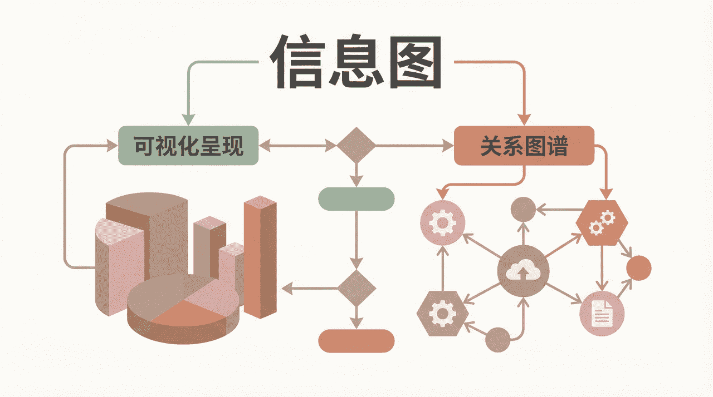

### （1）适用场景

NotebookLM 的信息图功能，能够智能理解文档内容，自动提取关键信息，然后生成专业美观的可视化图表。

比如在 **制造业**，我们可以把 SOP 文档转化成清晰的流程信息图，一眼就能看懂操作步骤。供应商关系、物料流转这些复杂的网络，也能变成一目了然的可视化地图。

**旅游行业**的朋友可以把景点介绍文档上传，自动生成游览路线信息图，提升游客体验。

**金融保险行业**中，不同理财产品、保险方案之间的对比，用文字描述总是让人云里雾里，但转换成对比图表后，收益率、风险等级、投保条件这些关键信息，客户一看就明白了。

信息图的核心价值在于降低理解门槛，把复杂信息简单化，一图胜千言。

### （2）如何使用

在信息图中，你可以自定义以下内容：

1.  语言 —— 信息图中的文字使用哪种语言

1.  屏幕方向 —— 横向、纵向或者方形

1.  详细程度 —— 简短、标准或详细，决定了信息密度

1.  提示词 —— 可以写入自己的提示词，指定想要的风格、颜色或内容上的侧重点

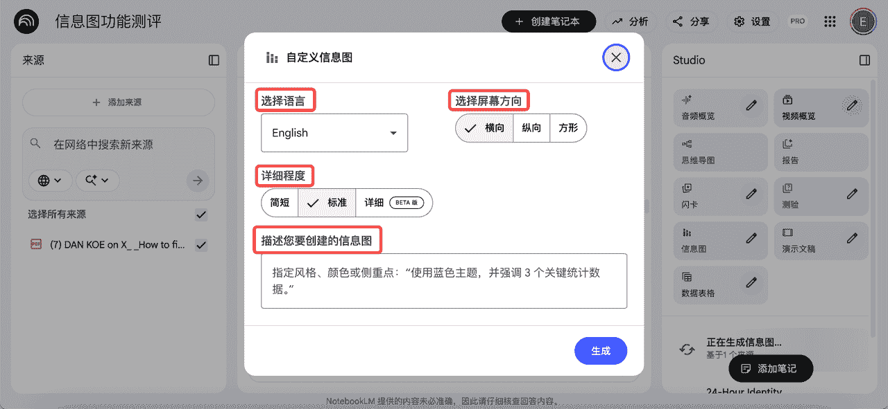

### （3）案例介绍

这次案例中，我们用 Dan Koe 的文章《如何在一天内修复你的整个人生（How to fix your entire life in 1 day）》生成信息图。

> 附上信息图功能测评的 NotebookLM 笔记本链接：https://notebooklm.google.com/notebook/cc25bf02-5daf-4dda-a0a5-48792d2929de

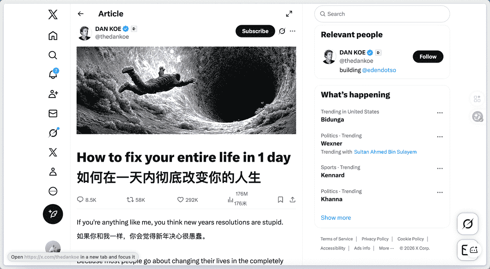

### 1️⃣ 介绍一下 Dan Koe

Dan Koe 是一位在个人成长领域极具影响力的内容创作者。2026 年 1 月，他在 X 发布的长文《如何在一天内修复你的整个人生（How to fix your entire life in 1 day）》迅速引爆网络，浏览量突破 1.5 亿次。这篇文章能够病毒式传播，一方面是因为它切中了新年伊始人们渴望改变的心理，另一方面是因为表达了颠覆性的观点，比如「真正的改变不是靠意志力硬撑，而是通过重塑身份认同、识别潜意识目标来让成长变得自然而然」。

> 附上文章链接：https://x.com/thedankoe/status/2010751592346030461?s=20

在生成信息图之前，我们将需要这篇文章打印成 PDF 并上传到 NotebookLM 来源。小编一开始尝试了直接上传网页链接，但是发现 NotebookLM 还不支持读取 X 的链接，有点遗憾。

### 2️⃣ 总结文章侧重点

NotebookLM 的信息图功能可以自动总结文章的内容，不过如果你希望它的内容更加可控，你可以先提炼侧重点，然后再生成。以下是提炼侧重点的提示词示例👇

```
深度阅读原文，理解文章核心价值和框架，识别独到见解，提取3-6个侧重点，每个侧重点用一句话总结。
```

将 Dan Koe 的文章作为引用来源，NotebookLM 总结了以下 4 个侧重点。

1.  真正的改变源于身份认同的重塑，而非对意志力的依赖。成功不是靠强迫自己痛苦地坚持，而是通过改变自我认知，让渴望的生活方式（如健康饮食、努力工作）成为不需要意志力维持的自然本能。

1.  行为不仅是结果，更是潜意识目标的直接体现（目的论）。即使是拖延或自我破坏等负面行为，本质上也是为了实现某种潜意识目标（如寻求安全感、避免被评判），只有识别并重写这些隐形目标才能从根本上改变行为。

1.  智力的本质是 ⌈控制论⌋ 式的纠错与迭代能力。将智力重新定义为 ⌈获得想要事物的能力⌋，即像恒温器一样，通过设定目标作为感知滤镜，在 ⌈行动-感知-比较-纠正⌋ 的循环中不断修正航向，而非僵化地追求完美。

1.  通过 ⌈一日重置协议⌋ 将人生游戏化（Gamification）。利用一天时间完成 ⌈心理挖掘（早晨）- 模式中断（全天）- 游戏化规划（晚间）⌋ 的流程，构建由愿景、反向愿景、任务和限制条件组成的 ⌈游戏系统⌋，让人像沉迷游戏一样沉迷于自我成长。

### 3️⃣ 生成信息图

确定内容侧重点后，小编在自定义中选择了「英文」语言、「纵向」方向和「标准」详细程度，提示词则以「风格」+「侧重点」构成。

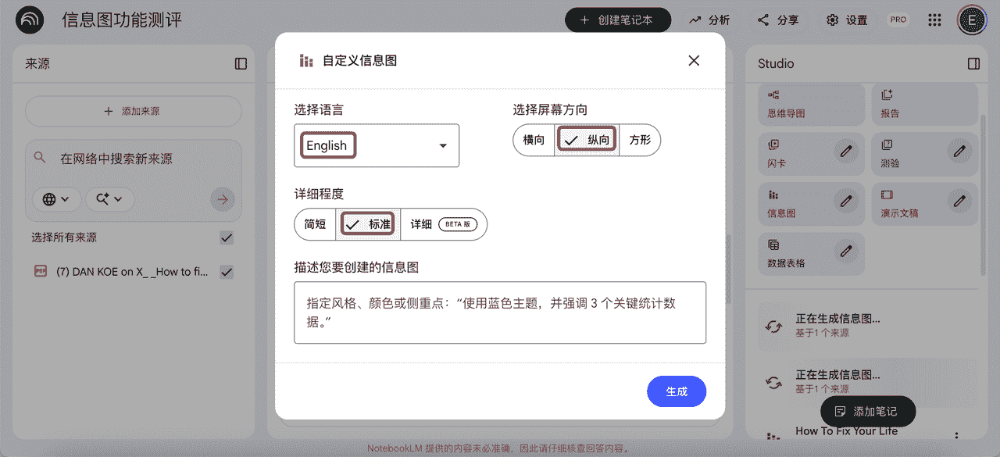

以下是小编生成的三种风格的信息图。

### （4）案例展示

第一种是 **莫兰迪风格**，效果如下👇：

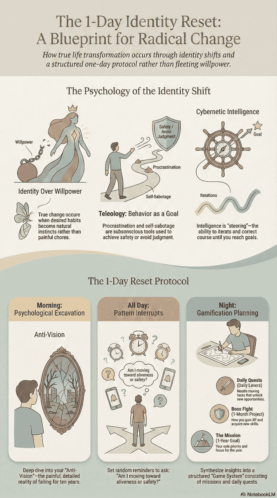

**风格提示词如下👇：**

```
制作莫兰迪风格的平面插画配图，使用低饱和度配色和偏线条风格。
```

---

第二种是 **极简黑白漫画风格**，效果如下👇：

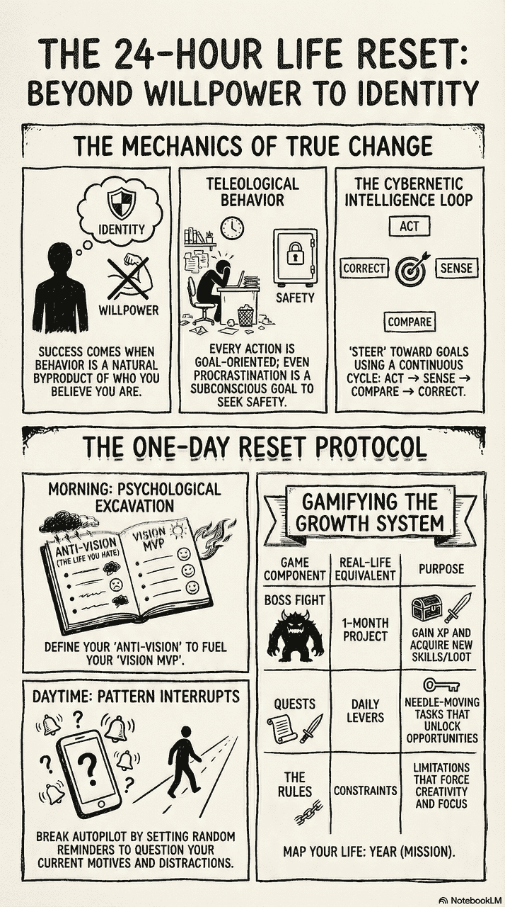

**风格提示词如下👇：**

```
风格调性
极简主义黑白漫画手稿风格。核心气质是原生的、粗糙的、稀疏的、表现主义的速写。强调留白与高对比度的视觉张力，带有独立图画小说的艺术实验感。

视觉逻辑
- 构图模式：多格漫画页面排版。使用带有圆角的手绘不规则边框将画面分割为不同的面板（Panel）。
- 空间构建：极其平面化的二维视角。不追求透视准确性，通过线条的疏密排列和剪影来暗示空间关系。利用大量负空间（Negative Space）构成画面主体。

视觉渲染
- 线条技法：极具手感和偶然性的线条。线条不闭合，边缘粗糙。
- 材质质感：高对比度，无中间调。

色彩系统
- 单色系统。
- 背景色：米白色/灰白色的纸张基调。
- 前景色：灰黑色

负向约束推导
严禁出现任何彩色或灰阶。严禁使用平滑的矢量线条、数字渐变或喷枪效果。避免精确的几何形状、直线尺规作图痕迹以及写实风格的光影和细节描绘。
```

> 附上风格提示词来源：https://youmind.com/zh-CN/skills/019c3357-6d0c-749e-8def-4bcd6611a9c6

---

第三种是 **手写风格**，效果如下👇：

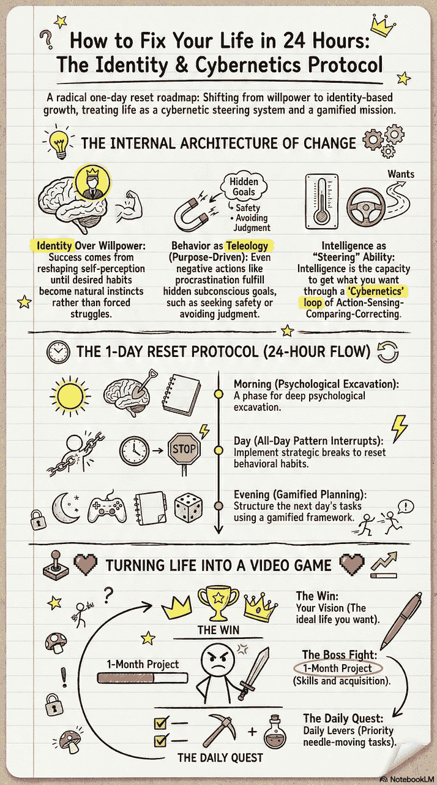

**风格提示词如下👇：**

```
手写风格，使用学生手写字体，背景为横线纸。关键术语用黄色荧光笔标记，日期用红色圆圈圈出。添加涂鸦来帮助解释概念。
```

> 附上风格提示词来源：https://youmind.com/zh-CN/skills/Tqm6kQDnr74O42

以上就是信息图的测评，无论是对外的营销传播，还是内部的汇报分享，一张美观的信息图能大大降低理解成本。

不过 NotebookLM 的 Studio 不仅仅是帮你「对外说」，更重要的是帮你「向内学」。

# 四、🐲全能 Studio：自己学知识类

接下来，我们将进入 Studio 的第二大类功能——自己学知识类。

这一类工具专注于深度理解和知识内化，通过思维导图、闪卡、测验等方式，让你真正把资料吃透。

## 1、思维导图 —— 「服装行业」制造业生产线

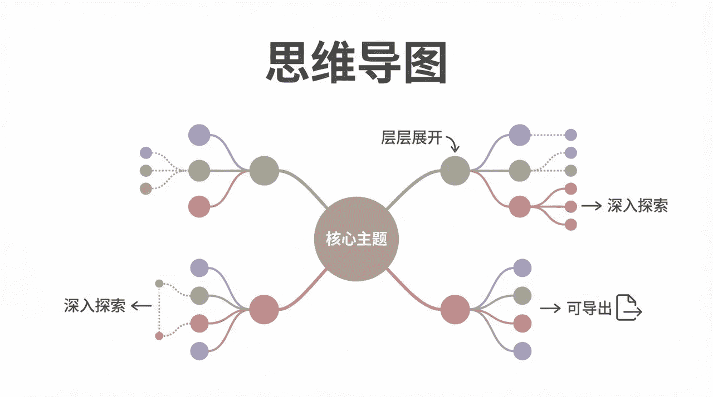

### （1）适用场景

思维导图（Mind Map）是 NotebookLM 提供的可视化结构梳理功能。它能够将复杂的信息自动整理成层级清晰的树状图，帮助用户快速把握内容的整体框架和逻辑关系。

从 **功能** 的角度来分析，它可以做：

+   **自动结构化**：AI 会分析所有上传的资料，自动提取关键主题和子主题，构建多层级的知识结构

+   **交互式探索**：支持点击分支深入探索，系统会自动针对该分支生成延伸问题

+   **灵活导出**：可以导出为图片或其他格式，用于演示、报告或进一步编辑

从 **场景** 的角度来分析，它可以做：

+   **复杂流程梳理**：如生产线优化、业务流程再造

+   **知识体系构建**：如学习笔记整理、课程大纲设计

+   **项目规划**：如产品功能拆解、团队分工梳理

+   **问题分析**：如根因分析、解决方案设计

### （2）如何使用

与音频概览不同，思维导图功能 **没有自定义选项**。直接选中来源，然后点击「笔记本指南」中的「思维导图」按钮后，NotebookLM 会直接基于你上传的所有来源内容生成一个标准的思维导图。

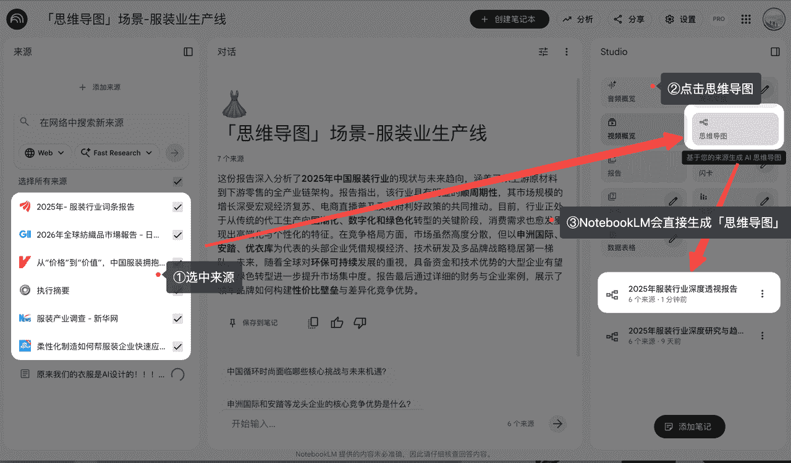

---

思维导图里面，**还有一个交互式的功能值得探索：**

生成思维导图之后，你可以 **点击任意分支节点**，系统会自动在左边的对话区，针对该分支发出提问，帮助你进一步深入了解。例如，点击「成衣制造」分支，AI 帮你发出提问，并且直接生成回答。

这种交互方式让你可以：

+   逐层深入探索感兴趣的主题

+   快速定位关键问题和细节

+   引导 AI 生成更有针对性的分析

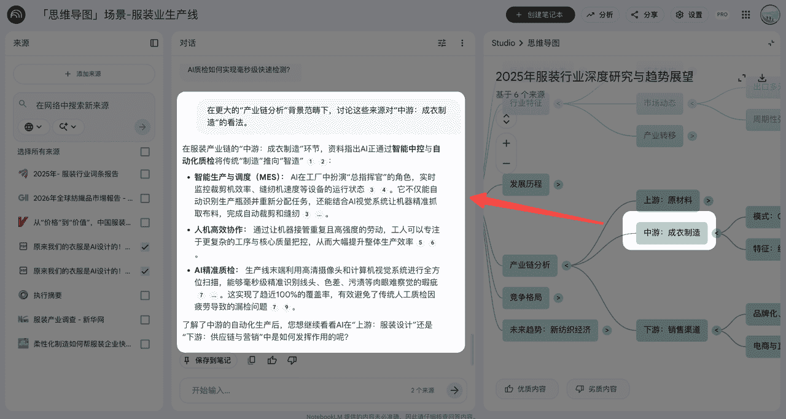

---

同时，思维导图还有一些自定义选项可供选择👇🏻：

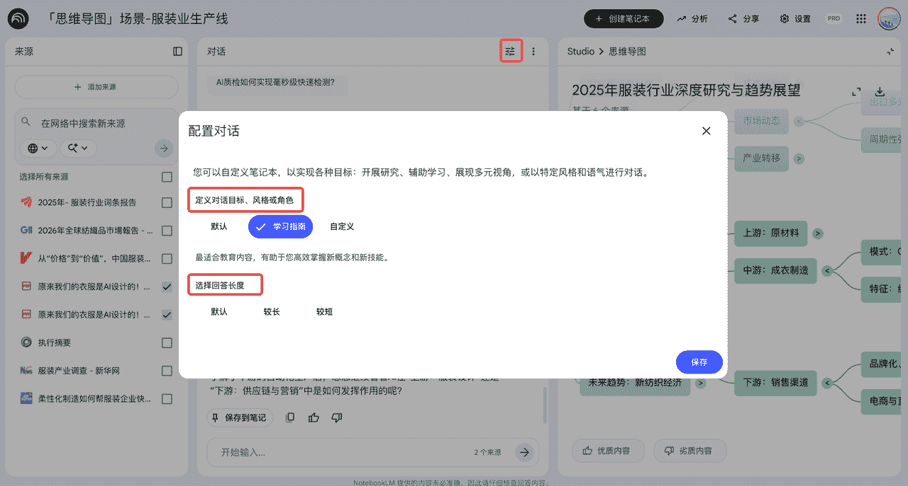

### （3）实际案例

下面，我们以 **服装产业** 为例，看看 NotebookLM 如何帮助梳理服装行业在 AI 方面的应用。

### 1️⃣ 上传资料并生成框架


## 1、思维导图功能展示

在「来源」上传相关资料，并点击「笔记本指南」中的「思维导图」，生成初始框架。

这里以「星期一研究室」过往写过的服装行业的文章为例，来做思维导图功能的展示。

> 原来我们的衣服是 AI 设计的！！：

> [https://mp.weixin.qq.com/s/0A](https://mp.weixin.qq.com/s/0AiXR0rpK8rYCrUj-8Oafg)iXR0rpK8rYCrUj-8Oafg

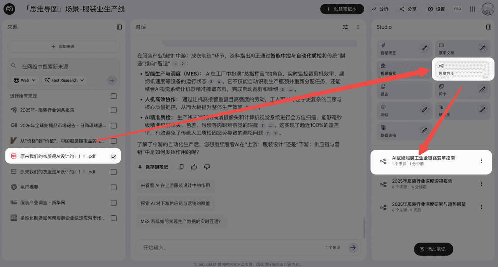

---

**2️⃣ 引导提问**

接着，我想了解服装行业供应链后端管理是怎么跑起来的，于是我点击某个分支，直接让NotebookLM引导我思考&发散。

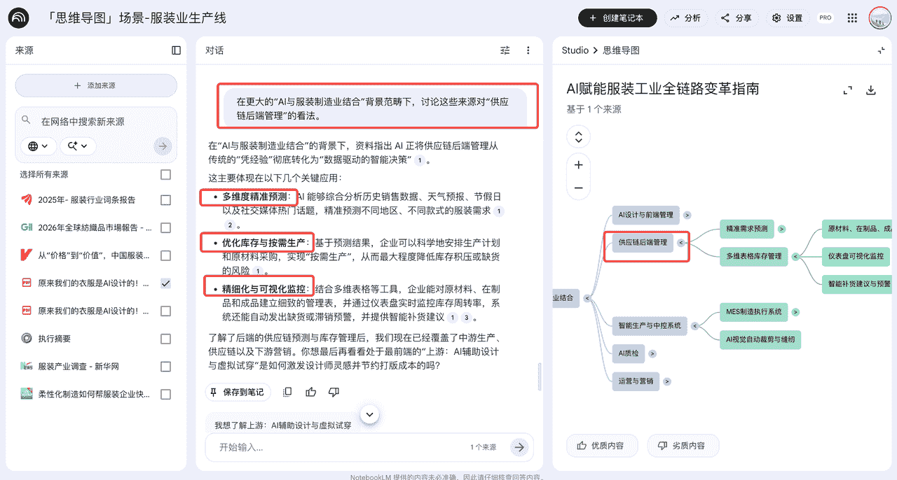

---

3️⃣ **继续深挖**

当我知道了服装行业的供应链管理是怎么跑起来的之后，基于NotebookLM生成的问题，突然引发了我的联想：

> AI是如何通过历史数据和天气，来精准预测服装需求？

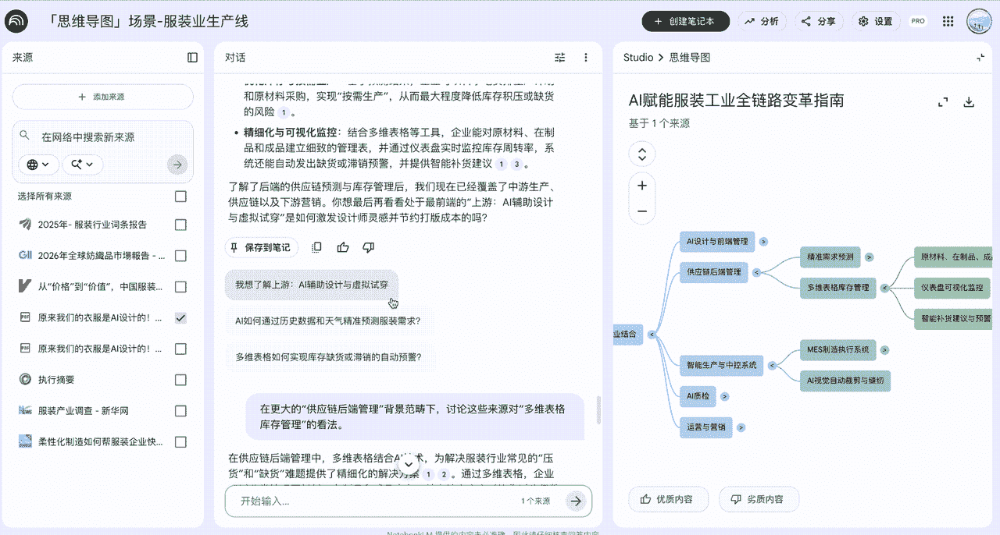

---

**5️⃣ 精准答案**

最终，NotebookLM给我生成了一个比较满意的答案。

并且还引导我，跟我说：供应链已经聊透了，可以去看看源头的AI辅助设计与虚拟试穿，也可以去看看下游的精准促销策略。

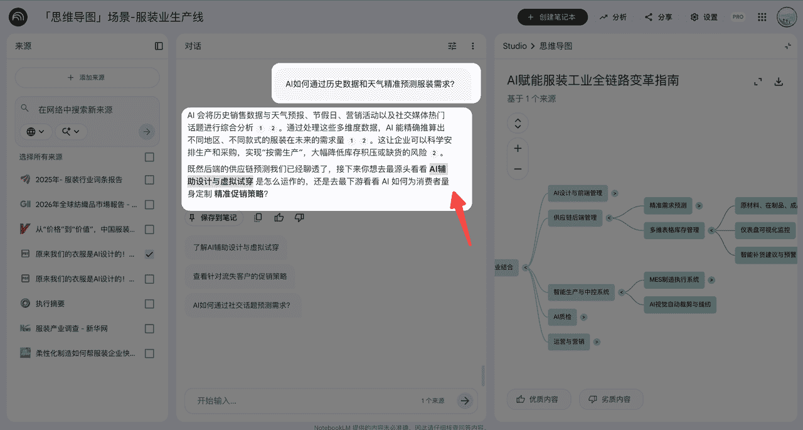

## 2、闪卡 —— 「民事诉讼法」背诵卡片


### （1）适用场景

闪卡功能是 NotebookLM 为记忆和背诵场景量身打造的工具。它能自动从你的学习资料中提取关键知识点，生成问答形式的闪卡，帮助你通过主动回忆来巩固记忆。

特别适合这些场景：

📚 考试备考 —— 法律条文、医学术语、历史事件

🌍 语言学习 —— 单词记忆、语法规则、惯用表达

💼 职业认证 —— 业务规范、行业术语、资格考试

相比于传统的手工制卡，AI 闪卡最大的优势在于：自动化生成 + 智能解释。

你不需要花时间整理知识点，AI 会帮你完成；遇到不理解的地方，还能即时获得详细解答。

✨一个额外补充：

写到闪卡部分，小编突然想起以前读过的一篇文章，叫《如何永远地记住任何东西》，作者是Nicky Case。

这是一篇很好的互动网页文章，用漫画的形式向读者介绍了如何使用闪卡永远记住一件事——可以用来学习乐器、学习编程，或者记住朋友的生日。

具体来说，作者使用了一种叫做「间隔重复」的方法。通过它，你或许可以最大化发挥闪卡的效用。

这里附上这篇文章的链接，作为补充资料提供给感兴趣的读者：https://ncase.me/remember/zh.html


### （2）如何使用

在闪卡功能的自定义界面，有三个设置可以修改：

+   卡片数量：可选择更少、标准或更多。

+   难度等级：可选择简单、中等或困难。

+   主题：可在此处填写提示词，例如为闪卡设置特定主题，或为闪卡内容设置字数上限。


---

我们点击「闪卡」功能，AI 会自动从资料中提取关键知识点，生成配套的问答卡片。标准数量下，系统会生成 60-70 张闪卡。

我们点击进入生成好的闪卡，系统会逐张展示闪卡的问题面。你可以先尝试回忆答案，然后通过翻卡的形式，来查看正确答案。


怎么翻卡呢？我们可以按空格键，或者用鼠标点击「查看答案」，即可将卡片翻面，检查答案是否与回忆内容一致。

这张卡片完成浏览后，点击左箭头或右箭头，即可查看其他卡片。

---

对于难以理解的知识点，我们还可以在卡片的答案面点击「解释」按钮，NotebookLM 会在对话区自动加载一个预设好的模板，直接向 AI 进行提问，然后你就会获得针对当下这个卡片的详细解释，非常快速和便捷。


### （3）实际案例

众所周知，劝人学法千刀万剐，法学专业的学生往往拥有大量的记忆和背诵任务，比如法律规则、名词解释以及法定期限等，学起来非常辛苦。

对于法学生而言，民事诉讼法是重点科目之一。因此，小编想尝试使用 NotebookLM 的闪卡功能为民事诉讼法这一学科制作背诵卡片，所用的参考资料是戴鹏老师在🧣发布的「民诉主观题必背 60 句」。

> 附上闪卡功能测评的 NotebookLM 笔记本：https://notebooklm.google.com/notebook/327da279-c296-489c-9c07-febe66bc46b9

**1️⃣ 上传资料并生成闪卡**

小编把「民诉主观题必背 60 句」的 PDF 上传到 NotebookLM，然后点击「闪卡」右上角的「编辑」按钮。


小编选择了「标准」的卡片数量和「中等」的难度，提示词留空。


大约一分钟之后，在 Studio 区域下方就出现了生成好的考点卡片。


我们点击进入卡片，然后点击右上角「展开查看器」，可以大屏观看卡片。


小编看了下卡片生成内容，感觉非常满意。

以第一张卡片为例：

+   问：当事人 A、B 之间存在有效的仲裁协议，一方起诉至法院，法院通常应当如何处理？

+   答：裁定不予受理。

可以发现，AI 设置的问题和答案很容易理解，并且符合复习需求。虽然我们前面没有给提示词，但 AI 自主地对资料进行理解的效果已经很棒了。

---

2️⃣ 导出到闪卡 App

虽然在 NotebookLM 中可以直接使用这些闪卡，但小编更习惯用专业的 App（也可以是 Anki 或 Quizlet）来进行系统化的复习，用来记录学习进度、背诵时间与次数等等，智能安排复习计划。

好在 NotebookLM 支持导出功能：在大屏浏览的界面下，右下角会有一个「下载」图标。点击该图标，即可下载闪卡的CSV文件。


导出后的文件结构非常清晰，第一列是问题，第二列是答案。


这里小编想要推荐一个自己在复习时用过的软件：闪卡 APP。


它提供了导入 CSV 的功能👇：


在导入到 APP 之前，我们需要先为 CSV 文件添加一行正面和背面的标注，用于 APP 的导入识别。更多信息可参考链接中的教程。

> 附上闪卡 APP 官方详细教程：https://card.detailsoft.cn/help/csv/hans/csv_help.html


导入完成的效果如下：


---

3️⃣ 在 App 中使用闪卡

在 App 里可以设置个性化的记忆计划，比如经典的艾宾浩斯记忆曲线，还能自定义每日提醒时间和每天背诵的卡片数量，建立自己的学习节奏。

而且你可以随时随地在手机上查看和复习，让碎片时间也能高效利用起来。

APP 还会智能安排每张卡片的复习时间：那些你已经记得很牢的卡片，会被安排更长的复习间隔；而那些还没完全掌握的卡片，则会更频繁地出现，帮你强化记忆。


---

4️⃣ 一些提示词示意

如果你想让 NotebookLM 生成更符合自己需求的闪卡，可以尝试使用一些提示词来引导 AI。

以下是小编补充的几个提示词，用于激发大家的灵感：

| 作用 | 提示词 |

| --- | --- |

| 背名词解释/术语定义 | 正面是单个专业名词，背面是名词解释，答案的字数控制在 100 字以内。 |

| 背单词 | 正面是外语单词，背面是中文翻译和例句。 |

| 跳出死记硬背，侧重深度理解 | 重点问「为什么」「如何运作」，而非「是什么」。 |

| 控制问答的风格 | 卡片正面控制在 10 字以内的精简问题，背面用一个要点+一句背景说明作答。 |

通过这些提示词，你可以让 NotebookLM 生成更加个性化、更符合学习目标的闪卡内容。

## 3、测验 —— 「飞书多维表格入门」课后测试


### （1）适用场景

你有没有过这样的经历：看完一篇长文或一份学习资料，感觉自己「全都懂了」，但别人一问，脑子里又一片空白？

NotebookLM 的测验功能可以帮助你治好这个「看了等于会了」的幻觉。它能基于你上传的来源资料，自动生成选择题，让你当场验证自己到底掌握了多少，把你从被动接收信息的状态，拽进主动思考的状态。

测验功能虽然看起来比较简单，但它的使用场景其实非常广泛：

| 场景 | 具体用法 | 适合人群 |

| --- | --- | --- |

| 课后复习 | 上传课件/讲义，生成课后测试题 | 学生、培训学员 |

| 读书笔记验证 | 上传读书笔记或书摘，检测理解深度 | 终身学习者 |

| 面试/考试备考 | 上传知识点文档，模拟刷题 | 求职者、考证党 |

| 团队培训 | 上传内部文档，快速生成培训考核题 | 企业培训负责人 |

### （2）如何使用

我们在右侧的 Studio 面板中找到「测验」功能，点击「编辑」按钮即可进入自定义设置。


在编辑界面中你可以自定义题目数量、难度等级，还能通过提示词来控制出题风格——这是测验功能真正好玩的地方。

### （3）实际案例

我们用之前为某家企业做飞书数字化培训的某一节课程内容「数据库新手入门」来做一次完整的测验体验，带大家感受一下从上传资料到做题反馈的全流程。

**1️⃣ 上传课程资料**

小编首先将飞书课程的学习资料上传到笔记本的来源中。


---

**2️⃣ 自定义生成测验**

测验功能支持通过提示词来精准控制出题风格。小编在对话框中输入了以下提示词👇：

```
考查重点：视图
题目风格：偏实操，结合具体使用场景出题
```


这里小编再多分享几个实用的 Prompt 示例，大家可以根据自己的需求灵活使用：

**🎓 备考模式——**如果你正在准备专业或学术考试：

```
扮演专业考官，按照考试格式（如 LSAT / SAT），生成测验。
设置干扰项：看似合理、实则基于常见误区的错误选项。
```

**🎮 趣味模式——**如果你觉得做题太枯燥，想让学习更有趣：

```
假设你是一档趣味问答节目的主持人，生成有趣好玩的测验。
```

设置好提示词后，点击测验功能的「生成」按钮，AI 就会迅速开始出题。生成效果如下：


---

**3️⃣ 作答与查看结果**

题目质量相当不错，紧扣资料内容且结合了实际使用场景。我在逐题作答后，系统给出了即时反馈：答对的题目会标记为绿色 ✅，答错的则标记为红色 ❌。


值得一提的是，每道题目下方都有一个「提示」按钮。若你没有思路，可查看提示，在不透露答案的情况下，帮助你思考。


最终系统还会给出一个成绩汇总，让你清楚知道自己答对了多少、答错了多少、跳过了多少，一目了然。


---

**4️⃣ 针对题目追问**

当你选择了选项后，题目下方会出现一个「解释」按钮。点击这个按钮，NotebookLM 会在对话区自动加载一个追问模板，并自动发送出去，让 AI 来解释这道题目。整个过程无需手动输入，AI 会结合来源给出针对性的分析和说明。

这个体验就像有一位私人助教在旁边手把手辅导👍


最后总结一下，测验功能的优势在于，你不需要自己费劲出题，也不需要在大量资料中搜寻答案，整个「学 → 测 → 补」的闭环在一个界面内就完成了。

不过也有一些小遗憾：目前测验只支持选择题这一种题型，还不能生成填空题、简答题等更多样的题型。静等NotebookLM补齐这个短板😜

# 五、🐯全能 Studio：职场办公干活类

到最后三个Studio咯！我们来看看适合职场办公类的三个Studio：报告、演示文稿、数据表格。

## 1、报告 —— 「客户关系管理 PRD 文档」案例


### （1）适用场景

报告功能可以用于学术研究、商业分析、内容创作、学习备考等场景中。比如：

+   学术研究：上传多篇论文和研究笔记，AI 自动提取核心观点与关键数据，生成结构化的文献综述，大幅缩短文献梳理时间。

+   跨领域对比：同时调用多个专题来源进行对比分析，比如不同企业的商业模式、不同技术路线的优劣，快速生成整合性研究报告。

+   学习备考：整合课程笔记和教材章节，生成个性化的学习报告，梳理知识脉络的同时发现知识盲区。

### （2）如何使用

点击「报告」功能后，你会看到一个弹窗界面。界面上方有两个选项：「格式」和「建议的格式」。

在「格式」选项卡中，你可以看到系统提供的默认格式：

+   自制格式 —— 通过指定结构、风格、语气等方面，按照自己的方式制作报告

+   简报文档 —— 概述来源中的重要分析洞见和引文

+   学习指南 —— 简答题测验、推荐的论文问题以及关键主题词汇表

+   博文 —— 将洞见要点融汇成文，深入浅出，通俗易懂

而「建议的格式」选项卡则会根据你当前笔记本的内容，智能推荐出最合适的格式。


我们点击格式卡片右上角的「编辑」按钮，就能进入自定义设置界面。


我们可以改动的是两个设置项：

1.  语言选择 —— 默认是 English，可以根据需要切换成中文或其他语言。

1.  提示词编辑 —— 你可以在这里详细描述你想要创建什么样的报告。


### （3）实际案例

这次的案例是从零开始制作一个完整的产品需求文档（PRD），针对「客户关系管理」赛道。小编想通过这个实战演示跑通「①调研 → ②产品设计和分析 → ③PRD」的流程。

> 附上报告功能测评的 NotebookLM 笔记本链接：https://notebooklm.google.com/notebook/cadc459f-7243-4212-9f06-48037ef43b9b

简单来说，我们接下来会：

1.  通过 NotebookLM 做市场调研，收集相关资料

1.  和 NotebookLM 对话，了解产品的设计要点

1.  用「报告」功能生成 PRD 产品需求文档

最后，你可以把 PRD文档交给 AI 编程工具来实现这个产品。

---

1️⃣ 市场调研：让 AI 帮你收集行业情报

首先，我们需要进行市场调研，小编使用了fast research的模式，提示词如下👇：

```
请分析当前市场上主流的人际关系管理应用，总结它们的核心功能、用户评价和差异化特点。
调查人际关系管理app的必备功能和创新功能点，每个功能如何帮助用户更好地维护社交关系。
```

NotebookLM 帮我收集了 8 个来源。对话区中有对所有来源的总结，我们在这里可以大致了解其中的内容，看看他调研的资料是不是符合我们的需求。


从截图中可以看到，NotebookLM 自动抓取了包括深度评测、行业报告、竞品分析等多个维度的资料，为我们后续的产品设计提供了扎实的基础。

---

2️⃣ 对话：挖掘产品设计的关键

光有资料还不够，我们这个时候可以继续在对话区进行讨论，从自己设计一个新产品的角度获取更多信息。

为此，我们在 NotebookLM 的对话框依次输入以下 prompt：


## 1、产品创意评估与 PRD 生成

1. 如何评估一个 xxx 领域/赛道的产品创意好不好
2. 总结 xxx 领域/赛道的趋势
3. 总结 xxx 领域/赛道的用户痛点
4. 列出 xxx 领域/赛道 产品应该具备的核心功能

> 上述提示词思路来源于 Youtube 博主 Tina Huang 的视频 NotebookLM In 30 Minutes

> 附上网址：[https://www.youtube.com](https://www.youtube.com/watch?v=qbt-MFVv🐧Y)/watch?v=qbt-MFVv🐧Y


小编把这四个问题都问了一遍，NotebookLM 给出的回答质量相当不错。这套提问逻辑非常实用，它能帮助我们从市场评估、行业趋势、用户需求、功能设计四个维度系统性地思考产品，基本覆盖了产品经理在做 PRD 前需要思考的核心问题。

---

### 3️⃣ 保存对话：把 AI 回复转化为引用来源

值得一提的是，在使用 Studio 功能的时候，AI 所依据的资料**只会是「来源区」的资料**，不包括我们在 AI 对话中获得的回复。

所以，当我们在对话中获得了有意义的回复时，可以把它用以下方法保存到来源当中，用于后续的引用。

我们先点击对话区回复左下角的「保存到笔记」，将回复保存在右侧 Studio 区域的下方。


小编把得到的 **4 条回复**逐条保存到笔记，然后点击笔记的右侧的「更多」，选择「将所有笔记转换为来源」，这些笔记就会整合为一个来源出现在左侧「来源区」。笔记只有成为「来源」的内容，才能被「报告」功能调用。


---

### 4️⃣ 生成报告：一键输出专业 PRD 文档

万事俱备，点击「报告」！


在报告类型中，我们选择「自制格式」，完全自定义报告的结构和内容。


这里小编选择了中文简体语言，并在提示词框中输入了生成 PRD 文档的提示词。


PRD 文档生成提示词如下👇：

```
Role: 你是一位资深的 AI 产品经理和架构师，擅长将复杂的产品构思转化为极简、高执行力的 PRD 文档，供 AI 工程师或 AI IDE 直接进行项目初始化。

Task: 我已经完成了前期的产品调研和功能论证，请根据我提供的原始素材，直接生成一份结构化的 Product Requirements Document （PRD）。

Constraint:
1. 通用架构： 不要局限于特定后端，请提供通用的架构建议（如 REST API/Websockets，SQL/NoSQL），以便我根据不同的 AI IDE 进行适配。
2. 工程化视角： 文档需要具备可执行性，包含清晰的逻辑流、数据结构建议和交互定义。
3. 语气： 严谨、专业、高效。

PRD 输出格式要求：

1. Product Overview （产品概览）
   - App Name: [名称]
   - Value Proposition: （1-2 句话说明产品核心解决的问题）
   - Target Audience: （用户画像及其核心痛点）

2. User Experience &amp; Flow （用户路径）
   - Core Journey: （从进入应用到完成核心功能的步骤，请以 Step 1， Step 2... 形式描述）
   - Entry Points: （用户如何触达核心功能）

3. Feature Specifications （功能详情）
   - 请将功能分为 MVP （最小可行性产品） 和 Future Roadmap （未来规划）。
   - 每个功能需包含：功能描述、业务逻辑、验收标准。

4. Technical Architecture （技术建议）
   - Frontend: （推荐的 UI 框架与风格，如 Tailwind/Shadcn UI）
   - Backend/Data: （推荐的数据存储逻辑，如 Auth 方案、数据库 Schema 建议）
   - Integration: （需要接入的第三方 API，如 LLM 接口、支付等）

5. UI/UX Style （设计风格）
   - Vibe: （如：极简、深色模式、专业、灵动）
   - Design References: （参考的设计风格或类似产品）

6. Implementation Plan （执行计划）
   - Phase 1: 项目初始化与核心原型
   - Phase 2: 关键功能实现
   - Phase 3: 部署与测试
```

> 附上上述提示词改编来源：[https://docs.google.com/document/u/0/d/11tkkCXsJBgyeVXVxLG_kJh31a6m](https://docs.google.com/document/u/0/d/11tkkCXsJBgyeVXVxLG_kJh31a6mzp1NBWrARGJHuK🐧/mobilebasic?pli=1&tab=t.0&_immersive_translate_auto_translate=1)zp1NBWrARGJHuK🐧/mobilebasic?pli=1&tab=t.0&_immersive_translate_auto_translate=1

---

### 5️⃣ 导出与分享：让 PRD 进入后续其他用途

生成完成后，我们点击「更多」，选择「导出到 Google 文档」。这样长文档的阅读和分享会更加便捷，团队成员可以直接在线协作编辑，也可以下载提交给 AI 编程工具。


这里是最后的效果👇：


> 附上 PRD 文档共享链接：[ht](https://docs.google.com/document/d/1aWgrFGsQq2l_X6iAj5WBlYahd9GMbcwEGJGR4qKDG4Y/edit?usp=sharing)tps://docs.google.com/document/d/1aWgrFGsQq2l_X6iAj5WBlYahd9GMbcwEGJGR4qKDG4Y/edit?usp=sharing

总的来说，NotebookLM 的「报告」功能，可以让我们把更多精力放在创意构思和战略思考上，而不是陷入文档撰写的繁琐细节中。

## 2、演示文稿 —— 创业者路演 PPT


### （1）适用场景

演示文稿生成（Slides Generation）是 NotebookLM 在 2024 年底推出的重磅功能。它能够将用户上传的任何资料一键转化为结构完整、视觉精美的演示文稿。

通俗一点讲演示文稿就是……大家熟悉的 PPT。海外软件一般把 PPT 称为演示文稿或者 Slides。

那演示文稿生成适合什么场景呢？其中不乏有：

**创业路演**：创业者需要向投资人展示项目亮点，但缺乏设计能力或时间。比如硅基流动准备向奇绩创坛路演，或者特工宇宙准备向投资机构展示商业计划。

**学术汇报**：研究生或者博士生需要将论文内容转化为答辩 PPT，或者在学术会议上做报告。

**工作汇报**：产品经理向团队汇报季度规划，运营人员需要向老板展示数据分析结果。

**培训教学**：讲师需要将教学大纲快速转化为课件，提升备课效率。

### （2）基础操作流程

NotebookLM 的演示文稿生成功能跟前面其他 Studio 的操作类似。操作流程为：

上传来源材料 —— 在笔记本中添加相关资料，可以是网页链接、PDF 文档、文本文件等


自定义调整 —— 可以通过提示词来优化内容结构、视觉风格和重点方向


生成演示文稿 —— 点击右侧工作室面板的「演示文稿」按钮，AI 会自动分析来源内容并生成初版 PPT


导出使用 —— 生成后可以直接在线预览，或导出为 PPTX 格式进一步编辑。


### （3）实际案例

比如说，最近 OpenClaw 爆火，你在社交媒体上看到有投资人王慧文老师想投 OpenClaw 方向的 AI 初创公司。现在你准备写一个路演 PPT，来向他的投资公司做展示。


下面从准备素材到生成文稿过程，做一个详细的展示。

---

#### 1️⃣ 准备素材阶段

首先，我们需要在 NotebookLM 中上传相关资料。这一步非常关键，素材越丰富，生成的 PPT 质量就越高。

上传的素材可以包括：

+ OpenClaw 官方文档：从官网或 GitHub 获取项目介绍、技术架构等核心信息

+ 行业分析报告：关于 AI Agent 市场规模、发展趋势的研究报告

+ 竞品分析资料：其他类似产品的功能对比、优劣势分析

+ 你的商业计划书：如果已经有初步的 BP，可以直接上传

+ 王慧文的投资偏好：从公开采访、社交媒体发言中整理他关注的重点


那有的小伙伴可能会问：如果我还没有商业计划书怎么办？其实这正是 NotebookLM 的强大之处——你只需要上传行业资料和产品信息，NotebookLM 就能帮你梳理出一个完整的路演框架。

---

#### 2️⃣ 生成演示文稿

素材准备好后，点击右侧工作室面板的「演示文稿」按钮。然后选择语言，配置对应的提示词：

```
请生成一份面向投资人王慧文的路演 PPT，重点突出：
1. OpenClaw 方向的市场机会和痛点
2. 我们的产品如何解决这些痛点
3. 技术壁垒和核心竞争力
4. 商业模式的可行性
5. 团队背景和融资计划

风格要求：低饱和科技感、数据驱动、逻辑清晰
页数控制在 12-15 页
```


---

#### 3️⃣ 查看和优化

经过些许时间以后，你就会看到一份完整的演示文稿。请来看效果👇🏻：


可以发现，NotebookLM 的 PPT 生成有几个亮点：

视觉设计：自动匹配科技感的配色方案，页面布局专业简洁

内容结构：符合投资人的阅读习惯，从问题到解决方案，再到商业价值

数据可视化：如果你的素材中包含数据，AI 会自动生成图表展示

根据我的实际测试，第一版生成的 PPT 大约能达到 7-8 分的水平（满分 10 分）。主要问题可能出现在：

+ 某些页面的重点不够突出

+ 数据展示方式可以更直观

+ 个别表述不够精准

这时候，你可以通过追加提示词来优化。比如：

```
请优化第 5 页「商业模式」部分，增加具体的收入测算数据，并用表格形式展示不同客户类型的定价策略
```

或者直接导出到本地进行手动调整。

通过这个案例，我们可以看到，NotebookLM 的演示文稿生成功能从某种程度上，真正降低了创业者的路演准备门槛。原本需要花费 2-3 天设计的 PPT，现在只需要 1-2 小时就能完成初稿，剩下的时间可以专注于打磨核心论点和演讲表达。

### （4）内容结构实践

到这里，关于演示文稿部分的介绍完结。


最后再来给大家展示两种不同内容结构的最佳实践。

**创业路演 PPT 结构**（10-15 页）：

```
1.封面 —— 项目名称 + 一句话定位
2.问题/痛点 —— 市场存在什么问题？
3.解决方案 —— 我们如何解决？
4.产品展示 —— 核心功能与亮点
5.商业模式 —— 如何赚钱？
6.市场规模 —— 市场有多大？
7.竞争分析 —— 我们的优势是什么？
8.团队介绍 —— 为什么我们能做成？
9.发展规划 —— 未来 1-3 年的路线图
10.融资需求 —— 需要多少钱？用来做什么？
```

**学术汇报 PPT 结构**（15-20 页）：

```
1.研究背景与意义
2.文献综述
3.研究问题与假设
4.研究方法
5.实验设计
6.数据分析与结果
7.讨论与结论
8.研究局限与展望
```

## 3、数据表格 —— 「司法案例分析」表格

全能 Studio 的最后一个功能，咱们来唠唠数据表格！


### （1）适用场景

简单来说，凡是需要从大量文本中提取结构化数据、进行横向对比分析的场景，数据表格功能都能大幅提升效率。

这个功能的三大亮点是：

+ 自动整合多源信息中的核心数据与关键指标

+ 生成清晰的可视化表格

+ 支持导出到 Google 表格，方便进一步处理、分享或协作编辑

举个例子，它有以下能发挥威力的场景：

**财报分析**：将财务报告扔给 NotebookLM，让它自动提取营收、利润、增长率等核心指标，生成一张对比清晰的汇总表。

**市场调研**：当你同时参考多个行业报告和竞品资料时，数据表格能将分散的市场数据汇聚成一张结构化表格，进行「定量 + 定性」双重分析，帮你快速看清市场全貌。

### （2）如何使用

你可以自定义数据表格的语言，以及输入提示词，向 AI 描述你的要求。


### （3）实际案例

这次的测评场景是法律行业的司法案例分析。

具体来说，就是针对涉及「商标恶意诉讼」的近年案例，用 NotebookLM 生成案例分析表格。

> 附上数据表格功能测评的 NotebookLM 笔记本链接：https://notebooklm.google.com/notebook/28d7d984-fd3b-402c-a565-1461f449728f

在法律实务中，从业者经常需要收集和整理与当事人情况类似的司法案例，研究法院会如何认定相关法律问题，做出哪种判决。因此，案例分析非常重要。

而 NotebookLM 的「数据表格」功能，恰好很适合处理这种批量分析的场景🎉

下面开始测评👇：

### （4）案例文件批量上传

小编先去威科先行数据库批量下载了 49 个涉及「商标恶意诉讼」的司法案例，然后直接拖拽上传到 NotebookLM。

注意，我们必须要下载 PDF 格式的案例，不要下载 Word 格式，因为 NotebookLM 不支持 Word 文件的导入。


小编全选了 49 篇司法案例并生成数据表格后，却发现表格只总结了 28 篇司法案例。

据此大概可以得出，NotebookLM 的数据表格功能，单次处理上限大约是 28 个来源。如果你的资料超过这个数量，建议分批处理。


由于案例过多，小编需要减少一部分案例。对于这种情况，我们可以通过勾选精准限定参考来源，因为表格的生成只会基于你在「来源」勾选的资料。

不过，如果你不太清楚自己的哪些资料最合适，只是有一个大概的侧重点，那么，直接在自定义提示词里描述你的需求就行，让 AI 帮你筛选。

这里小编想悄咪咪吐槽一下，NotebookLM 的资料管理貌似还不够友好。

一方面，来源区无法批量删除资料。

如果你一次性导入了几十个文件，后来发现有些不需要，你只能一个一个点击删除按钮。对于处理大量资料的场景来说，这个操作非常耗时。

另一方面，面对繁杂的资料，NotebookLM 还没有设计分组功能，所有文件都平铺在一个列表里，找起来会有点不太方便。


这点上对比 YouMind，体验会好很多。YouMind 支持对资料进行分组、批量选择、批量删除等操作，在处理大量文件时效率会更高一些。


### （5）设计提示词，生成案例分析表

回归正题，我们来设计下司法案例分析的提示词。用于案例分析表格所生成的提示词如下：

```
用表格形式，整理司法案例的信息，要包含以下列：
案例名称、案由、案号、审理法院、争议焦点、本院认为、判决结果
```

这个提示词的目的，是对原本独立的一个个判决书进行结构化信息提取和整理。

这 7 个字段的作用分别是：

| 字段 | 作用 |

| --- | --- |

| 案例名称 | 快速识别案件 |

| 案由 | 了解纠纷类型 |

| 案号 | 便于溯源查证 |

| 审理法院 | 判断司法层级和地域 |

| 争议焦点 | 抓住案件核心问题 |

| 本院认为 | 理解法院的观点和审理思路 |

| 判决结果 | 了解判决的内容和类型 |


这种案例分析格式非常好用，通过它，律师或者从业者能够一目了然地看见每个案例的核心内容。

最后我们可以在这份表格中，找到👇🏻：

1. 根据争议焦点和判决结果，迅速筛选出最符合当事人情况的案例，然后决定是否深入阅读；
1. 在表格中纵向比较不同案例，分析法院在类似情况下的裁判差异；
1. 快速了解司法中常见的争议焦点、法院倾向的观点与判决是什么。

确定好提示词后，我们全选所有来源，点击报告，选择「中文（简体）」，输入上面的提示词，点击生成。


## （6）案例效果展示

表格生成完成后，点击右上角「更多」，点击「导出到 Google 表格」，有助于后续分享和编辑文件。


> 附上小编分享的表格链接，大家可以直接查看效果👇：https://docs.google.com/spreadsheets/d/1gq0g1CaPBTe-J9AL7JWU8b9an0220AD1ZYNZXGaUUFE/edit?usp=sharing

作为法学生出身的小编，简单看了一下表格的整理内容，基本上感到满意！

## 优点分析：

+ 信息提取准确度高，7 个字段的内容基本都能够精准抓取；
+ 格式统一规范，便于阅读和对比；
+ 大幅节省时间！

以前在律所实习时，案例检索和表格整理都是手动复制粘贴，需要花费不少的时间和精力；

而现在，NotebookLM 可以直接帮我们把表格整理好，让我们投入更多的注意力在案例的检索和筛选，以及对法律问题本身的分析上，解放生产力😆

不过，我们仍需注意，AI 生成的结果可能存在幻觉或理解偏差，所以为了严谨性和专业性，建议在使用前根据原材料进行检查核实，二次确认，避免错误。

## （7）进阶玩法：结合 Gemini 深度分析

值得一提的是，在导出的 Google 表格中，你还可以点击右上角的 Gemini 图标，直接与 Gemini 对话，对表格数据进行进一步的统计分析等操作，实现「数据整理→智能分析」的完整闭环。


写到这里，我们就完整地测评了 NotebookLM Studio 的全部 9 种功能啦！最后来对整篇文章做个简单的小结。

# 六、🦒结束语

从 AI 播客到视频解说，从思维导图到闪卡测验，每一个功能都让人感受到 NotebookLM 团队的用心设计。

回到文章开头的问题：在这个信息和技能半衰期越来越短的时代，什么才是我们真正的核心竞争力？答案很清楚——学习能力本身。

NotebookLM 的价值，正是帮助我们构建这种能力。它通过 AI 的力量，把「收集资料→深度理解→知识输出」这个学习闭环变得高效而自然，更让学习变得有趣起来。

当然，它也有不足之处，比如中文播客暂时无法加入互动，某些功能对素材质量要求较高。但这些都不妨碍它成为当下最值得尝试的 AI 学习工具之一。

相信相信，在 AI 时代，真正能够脱颖而出的人，是那些懂得借助工具、持续学习、不断进化的人。而 NotebookLM，正是帮助我们成为这样的人的最佳伙伴。

以上就是本期的全部内容，我们下期见🍻🍻🍻

# 🐣彩蛋 One More Things

## 1、变更记录


## 2、参考文章

| 类别 | 标题 | 链接 |
| --- | --- | --- |
| Youtube 视频 | How to Use Notebooklm Better than 99% of People | https://youtu.be/SogSf-1p9t4?si=z-86yuWS3DaB7EmZ |
|  | NotebookLM In 30 Minutes | https://youtu.be/qbt-MFVv🐧Y?si=zBa95w4RzBiaO0Gq |
|  | 35+ INSANE Ways To Use NotebookLM (For FREE) | https://youtu.be/8Jw5Wa_8K0Y?si=kEMWEx1p64kSg4bE |
|  | NotebookLM 完整教學！93%的人還不知道的 8 個隱藏用法，完勝 ChatGPT| 分析報告 | 會議記錄 | 自動生成 Podcast、教學影片 | https://youtu.be/zgWerTIynVA?si=RurkKgpa_wVlcraT |
| Gemini Deep Research | NotebookLM 功能与应用调研 | https://docs.google.com/document/d/1rfQ7Dub3qOJ1d_-dzjIiHvJTJZPNG6ELiF_C7dkSZe4/edit?usp=sharing |
|  | NotebookLM 应用场景深度调研 | https://docs.google.com/document/d/1808FpAugnnUWUItjaT0_ZCC9GdDP5An2JrOuxjE5xEA/edit?usp=sharing |
| 🛰️👸号文章 | 颠覆学习的新范式：NotebookLM | https://mp.weixin.qq.com/s/iFqNJ961Z0Mo12WbFJiduw |
|  | Notebooklm 将🛰️👸号文章变成知识库 | https://mp.weixin.qq.com/s/UtFeYfJzbc-0JEGF5mQOvg |
|  | Get 笔记、腾讯 ima 被甩几条街？NotebookLM 的 3 个设计巧思，重新定义 AI 知识管理 | https://mp.weixin.qq.com/s/ytuj3IV3zBjiPtqm4z9sAQ |
|  | 我试了 NotebookLM 学习法后，彻底抛弃传统学习方式 | https://mp.weixin.qq.com/s/e9ZMHIoaiqWUlFUG6RMNXg |
|  | 推荐给每个人的学习神器：NotebookLM | https://mp.weixin.qq.com/s/9AxLL00WEMz47KcITjWM6Q |
|  | 有了 NotebookLM，所有👸号内容都值得重做一遍 | https://mp.weixin.qq.com/s/KPAUq-EVnZb6MbU4dsGijA |
|  | NotebookLM PPT 创作 8 大高阶玩法｜谷歌官方指南实测，多模态创作玩出花 | https://mp.weixin.qq.com/s/VJSKBOPedt1m6aHGRJZusg |
| 播客 | AI 时代是谁的黄金时代？｜和张咋啦聊：文科生、积极行动、爆款的规律、普通人也能赢 | https://www.xiaoyuzhoufm.com/episode/695af1289b7892496e9811cb |
