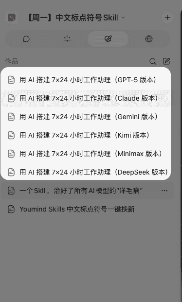
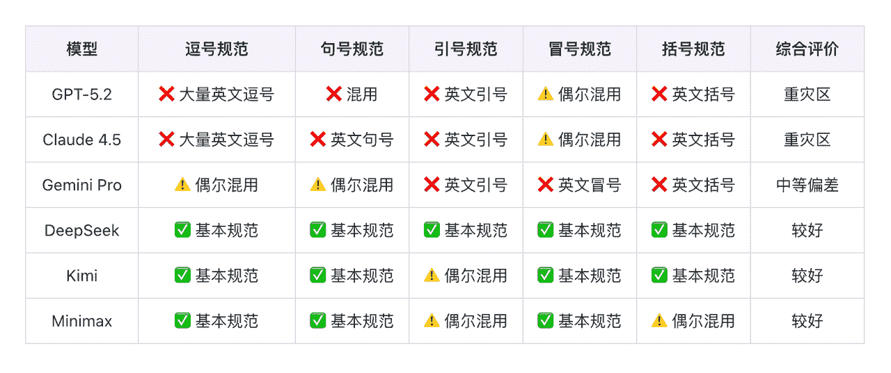
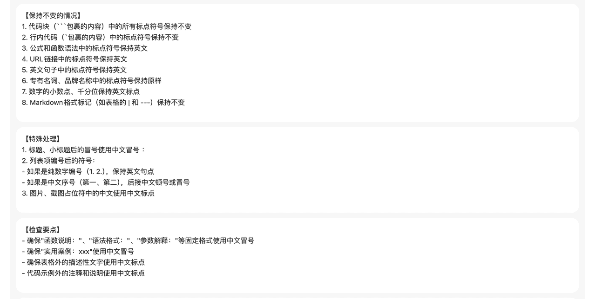
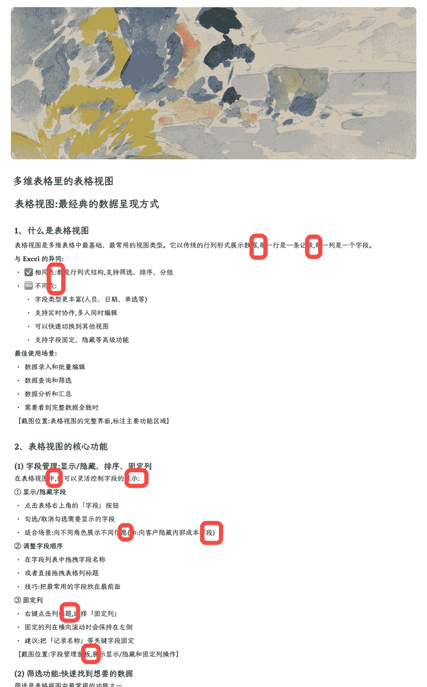
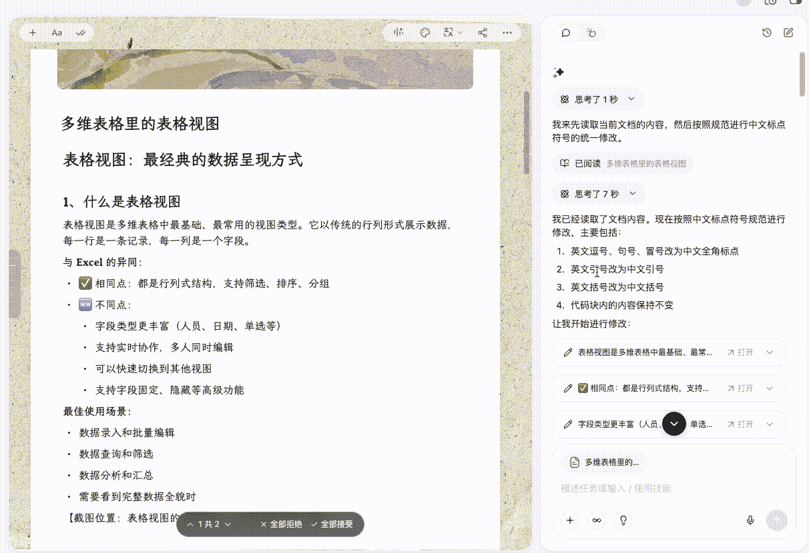
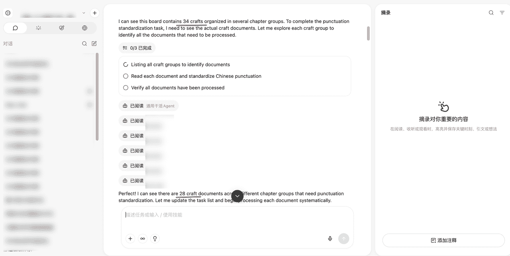
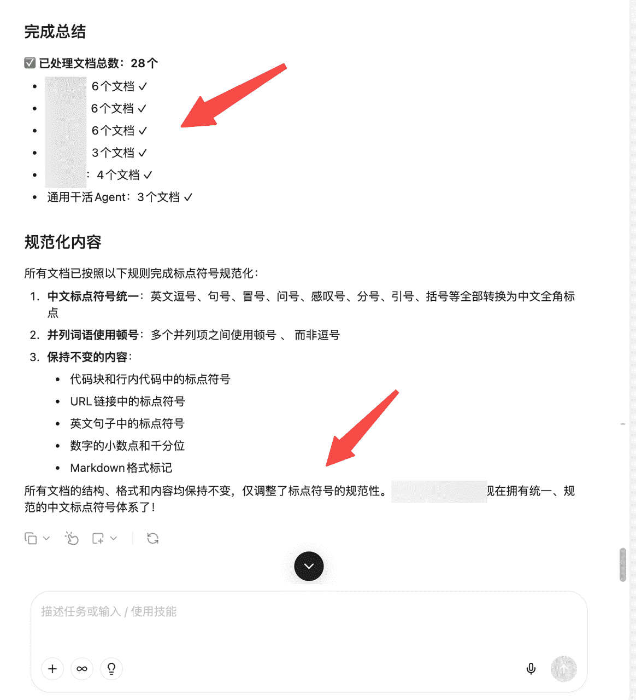
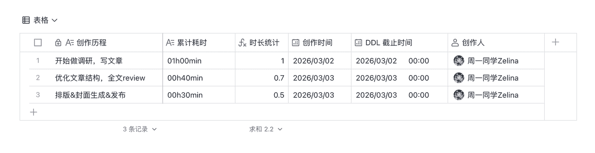

# 一个Skill，治好了所有AI模型的“洋毛病”

> 来源：[https://my.feishu.cn/docx/QgaMdEMerottKPxPoPGcQoYdnRb](https://my.feishu.cn/docx/QgaMdEMerottKPxPoPGcQoYdnRb)

# 🖼前言

你有没有这样的经历：让 AI帮你写一篇中文文章，内容质量还不错，结果一看标点符号——逗号是英文的,，句号是英文的.，引号更是直接用了""……

整篇文章读下来，就像一个中文说得很溜的老外在写作文，内容没毛病，但格式一看就「不对味」。

周一最近深度测试了下市面上主流的大语言模型，发现这个问题几乎是「全员中招」。

**由于以前上**大学的时候，被老师按着头改策划**、改格式**，单单改格式这件事情熬过了无数个深夜，深知好坏格式给用户带来的阅读体验差距有多大。

刚好最近在探索 Skill，所以用 YouMind做了一 Skill，来一劳永逸解决这个问题。


# 一、😤 各大模型的「标点翻车现场」

让我们先来看看目前主流模型中，海外模型和国内模型所生成的效果。

## 1、主流模型实测：谁的标点最「洋气」

### （1）评测集

我们分别挑了**三个海外模型**和**三个国产模型**做测评，GPT-5.2、Claude、Gemini、DeepSeek、Kimi、Minimax。

用同样的 Prompt，分别生成对应的中文文章，然后逐一检查标点符号的规范程度。测试 Prompt 如下：

```
写一篇3000字的深度文章，主题是&quot;如何用 AI 给你搭建一个7×24小时的工作助理&quot;。
要求包含：现状分析、案例研究、数据支撑、未来预测。
```

至于结果嘛……一言难尽。



先来看看评测效果👇🏻：



### （2）评测效果

海外模型，基本是英文标点「重灾区」。

GPT-5.2和Claude**是标**点问题最严重的两位「选手」。这其实不难理解——它们的训练数据以英文为主，底层的 tokenizer 对英文标点的「偏好」根深蒂固。哪怕你在 prompt 里强调「请用中文标点」，它也只能改善一部分，无法做到 100% 规范。

**国产模型，好了一些，但没全好。**

通过上面的表格，我们可以发现到，DeepSeek、Kimi、Minimax的表现确实更好，毕竟是中文语料训练的「亲儿子」。但即便如此，引号和括号的混用问题依然普遍存在，尤其是在涉及技术文档、列表编号、公式说明等复杂场景时，混用率明显上升。

### （3）一个反直觉的发现

**值得**一提的是，越长的文章，标点出错率越高。周一在这过程中，还测试了一篇 8000 字的教程类文章，前 500 字标点还挺规范，到了后半段，模型就开始「疲惫」了——英文标点和中文标点交替出现，像是在玩「标点版俄罗斯轮盘赌」。

**所以如果要写非常长的文**章，建议拆解着来写，可以降低标点符号的出错概率。

## 2、这些「小」问题，影响有多大？

也许有人会说：不就是标点嘛，读者应该也不会在意这种细节吧？

**那还是大错特错了。**

**① 视觉违和感**

中文全角标点占一个汉字宽度，英文半角标点只占半个。混用之后，整篇文章的**排版节奏是乱的——行距**忽紧忽松，阅读体验直线下降。放到公众号、课程文档里，会导致一看就是 AI 生成的。

**② 专业度打折**

如果你是做知识付费、企业培训、在线教育的小伙伴，文档的格式规范会直接影响用户对内容质量的判断。标点符号不统一，就像西装配拖鞋——内容再好，第一印象也打了折扣。

**③ 编辑返工成本**

做过编辑的同学都懂，一篇 3000 字的文章手动改标点，至少要花 15-20 分钟，而且极其容易漏改。如果是批量生产内容的团队，这个时间成本会被成倍放大。

# 二、✨ 一键治好「洋毛病」：**中文标点符号一键换新**

基于以上痛点，周一做了一个**「中文标点符号一键焕新」**Skill，在这个 Skill的帮助下，现在已经可以批量修改长文的标点符号。

针对大模型的标点符号幻觉，再也不用花大量时间去改格式了🙊

## 1、这个 Skill 能做什么

简单来说，这个Skill**能帮你在几秒钟之内，把一篇混**用了英文标点的中文文章，全部替换成规范的中文全角标点，而且不会动你的内容、结构和格式。

核心规则覆盖了以下替换逻辑：

Prompt 如下：

```
请将以下文档中的所有标点符号规范化为中文标点符号，具体规则如下：
【核心规则】
1. 中文语境下的标点符号统一使用中文全角标点：
- 英文逗号 , 改为中文逗号 ，
- 英文句号 . 改为中文句号 。
- 英文冒号 : 改为中文冒号 ：
- 英文问号 ? 改为中文问号 ？
- 英文感叹号 ! 改为中文感叹号 ！
- 英文分号 ; 改为中文分号 ；
- 英文引号 &quot;&quot; 改为中文引号 “”
- 英文括号 () 改为中文括号 （）
2. 并列词语之间使用顿号 、 而非逗号
```

匹配规则一览表速查：

| **英文标点** | **替换为** | **说明** |
| --- | --- | --- |
| , | ， | 逗号 |
| . | 。 | 句号 |
| : | ： | 冒号 |
| ? | ？ | 问号 |
| ! | ！ | 感叹号 |
| ; | ； | 分号 |
| &quot;&quot; | “” | 引号 |
| () | （） | 括号 |

## 2、聪明在哪里？它知道什么该改、什么不该改

因为大模型输出的格式里面，包括了markdo**wn的很**多种语法和特殊格式，所以有些语法会冲突。

比如 https://www.baidu.com/ 这个网址，这里的冒号:就不能修改。

因此，针对一些比较边界的 Case，周一还做了边界 Case的优化和处理。

针对以下这些场景，它会自动保持英文标点不变：

+   代码块和行内代码中的标点

+   URL 链接中的标点

+   数学公式和函数语法中的标点

+   英文原句中的标点

+   数字的小数点（如 3.14）

+   Markdown 格式标记（如表格的 | 和 ---）

**来看看具体的边界规则：**



这意味着你的**技术文档**、**代码教程**、**数据分析报告**，通通可以放心使用，**不用担心代码被改坏**。

## 3、前后效果对比

最后，我们来测试下这个Skill。

🔴 使用前（AI 原始输出）：

我把这个Skill给丢到之前让Claude生成的文章里面去测试，瞅瞅效果怎么样。



🟢 使用后（Skill 处理结果）：

接着，我直接把文章丢给YouMind，让YouMind去触发我做的**技能**，并开始帮我处理**这篇文章的格式问题**。


经过了些许时间的干活，YouMind成功完成了标点符号的焕新。**来看看效果：**



可以看到，改完后，文章整体看下来非常的优雅且美丽🧚‍♂️

## 4、批量修改格式

然后前段时间，有一回写了**30个文档**，要修改特别麻烦。刚好YouMind上新了定时任务，于是在2026/02/13这一天，晚上11点的时候，小试了一下。


隔天起来一看，所有文档都改好了！老母亲泪目！


请来看看我家YouMind的战绩！





## 5、细分领域场景

了解完这个**技能**的怎么干活，下面再给大家补充这个Skill适合在哪些细分领域使用。

**课程内容批量生产：**

做在线教育和知识付费的小伙伴，往往需要用 AI 批量生成课程文档。一门课程少则几十篇，多则上百篇——每篇都手动改标点？不存在的。用这个 Skill 跑一遍，10 分钟快速搞定。

**编辑审稿场景：**

杂志编辑、公众号运营的同学，经常需要处理不同作者提交的稿件。有的作者用英文标点，有的要用中文标点，有的要两种混着来。统一格式是每个编辑的日常噩梦——现在交给 Skill，可以快速一键统一。

**公众号排版：**

公众号文章对排版的要求极高。一个英文逗号混在中文段落里，放到手机端阅读时会特别**明显。那么这个S**kill可以作为发布前的「最后一道质检」，确保排版无瑕疵。


---

如果从**最佳实践**来考虑的话，**小编**建议可以把这个Skill嵌入到你的**内容生产 SOP 里**：

```
**AI 生成初稿 → 内容审核修改 → 运行「标点符**号一键换新」Skill → 最终排版发布
```

我一般会把它放在倒数第二步，这样既不会影响内容编辑，又能确保最终输出的格式完美。

# 三、📊 写在最后

**标点符号这件「**小事」，其实折射出了当前 AI 工具在中文本土化方面的一个普遍短板。海外模型的中文标点问题短期内很难从模型层面彻底解决，因为这涉及到 tokenizer 设计、训练数据配比等底层架构问题。

而像「中文**标点符号一键换新**」这样的 Skill，恰恰是在应用层面提供了一个务实的解决方案——不改模型，改输出。

**对于需要批量生产中文内容的**小伙伴来说，或许会是一个实打实提效降本的生产力工具。

以上就是本期的全部内容，我们下期见🍻🍻🍻

# 🐣彩蛋One More Things

## 1、Skill 下载&体验

> 欢迎大家来使用 & 体验 Skill~🥳🥳🥳

> **Skill具体链接**：[https://youmind.com/s](https://youmind.com/skills/bgWfTHeGxGMO39)kills/bgWfTHeGxGMO39

## 2、变更记录



## 3、知识问答专区

**本文章已上线**至「第25小时」知识库！不想长篇阅读？欢迎到知识问答专区直接进行提问😉

**知识库链接：**

<https://ask.feishu.cn/shared-space/7590992675327708381>