# 基于GPT的智能客服落地实践

> 来源：[https://my.feishu.cn/docx/HogsdMUs8oc9dLxyEvhciHkpn5f](https://my.feishu.cn/docx/HogsdMUs8oc9dLxyEvhciHkpn5f)

# 📍前言

在日常生活中，「客服」这个角色几乎贯穿着我们生活的方方面面。比如，淘宝买东西时，需要客服帮你解答疑惑。快递丢失时，需要客服帮忙找回。报名参加培训课程时，需要客服帮忙解答更适合的课程……

基于此背景下，可以了解到客服在我们生活中的重要性。传统的客服更多是以「一对一人工回复」的方式，来帮我们解答疑惑。那在以GPT为例的各类大模型爆火之后，纷纷涌现出一些新奇的「智能客服」。那在下面的文章中，就将来聊聊，关于大模型在智能客服领域相关的一些落地方案。

以下文章整理自 稀土开发者大会2023·大模型与AIGC-掘金 第二部分，讲解关于 Think Academy 公司，基于GPT的智能客服落地实践方案。

# 一、💬项目背景

该公司想要做这个项目的背景如下：

+   从业务场景出发：希望提供一个体验更好，响应更实时的智能客服。

+   从技术层面出发：跟进新技术，以及验证大模型在生产环境下的可应用性和可塑性。

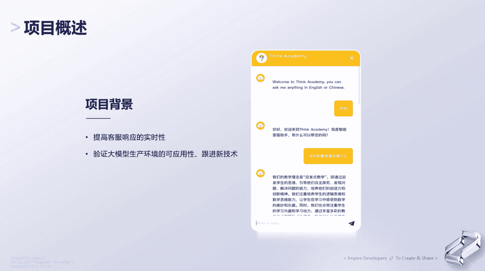

基于上面的背景信息，分析出即将要做的智能客服系统，要满足以下几个场景：

+   回答教育机构的教学理念、如何上课等类似静态的相关咨询。

+   当用户问到和入学测相关的问题时，会去引导用户去添加相关的教学主任，之后做相关的转化的动作。

+   希望大模型只回答业务相关的问题。

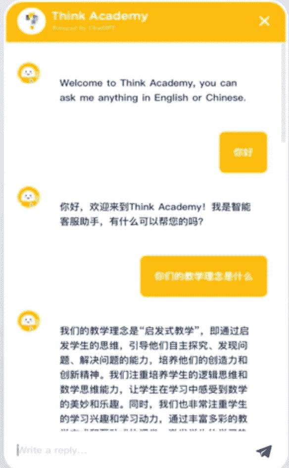

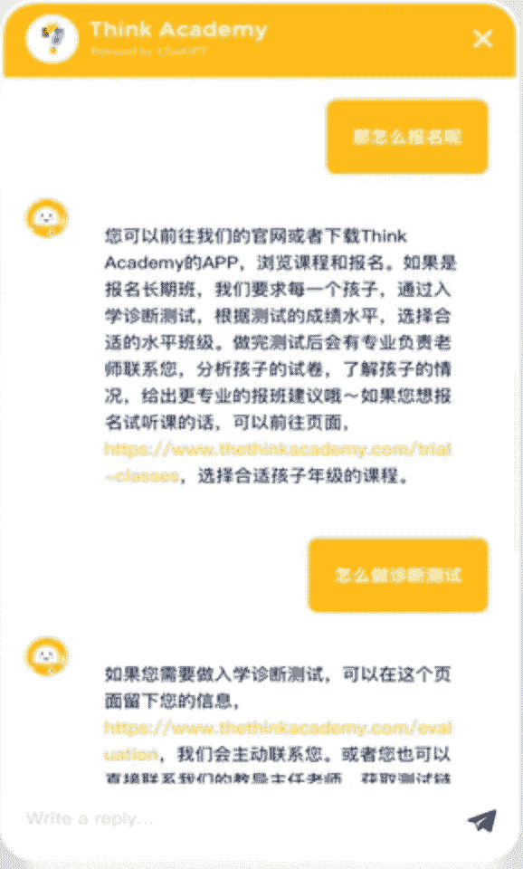

**有了上面的基**本信息铺垫以后，接下来来介绍，关于智能客服系统的第一个版本。

# 二、💭问答客服V_1.0 — 基于企业专有知识库的客服系统

> 技术选型、方案设计、数据表现及缺陷

## 1、如果让大模型学会特定领域知识

### （1）两种学习方式

首先在刚开始，我们调研到了有两种预训练方式：Fine-tuning Learning和In-context Learning。

Fine-tuning和In-conte**xt Lear**ning是机器学习中用于调整预训练模型的两种不同方法。它们之间的主要差异有：

> Fine-tuning（微调）👇🏻：

1.  定义：在预训练模型的基础上，用特定任务的数据集进行再训练，调整模型的参数以适应新任务。

1.  数据需求：需要一定量的标记数据来进行微调。

1.  训练时间：根据任务的复杂性和数据量的大小，微调可能需要一定的时间和计算资源。

1.  泛化能力：微调后的模型在特定任务上表现很好，但可能在其他任务上表现不佳。

1.  应用范围：适用于有足够数据的任务，并且希望模型在这个特定任务上达到最佳性能。

1.  灵活性：一旦微调完成，模型就固定了，想要适应新任务需要再次微调。

> In-context Learning（上下文学习）👇🏻：

1.  定义：在不改变预训练模型的参数的情况下，通过向模型提供包含任务信息的上下文来使其执行特定任务。

1.  数据需求：不需要额外的训练数据，但是需要为每个任务设计合适的上下文。

1.  训练时间：不需要再训练，可以立即用于各种任务。

1.  泛化能力：可以应用于多种任务，但性能可能不如微调后的模型。

1.  应用范围：适用于数据稀缺和任务多样的场景。

1.  灵活性：非常灵活，可以通过改变上下文来快速适应新任务。

总的来说，如果你有足够的标记数据，并且希望在特定任务上获得最佳性能，微调可能是更好的选择。而如果你需要模型适应多种任务，并且希望迅速部署，上下文学习可能更合适。

**因此，基于上**述两种学习方式的调研后，最终V1.0版本选择了 In-context Learning 的预训练方式。

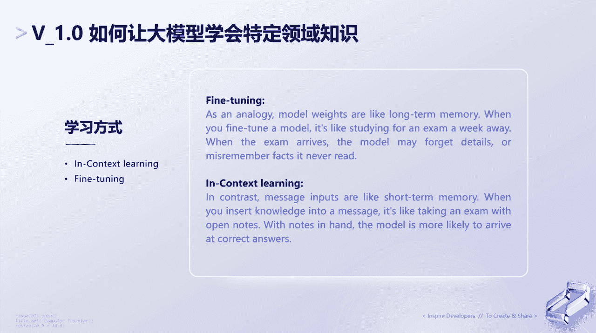

### （2）in-context learing

**确定了上面这种预训练模式之**后，接下来，就要思考，Prompt该怎么进行组织。可以理解为，给定一个题目，如何让大模型有相应的回答。

那在解决这个问题的过程中，就需要去攻克之后三个问题：

+   语料要如何组织

+   如何匹配到和用户问题相关的语料

+   token如何进行限制

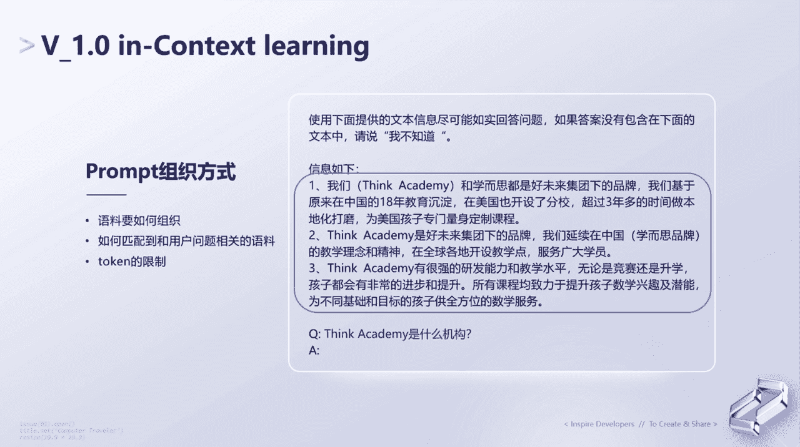

## 2、V1.0系统设计

有了上面的问题，接下来就是攻克上面这三个问题。

### （1）知识库的搭建

第一个是解决关于**语料**的问题。在**V1.0版本**中，采用的是**人为清洗数据**的方式。

可以看下图👇🏻，左边是原始**语料，会**先先人为地对这些数据先清洗一下，得到最后要使用的数据。

**之后呢，就是把清**洗后的数据，转换为右边的结构化语料。

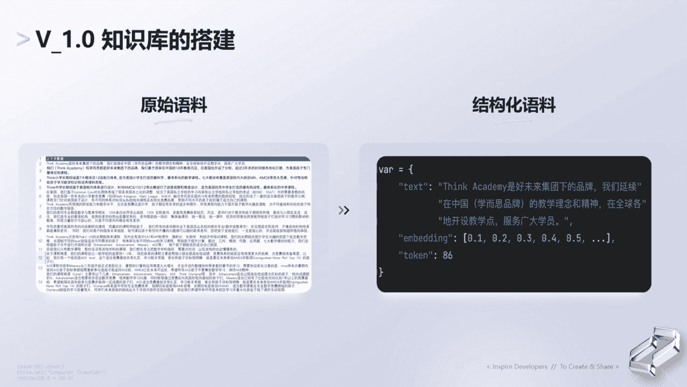

### （2）全局流程图

接着是攻克第二和第三个问题，请看关于该系统 V1.0 版本的全局流程图：

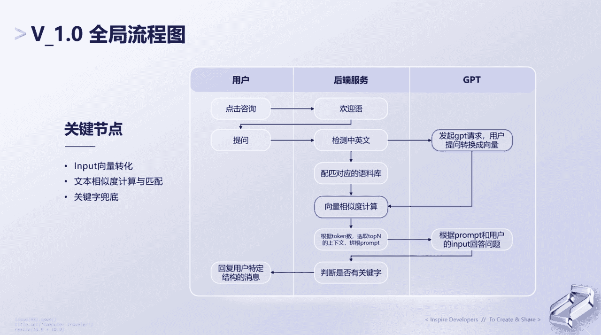

## 3、线上数据表现

V1.0系统搭建完成了，下面来看看线上的**数据表现。可以看**下**左边这张图，里**面有关于相关问题回复评分和不相关问题评分。

最终得出的结论是：

+   相关问题评分 → 1分2分的问题还是比较多，1分case基本算是一本正经地胡说八道了。

+   不相关问题评分 → 整体表现还可以。

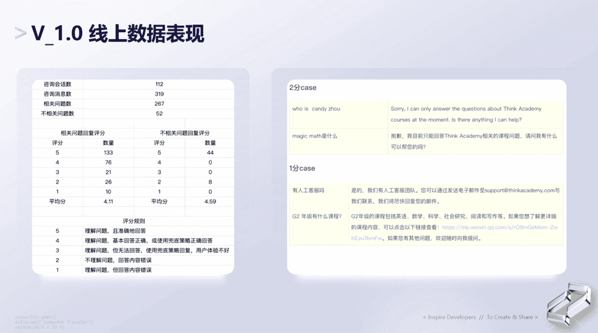

## 4、设计缺陷

在分析了线上数据之后，V1.0版本的设计总结出有以下缺陷：

+   需要扩展更多的覆盖场景，如老师咨询、课程咨询等。

+   动态信息的维护麻烦，给业务增加过多的维护成本。比如很多短期的活动、每学期的上课课程、上课时间等内容都会频繁地变动，这无形中给业务方带来了很大的麻烦。

+   部分情况下，ChatGPT**存在自由发挥**的情况，不完全可控。

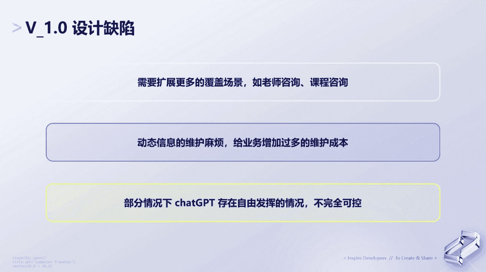

# 三、🗯问答客服V_2.0 — 基于指令识别的智能客服系统

> 技术选型、AutoGPT原理介绍、方案设计、数据表现

**分析了设计缺陷之后，**接下来就继续迭代了V2.0版本，可以说是从问答客服到智能客服的一个转变。

## 1、问答客服升级为智能客服

V2.0总结下来就是，基于**指令识别**的智能客服系统。

基于V1.0的设计缺陷，到了设计V2.0时，第一想法就是去扩展相关的语料库。以此让GPT回答公司更多的业务问题和更多的教学场景。

**但在实践过**程中发现，随着语料的数据量增加，会**导致匹配**准**确率直线**下降。又或者，如果语料的相似度很高，也会导致匹配的准确率直线下降。比如老师信息和课程信息，有可能只是两个老师的名字不同，但其他内容都相同。这也就是下图提到的方案一。

就在烦于要用什么方案来解决时候，AutoGPT问世了，于是借助Aut**oGP**T的设计思想，也就有了下面方案二的方案。

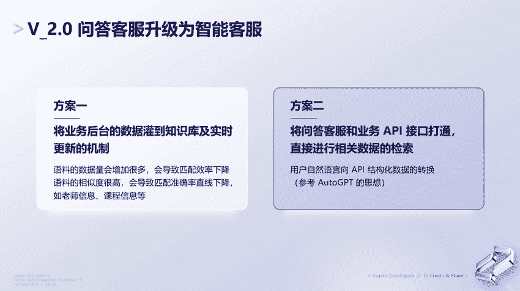

## 2、AutoGPT原理介绍

AutoGPT的原理是基于**预训练语言模型**，使用**大量的语料库**进行训练，从而学习到自然语言的规律和特征，进而生成符合语法和语义规则的文**章。Auto**GPT是GPT的改进版，通过自动搜索算法来优化GPT的超参数，从而提高其在各种任务上的表现。

AutoGPT使用多层的**自注意力机制**和**前馈神经网络**，可以有效地处理**长文本序列**，从而提高生成文章的质量和准确性。在生成文章时，AutoGPT会根据输入的文本内容，通过预训练模型进行编码，然后使用解码器生成符合语法和语义规则的文章。

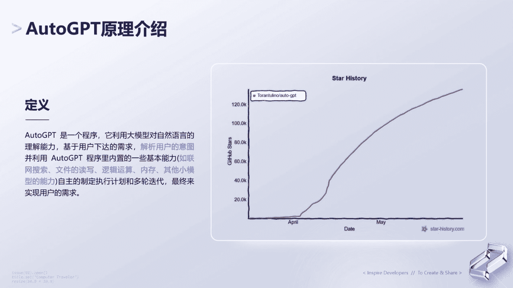

## 3、AutoGPT 的 Prompt组织形式

AutoGPT也是基于Prompt来进行组织的，总结下来主要有三种组织形式：

+   内置能力

+   数据结构化

+   记忆缓冲区

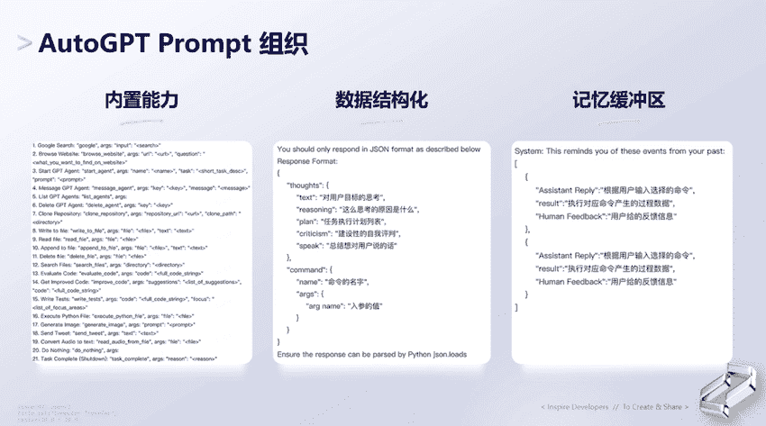

### （1）内置能力

AutoGPT内置了很多工程上的能力，比如：

+   Google Search

+   文件的读写

+   类似github相关的代码拉取

+   等等……

这些都定义在AutoGPT它内部的程序里面。

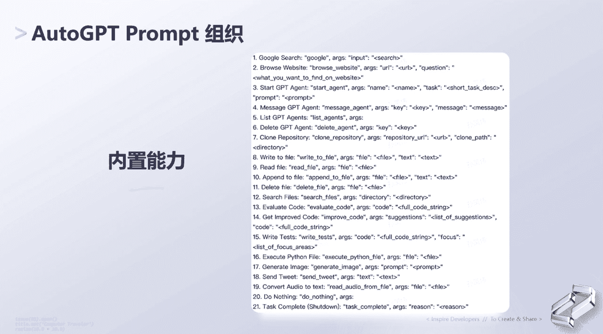

### （2）数据结构化

第二个是**数据结构化**。相当于AutoGPT要求**ChatGPT的返回**必须是一个JSON结构。

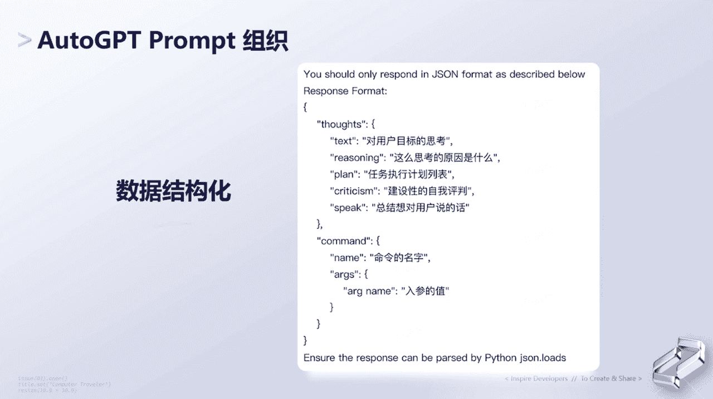

### （3）记忆缓冲区

AutoGPT的记忆缓冲区是指用于存储临时数据或信息的区域。在AutoGPT中，记忆缓冲区可能用于存储生成的文本片段、上下文信息或其他临时数据，以便在生成过程中使用。这样的缓冲区有助于AutoGPT在处理长文本序列时保持连贯性和一致性，从而提高生成文章的质量和准确性。

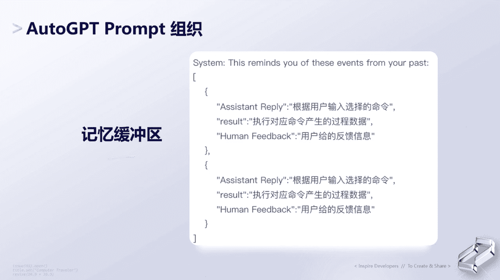

## 4、AutoGPT流程图

了解了上面**AutoGPT的基本原理**和**三种组织形式**以后，下面来看AutoGPT的流程图。如下图所示👇🏻:

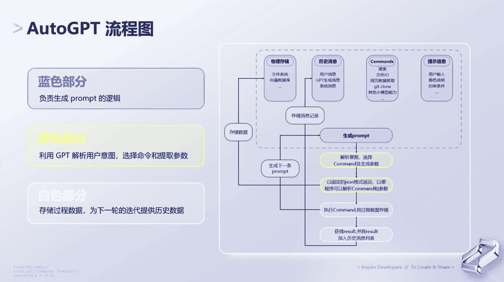

## 5、V_2.0 设计过程

### （1）方案设计

该公司参考了上面AutoGPT的思想，就有了V2.0的方案设计。

如下图所示，**最左边就是**整个业务系统的提示词，其中内置了几种命令。比如：第一个是获取老师的命令、第二个是获取课程信息的命令、第三个是兜底的命令（如果走的逻辑不是前面两种类型的命令，那么就会去执行原来V1.0方案的命令，让GPT「基于知识库去回答用户问题」的命令。）

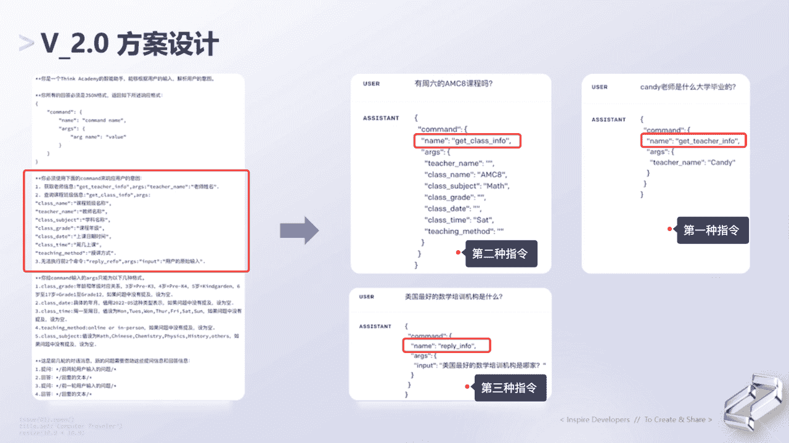

### （2）整体流程

下面我们来看下V2.0的整体实现流程，如下图所示：

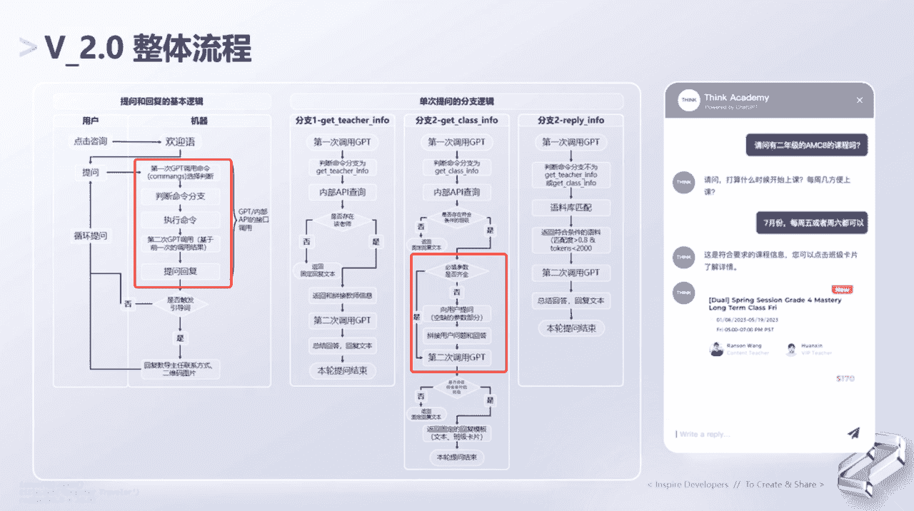

### （3）调试数据

**最后来分析下**V2.0方案中，调试数据的整体过程表现。如下图所示：

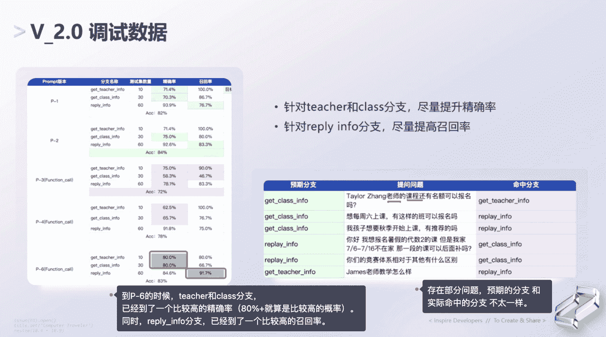

# 四、📢总结

> 迭代过程中的一些心得和思考

## 1、思考与总结

**经过上面两**个版本的迭代，得到了一些总结。如下所示：

开发思维 —— 相信大模型很聪明，并尽量让它做更多的事情。

模型能力 —— 详细了解各模型和参数的使用，以及prompt组织形式的设计。

效果调优 —— 根据业务场景，明确调优方案和目标，做好预期管理。

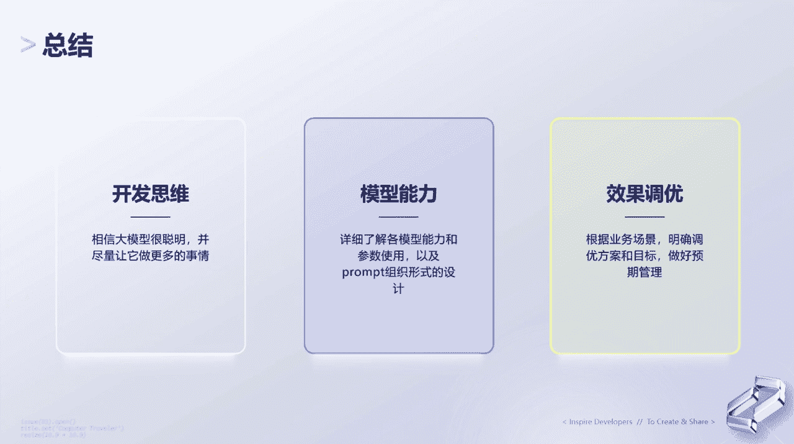

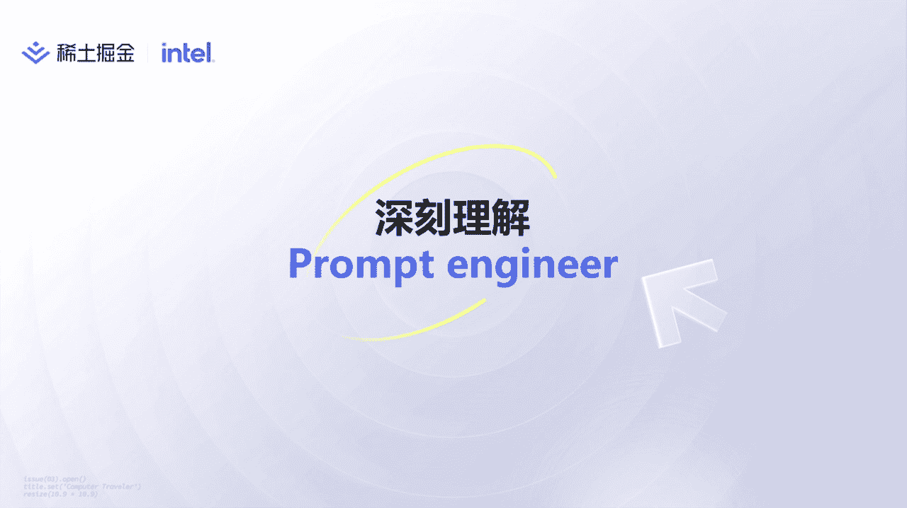

## 2、讨论

+   AutoGPT在调用的过程中，会存在死循环

# 五、🐣彩蛋One More things

## 1、参考材料

+   稀土开发者大会2023·大模型与AIGC-掘金

+   [🎬 PPT下载&回放链接｜2023稀土开发者大会大模型与 AIGC 分论坛](https://bytedance.feishu.cn/docx/BA9kdHjAKo3nK5xJF3TcAEBpnRh)

## 2、变更记录

多维表格（NP2tb66dGanqousfpQrcbrtRnrg_tblqIMZr6N4jgBFT）