# 向量数据库：大模型的海量记忆体

> 来源：[https://my.feishu.cn/docx/WFOada7TzoMglMxovqbcQyWJnLh](https://my.feishu.cn/docx/WFOada7TzoMglMxovqbcQyWJnLh)

# 🏖前言

**在大模型爆发**以**后，有越来越多**的公司需要用到专有的数据库，来存放百亿级甚至是千亿级的数据。在此基础上，纷纷涌现出一些企业去探索相关数据库的落地方案。在下面的文章中，就将来聊聊，关于大模型在向量数据库方面的一些落地方案。

以下文章整理自 稀土开发者大会2023·大模型与AIGC-掘金 第四部分，讲解 Zilliz公司在向量数据库方面的探索。

# 一、🛥前情简要

## 1、Embedding and Vector Search

Embedding这个词翻译过来，就是**嵌入**。那Embedding指的是，将文本等非向量数据转换为向量形式的过程，即将文本等含义嵌入向量中，用向量表示文本等含义。这些嵌入的向量可以用于比较文本等之间的相似度。嵌入可以是无监督学习过程，例如word2vec或GloVe中的词语嵌入，也可以是有监督学习过程，例如在情感分析任务中的句子嵌入。

Vector Search是指使用向量空间模型（Vector Space Model）进行信息检索的过程。在这种模型中，文档被表示为向量，通过计算这些向量的相似度来匹配查询和文档。Vector Search可以用于文本搜索、图像搜索等应用中。

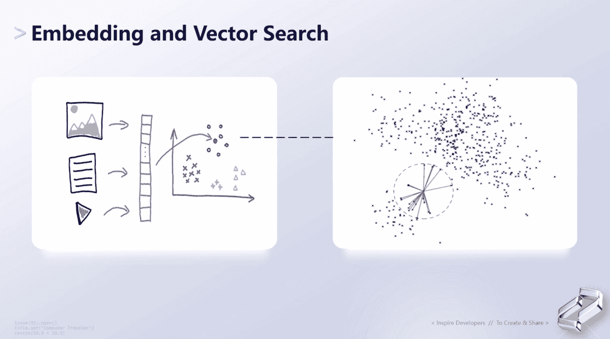

## 2、LLM Limitations

上面谈到了一些基础的概念，下面来说说大模**型目前会遇****到的一些限制。**所**谓大模型，就**是大语言模型，现在还远没到多模态。目前大模型遇到两个比较大的限制是：专有领域的数据和实时性的数据。专有领域的数据，比如医学法学等领域；而实时性数据，比如我现在在哪里哪里，开了某场发布会，这些可能是大模型没办法实时获取到的。

所以，当大模型在不知道一些事情的基础上，它就会开始胡说八道。去生成一些看似是正确的，但实际不是正确的内容。这也是目前面临的比较大的一个问题。

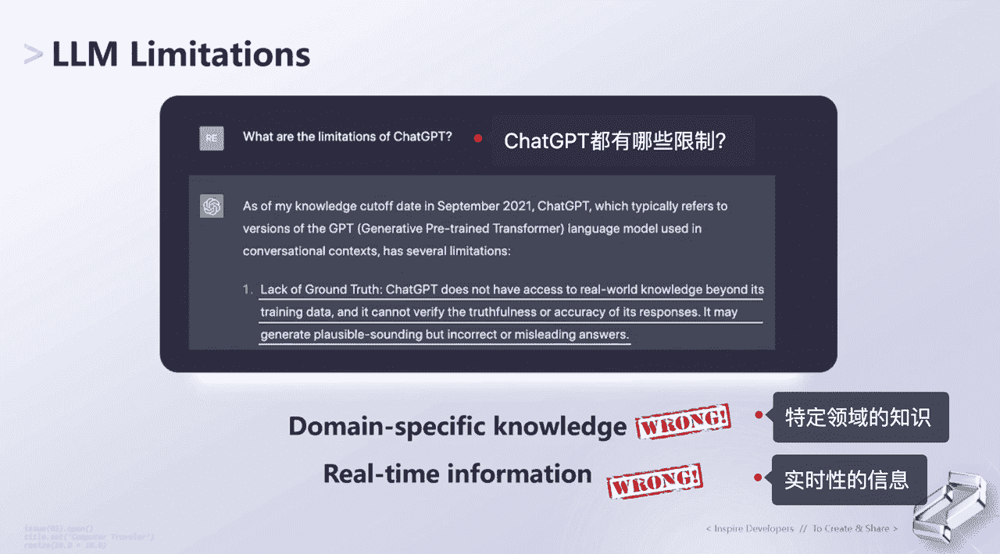

## 3、Knowledge Retrieval for LLMs

那为了解决这个问题，OpenAI在3月底的时候，发布了一个**插件计划**，来解决上面遇到的这两个问题。

可以把自己专有的数据，用Embedding的方式，变成**向量****。变成向量**之后，把这些向量，存到向量数据库里面。

其中这个插件计划里面也举例了一些可以存放的向量数据库：Milvus、Pinecone、Qdrant、Redis、Weaviate or Zilliz。

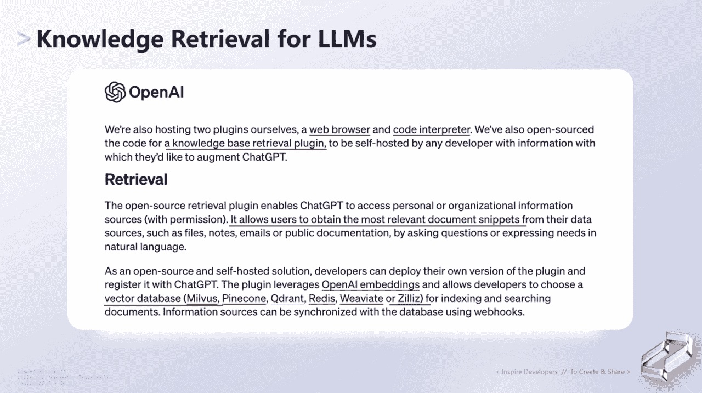

## 4、MVP framework：LLM + VectorDB + Prompt

所以，在此之后，我们也去整理了一些东西，就是怎样让上面提到的这些方案变成现实。

**最终我们的方案是：****MVP framework: LLM** + VectorDB + Prompt。翻译过来就是以ChatGPT为首的LLM，加上向量数据库VectorDB，再加上Prompt，去帮助大模型去做知识增强。细致来介绍下👇🏻：

+   首先，大模型可以看做是一个**中央处理器**，是一个CPU，它用来处理所有的计算和逻辑推理部分。

+   第二个是**向量数据库**，向量数据库主要用来存放大模型不知道的一些信息，一些专有领域的知识和一些实时的数据信息。可以理解为是给大模型做了一个外挂硬盘，像这样子的一个存储方式。所以我们也说，向量数据库是现在对大模型来说，很友好的一个记忆体。

+   第三个要说的是**Prompt**。大模型我们可以理解为是一个黑盒子，那我们用户唯一能跟它交流的方式就是Prompt。

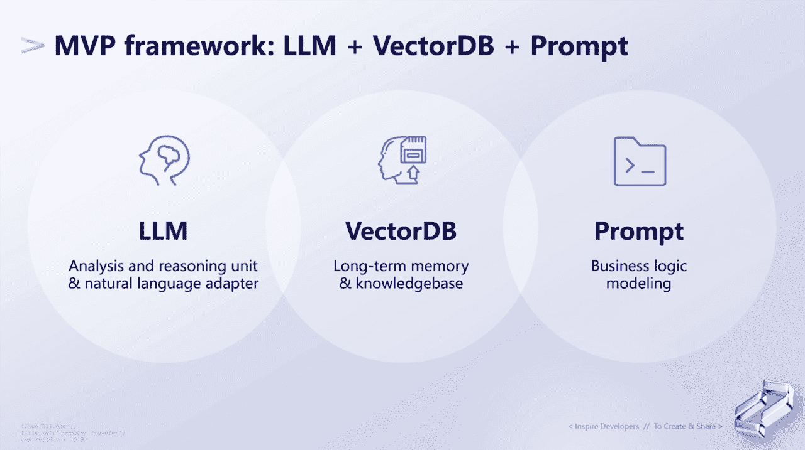

# 二、🛳常见向量数据库工具

**讲解完向量**数据库的一些落地方案后，下面我们来介绍下常见的几种和向量数据库相关的工具。

## 1、Milvus：为云而生的向量数据库

在使用之前，需要确定自己是需要**向量检索服务**，还是**向量数据库**。

如果你的数据量只是几十万上百万的数据量级的话，那建议可以不需要用向量数据库这个东西。

向**量数据库更**多地是面向更大规模的数据量，以及规模更大的业务。但是一旦你的数据量上了亿级、百亿级、甚至更多，那可能用一个专业的向量数据库，会是一个更好的选择。

这个东西就好比我们玩游戏一样，我们平常用手机可以玩游戏，但是就有人喜欢用switch、pico等等，这其实就是在使用更加专业的东西，去享受一个更加专业级的服务。

所以，如果你对向量检索有需求的话，那就按照自己的需求，去选择一个合适的向量检索服务或向量数据库就OK了。

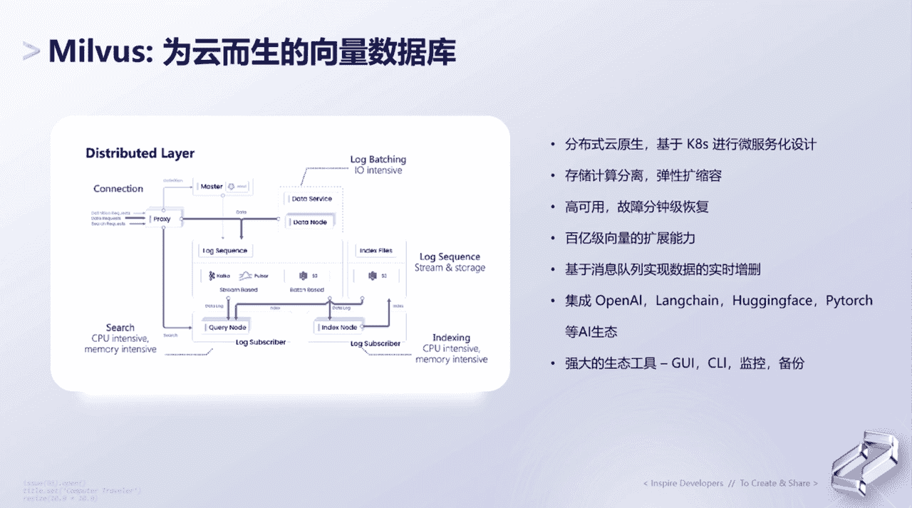

## 2、towhee

### （1）简单介绍

除了Milvus之外，还有另外一个项目叫towhee。简要概括来说就是，比LangChain更开箱即用些的应用程序。它也基本上是围绕着LLM + VectorDB + Prompt chained together这样的理念来开发。

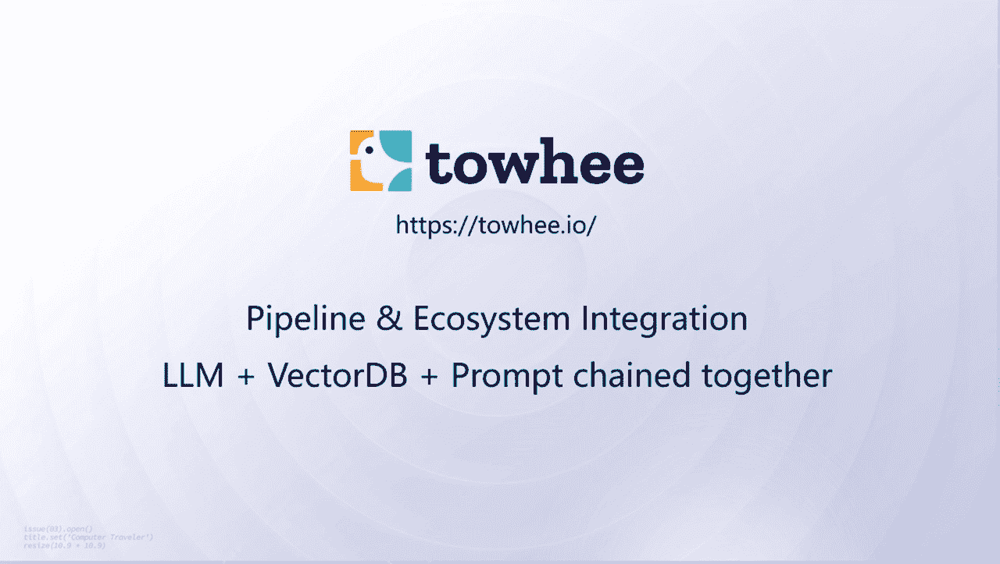

### （2）Operators & Pipelines

Towhee做的事情是什么呢？它以operator的方式，去把所有的model给serve起来。然后同时，去给我们的一些算法工程师，特别是针对工程能力比较欠缺的工程师，去建立一套完整的pipeline，去帮助工程师解决问题。

简单概括就是：towhee帮你把你的非结构化数据，给embedding成向量，然后后边对接到向量数据库里面，最后去对向量数据库去进行增删改查。

towhee也预置了很多主流的模型，基本上国外的主流模型都已经接上了。在未来的某一天，将会做到中外模型相互切换。

在这里，可以理解为：每一个模型相当于一个算子，直接配置进来进行切换就好了。

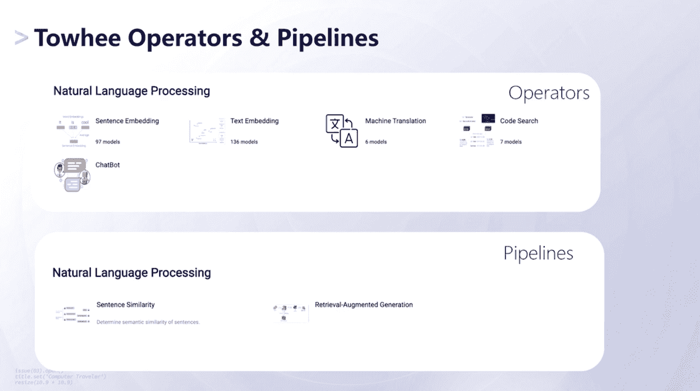

## 3、Zilliz

### （1）构建开源+云的非结构化数据处理方案

左边这张图，就是我们提供的一些最基础的工具，这工具就是根据用户自己按需使用即可。

来到右边这张图，要讲解的是ZilliZ Cloud。ZilliZ Cloud为用户提供的是，大而全、且开箱即用的全托管向量检索服务。

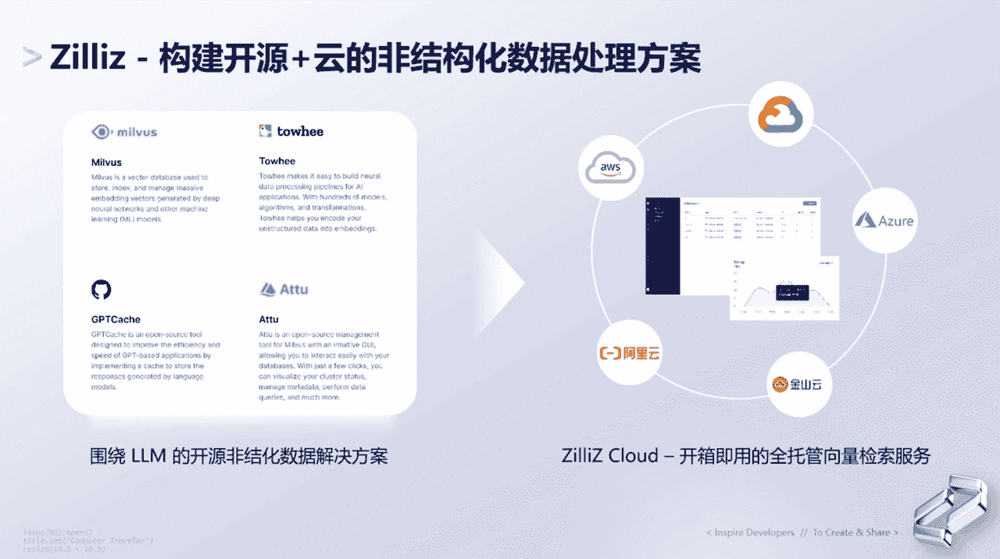

### （2）Zilliz Cloud：企业级特性

所以我们做Zilliz Cloud的目的主要是，从一个**开源级项目**到**企业级应用**进化的一个过程。它具有以下几点特性👇🏻：

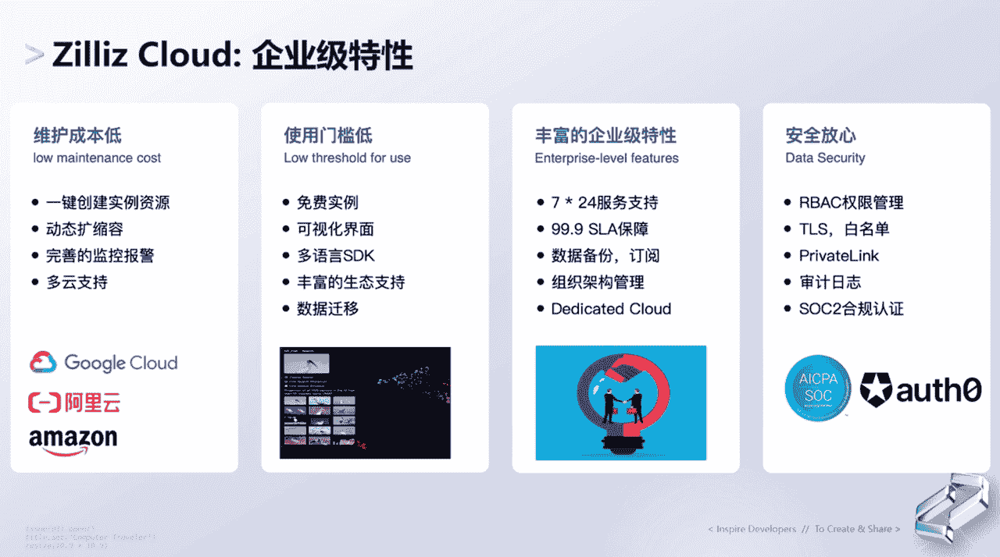

## 4、合作伙伴

Zilliz也成为OpenAI首批Plugin的合作厂商。整体生态如下图所示：

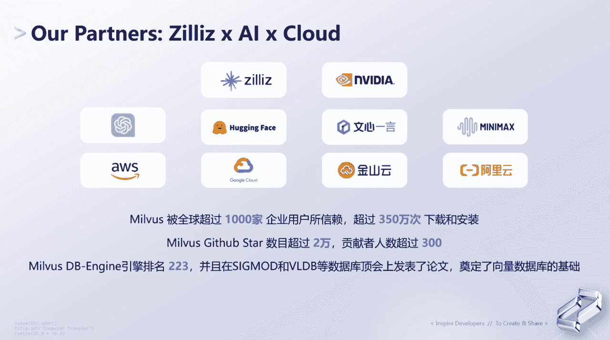

# 三、🏝周边应用

前面说到了很多向量数据库底层的东西，现在来说说一些相关的应用。

## 1、OSSChat

### （1）是什么

有这么一个网站：https://osschat.io/。

在3月25日，openAI发了Plugin的声明之后，我们在短时间内迅速开发了OSSChat。

OSSChat可以理解为是一个知识增强的应用。怎么做的呢？

ZilliZ把Github上面500⭐️以上的项目都公开抓了一遍，背后的原理是ChatGPT + ZilliZ Cloud。

其中ZilliZ做的事情是，把一些你特别想了解的项目，做了一个语义上和文档上的增强。

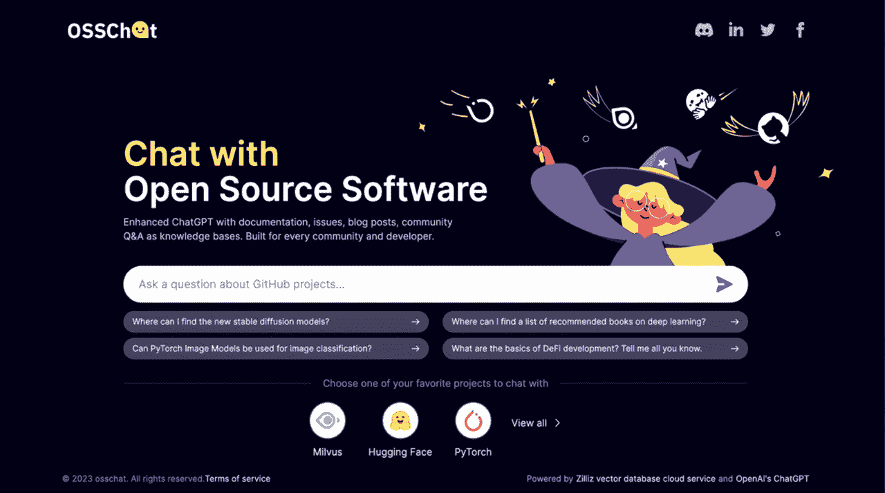

### （2）前后对比

下面来做个举例。比如问了同样一个问题：在Milvus里面，TTL是怎么实现的？

ChatGPT就开始胡说八道了，而经过知识增强的OSSChat，就给出了比较满意的答案。

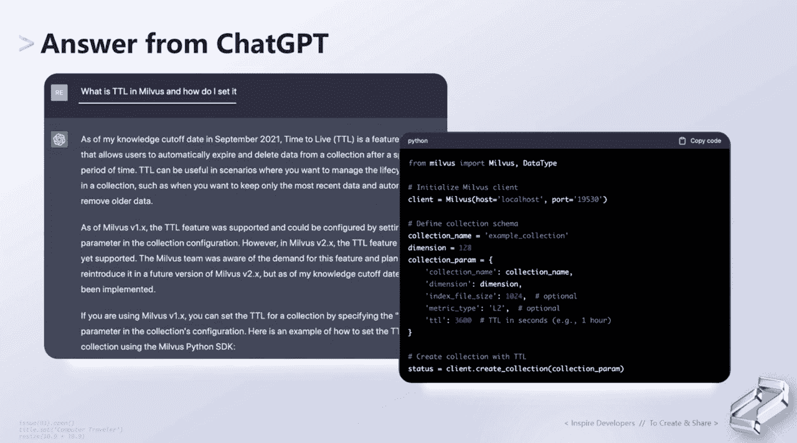

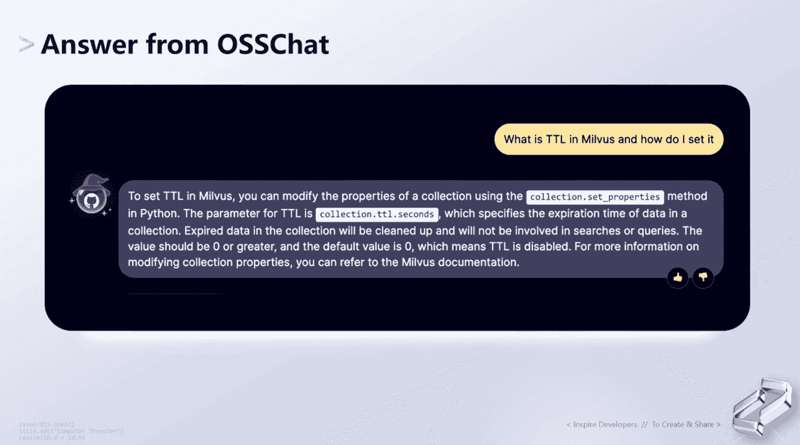

### （3）底层设计

下面梳理一下OSSChat做知识增强的一个大致逻辑。整体来讲就还是，结合向量数据库的能力，给大模型做一个更有力的知识积累和推荐。直白一点说就是，大模型不知道你想要的东西，那你就给它一些相关的东西，让它去学习和进化就好了。设计思路如下图所示👇🏻：

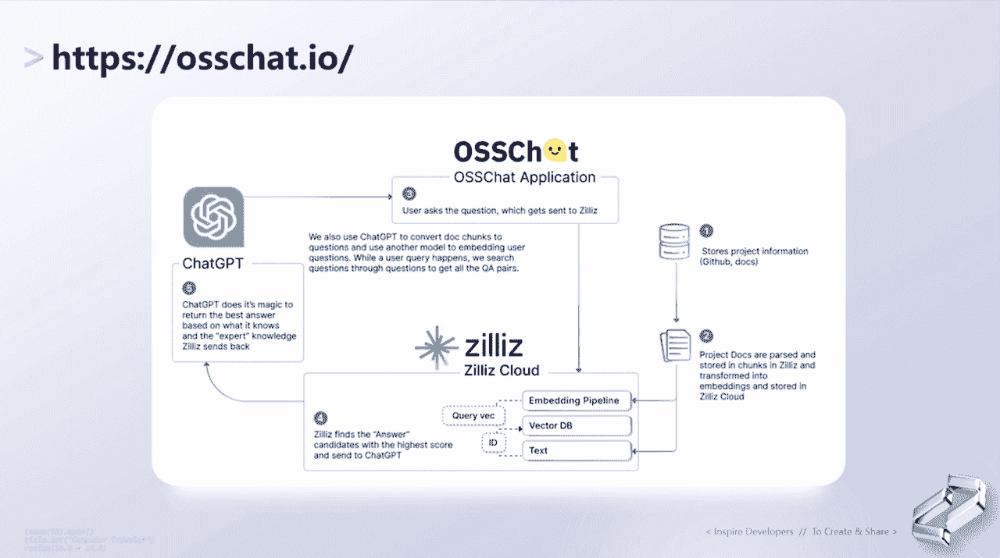

## 2、GPTCache

### （1）是什么

在做了OSSChat的过程中，ZilliZ发现了两个问题。

第一，GPT是按照Token去收费的，而且Token是有长度的，虽然是越来越长，但是永远是有限度的。

第二，大家会发现，ChatGPT在回答你的时候，是一个字一个字蹦出来的。慢的原因有可能是网络因素，也有可能是推理过程中需要较长时间的原因，所以它会一个字一个字蹦出来。

基于这两点，ZilliZ就做了GPTCache这个应用。GPTCache可以理解为，在关系型数据库里面，先帮你ready到一些事情。

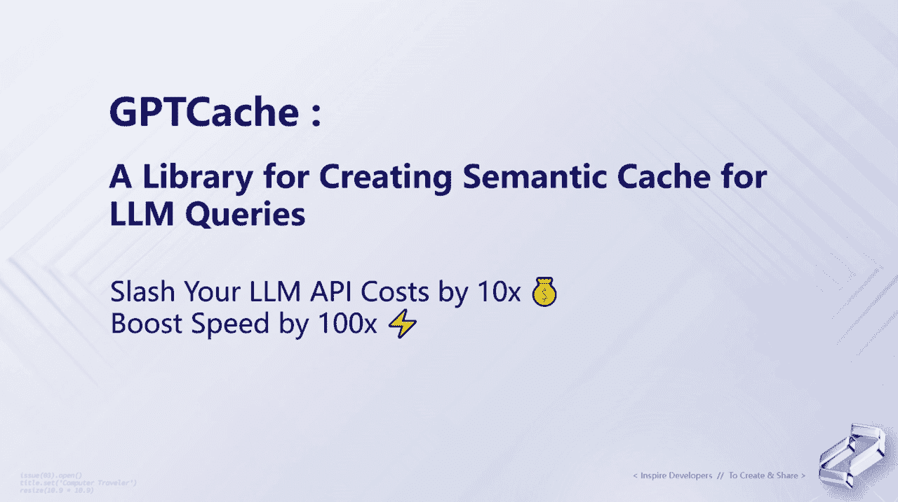

### （2）整体生成过程

GPTCache整体要做到的事情就是，让你省时省心省力，更快地去生成内容。

比如说你这是个客服系统，然后每天就会有几万个用户在那里问。但其实会发现大多数用户问的问题是一样的，比如说：这个商品包邮吗？你的邮费是多少？……

那这个东西其实，问来问去就是两个问题，在数据库里面要进行mapping的可能也就是这两个问题。

如果每回都要扔给大模型来处理的话，就会浪费掉很多不必要的资源：时间和金钱。

所以我们就会在中间建立一个Cache层，把用户的问题和大模型回答的答案，给存进来。存进来之后，每次用户问新问题，我就先去我的Cache层查询一下，如果命中了，我就直接把Cache里面的答案，扔回给用户。

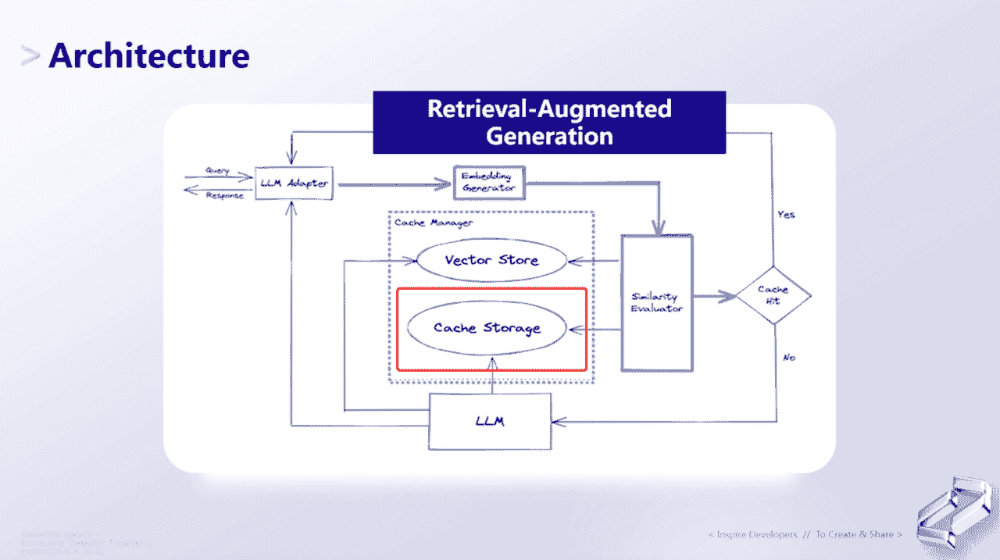

# 四、🌁Milvus的开发生态

最后一部分，来聊聊Milvus的一些开发生态。

## 1、LLM-powered autonomous agent system

在整个agent里面，我们可以看到，向量数据库做的事情就是，帮助大语言模型做到一个很好的辅助作用。

向量数据库更多的是为大模型提供长期的记忆，而这个长期记忆，就帮大模型去更好地做落地应用。

**目前的大模型基本**都是通用型的，而未来的大模型，更多的是往专有领域发展的。

目前ChatGPT都是以一个**应用Application**的形式在发展，那其实，比如说，你问ChatGPT说你们全家一天三餐吃什么，然后怎么吃更健康，有没有什么健康隐患？这个时候ChatGPT是不会告诉你的，因为ChatGPT没法知道一家人一天三餐都吃了些什么。所以你需要一个私有的、专业的助手去帮你做这件事情 。

那你的私域数据从哪里来呢？那就都来源于向量数据库提供的这些帮助。

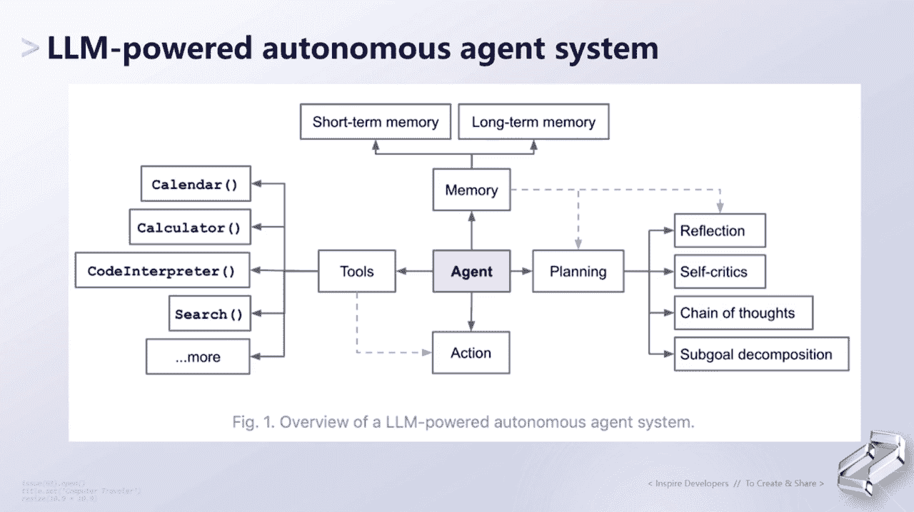

## 2、Features Designed for AIGC Developers

第二部分要谈到的是，针对AIGC开发者设计的一些功能。以下将介绍几个ZilliZ最近在向量数据库方面做的一些新的尝试。

### （1）Partition Key

第一个是Partition Key。可以看做是在建表的时候，比如像一些名字、时间等等，帮助用户去做资源的隔离。

因为我们可以看到一些AIGC的场景都是TO C的，我们都是给不同的用户去服务的。那在建表的时候，我们就希望把用户的数据完全地做隔离。原来的方式可能就是一人建立一套表，即一个组织一套向量数据库，但是这样的方式所带来的成本就会非常非常高。那现在就可以用Partition Key的方式，让你在一张表当中，可以去serve不同的用户。

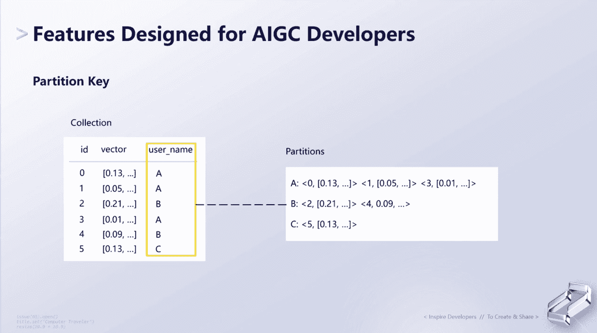

### （2）Sparse Vector

第二个要讲的是**稀疏向量**。以前我们更多用的是稠密向量，也就是比谁跟我们最像。

但其实在很多其他场景里面，我们也会看到稀疏向量。也就是在某些场景下，需要去找跟我们最不相近的东西。

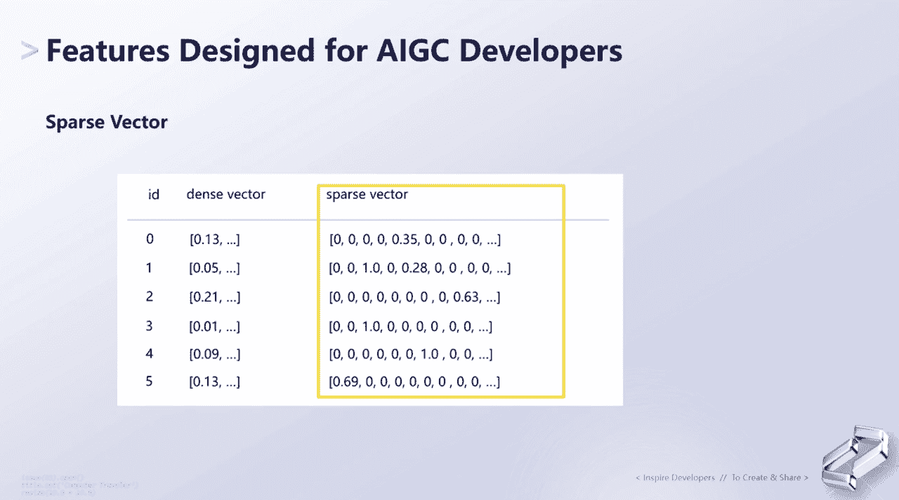

### （3）Multi Vectors

第三个要讲的是多维度向量查询。

有时候，一些个体信息会比较复杂，以特斯拉Model S为例，假设我们已经有它所有的信息和图片，那我们可以看到，除了它的名字之外，它的照片、车头、车底和车尾等，都有非常丰富的一些信息。那如果我们把这一辆车，作为一个向量来进行统一管理的话，可能会有一些遗漏。所以，我们可以把这个车，分成不同的向量去表示。

Multi Vectors**这个**比较适合的场景是，一个对象具有很多多模态的属性。

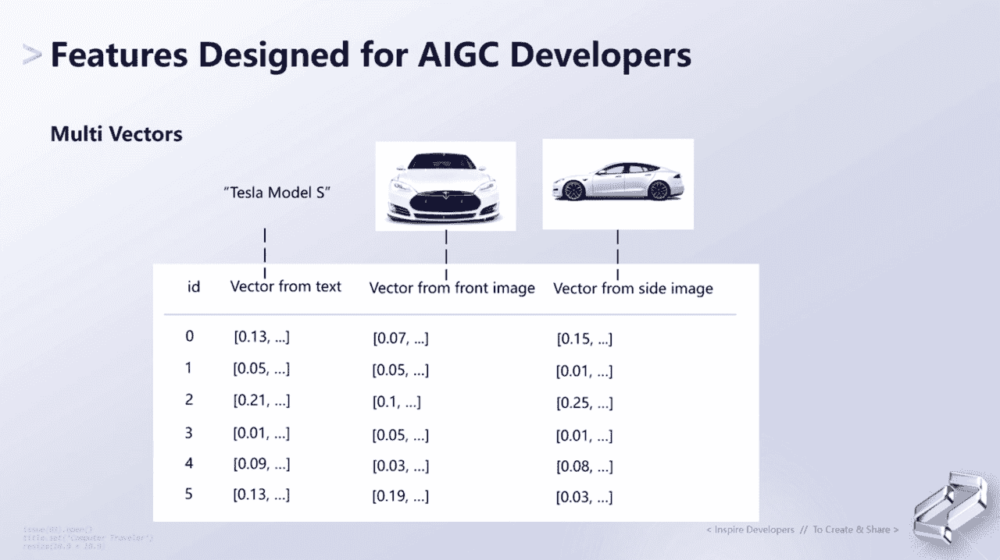

### （4）Vector List

第四个要讲的是：**向量组**。这个更多使用的场景是视频，未来等到大模型对视频下手的时候，就可能会以这种形式去做。

在之前，向量检索在视频的去重、风控、涉黄等层面，都有非**常多的应用。**那它是怎么做的呢，大部分是对视频的关键帧去进行抽帧。

如果未来要做的更加精细化的话，会以一秒一帧的形式去进行处理。下图可以看到，一般是以一秒一帧的形式，每张图片会对应放到数组里面，然后最终再对整个向量组，去进行搜索和查询。

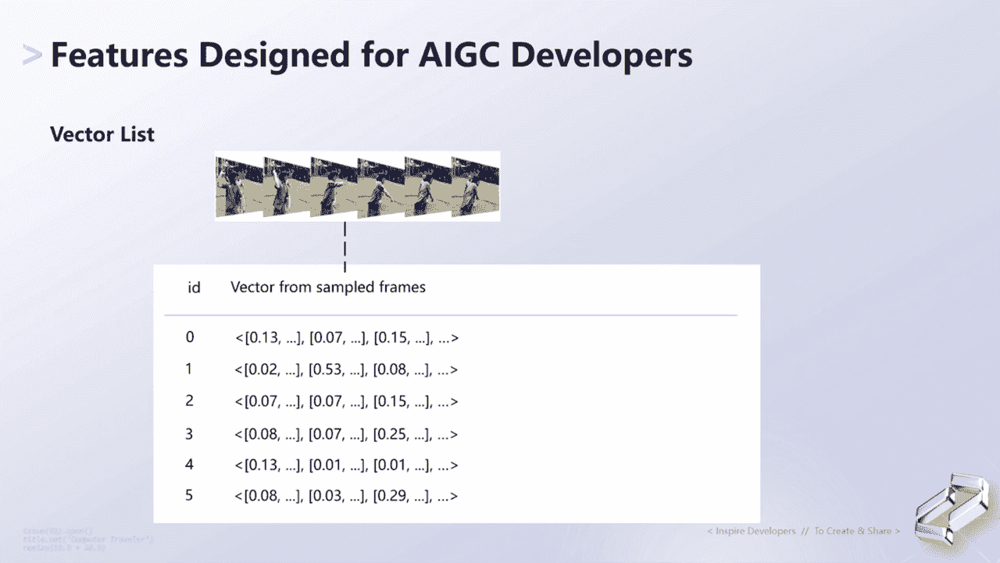

# 五、🚂结束语

文章写到这里，小编突然发现向量数据库的落地原来还能这么玩！

比如，GPTCache可以极大地降低大模型在落地应用时的时间损耗和成本损耗。OSSChat可以给个人、也可以给企业做知识增强。

当然除此之外，向量数据库能做的事情还有很多很多，未来还有很多相关的落地应用值得探索。

那说到这，关于向量数据库的讲解就告一段落啦！

这篇文章基于小编对开发者大会相关模块的主题做了一些整理和输出，有可能存在部分内容还理解不到位，欢迎小伙伴们交流&勘误。salute~🍻

# 六、🐣彩蛋One More things

## 1、参考材料

+   稀土开发者大会2023·大模型与AIGC-掘金

+   [🎬 PPT下载&回放链接｜2023稀土开发者大会大模型与 AIGC 分论坛](https://bytedance.feishu.cn/docx/BA9kdHjAKo3nK5xJF3TcAEBpnRh)

## 2、变更记录

多维表格（TpSobvNbTaquhzs2x9ecaJZfnbg_tbl7PtwF7rumwfzh）