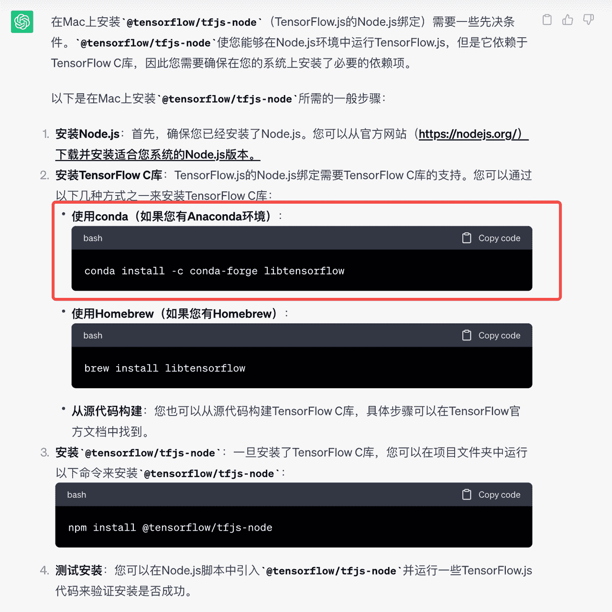
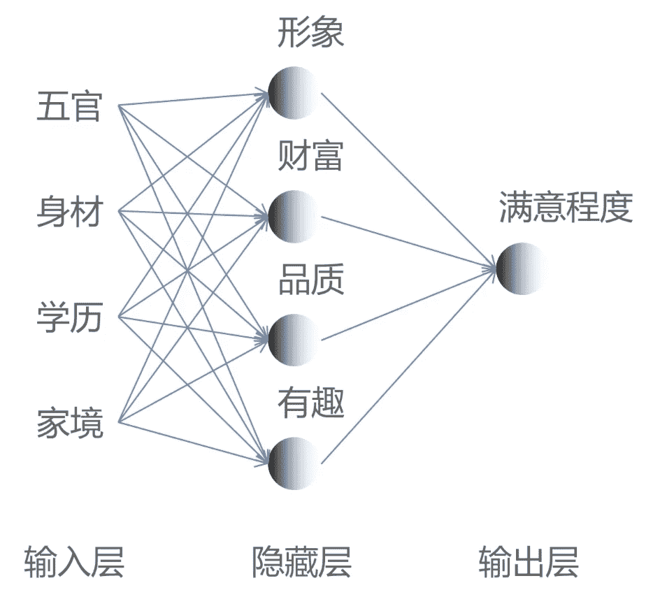

# 002 Tensorflow.js启航

> 来源：[https://my.feishu.cn/docx/QPaCdzJLHoZH6Hxsd7EcsK9snit](https://my.feishu.cn/docx/QPaCdzJLHoZH6Hxsd7EcsK9snit)

# 一、Tensorflow.js简介

## 1、Tensorflow.js是什么?

+   一个用 JavaScript 实现的机器学习库，以便让我们可以用它来做一些机器学习的功能。

+   让前端工程师可以直接在**浏览器**和**Node.js****中****使**用机器学习技术，且在浏览器里面做一些更高阶的交互操作。比如：①让我们手机里面的浏览器拥有摄像头、录音等能力；②开发一些小游戏 or 人工智能的游戏。

## 2、Tensorflow.js具体功能

+   **运行现有模型 —**— 现有模型指的是那些算法工程师已经训练好的模型，我们可以直接把它转化为在浏览器里面运行的格式，然后直接用 Tensorflow.js 运行。

+   重新训练现有模型 —— 我们可以在现有模型的基础上对它进行重新训练，让它能够识别我们自定义的一些类别，比如说我们可以识别我们的手势，然后让计算机记住我们的手势，这样我们就可以用手势来控制电脑了。

+   **使用Ja**vaScript开发机器学习模型 —— 指的是我们可以从0开始来开发一个机器学习模型，比如：从0训练一个线性回归模型来预测身高体重，预测房价等等。

# 二、安装Tensorflow.js

我们可以在**浏览器**和node.js中安装tensorflow.js，来看看如何安装。

## 1、浏览器安装

浏览器安装有两种方式：

+   使用Script标签来引入Tensorflow.js。

+   使用NPM包安装，并使用Parcel或Webpack构建。

下面我们来说下npm这种安装方式。首先，需要在项目安装@tensorflow/tsjs：

```
yarn add @tensorflow/tfjs
```

之后，在js文件里进行使用。比如：

```
// 把@tensorflow/tfjs打包出来的所有接口，变成一个对象
import * as tf from &#x27;@tensorflow/tfjs&#x27;;

const a = tf.tensor([1, 2]);
a.print();

```

至此，我们就可以在浏览器使用tensorflow这个库啦！

## 2、nodejs安装

第二种要讲的是，在nodejs环境中安装tensorflow。不过，这种方式会有一点麻烦的是，nodejs环境依赖于GPU，所以要先给我们的系统安装带有支持GPU的环境，才能让tensorflow在nodejs环境中使用。

首先第一步，先在mac里面安装tensorflow.js，具体戳此链接：[【](https://zhuanlan.zhihu.com/p/436908946?utm_id=0)环境备份】Mac M1 系列(Apple Silicon)各版本的 TensorFlow 及安装方法(支持 Mac GPU 加速)。

之后，我们其实就有了conda环境，然后需要使用conda环境来安装 Tensorflow C库。具体步骤如下👇🏻：



安装完成之后，就可以在我们的项目里面，安装@tensorflow/tfjs-node这个库：

```
yarn add @tensorflow/tfjs-node
```

之后，让这个库，在项目中使用：

```
// 把import改为node.js中commonjs的语法
const tf = require(&#x27;@tensorflow/tfjs-node&#x27;);

const a = tf.tensor([1, 2]);
a.print();
s
```

# 三、为何要用Tensor？

## 1、什么是Tensor？

+   中文名叫**张量**

+   张量**是**向量和矩阵向更高维度的推广

+   可以理解为，张量相当于**多维数组**

## 2、Tensor和机器学习有什么关系？

### （1）神经网络是什么样子



### （2）神经网络数据结构设计

如果让你设计神经网络的数据结构，你会怎么设计？

+   神经网络的每一层要存储 N 维数据

+   之后要做 N 层的 For 循环运算

+   Tensor作为高维数据结构完美解决以上问题

比如下面这段代码：

```
import * as tf from &#x27;@tensorflow/tfjs&#x27;;

// 传统 for 循环
// 输入层
const input = [1, 2, 3, 4];
// 第一层神经元
const w = [
  [1, 2, 3, 4], // 每个神经元的权重
  [2, 3, 4, 5],
  [3, 4, 5, 6],
  [4, 5, 6, 7]
];
// 第二层神经元
const output = [0, 0, 0, 0];

for (let i = 0; i &lt; w.length; i++) {
  for (let j = 0; j &lt; input.length; j++) {
    output[i] += input[j] * w[i][j];
  }
}

console.log(output); // [30, 40, 50, 60]

// dot() 点乘法
tf.tensor(w).dot(tf.tensor(input)).print(); // [30, 40, 50, 60]

```

如果按照传统的方法来计算，需要写一长串代码。而如果用tensorflow里面的tensor来解决，只需要最后一句代码，就可达到我们想要的结果。