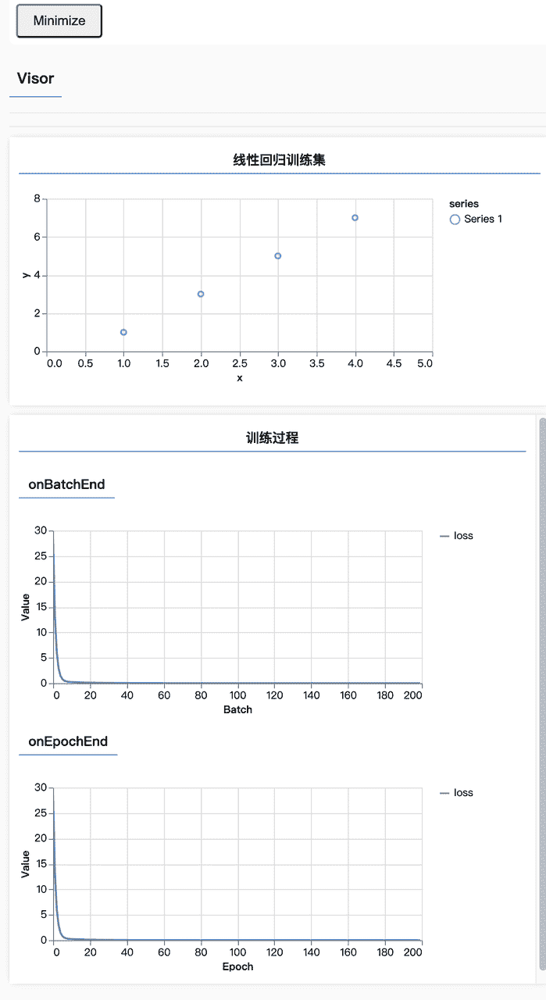

# 003 线性回归

> 来源：[https://my.feishu.cn/docx/DHXudC0RMoy7EExYfLpckFwQnQc](https://my.feishu.cn/docx/DHXudC0RMoy7EExYfLpckFwQnQc)

# 一、线性回归任务简介

## 1、什么是线性回归？

+   **线性回归****指的是，利用数理统**计中的回归分析，来确定两种或两种以上变量相互依赖的定量关系的一种统计分析方法。

+   例子：身高体重预测、房价预测。

## 2、举例

### （1）身高体重

身高体重预测就是一种线性回归。那身高体重预测是什么呢？

比如说：先给你非常非常多人的身高体重信息**，然后你**从中可以找到身高与体重之间的一种定量关系。好比方说，给你一个身高，你乘上一个数字，再加上一个数字，你就可以得到一个体重，这就是一种定量关系。一旦你找到这个定量关系之后，我再给你一个新的身高，你就可以预测出它的体重了，这就是一个线性回归的例子。

### （2）房价预测

刚刚所谈到的身高体重预测，是**两种变量****之间的关**系，而房间预测，则有可能是多种变量之间的关系。

比如说房子的面积以及房子里面的房屋数量都会影响房价，那么就是三种变量之间的定量关系了。如果我给你海量的房价数据，比如说多少平的房子多少钱，多少个房间的房子多少钱等等，然后你就可以得出一种定量关系。

最后我再给你一个新的房屋面积以及房间数量，你就可以预测出它的房价了，这就是线性回归。

## 3、操作步骤

了**解了线性回**归是什么，接下来，我们来看看，线性回归这个任务需要我们做些什么，就是我们将会写代码去构建一些什么东西，也就是操作步骤。具体如下：

+   **准备、可视化训练数据** **—— 先准**备一些数据，比如x轴输入什么、y轴输入什么，类似这种。准备好这些数据后，就是要把这些数据画在图表上，这个过程也就是把数据可视化的过程。

+   **使用 ****Tensorflow.js**** 的 ****API**** 来构建神经网络** —— 有了数据之后，就可以用tf.js来构建神经网络。

+   **训练模型并预测**** —**— 所谓神经网络，本质就是一个模型。所以在构建完成神经网络之后，接着就是来训练这个模型，并预测一些结果。

# 二、准备、可视化训练数据

## 1、操作步骤

+   准备线性回归训练数据

+   使用tfvis可视化训练数据

+   官方可视化库：https://js.tensorflow.org/api_vis/1.5.1/#render.histogram

## 2、训练过程

**下面，我们来以**散点图编译为例，先来初始化一个散点图。代码如下所示：

```
import * as tf from &#x27;@tensorflow/tfjs&#x27;;
import * as tfvis from &#x27;@tensorflow/tfjs-vis&#x27;;

window.onload = () =&gt; {
  const xs = [1, 2, 3, 4];
  const ys = [1, 3, 5, 7];

  // 散点图
  tfvis.render.scatterplot(
    { name: &#x27;线性回归训练集&#x27; },
    { values: xs.map((x, i) =&gt; ({ x, y: ys[i] })) },
    { xAxisDomain: [0, 5], yAxisDomain: [0, 8] }
  );
}
```

# 三、定义模型结构：单层单个神经元组成的神经网络

## 1、操作步骤

+   初始化一个神经网络模型

+   为神经网络模型添加层

+   涉及层的神经元个数和inputShape

## 2、训练过程

```
import * as tf from &#x27;@tensorflow/tfjs&#x27;;
import * as tfvis from &#x27;@tensorflow/tfjs-vis&#x27;;

window.onload = () =&gt; {
  const xs = [1, 2, 3, 4];
  const ys = [1, 3, 5, 7];

  // 散点图
  ……

  // 绝大多数模型都是sequential，即连续的模型
  const model = tf.sequential();
  // dense表示全链接层，units是神经元的个数，inputShape存放特征
  model.add(tf.layers.dense({ units: 1, inputShape: [1] }));
}
```

# 四、损失函数：均方误差（MSE）

## 1、为什么需要损失函数？

+   神经网络初始化的时候，它会瞎蒙一个权重值，当然这个权重值大概率是错的。那我们这个损失函数的作用就是告诉它你瞎蒙的这个权重值错的有多离谱。

+   神经网络知道自己错了，它就会乖乖地通过优化器来稍微优化一下，当然它每次优化它还不一定能优化的最好，所以每次我们都需要用损失函数来测量一下，告诉它你错的有多离谱，让它持续不断地优化自己。

## 2、常见损失函数

+   均方误差MSE（用于回归任务）

+   交叉熵损失（用于分类任务）

## 3、操作步骤

+   跟着Google机器学习速成教程理解损失函数与均方误差：深入了解机器学习 | 训练和损失

+   在Tensorflow.js中设置损失函数

## 4、训练过程

来看看在tensorflow里面如何设置损失函数：

```
import * as tf from &#x27;@tensorflow/tfjs&#x27;;
import * as tfvis from &#x27;@tensorflow/tfjs-vis&#x27;;

window.onload = () =&gt; {
  const xs = [1, 2, 3, 4];
  const ys = [1, 3, 5, 7];

  // 散点图
  ……

  // 定义模型结构
  ……
 
  // 对模型设置损失函数
  // loss表示损失，meanSquaredError表示均方误差
  model.compile({
    // 在编译里面设置损失函数
    loss: tf.losses.meanSquaredError
  });
}
```

# 五、优化器：随机梯度下降 （SGD）

## 1、为什么需要优化器？

**前面讲**到了损失函数，那用这个函数测**量出**来的结果，就是损失值。有了**损失值**之后，下一步就是改进。而改进的过程，就需要用到优化器。因此，损失函数和优化器往往是配合在一起使用的。

## 2、操作步骤

+   跟着google[机器学习速成教程理解优化器](https://developers.google.com/machine-learning/crash-course/reducing-loss/an-iterative-approach?hl=zh-cn)和随机梯度下降法： 深度了解机器学习：降低损失

+   在Tensorflow.js中设置优化器

## 3、常见优化器

+   随机梯度下降法SGD

+   Adam（会自动帮我们调整学习速率）

+   RMSprop

## 3、训练过程

来看看在tensorflow里面如何设置优化器：

```
import * as tf from &#x27;@tensorflow/tfjs&#x27;;
import * as tfvis from &#x27;@tensorflow/tfjs-vis&#x27;;

window.onload = () =&gt; {
  const xs = [1, 2, 3, 4];
  const ys = [1, 3, 5, 7];

  // 散点图
  ……

  // 定义模型结构
  ……
 
  // 对模型设置损失函数
  ……
  model.compile({
    loss: tf.losses.meanSquaredError,
    // 在编译里面设置优化器（在Tensorflow.js中设置优化器）
    optimizer: tf.train.sgd(0.1)
  });
}
```

# 六、训练模型并可视化训练过程

**随机梯度下降法**，如果每次只喂一个数据，那结果肯定是非常杂乱的。如果有小批量的多个点，那就会变平滑许多。

因此，在整个训练过程中，还需要调整学习率**、小批量大小、**epoch迭代次数等参数。如下代码所示：

```
import * as tf from &#x27;@tensorflow/tfjs&#x27;;
import * as tfvis from &#x27;@tensorflow/tfjs-vis&#x27;;

window.onload = () =&gt; {
  const xs = [1, 2, 3, 4];
  const ys = [1, 3, 5, 7];

  // 散点图
  ……

  // 定义模型结构
  ……
 
  // 对模型设置损失函数
  ……
  
  // 将训练数据转为tensor（xs和ys都要放进tensor）
  const inputs = tf.tensor(xs);
  const labels = tf.tensor(ys);
  await model.fit(inputs, labels, {
    // 小批量设置成多大，指的是每次这个模型要去学的样本的数据量有多大
    // 一般不设置太小，太小容易导致整个模型效果不佳
    batchSize: 4,
    // 迭代整个数据的次数
    epochs: 200,
    // 可视化过程
    callbacks: tfvis.show.fitCallbacks(
      { name: &#x27;训练过程&#x27; },
      //这里存放度量单位，loss表示看损失函数的曲线
      [&#x27;loss&#x27;]
    )
  });
}
```

# 七、进行预测

## 1、操作步骤

+   将待预测的数据转为Tensor

+   使用训练好的模型进行预测

+   将输出的Tensor转为JS中的普通数据并显示

## 2、预测过程

预测过程的代码如下👇🏻：

```
import * as tf from &#x27;@tensorflow/tfjs&#x27;;
import * as tfvis from &#x27;@tensorflow/tfjs-vis&#x27;;

window.onload = () =&gt; {
  const xs = [1, 2, 3, 4];
  const ys = [1, 3, 5, 7];

  // 散点图
  ……

  // 定义模型结构
  ……
 
  // 对模型设置损失函数
  ……
  
  // 训练模型并可视化过程
  ……
  
  // 预测结果
  const output = model.predict(tf.tensor([5]));
  alert(`如果 x 为 5，那么预测 y 为 ${output.dataSync()[0]}`);
}
```

## 3、完整代码

最后，附上完整代码👇🏻。script.js 文件代码如下：

```
import * as tf from &#x27;@tensorflow/tfjs&#x27;;
import * as tfvis from &#x27;@tensorflow/tfjs-vis&#x27;;

window.onload = async () =&gt; {
  const xs = [1, 2, 3, 4];
  const ys = [1, 3, 5, 7];

  // 散点图
  tfvis.render.scatterplot(
    { name: &#x27;线性回归训练集&#x27; },
    { values: xs.map((x, i) =&gt; ({ x, y: ys[i] })) },
    { xAxisDomain: [0, 5], yAxisDomain: [0, 8] }
  );

  const model = tf.sequential();
  model.add(tf.layers.dense({ units: 1, inputShape: [1] }));
  model.compile({
    loss: tf.losses.meanSquaredError,
    optimizer: tf.train.sgd(0.1)
  });

  const inputs = tf.tensor(xs);
  const labels = tf.tensor(ys);
  await model.fit(inputs, labels, {
    batchSize: 4,
    epochs: 200,
    callbacks: tfvis.show.fitCallbacks({ name: &#x27;训练过程&#x27; }, [&#x27;loss&#x27;])
  });

  const output = model.predict(tf.tensor([5]));
  alert(`如果 x 为 5，那么预测 y 为 ${output.dataSync()[0]}`);
};

```

接着，建立一个index.html里面，引入上面这个script文件。index.html代码如下：

```
&lt;script src=&quot;script.js&quot;&gt;&lt;/script&gt;
```

然后在终端运行上面这段代码：

```
parcel /index.html
```

我们来看下浏览器的展示内容：



这样，我们就让整个训练数据可视化了起来。