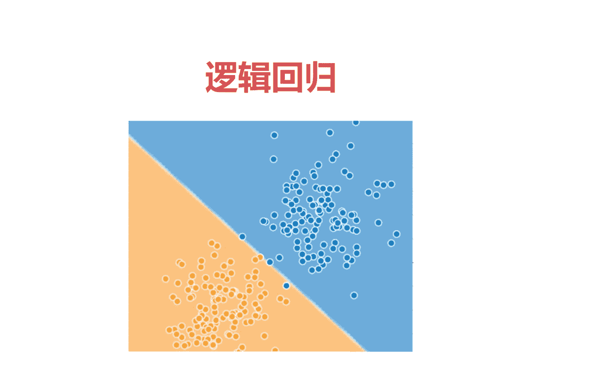
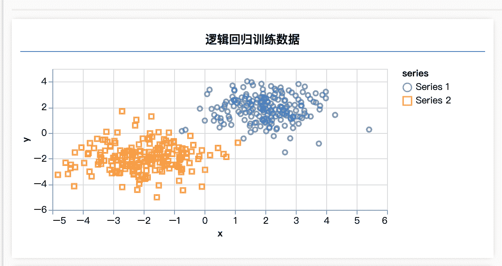
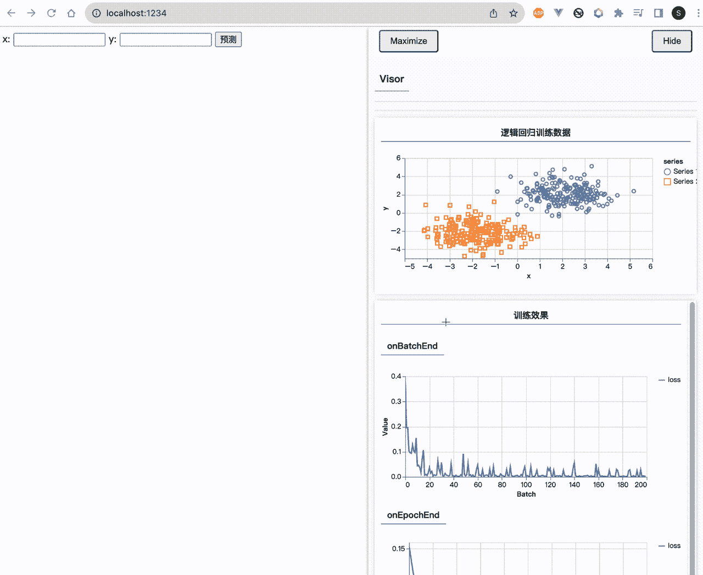

# 005 逻辑回归

> 来源：[https://my.feishu.cn/docx/ZSDIdLst3oxfc4xO8IxcellEnXb](https://my.feishu.cn/docx/ZSDIdLst3oxfc4xO8IxcellEnXb)

# 一、逻辑回归任务简介

## 1、逻辑回归

### （1）基础知识

+   逻辑回归和线性回归一样，都是深度学习的基础。

+   **与线性回**归不同的是，逻辑回归解决的是分类问题，比如说下面这张图上有很多很多的点，事先已经把这些点给打过标**签了，有**蓝色的点，也有黄色的点。然后你让神经网络来学习，他们学完之后你再给它一个新的点，它就能判断这个点有多大概率是蓝色区域的，多大概率是黄色区域的，这就是逻辑回归。

+   所以我们也可以发现**逻辑回归**输出的是**概率****，这是跟线性**回归最明显区别开的一点。线**性回归输****出的值**它是一个线性增长的值，可以说它的范围会很大。但逻辑回归它输出的则是一个概率，概率的区间一般是 0-1 之间。

+



### （2）怎么样才能输出一个概率

**有的**小伙伴可能就会有疑问了，怎么样**才能输出**一个概率呢？这就要用到我们之前提到过的激活函数了。

在讲神经网络那一节的时候讲过**激活函数**这个概念，它的作用是用于**添加一些非线性的变化**。

比如说一个相亲女，他对相亲对象的年薪要求是 100 万，就是说超过 100 万就跟 100 万差不多了， 200 万、 300 万对他来说跟 100 万没有太大区别，那么这个相亲对象的总分数对这个女孩而言就不能再随着年薪往上增长了，增长线就该平了。

也就是说对于你的年薪来说，不管年薪的横坐标往多右边去，它这个分数也不会**再长了。这意味着，**不管年薪再高，对这位相亲的女孩子来说都差不多了，就该平了，也就不能再继续线性增长了，那么这就是非线性的变化。

我们在做逻辑回归时也需要这种非线性的变化，这种变化就要把一个连续输出的值给压缩到 0-1 之间。

## 2、操作步骤

+   **加载二分类数据集** —— 首先我们需要去加载一个二分类的数据集，这个数据集就跟上面的图一样。就是会有很多个点，然后这些点有两种类别，这就是二分类。

+   定义模型结构：带有激活函数的单个神经元 —— 准备完了数据集我们就要开始定义模型结构，这个是我们逻辑回归任务的重点。这次我们要定义的这个神经网络模型也是单个神经元，跟线性回归是一样的，但是我们要定义一下激活函数，因为只有激活函数才能带来非线性的变化，才能把输出值压缩到 0-1 之间，作为概率输出。

+   **训练模型并预测** —— 最后我们会训练我们的模型并进行预测。这

# 二、加载二分类数据

## 1、操作步骤

+   使用**脚本**来生成**二分类数据集**

+   可视化二分类数据集

## 2、训练过程

首先，我们先创建一个 data.js 文件，功能主要用来**生成二分类数据集**。

```
/**
 * @description 二分类数据集生成
 * @param {*} numSamples
 * @returns
 */

export function getData(numSamples) {
  let points = [];

  function genGauss(cx, cy, label) {
    for (let i = 0; i &lt; numSamples / 2; i++) {
      let x = normalRandom(cx);
      let y = normalRandom(cy);
      points.push({ x, y, label });
    }
  }

  genGauss(2, 2, 1);
  genGauss(-2, -2, 0);
  return points;
}

/**
 * Samples from a normal distribution. Uses the seedrandom library as the
 * random generator.
 *
 * @param mean The mean. Default is 0.
 * @param variance The variance. Default is 1.
 */
function normalRandom(mean = 0, variance = 1) {
  let v1, v2, s;
  do {
    v1 = 2 * Math.random() - 1;
    v2 = 2 * Math.random() - 1;
    s = v1 * v1 + v2 * v2;
  } while (s &gt; 1);

  let result = Math.sqrt((-2 * Math.log(s)) / s) * v1;
  return mean + Math.sqrt(variance) * result;
}

```

接着，创建script.js**文件，来实现逻**辑回归的基本功能。具体代码如下：

```
import * as tf from &#x27;@tensorflow/tfjs&#x27;;
import * as tfvis from &#x27;@tensorflow/tfjs-vis&#x27;;
import { getData } from &#x27;./data.js&#x27;;

// 先初始化一组数据
window.onload = async () =&gt; {
  // 生成400个随机数据
  const data = getData(400);

  // 可视化随机数据
  tfvis.render.scatterplot(
    { name: &#x27;逻辑回归训练数据&#x27; },
    {
      values: [
        data.filter((p) =&gt; p.label === 1),
        data.filter((p) =&gt; p.label === 0)
      ]
    }
  );
}
```

最后来看下可视化效果👇🏻：



# 三、定义模型结构：带有激活函数的单个神经元

## 1、如何进行二分类？

**一般来说，**带有激活函数的单个神经元可以对平面上的点进行二分类。

## 2、操作步骤

+   初始化一个神经网络模型

+   为神经网络模型添加**层**：一个全链接层、一个dense层

+   设计：层的神经元个数、输入形状inputShape、激活函数

## 3、训练过程

具体训练代码如下👇🏻：

```
import * as tf from &#x27;@tensorflow/tfjs&#x27;;
import * as tfvis from &#x27;@tensorflow/tfjs-vis&#x27;;
import { getData } from &#x27;./data.js&#x27;;

window.onload = async () =&gt; {
  // 可视化数据过程
  ……
  
   // 初始化一个模型
  //  上一层的输出必然是下一层的输入
  const model = tf.sequential();
  model.add(
    // 通过dense层就可以二分类
    tf.layers.dense({
      units: 1,
      inputShape: [2],
      activation: &#x27;sigmoid&#x27; // sigmoid是为了把函数压缩到0-1之间
    })
  );  
}
```

# 四、损失函数：对数损失（log loss）

## 1、基础含义

+   对数函数的英文，为log loss。

+   对数损失用于衡量所输出预测值为 0 到 1 之间的分类模型的性能。

+   机器学习模型就是为了最小化这个值，**事实**上，任何损**失函**数我们都是**为了测出这个损**失，并把这个损失降到最**低，**一个完美的模型所对应的loss应该为零。

+   如果预测的可能性，跟**真实**的标签离得越远，那么这个 log 的损失就会越增加。

+   如果真实的 label 是 1 的话，但是预测的可能性是 0.1，像这种情况就是一个比较高的损失了，就说明你这模型不行，预测的不准。

+   那这个取对数到底是什么样的一个数学含义在里面呢？它为什么就能满足这样的特点呢？

+   其实，是因为它这个对数我们取 0 的时候就是**负无穷**，取1的时候就是0**，正好就满足**这个特点。所以说我们就用对数损失函数来去做这个概率，也就是用预测概率模型的损失函数。

## 2、训练过程

我们继续在 Tensorflow.js 中设置对数损失函数。**代码如下所示：**

```
import * as tf from &#x27;@tensorflow/tfjs&#x27;;
import * as tfvis from &#x27;@tensorflow/tfjs-vis&#x27;;
import { getData } from &#x27;./data.js&#x27;;

window.onload = async () =&gt; {
  // 可视化数据过程
  ……
  
  // 初始化一个模型
  ……
  
  model.compile({
    // 设置对数损失函数
    loss: tf.losses.logLoss,
    optimizer: tf.train.adam(0.1)
  });
}
```

# 五、训练模型并可视化过程

## 1、操作步骤

+   将训练数据转为 Tensor

+   训练模型

+   使用tfvis可视化训练过程

## 3、训练过程

具体训练过程如下：

```
import * as tf from &#x27;@tensorflow/tfjs&#x27;;
import * as tfvis from &#x27;@tensorflow/tfjs-vis&#x27;;
import { getData } from &#x27;./data.js&#x27;;

window.onload = async () =&gt; {
  // 可视化数据过程
  ……
  
  // 初始化一个模型
  ……
  
  // 设置对数函数
  ……
  
  // 二维的tensor，输入数据
  const inputs = tf.tensor(data.map((p) =&gt; [p.x, p.y]));
  // 二维的tensor，输出数据
  const labels = tf.tensor(data.map((p) =&gt; p.label));

  await model.fit(inputs, labels, {
    batchSize: 40,
    epochs: 20, // 训练轮数
    callbacks: tfvis.show.fitCallbacks({ name: &#x27;训练效果&#x27; }, [&#x27;loss&#x27;]) // 可视化训练过程
  });
  
  
}
```

# 六、进行预测

## 1、操作步骤

+   编写前端界面，并输入待预测数据

+   使用训练好的模型进行预测

+   将输出的Tensor转为普通数据并显示

## 3、训练过程

首先我们新建个文件夹 index.html，具体代码如下：

```
&lt;script src=&quot;script.js&quot;&gt;&lt;/script&gt;
&lt;form action=&quot;&quot; onsubmit=&quot;predict(this);return false;&quot;&gt;
    x: &lt;input type=&quot;text&quot; name=&quot;x&quot;&gt;
    y: &lt;input type=&quot;text&quot; name=&quot;y&quot;&gt;
    &lt;button type=&quot;submit&quot;&gt;预测&lt;/button&gt;
&lt;/form&gt;
```

接着，在script.js文件里面，继续编写**对数据进行预测**的代码。如下所示：

```
import * as tf from &#x27;@tensorflow/tfjs&#x27;;
import * as tfvis from &#x27;@tensorflow/tfjs-vis&#x27;;
import { getData } from &#x27;./data.js&#x27;;

window.onload = async () =&gt; {
  // 可视化数据过程
  ……
  
  // 初始化一个模型
  ……
  
  // 设置对数函数
  ……
  
  // 训练模型并可视化过程
  ……
  
  // 预测数据
  window.predict = (form) =&gt; {
    const pred = model.predict(
      tf.tensor([[form.x.value * 1, form.y.value * 1]])
    );
    alert(`预测结果：${pred.dataSync()[0]}`);
  };
  
}
```

最后，我们来打印看一下效果：

```
parcel /index.html
```

具体展示如下👇🏻：



可以清晰的看到，当x为0，y为2的时候，是蓝色的点，且预测值为0.99+，接近于label值，这个点的label值为1。