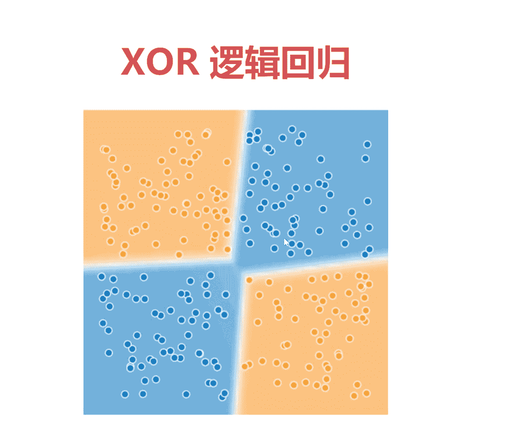
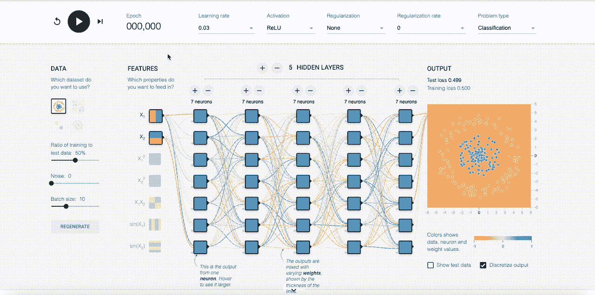
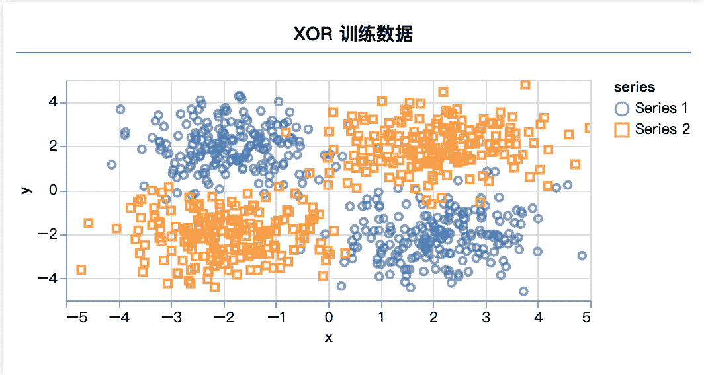
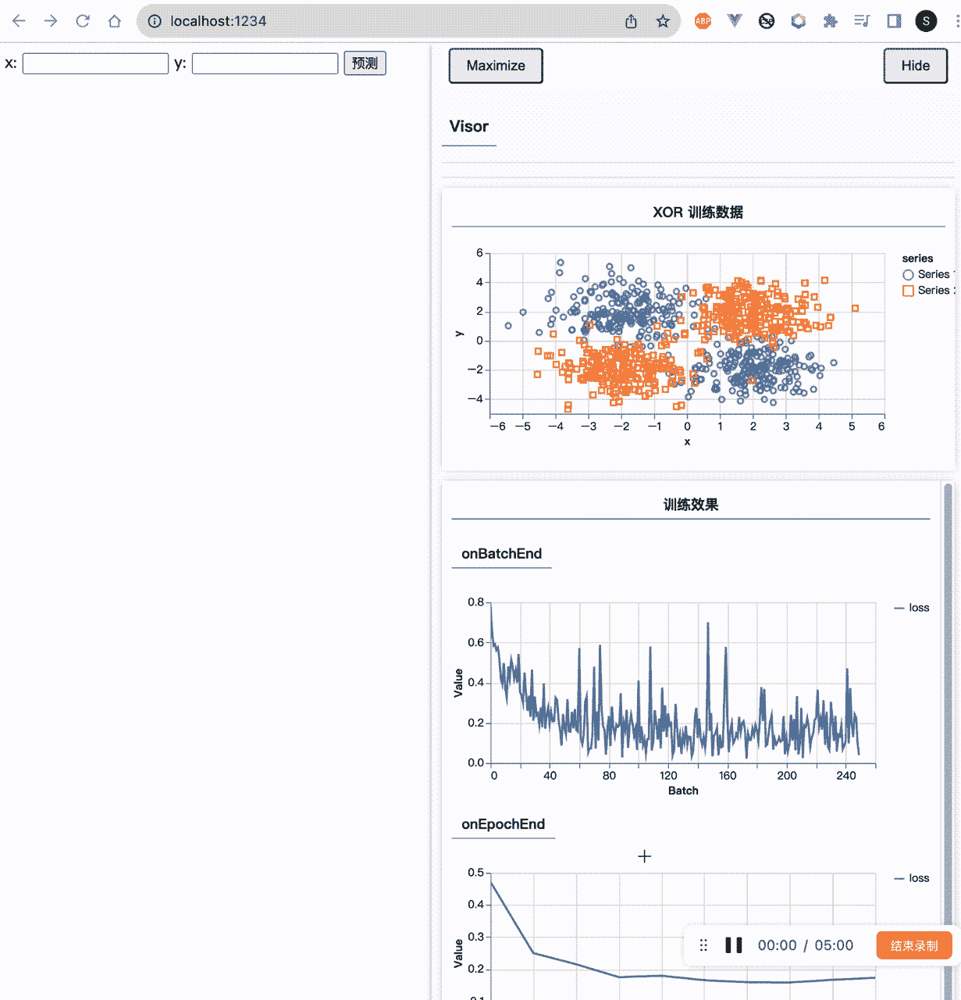

# 006 多层神经网络

> 来源：[https://my.feishu.cn/docx/IayvdrYWRoFRTDxFhWKc0lu6nIb](https://my.feishu.cn/docx/IayvdrYWRoFRTDxFhWKc0lu6nIb)

# 背景

在前面，我们一直用的是单层神经网络来解决线性回归和逻辑回归的问题，但**是像那样子简单的神经**网络也只能解决一些很简单的问题，一旦问题变得复杂，我们就需要增加神经网络的复杂度了。因此，我们要去学习使用神经网络配合激活函数去解决复杂的XOR问题。

# 一、多层神经网络任务简介

## 1、XOR逻辑回归

+   **异或（X**OR）是一个数学运算符，它应用于逻辑运算。异或的数学符号为“⊕”，计算机符号为“xor”。其运算法则为：a⊕b = (¬a ∧ b) ∨ (a ∧¬b)。如果a、b两个值不相同，则异或结果为1。如果a、b两个值相同，异或结果为0。

+   我们来观察一下下**面这个**平**面上的**点，这些点当中**它们的 **x坐标和 y坐标都为**正或都为**负的时候，它们**是蓝色的**点。当它们的 x 坐标一正一负的时候，它们为黄色的点。而我们的目的就是，要把蓝色的点和黄色的点分开，这个问题就是 XOR 问题。



## 2、通过Playground了解多层神经网络

**我们可以很明**显的看到，这个数据集显然不是**线性分布的****。之前谈**到，如果一个数据是呈线性分布的，那么我们一定可以在所有的维度上都用一条线把它们画出来，就是画一个趋势，要不然就是增，要不然就减，也就意味着在某一维度上肯定能画出来一个趋势。

而在我们这个篇章当中谈到的XOR，它明显看起来不是线性增长的。那对于这种非线性问题，如**何用神经网络来**解决呢？其实**我们只需**要增加神经网络的层数，再配[合一下激活函数就可以解决了。我们可以](https://playground.tensorflow.org/#activation=relu&batchSize=10&dataset=spiral&regDataset=reg-plane&learningRate=0.03&regularizationRate=0&noise=0&networkShape=7,7,7,7,7,7&seed=0.16242&showTestData=false&discretize=false&percTrainData=50&x=true&y=true&xTimesY=true&xSquared=true&ySquared=false&cosX=false&sinX=false&cosY=false&sinY=false&collectStats=false&problem=classification&initZero=false&hideText=false)用 Tensorflow — Neural Network Playground 来演示下：



可以看到，我们加了五层神经网络，每一层都有7个神经元。然后点击按键开始训练这个多层神经网络，最终整个训练结果的走向趋近我们想要的结果。

## 3、操作步骤

+   加载XOR数据集

+   定义模型结构：多层神经网络

+   训练模型并预测

+

# 二、加载 XOR 数据集

## 1、操作步骤

+   使用**脚本**来生成 XOR 数据集

+   可视化 XOR 数据集

## 2、训练过程

首先，我们先创建一个 data.js 文件，功能主要用来**生成二分类数据集**。

```
/**
 * @description
 */
export function getData(numSamples) {
  let points = [];

  function genGauss(cx, cy, label) {
    for (let i = 0; i &lt; numSamples / 2; i++) {
      let x = normalRandom(cx);
      let y = normalRandom(cy);
      points.push({ x, y, label });
    }
  }

  genGauss(2, 2, 0);
  genGauss(-2, -2, 0);
  genGauss(-2, 2, 1);
  genGauss(2, -2, 1);
  return points;
}

/**
 * Samples from a normal distribution. Uses the seedrandom library as the
 * random generator.
 *
 * @param mean The mean. Default is 0.
 * @param variance The variance. Default is 1.
 */
function normalRandom(mean = 0, variance = 1) {
  let v1, v2, s;
  do {
    v1 = 2 * Math.random() - 1;
    v2 = 2 * Math.random() - 1;
    s = v1 * v1 + v2 * v2;
  } while (s &gt; 1);

  let result = Math.sqrt((-2 * Math.log(s)) / s) * v1;
  return mean + Math.sqrt(variance) * result;
}

```

接着，创建script.js**文件，来实现逻**辑回归的基本功能。具体代码如下：

```
import * as tf from &#x27;@tensorflow/tfjs&#x27;;
import * as tfvis from &#x27;@tensorflow/tfjs-vis&#x27;;
import { getData } from &#x27;./data.js&#x27;; // 引入脚本里的数据

// 先初始化一组数据
window.onload = async () =&gt; {
  // 生成400个随机数据
  const data = getData(400);

  // 可视化随机数据
  tfvis.render.scatterplot(
    { name: &#x27;XOR 训练数据&#x27; },
    {
      values: [
        data.filter((p) =&gt; p.label === 1),
        data.filter((p) =&gt; p.label === 0)
      ]
    }
  );
}
```

最后来看下可视化效果👇🏻：



# 三、定义模型结构：多层神经网络

为了解决XOR问题，我们必须使用**多层神经网络配合激活函数**才行。

## 1、操作步骤

+   初始化一个神经网络模型

+   为神经网络模型添加**两个层**

+   设计这两个层的神经元个数、输入形状inputSize 和 激活函数

## 2、训练模型

具体训练代码如下👇🏻：

```
import * as tf from &#x27;@tensorflow/tfjs&#x27;;
import * as tfvis from &#x27;@tensorflow/tfjs-vis&#x27;;
import { getData } from &#x27;./data.js&#x27;; // 引入脚本里的数据

// 先初始化一组数据
window.onload = async () =&gt; {
  // 初始化数据
  ……
  
  // 加载XOR数据集
  const model = tf.sequential();
  model.add(
    tf.layers.dense({
      units: 4,
      inputShape: [2],
      activation: &#x27;relu&#x27;
    })
  );
  model.add(
    tf.layers.dense({
      units: 1,
      activation: &#x27;sigmoid&#x27;
    })
  );
  model.compile({
    loss: tf.losses.logLoss,
    optimizer: tf.train.adam(0.1) // 学习率
  });
}
```

# 四、训练模型并预测

## 1、操作步骤

+   训练模型并可视化训练过程

+   编写前端界面进行预测

## 2、训练过程

首先我们新建个文件夹 index.html，具体代码如下：

```
&lt;script src=&quot;script.js&quot;&gt;&lt;/script&gt;
&lt;form action=&quot;&quot; onsubmit=&quot;predict(this);return false;&quot;&gt;
    x: &lt;input type=&quot;text&quot; name=&quot;x&quot;&gt;
    y: &lt;input type=&quot;text&quot; name=&quot;y&quot;&gt;
    &lt;button type=&quot;submit&quot;&gt;预测&lt;/button&gt;
&lt;/form&gt;
```

接着，在script.js文件里面，继续编写对数据进行预测的代码。如下所示：

```
import * as tf from &#x27;@tensorflow/tfjs&#x27;;
import * as tfvis from &#x27;@tensorflow/tfjs-vis&#x27;;
import { getData } from &#x27;./data.js&#x27;; // 引入脚本里的数据

window.onload = async () =&gt; {
  // 初始化数据
  ……
  
  // 加载XOR数据集
  ……
  
  // 训练模型并预测
  const inputs = tf.tensor(data.map((p) =&gt; [p.x, p.y]));
  const labels = tf.tensor(data.map((p) =&gt; p.label));

  await model.fit(inputs, labels, {
    epochs: 10,
    callbacks: tfvis.show.fitCallbacks({ name: &#x27;训练效果&#x27; }, [&#x27;loss&#x27;])
  });

  window.predict = (form) =&gt; {
    const pred = model.predict(
      tf.tensor([[form.x.value * 1, form.y.value * 1]])
    );
    alert(`预测结果：${pred.dataSync()[0]}`);
  };
}
```

最后，我们在控制台使用 parcel /index.html 。之后在浏览器看下效果：



可以清晰的看到，当x为2，y为-2的时候，是蓝色的点，且预测值为0.99+，接近于label值，这个点的label值为1。