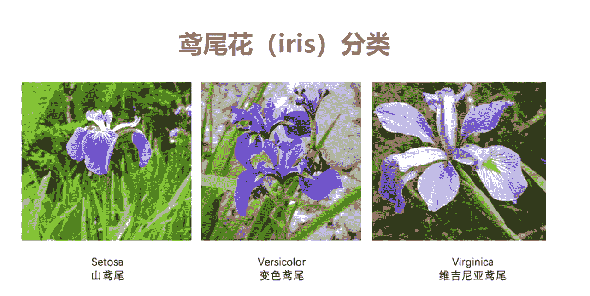
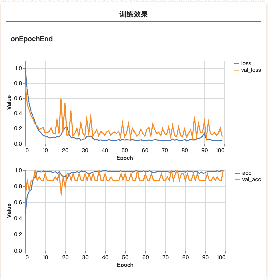
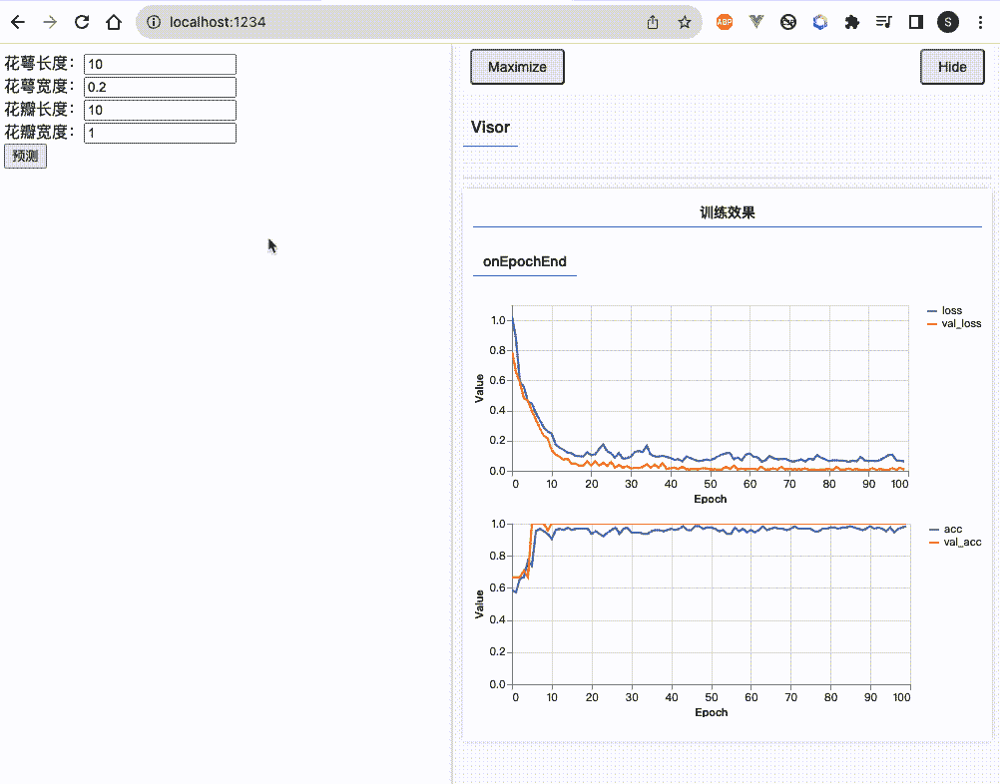

# 007 多分类

> 来源：`https://my.feishu.cn/docx/Jeyed0WOaouMPSxjVvKcwWc3nCz`

## 背景

前面我们一直在介绍二分类的逻辑回归问题，我们只需要输出一个概率就可以对数据集进行二分类。但是在现实生活中不仅包含二分类问题，也包含很多分类问题。举个例子，比如说你在画板上手写了一个数字，你用神经网络来判断这个手写的数字是 0- 9 哪个数字，那么这个问题一共就有 10 个分类，也就是多分类。再比如我们使用神经网络对通用的图片进行分类，比如说判断一张图片里面是否有钢琴、自行车、公鸡、母鸡、猫狗等等，可能就会有成千上万种分类了。那在下面，我们就来谈谈多分类。

## 一、任务简介、主要步骤

### 1、任务简介 - 鸢尾花例子

面对这样的多分类问题，我们该构建怎样的神经网络才能解决它们呢？

在应对更为复杂的多分类问题之前，我们先用一个著名的鸢尾花分类来进行学习。鸢尾花的英文叫做Iris，这个数据集已经诞生很多年了，无数的数据科学家用它作为数据集去验证自己的算法以及模型。因此，我们用这个数据集来进行多分类。

下面，继续给大家介绍一下什么是鸢尾花分类。我们这个分类问题是要根据鸢尾花的花瓣长度宽度，花鳄的长度宽度来将鸢尾花分为三个类别，分别是山鸢尾（Iris setosa）、变色烟尾和维吉尼亚鸢尾（Iris virginica）。

那花瓣的长度宽度，花萼的长度宽度，就一共有4个特征。之前我们构建的神经网络都是两个特征，现在就变成四个特征。那对于更为复杂的神经网络，我们该怎样构建呢？以至于既能解决这个多分类问题，又能输出这个多分类的概率输出，且满足多分类的结果。

事实上，面对这样的问题，我们只需要构建一个多层神经网络，并在神经网络的最后一层加一个 `Softmax` 激活函数就可以了。



### 2、主要步骤

+ 加载 IRIS 数据集（训练集与验证集）

+ 定义模型结构：带有`softmax`的多层神经网络

+ 训练模型并预测

## 二、加载iris数据集（训练集与验证集）

### 1、关于训练集和验证集

+ 训练集用于后面的模型训练，而验证集则用于验证模型是否训练的越来越好。

+ 验证集跟训练集的数据格式是一模一样的。在实际的工作中，验证集往往都是从训练集里面分一部分出来的，它俩的格式一模一样，也就意味着训练集跟验证集都包括了输入特征和对应的标签。

+ 虽然它俩格式一样，但但是作用不一样。训练集是用于训练神经网络的，换句话说，神经网络的权重会因为训练集的数据而变化，但是它的权重却不会因为验证级的数据而变化，因为验证级只是用来验证这个模型是否训练的越来越好了。

+ 举个例子，比如说在训练过程中，我们训练集的损失越来越低了，但是验证级的损失却越来越高，那就证明你这个模型没有越训练越好，你就该停止了，这个时候就要思考下要不要改一些模型结构或者其他超参数再训练它。

### 1、操作步骤

+ 使用预先准备好的脚本生成IRIS的数据集，包括训练集与验证集

+ 多打印 IRIS 数据集

### 2、训练过程

首先，我们先创建一个 `data.js` 文件，功能主要用来生成二分类数据集。


```
/**
 * @license
 * Copyright 2018 Google LLC. All Rights Reserved.
 * Licensed under the Apache License, Version 2.0 (the "License");
 * you may not use this file except in compliance with the License.
 * You may obtain a copy of the License at
 *
 * http://www.apache.org/licenses/LICENSE-2.0
 *
 * Unless required by applicable law or agreed to in writing, software
 * distributed under the License is distributed on an "AS IS" BASIS,
 * WITHOUT WARRANTIES OR CONDITIONS OF ANY KIND, either express or implied.
 * See the License for the specific language governing permissions and
 * limitations under the License.
 * =============================================================================
 */

import * as tf from '@tensorflow/tfjs';

export const IRIS_CLASSES =
    ['山鸢尾', '变色鸢尾', '维吉尼亚鸢尾'];
export const IRIS_NUM_CLASSES = IRIS_CLASSES.length;

// Iris flowers data. Source:
//   https://archive.ics.uci.edu/ml/machine-learning-databases/iris/iris.data
const IRIS_DATA = [
  [5.1, 3.5, 1.4, 0.2, 0], [4.9, 3.0, 1.4, 0.2, 0], [4.7, 3.2, 1.3, 0.2, 0],
  [4.6, 3.1, 1.5, 0.2, 0], [5.0, 3.6, 1.4, 0.2, 0], [5.4, 3.9, 1.7, 0.4, 0],
  [4.6, 3.4, 1.4, 0.3, 0], [5.0, 3.4, 1.5, 0.2, 0], [4.4, 2.9, 1.4, 0.2, 0],
  [4.9, 3.1, 1.5, 0.1, 0], [5.4, 3.7, 1.5, 0.2, 0], [4.8, 3.4, 1.6, 0.2, 0],
  [4.8, 3.0, 1.4, 0.1, 0], [4.3, 3.0, 1.1, 0.1, 0], [5.8, 4.0, 1.2, 0.2, 0],
  [5.7, 4.4, 1.5, 0.4, 0], [5.4, 3.9, 1.3, 0.4, 0], [5.1, 3.5, 1.4, 0.3, 0],
  [5.7, 3.8, 1.7, 0.3, 0], [5.1, 3.8, 1.5, 0.3, 0], [5.4, 3.4, 1.7, 0.2, 0],
  [5.1, 3.7, 1.5, 0.4, 0], [4.6, 3.6, 1.0, 0.2, 0], [5.1, 3.3, 1.7, 0.5, 0],
  [4.8, 3.4, 1.9, 0.2, 0], [5.0, 3.0, 1.6, 0.2, 0], [5.0, 3.4, 1.6, 0.4, 0],
  [5.2, 3.5, 1.5, 0.2, 0], [5.2, 3.4, 1.4, 0.2, 0], [4.7, 3.2, 1.6, 0.2, 0],
  [4.8, 3.1, 1.6, 0.2, 0], [5.4, 3.4, 1.5, 0.4, 0], [5.2, 4.1, 1.5, 0.1, 0],
  [5.5, 4.2, 1.4, 0.2, 0], [4.9, 3.1, 1.5, 0.1, 0], [5.0, 3.2, 1.2, 0.2, 0],
  [5.5, 3.5, 1.3, 0.2, 0], [4.9, 3.1, 1.5, 0.1, 0], [4.4, 3.0, 1.3, 0.2, 0],
  [5.1, 3.4, 1.5, 0.2, 0], [5.0, 3.5, 1.3, 0.3, 0], [4.5, 2.3, 1.3, 0.3, 0],
  [4.4, 3.2, 1.3, 0.2, 0], [5.0, 3.5, 1.6, 0.6, 0], [5.1, 3.8, 1.9, 0.4, 0],
  [4.8, 3.0, 1.4, 0.3, 0], [5.1, 3.8, 1.6, 0.2, 0], [4.6, 3.2, 1.4, 0.2, 0],
  [5.3, 3.7, 1.5, 0.2, 0], [5.0, 3.3, 1.4, 0.2, 0], [7.0, 3.2, 4.7, 1.4, 1],
  [6.4, 3.2, 4.5, 1.5, 1], [6.9, 3.1, 4.9, 1.5, 1], [5.5, 2.3, 4.0, 1.3, 1],
  [6.5, 2.8, 4.6, 1.5, 1], [5.7, 2.8, 4.5, 1.3, 1], [6.3, 3.3, 4.7, 1.6, 1],
  [4.9, 2.4, 3.3, 1.0, 1], [6.6, 2.9, 4.6, 1.3, 1], [5.2, 2.7, 3.9, 1.4, 1],
  [5.0, 2.0, 3.5, 1.0, 1], [5.9, 3.0, 4.2, 1.5, 1], [6.0, 2.2, 4.0, 1.0, 1],
  [6.1, 2.9, 4.7, 1.4, 1], [5.6, 2.9, 3.6, 1.3, 1], [6.7, 3.1, 4.4, 1.4, 1],
  [5.6, 3.0, 4.5, 1.5, 1], [5.8, 2.7, 4.1, 1.0, 1], [6.2, 2.2, 4.5, 1.5, 1],
  [5.6, 2.5, 3.9, 1.1, 1], [5.9, 3.2, 4.8, 1.8, 1], [6.1, 2.8, 4.0, 1.3, 1],
  [6.3, 2.5, 4.9, 1.5, 1], [6.1, 2.8, 4.7, 1.2, 1], [6.4, 2.9, 4.3, 1.3, 1],
  [6.6, 3.0, 4.4, 1.4, 1], [6.8, 2.8, 4.8, 1.4, 1], [6.7, 3.0, 5.0, 1.7, 1],
  [6.0, 2.9, 4.5, 1.5, 1], [5.7, 2.6, 3.5, 1.0, 1], [5.5, 2.4, 3.8, 1.1, 1],
  [5.5, 2.4, 3.7, 1.0, 1], [5.8, 2.7, 3.9, 1.2, 1], [6.0, 2.7, 5.1, 1.6, 1],
  [5.4, 3.0, 4.5, 1.5, 1], [6.0, 3.4, 4.5, 1.6, 1], [6.7, 3.1, 4.7, 1.5, 1],
  [6.3, 2.3, 4.4, 1.3, 1], [5.6, 3.0, 4.1, 1.3, 1], [5.5, 2.5, 4.0, 1.3, 1],
  [5.5, 2.6, 4.4, 1.2, 1], [6.1, 3.0, 4.6, 1.4, 1], [5.8, 2.6, 4.0, 1.2, 1],
  [5.0, 2.3, 3.3, 1.0, 1], [5.6, 2.7, 4.2, 1.3, 1], [5.7, 3.0, 4.2, 1.2, 1],
  [5.7, 2.9, 4.2, 1.3, 1], [6.2, 2.9, 4.3, 1.3, 1], [5.1, 2.5, 3.0, 1.1, 1],
  [5.7, 2.8, 4.1, 1.3, 1], [6.3, 3.3, 6.0, 2.5, 2], [5.8, 2.7, 5.1, 1.9, 2],
  [7.1, 3.0, 5.9, 2.1, 2], [6.3, 2.9, 5.6, 1.8, 2], [6.5, 3.0, 5.8, 2.2, 2],
  [7.6, 3.0, 6.6, 2.1, 2], [4.9, 2.5, 4.5, 1.7, 2], [7.3, 2.9, 6.3, 1.8, 2],
  [6.7, 2.5, 5.8, 1.8, 2], [7.2, 3.6, 6.1, 2.5, 2], [6.5, 3.2, 5.1, 2.0, 2],
  [6.4, 2.7, 5.3, 1.9, 2], [6.8, 3.0, 5.5, 2.1, 2], [5.7, 2.5, 5.0, 2.0, 2],
  [5.8, 2.8, 5.1, 2.4, 2], [6.4, 3.2, 5.3, 2.3, 2], [6.5, 3.0, 5.5, 1.8, 2],
  [7.7, 3.8, 6.7, 2.2, 2], [7.7, 2.6, 6.9, 2.3, 2], [6.0, 2.2, 5.0, 1.5, 2],
  [6.9, 3.2, 5.7, 2.3, 2], [5.6, 2.8, 4.9, 2.0, 2], [7.7, 2.8, 6.7, 2.0, 2],
  [6.3, 2.7, 4.9, 1.8, 2], [6.7, 3.3, 5.7, 2.1, 2], [7.2, 3.2, 6.0, 1.8, 2],
  [6.2, 2.8, 4.8, 1.8, 2], [6.1, 3.0, 4.9, 1.8, 2], [6.4, 2.8, 5.6, 2.1, 2],
  [7.2, 3.0, 5.8, 1.6, 2], [7.4, 2.8, 6.1, 1.9, 2], [7.9, 3.8, 6.4, 2.0, 2],
  [6.4, 2.8, 5.6, 2.2, 2], [6.3, 2.8, 5.1, 1.5, 2], [6.1, 2.6, 5.6, 1.4, 2],
  [7.7, 3.0, 6.1, 2.3, 2], [6.3, 3.4, 5.6, 2.4, 2], [6.4, 3.1, 5.5, 1.8, 2],
  [6.0, 3.0, 4.8, 1.8, 2], [6.9, 3.1, 5.4, 2.1, 2], [6.7, 3.1, 5.6, 2.4, 2],
  [6.9, 3.1, 5.1, 2.3, 2], [5.8, 2.7, 5.1, 1.9, 2], [6.8, 3.2, 5.9, 2.3, 2],
  [6.7, 3.3, 5.7, 2.5, 2], [6.7, 3.0, 5.2, 2.3, 2], [6.3, 2.5, 5.0, 1.9, 2],
  [6.5, 3.0, 5.2, 2.0, 2], [6.2, 3.4, 5.4, 2.3, 2], [5.9, 3.0, 5.1, 1.8, 2],
];

/**
 * Convert Iris data arrays to `tf.Tensor`s.
 *
 * @param data The Iris input feature data, an `Array` of `Array`s, each element
 *   of which is assumed to be a length-4 `Array` (for petal length, petal
 *   width, sepal length, sepal width).
 * @param targets An `Array` of numbers, with values from the set {0, 1, 2}:
 *   representing the true category of the Iris flower. Assumed to have the same
 *   array length as `data`.
 * @param testSplit Fraction of the data at the end to split as test data: a
 *   number between 0 and 1.
 * @return A length-4 `Array`, with
 *   - training data as `tf.Tensor` of shape [numTrainExapmles, 4].
 *   - training one-hot labels as a `tf.Tensor` of shape [numTrainExamples, 3]
 *   - test data as `tf.Tensor` of shape [numTestExamples, 4].
 *   - test one-hot labels as a `tf.Tensor` of shape [numTestExamples, 3]
 */
function convertToTensors(data, targets, testSplit) {
  const numExamples = data.length;
  if (numExamples !== targets.length) {
    throw new Error('data and split have different numbers of examples');
  }

  // Randomly shuffle `data` and `targets`.
  const indices = [];
  for (let i = 0; i < numExamples; ++i) {
    indices.push(i);
  }
  tf.util.shuffle(indices);

  const shuffledData = [];
  const shuffledTargets = [];
  for (let i = 0; i < numExamples; ++i) {
    shuffledData.push(data[indices[i]]);
    shuffledTargets.push(targets[indices[i]]);
  }

  // Split the data into a training set and a tet set, based on `testSplit`.
  const numTestExamples = Math.round(numExamples * testSplit);
  const numTrainExamples = numExamples - numTestExamples;

  const xDims = shuffledData[0].length;

  // Create a 2D `tf.Tensor` to hold the feature data.
  const xs = tf.tensor2d(shuffledData, [numExamples, xDims]);

  // Create a 1D `tf.Tensor` to hold the labels, and convert the number label
  // from the set {0, 1, 2} into one-hot encoding (.e.g., 0 --> [1, 0, 0]).
  const ys = tf.oneHot(tf.tensor1d(shuffledTargets).toInt(), IRIS_NUM_CLASSES);

  // Split the data into training and test sets, using `slice`.
  const xTrain = xs.slice([0, 0], [numTrainExamples, xDims]);
  const xTest = xs.slice([numTrainExamples, 0], [numTestExamples, xDims]);
  const yTrain = ys.slice([0, 0], [numTrainExamples, IRIS_NUM_CLASSES]);
  const yTest = ys.slice([0, 0], [numTestExamples, IRIS_NUM_CLASSES]);
  return [xTrain, yTrain, xTest, yTest];
}

/**
 * Obtains Iris data, split into training and test sets.
 *
 * @param testSplit Fraction of the data at the end to split as test data: a
 *   number between 0 and 1.
 *
 * @param return A length-4 `Array`, with
 *   - training data as an `Array` of length-4 `Array` of numbers.
 *   - training labels as an `Array` of numbers, with the same length as the
 *     return training data above. Each element of the `Array` is from the set
 *     {0, 1, 2}.
 *   - test data as an `Array` of length-4 `Array` of numbers.
 *   - test labels as an `Array` of numbers, with the same length as the
 *     return test data above. Each element of the `Array` is from the set
 *     {0, 1, 2}.
 */
export function getIrisData(testSplit) {
  return tf.tidy(() => {
    const dataByClass = [];
    const targetsByClass = [];
    for (let i = 0; i < IRIS_CLASSES.length; ++i) {
      dataByClass.push([]);
      targetsByClass.push([]);
    }
    for (const example of IRIS_DATA) {
      const target = example[example.length - 1];
      const data = example.slice(0, example.length - 1);
      dataByClass[target].push(data);
      targetsByClass[target].push(target);
    }

    const xTrains = [];
    const yTrains = [];
    const xTests = [];
    const yTests = [];
    for (let i = 0; i < IRIS_CLASSES.length; ++i) {
      const [xTrain, yTrain, xTest, yTest] =
          convertToTensors(dataByClass[i], targetsByClass[i], testSplit);
      xTrains.push(xTrain);
      yTrains.push(yTrain);
      xTests.push(xTest);
      yTests.push(yTest);
    }

    const concatAxis = 0;
    return [
      tf.concat(xTrains, concatAxis), tf.concat(yTrains, concatAxis),
      tf.concat(xTests, concatAxis), tf.concat(yTests, concatAxis)
    ];
  });
}
```


接着，创建`script.js`文件，来加载Iris的数据集。
具体代码如下：

```
import * as tf from &#x27;@tensorflow/tfjs&#x27;;
import * as tfvis from &#x27;@tensorflow/tfjs-vis&#x27;;
import { getData } from &#x27;./data.js&#x27;;

window.onload = async () =&gt; {
  // 加载数据集
  // xTrain代表输入的特征；xTest代表训练集的所有标签
  const [xTrain, yTrain, xTest, yTest] = getIrisData(0.15);
}
```

# 三、定义模型结构：带有softmax的多层神经网络

## 1、操作步骤

+ 初始化一个神经网络模型
+ 为神经网络模型添加两个层
+ 设计这两个层的神经元个数、`inputShape`、激活函数

## 2、训练过程

我们需要用`model`，来为这个神经网络网络添加两个层。具体代码如下👇🏻：

```
import * as tf from &#x27;@tensorflow/tfjs&#x27;;
import * as tfvis from &#x27;@tensorflow/tfjs-vis&#x27;;
import { getData } from &#x27;./data.js&#x27;;

window.onload = async () =&gt; {
  // 加载数据集
  // xTrain代表输入的特征；y代表训练集的所有标签
  const [xTrain, yTrain, xTest, yTest] = getIrisData(0.15);
  
  const model = tf.sequential();
  // 带有softmax的多层神经网络
  model.add(
    tf.layers.dense({
      units: 10,
      inputShape: [xTrain.shape[1]],
      activation: &#x27;sigmoid&#x27;
    })
  );
  model.add(
    tf.layers.dense({
      units: 3,
      activation: &#x27;softmax&#x27;
    })
  );
}
```

# 四、训练模型：交叉熵损失函数与准确度度量

## 1、操作步骤

+ 设置交叉熵函数
+ 添加准确度度量
+ 训练模型并使用`tfvis`可视化训练过程

## 2、训练过程

添加完成神经网络的层之后，接下来要为这个模型，设置交叉熵损失函数与准确度度量，之后进行预测。具体代码如下👇🏻：

```
import * as tf from &#x27;@tensorflow/tfjs&#x27;;
import * as tfvis from &#x27;@tensorflow/tfjs-vis&#x27;;
import { getData } from &#x27;./data.js&#x27;;

window.onload = async () =&gt; {
  // 加载数据集
  ……
  
  // 定义模型结构 
  ……
  
  // 交叉熵损失函数与准确度度量
  model.compile({
    loss: &#x27;categoricalCrossentropy&#x27;, // 设置损失函数
    optimizer: tf.train.adam(0.1), // 设置优化器
    metrics: [&#x27;accuracy&#x27;] // 设置度量
  });

  // 开始训练
  await model.fit(xTrain, yTrain, {
    epochs: 100,
    validationData: [xTest, yTest],
    callbacks: tfvis.show.fitCallbacks(
      { name: &#x27;训练效果&#x27; },
      [&#x27;loss&#x27;, &#x27;val_loss&#x27;, &#x27;acc&#x27;, &#x27;val_acc&#x27;],
      { callbacks: [&#x27;onEpochEnd&#x27;] } // 设置图标只展示 onEpochEnd
    )
  });
}
```

最后，来看下效果：



可以看到，蓝线和黄线基本是接近高度吻合，所以说预测效果接近95%+的正确率。

# 五、多分类预测方法

## 1、操作步骤

+ 编写前端界面，并输入待预测数据
+ 使用训练好的模型进行预测
+ 将输出的`Tensor`转为普通数据并显示

## 2、训练过程

首先我们新建个文件夹 `index.html`，具体代码如下：

```
&lt;script src=&quot;script.js&quot;&gt;&lt;/script&gt;
&lt;form action=&quot;&quot; onsubmit=&quot;predict(this); return false;&quot;&gt;
    花萼长度：&lt;input type=&quot;text&quot; name=&quot;a&quot;&gt;&lt;br&gt;
    花萼宽度：&lt;input type=&quot;text&quot; name=&quot;b&quot;&gt;&lt;br&gt;
    花瓣长度：&lt;input type=&quot;text&quot; name=&quot;c&quot;&gt;&lt;br&gt;
    花瓣宽度：&lt;input type=&quot;text&quot; name=&quot;d&quot;&gt;&lt;br&gt;
    &lt;button type=&quot;submit&quot;&gt;预测&lt;/button&gt;
&lt;/form&gt;
```

接着，在`script.js`文件里面，继续编写对数据进行预测的代码。如下所示：

```
import * as tf from &#x27;@tensorflow/tfjs&#x27;;
import * as tfvis from &#x27;@tensorflow/tfjs-vis&#x27;;
import { getData } from &#x27;./data.js&#x27;;

window.onload = async () =&gt; {
  // 加载数据集
  ……
  
  // 定义模型结构 
  ……
  
  // 交叉熵损失函数与准确度度量
  ……
  
  // 多分类预测方法
  window.predict = (form) =&gt; {
    const input = tf.tensor([
      [form.a.value * 1, form.b.value * 1, form.c.value * 1, form.d.value * 1]
    ]);
    const pred = model.predict(input);
    alert(`预测结果：${IRIS_CLASSES[pred.argMax(1).dataSync(0)]}`);
  };
}
```

最后，我们来看下预测效果：


