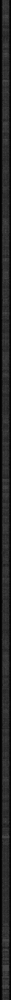
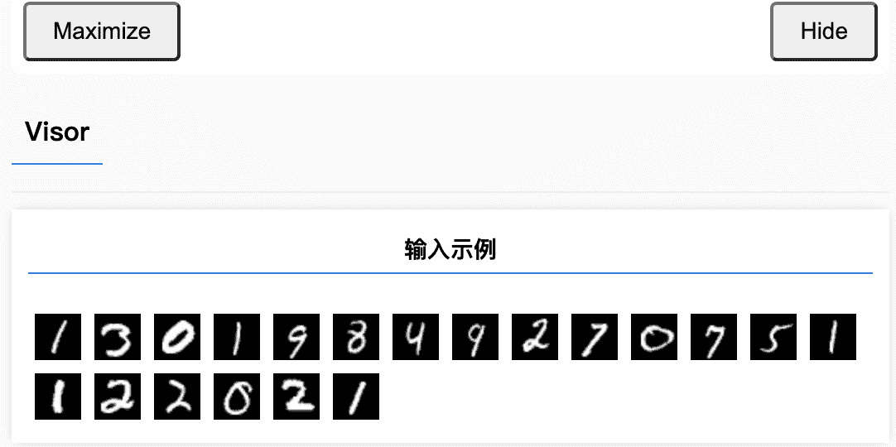
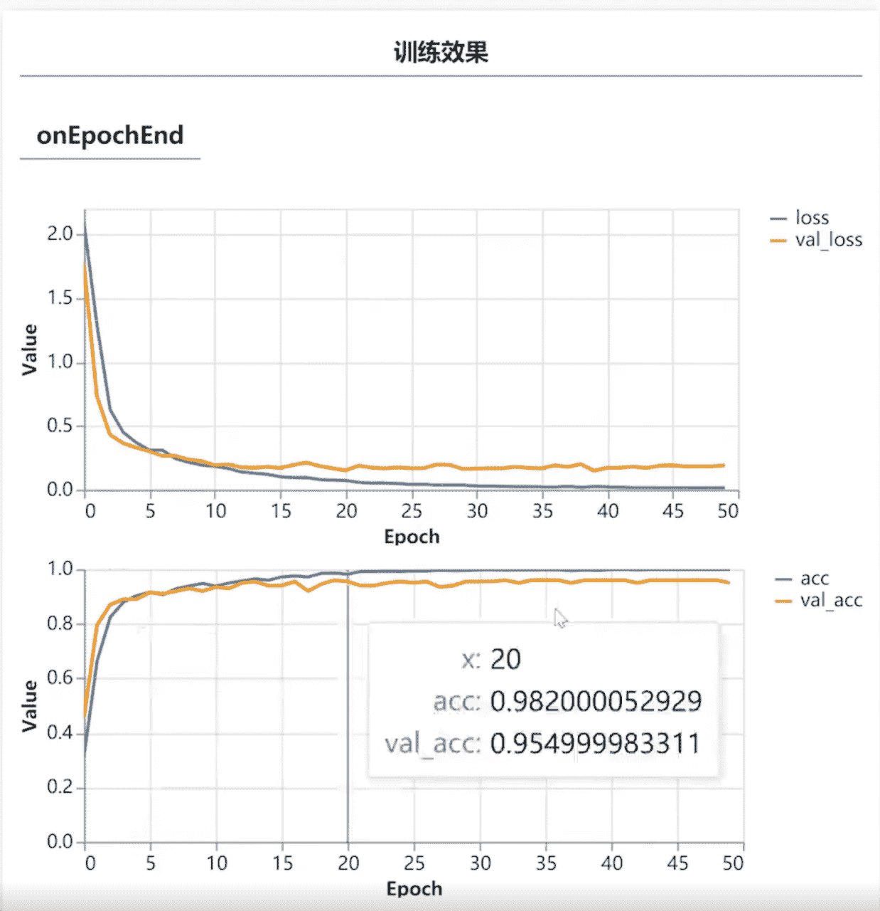
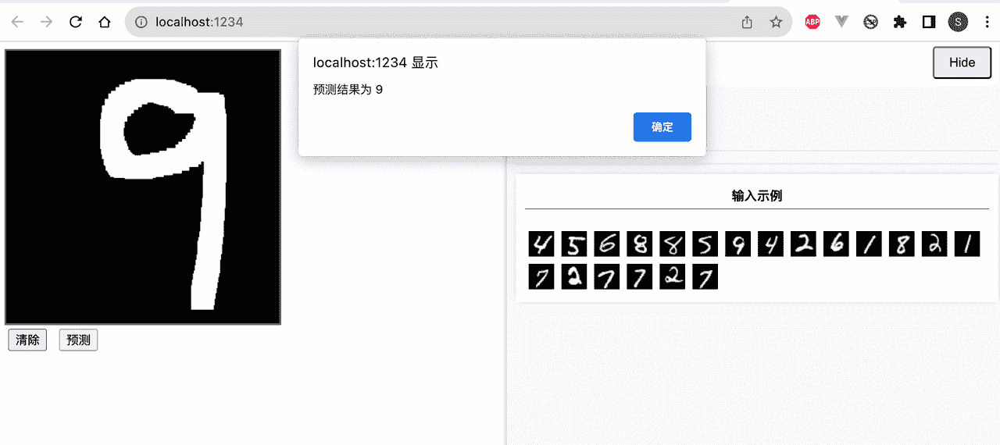

# 001 使用卷积神经网络（CNN）识别手写数字

> 来源：[https://my.feishu.cn/docx/GgnQddNh4oXscrxoMuRclKppnNh](https://my.feishu.cn/docx/GgnQddNh4oXscrxoMuRclKppnNh)

# 一、使用卷积神经网络识别手写数字任务简介

## 1、任务简介

+   什么是识别手写数字？比如说你在纸上写了一个数字，拍了一张照片传到我们的模型里，然后我们的模型就可以判断你写的这个数字是 0-9 的哪个数字。

+   这项任务看似简单，其实非常非常的困难，我们人去看图片识别数字是一件非常简单的事情，这个小朋友都可以做到。

+   但是对于计算机来说，处理这种**非结构化的数据**，也就是图片是非常困难的，比如说我们写的数字稍微偏一点儿、歪一点**儿、长一点儿**、短一点儿，对计算机来说都是完全不一样的信息。且我们的图片最后会变成一个个像素值传还给计算机，对计算机来说，识别出来的内容随时都有可能是不一样的数字。

+   那么计算机它如何处理这种千变万化的状态呢？这就要用到卷积神经网络了。

## 2、操作步骤

+   加载 MNIST 数据集 —— 第一步还是加载数据集，**这次我们要加载的**是 MNIST 数据集，这个数据集其实就是一张巨大的雪碧图，在这个雪碧图里面将会有非常非常多的手写数字。

+   构建卷积神经网络并训练 —— 将会介绍卷积神经网络它都包含哪些层，每个层大致的原理是什么样的，以及功能是什么样的。

+   使用Canvas绘制数字并预测 —— 用鼠标在canvas画板上写数字，之后把canvas的数据转换成图片，然后把图片转化为Tensor，最后会把这个转化后的 Tensor 输入到模型里面进行预测。

# 二、加载 MNIST 数据集

## 1、操作步骤

+   使用预先准备好的脚本加载 MNIST 数据集 —— MNIST是个非常著名的数据集，无数的机器学习、深度学习爱好者和从业者使用它来学习卷积神经网络。那为什么使用它呢？因为 MNIST 它包含了大量的手写数字以及对应的标签，所以就用它来训练我们的卷积神经网络。

+   可视化数据集 —— 把手写数字的图片，给渲染到浏览器中。

## 2、训练过程

### （1）准备数据

首先我们在根目录下，创建一个文件夹，命名为data。然后里面再创建一个文件夹，命名为mnist。mnist里面会有这么两个文件：




[mnist_labels_uint8](https://internal-api-drive-stream.feishu.cn/space/api/box/stream/download/all/GNaGbySbyoR3bzxOtnzcXM2Wngf)

其中，第一个文件就是那张巨大无比的图片，这里面包含了非常非常多的手写数字，它把很多很多的手写数字给拼接到一起了。然后呢，第二个文件是无数张图片对应的标签文件，且这是一个二进制的文件。

### （2）准备加载数据的文件

然后，我们创建一个新的文件夹，命名为minist。在minist创建一个文件，命名为data.js。具体代码如下：

const MNIST_IMAGES_SPRITE_PATH = &#x27;http://127.0.0.1:8080/mnist/mnist_images.png&#x27;;

```
/**
 * @license
 * Copyright 2018 Google LLC. All Rights Reserved.
 * Licensed under the Apache License, Version 2.0 (the &quot;License&quot;);
 * you may not use this file except in compliance with the License.
 * You may obtain a copy of the License at
 *
 * http://www.apache.org/licenses/LICENSE-2.0
 *
 * Unless required by applicable law or agreed to in writing, software
 * distributed under the License is distributed on an &quot;AS IS&quot; BASIS,
 * WITHOUT WARRANTIES OR CONDITIONS OF ANY KIND, either express or implied.
 * See the License for the specific language governing permissions and
 * limitations under the License.
 * =============================================================================
 */

import * as tf from &#x27;@tensorflow/tfjs&#x27;;

const IMAGE_SIZE = 784;
const NUM_CLASSES = 10;
const NUM_DATASET_ELEMENTS = 65000;

const TRAIN_TEST_RATIO = 5 / 6;

const NUM_TRAIN_ELEMENTS = Math.floor(TRAIN_TEST_RATIO * NUM_DATASET_ELEMENTS);
const NUM_TEST_ELEMENTS = NUM_DATASET_ELEMENTS - NUM_TRAIN_ELEMENTS;

// 为其建立静态文件的服务器
const MNIST_LABELS_PATH = &#x27;http://127.0.0.1:8080/mnist/mnist_labels_uint8&#x27;;

/**
 * A class that fetches the sprited MNIST dataset and returns shuffled batches.
 *
 * NOTE: This will get much easier. For now, we do data fetching and
 * manipulation manually.
 */
export class MnistData {
  constructor() {
    this.shuffledTrainIndex = 0;
    this.shuffledTestIndex = 0;
  }

  async load() {
    // Make a request for the MNIST sprited image.
    const img = new Image();
    const canvas = document.createElement(&#x27;canvas&#x27;);
    const ctx = canvas.getContext(&#x27;2d&#x27;);
    const imgRequest = new Promise((resolve, reject) =&gt; {
      img.crossOrigin = &#x27;&#x27;;
      img.onload = () =&gt; {
        img.width = img.naturalWidth;
        img.height = img.naturalHeight;

        const datasetBytesBuffer = new ArrayBuffer(
          NUM_DATASET_ELEMENTS * IMAGE_SIZE * 4
        );

        const chunkSize = 5000;
        canvas.width = img.width;
        canvas.height = chunkSize;

        for (let i = 0; i &lt; NUM_DATASET_ELEMENTS / chunkSize; i++) {
          const datasetBytesView = new Float32Array(
            datasetBytesBuffer,
            i * IMAGE_SIZE * chunkSize * 4,
            IMAGE_SIZE * chunkSize
          );
          ctx.drawImage(
            img,
            0,
            i * chunkSize,
            img.width,
            chunkSize,
            0,
            0,
            img.width,
            chunkSize
          );

          const imageData = ctx.getImageData(0, 0, canvas.width, canvas.height);

          for (let j = 0; j &lt; imageData.data.length / 4; j++) {
            // All channels hold an equal value since the image is grayscale, so
            // just read the red channel.
            datasetBytesView[j] = imageData.data[j * 4] / 255;
          }
        }
        this.datasetImages = new Float32Array(datasetBytesBuffer);

        resolve();
      };
      img.src = MNIST_IMAGES_SPRITE_PATH;
    });

    const labelsRequest = fetch(MNIST_LABELS_PATH);
    const [imgResponse, labelsResponse] = await Promise.all([
      imgRequest,
      labelsRequest
    ]);

    this.datasetLabels = new Uint8Array(await labelsResponse.arrayBuffer());

    // Create shuffled indices into the train/test set for when we select a
    // random dataset element for training / validation.
    this.trainIndices = tf.util.createShuffledIndices(NUM_TRAIN_ELEMENTS);
    this.testIndices = tf.util.createShuffledIndices(NUM_TEST_ELEMENTS);

    // Slice the the images and labels into train and test sets.
    this.trainImages = this.datasetImages.slice(
      0,
      IMAGE_SIZE * NUM_TRAIN_ELEMENTS
    );
    this.testImages = this.datasetImages.slice(IMAGE_SIZE * NUM_TRAIN_ELEMENTS);
    this.trainLabels = this.datasetLabels.slice(
      0,
      NUM_CLASSES * NUM_TRAIN_ELEMENTS
    );
    this.testLabels = this.datasetLabels.slice(
      NUM_CLASSES * NUM_TRAIN_ELEMENTS
    );
  }

  nextTrainBatch(batchSize) {
    return this.nextBatch(
      batchSize,
      [this.trainImages, this.trainLabels],
      () =&gt; {
        this.shuffledTrainIndex =
          (this.shuffledTrainIndex + 1) % this.trainIndices.length;
        return this.trainIndices[this.shuffledTrainIndex];
      }
    );
  }

  nextTestBatch(batchSize) {
    return this.nextBatch(batchSize, [this.testImages, this.testLabels], () =&gt; {
      this.shuffledTestIndex =
        (this.shuffledTestIndex + 1) % this.testIndices.length;
      return this.testIndices[this.shuffledTestIndex];
    });
  }

  nextBatch(batchSize, data, index) {
    const batchImagesArray = new Float32Array(batchSize * IMAGE_SIZE);
    const batchLabelsArray = new Uint8Array(batchSize * NUM_CLASSES);

    for (let i = 0; i &lt; batchSize; i++) {
      const idx = index();

      const image = data[0].slice(
        idx * IMAGE_SIZE,
        idx * IMAGE_SIZE + IMAGE_SIZE
      );
      batchImagesArray.set(image, i * IMAGE_SIZE);

      const label = data[1].slice(
        idx * NUM_CLASSES,
        idx * NUM_CLASSES + NUM_CLASSES
      );
      batchLabelsArray.set(label, i * NUM_CLASSES);
    }

    const xs = tf.tensor2d(batchImagesArray, [batchSize, IMAGE_SIZE]);
    const labels = tf.tensor2d(batchLabelsArray, [batchSize, NUM_CLASSES]);

    return { xs, labels };
  }
}

```

在上面这段代码中，MNIST_IMAGES_SPRITE_PATH 和 MNIST_LABELS_PATH 这两个变量都是一个本地服务的路径。因此，我们还要开一个静态的本地服务，来加载我们在第一步准备的数据。

跨域加载图片数据的具体方式为，在根目录的终端输入以下命令：

```
http-server data --cors
```

至此，我们就可以在其他文件下，引用到data.js的数据了！

### （3）加载数据集

继续，我们在minist文件下，建立index.html文件，具体代码如下：

```
&lt;script src=&quot;script.js&quot;&gt;&lt;/script&gt;
```

然后，我们再建立script.js文件，具体代码如下：

```
import * as tf from &#x27;@tensorflow/tfjs&#x27;;
import * as tfvis from &#x27;@tensorflow/tfjs-vis&#x27;;
import { MnistData } from &#x27;./data&#x27;;

window.onload = async () =&gt; {
  // 实例化数据
  const data = new MnistData();
  // 加载数据
  await data.load();
  // 加载20个数据
  const examples = data.nextTestBatch(20);
  // visor遮阳板 → 主要用来把转化后的图片，放到tfvis里面
  const surface = tfvis.visor().surface({ name: &#x27;输入示例&#x27; });
  for (let i = 0; i &lt; 20; i += 1) {
    // tf.tidy方法
    // 加上这个方法以后，就可以清除掉WebGL的一些内存，防止内存泄漏
    const imageTensor = tf.tidy(() =&gt; {
      // 起点，是第i个图片第1个像素值
      // 切割出一个图片，并切割出784
      // reshape 改变图片的形状
      return examples.xs.slice([i, 0], [1, 784]).reshape([28, 28, 1]);
    });

    // 创建canvas画布
    const canvas = document.createElement(&#x27;canvas&#x27;);
    canvas.width = 28;
    canvas.height = 28;
    canvas.style = &#x27;margin: 4px&#x27;;
    // 把tensor转化为像素
    // 图片要求：必须是二维或者三维的
    await tf.browser.toPixels(imageTensor, canvas);
    surface.drawArea.appendChild(canvas);
  }
};

```

至此，我们就加载完了MNIST数据集！下一步，就是要去**定义模型的结构**。

# 三、定义模型结构：卷积神经网络

## 1、为什么要用卷积神经网络？

图片数据量**大，**运算量大。比如说一**个200***200的彩色图片，那么它就有200 * 200 * 3 = 120000个特征。（乘3代表彩色图片包含 RGB 三个图层）

我们知道，在当下这个时代， 200*200 的照片算是非常非常小了，光它就有 12 万个特征。之前我们谈到过，每个特征我们都会为它准备一个权重，这个权重会存放到神经元里面。那么光这张彩色照片都有 12 万个权重，如果需要一步步去调试和计算，效率就会有点太低了。而且因为我们这个特征一多，网络也复杂，很容易导致过拟合。

**因此，我**们要采用一种新的神经网络来解决这种图片分类的问题，也就是卷积神经网络。

**卷积神经**网络模拟人类的视觉处理流程，能够快速高效地提取特征，更大幅度地减少运算量。

## 2、卷积神经网络的层

**卷积层：**

+   卷积层是用来提取特征的；

+   通过 [Image Kernels](https://setosa.io/ev/image-kernels/) 了解卷积运算；

+   使用多个卷积核（filter/kernel）对图像进行卷积操作；

+   卷积层有权重需要训练，卷积核就是权重；

+   附上一个专门讲解卷积神经网络的网址：https://cs231n.github.io/convolutional-networks/。

**池化层：**

+    最大池化层用于提取最强的特征

+   扩大感受野，减少计算量

+   池化层没有权重需要训练

**全链接层：**

+   作为输出层

+   作为分类器

+   全连接层有权重需要训练

## 3、训练过程

**了解了卷积神经**网络的层之后，下面我们用这些知识点，来完善上面的代码。具体代码如下：

```
import * as tf from &#x27;@tensorflow/tfjs&#x27;;
import * as tfvis from &#x27;@tensorflow/tfjs-vis&#x27;;
import { MnistData } from &#x27;./data&#x27;;

window.onload = async () =&gt; {
  // 加载mnist数据
  ……
  
  /**
   * 卷积神经网络
   */
  // sequential连续型模型
  const model = tf.sequential();
  // 第一层卷积神经网络
  model.add(
    tf.layers.conv2d({
      inputShape: [28, 28, 1], // 图片的宽度、高度和channels
      kernelSize: 5, // 用奇数会更好提取
      filters: 8,
      strides: 1, // 移动步长
      // 激活函数设置成relu，可以移除掉一些不常用的特征。
      // 如果特征小于0，就输出0.如果大于0，就输出它自己。
      activation: &#x27;relu&#x27;,
      // 卷积初始化，设置了之后能够加快模型的收敛速度
      kernelInitializer: &#x27;varianceScaling&#x27;
    })
  );
  // 最大池化层
  model.add(
    tf.layers.maxPool2d({
      // 设置池化的尺寸，设置成2个
      poolSize: [2, 2],
      // 超参数
      strides: [2, 2]
    })
  );

  // 手写数字：第一轮提取横竖
  model.add(
    tf.layers.conv2d({
      kernelSize: 5,
      filters: 16,
      strides: 1,
      activation: &#x27;relu&#x27;,
      kernelInitializer: &#x27;varianceScaling&#x27;
    })
  );
  // 手写数字：第二轮提取直角
  model.add(
    tf.layers.maxPool2d({
      poolSize: [2, 2],
      strides: [2, 2]
    })
  );
  // 把高维的特征转化成一维，也就是把高维数据放到最后一层dense层去做分类
  model.add(tf.layers.flatten());
  // 最后一层，全链接层
  model.add(
    tf.layers.dense({
      units: 10, // 神经元10个，0-9
      activation: &#x27;softmax&#x27;, // 多分类的激活函数
      kernelInitializer: &#x27;varianceScaling&#x27;
    })
  );
};

```

# 四、训练模型

## 1、操作步骤

+   **设计损**失函数与优化器 —— 卷积神经网络的损失函数和优化器跟多分类是一样的，因为它的本质也是一种分类，而且是多分类。损失函数使用交叉熵，优化器使用Adam。

+   准备训练集和验证集 —— 需要注意的是，卷积神经网络的训练集和验证集是什么样的，也就是它的Tensor是什么样的，跟其他类型的神经网络有什么不一样。

## 2、训练过程

下面我们来看下具体的训练代码：

```
import * as tf from &#x27;@tensorflow/tfjs&#x27;;
import * as tfvis from &#x27;@tensorflow/tfjs-vis&#x27;;
import { MnistData } from &#x27;./data&#x27;;

window.onload = async () =&gt; {
  // 加载mnist数据
  ……
  
  // 卷积神经网络
  ……
  
  /**
   * 训练模型
   */
  // 第一步：设置损失函数和优化器
  model.compile({
    loss: &#x27;categoricalCrossentropy&#x27;, // 交叉熵
    optimizer: tf.train.adam(), // 设置优化器
    metrics: [&#x27;accuracy&#x27;] // 希望看到精确度
  });

  // 准备训练集
  // 如果放到tidy方法里面，中间的Tensor就会被清除掉，可以有效地优化性能
  const [trainXs, trainYs] = tf.tidy(() =&gt; {
    // 取1000图片来训练
    const d = data.nextTrainBatch(1000);
    return [d.xs.reshape([1000, 28, 28, 1]), d.labels];
  });

  // 准备验证集
  const [testXs, testYs] = tf.tidy(() =&gt; {
    // 这里取训练集的1/5来验证
    const d = data.nextTestBatch(200);
    return [d.xs.reshape([200, 28, 28, 1]), d.labels];
  });
};

```

最后来看下效果：





可以看到，训练集和验证集的损失都降下去了！

碎碎念一句，为了截这个图，把小编的电脑给直接卡爆了。第一回感受到电脑配置的重要性🥲

# 五、进行预测

## 1、操作步骤

+   编写前端界面输入待预测数据

+   使用训练好的模型进行预测

+   将输出的Tensor转为普通数据并显示

## 2、训练过程

继续上面的代码，我们首先在index.html里面，编写我们的界面：

```
&lt;script src=&quot;script.js&quot;&gt;&lt;/script&gt;
&lt;!-- 编写一个个canvas画板 --&gt;
&lt;canvas width=&quot;300&quot; height=&quot;300&quot; style=&quot;border: 2px solid #666;&quot;&gt;&lt;/canvas&gt;
&lt;br&gt;
&lt;!-- 调用clear方法 --&gt;
&lt;button onclick=&quot;window.clear();&quot; style=&quot;margin: 4px;&quot;&gt;清除&lt;/button&gt;
&lt;!-- 调用predict方法 --&gt;
&lt;button onclick=&quot;window.predict();&quot; style=&quot;margin: 4px;&quot;&gt;预测&lt;/button&gt;
```

继续去script.js里面，完成clear和predict方法。具体代码如下：

```
import * as tf from &#x27;@tensorflow/tfjs&#x27;;
import * as tfvis from &#x27;@tensorflow/tfjs-vis&#x27;;
import { MnistData } from &#x27;./data&#x27;;

window.onload = async () =&gt; {
  // 加载mnist数据
  ……
  
  // 卷积神经网络
  ……
  
  /**
   * 训练模型
   */
  // 第一步：设置损失函数和优化器
  model.compile({
    loss: &#x27;categoricalCrossentropy&#x27;, // 交叉熵
    optimizer: tf.train.adam(), // 设置优化器
    metrics: [&#x27;accuracy&#x27;] // 希望看到精确度
  });

  // 准备训练集
  ……

  // 准备验证集
  ……
  
  // 清除功能
  window.clear = () =&gt; {
    // 用canvas获取2d的上下文
    const ctx = canvas.getContext(&#x27;2d&#x27;);
    // 黑底
    ctx.fillStyle = &#x27;rgb(0,0,0)&#x27;;
    // 画一个矩形
    ctx.fillRect(0, 0, 300, 300);
  };
  clear();
  
  // 预测功能
  window.predict = () =&gt; {
    const input = tf.tidy(() =&gt; {
      // fromPixels接受canvas对象
      return tf.image
        .resizeBilinear(tf.browser.fromPixels(canvas), [28, 28], true) // alignCorners代表4个边角
        .slice([0, 0, 0], [28, 28, 1])
        .toFloat()
        .div(255) // 所有像素都是0-255，所以这里除以255，能做到归一化
        .reshape([1, 28, 28, 1]);
    });
    const pred = model.predict(input).argMax(1);
    alert(`预测结果为 ${pred.dataSync()[0]}`);
  };
};

```

最终，我们来看下预测效果：



可以看到，可以很大程度的预测准确。不过，我们的损失率并没有降到0，所以还会出现极个别不准确的情况。这种情况下可以加大训练集去训练，让模型学更多的数据。