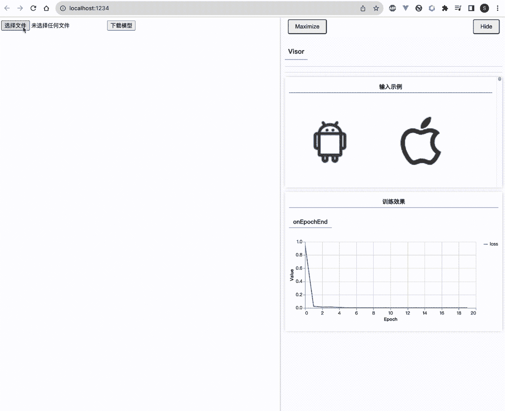
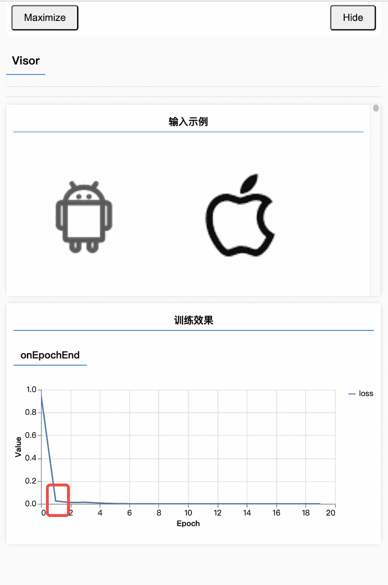

# 003 基于迁移学习的图像分类器：商标识别

> 来源：[https://my.feishu.cn/docx/ICGzdtETkoSpg8x05kictj9unLc](https://my.feishu.cn/docx/ICGzdtETkoSpg8x05kictj9unLc)

# 一、任务简介

这次我们要做的是**商标识别**，且要做的程序可以对**苹果**、**安卓**和**Windows**这三个商标进行分类。

## 1、迁移学习简介

+   把已训练好的模型参数迁移到新的模型来帮助新模型训练。

+   为**什么要用迁移学习来进**行模型训练？之所以要进行迁移学习，是因为深度学习模型的参数非常多，如果我们从头训练的话，成本很高。比如做一个28 * 28 像素黑白图片的手写数字识别，可能就需要用几千张图片来训练，而且训练过程还会花很长的时间，因此需要用迁移学习来解决。如果用迁移学习的话，就可以用非常少的训练素材，且在非常短的时间就可以训练好我们想训练的模型。（深度学习模型参数多，从头训练成本高）

+   **迁移学习是如何操**作的？它是通过删除原始模型的最后一层，然后基于删除后的截断模型的输出，去训练一个新的模型。

+   新的这个模型通常都非常非常的浅，那上面这个操作是什么意思呢？为什么这么做就可以做到迁移学习？

+   **之前谈到过**卷积神经网络，所谓卷积神经网络，会先去识别一些细小**的特征，然后把细小的**特征组合成较大的特征，然后再把较大的特征继续组合，反复这个过程，最终得到一个比较复杂、比较详细的高级特征。然后我们再添加一个 softmax，就可以把这些高级特征分成我们想要的类别了。

+   其实**计算机视觉里的**世界万物，它们虽然说看起来完全不一样，但是我们想一下它们里面的细小特征以及次细小特征是不是都差不多？其实这一部分工作我们是不需要从头开始训练的，这部分工作是可以复用的，那这个复用的过程其实就是迁移学习。

+   那如何做到复用呢？其实我们只需要把一个已经训练好的神经网络，把它的前几层给保留下来，然后我们去复用这前几层，间接地，复用的这几层，就不用再训练了。

+   最后我们只需要训练最后一层，也就是分类那一层，把一些高级特征重新分类即可。

## 2、操作步骤

+   加载商标训练数据并可视化

+   定义模型结构：截断模型+双层神经网络

+   **训练**模型**并预****测 —— 因**为是基于迁移学习，所以说不管是训练还是预测，它们的输入数据都需要先经过截断模型，然后用截断模型的输出去作为训练或者预测的输入数据。

# 二、迁移学习下的模型预测

## 1、操作步骤

### （1）加载商标训练数据可视化

+   预设一些商标训练图片

+   编写JS脚本加载训练图片及其标签

+   可视化训练图片

### （2）定义模型结构：截断模型+双层神经网络

+   加载MobileNet模型并截断

+   构建双层神经网络

+   **截断模型**作为输入，双层神经网络作为输出

### （3）迁移学习下的模型训练

+   定义损失函数和优化器

+   训练数据经过截断模型，转为可以用于新模型训练的数据

+   使用Tensorflow.js的**fit方法**进行训练

### （4）迁移学习下的模型预测

+   编写前端界面输入待预测数据

+   待预测数据经过截断模型，转为可以用新模型预测的数据

+   预测后，将输出的Tensor转为普通数据并显示

## 2、训练过程

现在我们来开始完成迁移学习这个模型。

### （1）准备数据

首先是准备数据，根目录下新建文件夹data/brand，然后预先准备一些数据。比如：


[brand.zip](https://internal-api-drive-stream.feishu.cn/space/api/box/stream/download/all/NRQYb6XoAo🐧v2xZdMIcUn62ncg)

接着，我们需要启个http服务，来加载这些数据。

### （2）数据处理

有了上面的这些数据以后，下面，我们是要让处理数据的格式，让上面的数据可以为我们所用。在项目根目录下创建新的文件夹brand，然后创建一个新的文件data.js。具体代码如下:

      const src = `http://127.0.0.1:8080/brand/train/${label}-${i}.jpg`;

```
const IMAGE_SIZE = 224;

// 加载图片
const loadImg = (src) =&gt; {
  // 图片加载是一个异步的过程
  return new Promise((resolve) =&gt; {
    const img = new Image();
    // 想要让图片可以访问，要设置跨域
    img.crossOrigin = &#x27;anonymous&#x27;;
    img.src = src;
    img.width = IMAGE_SIZE;
    img.height = IMAGE_SIZE;
    img.onload = () =&gt; resolve(img);
  });
};

/**
 * 获取双层神经网络的输入
 */
export const getInputs = async () =&gt; {
  const loadImgs = [];
  const labels = [];
  for (let i = 0; i &lt; 30; i += 1) {
    [&#x27;android&#x27;, &#x27;apple&#x27;, &#x27;windows&#x27;].forEach((label) =&gt; {
      const img = loadImg(src);
      loadImgs.push(img);
      labels.push([
        label === &#x27;android&#x27; ? 1 : 0,
        label === &#x27;apple&#x27; ? 1 : 0,
        label === &#x27;windows&#x27; ? 1 : 0
      ]);
    });
  }
  // 用Promise.all同时加载所有图片
  const inputs = await Promise.all(loadImgs);
  return {
    inputs,
    labels
  };
};

```

这个文件预置了两个函数，loadImg和getInputs。loadImg是用来加载每一张图片的，getInputs是用来获取截断模型的输出，以此把它用来当新模型的输入。

### （3）工具集

接着，我们来写一些工具集函数。在根目录的brand文件夹**下，再创建一个**新的文件utils.js。具体代码如下：

```
import * as tf from &#x27;@tensorflow/tfjs&#x27;;

// 将img变成mobilenet需要的格式
export function img2x(imgEl) {
  return tf.tidy(() =&gt; {
    const input = tf.browser
      .fromPixels(imgEl)
      .toFloat()
      .sub(255 / 2)
      .div(255 / 2)
      .reshape([1, 224, 224, 3]);
    return input;
  });
}

// 将文件转为图片格式
export function file2img(f) {
  return new Promise((resolve) =&gt; {
    const reader = new FileReader();
    reader.readAsDataURL(f);
    reader.onload = (e) =&gt; {
      const img = document.createElement(&#x27;img&#x27;);
      img.src = e.target.result;
      img.width = 224;
      img.height = 224;
      img.onload = () =&gt; resolve(img);
    };
  });
}

```

### （4）模型训练和预测

之后呢，在brand文件夹下，创建script.js文件，来写我们的预测代码。具体代码如下:

```
import * as tf from &#x27;@tensorflow/tfjs&#x27;;
import * as tfvis from &#x27;@tensorflow/tfjs-vis&#x27;;
import { getInputs } from &#x27;./data&#x27;;
import { img2x, file2img } from &#x27;./utils&#x27;;

const MOBILENET_MODEL_PATH =
  &#x27;http://127.0.0.1:8080/mobilenet/web_model/model.json&#x27;;
const NUM_CLASSES = 3;
const BRAND_CLASSES = [&#x27;android&#x27;, &#x27;apple&#x27;, &#x27;windows&#x27;];

window.onload = async () =&gt; {
  /**
   * 加载商标数据训练数据并可视化
   */
  const { inputs, labels } = await getInputs();
  // 创建一个抽屉
  const surface = tfvis
    .visor()
    .surface({ name: &#x27;输入示例&#x27;, styles: { height: 250 } });
  inputs.forEach((img) =&gt; {
    surface.drawArea.appendChild(img);
  });

  /**
   * 定义模型结构:截断模型+双层神经网络
   */
  // 加载mobileNet模型
  const mobilenet = await tf.loadLayersModel(MOBILENET_MODEL_PATH);
  mobilenet.summary();
  // 获取 conv_pw_13_relu 这一层（中间层）
  const layer = mobilenet.getLayer(&#x27;conv_pw_13_relu&#x27;);
  // 把mobilenet做截断
  const truncatedMobilenet = tf.model({
    inputs: mobilenet.inputs,
    outputs: layer.output
  });

  // 双层神经网络
  const model = tf.sequential();
  model.add(
    tf.layers.flatten({
      inputShape: layer.outputShape.slice(1)
    })
  );
  model.add(
    tf.layers.dense({
      units: 10,
      activation: &#x27;relu&#x27;
    })
  );
  model.add(
    tf.layers.dense({
      units: NUM_CLASSES,
      activation: &#x27;softmax&#x27;
    })
  );

  /**
   * 迁移学习下的模型训练
   */
  // 设置损失函数和优化器
  model.compile({
    loss: &#x27;categoricalCrossentropy&#x27;,
    optimizer: tf.train.adam()
  });
  //
  const { xs, ys } = tf.tidy(() =&gt; {
    const xs = tf.concat(
      // 把图片喂给截断模型
      inputs.map((imgEl) =&gt; truncatedMobilenet.predict(img2x(imgEl)))
    );
    const ys = tf.tensor(labels);
    return { xs, ys };
  });

  await model.fit(xs, ys, {
    epochs: 20,
    callbacks: tfvis.show.fitCallbacks({ name: &#x27;训练效果&#x27; }, [&#x27;loss&#x27;], {
      callbacks: [&#x27;onEpochEnd&#x27;]
    })
  });

  /**
   * 迁移学习下的模型预测
   */
  window.predict = async (file) =&gt; {
    const img = await file2img(file);
    document.body.appendChild(img);
    const pred = tf.tidy(() =&gt; {
      const x = img2x(img);
      const input = truncatedMobilenet.predict(x);
      return model.predict(input);
    });

    const index = pred.argMax(1).dataSync()[0];
    setTimeout(() =&gt; {
      alert(`预测结果：${BRAND_CLASSES[index]}`);
    }, 0);
  };

  window.download = async () =&gt; {
    await model.save(&#x27;downloads://model&#x27;);
  };
};

```

最后，来编写前端界面，然后在浏览器渲染最终的结果。在brand文件夹下，新建一个文件index.html。具体代码如下：

```
&lt;script src=&quot;script.js&quot;&gt;&lt;/script&gt;
&lt;input type=&quot;file&quot; onchange=&quot;predict(this.files[0])&quot;&gt;
&lt;button onclick=&quot;download()&quot;&gt;下载模型&lt;/button&gt;
```

最后，我们来看下效果。**如下图所示：**



值得注意的是，迁移学习的情况下，epoch为1的时**候，损失率l**o**ss就已经快**接近0了。所以说，迁移学习是一种非常高效的机器学习手段。如下图所示：

