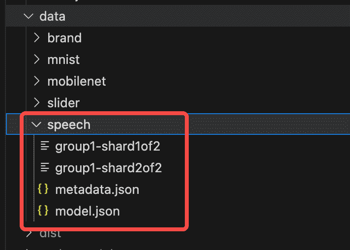
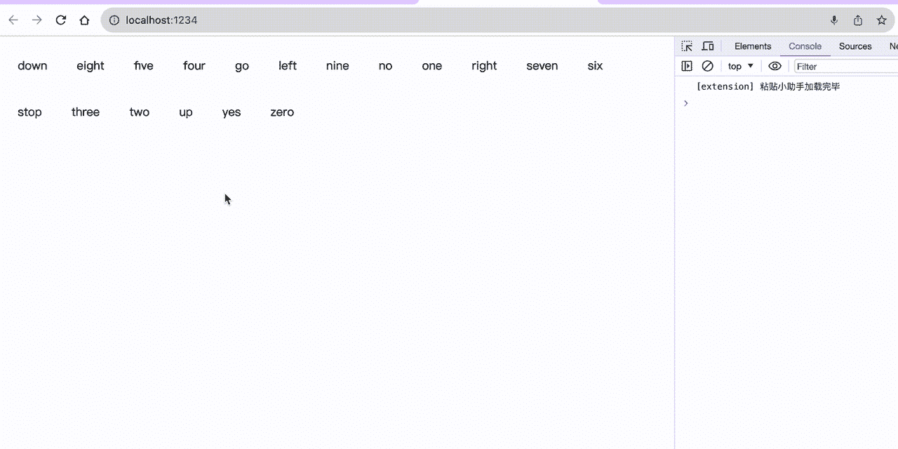

# 004 使用预训练模型进行语音识别

> 来源：[https://my.feishu.cn/docx/Wj0od7Psvouai9x9hi1c1rkPn5c](https://my.feishu.cn/docx/Wj0od7Psvouai9x9hi1c1rkPn5c)

# 一、任务简介

## 1、什么是语音识别

+   语音识别在生活中非常常见，比如说讯飞语音输入法，还有苹果的 Siri 等等。

+   语音识别其实就是模型**接受声音信息**，然后**输出分类信息**。

+   为什么是输出分类信息呢？其实语音识别的本质也是一种分类，比如你给模型一段声音，它帮你分辨出这是哪几个单词。所以说我们这次任务所说的语音识别，其实就是声音分类或者语音分类。

+   **那声音****分类**是怎么实现的呢？其实，声音在计算机里是声谱图，我**们经常会**看到计算机里各种音频可视化的一些样子，也就是一种图像。因此，既然是图像，那么其实声音的识别也可以使用卷积神经网络，因为卷积神经网络的本质就是处理图像。

## 2、操作步骤

+   **加载预训练语音识别模型** —— 这个预训练模型是Tensorflow官方的一个模型，他们建立了一个**语音命令数据集**，这个数据集只有很有限的几个单词。然后官方使用 Python 版的 Tensorflow 训练了很长很**长时间，**准确度训练的很高，最后转化为了我们 Tensorflow. js 可以加载的模型格式，而我们要加载的就是 Tensorflow.js 使用的模型格式。

+   **进行语音识别** —— 使用Tensorflow.js官方的一个**语音命令包**，它里面封装了一些操作，然后我们直接调用这个包就可以进行模型加载以及语音识别的相关操作了。

# 二、加载预训练语音识别模型

## 1、操作步骤

+   下载语音识别模型文件

+   在本地开启静态文件服务器

+   使用tfjs-models的speech-commands包加载模型 —— tfjs-models是Tensorflow官方的一个模型库，里面有各种各样的模型**，与此同时，这些**模型库已经帮助我们写好了模型加载以及预测相关的TFJS的代码。

## 2、训练过程

### （1）准备数据

首先创建文件夹data/speech，然后在speech下，存放这些内容。**如下图所示：**



其中，group1开头的是**两个权重文件**，metadata.json是元信息的json，model.json是模型的json。

下面附上数据文件👇🏻：


[speech.zip](https://internal-api-drive-stream.feishu.cn/space/api/box/stream/download/all/DAMub49HWoalUmxmHqncqQiangd)

### （2）加载模型

接着，根目录创建一个新的文件夹speech，然后在这个文件夹下面创建两个文件，分别为index.html和script.js。

index.html代码如下：

```
&lt;script src=&quot;script.js&quot;&gt;&lt;/script&gt;
```

script.js代码如下：

```
import * as speechCommands from &#x27;@tensorflow-models/speech-commands&#x27;;

const MODEL_PATH = &#x27;http://127.0.0.1:8080/speech&#x27;;

window.onload = async () =&gt; {
  /**
   * 加载预训练语音识别模型
   */
  const recognizer = speechCommands.create(
    &#x27;BROWSER_FFT&#x27;, // 傅里叶的变换，这里选择浏览器自带的原生的傅里叶
    null, // 初始化要识别的单词
    MODEL_PATH + &#x27;/model.json&#x27;, // 自带的模型URL
    MODEL_PATH + &#x27;/metadata.json&#x27; // 自定义元信息的url
  );

  // 确保模型加载，调用模型的ensureModelLoaded（可以在浏览器的network里面看到）
  await recognizer.ensureModelLoaded();

};

```

至此，我们就完成了模型加载！

# 三、进行语音识别

## 1、操作步骤

+   **从浏览器监听麦克风输入** ——  语音命令包已经帮我们实现好了相关的功能，我们只需要调用语音命令的listen方法，即可完成此项操作。

+   **进行语音识别** —— 对着电脑的麦克风说几个单词，让电脑来识别出具体所说的话。

+   **显示语音识别结果** —— 编写相应的前端界面，来显示最后的结果

## 2、训练过程

继续完善上面的代码，首先是index.html的代码：

```
&lt;script src=&quot;script.js&quot;&gt;&lt;/script&gt;
&lt;style&gt;
    #result&gt;div {
        float: left;
        padding: 20px;
    }
&lt;/style&gt;
&lt;div id=&quot;result&quot;&gt;&lt;/div&gt;
```

接着是script.js的代码：

```
import * as speechCommands from &#x27;@tensorflow-models/speech-commands&#x27;;

const MODEL_PATH = &#x27;http://127.0.0.1:8080/speech&#x27;;

window.onload = async () =&gt; {
  /**
   * 加载预训练语音识别模型
   */
  const recognizer = speechCommands.create(
    &#x27;BROWSER_FFT&#x27;, // 傅里叶的变换，这里选择浏览器自带的原生的傅里叶
    null, // 初始化要识别的单词
    MODEL_PATH + &#x27;/model.json&#x27;, // 自带的模型URL
    MODEL_PATH + &#x27;/metadata.json&#x27; // 自定义元信息的url
  );

  // 确保模型加载，调用模型的ensureModelLoaded（可以在浏览器的network里面看到）
  await recognizer.ensureModelLoaded();

  /**
   * 进行语音识别
   */
  // wordLabels 识别器里面所预置的能识别的一些单词
  const labels = recognizer.wordLabels().slice(2);
  // 获取html里面的dom元素
  const resultEl = document.querySelector(&#x27;#result&#x27;);
  resultEl.innerHTML = labels
    .map(
      (l) =&gt; `
        &lt;div&gt;${l}&lt;/div&gt;
    `
    )
    .join(&#x27;&#x27;);
  recognizer.listen(
    (result) =&gt; {
      const { scores } = result;
      const maxValue = Math.max(...scores); // 取出scores的最大值
      const index = scores.indexOf(maxValue) - 2; // 取出语音后输出的值，前面截取掉了2个，这个也相应要减掉2个
      // 语音说出哪个单词，哪个单词就变绿
      resultEl.innerHTML = labels
        .map(
          (l, i) =&gt; `
        &lt;div style=&quot;background: ${i === index &amp;&amp; &#x27;green&#x27;}&quot;&gt;${l}&lt;/div&gt;
        `
        )
        .join(&#x27;&#x27;);
    },
    {
      overlapFactor: 0.3, // 控制语音识别的频率
      probabilityThreshold: 0.9 // 配置可能性的阈值（比如说，我说的单词跟模型训练的单词得有90%的相似度，模型才会运行）
    }
  );
};

```

最后我们来浏览器看下识别效果：



这是一张动图不是MP4哈哈，可以想象为小编向浏览器说了对应的字母，然后它变绿了👻。