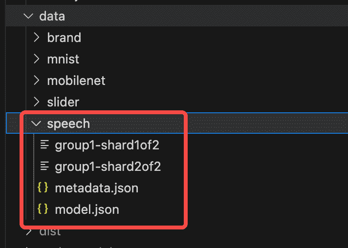
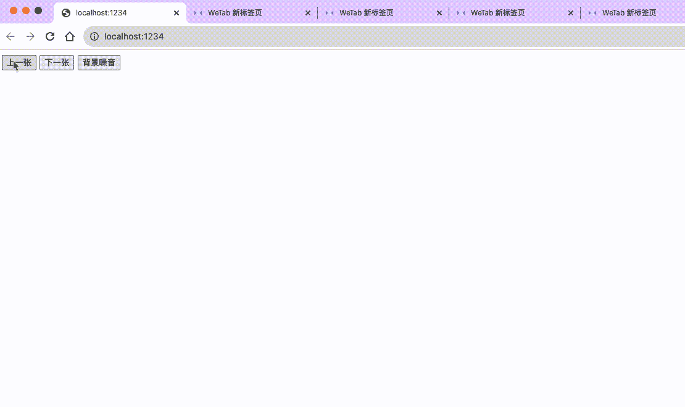
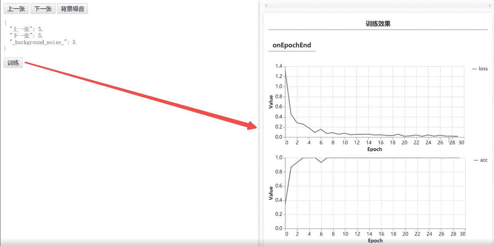
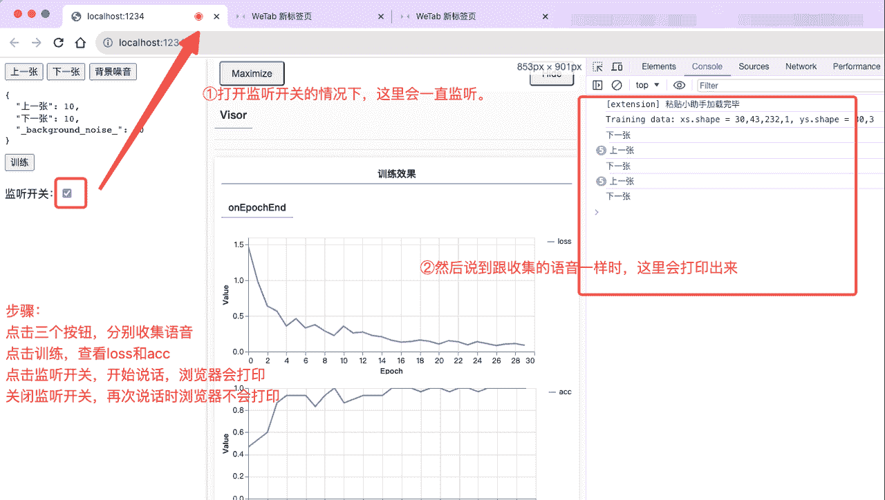
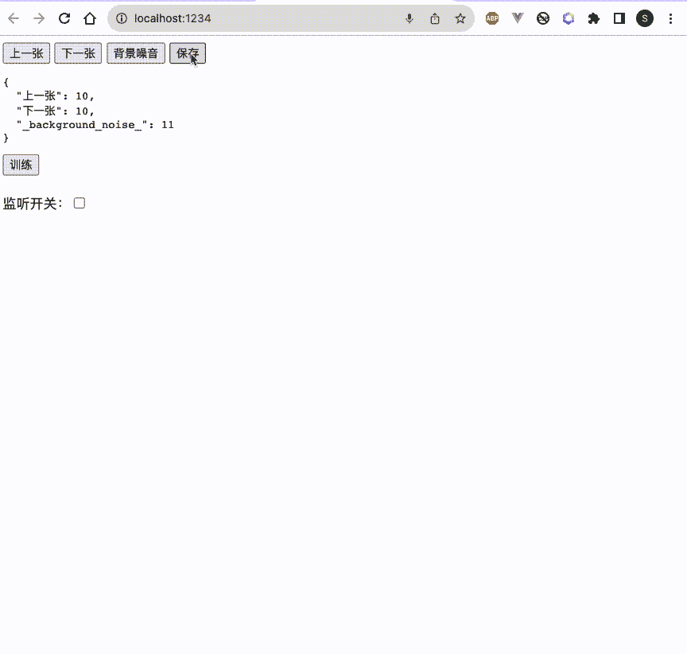
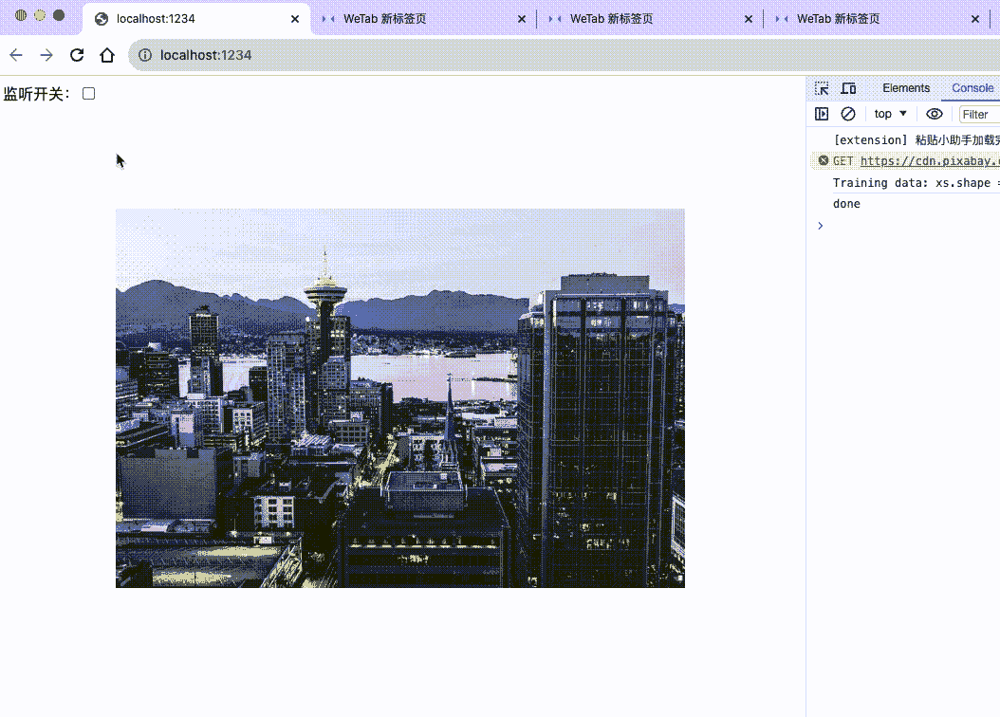

# 005 基于迁移学习的语音识别器：声控轮播图

> 来源：[https://my.feishu.cn/docx/UQBEdGPOgoH8GSxiLrKcuwxonSa](https://my.feishu.cn/docx/UQBEdGPOgoH8GSxiLrKcuwxonSa)

# 一、任务简介

## 1、使用场景

+   比如说你双手正在打字或者正在忙别的东西，或者你人离电脑很远，没有办法通过鼠标或键盘来切换这个幻灯片或者说轮播图，那么你就可以远程通过语音来控制这个轮播。

+   也可以通过声音来控制网页切换、不同浏览器切换等等。

+   编写声控轮播图应用

## 2、操作步骤

+   在浏览器里面，通过麦克风来收集中文语音训练数据。也就是我会对着麦克风说一些语音，让这个模型来训练，这个训练数据就是我说的中文语音。

+   然后是使用speech commands包进行迁移学习并预测。

+   最后是语音训练数据的**保存**和**加载**。为什么要做语音训练数据的保存和加载呢？因为我们是从浏览器里面收集中文语音的，如果每次语音识别前，我都要先收集一番这个训练数据，那就太麻烦了。理想的状态是我收集一次把它保存成文件以后，每次都能用，这是最理想的，因此就需要这个步骤。

# 二、在浏览器中收集中文语音训练数据

## 1、操作步骤

+   使用speech commands包创建迁移学习器

+   编写前端界面，为了收集语音数据做准备。主要收集上一张、下一张以及背景噪音这三种语音

+   调用collectExample方法收集语音数据

## 2、训练过程

### （1）准备数据

首先创建文件夹data/speech，然后在speech下，存放这些内容。**如下图所示：**



其中，group1开头的是**两个权重文件**，metadata.json是元信息的json，model.json是模型的json。有了这些数据后，可以先用http-server在终端加载上面的这些数据文件。

下面附上数据文件👇🏻：


[speech.zip](https://internal-api-drive-stream.feishu.cn/space/api/box/stream/download/all/VpSob1Ibfot9k0xB19fcPDKUn0g)

### （2）收集中文语音

接着，根目录创建一个新的文件夹speech-cn，然后在这个文件夹下面创建两个文件，分别为index.html和script.js。

index.html代码如下：

```
&lt;script src=&quot;script.js&quot;&gt;&lt;/script&gt;
&lt;button onclick=&quot;collect(this)&quot;&gt;上一张&lt;/button&gt;
&lt;button onclick=&quot;collect(this)&quot;&gt;下一张&lt;/button&gt;
&lt;button onclick=&quot;collect(this)&quot;&gt;背景噪音&lt;/button&gt;
&lt;!-- 保留程序最初始的风格 --&gt;
&lt;pre id=&quot;count&quot;&gt;&lt;/pre&gt;
```

script.js代码如下：

```
import * as speechCommands from &#x27;@tensorflow-models/speech-commands&#x27;;
import * as tfvis from &#x27;@tensorflow/tfjs-vis&#x27;;

const MODEL_PATH = &#x27;http://127.0.0.1:8080&#x27;;
// 迁移学习识别器
let transferRecognizer;

/**
 * 加载语音识别数据
 */
window.onload = async () =&gt; {
  const recognizer = speechCommands.create(
    &#x27;BROWSER_FFT&#x27;,
    null,
    MODEL_PATH + &#x27;/speech/model.json&#x27;,
    MODEL_PATH + &#x27;/speech/metadata.json&#x27;
  );
  await recognizer.ensureModelLoaded();
  transferRecognizer = recognizer.createTransfer(&#x27;轮播图&#x27;);
};

/**
 * 收集中文语音训练数据
 */
window.collect = async (btn) =&gt; {
  // 点击之后，要把当前按钮禁用掉
  btn.disabled = true;
  const label = btn.innerText;
  // 调用迁移学习器的collectExample方法，哦爱收集语音的数据
  await transferRecognizer.collectExample(
    // speech-command里面有一个背景噪音的字段，这里需要将我们的中文转化为对应的
    label === &#x27;背景噪音&#x27; ? &#x27;_background_noise_&#x27; : label
  );
  btn.disabled = false;
  document.querySelector(&#x27;#count&#x27;).innerHTML = JSON.stringify(
    transferRecognizer.countExamples(),
    null,
    2
  );
};
```

下面，我们来看下收集语音的过程：



**点击**每个按钮，浏览器上面就会有一个红点等待我们去录**制声音，然**后录制完成后，下面的json就会对应+1。一般来说，要每一种收集够30张左右，最终识别的结果才会相对精确一些。

# 三、语音世界迁移学习的训练和预测

## 1、操作步骤

+   **编写界面，点击**训练按钮，调用迁移学习器的train方法进行迁移学习训练

+   **编写界面，点击控**件（按钮/勾选框/…），调用listen方法从浏览器监听麦克风预测

+   编写界面，调用**stopListening方法**来停止监听（不能让麦克风一直开着，声音监听完了就得停止掉）

## 2、训练过程

继续完善上面的代码，首先是index.html文件：

```
&lt;script src=&quot;script.js&quot;&gt;&lt;/script&gt;
&lt;button onclick=&quot;collect(this)&quot;&gt;上一张&lt;/button&gt;
&lt;button onclick=&quot;collect(this)&quot;&gt;下一张&lt;/button&gt;
&lt;button onclick=&quot;collect(this)&quot;&gt;背景噪音&lt;/button&gt;
&lt;pre id=&quot;count&quot;&gt;&lt;/pre&gt;
&lt;button onclick=&quot;train()&quot;&gt;训练&lt;/button&gt;

&lt;br&gt;&lt;br&gt;
监听开关：&lt;input type=&quot;checkbox&quot; onchange=&quot;toggle(this.checked)&quot;&gt;
```

然后完善script.js的逻辑：

```
import * as speechCommands from &#x27;@tensorflow-models/speech-commands&#x27;;
import * as tfvis from &#x27;@tensorflow/tfjs-vis&#x27;;

const MODEL_PATH = &#x27;http://127.0.0.1:8080&#x27;;
// 迁移学习识别器
let transferRecognizer;

/**
 * 加载语音识别数据
 */
……

/**
 * 收集中文语音训练数据
 */
……

/**
 * 语音识别迁移学习的训练
 */
window.train = async () =&gt; {
  await transferRecognizer.train({
    epochs: 30,
    callback: tfvis.show.fitCallbacks(
      { name: &#x27;训练效果&#x27; },
      [&#x27;loss&#x27;, &#x27;acc&#x27;], // 损失率和精确率
      {
        callbacks: [&#x27;onEpochEnd&#x27;]
      }
    )
  });
};

/**
 * 监听过程
 * @param {*} checked
 */
window.toggle = async (checked) =&gt; {
  // 开始监听
  if (checked) {
    await transferRecognizer.listen(
      (result) =&gt; {
        const { scores } = result;
        const labels = transferRecognizer.wordLabels();
        const index = scores.indexOf(Math.max(...scores));
        console.log(labels[index]);
      },
      {
        overlapFactor: 0, // 控制识别频率 0-1 （0表示不要识别的太频繁）
        probabilityThreshold: 0.75 // 可能性阈值
      }
    );
  }
  // 停止监听⏹
  else {
    transferRecognizer.stopListening();
  }
};


};
```

在上面的代码中，我们设置了一个**训练按钮，来**触发train方法，以此完成训练。如下图所示：



之后，我们来写了一个勾选框checkbox，来控制**监听范围****。勾选的时候**开始监听，不勾选的时候就停止监听。如下图所示：



**至此**，**我们**就完成了在迁移学习下，语音的训练和预测。

# 四、语音训练数据的保存和加载

## 1、操作步骤

+   保存语音训练数据到文件 —— speech command包提供了相关的方法，可以把一些训练数据，比如采集好的训练数据，给序列化成二进制的数据，而这个二进制的数据是JS中ArrayBuffer格式的数据。

+   **加载语音训练**数据到模型** —— 把**上面二进制的数据保存成一个二进制文件，然后将这个文件丢到我们的静态服务器里面。之后通过fetch方法，来获取请求后响应的结果。

+   通过加载的语音数据进行训练和预测 —— 保存后的数据就可以不用每次都录入了，然后我们就可以对这些数据进行训练和预测。

## 2、训练过程

### （1）保存语音训练数据

继续完善上面的代码，首先是index.html文件，加个保存按钮。如下代码所示：

```
&lt;script src=&quot;script.js&quot;&gt;&lt;/script&gt;
&lt;button onclick=&quot;collect(this)&quot;&gt;上一张&lt;/button&gt;
&lt;button onclick=&quot;collect(this)&quot;&gt;下一张&lt;/button&gt;
&lt;button onclick=&quot;collect(this)&quot;&gt;背景噪音&lt;/button&gt;

&lt;!-- 加在这里 --&gt;
&lt;button onclick=&quot;save()&quot;&gt;保存&lt;/button&gt;

&lt;pre id=&quot;count&quot;&gt;&lt;/pre&gt;
&lt;button onclick=&quot;train()&quot;&gt;训练&lt;/button&gt;

&lt;br&gt;&lt;br&gt;
监听开关：&lt;input type=&quot;checkbox&quot; onchange=&quot;toggle(this.checked)&quot;&gt;
```

然后完善script.js的逻辑，增加保存逻辑。如下代码所示：

```
window.save = () =&gt; {
  // 把采集好的数据序列化为二进制数据（ArrayBuffer格式）
  const arrayBuffer = transferRecognizer.serializeExamples();
  // 先转为blob格式（这种格式主要为下载做准备）
  const blob = new Blob([arrayBuffer]);
  // 在JS里面创建a标签，来模拟点击a标签之后下载的功能
  const link = document.createElement(&#x27;a&#x27;);
  link.href = window.URL.createObjectURL(blob);
  // bin后缀主要是为了体现其是二进制格式
  link.download = &#x27;data.bin&#x27;;
  link.click();
};
```

我们来看下保存后的文件：



现在，我们将导出的这个二进制文件，给用来训练声控轮播图。

### （2）加载语音训练数据

我们在根目录下新建一个文件夹data/slider，然后把上面的**二进制文件**给丢到这个数据文件夹里。然后将这份数据开启一个静态服务，方便我们之后去加载它。

### （3）训练和预测

接着，根目录再创建一个新的文件夹，命名为slider。之后在这个文件夹下，创建index.html文件。代码如下所示：

```
&lt;script src=&quot;script.js&quot;&gt;&lt;/script&gt;
监听开关：&lt;input type=&quot;checkbox&quot; onchange=&quot;toggle(this.checked)&quot;&gt;
```

接着，在slide文件夹下创建script.js文件，代码如下所示：

```
import * as speechCommands from &#x27;@tensorflow-models/speech-commands&#x27;;

const MODEL_PATH = &#x27;http://127.0.0.1:8080&#x27;;
let transferRecognizer;
let curIndex = 0;

/**
 * 创建一个迁移学习器
 */
window.onload = async () =&gt; {
  const recognizer = speechCommands.create(
    &#x27;BROWSER_FFT&#x27;,
    null,
    MODEL_PATH + &#x27;/speech/model.json&#x27;,
    MODEL_PATH + &#x27;/speech/metadata.json&#x27;
  );
  await recognizer.ensureModelLoaded();
  transferRecognizer = recognizer.createTransfer(&#x27;轮播图&#x27;);
  const res = await fetch(MODEL_PATH + &#x27;/slider/data.bin&#x27;);
  const arrayBuffer = await res.arrayBuffer();
  // 用loadExamples方法，把二进制数据，加载到模型里
  transferRecognizer.loadExamples(arrayBuffer);
  await transferRecognizer.train({ epochs: 30 });
  console.log(&#x27;done&#x27;);
};

/**
 * 监听开关
 */
window.toggle = async (checked) =&gt; {
  if (checked) {
    await transferRecognizer.listen(
      (result) =&gt; {
        const { scores } = result;
        const labels = transferRecognizer.wordLabels();
        const index = scores.indexOf(Math.max(...scores));
        window.play(labels[index]);
      },
      {
        overlapFactor: 0,
        probabilityThreshold: 0.5
      }
    );
  } else {
    transferRecognizer.stopListening();
  }
};
```

这样，我们就成功用保存的那份数据，来训练和预测最终要使用的模**型。然后**下面，我们就可以用这个模型，去做声控轮播了。

# 五、声控轮播图

## 1、操作步骤

+   编写轮播图应用 ——  完成轮播图的视图，每次只显示一张。

+   编写声控逻辑 —— 用户说「上一张」或「下一张」时，展示对应的图片。

+   演示声控轮播图的效果

## 2、训练过程

继续完善index.html的代码，如下所示：

        &lt;img src=&quot;https://cdn.pixabay.com/photo/2019/10/29/15/57/vancouver-4587302__480.jpg&quot; alt=&quot;&quot; width=&quot;600&quot;&gt;
        &lt;img src=&quot;https://cdn.pixabay.com/photo/2019/10/31/07/14/coffee-4591159__480.jpg&quot; alt=&quot;&quot; width=&quot;600&quot;&gt;
        &lt;img src=&quot;https://cdn.pixabay.com/photo/2019/11/01/11/08/landscape-4593909__480.jpg&quot; alt=&quot;&quot; width=&quot;600&quot;&gt;
        &lt;img src=&quot;https://cdn.pixabay.com/photo/2019/11/02/21/45/maple-leaf-4597501__480.jpg&quot; alt=&quot;&quot; width=&quot;600&quot;&gt;
        &lt;img src=&quot;https://cdn.pixabay.com/photo/2019/11/02/03/13/in-xinjiang-4595560__480.jpg&quot; alt=&quot;&quot; width=&quot;600&quot;&gt;
        &lt;img src=&quot;https://cdn.pixabay.com/photo/2019/11/01/22/45/reschensee-4595385__480.jpg&quot; alt=&quot;&quot; width=&quot;600&quot;&gt;

```
&lt;script src=&quot;script.js&quot;&gt;&lt;/script&gt;
监听开关：&lt;input type=&quot;checkbox&quot; onchange=&quot;toggle(this.checked)&quot;&gt;

&lt;style&gt;
    .slider {
        width: 600px;
        overflow: hidden;
        margin: 10px auto;
    }
    .slider &gt; div{
        display: flex;
        align-items: center;
    }
&lt;/style&gt;
&lt;!-- 最外层窗口 --&gt;
&lt;div class=&quot;slider&quot;&gt;
    &lt;!-- 移动的div --&gt;
    &lt;div&gt;
    &lt;/div&gt;
&lt;/div&gt;
```

然后完善script.js的逻辑，增加**声控轮播**的逻辑。如下代码所示：

```
// 此处省略很多之前写过的代码
……

/**
 * 声控轮播
 * @param {*} label
 * @returns
 */
window.play = (label) =&gt; {
  // 获取轮播图的dom位置
  const div = document.querySelector(&#x27;.slider&gt;div&#x27;);
  // 当用户说了上一张时
  if (label === &#x27;上一张&#x27;) {
    if (curIndex === 0) {
      return;
    }
    curIndex -= 1;
  } else {
    if (curIndex === document.querySelectorAll(&#x27;img&#x27;).length - 1) {
      return;
    }
    curIndex += 1;
  }
  div.style.transition = &#x27;transform 1s&#x27;;
  // 整个div往左平移一张图片的宽度
  div.style.transform = `translateX(-${100 * curIndex}%)`;
};
```

来看下最后的效果：



至此，我们就完成了一个简洁版的声控轮播图。