# 原来我们的衣服是AI设计的！！！

> 来源：[https://my.feishu.cn/docx/SRyhdoMNwob8IfxrCdRcN9nenfb](https://my.feishu.cn/docx/SRyhdoMNwob8IfxrCdRcN9nenfb)

# 前言

周末的时候，跟**大姐Ashley**语音聊了聊天。大姐在**服装制造行业****从业了将**近有10年+，然后聊天的时候，我们聊到了这波AI浪潮会怎么跟服装行业进行结合。在聊天的过程中，碰撞了一些火花和灵感。

过后，带着跟Ashley**碰撞出来的**一些火花，以及脑袋里产生了一些小疑问：在想 AI 是如何为传统制造业去进行提效的？

带着这个好奇，**周一同学**去翻了很多文章，一步步深挖之后，发现了很多好玩的场景和有趣的东西。

那在今天的文章中，就以**服装制造业**为例，来解析下，非常传统的制造业，在哪些场景下，可以用 AI 来帮助行业从业者提效。

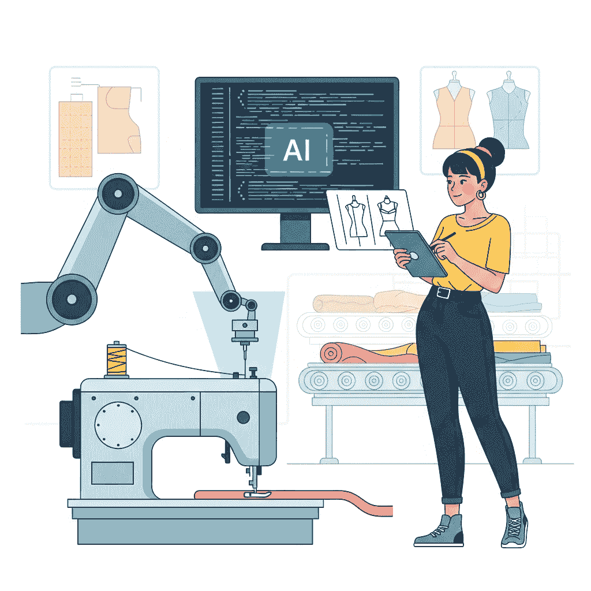

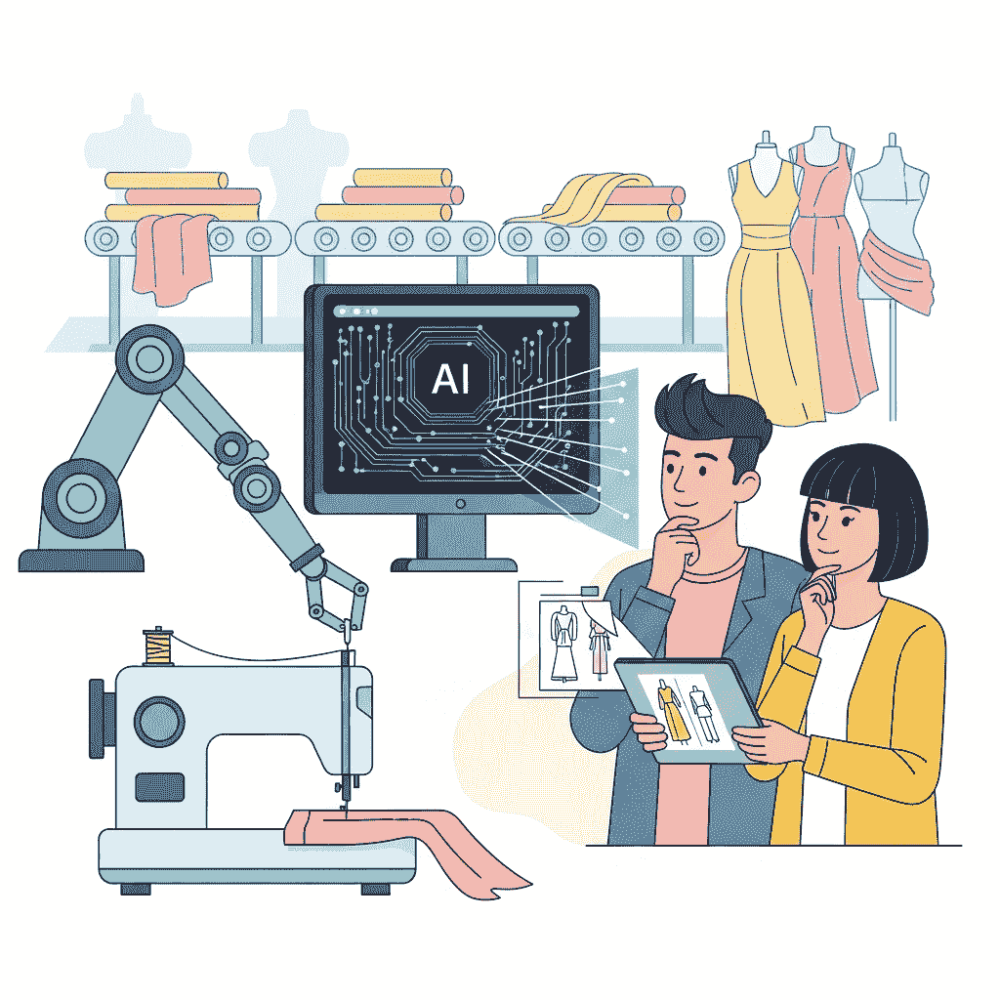

# 一、AI设计与前端管理

文章的第一部分，先来聊聊，A服装**行业**如**何用AI**辅助设计与提速，更大程度地从概念到虚拟样品实现提速。

## 1、AI辅助设计

### （1）行业痛点

在服装设计这个高度依赖**灵感**的环节，AI正在成为设计师最得力的助手，或许AI正成为设计师的「灵感加速器」。它不是要取代创意，而是通过强大的数据处理能力，为设计师提供无限可能。

比如，设计师输入「夏日」、「海洋」、「波西米亚风」等**关键**词，AI就能迅速从海量的时尚数据库、流行趋势、甚至社交媒体图片中提取元素，生成上百种图案和款式的草图。

**这在某种**程**度上，极大**地拓展了设计师的创意边界，也大大缩短了从一个模糊概念到具体设计稿的时间。

下面用豆包**智能创意**的功能，来给大家展示几个场景。

### （2）材质创新设计

假如说你现在想要以**环保**为主题，来设计一款新的夏装，作为品牌新一季度的时尚单品。我们用这个Prompt下测试下：

```
探索海洋废料回收材料在**波西米亚风夏装**中的应用，设计环保时尚单品，体现可持续的发展理念。
```

**生成样图如下：**

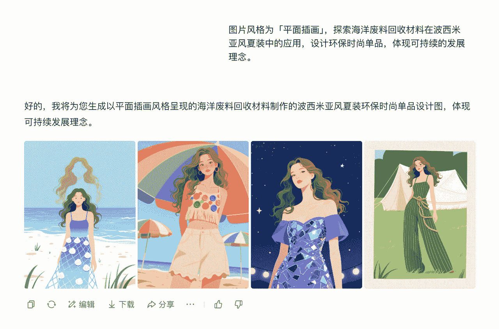

可以看到，整个生成结果就非常的符合题意。

### （3）文化融合设计

第二个case，我们来尝试下将文化元素与服装设计进行融合：

```
将地中海渔民服饰传统元素与现代波西米亚风格结合，创造具有故事性的夏日服装系列。
```

**生成效果如下图所示：**

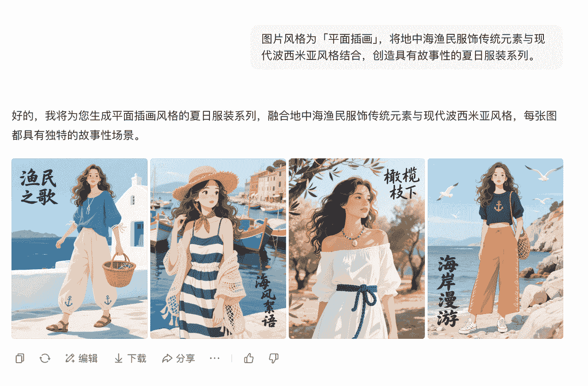


### （4）系列款式设计

**第三个case，我们用**系列款式为主题，来生成服装设计里的样图。具体Prompt如下：

```
请生成一组**波西米亚风夏日连衣裙**的设计图，海洋元素图案，飘逸面料，贝壳装饰，青绿色和珊瑚色调，手绘时装插画风格。
```

**生成样图如下：**

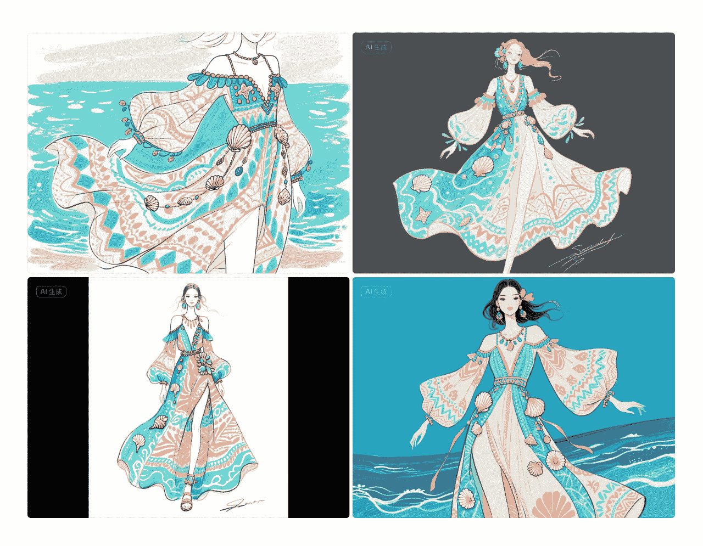

想说，豆包答题答的是真的太符合题意了。👩‍🎨‍

## 2、虚拟试穿与3D样衣

解决了**设计环节**生成草图**的问题，**那在服装行业，还有一个比较大的行业痛点就是：样衣打版。

### （1）行业痛点

一件衣服从设计稿到成品，打样是一个耗时耗力且成本高昂的环节。现在，AI结合3D建模技术，可以创建出高度逼真的虚拟样衣。

设计师可以直接在电脑上调整版型、面料纹理、垂坠感，甚至让虚拟模特进行「试穿」，观察动态效果。这样一来，不仅可以大幅减少物理样品的制作次数，节约成本，还能在正式生产前就快速得到内外部反馈，确保设计方案的精准度。

### （2）AR虚拟试穿平台

然后我又去搜了搜，看看目前行业内有哪些平台，在做这个事情。

后来找到了Kivisense这个产品：https://tryon.kivisense.com/blog/zh/ar-solution-clothes-cn/

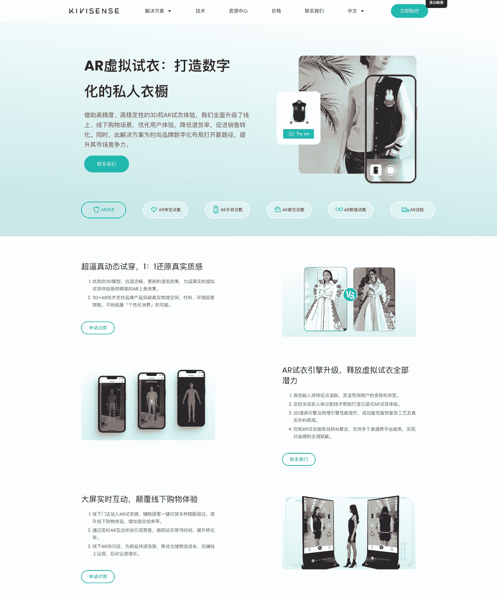

在**AR虚拟试衣**的基础上，Kivisense还做了AR虚拟试鞋、AR虚拟试珠宝、AR虚拟试表、AR虚拟试包、AR虚拟试眼镜。

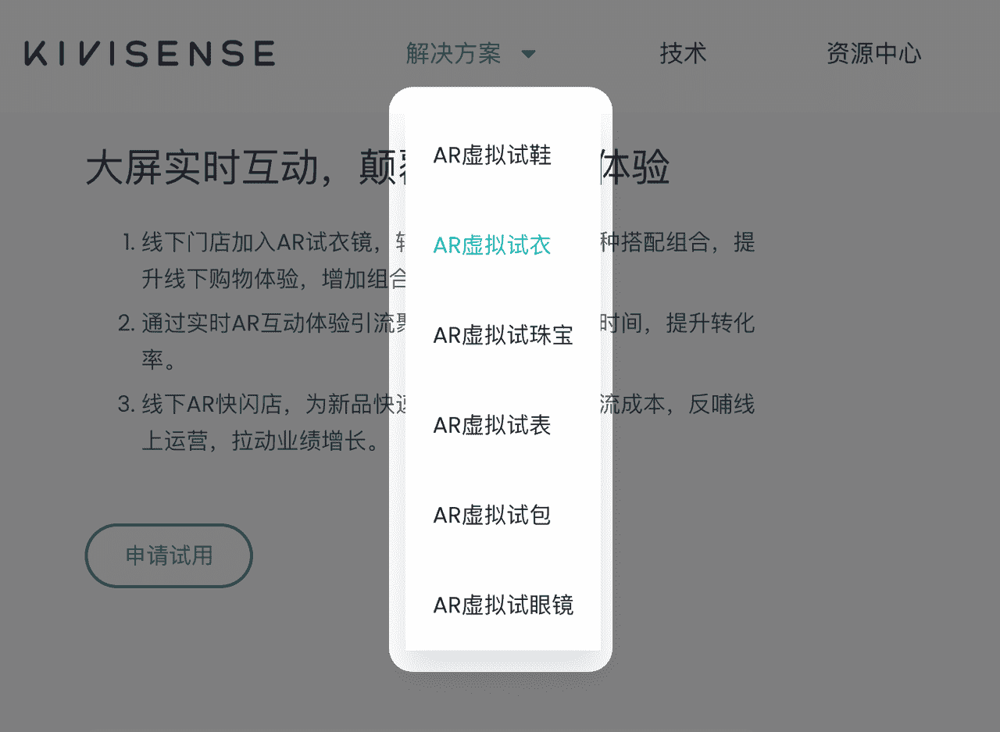

# 二、供应链后端管理

文章的第二部分，来聊聊**供应链后端管理**。

## 1、场景解读

在服装业，**库存管理**和**供应链**一直是个大难题。卖得好怕缺货，卖得不好怕压货。

AI的**预测分析**能力在这里发挥了关键作用。我们可以用AI来综合分析历史销售数据、天气预报、节假日、市**场营销活**动、甚至社交媒体上的热门话题等多种维度的数据，**对不同地**区**、不**同款式的服装需求进行精**准预**测**。这**样一来，企业就可以更科学地安排生产计划，优化原材料采购，实现按需生产，最大化地减少库存积压和缺货的风险，进一步实现了从经验到数据的智能决策。

## 2、工具探索：多维表格 AI 字段捷径

写到**库存管理****的时候，**想起来有一段时间，在飞书上经常**看到多维**表**格的各种模**板，于是就去搜索了各种库存管理和供应链管理相关的信息。

对**相关模板**学了一波搭建思路之后，下面来对使用场景做一番总结。

### （1）咖啡工厂库存管理

假如你正在运营一家咖啡工厂，你可以用多维表格，来搭建一个「咖啡工厂库存管理」系统。

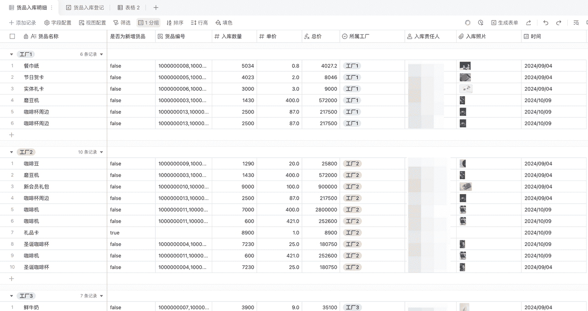

同时，可以用仪表盘来即时查看入库金额、出库金额等信息。

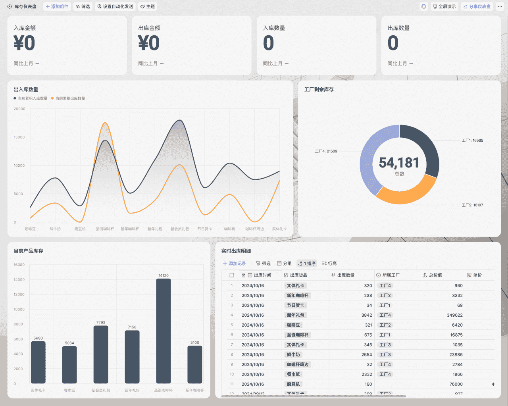

这里用到的是**咖啡工厂**举例子，那对于服装制造业来说，同样可以用相同的方式来管理库存的信息，只不过服装行业的库存管理会更加复杂和精细化。

### （2）服装工厂库存管理

一般来说，在服装制造商中，**库存**一般包括三种主要类型：

+   **原材料**（不同类型的面料、纽扣、线等）；

+   **在制品库存**（正在生产过程中的半成品）；

+   **成品**（完成的服装产品）。

对于**原材料库存管理**来说，我们可以制作：①**原材料库存**管理表；②**在制品库存**管理表；③**成品库存**管理表。

当我们在设计多维表格的时候，可以这么设计：

**原材料库存管理表：**

**在制品****和****成品****库存管理表：**

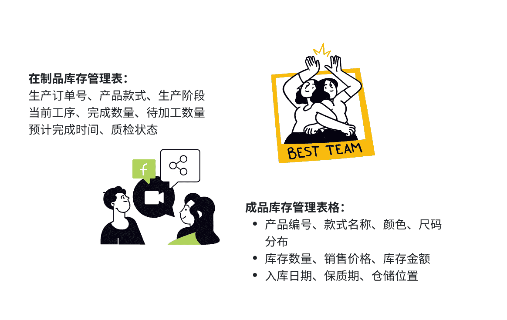

### （3）仪表盘可视化管理

除此之外，也可以用**飞书多维表格**的仪表盘可视化管理。

飞**书多维**表格提供强大的数据处理能力，**支持**多人实时协作，确保库存数据的准确性和及时更新。多维表格还可以自定义仪表盘的表现形式，帮助企业更直观地监控库存状态和销售趋势。比如以下核心监控指标👇🏻：

+   **库存周转率**：评估库存流动效率

+   **库存金额分布**：原材料、在制品、成品的资金占用

+   **预警提醒**：低库存、过期库存、滞销库存提醒

+   **采购建议**：基于销售预测的智能补货建议

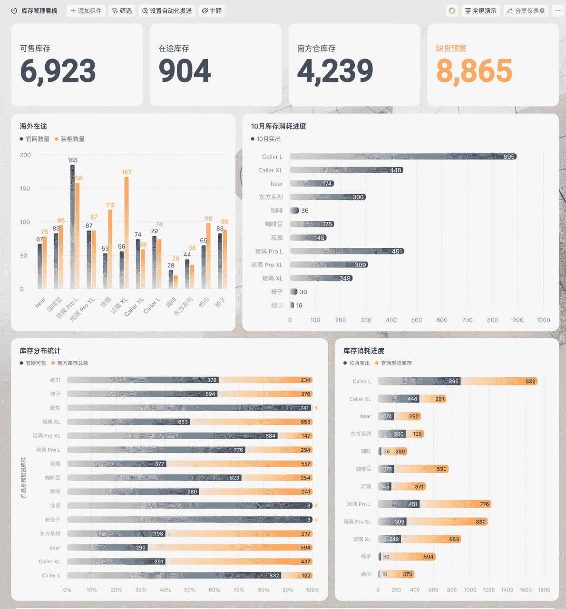

# 三、智能生产与中控系统

当AI与传统制造业的**中控系统**结合时，未来工厂的自动化中枢正在被构建中。

## 1、场景探索

在工厂的中控系统，AI扮演着一个「总指挥官」的角色。它能实时监控每一台机器的运行状**态，比如缝**纫机的速度、裁**剪机**的效率。比如某条生产线出现瓶颈，AI能够立即识别并智能地重新分配任务，或者向工人发出提醒。

比如，**MES系统**通过精细化管理和智能调度**，能够显**著**地提高生**产效率。系统可以根据订单需求和生产计划，合理安排生产任务，优化生产线的排产和资源配置，减少生产周期和成本。

又或者，通过**AI视觉系统**，机器可以精确识别并抓取布料，完成自动裁剪和缝**纫。这**些**机器能****够与**工**人一起协**作，接管那些重复性、高强度的劳动，让工人可以专注于更复杂的工序和质量把控，从而提升整体的生产效率。

## 2、工具探索：MES生产中控系统

对于**中控系统**来说，可以用**AI智衣MES系统**来为中控进行提效赋能。

### （1）MES是什么？

**MES**是Manufact**uring **Execution System的缩写，中文称为制造执行系统。它是一种用于管理和监控制造过程的软件系统，主要面向车间生产的管理系统 。

从**技术角度**来说，**制造执行系统**就是一个在**厂房层面**连接及监控机器与工作中心的系统。MES的主要目标是确保制造业务有效执行，并且提升生产效率。

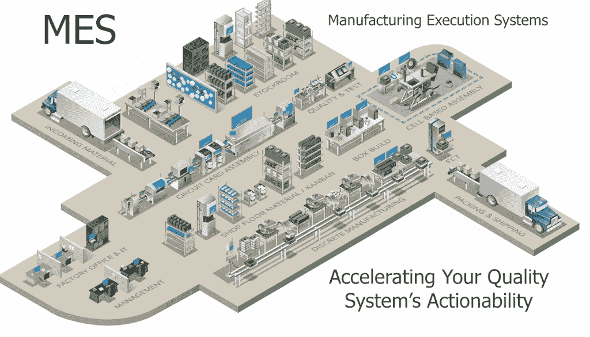

> 图源：https://www.pinterest.com/pin/349380883612900691/

### （2）**AI智衣MES系统**

**AI智衣MES系统**为服装制造企业、品牌商、供应链企业提供全流程数字化生产管理解决方案，覆盖成衣、家纺、针织、智能仓储等核心业务场景。

产线中控系统对接MES，实现生产数据实**时互通，优**化生产流程，提高制造效率**。通过**智能化手段，来增强企业竞争力，推动制造业转型升级 。

对于企业来说，可以随时在**MES系统**中查看每个**工作指令**的执行情况和状态；可以将工作项分配到**每个工**作区；也可以进行人力资源的管理，对生产线上员工的效率和工作质量，进行全面的监控 。

> 附上一篇IBM公司的剖析：

> 什么是 MES 系统 (制造执行系统)？https://www.ibm.com/cn-zh/topics/mes-system

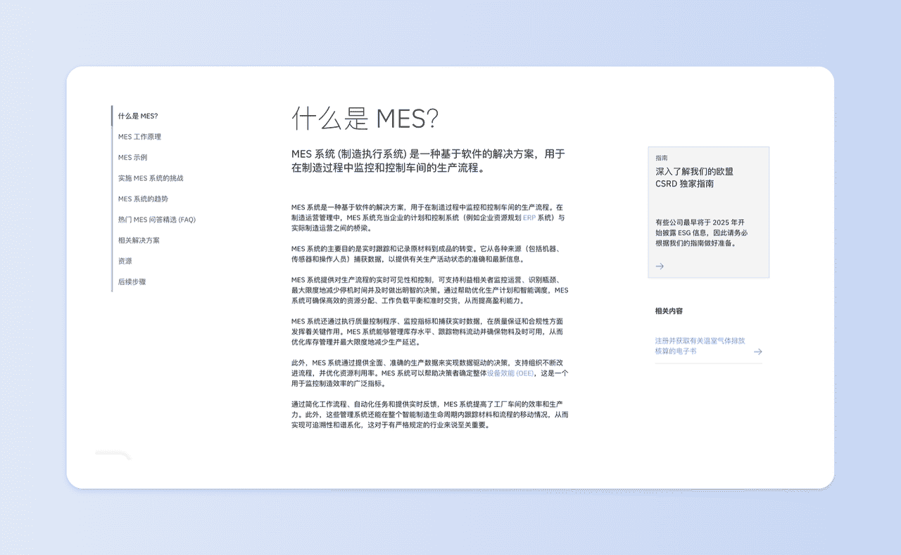

# 四、AI质检

## 1、与AI结合的可能性探索

一件**服装**在生产的过程中，线头、色差、污渍、**尺寸偏差****等问**题永远是不可避免的。而传统的人工质检，非常容易受到疲劳等因素的影响，最终导致存在漏检等风险。

而在AI时代，我们则可以使用由**AI驱动**的计算机视觉系统，实现趋近于100%**的覆盖率**和更高的准确率，让AI实现比传统人眼筛查更精准的品控「守护者」。

同时，在**生产线末端**，**高清摄像头****对每**一件服装进行全方位扫描，也能让AI能在极短时间内识别出各种肉眼难以察觉出来的瑕疵。

**一旦发现**问题**，系**统会自动进行标记，甚至剔除掉不合格品，从源头确保了出厂产品的质量稳定性，进一步有效提升了品牌的信誉。

## 2、工具探索：多维表格 AI 字段捷径

对于**AI质检**来说，第一时间也是想到了多维表格 AI 字段捷径。

### （1）质检数据采集与管理

一般来说，我们可以考虑在多维表格建**立一个「**质检记录表」，然后表单可以直接给一线员工使用。当一线员工发现了瑕疵之后，可以第一时间拍照上传，系统就可以自动记录：

+   **时间戳**：精确到秒的发现时间

+   **工位信息**：具体的生产线和工位编号

+   **产品信息**：款式、颜色、尺码、批次号

+   **瑕疵图片**：高清照片，支持多角度拍摄

+   **初步分类**：线头、色差、污渍、尺寸等快速标签

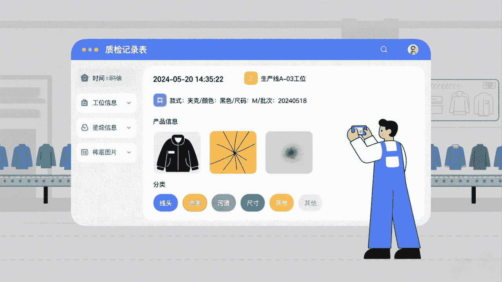

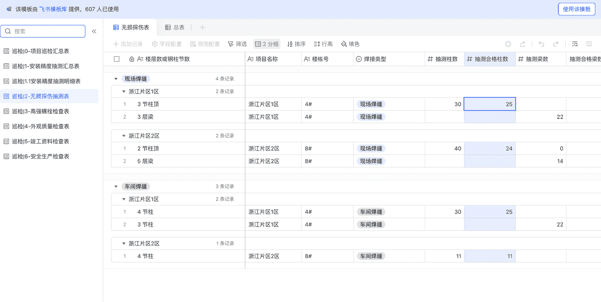

### （2）AI智能分析与统计

然后还可以用**多维表格AI字段捷径**，来帮忙实现更深层的数据洞察，比如：

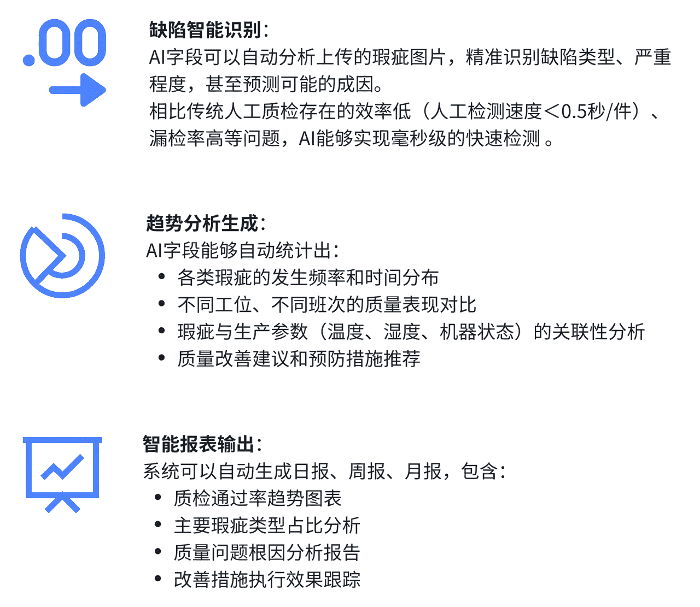

### （3）闭环管理实现

**更进一步，我**们还可以用多维表格来设置自动化工作流，比如：

+   **当AI检测**到严重瑕疵时，自动通知到相关负责人；

+   根据**瑕疵类型**，自动分派给对应的技术专家处理；

+   跟踪问题处理进度，确保每个质量问题都有闭环解决。

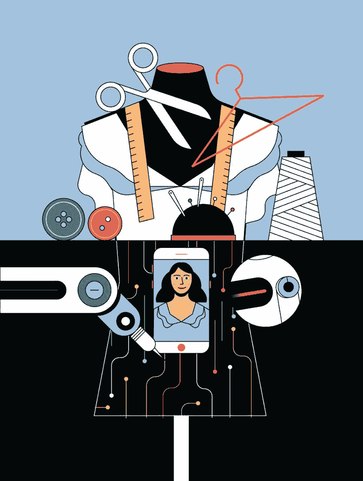

# 五、运营与营销

AI的应用并不仅限于**生产端**，在最前端的**运营**和**营销**环节，它同样能为企业带来巨大的价值。

## 1、AI驱动个性化营销

我们可以通过 AI 来分析**消费者**在电商平台的浏览记录、购买历史、甚至社交媒体上的互动数据，让AI为每一个用户创建**精准的个性化画像**。

在此之后，**运营团队**可以基于这些**个性化画像**，向消费者推送他们最有可能感兴趣的商品**、搭配方案或**促销活动。与此同时，还可以用AI智能客服，实现7x24小时为消费者答疑解惑、处理售后等问题。这在很大程度上，大幅提升了用户的购物体验和客户满意度。

那对于**服装厂商的运营人员**来说，要怎么运用AI，来实现更精细化的**运营**和**营销**呢？

## 2、场景探索：智能商品推荐系统

比如说你是商场里的**导购****，正在对怎么给用****户推荐商品**而发愁。那么可以做一个智能商品推荐系统，这样可以每回先根据用户的购物喜好，来实现快速个性化商品推荐。

比如要给25岁的职场女性做春季购衣推荐，**那么我们可以这样问AI：**

```
基于以下用户数据为其推荐3-5个商品：
- 用户年龄：25岁
- 购买历史：职业装、休闲装、配饰
- 浏览偏好：简约风格/ZARA、优衣库品牌
- 预算范围：200-800元
- 季节需求：春季

请生成个性化推荐理由，包含商品特点、搭配建议和促销信息。

```

最终可以生成一个类似这样的个性化推荐页面：

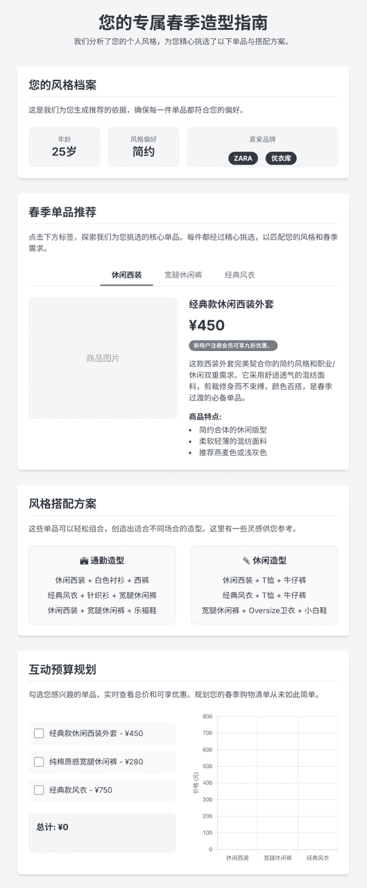

## 3、场景探索：个性化营销文案生成

又或者说，你是某品牌的**新品羽绒服推广者**，现在正发愁要怎么把羽绒服推广给高端消费者。那么你可以这么问AI👇：

```
请你为以下用户群体创建个性化营销文案：
- 目标用户：30-45岁高收入白领，注重品质和品牌，追求时尚与实用并重
- 推广商品：加拿大鹅同款设计羽绒服，90%白鹅绒填充，防风防水，多色可选
- 营销目标：新品推广
- 渠道平台：微信朋友圈广告
- 文案长度：80-120字

请生成吸引人的标题和正文，突出用户关心的价值点。
```

之后AI会给你一套个性化营销文案供你参考：

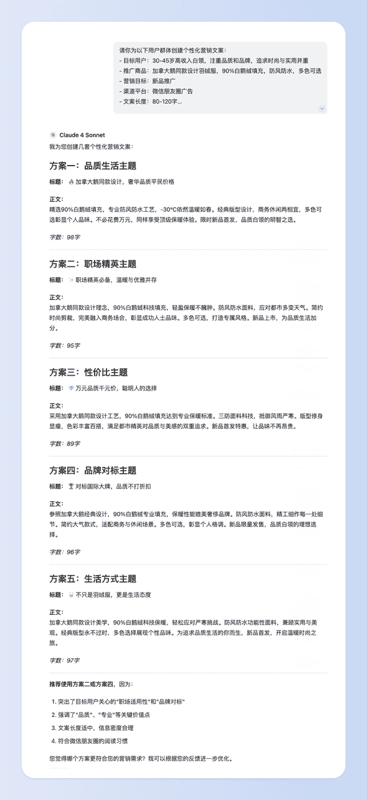

当然，你也可以把上面这个提示词，抽离成模板，然后套用到任何场景下都同比适用。

## 4、场景探索：智能促销策略制定

运营与营销的第三个场景，想聊聊**智能促销策略制定**。

**突然在想**一个场景，想象一下，你是一家电商平台的运营经理，每天都要面对各种促销决策难题，比如：

+   双11大促怎么定价才能既保证销量又不亏本？

+   3个月没购买的老客户用什么优惠能重新激活？

+   新上架的商品如何快速打开市场？

+   库存积压的夏装要用多大折扣才能快速清理？

传统的做法往往是**凭经验拍脑袋**，或者简单粗暴地打折促销，但这样既缺乏针对性，效果也难以预测。

而通过**AI智能分析**，我们可以进一步地根据用户的行为数据、消费习惯、市场趋势等多维度信息，为不同类型的用户群体制定精准的个性化促销策略。

比如对于**流失客户**，AI可以帮忙分析他们的历史购买偏好和流失原因，制定专属的「回归礼」策略；

对于**新客户**，可以根据他们的浏览行为和价格敏感度，设计合适的首购优惠；

对于**高价值VIP客户**，则可以提供更有尊享感的专属服务和优惠。

这样不仅能大幅度提升促销活动的**转化率**和**ROI**，还能让每一分**营销预算**都花在刀刃上，实现更加精准营销的目标。

下面提供几大场景来进行尝试。

**场景一：挽回流失客户策略**

```
为以下用户群体设计促销策略：
- 用户类型：流失客户（3个月未购买）
- 消费能力：中等消费（历史客单价300-800元）
- 购买频次：中频（每月1-2次）
- 偏好品类：女装、配饰
- 竞争环境：双11前期，竞争激烈

请制定包含折扣力度、活动形式、推广渠道的完整促销方案。

```

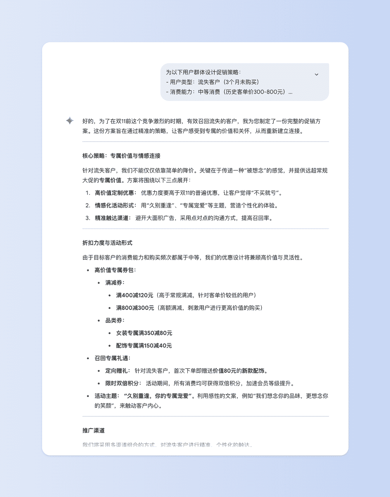

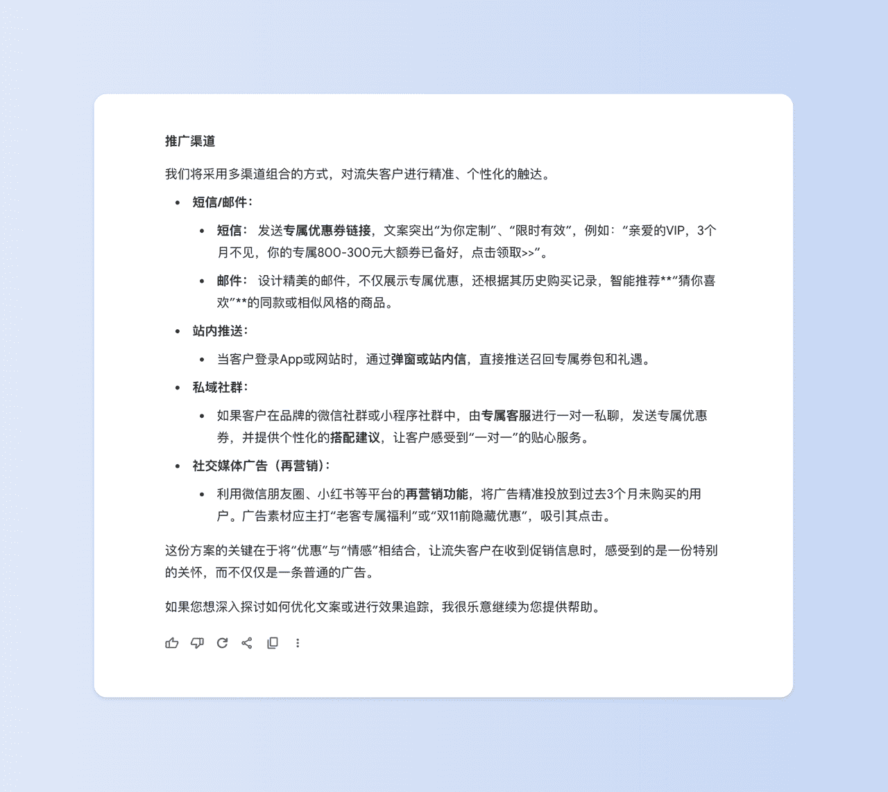

**场景二：新客户获取策略**

```
为以下用户群体设计促销策略：
- 用户类型：新客户（首次访问网站）
- 消费能力：未知（通过浏览行为判断为中低消费）
- 购买频次：首次购买
- 偏好品类：休闲装、运动装
- 竞争环境：开学季，学生消费旺季

请制定包含折扣力度、活动形式、推广渠道的完整促销方案。

```

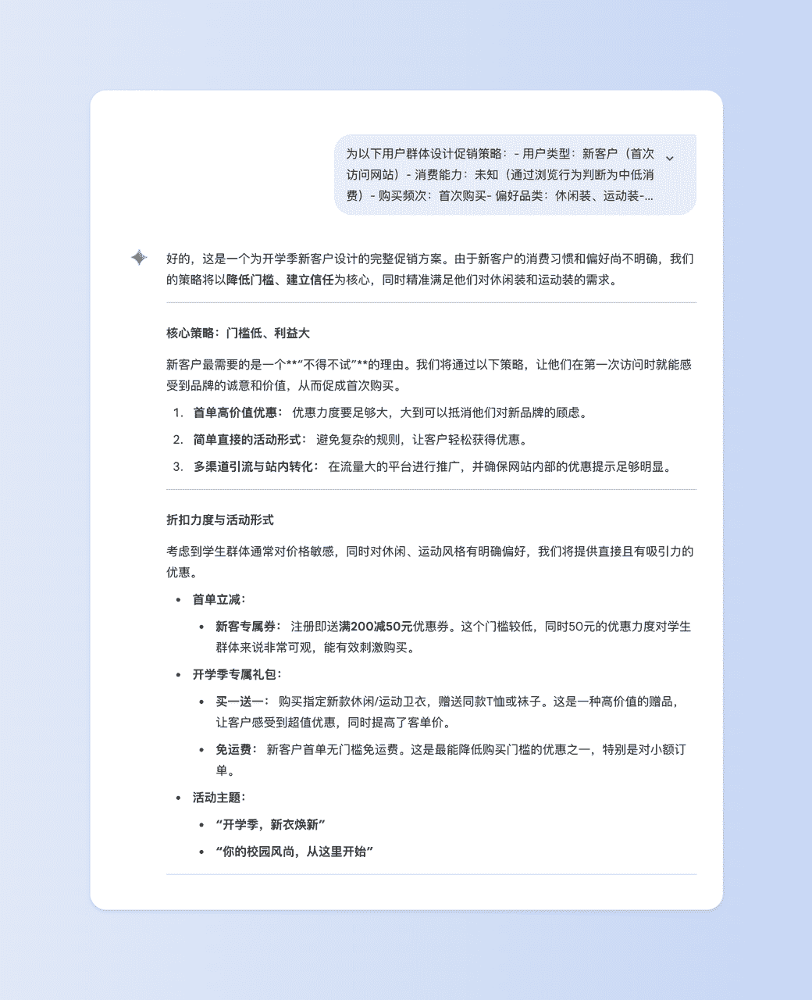

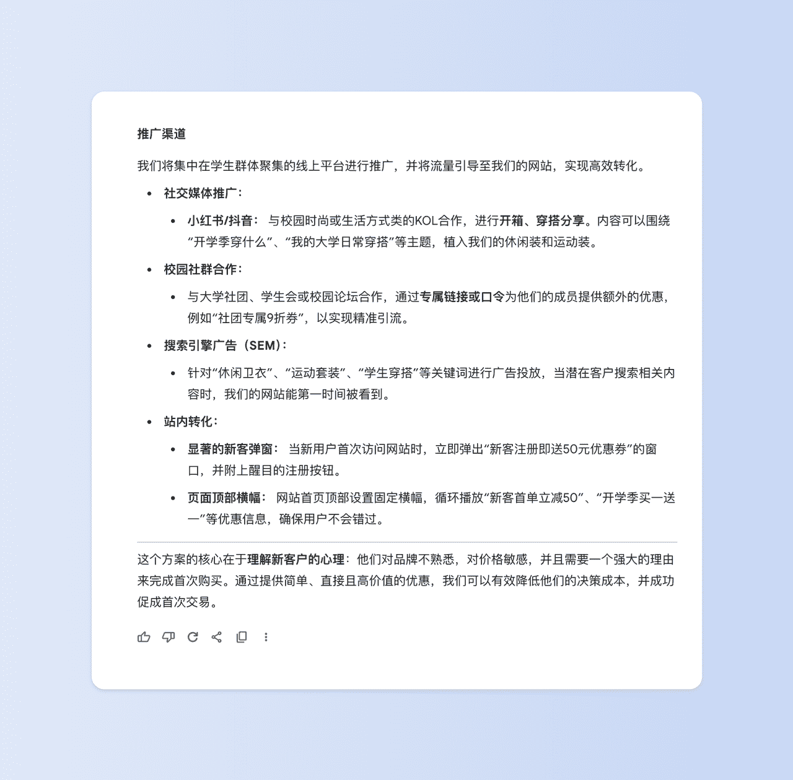

**场景三：高价值客户维护策略**

```
为以下用户群体设计促销策略：
- 用户类型：老客户（购买历史2年以上）
- 消费能力：高消费（月均消费1500元以上）
- 购买频次：高频（每周1-2次）
- 偏好品类：高端女装、奢侈品配饰
- 竞争环境：品牌周年庆期间

请帮忙制定包含折扣力度、活动形式、推广渠道的完整促销方案。

```

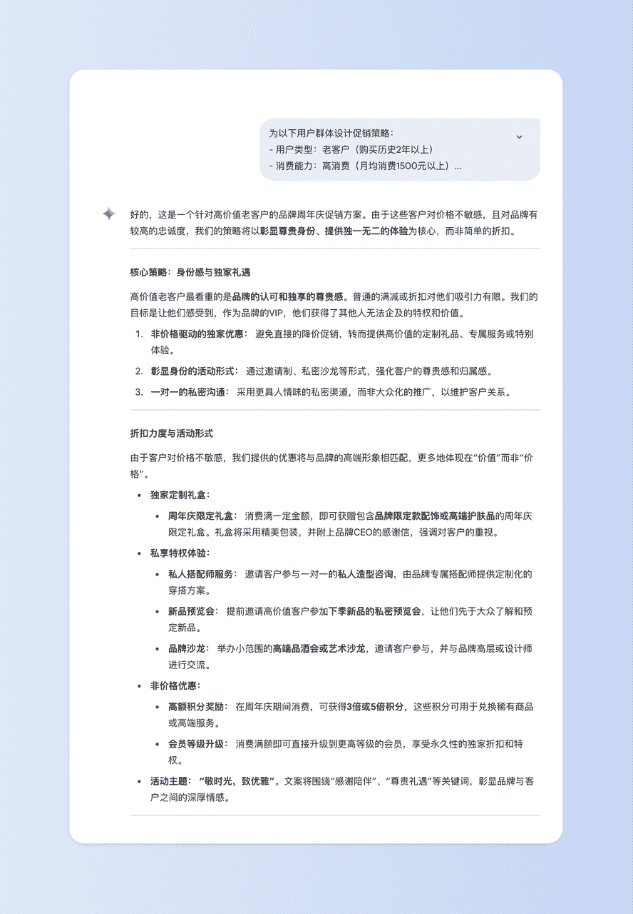

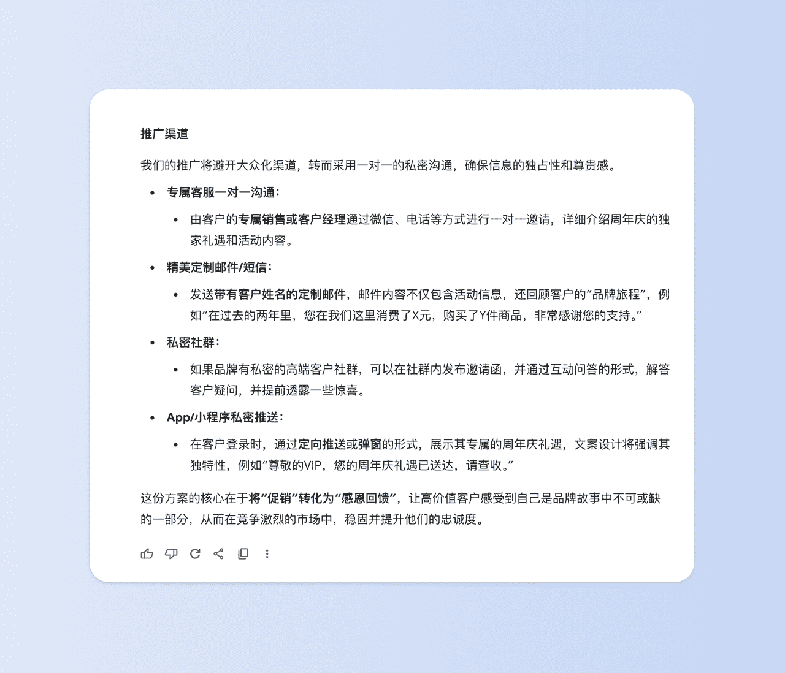

**场景四：季末清库存策略**

```
为以下用户群体设计促销策略：
- 用户类型：价格敏感型老客户
- 消费能力：低消费（客单价100-300元）
- 购买频次：低频（季度购买1-2次）
- 偏好品类：基础款T恤、牛仔裤、帆布鞋
- 竞争环境：夏末秋初，需要快速清理夏季库存

请制定包含折扣力度、活动形式、推广渠道的完整促销方案。
```

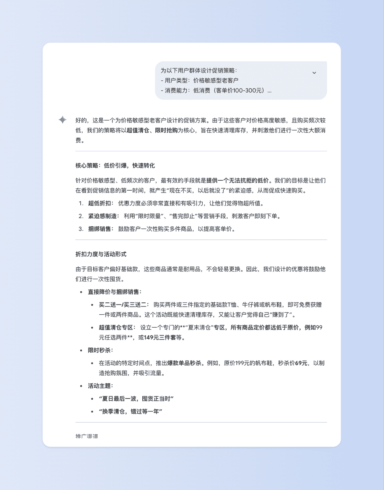

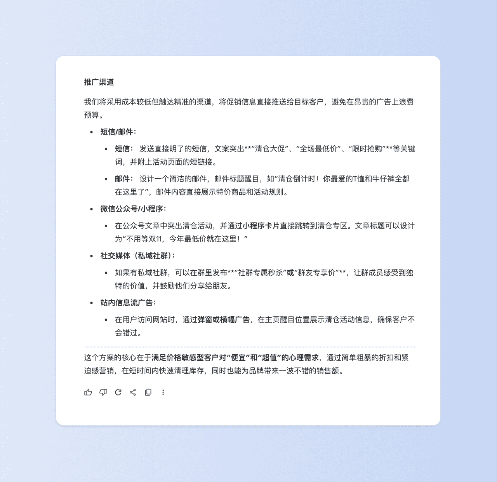

## 5、服装电商市场营销策略

探索完「运营与营销」的场景，小编突然在想，这么大的服装市场，市面上是不是会有一些比较全面的研究。然后我又去开始了一波新的深度搜索。

对于服装电商市场营销策略来说，最终在**汉斯Hans**的这篇期刊中找到了它与AI结合的答案。

> 基于人工智能应用背景下的服装电商市场精准营销策略研究：

> https://www.hanspub.org/journal/paperinformation?paperid=114443

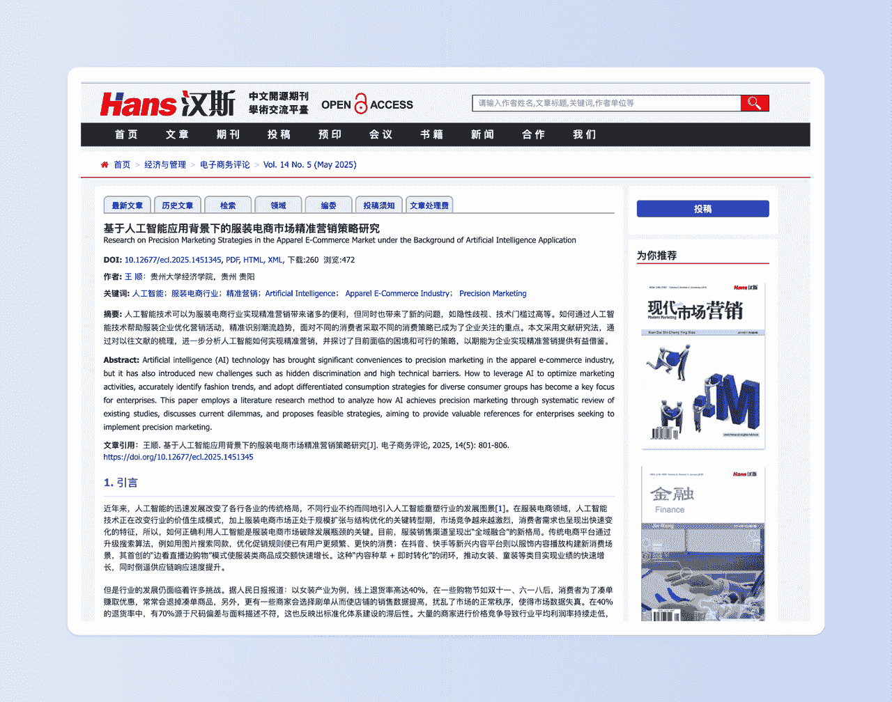

从整个行业发展趋势来看，**AI服装电商**正在深度融入电商平台的各运营环节，实现智能选品、AI导购、个性化推荐、智能客服等功能，从而重塑传统电商生态。

对于**服装电商**而言，AI的应用已经从单点突破走向全链路赋能：

+   **前端营销**：通过AI来分析消费者画像，实现千人千面的个性化推荐；

+   **中端运营**：利用AI来优化库存管理、价格策略和促销活动；

+   **后端服务**：借助AI客服来提升用户体验和服务效率。

**这种全链**路的AI应用，不仅提升了运营效率，更重要的是，它让服装电商能够在激烈的市场竞争中，通过数据驱动的精准营销，实现更大程度的差异化竞争优势。

在未来，随着AI技术的不断成熟和数据积累的日益丰富，服装电商的AI应用将会更加深入和智能化，真正实现「让每一个消费者都能找到最适合自己的那件衣服」的愿景。

# 六、结束语

文章到这里，关于「AI×服装制造业」的介绍就接近尾声啦！下面我们来做个小结。

从**最初的设计**创意，到后端供应链的精准预测；从生产线上的智能中控，再到最终的品控和个性化营销，AI正以其强大的数据分析和自动化能力，渗透到服装制造业的每一个环节。

「AI×服装制造业」这个链路，不仅仅是一种「提效」的工具，更是一种系统性的解决方案，AI正在帮助这个传统行业实现从「制造」到「智造」的跨越。

**目前市面上也**已经涌现了越来越多的AI服装产品，其中不乏包含我们前文提到的AR虚拟试穿平台、AI智衣MES系统，更有AI智能商拍、AI潮玩智能体等工具。

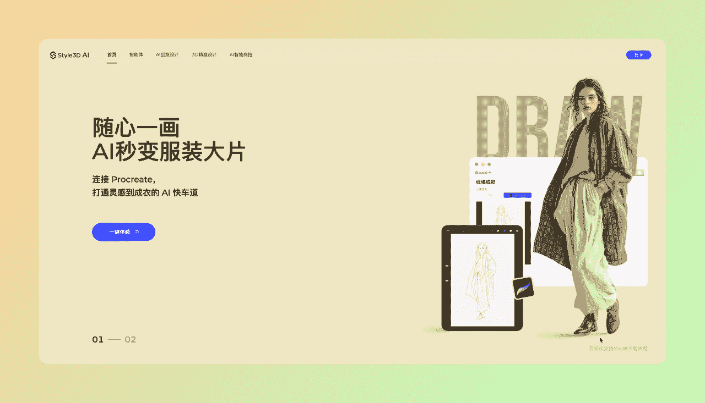

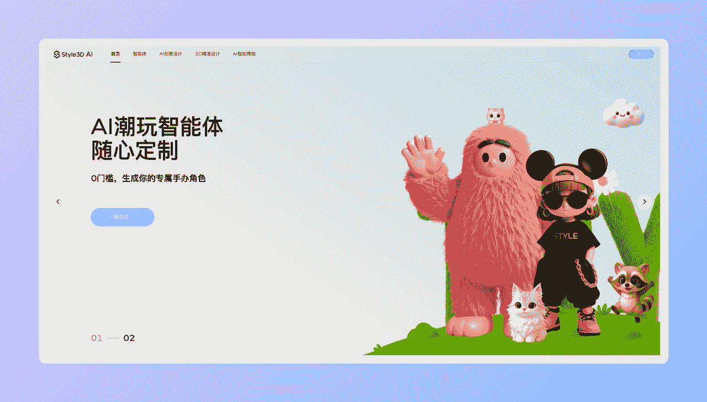

虽然AI与传统制造业的时代才刚刚开始，但我们可以预见，AI与制造业的深度融合，未来必将开启一个更加智能、高效且充满无限可能的新时代。

以上就是本期的全部内容！我们下期见🍻🍻🍻

# 彩蛋One More Things

## 1、变更记录

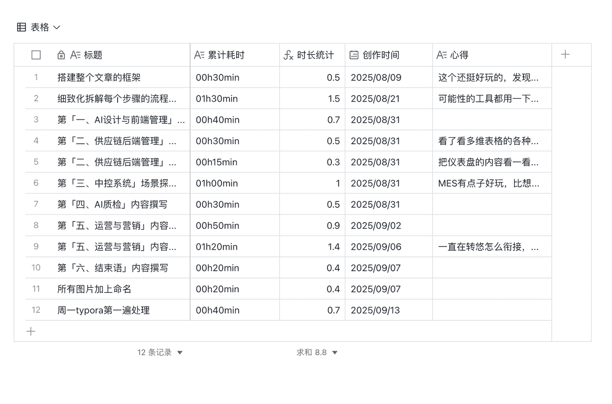

## 2、作者介绍

经常更新的地方：公众号「星期一研究室」

Zelina的宝藏库：[Zelina的个人说明书](https://pzfqk98jn1.feishu.cn/wiki/wikcnTijikVNdkWdBEKzQpiA6ie)