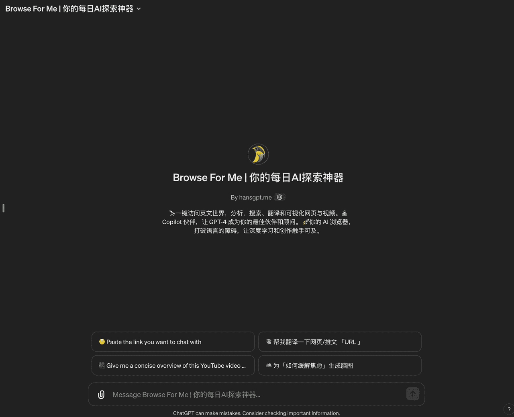
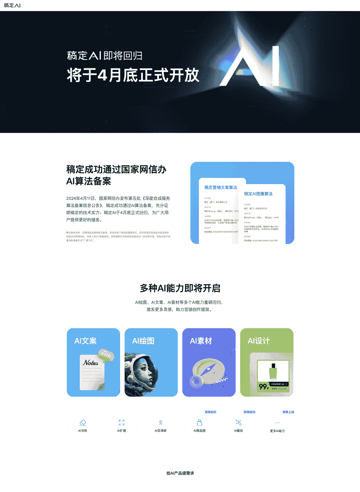
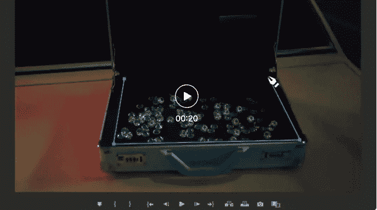
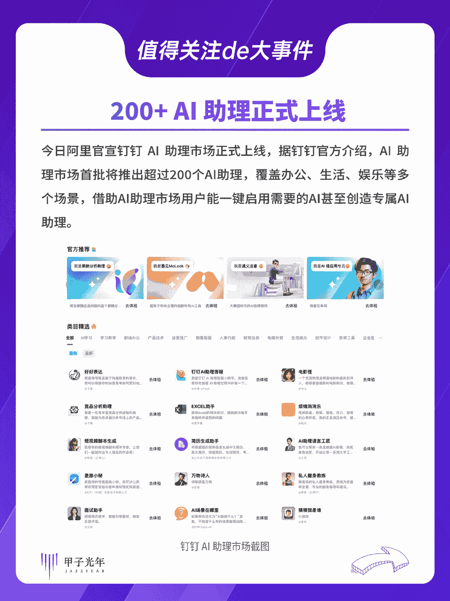
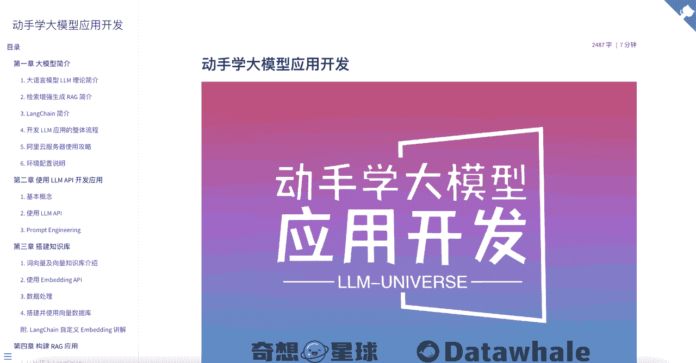
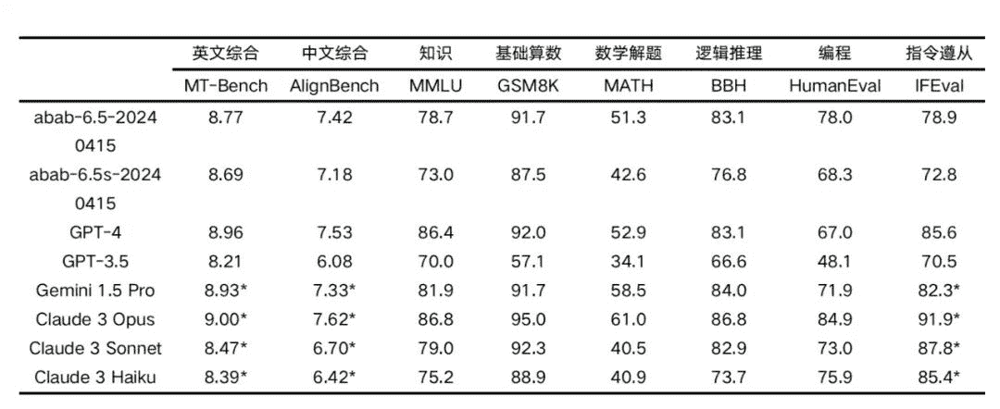

# Vol.004 - 2024/04-第3周 🌈 逆商学园、稿定AI、天工音乐

> 来源：[https://my.feishu.cn/docx/L0gKdtdIRoViSHxsbCGcV0vfnCf](https://my.feishu.cn/docx/L0gKdtdIRoViSHxsbCGcV0vfnCf)

> 2024/04-第3周-2024/04/15-2024/04/21

> 保护眼睛，贵精不贵多。

# 生产力工具

## 01 工作流探索

| **一些介绍** | **图片示例** |
| --- | --- |
| 你是否有遇到过这样的困惑：①YouTube的视频看着看着就不知道重点在哪了；②英文资讯看着看着就不知道看到哪一行了；③…… |  |
| [这里推荐一款帮助你提效的GPTs：✨](https://m.okjike.com/originalPosts/65f389b1a922aa28d0e3bad1?s=eyJ1IjoiNWIzNzQ1ZTU4OThlYTgwMDE3MmYzOTBkIiwiZCI6MX0%3D) 开源我的探索工作流，推荐一款自制且强大的GPTs： Br - 即刻App |  |
| 详细GPTs地址戳：https://chat.openai.com/g/g-JxorrWpeH-browse-for-me-ni-de-mei-ri-aitan-suo-shen-qi |  |

## 02 逆商学园

欢迎来到逆熵学园终身学习者资源导航！https://nishang.online/

> 比情商和智商更重要的“逆商”！

> 顶尖人脉成长社群！

> Inverse entropy 公司 成立于2022年6月1日，在理想世界诞生，由理想世界创建！

> 肩负着影响世界人、改变世界人的使命！

> 以“无用”为核心！秉承“Live and let live，即活得幸福和帮助他人活得幸福”、“坚持做难而正确的事”、“专注于美好作品”、“思考为一切之先”为理念，打造不被定义的理想世界，培养具有面对未来100年时代的综合力量的逆熵增者！！

**具体来源👇🏻：**

# AGI应用探索

## 01 稿定设计AI

**稿定AI**又双叒要更新啦！特别好奇它能给我整些什么花样出来~

戳地址：https://www.gaoding.com/landing-page/site106

## 02 Adobe Pr AI

Adobe带来王炸产品#Prmiere pro，将OpenAI的Sora、Pika 、Runway等著名第三方文生视频模型，集成在视频剪辑软件Premiere Pro中（简称“PR”）。

具体文章链接：Adobe将Sora、Runway、Pika，集成在PR中

## 03 阿里版GPTStore上线

阿里版GPTStore来了！钉钉正式上线AI助理市场｜甲子发现

4月18日，阿里钉钉正式上线了GPTStore(AI助理市场)，首批将推出超过200个AI助理，覆盖办公、生活、娱乐等多个场景，借助AI助理市场用户能一键启用需要的AI甚至创造专属AI助理。

基于通义千问大模型的支持，AI助理可通过文字或语音交互，让大模型提供文生文、文生图、图像理解等多模态服务。产品负责人表示：伴随市场上线，也对AI助理的行动系统进行了升级，已支持拟人操作、工作流、自定义能力三种开发方式，让AI与应用的连接更简单。

## 04 图生代码

CodeFuse - 蚂蚁推出图生代码功能

[蚂蚁集团CodeFuse 发布“](https://www.jiqizhixin.com/articles/2024-04-11-2)图生代码”功能，超五成程序员用AI写代码

# LLM大模型

## 01 大模型应用开发

> DataWhale官方出的文档，写的特别详细。

> 动手学大模型应用开发：https://datawhalechina.github.io/llm-universe/#/

## 02 Meta发布Llama3

wayToAGI文档：[Llama3 正式发布，开源模型的质量又迎来再一次飞跃](https://waytoagi.feishu.cn/wiki/DswSwkTOCiUkiDkEZr1cMJU7nih)

FP推文：[Llama 3 发布！目前最强开源大模型，全面登陆 Me](https://mp.weixin.qq.com/s?__biz=Mzg5NTc0MjgwMw==&mid=2247497876&idx=1&sn=140e0f8c63c37dee949fab57a1d3f094&chksm=c0091ea8f77e97be7247720bdec8a50ef1cca3791ab4f663e6991ccebde45dadd52b75591d14&mpshare=1&scene=1&srcid=0419No🐧JYOmXsYWCbaj0YTK&sharer_shareinfo=9ddb073f2a519757a562a98a0c2227da&sharer_shareinfo_first=9ddb073f2a519757a562a98a0c2227da#rd)ta 系产品，即将推出 4000 亿模型

## 03 扣子支持Kimi模型、搜索结果溯源

扣子全面支持更多新模型👉🏻：月之暗面 Kimi 智能助手升级：支持新模型、搜索结果溯源

## 04稀宇科技推出万亿MoE模型

昨晚才在看AI大模型**五小龙**，今天就看到了minimax的报道。

**Minimax👉🏻：ab**[ab 模型进展｜MiniMax 发](https://mp.weixin.qq.com/s/xBoAP-6fZVQA9cEWT8gyfw)布万亿 MoE 模型abab 6.5

## 05 国内首个：天工音乐大模型

基本报道：中国首个音乐SOTA模型「天工音乐大模型」今日公测

从0到1揭秘教程：从 0 到 1，揭秘中国首个 AI 音乐 SOTA 模型