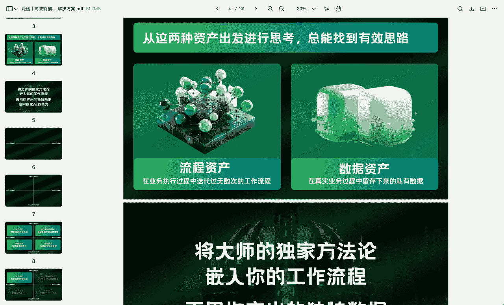
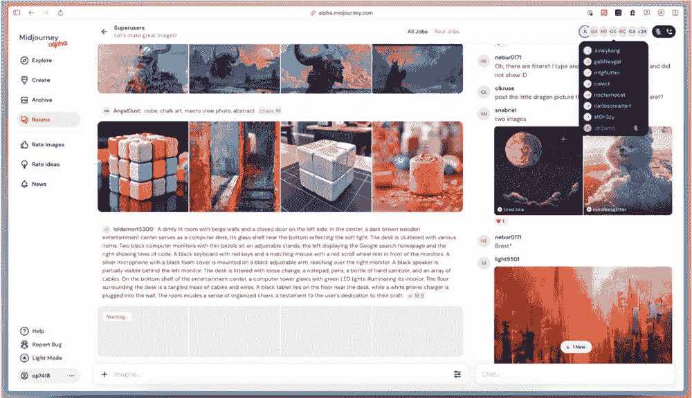
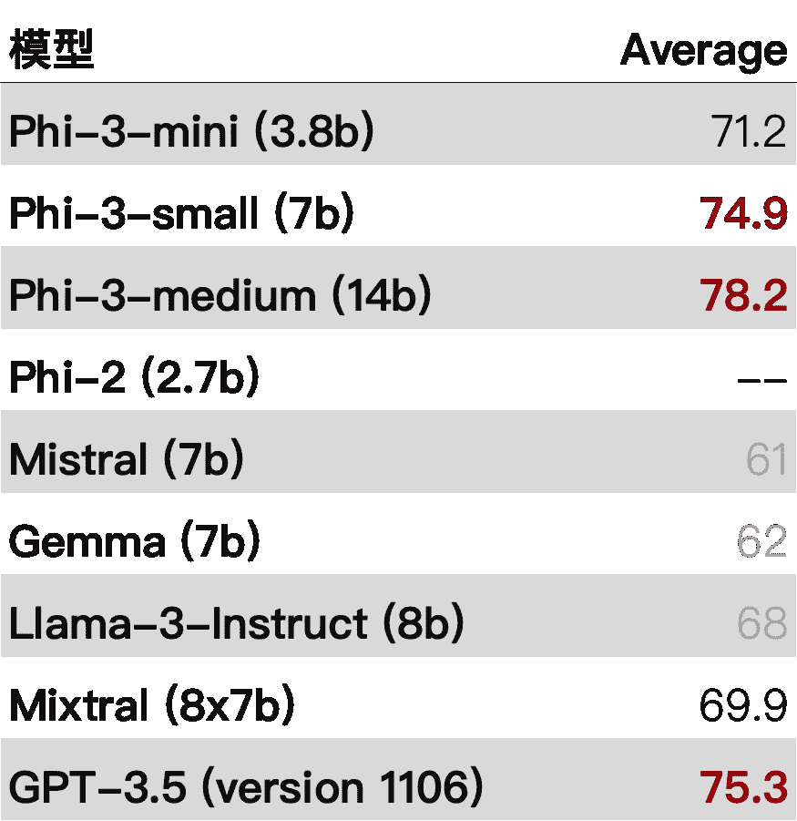

# Vol.005 - 2024/04-第4周 🌈 AI播客PodWise、高效能创作者的全链路AI

> 来源：[https://my.feishu.cn/docx/FgBadPk5lofmbYxuWufcpvenneb](https://my.feishu.cn/docx/FgBadPk5lofmbYxuWufcpvenneb)

> 2024/04-第4周-2024/04/22-2024/04/28

# 生产力工具

##    播客应用Podwise

AI 播客知识管理应用 Podwise 的 ARR 年收入突破了 12000 美元，作为一款聚焦播客文本转录、提取和总结分析的 AI 应用，Podwise 聚焦在硬核播客赛道，同时与 Notion、Obsidian、Logseq 和 Readwise 等平台的打通，嵌入用户的知识管理工作流。

具体文章地址戳：[AI 播客应用 Podwise 三万字复](https://mp.weixin.qq.com/s/5gtvNsvpYws5sLGnP1f8_g)盘：两个月 1.2 万美元 ARR 之路

[AI 声影瑰宝阁](https://fx0k8uq4yur.feishu.cn/wiki/Lrttwmosziw2XRkDbvvcTAV4nDd?table=tblNZ8a6AnE0uPfn&view=vewQHLqvAS)带附上最近整理的一个AI播客相关的工具箱：

##    高效能创作者的全链路AI

泛函同学对AI解决方案的思路，太棒了！具体链接戳👉🏻：泛函 | 高效能创作者的全链路 AI

# AGI应用探索

##    AI产品数据榜

[AI产品数据榜  AIwatch.ai](https://zw73xyquvv.feishu.cn/wiki/UH5QwtUWtis1gTk4R6rcnWK2nZc?table=tblS2Jv7isKtSODz&view=vewfCdOf0U)飞书挖掘到一个针对AI做垂类数据观察的，具体链接🔎：

##    EMO模型上线通义App

通义实验室研发的AI模型——EMO上线通义APP，可开放给所有用户免费使用。打开通义APP，进入“全民舞台”频道，就可来到EMO产品页面“全民唱演”。在歌曲、热梗、表情包中任选一款模板，上传肖像照片，EMO随即就能合成视频。

阿里AI模型EMO免费上线通义APP

##    Midjourney推出新功能Room 用户可在聊天室中一起创作图像

Midjourney 最近推出了一个有趣的新功能「Room」，为用户提供了一个协作和社交平台，用户可以一起创建和分享图像，并参与实时聊天。Room 促进了用户之间的互动和合作，激发灵感和创意交流，丰富了 Midjourney 的体验。

具体链接👉🏻：Midjourney推出新功能Room 用户可在聊天室中一起创作图像

# LLM大模型

## 微软发布phi-3-mini

上周Meta刚发了Llama3，**这周就迎来了微软**发布iPhone可运行的ChatGPT级AI模型Phi-3系列：Phi-3-mini。具体文章：Phi-3：小模型击败 Llama3，微软今天发布，手机畅跑。

编者荐语：仅仅是 Phi-3-mini 这一最小版本，就已经全面超越刚刚发布的Llama 3了！

## 苹果发布OpenELM

4月24日，苹果开源了大语言模型OpenELM。这与微软刚开源的P**hi-3**M**ini**类似，是一款专门针对手机等移动设备的模型。OpenELM有指令微调和预训练两种模型，一共有2.7亿、4.5亿、11亿和30亿4种参数，提供生成文本、代码、翻译、总结摘要等功能。

具体文章👉🏻：苹果开源OpenELM，大模型开源领域再迎一巨头！

项目地址👉🏻：https://huggingface.co/collections/apple/openelm-instruct-models-6619ad295d7ae9f868b759ca

## Web GPU 和 Transformer

同事给推荐了两个很好玩的东西。

**First：WebGPU**

> 推荐给周一个挺有趣的开源项目，可以学学webgpu。

> Github地址：https://github.com/lxfater/inpaint-web

> 项目地址：https://huggingface.co/spaces/Xenova/segment-anything-webgpu

Second：Transformer.js

> transformer这个你也可以试试，代码在这里。Github地址👉🏻：https://github.com/xenova/transformers.js/blob/v3/examples/segment-anything-client/worker.js