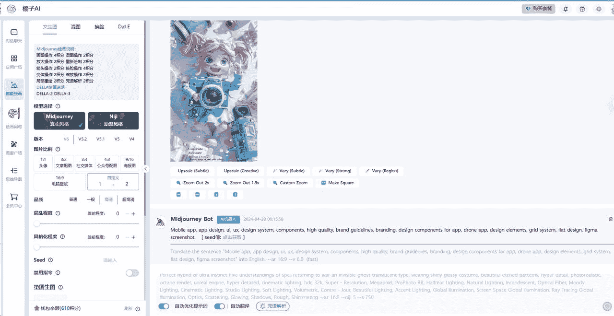
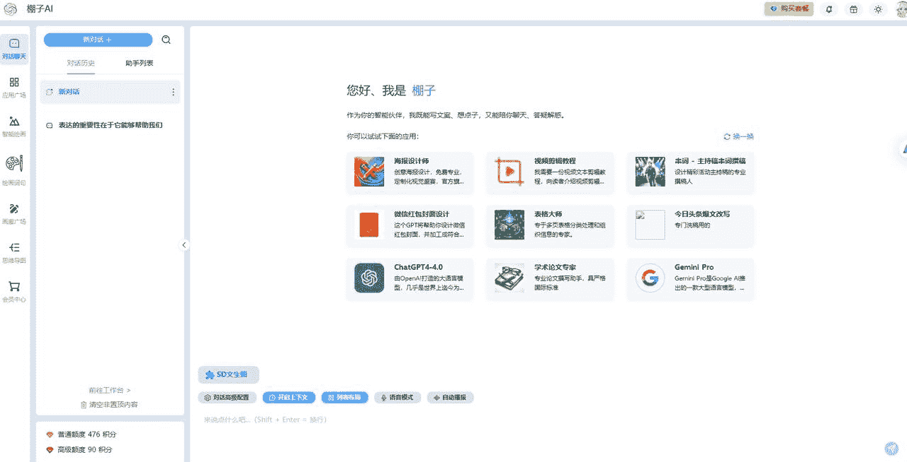
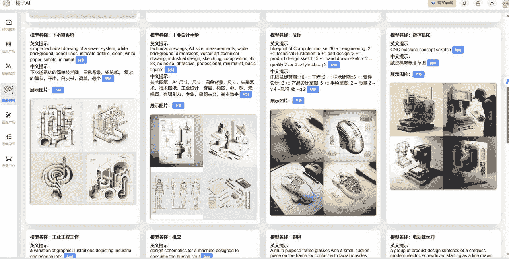
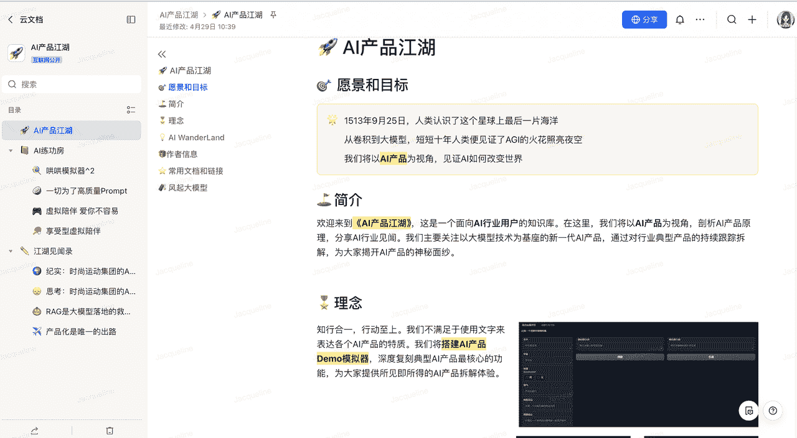
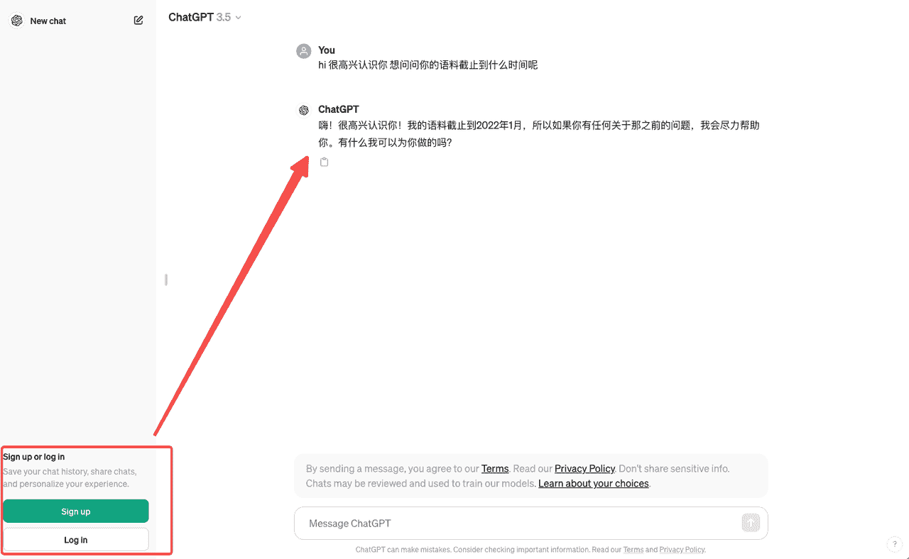

# Vol.006 - 2024/05-第1周 🛒 Arc for windows、星绘、AI产品江湖

> 来源：[https://my.feishu.cn/docx/CztzdyN0todhIXxLhN1cJ1EZnlg](https://my.feishu.cn/docx/CztzdyN0todhIXxLhN1cJ1EZnlg)

> 2024/04/29-2024/05/05

# 生产力工具

##    Arc for windows

| 4月29日晚上，Arc for Windows 正式来到 1.0 啦！ |  |
| --- | --- |

信息源来自：

# AGI应用探索

##    棚子AI

棚子AI：我们不断在优化ai的产品，欢迎大家测试和使用。

棚子AI体验地址：https://a.wpzllq.top/

| **序号** | **描述** | **展示** |
| --- | --- | --- |
| 01 | 注册推广就有很多额度，mj随便生成，模型随便用 |  |
| 02 | 多模型支持 |  |
| 03 | 多问答系统 |  |
| 04 | 非常多的绘画提示词库 |  |
| 05 | 画廊展示 |  |

##    AI产品江湖

在飞书上挖到一个[AI产品江湖](https://wmrhgp690g.feishu.cn/wiki/VNVtwRCDaiS3LNkwjYxcXO2ynPg)，整体理解下来有点像是在分析行业产品的知识库。

##    抖音发布AI相机类产品“星绘”

**近日，抖**音Flow部门上线AI相机类产品“星绘”，对标妙鸭相机。据悉，用户可以通过抖音ID一键登录，使用AI分身、AI修图、文生图等功能。

另外，字节面向海外市场，同样上线了一款功能相似的APP“Picpic”。用户上传图片后，可以通过输入提示词，切换图片风格，如像素风、赛博朋克、日式漫画等。

具体文章戳：独家｜对标妙鸭相机，抖音上线“星绘”APP

> 图源：特工宇宙公众号

##    ChatGPT3.5无需注册可直接使用

OpenAI无序注册也可以免费使用ChatGPT了，文章戳：[OpenAI 宣布将让人们无需注册账](https://juejin.cn/post/7352845644736364571)户即可免费使用 ChatGPT - 掘金

