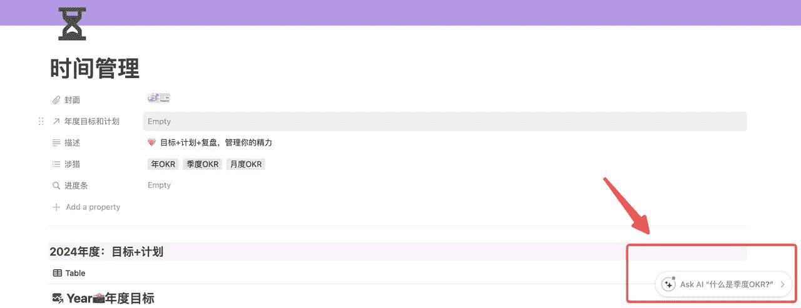
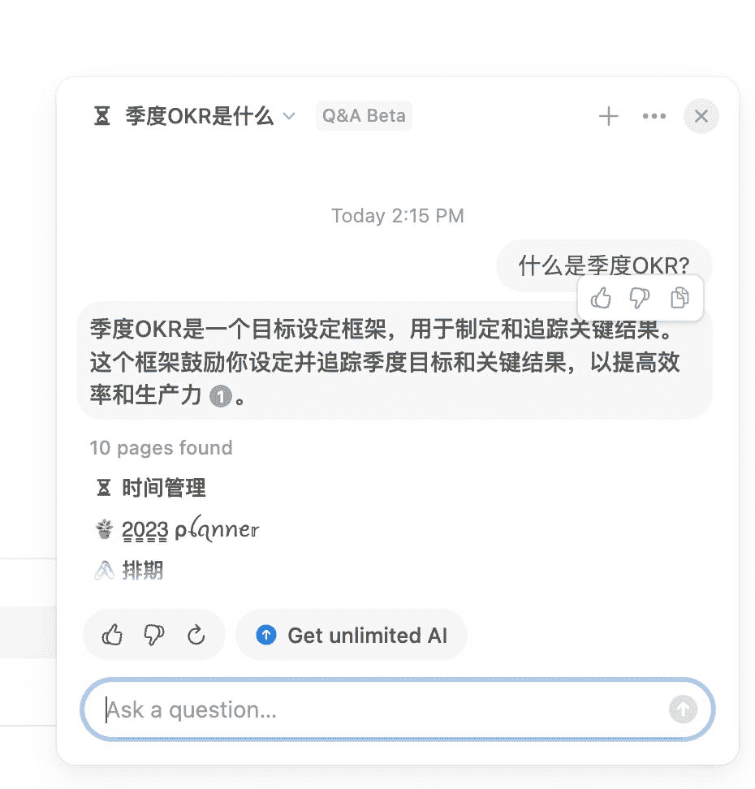
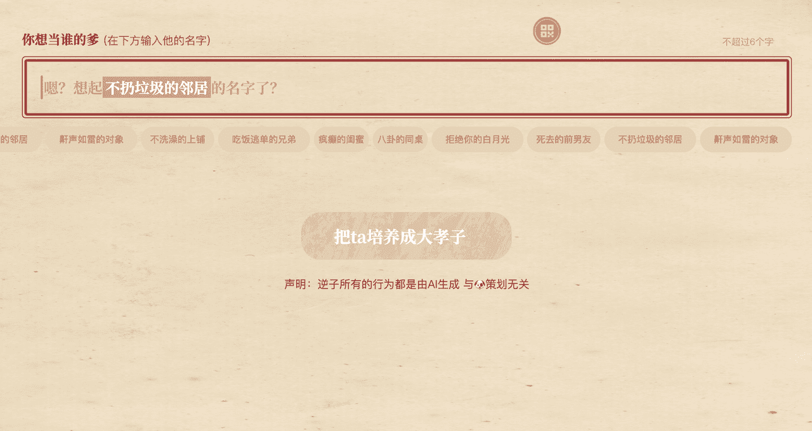
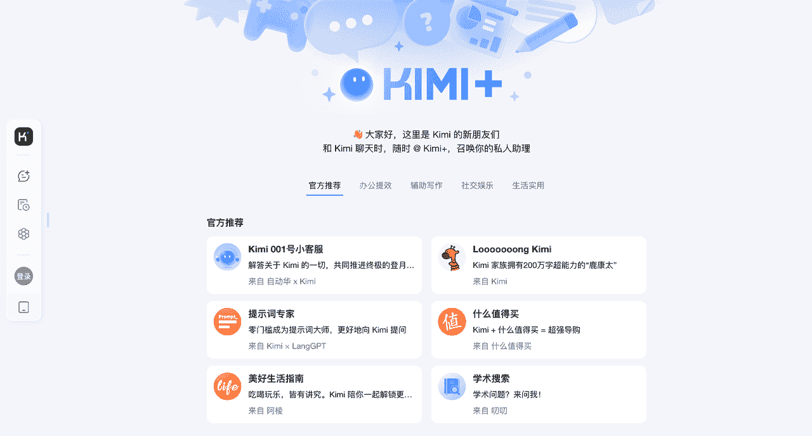

# Vol.007 - 2024/05-第2周 🛒 Remini黏土人、AI逆子、小地瓜

> 来源：[https://my.feishu.cn/docx/NuX8djlPUoMPQExkUVScWVRUnJc](https://my.feishu.cn/docx/NuX8djlPUoMPQExkUVScWVRUnJc)

> 2024/05/06-2024/05/12

# 生产力工具

##    Notion AI集成问答中心

随处可见的AI，刚打开Notion就给我跳出了这个。

试了一把，发现新上线的这个**问答功能**还不错，还可以快速帮我找到一些**相关文档**。

**PS：**期待未来飞书可能也会有相关能力

# AGI应用探索

##    妙鸭之后，另一个现象级的 AI 修图软件火了

只能说这届产品经理真的太懂网感了！

具体文章👇🏻：

+   妙鸭之后，另一个现象级的 AI 修图软件火了

+   “什么滤镜能玩一宿”，打工人咋都在跪求网友把自己变成猥琐泥人？

##    AI逆子：换你来当爹

你想当谁的爹：https://lipu.badiya.cn/23/

##    文本生成语音 ElevenLabs Music

5月10日凌晨，著名语音生成式AI平台ElevenLabs在社交平台宣布，推出文本生成歌曲产品ElevenLabs Music。

从其展示的效果来看，音乐的节奏感、和声、乐器的搭配、情感表达、创意性、风格的多样性、高/低音，可媲美该领域的两款头部产品Suno和Udio。

具体链接戳：媲美Suno、Udio！AI铁了心，要砸音乐人的饭碗

## 剪映Dreamina更名为即梦

剪映Dreamina官方宣布其品牌正式更名为中文「即梦」，同时宣布其AI作图和AI视频生成功能已全量上线。用户现在可以通过电脑浏览器访问新域名来体验这些功能。这将进一步丰富即梦的产品线，使用户能够通过AI技术讲述和创作更加生动和个性化的故事。体验地址：

[D](http://www.citnews.com.cn/news/202405/178765.html?open_source=weibo_search)reamina正式更名为“即梦” AI绘画和AI视频功能全量上线_中文科技资讯 提供快捷产业新资讯 创新驱动商业

##    零一万物推出AI工作平台-万知

最适合中国宝宝体质的AI个人特助，让打工效率原地×10！5000页长文档速读，2分钟搞定PPT，表格公式代码全输出。

具体链接：[最懂打工人的AI特助万知来了，李开复](https://mp.weixin.qq.com/s/4y_2mX-0RxaNfNsScMKV2Q)在线催更！2分钟手机直出PPT效率×10

##    Kimi更新智能体功能Kimi+

体验地址：https://kimi.moonshot.cn/kimiplus-square

# LLM大模型

##    药物大模型

[里程碑式突破！谷歌DeepMind推出新一](https://baijiahao.baidu.com/s?id=1798515014518291743&wfr=spider&for=pc)代药物研发AI模型AlphaFold 3

##    📕大模型小地瓜

📕自研大模型“小地瓜”悄然内测，AI布局加速