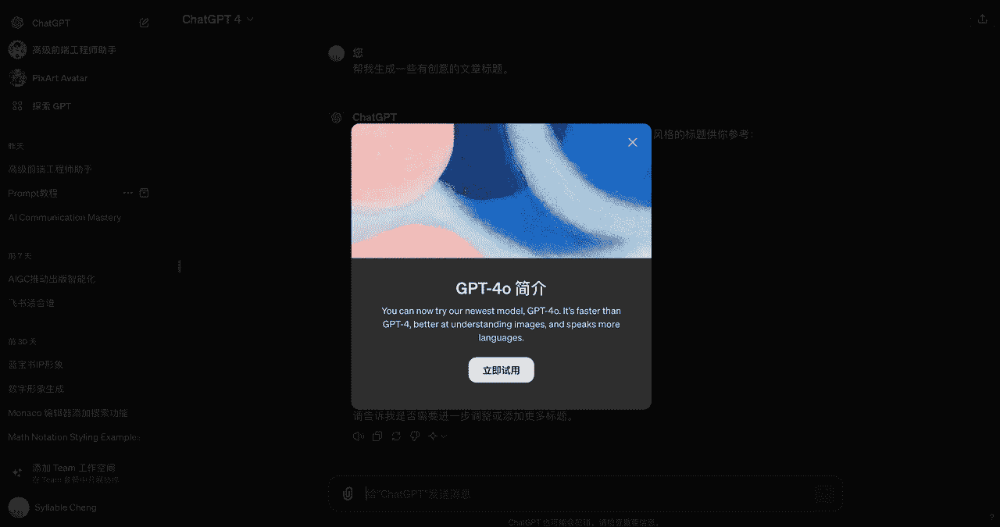
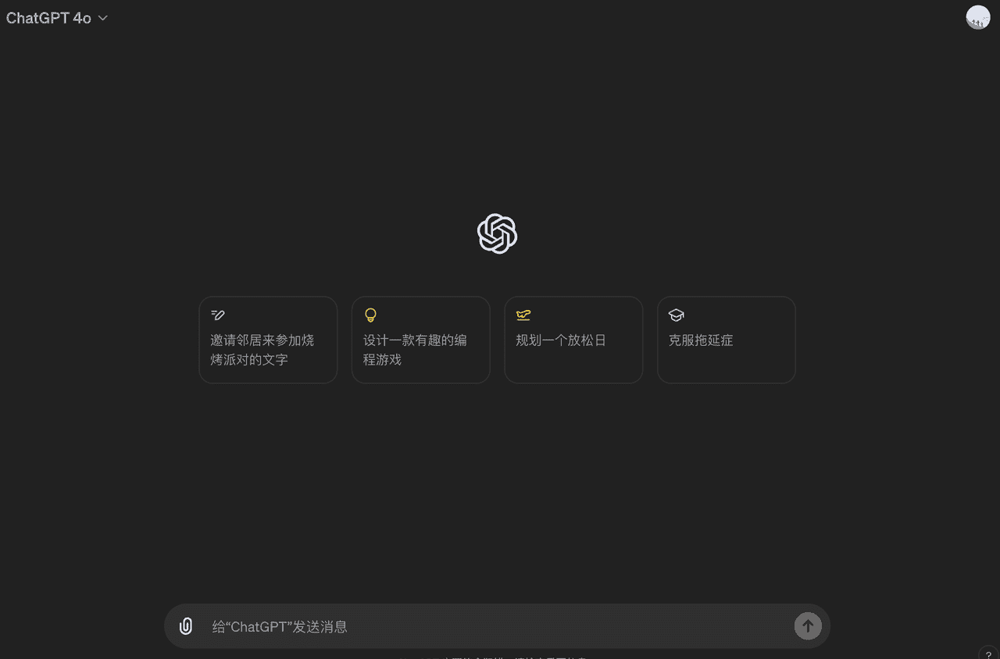
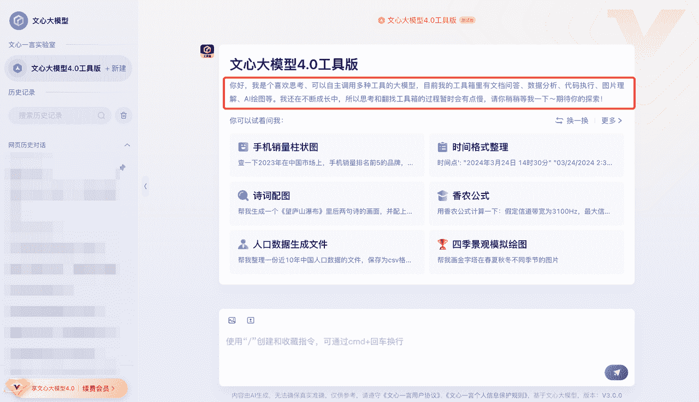
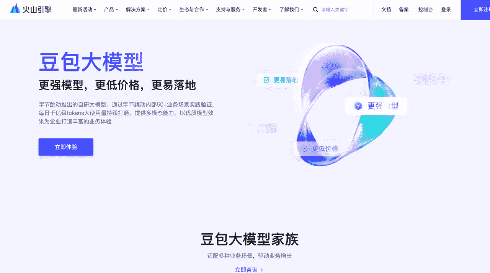
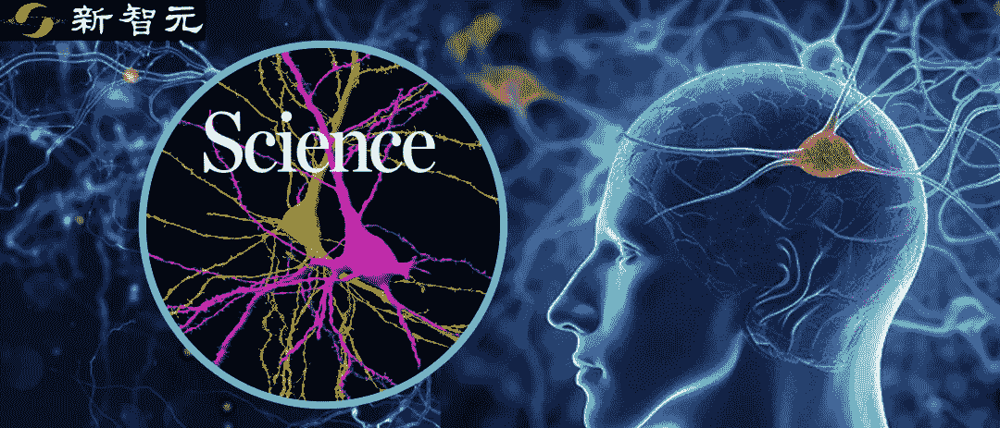

# Vol.008 - 2024/05-第3周 🛒 GPT4o、豆包大模型、文心一言4.0工具版

> 来源：[https://my.feishu.cn/docx/YV9XdVeKso9ru4xJ7GGcRvinnl6](https://my.feishu.cn/docx/YV9XdVeKso9ru4xJ7GGcRvinnl6)

> 2024/05/13-2024/05/19

# AGI应用探索

##    GPT-4o

🛰️：OpenAI 重磅发布 GPT-4o ：见证《Her》的诞生！

Bilibili：[【双语】OpenAI春季发布会，重磅官宣免费多模态](https://www.bilibili.com/video/BV1by411Y7jw/?buvid=Z84FA2895A3C48034C41947042F097E495DB&from_spmid=search.search-result.0.0&is_story_h5=false&mid=l%2F1Ir50IGwjiF7XlqrDGTA%3D%3D&p=1&plat_id=116&share_from=ugc&share_medium=iphone&share_plat=ios&share_session_id=1168D77E-D5A7-40BF-9DC9-07D3CAD6834E&share_source=COPY&share_tag=s_i&spmid=united.player-video-detail.0.0&timestamp=1715628619&unique_k=4YAR4Su&up_id=1845434732)GPT4o！_哔哩哔哩_bilibili

WayToAGI：[OpenAI 春季发布会：GPT-4o](https://waytoagi.feishu.cn/wiki/Qy5Pw3IUZidKf4ky6YacopJBnNh)

##    Google I/O 发布Gemini

Google I/O 2024：开启新一代的 I/O

[抢先测试体验上了 Search La](https://m.okjike.com/originalPosts/6643b6a444e298e87eacc30e?s=eyJ1IjoiNjM1OWZiZGUxZGFjYWFlYjIwYmNjYWY2IiwiZCI6MX0%3D)bs 中的 Google - 即刻App

##    文心一言4.0工具版

周末刚好在用文心一言测试个东西，发现出了4.0工具版，可以理解为是模型精调后的聊天机器人。

# LLM大模型

##    豆包大模型

**戳一些值得看的文章：**

[字节跳动的AI野心](https://mp.weixin.qq.com/s/tn_wWZa19qN3r7lcpLx69w)

[豆包模型，认识一下](https://mp.weixin.qq.com/s/uRotMb5uyFdYiKHROYjTWA)

[字节大模型豆包，就是一切都包了](https://kh18s6uvdi.feishu.cn/docx/Vlr2d2BQMoVvr1xkqP8cp8slnGv)

字节跳动副总裁朱骏：从大模型到用户体验，在做豆包产品时的一点感想

**一些总结：**

从**云雀模型**到**豆包大模型**的名称转变，统一了字节在大模型方面的发展战略。从价格来说，像是以更能打的价格把营销先卷起来。

##    Google发布人脑图谱

Google在人脑方面的研究一直都在前沿，非常值得挖掘~

来看看具体文章：十年磨一「图」，谷歌震撼发布纳米级人脑图谱！AI加持人类大脑研究

##    值得买消费大模型

值得买科技5月10日正式发布全面AI战略，宣布将在AI战略框架下，把核心产品什么值得买App改造升级为“AI原生的什么值得买GEN2”，同时积极推进出海。

具体文章：值得买发布全新AI战略 “值得买消费大模型”正式发布