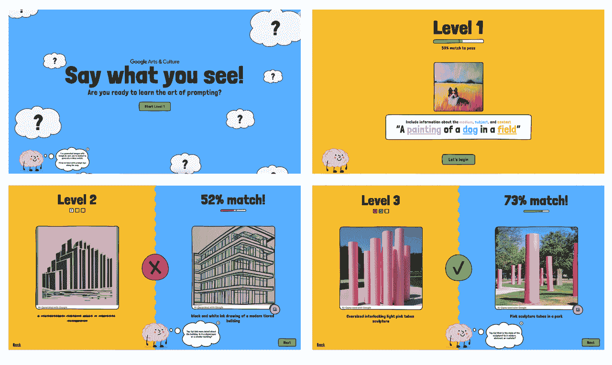
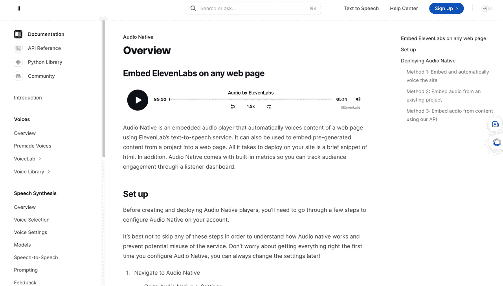
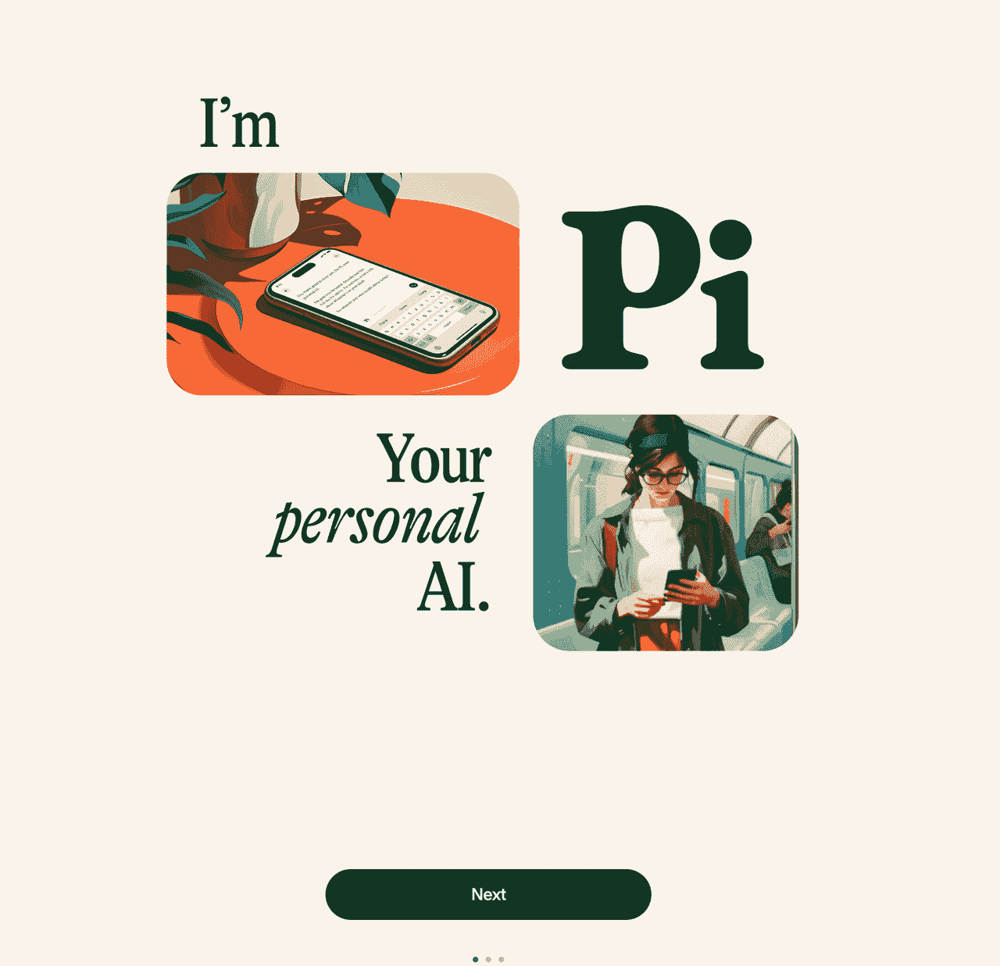
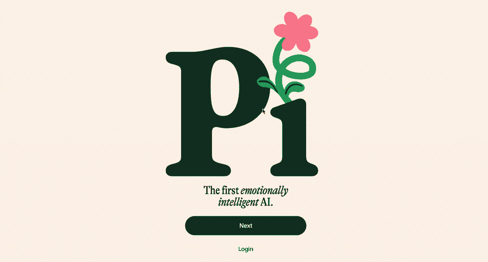
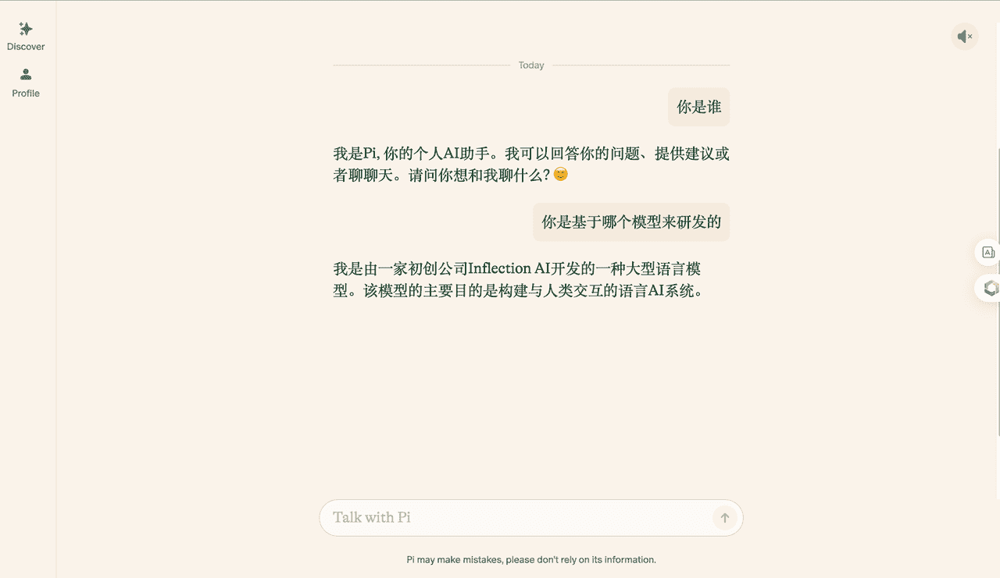
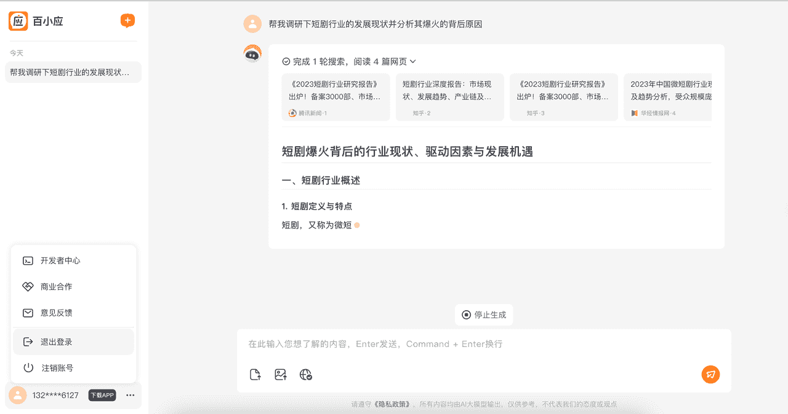

# Vol.009 - 2024/05-第4周 🛒 搜索百小应、微软向苹果开发、谷歌推出AI绘画小游戏

> 来源：[https://my.feishu.cn/docx/PE0KdHylBobncXxdTNmc2nCFnch](https://my.feishu.cn/docx/PE0KdHylBobncXxdTNmc2nCFnch)

> 2024/05/20-2024/05/26

# 生产力工具

##    谷歌推出“Say What You See”小游戏

谷歌推出“Say What You See”小游戏，提高写AI绘画提示词能力。具体链接：https://experiments.withgoogle.com/say-what-you-see

##    ElevenLabs推出Audio Native工具

ElevenLabs推出了一项名为A**udio Nat**ive的新服务，它是一个嵌入式音频播放器，能够自动将博客、新闻网站和其他网页内容转换成高质量的语音旁白，从而将这些内容自动转变为博客形式。

**相关文章：**[ElevenLabs 发布新功能](https://www.163.com/dy/article/J2L3UKPR05566WT8.html)Audio Native ，自动生成播客

**官方介绍：**https://elevenlabs.io/docs/audio-native/overview

# AGI应用探索

##    微软向苹果开火，AI PC全家桶装上GPT-4o

周二一大早就被微弱给炸了个机灵，整个原生态都接入了AI。相关文章👇🏻：

[微软向苹果开火，AI PC全家桶装上GPT-](https://36kr.com/p/2784915429032835?channel=copy_url)4o，AI实时聊天教你打游戏，高通赢麻了

##    个人AI产品 Pi.ai

Pi.ai是一款个人AI产品，旨在为用户提供日常生活中的各种帮助和支持。它拥有24种聊天场景，涵盖了心理、情感、写信邮件、工作、挑选礼物、脑爆、生活日常、健康与健身等多个方面，使用户能够轻松应对各种生活场景。

体验地址：https://pi.ai/onboarding

##    AI搜索+智能助手

王小川的第一个 AI 应用来了！主打 AI 搜索+智能助手

[百川智能发布Baichuan 4及](https://baijiahao.baidu.com/s?id=1799742915958293930&wfr=spider&for=pc)首款AI智能助手百小应，模型能力国内第一

体验地址：https://ying.baichuan-ai.com/chat

# LLM大模型

##    大模型价格战

大模型降价，一场没有赢家的战争。这周大模型价格战，虽说有一种历史性的一刻。不过仔细复盘下，大模型调用的价格还不仅仅只是明面的价格，背后涉及的深沟还很值得挖掘~

解读大模型价格战：着急的大厂，「不太慌」的模型厂商和创业者

##    大模型生态及技术趋势

**相关文章：**

万字实录：中美大模型生态及技术趋势

**文章概括：**

腾讯研究院联合前海国际事务研究院等举办AI&Society研讨会，探讨中美大模型生态及技术趋势。

嘉宾们从各自角度分析了中美大模型发展的主要区别、影响因素及未来竞争和产业化路线的异同。

**要点提炼**：

+   中美大模型发展存在主要区别，涉及文化、使命感、技术应用和创新思维等方面。

+   影响大模型生态发展的因素包括体制、文化习惯、投资回报等。

+   未来中美大模型在竞争和产业化路线上可能会有异同，涉及原创性技术创新能力和技术应用等方面。

+   中国在技术应用方面表现出色，但原创性技术创新方面仍需加强。

##    图灵奖得主 Geoffrey Hinton 万字访谈

图灵奖得主 Geoffrey Hinton 万字访谈：用更大模型「预测下一个词」值得全力以赴

相关文章：https://baijiahao.baidu.com/s?id=1799715271536310366