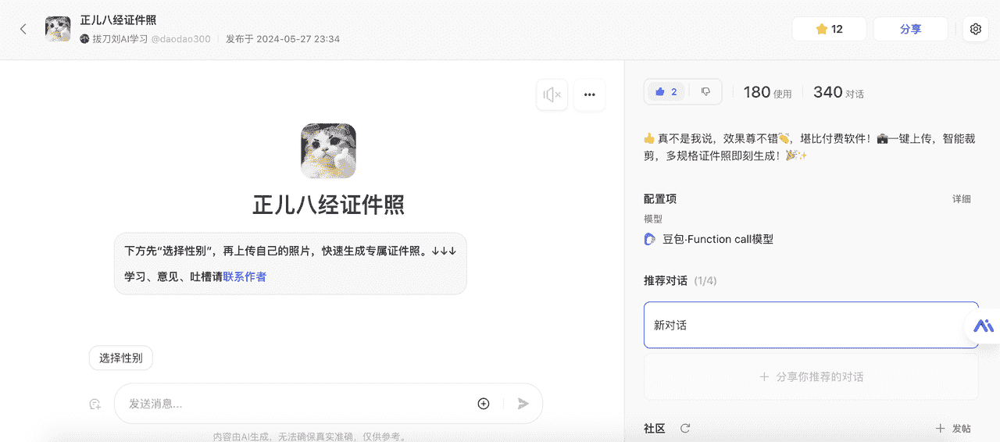
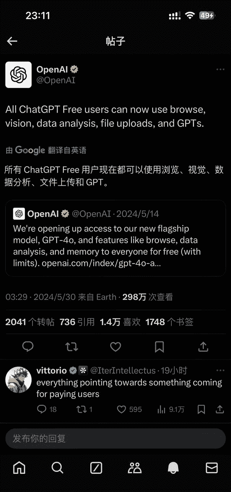
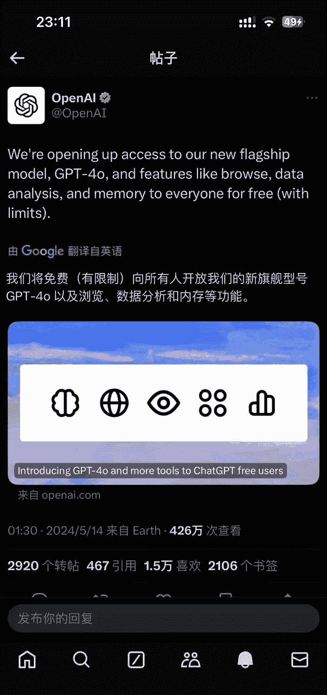
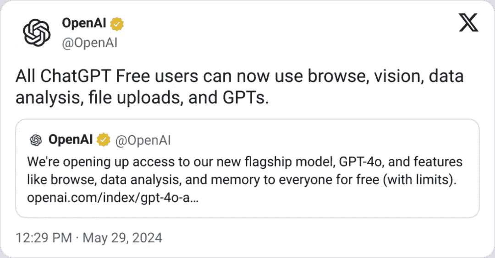
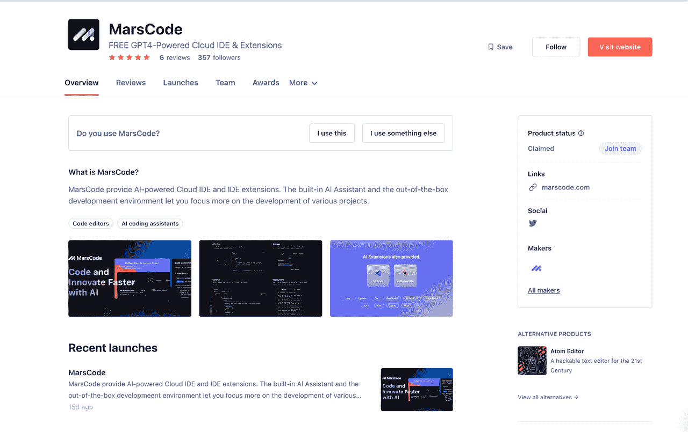
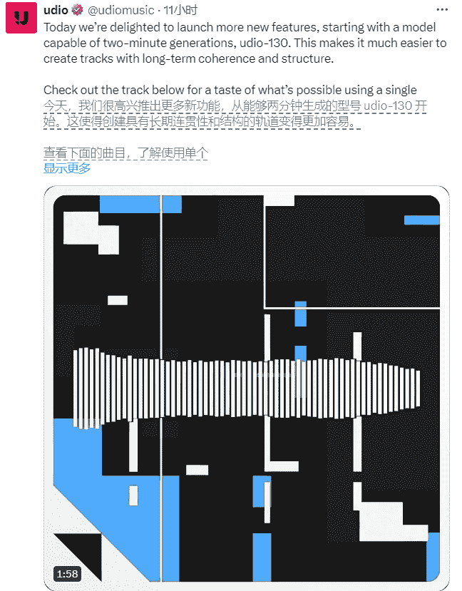

# Vol.010 - 2024/05-第5周 🛒 正儿八经证件照、AI应用矩阵、日日新大模型

> 来源：[https://my.feishu.cn/docx/WP0gd82H3oMR1wxcWeYczU0xnrZ](https://my.feishu.cn/docx/WP0gd82H3oMR1wxcWeYczU0xnrZ)

> 2024/05/27-2024/06/02

# 生产力工具

##    正儿八经证件照

扣子上一个很知名的智能体：[正儿八经证件照Agent](https://www.coze.cn/store/bot/7371362580344127523?from=top_card&panel=1)

# AGI应用探索

##    OpenAI向所有用户免费开放GPT-4o

OpenAI向所有用户免费开放GPT-4o了，所有用户均可以访问定制化GPT、分析图表、询问有关照片的问题。

##    ChatGPT Edu来了

OpenAI再次走在创新的前沿，正式推出面向高校的ChatGPT Edu。

相关文章戳：重磅！ChatGPT Edu来了！全面开启大学AI时代！

##    ChatGPT免费用户也可以用GPTs了

ChatGPT的免费用户也可以使用GPTs了~

具体文章触达：[OpenAI：全免费！所有用户都可以创建GPTs](https://mp.weixin.qq.com/s?__biz=MzkzMzQ5MDA5Ng==&mid=2247485617&idx=1&sn=065fca919a4008199cc5d6372b788c61&chksm=c24af46ef53d7d789964ae22c6a402c043a27c2bc7c2720eabad2aefa65b2224543ea2eb1844&mpshare=1&scene=1&srcid=0530CSFucZly8tfnTwfyqLHg&sharer_shareinfo=d6f9d82fe236e0c1d0abd3b3c8d794cc&sharer_shareinfo_first=d6f9d82fe236e0c1d0abd3b3c8d794cc#rd)，以及网络浏览、视觉、数据分析和文件上传

## **  ** Suno将推出全新功能 可将任何声音转换为音乐作品

5月27日消息：[Suno](https://www.chinaz.com/tags/Suno.shtml) 宣布即将推出一项全新的功能，可以将任何声音创作成歌曲。这项新功能能够将日常生活中的各种声音转化为音乐，为音乐创作带来了全新的可能性。用户只需敲击出节奏，Suno 会自动捕捉并与之“和弦”，将这些声音转换为音乐作品。首个示例便是将敲击浇水壶的声音转化为迷幻摇滚音乐，展示了这项技术的强大和创意潜力。

相关文章：Suno将推出全新功能 可将任何声音转换为音乐作品

# LLM大模型

##    代码模型Codestral

🚨 Mistral 刚刚发布了一个新的代码模型 - Codestral，并开源模型参数权重！⚡️

Codestral 22B 在 **80+ 编程语言**上进行训练，在代码基准测试中显著优于 Llama3 70B 等大模型！

目前是 Beta 阶段，可以访问 https://chat.mistral.ai 免费使用！💥

产品地址：https://www.producthunt.com/posts/marscode

##    Udio推出新的音乐模型

日前，udio 宣布推出新的udio-130音乐生成模型，可以生成**2分钟的音频**，这一功能使得创作具有长期连贯性和结构的音轨变得更加容易。目前，两分钟生成是一项实验性功能，仅提供给专业订阅者，但将在未来几周内更广泛地推出。

相关文章：Udio推出新的udio-130音乐生成模型：可生成两分钟音频

##    蚂蚁首次公布AI应用矩阵

蚂蚁在开放日上对外展示了多个AI创新应用产品。基于大规模业务场景的需求，蚂蚁集团已经布局了包括知识图谱、**运筹优化、图学**习、可信AI、大模型等在内的AI技术，其中蚂蚁百灵大模型已于去年底完成备案。蚂蚁集团CTO何征宇透露，基于蚂蚁百灵大模型的三个应用是蚂蚁当下重点破局方向：生活管家、就医助理及金融助手。此外，多模态大模型技术也在蚂蚁内部也有一些创新应用，如AI智绘、AIGC数字人等。

相关报道：[蚂蚁首次公布AI应用矩阵](https://baijiahao.baidu.com/s?id=1800296911616986591&wfr=spider&for=pc)

##    商汤科技发布日日新大模型

商汤科技正式对外发布**日日新大模型5.0**粤语版~

**相关文章：**商汤科技正式对外发布日日新大模型5.0粤语版