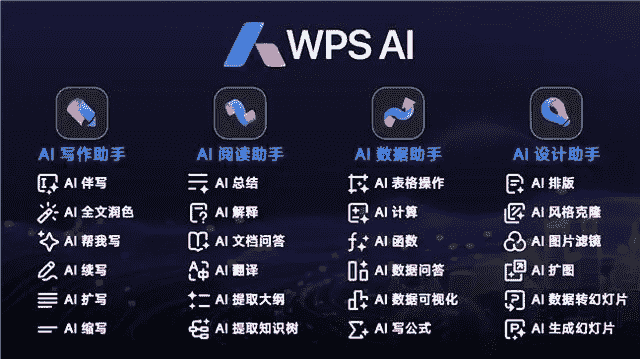
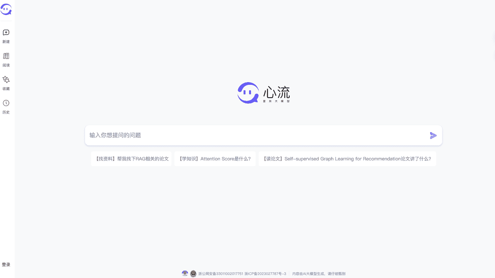

# V0l.016 - 2024/07-第2周 💡 阿里推出寻光AI创作平台、金山发布WPS AI 2.0、豆包发布MarsCode

> 来源：[https://my.feishu.cn/docx/NhGHdcltBoKi2wxq2fwcYQmjn5t](https://my.feishu.cn/docx/NhGHdcltBoKi2wxq2fwcYQmjn5t)

> 2024/07/08-2024/07/14

# 生产力工具

##    金山办公发布WPS AI 2.0，首次公布政务自研模型

WPS AI 2.0 为个人用户新增了 4 个 AI 办公助手，分别为 AI 写作助手、AI 阅读助手、AI 数据助手、AI 设计助手。

相关报道：[WPS AI 2.0发布：个人用](https://baijiahao.baidu.com/s?id=1803728145477351882&wfr=spider&for=pc)户新增4个AI办公助手，政务模型首次亮相

##    月之暗面 Kimi 浏览器插件上线：支持框选搜索、全文自动总结

月之暗面官宣上线 Kimi 浏览器插件，该插件支持轻量搜索功能，适用于浏览网页术语查询、外文报道摘要总结、文档数据查询以及“金句”收藏 / 同类表达举例。

相关介绍：

月之暗面 Kimi 浏览器插件上线：支持框选搜索、全文自动总结

首发丨Kimi 官方插件第一手测评！极度丝滑！

# AGI应用探索

##    阿里达摩院推出AI视频创作平台“寻光”

2**02**4 世界人工智能大会（WAIC 2024）期间，阿里达摩院推出了一站式 AI 视频创作平台 —— 寻光。官方表示，该平台旨在通过 AI 技术使视频创作更简单、高效，其集成了剧本创作、分镜设计、视频素材编辑等关键步骤，创作者可以从构思到成品，在该平台上完成视频创作全过程。

相关报道：阿里达摩院推出AI视频创作平台“寻光”：集成编剧、分镜、图层等

体验地址：https://xunguang.damo-vision.com/

##    快手“可灵AI”推出网页端

相关报道：快手大模型首次集体亮相 可灵AI推出网页端 可图正式开源

体验地址：https://klingai.kuaishou.com/

##    阿里妈妈推出“心流”AI搜索产品

钛媒体App 7月11日消息，阿里妈妈旗下AI公司“万相创意”推出的大模型应用产品“心流”已于日前正式上线。

相关报道：[AI搜索助手“心流”正式上线](https://baijiahao.baidu.com/s?id=1804173298771846196&wfr=spider&for=pc)

体验地址：https://iflow.cn/

# LLM大模型

##    智谱AI发布CodeGeeX代码大模型

7月4日，在世界人工智能大会的产业发展主论坛上，智谱AI CEO张鹏表示，当下因大模型而掀起的AI热潮和之前有所不同，在过去，AI技术解决了一些实际问题，但如今的大模型发展带来了更重要的类人认知能力。

论坛上，智谱AI CodeGeeX技术负责人郑勤锴发布了第4代CodeGeeX代码大模型CodeGeeX4-ALL-9B。

相关报道：[WAIC 智谱发布CodeGeeX代码大模型，](https://www.leiphone.com/category/ai/ltftlvyL947nYJAr.html)张鹏:大模型将创造指数级价值 | 雷峰网

##    豆包MarsCode免费开放

相关报道：让编程更简单，豆包MarsCode面向开发者免费开放 | 量子位

官方文档：豆包 MarsCode - 文档

体验地址：豆包 MarsCode - 编程助手

