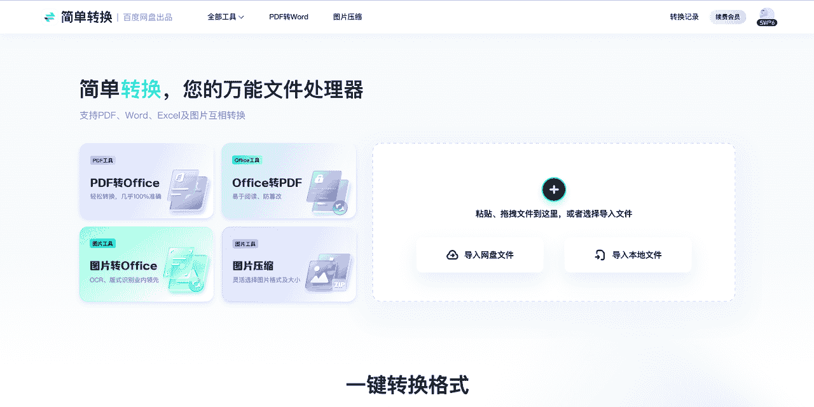
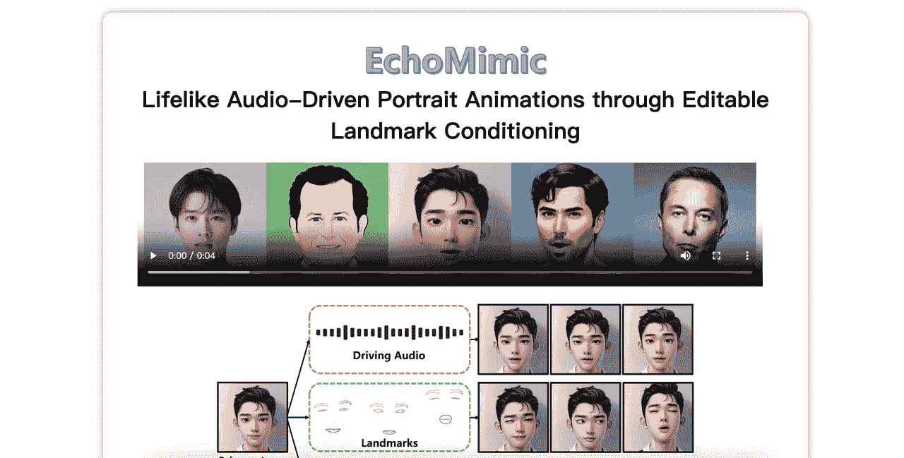
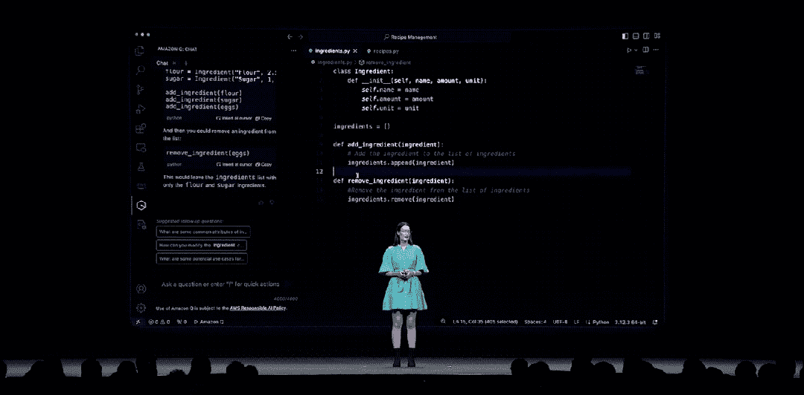
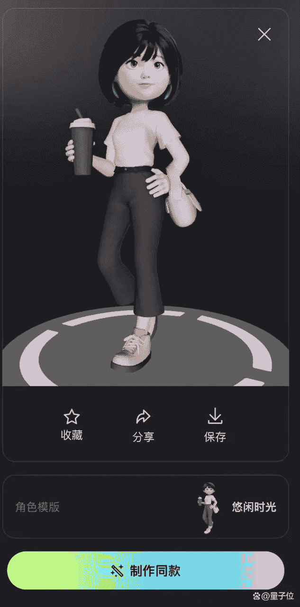
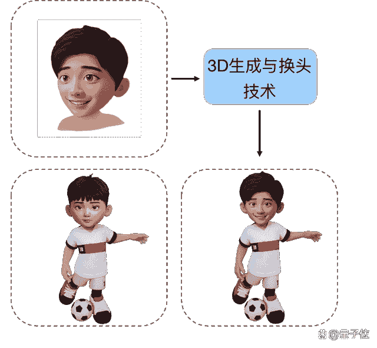

# V0l.017 - 2024/07-第3周 💡 简单转换、超能画布、EchoMimic、3D生成梦工厂

> 来源：[https://my.feishu.cn/docx/A7YHdu7LSoMCpkxMdYncksTwned](https://my.feishu.cn/docx/A7YHdu7LSoMCpkxMdYncksTwned)

> 2024/07/15-2024/07/21

# 生产力工具

##    百度网盘推出简单转换

简单转换是由百度网盘出品的万能文件转换器网站，为用户在线提供PDF转Office、Office转PDF、图片转Office以及图片压缩等文档格式转换功能、实现一键转换格式，提升内容输出效率，智能处理所有格式文件。

具体体验地址：https://aiconvert.baidu.com/simple/convert

##    百度网盘推出超能画布

**一人一设**备 = 上百个影棚？百度网盘推出全新解决方案，为摄影行业带来一站式降本增效的的AI创意生成该工具。

画布体验链接：https://photo.baidu.com/photasy/welcome

画布使用文档：https://baijiahao.baidu.com/s?id=1804177557298781483&wfr=spider&for=pc

# AGI应用探索

##    蚂蚁集团开源EchoMimic新项目

**蚂蚁集团 1**0** 日**开源了名为 EchoMimic 的新项目，其能够通过人像面部特征和音频来帮人物“对口型”，结合面部标志点和音频内容生成较为稳定、自然的视频。

相关报道：[AI 根据声音内容帮照片“对口型”](https://www.ithome.com/0/781/172.htm)，蚂蚁集团开源 EchoMimic 项目

Github地址：https://github.com/BadToBest/EchoMimic

项目体验地址：https://badtobest.github.io/echomimic.html

##    亚马逊推出App Studio

亚马逊云科技推出 App Studio：仅依靠Prompt打造一个App。

相关文章：“云计算一哥”深夜放大招：几分钟，纯靠Prompt打造一个App！

##    腾讯元宝首发3D生成应用

**腾讯旗下大模型**应用“腾讯元宝”上线了“3D角色梦工厂”玩法，腾讯元宝也是首个拥有打印级3D生成能力的通用大模型App。只需一张照片，便能迅速打造独一无二的3D角色。

相关报道：腾讯元宝首发3D生成应用，一张图即可生成3D角色

##    阿里国际工具最新 AI 进展

在当下的电商领域，跨境商家的 AI 需求正在激增。来自阿里国际的数据显示，平均每两个月，商家的 AI 调用量就会翻一倍。

相关报道：阿里国际公布AI进展：在40多个电商场景落地，服务50万商家

# LLM大模型

##    商汤发布“东风”泰语大模型

IT之家 7 月 11 日消息，商汤科技官方公众号今日晚间发文宣布，7 月 10 日，商汤联合泰国 DTGO 集团及旗下 Quinnnova 共同发布“东风”泰语大模型（DTLM）。

相关报道：商汤发布“东风”泰语大模型：全球首个可在三语环境下高效工作

