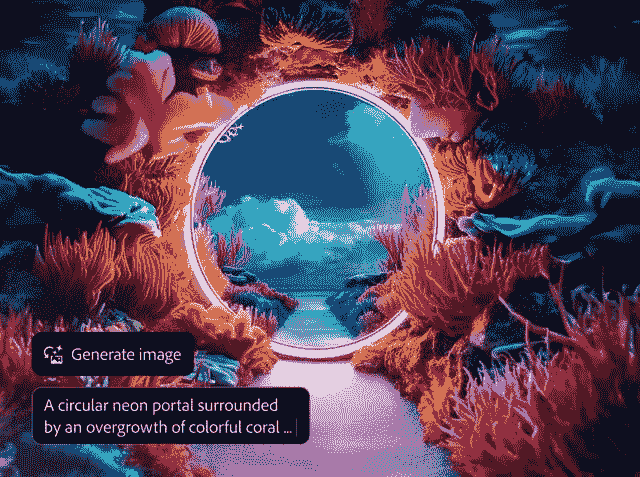
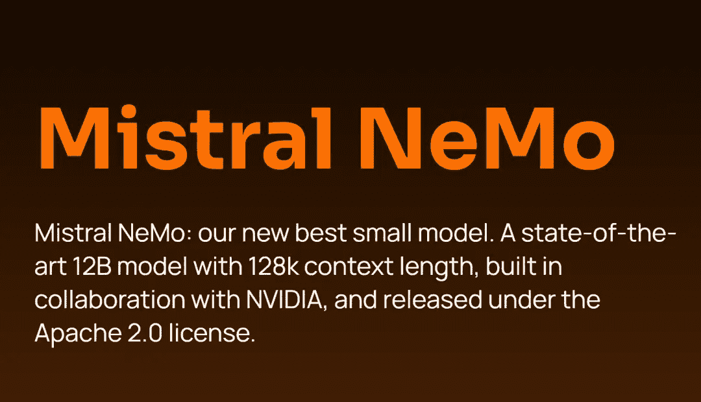
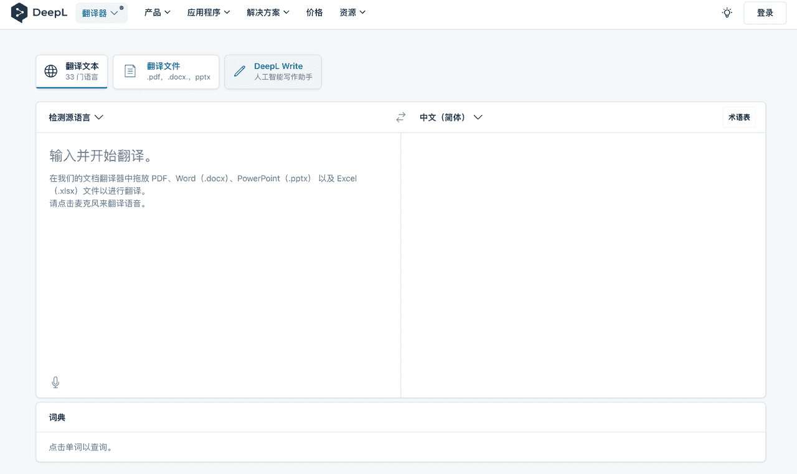
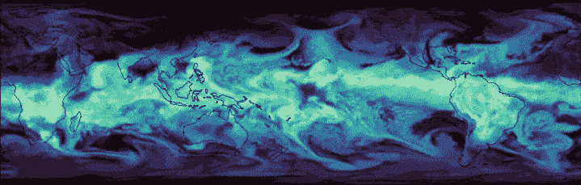

# V0l.018 - 2024/07-第4周 💡 Adobe发布Firely工具、腾讯推出“智能画布”、AI打败传统气候模型

> 来源：[https://my.feishu.cn/docx/TzcKdp4zVomvXSx0nklcAIHWnTc](https://my.feishu.cn/docx/TzcKdp4zVomvXSx0nklcAIHWnTc)

> 2024/07/22-2024/07/28

# 生产力工具

##    Adobe发布Firefly工具

Adobe周二发布针对Photoshop和Illustrator的新Firefly工具，让图形设计师可以用更多方式使用该公司的内部AI模型。同时，Adobe的新功能还允许创意工作者通过简短的提示描述他们想要的效果，然后接收到由AI生成的纹理或图像，这些原本数小时才能完成的工作现在可在一分钟内完成。

相关报道：Adobe发布新AI工具，可即时生成效果图，数小时工作现在一分钟内完成

##    腾讯智影推出“智能画布”

腾讯智影PC端推出“智能画布”功能 支持再创作、抠图、消除、扩图等

体验地址：https://zenvideo.qq.com/smart/smartCanvas

# AGI应用探索

##    快手可灵全面开放内测

相关报道：快手可灵AI全面开放内测 模型效果再次升级

官方网站：https://klingai.kuaishou.com/

# LLM大模型

##    Mistral联合英伟达开源12B小模型

比** OpenAI 官宣 G**PT-4o mini 早几个小时，被誉为「欧洲版 OpenAI」的 Mistral AI 也官宣了一个小模型 ——Mistral NeMo。

相关报道：[小模型卷起来了：Mistral联](https://mp.weixin.qq.com/s/7oSxdFyqJ7MUpbfuNB_n5Q)合英伟达开源12B小模型，128k上下文

##    DeepL 推出新一代翻译 LLM

IT之家 7 月 18 日消息，以其同名机器翻译器闻名的语言人工智能公司 DeepL 德国当地时间昨日宣布推出新一代面向翻译和编辑应用的大型语言模型。

**DeepL 宣称基于新模型的译文受语言专家**的青睐程度是谷歌翻译的 1.3 倍，ChatGPT-4 的 1.7 倍，微软翻译的 2.3 倍。

相关报道：[DeepL 推出新一代翻译 LLM：译文受青睐](https://baijiahao.baidu.com/s?id=1804883764968458521&wfr=spider&for=pc)度达 ChatGPT-4 的 1.7 倍

##    AI 打败传统气候模型：NeuralGCM

传统天气预测、气候模拟，正在被 AI 颠覆。由 Google Research 研究团队及其合作者开发的人工智能（AI）模型 NeuralGCM，将天气预测和气候模拟提升到了新高度。

相关报道：谷歌最新研究登上Nature：AI打败传统气候模型

论文地址：https://www.nature.com/articles/s41586-024-07744-y

