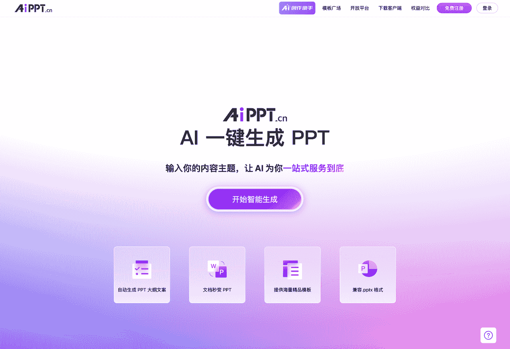
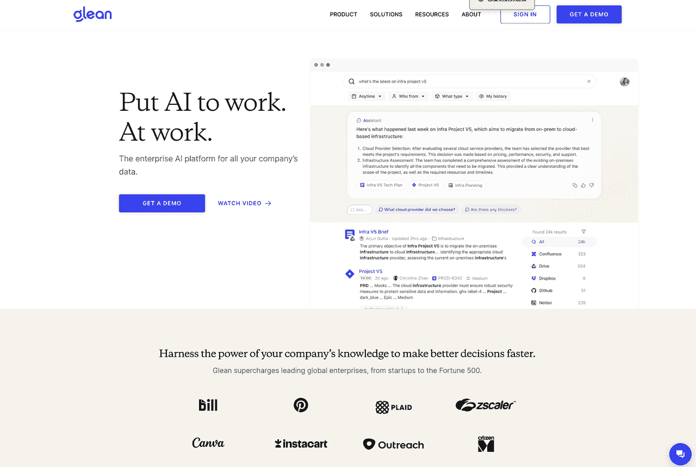
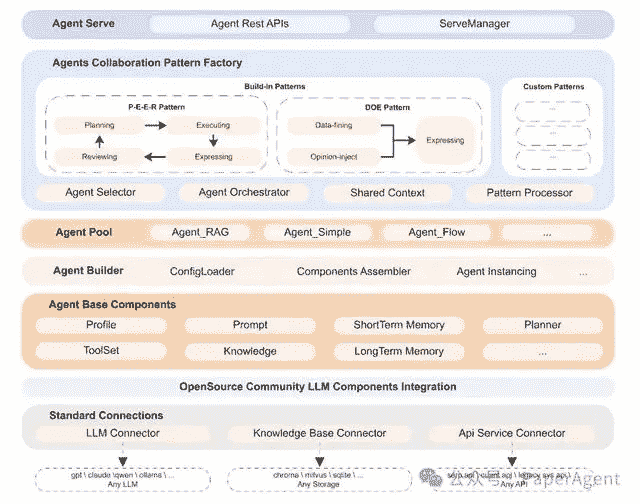
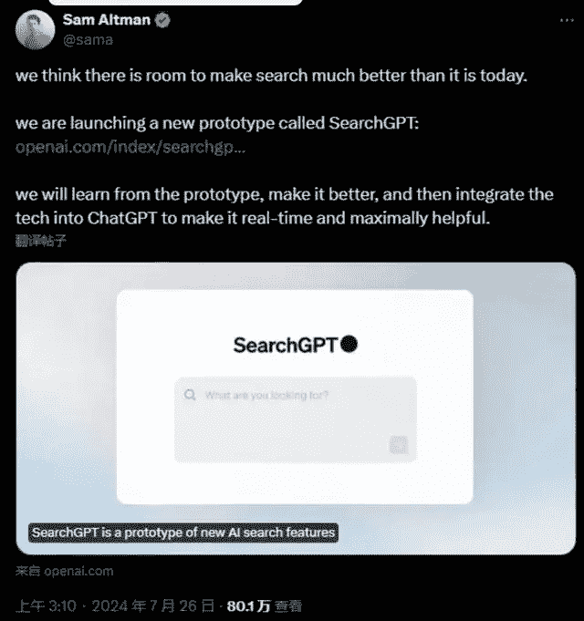
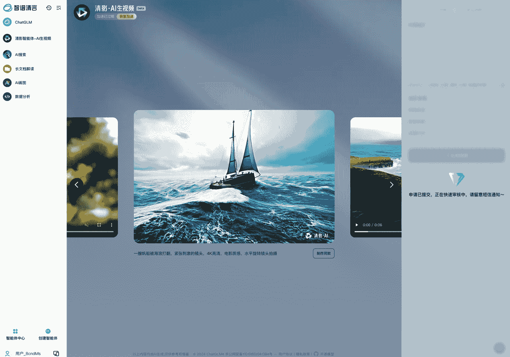
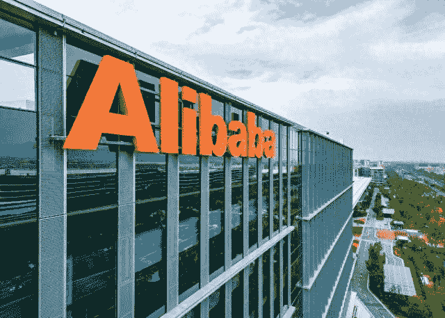

# V0l.019 - 2024/08-第1周 🚲 轻设计 AI PPT、OpenAPI推出SearchGPT、智谱发布视频模型清影

> 来源：[https://my.feishu.cn/docx/AlPydxvxWoKzGKxpLKmcPs4In0g](https://my.feishu.cn/docx/AlPydxvxWoKzGKxpLKmcPs4In0g)

> 2024/07/29-2024/08/04

# 生产力工具

##    AI PPT！打造下一代个人与组织的AIGC工作站

「爱设计&AiPPT.cn」[成立于2018年](http://AiPPT.cn)，从在线设计工具的角度切入，延伸至企业AIGC 内容营销中台，去年 8 月份又孵化上线了AI 办公超级单品AiPPT.cn和AiPPT.com。

商业版图从在线设计工具到AIGC内容营销中台，再延展至市场空间更大的AI办公赛道，并在国内和海外市场均取得了不俗的成绩。

「爱设计」从成立至今已经进行了三次重大迭代，2024 年，爱设计以“下一代个人与组织的 AIGC工作站”为愿景，迈出了AIGC科技和商业创新的新道路。

相关文章：[爱设计&](https://mp.weixin.qq.com/s/FNQLlNAEQnejYMVd2U6l8A)[AiPPT.cn](https://mp.weixin.qq.com/s/FNQLlNAEQnejYMVd2U6l8A)完成B1轮融资！打造下一代个人与组织的 AIGC工作站！

##    Glean - 企业级 AI 搜索和知识管理解决方案

Glean 是一个人工智能驱动的工作助手，专注于企业搜索和知识管理，旨在通过链接和理解企业内部知识，提升员工的工作效率。

作为企业级 AI 搜索和知识管理解决方案，受到市场的高度关注，已成长为备受瞩目的独角兽企业。

相关文档：[Glean - 企业级 AI 搜索和知识管理解决方案](https://km3dl0ffdl.feishu.cn/wiki/RaWqwID3uiFTN2kZGKRcDbJhnVg)

体验地址：https://www.glean.com/

##    阿里国际支持奥运会解说AI

一批AI技术正在2024巴黎奥运会赛场大显身手。其中，今年奥运会期间将上线首个（奥运领域）大模型应用，这项AI应用由阿里国际参与研发。据介绍，阿里国际AI团队研发的Agent框架支持了巴黎奥运会赛事解说的AI概念产品，在解说员场景提供AI服务。

相关文章：阿里国际自研Agent框架支持巴黎奥运会赛事解说AI

# AGI应用探索

##    OpenAI发布AI搜索模型SearchGPT

北京时间7月26日凌晨，OpenAI发布了名为"SearchGPT"的新人工智能搜索功能的临时原型。

“我们认为今天的搜索还有改进空间。”OpenAI创始人山姆·奥特曼在X上表示，Open AI将从这款原型产品中学习并对其进行改进，然后该技术集成到ChatGPT中，使其实时且最大限度地发挥作用。

相关报道：OpenAI发布AI搜索原型SearchGPT，正面对垒谷歌

##    Haivivi推出首款AIGC玩具BubblePal

伴随AI技术的飞速发展，玩具这一人类从天性出发的最伟大发明，正迎来全新发展机遇。6月25日，国内AI玩具赛道创业新势力——深圳跃然创新科技有限公司（英文名：Haivivi）正式推出全球首款基于AIGC技术的对话交互式挂件玩具——BubblePal。凭借其领先的AI技术和对儿童市场的细腻洞察，创造出能够与孩子进行自然对话并兼具情感陪护功能的下一代智能玩具，受到行业的广泛关注。

相关报道：[以AI之力“复活”毛绒玩具 Haiviv](https://baijiahao.baidu.com/s?id=1802802671041350379&wfr=spider&for=pc)i推出首款AIGC玩具BubblePal

##    智谱AI发布AI生成视频模型清影

智谱AI发布AI生成视频模型清影

自从快手可灵 AI 火爆海内外，国内视频生成也如同 2023 年的文本大模型一样，越来越卷了。

**这周，又一视频生成大模型产品**宣布正式上线：智谱 AI 正式发布「清影」。只要你有好的创意（几个字到几百个字），再加上一点点耐心（30 秒），「清影」就能生成 1440x960 清晰度的高精度视频。

+   相关报道：智谱AI杀入视频生成：「清影」上线，时长6秒，免费不限量

+   PC 端访问链接：https://chatglm.cn/

+   移动端访问链接：https://chatglm.cn/download?fr=web_home

##    阿里将推出人工智能对话式采购引擎

据官方介绍，该人工智能对话式采购引擎将深度整合阿里巴巴旗下所有电商平台，包括但不限于阿里巴巴国际站、速卖通、天猫国际及Lazada等。

值得关注的是，该引擎还具备预测采购需求并提供个性化建议的能力。通过大数据分析与机器学习技术，它能够精准预测企业的未来采购需求，并据此提供采购建议，助力企业优化库存管理，降低运营成本。

相关报道：阿里巴巴将推出人工智能对话式采购引擎 预计9月发布

能想象的是，未来的商家，仅需通过几句Prompt，能直接完成采购流程，不用再像以前那样，一直增删改等操作。

# LLM大模型

##    我国发布首个亿级参数量地震波大模型

新华社成都7月29日电（记者李力可、王聿昊）7月28日，“谛听”地震波大模型在四川成都发布，该大模型由国家超级计算成都中心、中国地震局地球物理研究所以及清华大学联合开发，是首个亿级参数量的地震波大模型。

相关报道：我国发布首个亿级参数量地震波大模型

##    阿里统一免费开放奥运AI大模型

7月31日，阿里通义宣布免费开放奥运AI大模型，具备最强奥运专业知识，并集合同声传译级别的中法互译功能。即日起，用户可以在通义APP免费使用。

通过奥运专项强化训练，通义大模型已具备业界最强奥运专业知识，可以最快地回答奥运相关的各种问题。在通义APP的主搜索和“赛事百事通”功能中，用户无论查询各类赛事知识，还是了解各国运动员和赛事历史，只需简单提问，就能获得详尽且专业的答案。

相关报道：[阿里通义免费开放奥运AI大模型](https://baijiahao.baidu.com/s?id=1806080072668459296&wfr=spider&for=pc)