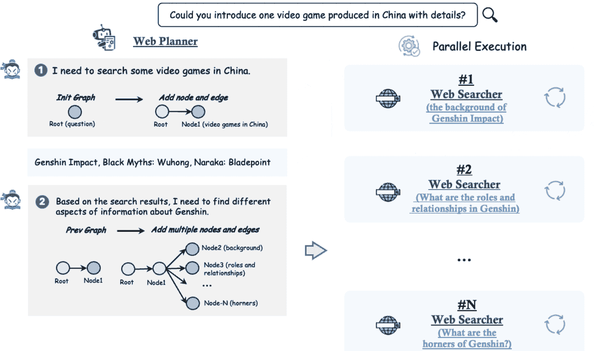
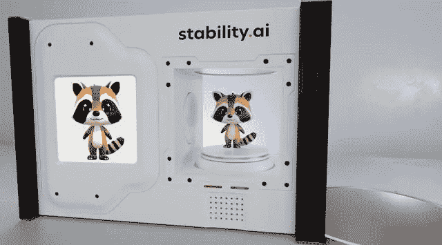

# V0l.020 - 2024/08-第2周 🚲 腾讯上线长文精读、钉钉发布“AI 迎新百事通”

> 来源：[https://my.feishu.cn/docx/FUkYdnFHhowrfExtPaPcqzdTnxd](https://my.feishu.cn/docx/FUkYdnFHhowrfExtPaPcqzdTnxd)

> 2024/08/05-2024/08/11

# 生产力工具

##    MindSearch模仿人类思维AI搜索引擎

MindSearch是一个基于大型语言模型（LLM）的多智能体网络搜索引擎框架，具有与Perplexity.ai Pro相似的性能。用户可以轻松部署自己的搜索引擎，支持闭源大型语言模型（如GPT、Claude）或开源大型语言模型（如InternLM2.5-7b-chat）。

相关报道：[媲美Perplexity！MindSearch：模仿人类思维](https://www.chinaz.com/ainews/10793.shtml)AI搜索引擎 3分钟整合300个网页信息

Github地址：https://github.com/InternLM/MindSearch?tab=readme-ov-file

##    谷歌Chrome新增三大AI功能

新功能包括桌面版Google Lens（圈选搜索）、标签页对比以及回顾浏览历史，都是基于谷歌最新的AI和Gemini模型。

相关报道：谷歌Chrome新增三大AI功能！轻松找到访问过但未保存网站

##    腾讯元宝上线长文精读能力

在最新版本的腾讯元宝中，当用户上传论文、财报、研报等专业内容的 URL 链接或文件，除获得文字概括总结外，还可进入深度阅读模式，对长文进行精读。该模式可提供核心内容概览及模块化解析，生成总结性图表，辅助用户快速理解关键信息。

相关报道：腾讯元宝上线长文精读，专攻论文、财报及研报场景

# AGI应用探索

##    Stability AI 推出 Stable Fast 3D

相关报道：[一图 0.5 秒生成建模，Stability AI ](https://baijiahao.baidu.com/s?id=1806287793015475351&wfr=spider&for=pc)推出“Stable Fast 3D”模型

官方相关介绍：https://stability.ai/news/introducing-stable-fast-3d

##    钉钉发布“AI 迎新百事通”

面对每年数以万计的新生涌入校园，传统的迎新方式往往面临着咨询量大、信息繁杂等问题。钉钉推出了“AI 迎新百事通”解决方案，该方案基于钉钉 AI 助理与知识库，仅需短短 10 分钟，即可为学校量身定制一个全天候、全方位的智能迎新助手。

相关报道：钉钉发布 “AI 迎新百事通”，智能化助力高校开学季

# LLM大模型

##    OpenAI 正研发 ChatGPT 文本水印

据《华尔街日报》报道，OpenAI 已经开发出一款能够高精度识别 ChatGPT 生成文本的工具，但迟迟未发布。对此 OpenAI 进行了回应，承认正在研究文本水印技术，但表示这项技术仍存在诸多挑战。

OpenAI 承认正研发 ChatGPT 文本水印，但面临挑战

##    阿里发布“神笔马良版Sora”

阿里团队近日推出**视频生成模型Tora**，能够根据**轨迹、图像、文本****或其组合，**简单几笔快速生成精确运动控制的视频，同时也支持首尾帧控制，让视频生成的可控性又上了一个阶梯。

相关报道：阿里发“神笔马良版Sora”，轻轻一抹让猫咪转向