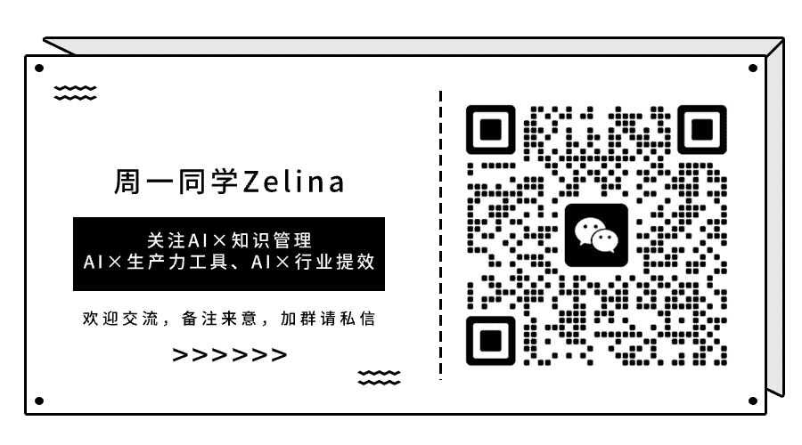
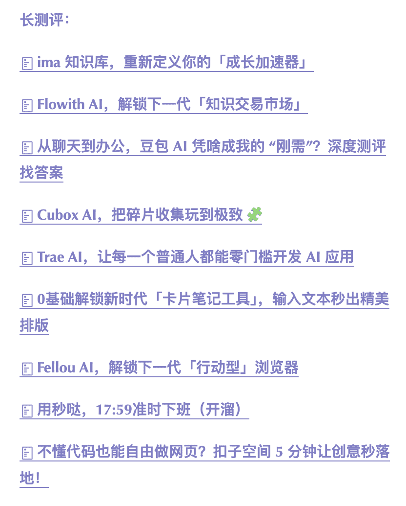
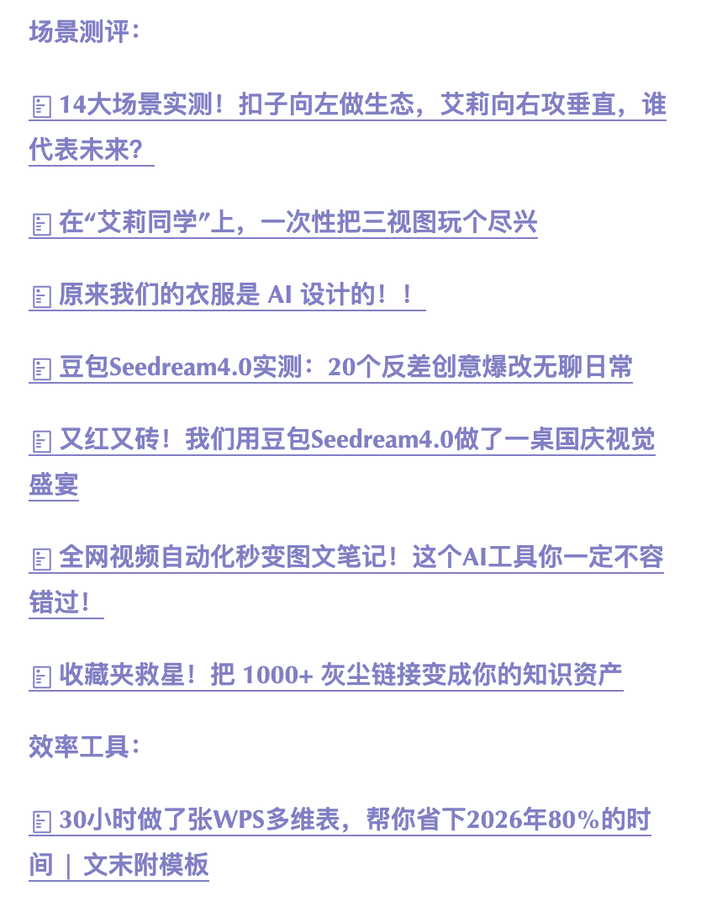
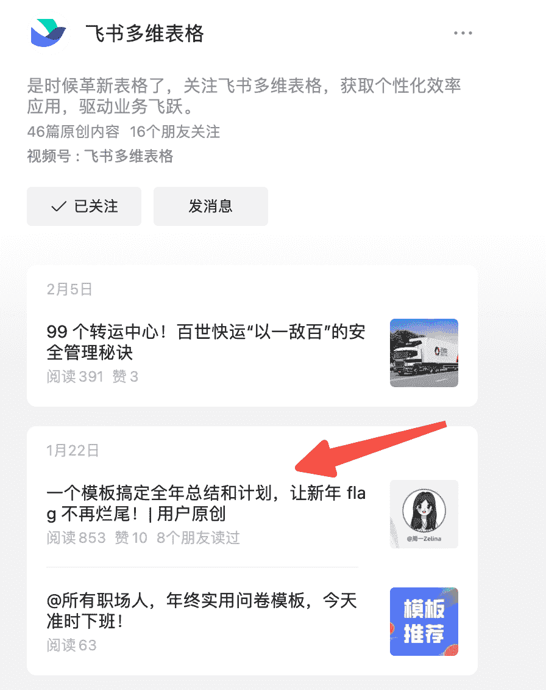
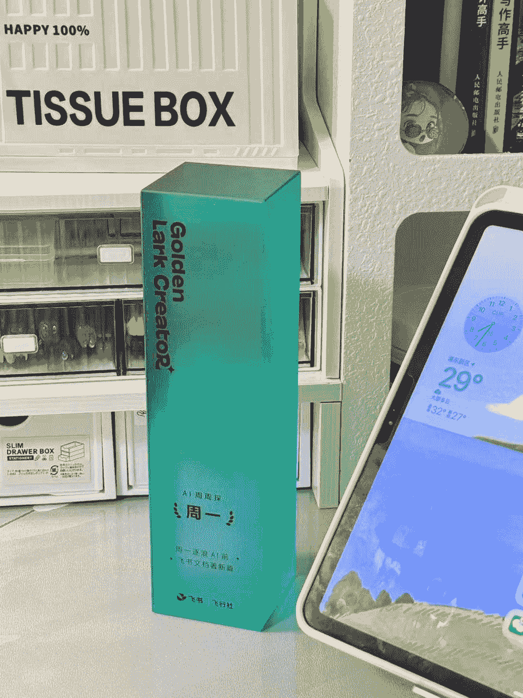
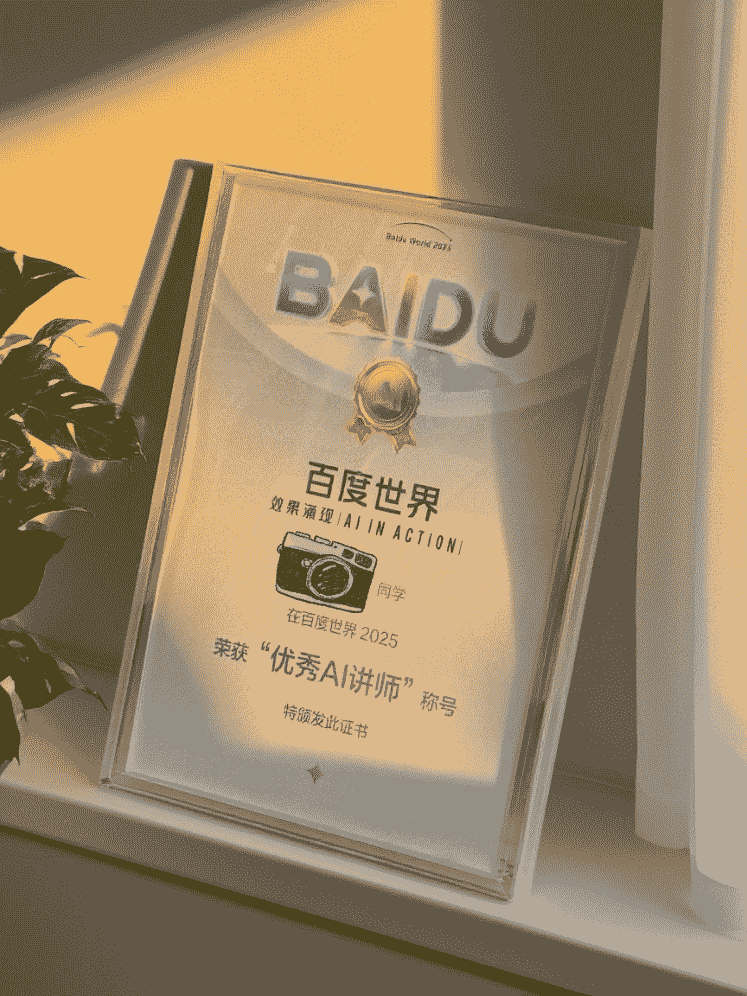
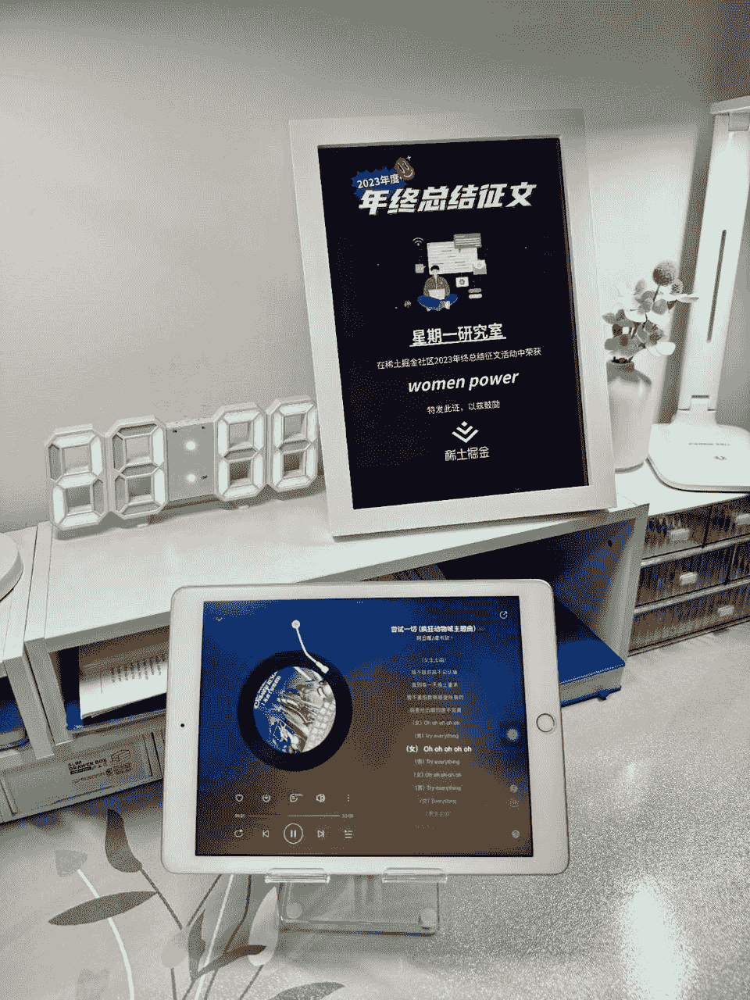
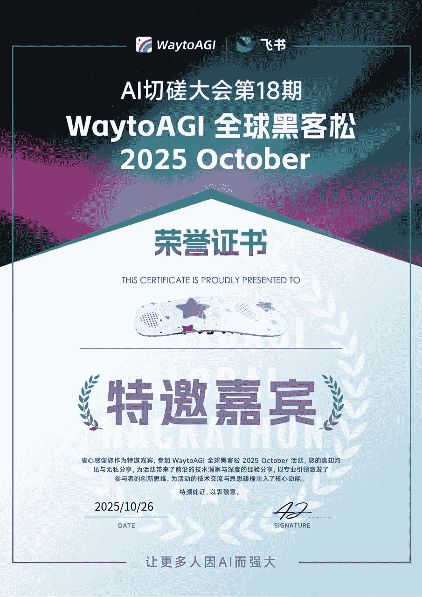
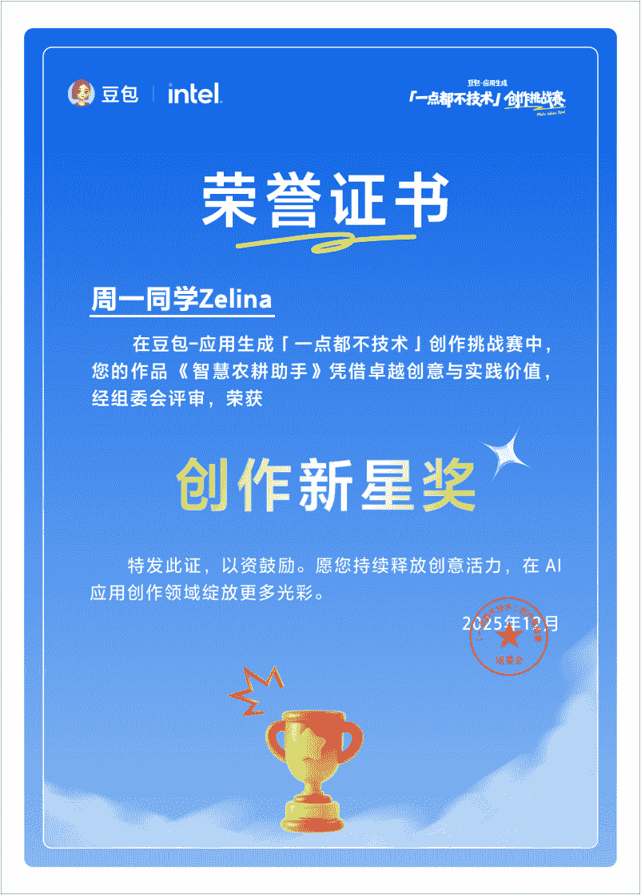
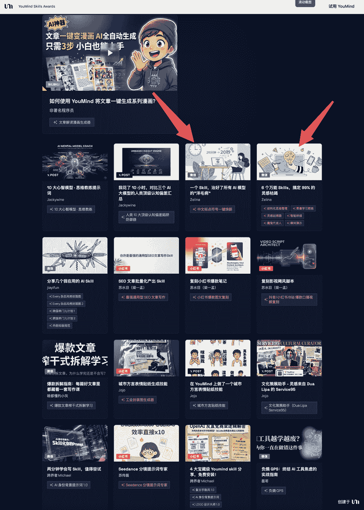

# Zelina的个人说明书

> 来源：[https://my.feishu.cn/docx/NCnFdtxXDo77rExxRCvcxxDAnMh](https://my.feishu.cn/docx/NCnFdtxXDo77rExxRCvcxxDAnMh)

👋 Hi ! 很高兴在亿万人中与你相遇，这一刻起，我们的故事即将开始~

AI创想集市已上线至**知识问答专区**，欢迎大家来玩：第25小时🛵AI工具深度长测评

[**👀 关于周一**](https://pzfqk98jn1.feishu.cn/wiki/wikcnTijikVNdkWdBEKzQpiA6ie#IucWdCIkWoguIuxUjDNcxQ60ngf)

[**🚂 AI海上驿站**](https://pzfqk98jn1.feishu.cn/wiki/NWKfwYN0ni8zhPkUSlDcp8iznmh)

[**📚 阅读与思考**](https://pzfqk98jn1.feishu.cn/wiki/FD9PwxGyPiPS4gkbXdtcfS0hn2c)

[**📨 联系我**](https://pzfqk98jn1.feishu.cn/wiki/wikcnTijikVNdkWdBEKzQpiA6ie#share-AUXcdLP1nolr5txYNa9cBQr7nFg)

# 🧙🏻‍♀️ 关于我

𝔸𝕓𝕠𝕦𝕥 𝕄𝕖

**周一同学Zelina**

📷 基**本介绍**

+   00后 | 互联网大厂AI工程师，公众号「星期一研究室」作者，上海AI Hacker House 前PMO&运营负责人

+   软件工程科班生，平平无奇又很爱学习的斜杆青年

+   平常工作主要职责是Web前端研发。研究领域不局限于前端，目前正在深度探索AGI、AI Agent 和 LLM 应用开发~

+   **信息整合怪**，善于把一切凌乱无序的内容快速整合成有序且可导航的信息。

+   半吊子设计天赋，喜欢一切与美学相关的东西，调色、布局、临摹都很爱探索。

+   效率人机，**Notion**、飞书文档、多维表格、FlowUs骨灰级宝藏玩家，用正确的工具做正确的事。

+   对时间极度吝啬，对知识极度open~🎬

+   INTJ-A紫老太，热爱普拉提，还是一枚帕粉🙋‍♀️

# 👩‍🎨工作 × 社媒 × 人机

𝕨𝕠𝕣𝕜&𝕞𝕖𝕕𝕚𝕒&𝕤𝕜𝕚𝕝𝕝𝕤

## 关于我的工作

主业以 **AI Agent 应用生成 **为核心目标，整合主流前端技术栈与 AI 各链路技术栈，重点研究两者之间的融合落地难点、最优实践方案。以及如何通过技术整合，提升 AI Agent 应用的开发效率、用户体验与业务价值转化。

## 个人社媒平台

| ## 平台集散地 |  | ## Explore |
| --- | --- | --- |
| **公众号：**星期一研究室 |  |  |
| **即刻：周一同学Zelina** | [https://jike.city/](https://web.okjike.com/u/5a3ec1d5-bcfb-40a9-942c-e16d419c69fd)mondaylab ▷ 欢迎来发夸夸😉 |  |
| **小红书：**周一同学Zelina | 周一同学Zelina：[主要更新效率工具的使用心得](https://www.xiaohongshu.com/user/profile/5e09ca9f0000000001002c9b) |  |
| **个人博客：**mondaylab-blog | 周一的博客 | Hi，终于等到你 |  |
| **Github：**mondaylab | Github - mondaylab - Overview |  |
| **掘金：**星期一研究室 | 星期一研究室 的个人主页 - 文章 - 掘金 |  |
|  |  |  |
|  |  |  |

[技术文章&个人成长&干货合集 🛒 待你来挖掘~.jpg](https://internal-api-drive-stream.feishu.cn/space/api/box/stream/download/all/RWdfbS6izo65acxw91VcFfsInTb)

# 🌱我能为你提供什么

𝑰𝒏𝒕𝒆𝒓𝒆𝒔𝒕𝒊𝒏𝒈 𝑷𝒓𝒐𝒅𝒖𝒄𝒕𝒔

## Zelina的产品铺

**如果你想挖掘更多有趣**的知识管理技巧，欢迎来Zelina的产品铺挖宝🚏

多维表格（M3wObRXOuak50OslTgOcy5yHnHd_tblLY6xtZWevsief）

## Coffee Chat☕️（联系我）

周一平日里驻扎在上海，一般周末会不定时出没在一些活动。如果想和我约个Coffee Chat，欢迎提前来约线下时间🧚‍♂️

> 关注「AI × 知识管理体系」、「AI × 项目管理体系」

> 与AI Agent、LLM大模型落地、创投**、**社媒等相关领域，欢迎交流&链接🔗

> **Wechat:**** monda**ylab712 【备注“飞书”】  |  Email: mondaystudio712@gmail.com

# 📸 先进生产力分享

𝑬𝒙𝒑𝒍𝒐𝒓𝒆 𝒕𝒉𝒆 𝒘𝒐𝒓𝒍𝒅

## 挖掘好文章&好工具

| #### 📝看家宝藏 Blog&amp;Articles |  |
| --- | --- |
| **写过许多技术博客和干货笔记：** | **小编平常会经常用到的工具箱：** |
| [技术文章](https://pzfqk98jn1.feishu.cn/wiki/wikcnt0BI375Svyd3PNhjFM7UHf) | +   [自媒体/文档/设计/时间管理](https://pzfqk98jn1.feishu.cn/wiki/LWsmw5Zkqi7HdRkzY6ycptfUn9d) |
| **如果你想学习飞书相关技巧：** | **如果你想了解我的阅读和思考：** |
| +   飞书新人 → [手把手教你玩转飞书文档](https://pzfqk98jn1.feishu.cn/wiki/XSPUwVQMmiPKS7kZVmscIfRUnUf)  | +   个人成长 →[ 2021至今个人成长故事](https://mp.weixin.qq.com/mp/appmsgalbum?__biz=Mzg5MDA4NTUyNA==&amp;action=getalbum&amp;album_id=1950281078263300098&amp;uin=&amp;key=&amp;devicetype=iMac+MacBookPro18%2C3+OSX+OSX+13.4.1+build(22F82)&amp;version=13080512&amp;lang=zh_CN&amp;nettype=WIFI&amp;ascene=0&amp;fontScale=100) |
| #### 📝捣鼓的小工具 𝑳𝒊𝒕𝒕𝒍𝒆 𝑻𝒐𝒐𝒍𝒔 |  |
| 个人博客搭建指北：vitepress从0到1，让每个前后端小伙伴都拥有一个属于自己的博客 |  |

## 公众号（首发主力）

文章更新主力在公众号**【星期一研究室】**，首发尽在公众号，欢迎关注🧚‍♂️

| 扫码关注👇🏻👇🏻👇🏻 | 一览表 | 长测评 | 场景测评 |
| --- | --- | --- | --- |
|  |  |  |  |

## 周一的技能库

| 🧙‍♀️ 技**术能力（前端研发）** | 🧙‍♂️ 技**术能力（前端以外）** |
| --- | --- |
| +   前端三件套 - HTML、CSS、JS、TS | +   机器学习 - Tensorflow.js |
| 🎨 设**计能力** | 📑 文**档能力** |
| +   原型图 - figma、即时设计、Axure RP、PhotoShop | +   飞书文档&amp;多维表深度玩家、notion深度冲浪选手 |

## 飞书话题群

看着还不过瘾？欢迎来**飞书群**挖宝😜

**话题群**，聚焦各种优质前沿信息的分享（AI、LLM、投研、领域体系等），欢迎来分享你的信息差😉

**聊天群**，聚焦飞书、Notion和Obsidian等主流知识管理工具的深度探索，聚焦「AI时代的知识管理进化论」，欢迎来提问🧚‍♂️

# 📰 积极碰撞世界

𝑬𝒙𝒑𝒍𝒐𝒓𝒆 𝒕𝒉𝒆 𝒘𝒐𝒓𝒍𝒅

## 汇聚多元视角

|  | #### 🌟飞书的好朋友们 |
| --- | --- |
|  | #### 📒邻友知识库推荐 |

**小林**

[元Coding | AI 编程实战手册](https://drwnsc5veu.feishu.cn/wiki/HhHOwodFciggqqkTeF8cK3Wcnyb)

医药学院毕业、自学编程

全网40 万读者、AI编程开源手册作者

**前端工程师**

[FE的宝藏库说明书](https://ai.feishu.cn/wiki/UVd7wQ9SciqjFEkiStLcbTr3nee)

**AI工具深度测评**

[第25小时 · AI工具深度长测评](https://my.feishu.cn/wiki/LJUiw3saTiFWXekYFhDcTapSnde)

## 值得记录的瞬间

|  | #### **🌟Media** |
| --- | --- |
| **Honor Wall** | #### 🌟Zelina&#x27;s Insight Champion |
| **Workshop Wall** | #### 🌟Zelina&#x27;s Creations |

## 朋友眼中的个人标签

多维表格（M3wObRXOuak50OslTgOcy5yHnHd_tblOuSlDCmcgkaSi）

# 🚏知识库动态

𝒌𝒏𝒐𝒘𝒍𝒆𝒅𝒈𝒆 𝒅𝒚𝒏𝒂𝒎𝒊𝒄𝒔

**知识库近期精华更新：**

> YouMind：一个真正让创作「自然发生」的AI工作室

> 收藏夹救星！把 1000+ 灰尘链接变成你的知识资产

> 0基础解锁新时代「卡片笔记工具」，输入文本秒出精美排版

> 用秒哒，17:59准时下班（开溜）

如果你想看知识库的**某篇文章**，可以看以下**全站一览表**来定位👏🏻：

🗝 **如果把周**一比喻成一本书，那周一就是一本可以越翻越多的书 🗝

🌟 愿新的一年里，快乐、温暖和精彩一直相伴 🌟

🍻 To you have a magical year! 🍻

