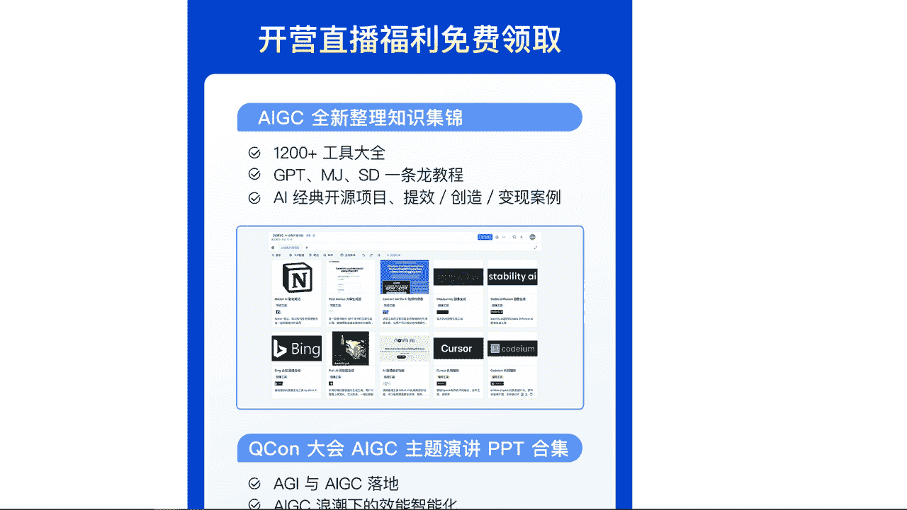
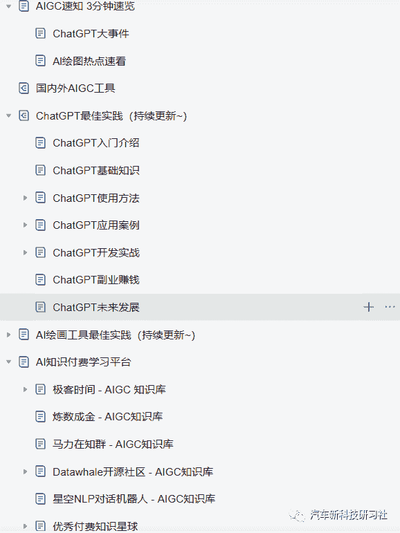

# 动力学院 AIGC 知识库 · 学习指南

> 来源：[https://docs.feishu.cn/docx/Ta0Ndfn0UosxJPxoC07c13f7nFd](https://docs.feishu.cn/docx/Ta0Ndfn0UosxJPxoC07c13f7nFd)

> 团队说明书是对团队的定位/价值、主要工作职责和可交付成果以及团队成员的介绍和描述，它可以方便其他团队快速了解该团队的相关信息，以及快速定位相关人员进行沟通，有利于团队之间高效合作。

# 团队使命

> 学习AIGC知识，让咸鱼也能翻身

# 团队主要职责

> 分享AIGC知识

# 我们可以如何帮到你

> 在这里，可以介绍如果他人需要合作，可以如何快速高效地与团队进行配合

> 也可以通过@+其他相关人员、话题群或者相关文档，介绍相关的合作流程和机制

# 团队成员简介

> 在这里，可以对团队成员的基本信息和分工进行介绍

多维表格（HTl6b0BV5aXiMgs2wF0cfmnhnOg_tbltyMntl7L0gtSC）

# 学习前准备

1、魔法

# 学什么

## ️ChatGPT

可以简单理解它为百事通，问它什么问题都能回答，文案方案、论文、聊天、实事等等，都可以帮你写。但目前对国内的大家来说注册和访问比较困难

## Midjourney

超级火的AI绘画工具，只需要简单几个关键词，就能生成精美的图象，非常适合设计师或者想要有产出的大家，但目前需要付费。

## ️Stable Diffussion

比较可控的AI绘画工具，具有很多可以自定义的插件，可以让你按自己的想法去AI绘画，但对电脑的配置要求比较高，操作难度会稍微大一些。

https://chat.forefront.ai/share/a4kbwyisc6eo045s

# 学习教程

AIGC学习交流①群

个人微信

公众号 汽车新科技研习社

|  |  |
| --- | --- |
|  |  |