# Al绘图热点速看

> 来源：[https://docs.feishu.cn/docx/XWbBd3yHdoPqwDxGzI7cXgWSnVb](https://docs.feishu.cn/docx/XWbBd3yHdoPqwDxGzI7cXgWSnVb)

# Vol.01 20230523

**📰最新要闻**

---

**1、拖**拽就可精准控图？Al还能读心？CPT有APP啦～本周Al热点请查收。

https://mp.weixin.qq.com/s/kd-dYQl5kyZcNbkqsBN-zQ

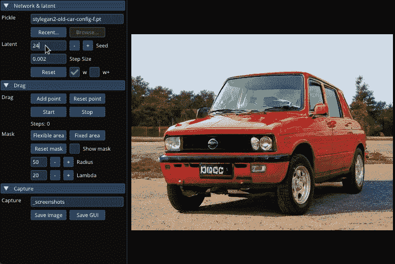

2、看了这篇文章，你也能成为顶级A绘画师！

https://mp.weixin.qq.com/s/_7fMcuMdR9Tq8hMSQKvEqw

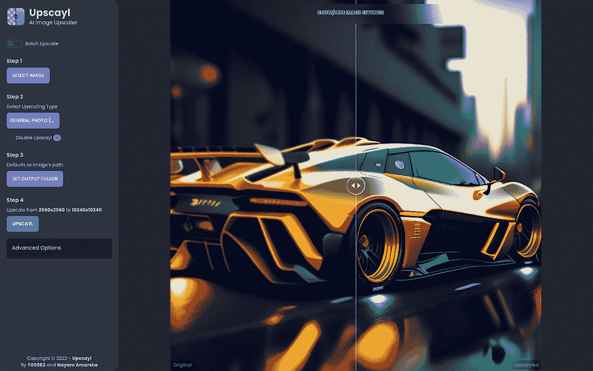

**3、专访SOULO：首支全****AI**制作短片幕后揭秘，大胆操盘后的分享

https://www.digitaling.com/articles/927415.html

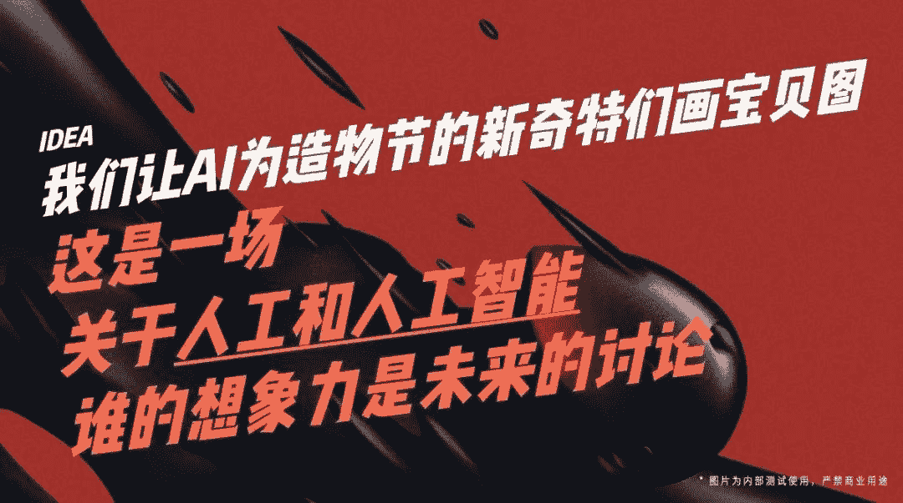

**4、Open ****Al 发**布 ios 版本 ChatGPT App

使用美区帐号，可以在 App Store 直接安装使用。

https://apps.apple.com/us/app/chatgpt/id6448311069

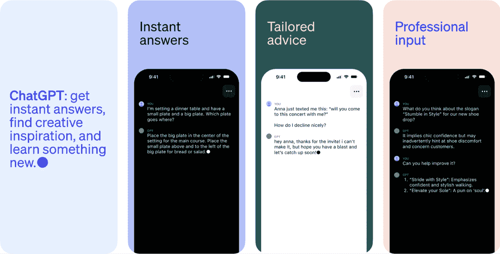

**🎯设计师专供**

**1、【喂饭级教程】****AI****工具在B端视觉设计中的落地应用**

https://mp.weixin.qq.com/s/bjQLR9iM8WjYjxINCNiURA

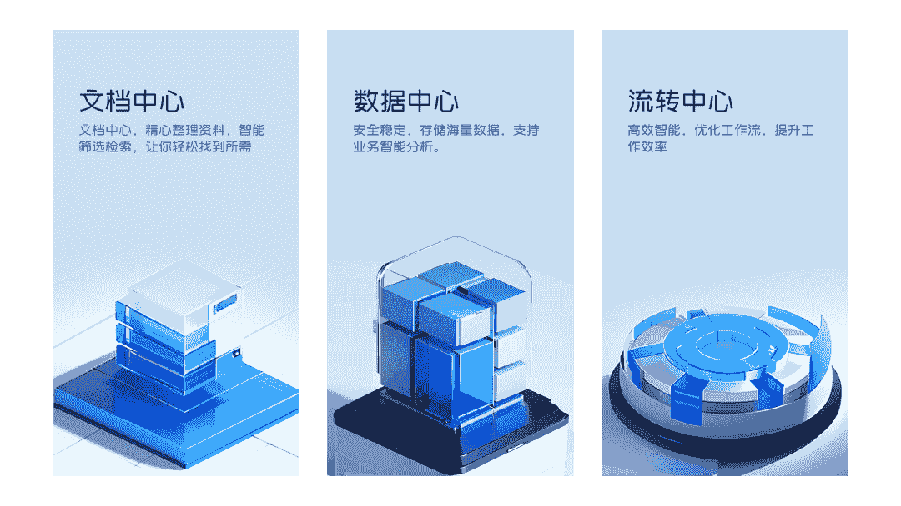

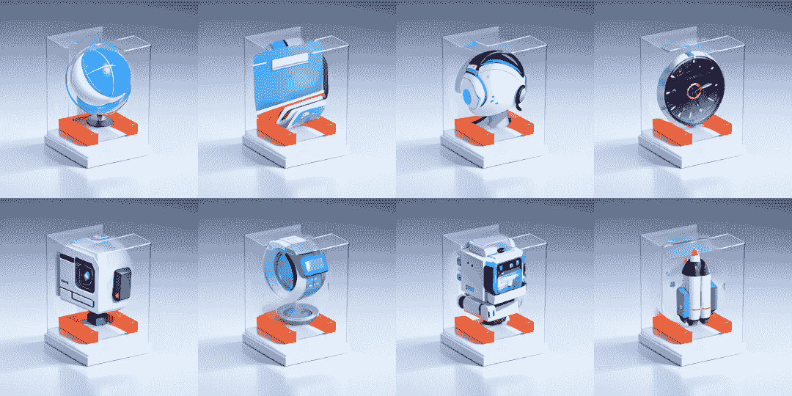

**2、Al 应用程序整套源文件**

免费的 AI 应用程序文件，文件中包含 UI 界面和设计规范以及组件

https://www.figma.com/community/file/1237505388738737733/Artificium---AI-Content-Creation-App---UI-Kit

**3、可爱的图标库**

一个不断更新的图标集，有5种不同的风格，专为web设计

https://www.figma.com/community/file/1171757667324008945

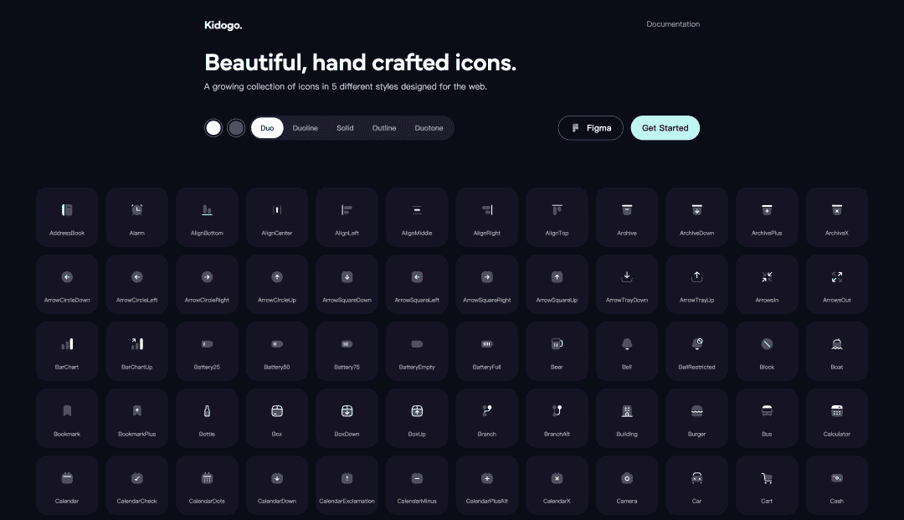

**4、太空主题应用**

https://www.figma.com/community/file/1239478379819513105/Space-App-Concept

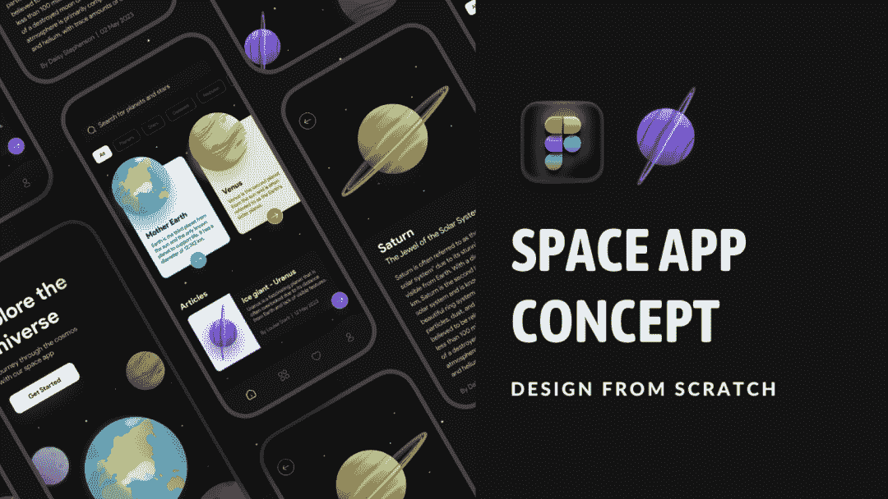

5、设计公开课《玩转地理空间可视化，双11大屏设计师》

地理空间数据和人类生产生活息息相关，通过可视化手段可以有效挖掘它的价值。对于双11数据大屏的设计师来说，地理空间可视化更是帮助集团对外传播业务价值以及社会价值的有力工具。本次分享会从地球到城市再到社区，基于落地大屏场景案例，聊一聊在不同的地理空间维度下，我们双11大屏设计师是如何玩转地理空间可视化的

https://mp.weixin.qq.com/s/U-p3RLxVqD3AXCMxeH7RVg

**🏆A****I工****具**

---

**1、70+款****AI****工具合集，值得收藏**

小红书上有关ChatGPT的笔记已有10w+篇，相关话题浏览量也达到了1.12亿次。其中讨论最为热烈的，要数“ChatGPT使用教程”。（当然，类似的话题还包括，教你如何使用Midjourney等等）甚至还有人通过ChatGPT教学，月入十万

https://www.digitaling.com/articles/925441.html

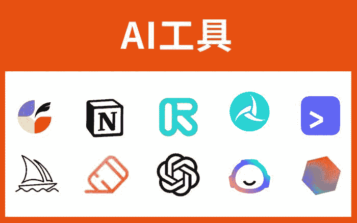

2、多合一的工具套件：Booltool

Al 图片处理工具，提供常用的去除背景、替换背景、删除部分、图片放大等功能。除了静态图片还可以给图片增加特效。（下面的图是使用 Midjourney 生成的图像，使用 Booltool 增加动态效果）

https://booltool.boolv.tech/home

3、Figma插件，使用 Al 从图像中剪切元素

从图像中提取元素，完成抠图的效果，处理完的图像尺寸比较小，适合对细节要求不高的时候使用。胜在方便快捷

https://www.figma.com/community/plugin/1229141725660705006/Segment-Anything

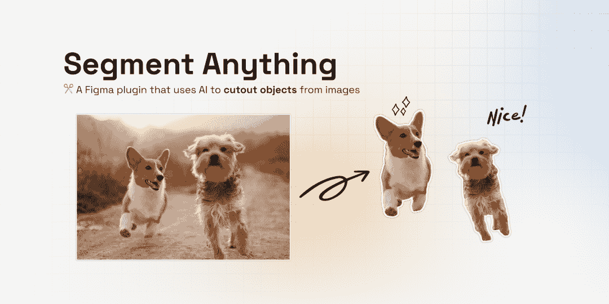

# Vol.02 20230605

### **1、Midjourney劲敌来了****！谷****歌St**yleDrop王牌定制大师引爆AI艺术圈

**近期谷歌放出来一个王炸****AI****创作神奇StyleDrop，用户只需要选择一张样例图片，然后修改特定文本**Prompt中的关键词就可以生成类似原图风格的各种目标，效果逼真的简直要逆天！”

给定梵高的星空，AI化身梵高大师，对这种抽象风格顶级理解后，做出无数幅类似的画作。

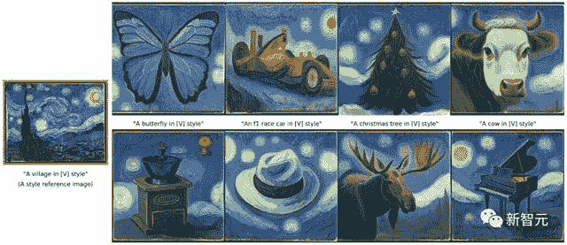

再来一张卡通风，想要绘制的物体呆萌了许多。

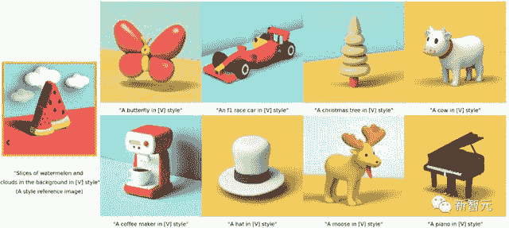

项目主页-https://styledrop.github.io/

论文链接-https://arxiv.org/pdf/2306.00983.pdf