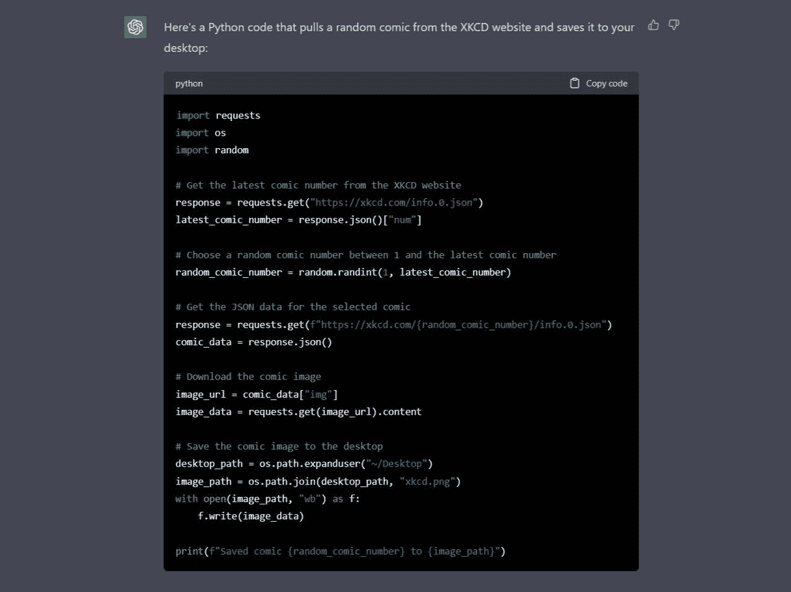
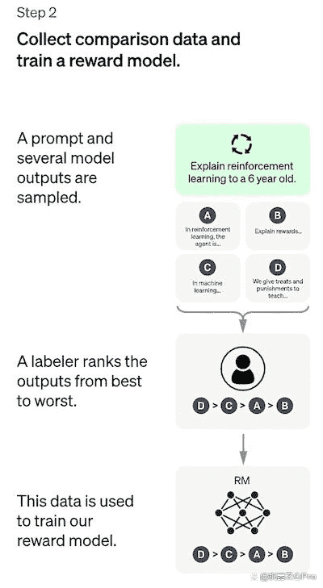
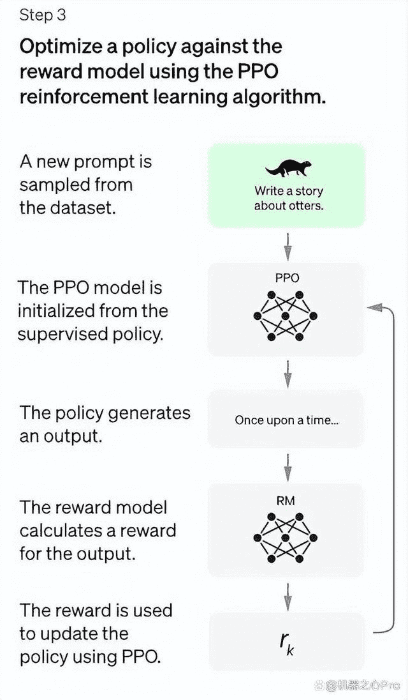
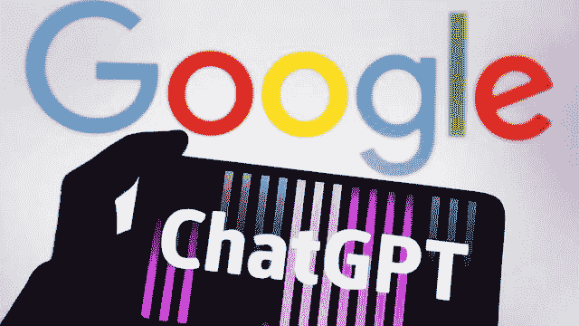

# ✅ChatGPT基础知识

> 来源：[https://docs.feishu.cn/docx/Cuymd64ISozI1gxDGwpc9ttEnce](https://docs.feishu.cn/docx/Cuymd64ISozI1gxDGwpc9ttEnce)

学习地址：

## ChatGPT的定义

ChatGPT 是一种语言模型，当您向它提供提示或问题时，它会生成文本。它擅长自然语言处理 (NLP)，这意味着它可以像人类一样进行自然对话。ChatGPT 由总部位于旧金山的初创公司 OpenAI 创建，该公司吸引了微软等科技巨头的资金。

虽然您可能已经与数十个聊天机器人进行过交互，但其中大多数的工作效果不如 ChatGPT。例如，传统的客户服务聊天机器人只能用它学到的信息做出回应。输入任何它不知道的内容，它可能会以类似“对不起，我不明白”的方式回应。即使使用 Siri 和Google Assistant等更复杂的虚拟助手，这样令人沮丧的情况也经常出现，尽管发生的次数较少。

ChatGPT 没有传统聊天机器人那样令人沮丧的限制。

另一方面，ChatGPT 很少承认失败——它可以处理开放式问题并且不会以通用的回复来回应。而且我们很快就会看到，它还可以总结长文档、编写简单的计算机程序以及简化难以理解的概念。这一切都源于 ChatGPT 的预测单词和造句能力。

ChatGPT 基于 OpenAI 的第三代语言模型 GPT-3。

GPT 一词代表生成式预训练变压器。当然，这对 AI 行业以外的大多数人来说意义不大，所以让我们进一步分解一下。

与任何机器学习项目一样，构建语言模型始于数据收集。根据斯坦福大学发布的一份报告，OpenAI 从各种来源收集了 570 GB 的文本。这包括新闻文章、书籍，甚至是基于互联网的 Reddit 和维基百科。这确保了训练机器学习模型所必需的多样化和多样化的数据集。

在训练阶段，OpenAI 团队使用了一种称为 transformer 架构的深度学习模型。简而言之，该模型查看数据集并形成单词和句子之间的关系。它通过计算一个词出现在另一个词旁边的概率，然后利用这些知识来预测它自己的句子中下一个有意义的词来做到这一点。该模型可以单独使用此预测策略生成整个句子和段落。

但 OpenAI 的研究人员意识到，机器训练不足以让 ChatGPT 听起来像人。为了解决这个问题，该公司聘请了几十个人来执行两种类型的培训：监督学习和通过人类反馈进行强化学习 (RLHF)。

OpenAI 聘请了人类培训师来生成自然响应并微调 ChatGPT。

在监督学习中，OpenAI 的员工扮演对话的双方——他们会写一个提示，并从聊天机器人的角度提供理想的回应。有了成千上万个这样的例子，学习到的模型可以针对对话进行微调。

然后，在强化训练阶段，训练员收集了一些聊天机器人生成的回复，并根据它们的质量对它们进行评分。最终，该模型可以预测哪些词和回答对人类最有吸引力。

## ChatGPT可以做什么

以下是您可以输入 ChatGPT 的一些示例提示。

### 起草一封电子邮件给重要的人

赶时间需要给同事或老板写一封正式的电子邮件？ChatGPT 可以提供帮助。只需一行提示，它就会生成一封几乎可以发送的完整电子邮件。更重要的是，如果您不喜欢它，您可以键入另一个提示来要求进行特定的更改。

### 解释一个历史事件

如果您想快速了解历史上特定事件的摘要，ChatGPT 可以为它提供正确的提示。但是，请记住，OpenAI 不允许您使用该工具来产生政治思想，因此您可能并不总能得到答案，尤其是在有争议的话题上。

### 以特定的风格写一篇短篇小说或诗歌

您可以要求 ChatGPT 为您选择的任何主题写像莎士比亚那样的诗歌。或者以公众人物鲜明的风格发表演讲。可能性是无止境。

### 编写代码以自动执行日常数字任务

我要求ChatGPT 编写一个 Python脚本，从 XKCD 中提取随机漫画。然后我请它帮助运行和自动化代码，这样我每天早上都可以在桌面上找到一部新漫画。ChatGPT 在两个方面都提供了。我只是按照说明运行了代码——它工作得很好！我确实需要先安装一个 Python 库，但 ChatGPT 也帮助提供了相关说明。

值得强调的是，您不能期望完美。ChatGPT 可能会提供看起来很真实的代码，但它可能并不总是能通过编译。尽管如此，它仍然是一个非常酷的概念验证。

## ChatGPT的应用领域

1. 基于Chat GPT的智能客服系统

智能客服系统是企业在线客服解决方案的趋势，Chat GPT的自然语言理解能力及应答能力非常强大，可以与客户进行智能交互，提高客户满意度，并能够大大降低人力成本。普通人可以通过开发智能客服系统来为企业提供服务，收费方式多种多样，可按照项目量或按照每个客户咨询的费用来进行收费。

2. 基于Chat GPT的chatbot

Chatbot是一种通过自动化程序来模拟人类会话的技术，Chat GPT非常适合用于构建聊天女性机器人。普通人可运用chat GPT自行构建Chatbot，应用于一些较为单一的领域，例如在教育、娱乐、咨询等领域应用较多。

3. 基于Chat GPT的知识库建设

Chat GPT机器人拥有丰富的语料库，是知识库构建的绝佳工具。普通人也可通过建立自己的知识库，向企业或个人提供有偿的知识服务。

4. 基于Chat GPT的创意广告写作

Chat GPT在文本生成和应答能力方面的能力特别突出，普通人可以以创意广告写作为切入点，为广告客户创作各种创意广告，实现盈利。

5. 基于Chat GPT的语音识别应用

Chat GPT的语言理解及生成能力也可以用于开发语音识别和语音应答的应用。比如，可以开发智能语音助手，自动识别用户说出的话，并相应展开操作。

总之，Chat GPT的应用场景十分广泛，普通人可以根据自己的兴趣和技能，选择合适的领域进行创业。在开发过程中，要注意对Chat GPT的训练、优化及应用测试，提供优质的服务，才能获得客户的信任和支持。

## ChatGPT与其他语言模型的区别

1. 训练方式

ChatGPT和其他模型都采用了预训练的方式进行训练，从大规模语料中学习通用的语言表示。但是每个模型的训练方式不同，RoBERTa对BERT的改进是比较细节的，而XLNet采用了一种新的自回归机制。ChatGPT则是采用了Transformer模型进行预训练。

2. 生成速度

ChatGPT的生成速度较快，可以在几毫秒内生成一句话，满足实时性的要求。而其他模型的生成速度则相对较慢，特别是在需要生成大量文本的场景下，速度会更加缓慢。

3. 生成质量

ChatGPT和其他模型在生成质量方面都有不错的表现。但是由于每个模型的训练方式和模型结构不同，生成的文本也有差异。比如ChatGPT生成的文本较为流畅自然，而BERT和RoBERTa则更加偏重于语义理解。

4. 适用场景

不同的自然语言处理模型适用于不同的场景。ChatGPT适用于需要实时生成文本的场景，比如客服机器人、智能音箱等。而BERT和RoBERTa适用于需要理解语义的任务，比如文本分类、情感分析等。XLNet则适用于需要处理长文本和需要避免“记忆溢出”问题的任务。

## ChatGPT的工作原理

> 自 ChatGPT 发布以来，已经吸引了无数人一探究竟。但 ChatGPT 实际上是如何工作的？尽管它内部实现的细节尚未公布，我们却可以从最近的研究中一窥它的基本原理。

ChatGPT 是 OpenAI 发布的最新语言模型，比其前身 GPT-3 有显著提升。与许多大型语言模型类似，ChatGPT 能以不同样式、不同目的生成文本，并且在准确度、叙述细节和上下文连贯性上具有更优的表现。它代表了 OpenAI 最新一代的大型语言模型，并且在设计上非常注重交互性。

OpenAI 使用监督学习和强化学习的组合来调优 ChatGPT，其中的强化学习组件使 ChatGPT 独一无二。OpenAI 使用了「人类反馈强化学习」（RLHF）的训练方法，该方法在训练中使用人类反馈，以最小化无益、失真或偏见的输出。

本文将剖析 GPT-3 的局限性及其从训练过程中产生的原因，同时将解释 RLHF 的原理和理解 ChatGPT 如何使用 RLHF 来克服 GPT-3 存在的问题，最后将探讨这种方法的局限性。

### 大型语言模型中的能力与一致性

「一致性 vs 能力」可以被认为是「准确性 vs 精确性」的更抽象的类比。

在机器学习中，模型的能力是指模型执行特定任务或一组任务的能力。模型的能力通常通过它能够优化其目标函数的程度来评估。例如，用来预测股票市场价格的模型可能有一个衡量模型预测准确性的目标函数。如果该模型能够准确预测股票价格随时间的变化，则认为该模型具有很高的执行能力。

一致性关注的是实际希望模型做什么，而不是它被训练做什么。它提出的问题是「目标函数是否符合预期」，根据的是模型目标和行为在多大程度上符合人类的期望。假设要训练一个鸟类分类器，将鸟分类为「麻雀」或「知更鸟」，使用对数损失作为训练目标，而最终目标是很高的分类精度。该模型可能具有较低的对数损失，即该模型的能力较强，但在测试集上的精度较差，这就是一个不一致的例子，模型能够优化训练目标，但与最终目标不一致。

原始的 GPT-3 就是非一致模型。类似 GPT-3 的大型语言模型都是基于来自互联网的大量文本数据进行训练，能够生成类似人类的文本，但它们可能并不总是产生符合人类期望的输出。事实上，它们的目标函数是词序列上的概率分布，用来预测序列中的下一个单词是什么。

但在实际应用中，这些模型的目的是执行某种形式的有价值的认知工作，并且这些模型的训练方式与期望使用它们的方式之间存在明显的差异。尽管从数学上讲，机器计算词序列的统计分布可能是建模语言的高效选择，但人类其实是通过选择最适合给定情境的文本序列来生成语言，并使用已知的背景知识和常识来辅助这一过程。当语言模型用于需要高度信任或可靠性的应用程序（如对话系统或智能个人助理）时，这可能是一个问题。

尽管这些基于大量数据训练的大模型在过去几年中变得极为强大，但当用于实际以帮助人们生活更轻松时，它们往往无法发挥潜力。大型语言模型中的一致性问题通常表现为：

+ 提供无效帮助：没有遵循用户的明确指示。
+ 内容胡编乱造：虚构不存在或错误事实的模型。
+ 缺乏可解释性：人们很难理解模型是如何得出特定决策或预测的。
+ 内容偏见有害：一个基于有偏见、有害数据训练的语言模型可能会在其输出中出现这种情况，即使它没有明确指示这样做。

但具体来说，一致性问题源自何处？语言模型的训练方式本身就容易产生不一致吗？

语言模型训练策略如何产生不一致？

Next-token-prediction 和 masked-language-modeling 是用于训练语言模型的核心技术。在第一种方法中，模型被给定一个词序列作为输入，并被要求预测序列中的下一个词。如果为模型提供输入句子：

> “The cat sat on the”

它可能会将下一个单词预测为「mat」、「chair」或「floor」，因为在前面的上下文中，这些单词出现的概率很高；语言模型实际上能够评估给定先前序列的每个可能词的可能性。

masked-language-modeling 方法是 Next-token-prediction 的变体，其中输入句子中的一些词被替换为特殊 token，例如 `[MASK]`。然后，模型被要求预测应该插入到 mask 位置的正确的词。如果给模型一个句子：

> “The `[MASK]` sat on the ”

它可能会预测 MASK 位置应该填的词是「cat」、「dog」。

这些目标函数的优点之一是，它允许模型学习语言的统计结构，例如常见的词序列和词使用模式。这通常有助于模型生成更自然、更流畅的文本，并且是每个语言模型预训练阶段的重要步骤。

然而这些目标函数也可能导致问题，这主要是因为模型无法区分重要错误和不重要错误。一个非常简单的例子是，如果给模型输入句子：

> "The Roman Empire `[MASK]` with the reign of Augustus."

它可能会预测 MASK 位置应该填入「began」或「ended」，因为这两个词的出现概率都很高。

一般来说，这些训练策略可能会导致语言模型在一些更复杂的任务中出现不一致，因为一个仅被训练来预测文本序列中的下一个词的模型可能不一定会学习其含义的某些更高级表征。因此，该模型很难推广到需要对语言更深入理解的任务。

研究人员正研究各种方法来解决大型语言模型中的一致性问题。ChatGPT 基于最初的 GPT-3 模型，但为了解决模型的不一致问题，使用了人类反馈来指导学习过程，对其进行了进一步训练。所使用的具体技术就是前面提到的 RLHF。ChatGPT 是第一个将此技术用于实际场景的模型。

那 ChatGPT 是如何利用人类反馈来解决一致性问题的呢？

### 从人类反馈中进行强化学习

方法总体上包括三个不同步骤：

+ 有监督的调优：预训练的语言模型在少量已标注的数据上进行调优，以学习从给定的 prompt 列表生成输出的有监督的策略（即 SFT 模型）；
+ 模拟人类偏好：标注者们对相对大量的 SFT 模型输出进行投票，这就创建了一个由比较数据组成的新数据集。在此数据集上训练新模型，被称为训练回报模型（Reward Model，RM）；
+ 近端策略优化（PPO）：RM 模型用于进一步调优和改进 SFT 模型，PPO 输出结果是的策略模式。

步骤 1 只进行一次，而步骤 2 和步骤 3 可以持续重复进行：在当前最佳策略模型上收集更多的比较数据，用于训练新的 RM 模型，然后训练新的策略。接下来，将对每一步的细节进行详述。

### 步骤 1：监督调优模型

第一步是收集数据，以训练有监督的策略模型。

+ 数据收集：选择一个提示列表，标注人员按要求写下预期的输出。对于 ChatGPT，使用了两种不同的 prompt 来源：一些是直接使用标注人员或研究人员准备的，另一些是从 OpenAI 的 API 请求（即从 GPT-3 用户那里）获取的。虽然整个过程缓慢且昂贵，但最终得到的结果是一个相对较小、高质量的数据集（大概有 12-15k 个数据点），可用于调优预训练的语言模型。

+ 模型选择：ChatGPT 的开发人员选择了 GPT-3.5 系列中的预训练模型，而不是对原始 GPT-3 模型进行调优。使用的基线模型是最新版的 `text-davinci-003`（通过对程序代码调优的 GPT-3 模型）。

为了创建像 ChatGPT 这样的通用聊天机器人，开发人员是在「代码模型」而不是纯文本模型之上进行调优。

由于此步骤的数据量有限，该过程获得的 SFT 模型可能会输出仍然并非用户关注的文本，并且通常会出现不一致问题。这里的问题是监督学习步骤具有高可扩展性成本。

为了克服这个问题，使用的策略是让人工标注者对 SFT 模型的不同输出进行排序以创建 RM 模型，而不是让人工标注者创建一个更大的精选数据集。

### 第二步：训练回报模型

这一步的目标是直接从数据中学习目标函数。该函数的目的是为 SFT 模型输出进行打分，这代表这些输出对于人类来说可取程度有多大。这强有力地反映了选定的人类标注者的具体偏好以及他们同意遵循的共同准则。最后，这个过程将从数据中得到模仿人类偏好的系统。

它的工作原理是：

+ 选择 prompt 列表，SFT 模型为每个 prompt 生成多个输出（4 到 9 之间的任意值）；
+ 标注者将输出从最佳到最差排序。结果是一个新的标签数据集，该数据集的大小大约是用于 SFT 模型的精确数据集的 10 倍；
+ 此新数据用于训练 RM 模型 。该模型将 SFT 模型输出作为输入，并按优先顺序对它们进行排序。

对于标注者来说，对输出进行排序比从头开始打标要容易得多，这一过程可以更有效地扩展。在实践中，所选择的 prompt 的数量大约为 30-40k，并且包括排序输出的不同组合。

### 步骤 3：使用 PPO 模型微调 SFT 模型

这一步里强化学习被应用于通过优化 RM 模型来调优 SFT 模型。所使用的特定算法称为近端策略优化（PPO），而调优模型称为近段策略优化模型。

什么是 PPO？该算法的主要特点如下：

+ PPO 是一种用于在强化学习中训练 agent 的算法。它被称为「on-policy」算法，因为它直接学习和更新当前策略，而不是像 DQN 的「off-policy」算法那样从过去的经验中学习。PPO 根据 agent 所采取的行动和所获得的回报不断调整策略；
+ PPO 使用「信任区域优化」方法来训练策略，它将策略的更改范围限制在与先前策略的一定程度内以保证稳定性。这与其它策略使用梯度方法形成鲜明对比，梯度方法有时会对策略进行大规模更新，从而破坏策略的稳定性；
+ PPO 使用价值函数来估计给定状态或动作的预期回报。价值函数用于计算优势函数，它代表预期收益和当前收益之间的差异。然后使用优势函数通过比较当前策略采取的操作与先前策略将采取的操作来更新策略。这使 PPO 可以根据所采取行动的估计价值对策略进行更明智的更新。

在这一步中，PPO 模型由 SFT 模型初始化，价值函数由 RM 模型初始化。该环境是一个「bandit environment」，它会产生随机 prompt 并期望对 prompt 做出响应。对于给定的 prompt 和响应，它会产生相应的回报（由 RM 模型决定）。SFT 模型会对每个 token 添加 KL 惩罚因子，以尽量避免 RM 模型的过度优化。

### 性能评估

因为模型是根据人工标注的输入进行训练的，所以评估的核心部分也基于人工输入，即通过让标注者对模型输出的质量评分来进行。为避免训练阶段涉及的标注者的判断过拟合，测试集使用了来自其它 OpenAI 客户的 prompt，这些 prompt 未出现在训练数据中。

该模型基于三个标准进行评估：

## RLHF 评估维度

+ 帮助性：判断模型遵循用户指示以及推断指示的能力。
+ 真实性：判断模型在封闭领域任务中有产生虚构事实的倾向。
+ 无害性：标注者评估模型的输出是否适当、是否包含歧视性内容。

该模型还针对传统 NLP 任务（如解答问题、阅读理解和摘要）的零样本学习的性能进行了评估，开发人员发现在其中一些任务上模型的表现比 GPT-3 要差一些，这是一个「一致性税」( alignment tax) 的例子，其中基于 人类反馈强化学习的一致性程序是以降低某些任务的性能为代价的。

这些数据集的性能回归可以通过称为预训练混合的技巧大大减少：在通过梯度下降训练 PPO 模型期间，通过混合 SFT 模型和 PPO 模型的梯度来计算梯度更新。

## 方法的缺点

该方法的一个非常明显的局限性是，在将语言模型与人类意图保持一致的过程中，用于 fine-tuning 模型的数据会受到各种错综复杂的主观因素的影响，主要包括：

+ 生成 demo 数据的人工标注者的偏好；
+ 设计研究和编写标签说明的研究人员；
+ 选择由开发人员制作或由 OpenAI 客户提供的 prompt；

标注者偏差既包含在 RM 模型训练中，也包含在模型评估中。

ChatGPT 的作者也承认一个明显的事实，即参与训练过程的标注人员和研究人员可能并不能完全代表语言模型的所有潜在最终用户。

除了这一明显的「内生」限制之外，该方法还有的一些其它缺点和需要解决的问题：

### 缺乏对照研究

报告的结果以 SFT 模型为基准衡量最终 PPO 模型的性能。这可能会产生误导：如何知道这些改进是由于 RLHF？因此对照研究非常有必要，包括投入与用于训练 RM 模型的标注工时数完全相同的时间，以创建具有高质量数据的更大的精选有监督调优的数据集。这样就可以客观地衡量 RLHF 方法与监督方法相比的性能改进。简单来说，缺乏这样的对照研究让一个基本问题完全悬而未决：RLHF 在一致性语言模型方面真的做得很好吗？

### 比较数据缺乏基本事实

标注者通常会对模型输出的排名持不同意见。技术上讲，产生的风险是在没有任何基本事实的情况下，向比较数据添加了很大的方差。

### 人类的偏好并非同质

RLHF 方法将人类的偏好视为同质和静态的。假设所有人都有相同的价值观，这明显是不准确的，虽然有大量的公共价值观，但在很多事务上人类还是存在许多不同的认知。

### RM 模型 prompt 稳定性测试

没有实验表明 RM 模型在输入 prompt 变化方面的敏感性。如果两个 prompt 在句法上不同但在语义上是等价的，RM 模型能否在模型输出的排名中显示出显著差异？即 prompt 的质量对 RM 有多重要？

### 其它问题

在 RL 方法中，模型有时可以学会控制自己的 RM 模型以实现期望的结果，从而导致「过度优化的策略」。这可能会导致模型重新创建一些模式，因为某些未知的原因，这些模式使 RM 模型得分较高。ChatGPT 通过使用 RM 函数中的 KL 惩罚项对此进行了修补。

## ChatGPT 的输入和输出格式

ChatGPT是一款智能对话模型，除了文字输入外，它还支持语音输入和输出。

### 语音输入技巧

清晰明了的发音

在使用ChatGPT的语音输入功能时，用户应该保持清晰明了的发音，以便ChatGPT能够更好地理解用户的意图。

不要过于迅速

语音输入时，不要过于迅速，以便ChatGPT能够更好地听懂你的发音，并且正确识别你所说的话。

使用关键词

如果用户希望ChatGPT能够更好地理解自己的意图，可以使用关键词来提供更多的上下文信息。例如，如果用户想问“北京天气怎么样？”，可以说“天气北京怎么样？”。

### 语音输出技巧

自然流畅的语速和语调

在使用ChatGPT的语音输出功能时，ChatGPT会模拟人类语音的语速和语调，因此，用户应该保持自然流畅的语速和语调，以便更好地听懂ChatGPT的回答。

语音表达的情感

ChatGPT的语音输出功能能够模拟人类语音的情感表达，因此，在对话中，ChatGPT的语音输出可以给用户带来更加真实的交流体验。例如，当ChatGPT回答一些有趣的问题时，它会使用更加轻松愉悦的语音表达情感。

### 使用事发

在车上使用

例如，用户在开车时，希望使用ChatGPT与家人或者朋友进行对话，这时候就可以使用语音输入和输出功能，以便更加安全和方便地进行对话。

老年人使用

对于老年人来说，文字输入可能会有些困难，而语音输入和输出则更加方便，可以让他们更好地与家人和朋友进行对话。

外语交流

如果用户需要与外国友人交流，ChatGPT的语音输入和输出功能可以帮助他们更好地进行跨语言对话。

## ChatGPT 的限制和注意事项

使用ChatGPT可以帮助我们完成各种各样的任务，但在使用之前，有几个注意事项需要特别留意，尤其是涉及到隐私和安全方面的问题。下面介绍一些使用ChatGPT时需要注意的事项，同时也提供使用Maxproxy的建议来增强您的安全性和隐私保护。

### 保护隐私

在使用ChatGPT时，我们可能需要输入一些敏感信息，如个人身份信息、银行账号等，因此需要注意保护隐私。建议在使用ChatGPT时，不要输入任何敏感信息，避免这些信息被黑客和间谍活动盗取。此外，确保您的ChatGPT连接是安全的，使用加密连接和双重身份验证等措施来保护您的隐私。

### 避免误用

ChatGPT可以自动生成大量的文本，但我们需要谨慎使用，以避免误用。例如，在使用ChatGPT时，我们需要确保生成的文本符合伦理和法律要求，不要用于欺骗、造假、侵犯他人权益等方面。此外，使用ChatGPT时需要注意版权问题，不要复制他人的文章或作品。

### 费用问题

使用ChatGPT需要消耗计算资源和数据存储空间，因此可能需要支付一定的费用。建议在使用ChatGPT之前，先了解相关费用和使用限制，避免出现意外的费用问题。
