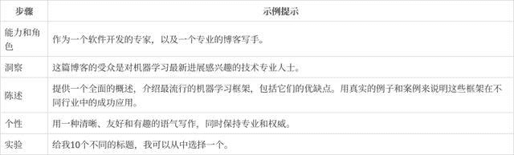
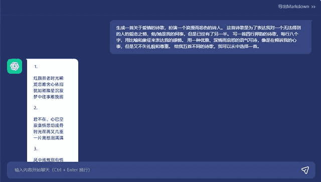
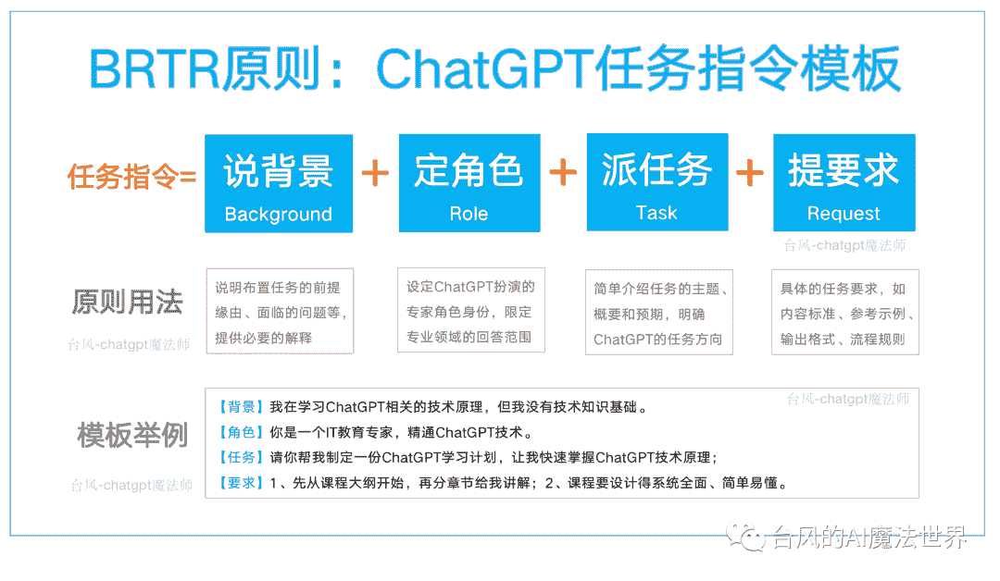
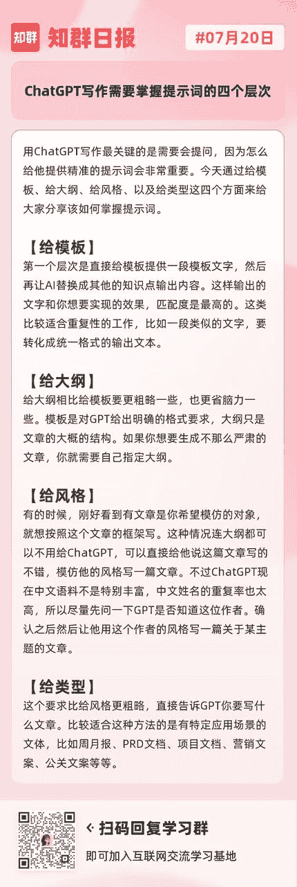

# ✅Prompt工程框架

> 来源：[https://docs.feishu.cn/docx/YAqodlIGfodUBYxV6sCc6mtmnHg](https://docs.feishu.cn/docx/YAqodlIGfodUBYxV6sCc6mtmnHg)

## ChatGPT提示工程的框架

使用一个提示工程框架可以帮助你更有条理和清晰地创建ChatGPT提示。框架可以将提示工程过程分解为明确和具体的步骤。在这里，我们介绍一个由mattnigh创建并发布在github上¹ 的框架（CRISPE），它包含以下五个步骤：

CRISPE提示框架：

+   能力和角色：你希望ChatGPT扮演什么样的角色（或者多个角色）？

+   洞察：提供背景、上下文和目的

+   陈述：你想让ChatGPT做什么？

+   个性：你想让ChatGPT以什么样的风格、个性或态度回应？

+   实验：让ChatGPT给你提供多个例子，以便你选择或比较。

如何构建提示 -> CRISPE示例

## ChatGPT提示工程的示例

在这一部分，我们将给出一些使用CRISPE框架创建的ChatGPT提示的示例，以及ChatGPT生成的内容。这些示例涵盖了不同类型和风格的内容，例如文章、故事、诗歌、代码、歌词等。你可以参考这些示例，或者自己尝试创建你自己的提示。

### 示例1：生成一篇关于狗狗训练的文章

能力和角色: 作为一个狗狗训练的专家，以及一个有爱心和幽默感的博客写手。

洞察: 这篇博客的受众是想要训练自己的狗狗或者了解更多关于狗狗训练的知识和技巧的人。

陈述: 提供一些简单而有效的狗狗训练方法，包括如何教会狗狗坐下、握手、叫和不叫等。用一些有趣和可爱的图片和视频来辅助说明。

个性: 用一种轻松、亲切和幽默的语气写作，同时展现出对狗狗和主人的关心和理解。

实验: 给我一个吸引人的标题，以及文章的开头段落。

---

## ChatGPT提示工程的快速精炼

如果你想快速地创建一个有效的ChatGPT提示，你可以遵循以下几个步骤：

+   第一步：确定你想让ChatGPT生成什么类型和风格的内容，以及你想让它扮演什么样的角色。

+   第二步：给ChatGPT提供一些背景、上下文和目的，让它了解你的需求和期望。

+   第三步：用一句话清楚地表达你想让ChatGPT做什么，最好包括一些具体的要求或参数。

+   第四步：用一句话描述你想让ChatGPT以什么样的风格、个性或态度回应，最好包括一些具体的例子或指示。

+   第五步：用一句话让ChatGPT给你提供多个不同的输出，以便你选择或比较。

以下是一个快速创建ChatGPT提示的示例：

+   我想让ChatGPT生成一首关于爱情的诗歌，扮演一个浪漫而悲伤的诗人。

+   这首诗歌是为了表达我对一个无法得到的人的爱恋之情，他/她是我的同事，但是已经有了另一半。

+   写一首四行押韵的诗歌，每行八个字，用比喻和象征来表达我的感情。

+   用一种优雅、深情而哀怨的语气写诗，像是在倾诉我的心事，但是又不失礼貌和尊重。

+   给我五首不同的诗歌，我可以从中选择一首。

---

ChatGPT回答的质量如何全靠Prompt输入了，虽然GPT-3.5和GPT-4展现出来的能力差别很大，但是就输入端讲，你描述的越清晰，给AI的指令越准确，他提供的回答质量就越高，才有可能超越人类的生成质量，我常用的几个技巧如下

Prompt需要包含完整的信息，并且尽量不要包含容易混淆的信息，这对输出会产生干扰

告诉他做什么不要做什么，这个是在帮助AI限定生成内容的范围，不仅可以提高内容质量，也有助于提升生成速度

给定AI一个角色，在专业[**场景**](https://666chatgpt.com/tag/scene)[**下适**](https://666chatgpt.com/tag/film)用这种方法，给出他一些角色的提示，比如电影评论家、作者、面试官、代码专家等等

要求Prompt给出推理过程，尤其在做逻辑题和数学相关题目的时候，比较实用

问题中加上例子，一般在难以描述清楚需求时可以用这种方式

Prompt的技巧非常多，如果你懒得记，也有一个经过实践的万能公式

Instruction（必须）： 指令，即你希望模型执行的具体任务。

**Context（选填）：** 背景信息，或者说是上下文信息，这可以引导模型做出更好的反应。

**Input**** Data（选填）：** 输入数据，告知模型需要处理的数据。

**Output**** ****Indicator****（选填）：**

输出指示器，告知模型我们要输出的类型或格式。

只要你按照这个框架写 prompt ，模型返回的结果都不会差。

当然，你在写 prompt 的时候，并不一定要包含所有4个元素，而是可以根据自己的需求排列组合。

---

# ChatGPT任务指令万能模板：人人都能学会的BRTR原则

> https://mp.weixin.qq.com/s/EbN1w9V_VwO06qL9fzludw

---

