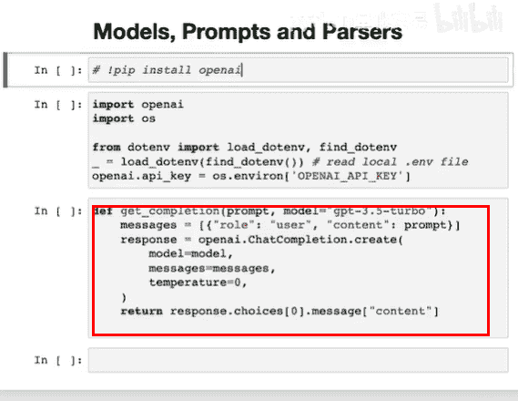
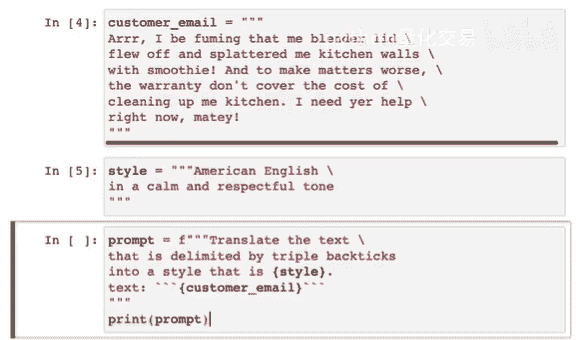
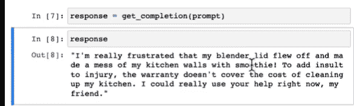

# ✅Prompt 练习

> 来源：[https://docs.feishu.cn/docx/AfnxdtHiho1pXTxjYYwcNoRhnxh](https://docs.feishu.cn/docx/AfnxdtHiho1pXTxjYYwcNoRhnxh)

因为有些朋友一直问，提前说下访问官网需要梯子😒。

# **1：张三的提问，****gpt****帮我改一下卷子**

+   （这个示例是我在ppt中用的到的，并不规范哈）

我是一个英语老师，有个学生天天写错别字，真是神烦，教务处还要求我用红笔修改以下作业，可是我根本懒得改，请帮我批改以下这个学生的英语作业。学生的英语作业是使用三个单引号括起来的部分：

'''

I love speending time in nature.

Whether it'is hiking through they mountains, walking on the beach, or simple sitting in a park, being outdoors makes me feel alive.

There's simething about the fresh air, the sunlight, and the beauty of the naitural world that brings me a senses of peace and contentment

'''

# 2：程序员小美 需要得到用红笔修改作业的代码

我有一篇英语文章，其中包含着错误。

包含着错误的文章为：

sentence = '''I love speending time in nature.   Whether it'is hiking through they mountains, walking on the beach, or simple sitting in a park, being outdoors makes me feel alive. There's simething about the fresh air, the sunlight, and the beauty of the naitural world that brings me a senses of peace and contentment.

'''

修改后正确的文章为：

sentence _right=    '''I love spending time in nature. Whether it's hiking through the mountains, walking on the beach, or simply sitting in a park, being outdoors makes me feel alive. There's something about the fresh air, the sunlight, and the beauty of the natural world that brings me a sense of peace and contentment.'''

我需要在一个浏览器上展示错误的文章，文章之中错误的单词被删除线标识，并且错误的单词颜色为红色，最后在错误的单词后面写上正确的单词。

请使用python实现功能并给出代码。

gpt返回代码：

```
import re
import webbrowser

# 错误的文章
sentence = &#x27;&#x27;&#x27;
I love speending time in nature.   Whether it&#x27;is hiking through they mountains, walking on the beach, or simple sitting in a park, being outdoors makes me feel alive. There&#x27;s simething about the fresh air, the sunlight, and the beauty of the naitural world that brings me a senses of peace and contentment.
&#x27;&#x27;&#x27;

# 正则表达式，匹配单词字符
word_pattern = re.compile(r&#x27;\w+&#x27;)

# 将错误的文章分割成单词列表
words = word_pattern.findall(sentence)

# 构造HTML标记，将错误单词用删除线标记并且用红色标记出来，并在后面加上正确的单词
marked_sentence = &#x27;&#x27;
for word in words:
    if word.lower() in [&#x27;speending&#x27;, &quot;it&#x27;is&quot;, &#x27;they&#x27;, &#x27;simple&#x27;, &#x27;simething&#x27;, &#x27;naitural&#x27;, &#x27;senses&#x27;]:
        correct_word = {
            &#x27;speending&#x27;: &#x27;spending&#x27;,
            &quot;it&#x27;is&quot;: &quot;it&#x27;s&quot;,
            &#x27;they&#x27;: &#x27;the&#x27;,
            &#x27;simple&#x27;: &#x27;simply&#x27;,
            &#x27;simething&#x27;: &#x27;something&#x27;,
            &#x27;naitural&#x27;: &#x27;natural&#x27;,
            &#x27;senses&#x27;: &#x27;sense&#x27;
        }[word.lower()]
        marked_sentence += f&#x27;&lt;span style=&quot;color:red; text-decoration:line-through&quot;&gt;{word}&lt;/span&gt;&lt;span style=&quot;color:green&quot;&gt;{correct_word}&lt;/span&gt; &#x27;
    else:
        marked_sentence += word + &#x27; &#x27;

# 构造HTML页面
html = f&#x27;&#x27;&#x27;
&lt;html&gt;
&lt;head&gt;
  &lt;title&gt;Error Article&lt;/title&gt;
&lt;/head&gt;
&lt;body&gt;
  &lt;p&gt;{marked_sentence}&lt;/p&gt;
&lt;/body&gt;
&lt;/html&gt;
&#x27;&#x27;&#x27;

# 写入HTML文件并在浏览器中打开
with open(&#x27;error_article.html&#x27;, &#x27;w&#x27;) as f:
    f.write(html)

webbrowser.open(&#x27;error_article.html&#x27;)
```

# **3：使用****API**

### **3.1下载****api****的地址**

openai官方网页：[h](https://platform.openai.com/docs/api-reference/chat/create)ttps://platform.openai.com/docs/api-reference/chat/create

### **3.2使用****api**

##### **安装open ****ai**** 工具包：**

在控制台中使用pip命令安装：

```
pip install openai
```

如果下载太慢，可以并指定使用清华镜像：

```
pip install -i https://pypi.tuna.tsinghua.edu.cn/simple openai
```

##### **写调用****gpt****  ****api**** 的代码：**

简单的写下代码：

```
# 引入openai的包
import openai

# OpenAI API key
openai.api_key = &#x27;sk-b95toDwHIXmLM51Vvt11DT3BlbkFJ7pSNdz0jDarg3C1GiP4V&#x27;


# 定义GPT API
def gpt(prompt):
    response = openai.ChatCompletion.create(
        model=&#x27;gpt-3.5-turbo&#x27;,
        messages=[
            {&#x27;role&#x27;: &#x27;user&#x27;,
             &#x27;content&#x27;: prompt}
        ],
        temperature=0,
    )
    print(response.choices[0].message.content)
    return response.choices[0].message.content

#使用GPT API
gpt(&quot;你好请问你可以帮我修改英语试卷吗？&quot;)
```

将问题替换为我们想要解决的问题：

```
# 使用GPT API
prompt=&quot;&quot;&quot;
我是一个英语老师，有个学生天天写错别字，真是神烦，教务处还要求我用红笔修改以下作业，
可是我根本懒得改，请帮我批改以下这个学生的英语作业。学生的英语作业是使用三个单引号括起来的部分：
&#x27;&#x27;&#x27;
       I love speending time in nature.
        Whether it&#x27;is hiking through they mountains, walking on the beach,
         or simple sitting in a park, being outdoors makes me feel alive. 
        There&#x27;s simething about the fresh air, the sunlight, and the beauty 
        of the naitural world that brings me a senses of peace and contentment
&#x27;&#x27;&#x27;
&quot;&quot;&quot;
gpt(prompt)
```

##### **写批改是个学生作业的代码**

注意  学生英语作文.txt  文件需要与写代码的.py文件在同一个目录下

```

# 引入openai的包
import openai

# OpenAI API key
openai.api_key = &#x27;sk-b95toDwHIXmLM51V1vt1DT3BlbkFJ7pSNdz0jDarg3C1GiP4V&#x27;


# 定义GPT API
def gpt(prompt):
    response = openai.ChatCompletion.create(
        model=&#x27;gpt-3.5-turbo&#x27;,
        messages=[
            {&#x27;role&#x27;: &#x27;user&#x27;,
             &#x27;content&#x27;: prompt}
        ],
        temperature=0,
    )
    print(response.choices[0].message.content)
    return response.choices[0].message.content

import time

# 读取10篇英语作文
with open(&#x27;学生英语作文.txt&#x27;, &#x27;r&#x27;) as f:
    essays = f.readlines()

# 批量修改每篇英语作文
for essay in essays:
    prompt = f&quot;&quot;&quot;
            我是一个英语老师，有个学生天天写错别字，真是神烦，教务处还要求我用红笔修改以下作业，
            可是我根本懒得改，请帮我批改以下这个学生的英语作业。学生的英语作业是使用三个单引号括起来的部分.
            &#x27;&#x27;&#x27;
            {essay}
            &#x27;&#x27;&#x27;
            &quot;&quot;&quot;

    gpt(prompt)

    # 让程序暂停 20 秒 以免调用过于频繁导致报警
    time.sleep(20)
批量处理10个学生的作业并使用工具包打上红线：
# 引入openai的工具包
import openai
# 引入浏览器的工具包
import webbrowser
# 引入画红线处理错误单词的工具包
from redlines import Redlines
# 引入可以让请求暂停20秒的工具包
import time

# OpenAI API key
openai.api_key = &#x27;sk-b95toDwHIXmLM51Vvt111DT3BlbkFJ7pSNdz0jDarg3C1GiP4V&#x27;


# 定义GPT API
def gpt(prompt):
    response = openai.ChatCompletion.create(
        model=&#x27;gpt-3.5-turbo&#x27;,
        messages=[
            {&#x27;role&#x27;: &#x27;user&#x27;,
             &#x27;content&#x27;: prompt}
        ],
        temperature=0,
    )
    print(response.choices[0].message.content)
    return response.choices[0].message.content


# 读取10篇英语作文
with open(&#x27;学生英语作文.txt&#x27;, &#x27;r&#x27;) as f:
    essays = f.readlines()

# 循环获取 批量修改每篇英语作文
for essay in essays:
    prompt = f&quot;&quot;&quot;
            我是一个英语老师，有个学生天天写错别字，真是神烦，教务处还要求我用红笔修改以下作业，
            可是我根本懒得改，请帮我批改以下这个学生的英语作业。学生的英语作业是使用三个单引号括起来的部分：
            &#x27;&#x27;&#x27;
            {essay}
            &#x27;&#x27;&#x27;
            &quot;&quot;&quot;

    # 请求gpt
    correct_sentence = gpt(prompt)

    after_red_line = Redlines(essay, correct_sentence)

    # 将Markdown格式的文本转换为HTML格式
    html = after_red_line.output_markdown

    # 将HTML页面写入文件
    with open(&#x27;output.html&#x27;, &#x27;w&#x27;) as f:
        f.write(html)

    # 在浏览器中打开HTML页面
    webbrowser.open(&#x27;output.html&#x27;)

    # 让程序暂停 20 秒 以免调用过于频繁导致报警
    time.sleep(20)
```

1.  **修改邮件**







# **4.安装软件**

1.  **pip**：pip 是 Python 的包管理器，用于安装和管理 Python 包。通常情况下，pip 会随着 Python 的安装一起提供。

+   如果你已经安装了 Python，请确保 pip 已经安装。你可以在命令行中运行以下命令来检查 pip 的版本：

+   pip --version

+   如果你没有安装 Python，你需要先下载和安装 Python 解释器。在 Python 官方网站上，你可以找到适用于不同操作系统的 Python 安装程序：https://www.python.org/downloads/

+   安装 Python 后，pip 应该已经包含在安装中。你可以在命令行中运行 pip --version 来验证 pip 是否安装成功。

1.  **Python ****解释器**：Python 解释器用于执行和运行 Python 代码。你可以从 Python 官方网站下载适用于你的操作系统的 Python 安装程序：https://www.python.org/downloads/

+   在下载页面上，选择适合你操作系统的安装程序，并下载最新版本的 Python。

+   执行下载的安装程序，并按照向导指示进行安装。

+   在安装过程中，请确保选中 "Add Python to PATH"（将 Python 添加到系统路径）选项，这样你就可以在命令行中直接使用 python 命令。

+   完成安装后，你可以在命令行中运行 python --version 来验证 Python 是否成功安装。

1.  **PyCharm 社区版**：PyCharm 是一款强大的 Python 集成开发环境（IDE）。PyCharm 社区版是免费的，适用于个人开发者和小型团队。

+   可以从 J[etBrains 官方网站下载 PyCharm](https://www.jetbrains.com/pycharm/download/) 社区版的安装程序：https://www.jetbrains.com/pycharm/download/

+   在下载页面上，选择适用于你的操作系统的安装程序，并下载最新版本的 PyCharm 社区版。

+   执行下载的安装程序，并按照向导指示进行安装。

+   在安装过程中，你可以选择配置一些首选项，如主题和键盘布局。

+   完成安装后，你可以启动 PyCharm 并开始使用它来开发 Python 项目。