# ✅ChatGPT应用案例

> 来源：[https://docs.feishu.cn/docx/Gk31dLWpyoyU6ZxIP6ycuJSFn1f](https://docs.feishu.cn/docx/Gk31dLWpyoyU6ZxIP6ycuJSFn1f)

## 全面接入！ChatGPT杀进15个商业应用，让AI替你打工

> https://mp.weixin.qq.com/s/v334DX0fEr6iJSqvD5al-A

**近****日，****智东西****全面梳理了市面可见的类**ChatGPT应用，发现在办公软件、社交文娱、营销广告、家庭助理四大方向的15条赛道，AI大模型技术正出现落地的萌芽。其中不仅有国民级的Office工具、钉钉等协同办公平台接入大模型，还有来自办公、电商、家居、社交文娱互联网平台推出AIGC功能，甚至以智能汽车、AR眼镜为代表的实体终端也上了大模型，带来新奇体验。

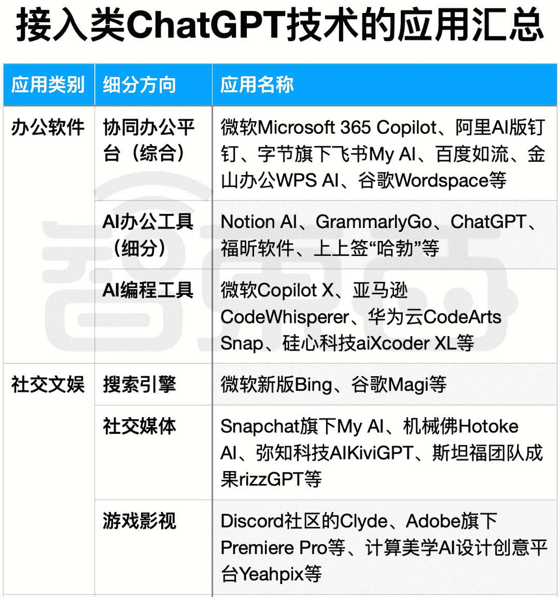

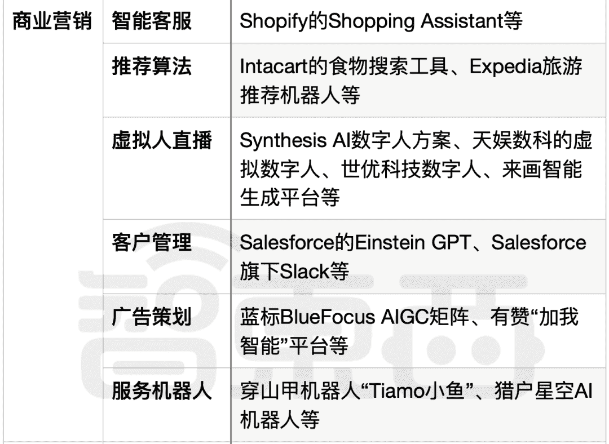

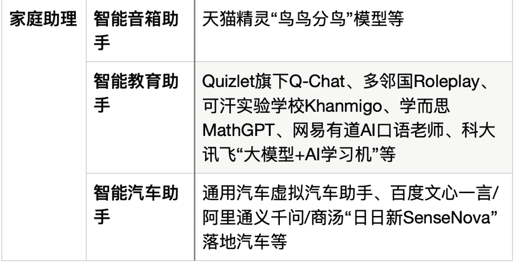

## **ChatGPT****商业应用——LLM是星辰大海**

本次调研报告的目的在于向大家介绍ChatGPT的商业应用，聚焦于ChatGPT在各个领域已经发生或者即将发生的应用场景，我们可以看到ChatGPT在各个方面已经有比较成功的应用，而且趋势越来越好，但整体还处在早期探索的摸石头过河的状态，未来大模型的商业应用蓝海还有待探究。

### **1. 研究背景**

---

#### **1.1 研究背景**

ChatGPT的出现敲开了新时代的大门，不仅仅是一个伟大的技术成果，更是一种颠覆性的力量。它正在以惊人的速度渗透到各行各业，重新定义着我们与计算机交互的方式。以前，我们谈论的是数字化、互联网+等概念，而现在，ChatGPT+、LLM+、AI+等关键词已经成为了我们不得不面对的新现实。

随着ChatGPT技术的不断升级和商业应用的拓展，其影响已经开始显现。几个月的时间内，ChatGPT已经在多个领域展现出了它的应用价值。在金融领域，ChatGPT可以为客户提供智能化的投资建议和风险管理方案；在医疗领域，ChatGPT可以辅助医生进行疾病诊断和药物研发；在零售领域，ChatGPT可以为消费者提供个性化的购物建议和客户服务。这些仅仅是ChatGPT商业应用的冰山一角，未来还有无限的可能等待我们去探索。

ChatGPT的出现，代表着人工智能的一个新时代的到来。我们可以期待，在ChatGPT的推动下，人工智能技术会变得越来越成熟和普及，它将为人类社会带来更多的便利和发展机遇。下面我们就来看看作为LLM的代表“人物”ChatGPT目前已经形成了怎样的星辰大海......

#### **1.2 研究方法**

本次调研的主要方法包括观看学习亚马逊AIGC创新实践大会、阅读相关文献、网络资料搜集和某些应用的实践上手体验为主，调研的资料和数据的选择主要以ChatGPT相关为主。

### **2. 商业应用和案例分析**

---

#### **2.1 工具层**

#### **ChatGPT****+搜索**

ChatGPT的出现受影响最大的领域是什么？毫无疑问是搜索引擎，可能“影响”，“颠覆”这些词还不够有力度来描述这次ChatGPT对搜索引擎的冲击，愿称之为“摧毁”和“重塑”，对原先探索知识方式的摧毁和人类知识体系结构的重塑。人们的需求在改变：人们不再满足于在各个网页中漫无目的地寻找最佳答案，而是可以让ChatGPT直接告诉我们一个近乎完美的答案。

所以搜索引擎的巨头们首先做出来反应，我们先来看看和ChatGPT直接相关的微软New Bing，微软公司一直和ChatGPT的母公司OpenAI保持合作，他们将ChatGPT整合进自己的bing搜索引擎里面，因为就目前来看，ChatGPT最大的问题就是一本正经的胡说八道，它不能对它说的话证伪，有时候我们都能看出来它说的不对，那么new bing就解决了这个问题，可以看到它是根据哪个链接告诉我们内容的，而且我们可以点击那个链接进去看具体的内容，这样的回答就有理有据了。

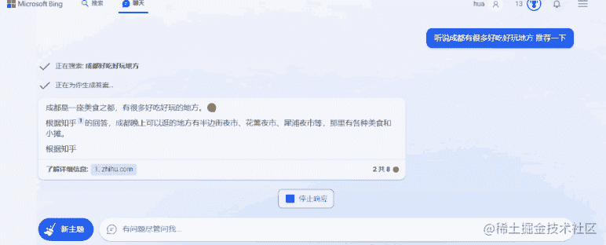

其次我们来看看全球搜索最大巨头谷歌，他们于2023年2月8日推出了类ChatGPT的Bard，但是很遗憾他们自己的聊天搜索引擎Bard的演示会上，巴德出现明显失误：在谷歌短短的几秒展示里，Bard其实只被问了一个问题——“我可以告诉我 9 岁的孩子关于詹姆斯·韦伯太空望远镜（James Webb Space Telescope ，简称JWST） 的哪些新发现？” Bard的回答很精彩——有丰富的信息，而且很形象的比喻，确实深入浅出地给孩子解释了JWST的发现。   然而，里面有一个巨大的错误：回答里提到“ JWST 拍摄到了太阳系外行星的第一张照片”，也就是下图灰线部分。然而，事实上，第一张系外行星照片是由欧洲南方天文台的Very Large Telescope (VLT) 在 2004 年拍摄的。

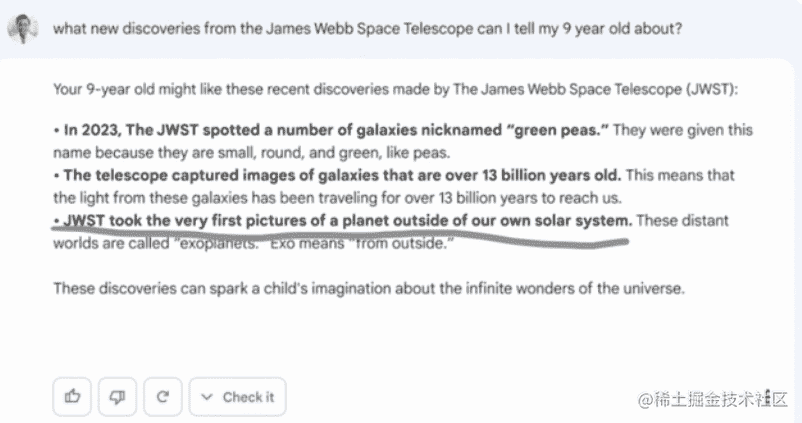

最后我们来看看国内：百度于2023年3月16日14时在北京总部召开新闻发布会，主题围绕文心一言。百度创始人、董事长兼首席执行官李彦宏，百度首席技术官王海峰出席。

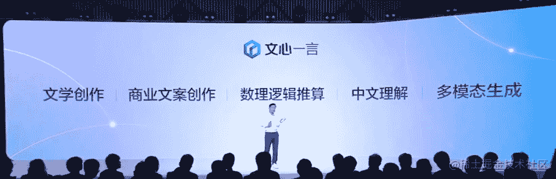

笔者全程看完了直播，但从结果来看，当时的文心一言是不太合格的，该演示发布会的文心一言前面三个演示的效果，ChatGPT更胜一筹，中文理解上当然是文心一言更强，这没什么好疑问的，最后一个多模态也比GPT-4差很多。但是最让人失望的是文心一言只对企业开放访问，不过现在个人也可以加入申请。

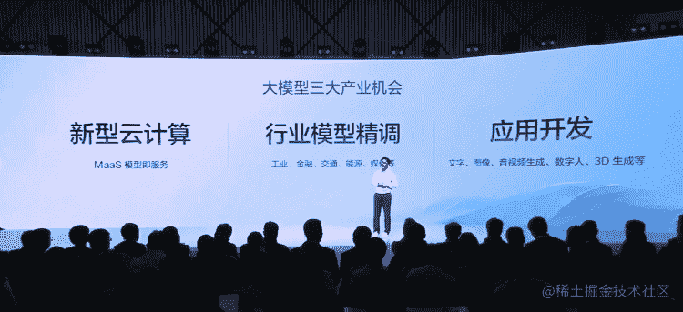

文心一言说到底还是我们发布的第一个大模型，也许我们应该再给一点点耐心，未来希望文心一言真正能够让这场人工智能变革走进我们每个人的学习生活，开放给每一个人。

#### **ChatGPT****+办公**

目前来说ChatGPT对于我们普通人来说是最大的福音，除了聊聊天打打趣，最直接相关的方面就是与我们的办公软件的结合，这也是我们认为人们应该最先感受到人工智能时代已经到了的地方。ChatGPT将大大提高我们的办公效率，解放我们的生产力。

我们最常用的办公软件Word、Excel、PPT和PDF，其实已经有很多人做出了和ChatGPT的结合应用，下面我们就来稍微介绍一下。

+   **Word**：ChatGPT与Word的结合目前大部分都是以插件形式提供的，即在Word的中插入ChatGPT插件的功能，接入ChatGPT的API，在API中提问，进而达到对Word文档的分析、总结、扩写、缩写、生成文章等等功能，代表：ONLY office、不坑盒子等。

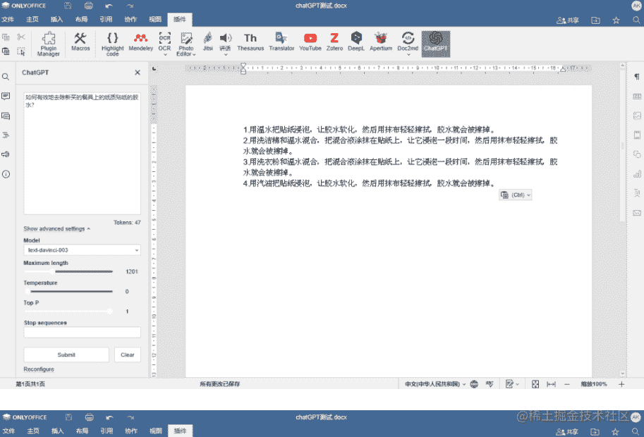

+   **Excel**：Cha[tGPT与Excel的](https://www.chatexcel.com/)结合目前有来自北京大学深圳研究生院 / 信息工程学院袁粒老师团队实现的ChatExcel，主要由三名硕博生独立研发。谈谈使用之后的感受，当使用的表格数据量很大时，该工具的性能还有待提升，不过这也仅仅只是一个开始，相信在不远的未来，这个工具的功能一定会更完美，这个美而小的产品未来可期，大家可以访问酷表ChatExcel网址进行试用。

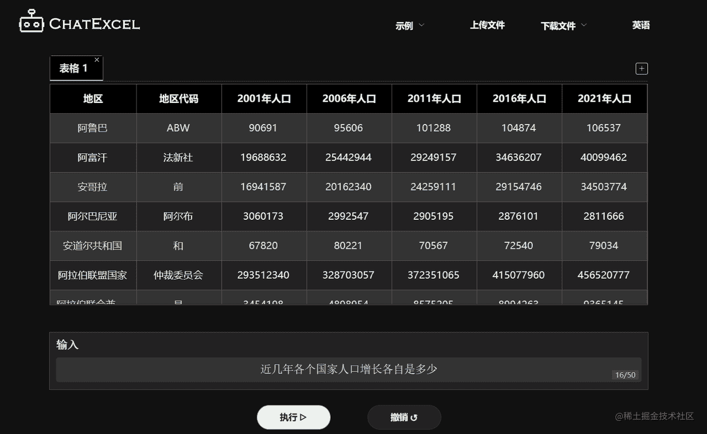

+   **PPT**：ChatGPT与PPT的结合有ChatBCG，你敢相信只需要一句话就能生成一个PPT吗？是的，ChatBCG就有这样的能力，在ChatBCG的网址里，只需要输入一句话就可以生成一个PPT，而且还能对生成的PPT进行编辑，比如说调整颜色、风格、字体等等，ChatBCG是由ChatGPT和DALL-E 2结合的，甚至可以根据一篇论文生成PPT，下面就是ChatBCG的官网，只需要像在ChatGPT一样输入一句话在对话框中就可得到漂亮的PPT，是的，你没看错在笔者访问他的时候他已经被玩宕机了，因为实在太火了。

+   **PDF**：ChatGPT与PDF的结合有ChatPDF，说实话该工具的功能和前面Word的有点像，毕竟Word和PDF是可以直接转换的，但是也有其独特的应用点，比如在论文、报告这种大篇幅文章方面，可以直接将PDF放进去，然后一点点去问它你想要知道的东西（如下图2）。

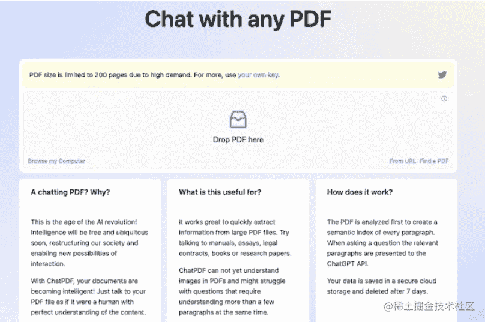

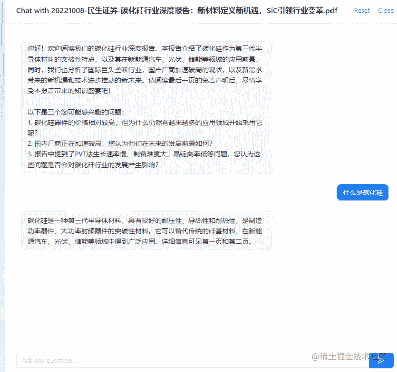

以上都是ChatGPT与办公软件单方面的结合。然而2023年3月16日，科技巨头微软在其官网宣布，公司正在将其人工智能（AI）技术植入到办公软件中，其实就是GPT-4，该功能名为“Microsoft 365 Copilot”。从官方的演示视频中，我们可以看到copilot可以直接一句话在Word中生成文章，提炼文档总结，一句话生成十几页漂亮的PPT，一句话在Excel中进行简单的数据分析和可视化，帮你写邮件，总结实时的会议纪要等。目前已经在测试中，相信不久就可以开放使用。

####

#### **ChatGPT****+教育**

ChatGPT已经对教育行业产生了巨大的影响，据调查89%的美国学生使用ChatGPT做作业，甚至有因学生的作业太完美而被老师质疑抄袭，是的，ChatGPT就像一个“哆啦A梦”，仿佛无所不能无所不知，可以告诉我们任何事情。

最近，著名非盈利教育机构可汗学院发布了他们的智能辅导产品：Khanmigo，它就是通过GPT进一步打造的，专门训练了教育辅导方面的各种知识，使得它能够在学生遇到问题的时候，只需要点一下Tutor me就能够帮助学生解决复杂的问题，而且并不像百度一样直接告诉你答案，通过循循善诱启发你思考，让你一步步解决问题。Khanmigo还会为你提供量身定制的学习计划，给出学习建议等等。你还能在它设定的场景里进行学习，比如说批改一篇作文、与机器人进行一场辩论、进行创意写作等等。

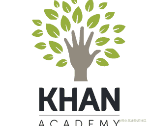

说完了Khanmigo，我们再来看看另一个厉害的学习编程的工具，它也是基于GPT开发的自动学代码的工具，甚至就是OpenAI自己做的，cursor一个可以自动生成代码和注释的编程工具，而且还支持不同的编程语言。我们只需要按Ctrl+K调出对话框，输入我们需要实现的功能，它就可以自动生成相应的代码，如果你看不懂这段代码的含义，可以直接框选那部分代码，按下Ctrl+L键，就会在右边生成代码的功能描述。

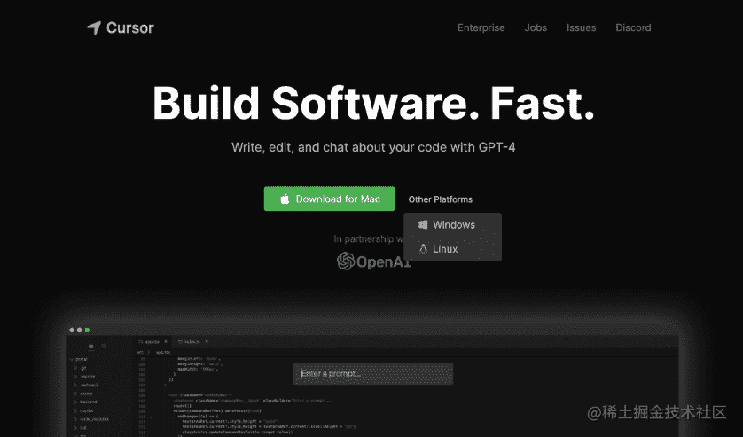

说完大的应用，我们也可以看看在比较小方面下的细分赛道的应用，比如说“口语教育”，也许你还不知道，ChatGPT是可以说话的，靠什么呢？很简单的一个插件：Voice Control for ChatGPT，可以在谷歌的插件商城进行下载，下载之后，在ChatGPT页面下面会出现这样一个麦，这样就可以进行口语的输入了。

像这样的AI口语教育，国内已经有应用落地了，有一个留学生的博主搞了一个小程序——AI口语练习室，就直接调用了该功能，实现了AI口语教育的落地，你可能会说这和直接抄有什么区别，不就是一个搬运嘛，从本质上来说，他就是搬运的，但是我们可以看到这里面大有可为，并不是单纯的照搬，他们做了功能的细化，把英语分成两种应试和应用两种模块，应试模块里面有雅思、托福、BEC、口语模拟等功能，应用模块里面有旅游场景、面试场景、商务场景的英语练习，这里面就包含了各种以prompt为主的测试和产品设计，目前该小程序是采用会员制收费的。

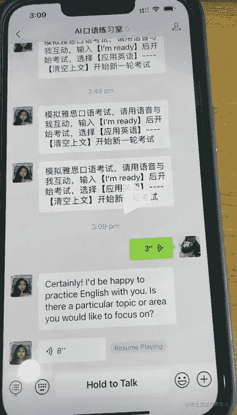

#### **2.2 行业层**

#### **ChatGPT****+游戏**

ChatGPT可以帮助游戏的内容更吸引人，得到更有意思的创意和更真实的场景对话等等，还可以在游戏制作的过程中缩短游戏制作的周期，降低游戏制作的成本。如下图所示，我们就可以看到游戏公司最重要的核心的就是美术人员，在以前，美术人员可能要用一天的时间完成的内容，在人工智能的帮助下，现在可能在一个小时内就可以搞定，以前一个创意可能需要冥思苦想好久时间，但现在可以让人工智能给生成一大堆东西，然后再去做出选择。

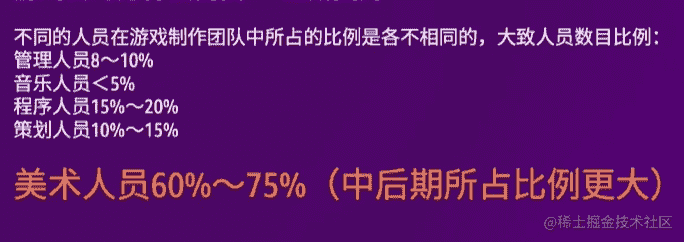

接下来，我们将从游戏策划，游戏内容和游戏制作三个方面介绍一些的应用示例。

+   游戏策划

通过询问ChatGPT关于游戏的一些内容信息，然后让它自由扩写，我们再不断地修正ChatGPT生成的内容，得到一个灵感或者一个你可能都想不到的创意。然后再通过Midjourney把创意画出来，或者通过Unity把游戏内容实现出来。

+   游戏内容

在国内，网易宣布旗下手游《逆水寒》将实装国内首个游戏版ChatGPT。《逆水寒》手游给“游戏GPT”的定位是首个能在具体情境中应用、与游戏机制深度融入结合且用来丰富游戏虚拟世界的智能NPC系统。

游戏版ChatGPT不仅能让智能NPC和玩家自由生成对话，而且基于对话内容自主给出有逻辑的行为反馈，还可以通过AI随机生成任务、关卡地牢等。该手游预计于2023年内上线。玩家可以用智能NPC的特质来与其交互，例如玩家告诉一个敌对NPC“你家着火了”，该NPC会快速回家，从而避免了玩家与其战斗。此外，如果一个NPC的特质包含“知恩图报”，在BOSS战中，该NPC可能会为玩家挡下攻击，因为玩家曾在荒漠中给他食物和水。《逆水寒》手游将智能NPC描述为“有灵魂的群演”。

在国外，游戏开发者Bloc在游戏《骑马与砍杀2》开发的实验性Mod中实现了NPC的智能对话，《骑马与砍杀2》是一款设定在欧洲中世纪风格架空世界的游戏，有详细的设定细节，除了战斗外，还可与游戏世界中的各种角色交互，该游戏在Steam上获得“特别好评”。

除了基本玩法外，游戏还提供接口和Mod制作工具以方便玩家按自己喜好修改、扩展游戏内容，Bloc就是这方面的高手。在Bloc的游戏Mod中，玩家扮演一个中世纪的骑士（左），在路上遇到一个NPC村民（右），该村民介绍自己的职业是铁匠。

于是，玩家开始提问：既然你是铁匠，可以为我打造一把剑吗？

铁匠NPC回答“没问题”，同时介绍了不同用料的成本，并询问玩家的预算和铸剑要求。

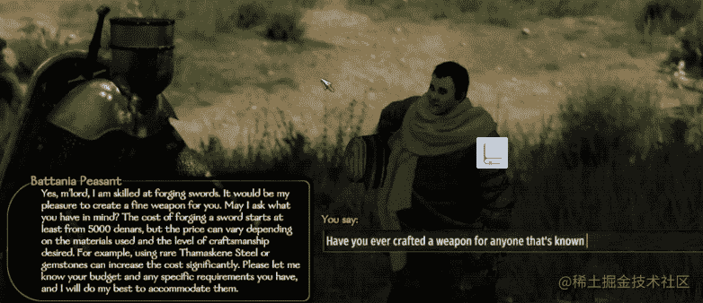

随后玩家问了一个开放的问题：“你还为这片土地上的哪些贵族铸过剑？”结果铁匠NPC丛容应对，有理有据，并且不忘继续追问玩家对剑的种类的需求。

+   游戏制作

ChatGPT能在游戏文本、游戏测试、游戏建模等方面给我们带来了巨大的帮助，以下这个视频就是[介](https://www.iculture.cc/knowledge/pig=31554)绍专业游戏开发者用ChatGPT和Unity开发一款射击游戏的过程。视频地址：我用ChatGPT写了一个射击游戏 | ChatGPT玩法介绍-FancyPig's blog (iculture.cc)

####

#### **ChatGPT****+音乐**

大部分人们可能还认为人工智能只能取代重复性劳动，无法产生“创意”或“艺术”。其实不然，相反AI最火爆的领域就是艺术，AI绘画、AI音乐生成等都要比ChatGPT还要早被创造出来，并不断完善。我们今天就以ChatGPT+音乐来看看AI在艺术领域的无穷想象力：随着ChatGPT的爆火，先锋音乐人们也闻声而动，利用ChatGPT创造更有意思的音乐，就比如我们熟悉的歌手刘柏辛。

近日她在社交平台发布了一段短视频记录了自己如何在ChatGPT的帮助下创作出一首新的音乐，大概的过程：刘柏辛向ChatGPT提问，要求它帮她写一段关于伤心草莓的歌词，然后再补充了曲风的形式，ChatGPT的建议是法式浩室舞曲，还给出了和声等方面的建议，最后刘柏辛基于ChatGPT的建议和自己手动调整完成了这首全新的音乐，音乐欣赏的链接：刘柏辛Lexie的主页 - 歌手 - 抖音 (douyin.com) 。

####

#### **ChatGPT****+零售电商**

我们先看看在亚马逊AIGC创新实践大会--电商分会场上，关于对零售电商在AI领域的看法有以下几点：

在产业端：

+   多模态数据分析称为零售电商行业热点

+   多模态数据融合助力行业AI模型训练及开发

+   加速构建大规模虚拟电商环境下的AI应用

在消费端：

+   AIGC称为塑造数字内容交互式生成的基础设施

+   AIGC应用生态促进内容消费市场的发展

+   增强智能机器人和数字人的应用

AIGC在电商行业的使用场景：

+   营销：数字人直播、文案、短视频

+   售后：智能问答、操作指南

+   展示：产品物料（图片、视频）

结合上述应用场景和AIGC在产业端和消费端的发展，AIGC给我们展现了在零售电商方向上的应用潜力，其中ChatGPT无疑是AIGC中不可或缺的力量，比如在上面提到的文案、智能问答、操作指南等方面，我们就可以有所发挥，零售电商无非三点：人的营销、货的品质和展示、渠道的打造，ChatGPT可以帮助我们生成营销话术、货品的卖点挖掘、评论观点的挖掘等等。

也许ChatGPT不能帮助我们直接进行AI直播，但是我们从下面这张图中可以看出快速开启AI直播的方法和步骤，其中的一些部分ChatGPT是可以完美胜任。

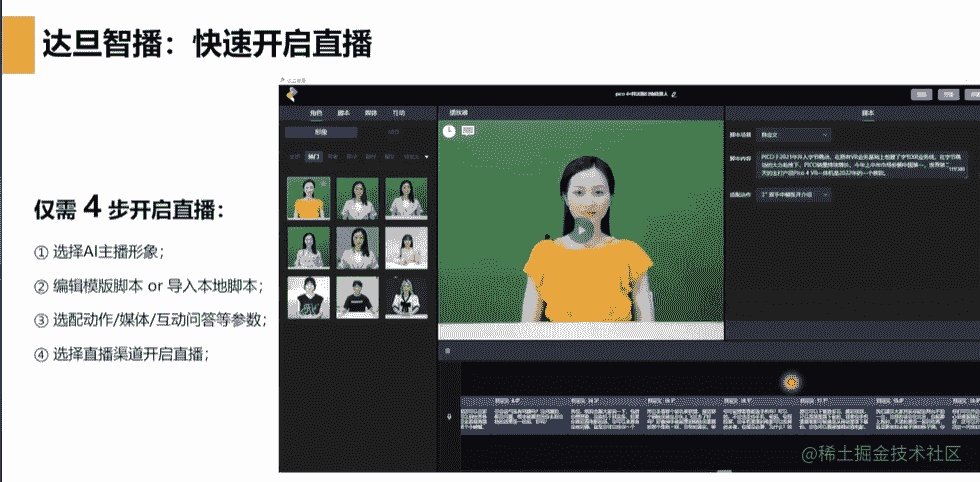

####

#### **ChatGPT****+广告营销**

> 创意没有上限，但AI可以不断提高下限，无论你用或者不用，工具始终在那里。

ChatGPT是目前最强的自然语言处理工具，与此同时，广告营销在这方面也有着巨大的需求，可以帮助企业分析其目标受众的行为和兴趣，并根据这些数据提供有关市场趋势和受众反应的见解；可以提供有关广告创意的建议和创意灵感，以及根据受众数据定制广告内容和形式；可以协助企业实现自动化广告流程，例如通过自然语言生成技术自动生成广告文案；可以帮助企业进行跨语言营销，翻译和转换广告内容，以便扩大受众范围。从而帮助企业更好地了解其受众、制定有效的营销策略，并提高广告投放效率和营销效果。

在营销方面，AI可以进行创意生成、提供虚拟客服、进行电商导购。在创意生成方面，包括广告创意、广告配乐、海报、插画等；在虚拟客服方面，包括私域导流、虚拟人物等；在电商导购方面，包括智能客服、视频生成等应用功能。

亚马逊为广告创意提供了一整套的架构解决方案：设计师或者产品经理等可以将产品图或者产品需求提交到亚马逊的EC2中，EC2将产品图放置在Amazon S3上，将产品数据放置在MongDB数据库中，然后EC2再进行数据处理存储在Amazon S3上，将生成的数据放到亚马逊的模型中进行训练，最后输出产品最终的效果，EC2再对产品效果进行推理处理，将结果存储在MongDB数据库和S3系统上，最终设计师可以直接在亚马逊上找到对应的产品效果，进行广告展示。

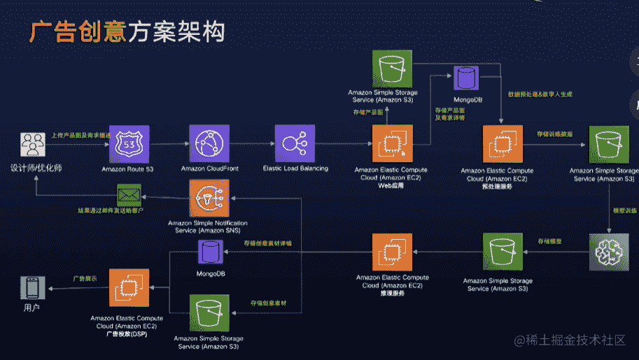

####

#### **ChatGPT****+媒体新闻**

同广告营销一样，ChatGPT在媒体新闻也能发挥不同凡响的作用，帮助媒体新闻行业的工作人员提高效率，简化流程，缩短时间更加具有时效性。可用于以下场景：新闻采编，新闻稿件写作，视频剪辑，新闻播报等，最新的GPT-4模型已经可以实现全部功能了。

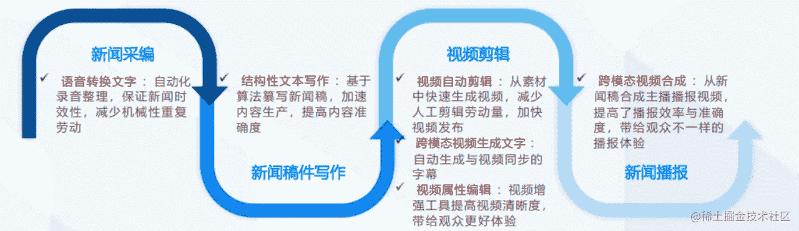

从最初的GPT-3时，其实已经有人在不断地尝试和创新，比如Jasper一个文案自动生成的平台，仅仅通过一个文案生成的功能就已经实现了15亿的估值，可见大语言模型在媒体新闻行业的不俗前景和广阔应用。

ChatGPT在传媒行业最重要的时效性上也有不错的发挥，比如地震救灾的报道、财经新闻的编写等方面，人工智能的产出时效性比人更快更好。

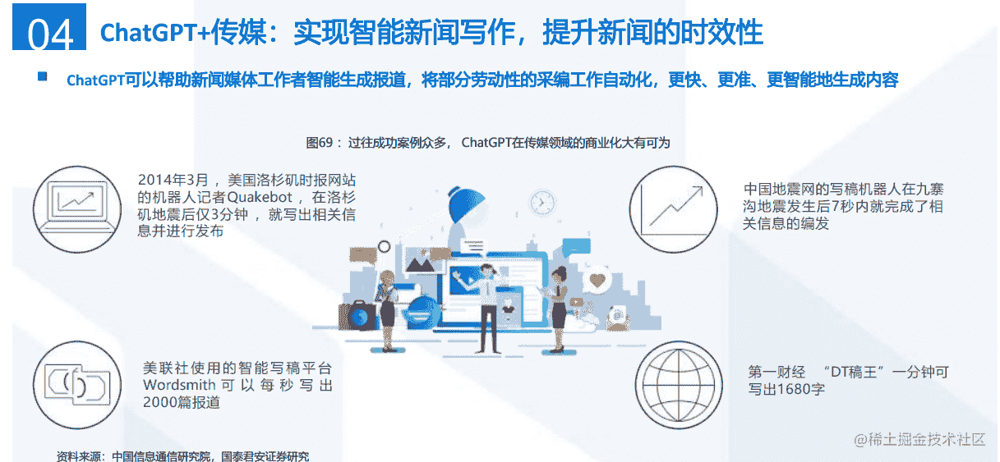

ChatGPT还能在AIGC领域帮助我们创作更好的娱乐体验、创建更多的虚拟资产、丰富虚拟世界推动元宇宙的发展等。

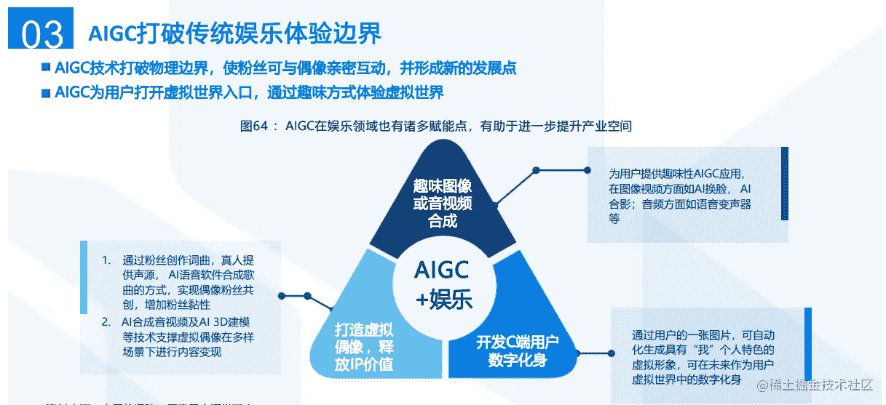

####

#### **ChatGPT****+金融**

ChatGPT可以优化我们的金融服务，实现降本增效的目的。通过ChatGPT塑造虚拟金融理财顾问，输出金融营销视频等，更好地实现金融服务，在金融行业的智能运营、智能风控、智能投顾、智能营销、智能客服等多个场景产生影响，降低金融行业的门槛，使普通人也可以获得比较专业的金融知识和服务，帮助降低金融风险，提高金融安全和可信度。一方面，金融机构可以通过ChatGPT实现金融资讯、金融产品介绍内容的自动化生产，提升金融机构内容生产的效率；另一方面，可以通过ChatGPT塑造虚拟理财顾问，让金融服务更有温度。

ChatGPT在金融投资领域也可以发挥重要作用，在每一笔投资的背后肯定需要详细的调研和考察，在这个时候，ChatGPT可以帮助我们快速地获取相关方面的资料，发挥通用型人工智能的优势，从各个方面获取想要的资料和信息，并帮助我们进行数据的处理，最终做出最好的投资决策。

2023年3月31日，金融领域的ChatGPT来了，纽约彭博社发布研究报告向我们展示了BloombergGPT，它由7000亿语料库训练，一半来自彭博社自身的3630亿金融数据，另一半则是公共的数据集3450亿，参数为500亿左右，该模型将重塑金融分析师的流程，未来也会上线纽约彭博社的终端为客户提供服务。我们相信未来这样的模型将在各行各业中涌现，不断提高行业的效率，形成更大的生产力。

那么ChatGPT能给我们个人带来怎么样的投资机会或者金融方面的机会呢？在传统的量化投资过程中，你需要懂投资，还要懂代码，不过现在可能就不用较强的代码编写能力了（至少目前是这样，未来可能就完全不用了）。最近就有人用ChatGPT帮助他写出了一个回溯1200%的量化投资策略。首先他在量化交易平台上选择一个已经有投资策略的模型作为基础，然后根据自己的风格让ChatGPT优化该策略模型，其中优化的第一步是只做多头仓位不做空，第二个是调整超买超卖的情况，第三个是调整单笔下注的金额，最后通过回测这个策略从原来的58%飙升到1200%。这个可能就是ChatGPT给量化领域带来的改变，也许他有一定的运气程度，但是我们可以通过这种方式找到一个更好的交易策略，而且可能通过完全零代码的方式完成，这将带来极大的便利。

####

#### **ChatGPT****+医疗**

ChatGPT能帮助医生提高诊断和治疗水平，同时也能够为患者提供更好的医疗服务和健康管理方案。在快速诊断方面，通过快速了解患者的病情并给出较为合理的及时反馈，通过人性化的方式第一时间抚慰患者，从而舒缓患者的情绪，加速其康复；同时让医生有更多的时间和精力集中在关键患者的关键治疗环节上。在医学影像方面，GPT-4技术通过建立文本与图像之间的联系，将图像上的关键信息转化为准确的文字信息，提升医生的检测效率和检测能力。在诊断过程方面，能够改善医学图像质量，自动录入电子病历，减轻医生的工作压力。

基于ChatGPT，在医疗领域可以有以下几个应用场景：

+   医学研究：对于医学文献和临床记录等大量的文本信息，ChatGPT可以进行文本处理和语义分析，提取有用信息，加速医学研究和临床决策的过程。

+   诊断辅助：ChatGPT可以利用机器学习和深度学习技术，结合大量的医学影像数据，协助医生进行疾病诊断和治疗方案制定，提高诊断准确性和治疗效果。

+   智能健康管理：结合传感器技术，实现智能化的健康监测和管理，如健康数据的自动记录和分析，提供针对性的健康建议和干预措施，帮助人们更好地管理自己的健康。

+   医疗机器人：与机器人技术结合，实现手术和治疗等操作的自动化，提高手术精度和效率，减少医疗事故的发生，还能进行智能医疗问答帮助患者排忧解难。

#### **ChatGPT****+设计**

在设计领域，ChatGPT可以帮助设计师更快、更准确地获取和分析设计相关的信息，提升设计效率和质量。比如帮助设计师快速生成产品的文字描述、产品介绍、广告语、用户手册等，让设计师专注于产品本身的设计。通过对图像的识别和分析，帮助设计师了解用户的需求和行为模式，从而优化设计方案。对设计数据进行分析，帮助设计师发现产品的优势和不足，及时进行调整和改进。根据用户需求和历史数据，生成一些创意性的设计方案，帮助设计师快速得到启发和灵感。

在设计领域最重要的可能就是图片或者模型的生成，AI 辅助包装设计和服装设计的图片生成是最为常见的场景，在这一领域上，已经有不少公司推出了智能设计平台或者AI设计平台，其中犀牛智造推出AI设计平台，canva推出了可画在线设计平台等，还有最近最火的基于Stable Diffusion的AI绘画平台Midjourney，很多设计师已经开始用它进行设计工作了。

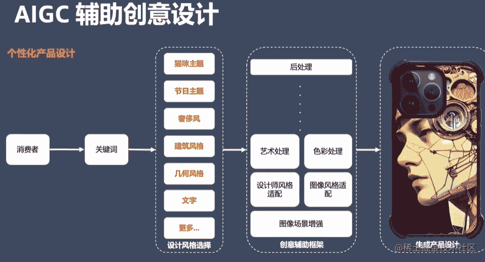

包括在3D领域，也已经出现了自动化设计和模型生成的AI工具，提高设计师的工作效率，实现更大的创意。比如自动设计工具Figma Plugin、Text-3D工具等。

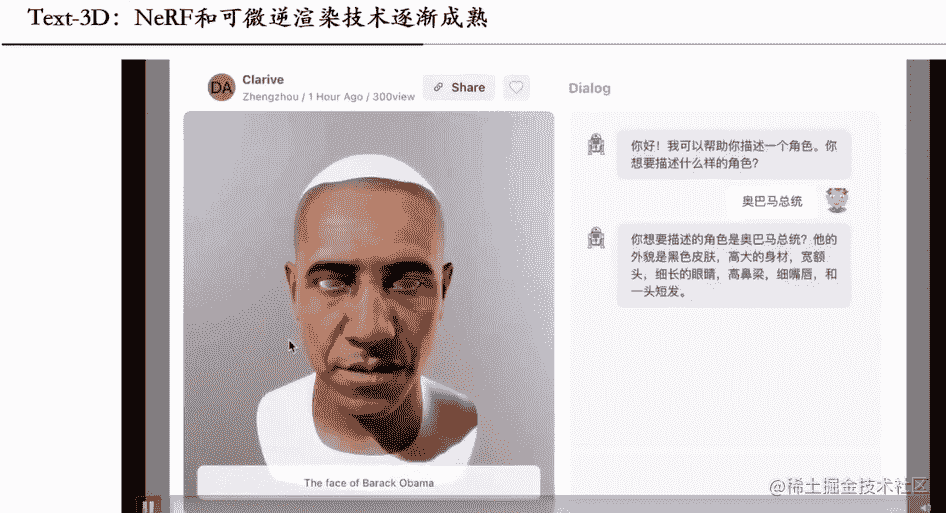

#### **ChatGPT****+影视**

在影视行业，ChatGPT也将产生深远的影响和变革，最为明显的就是剧本创作，我们无法要求一个编剧一分钟产出一个剧本，但是ChatGPT可以，也许这个剧本不能直接拿来使用，但只要稍加修改，一个专业的编剧一定可以做到一个小时或者一天之内完成对剧本的调整和成品的产出。而且还能让ChatGPT帮助我们定制特定内容的作品。甚至在GPT-4中，已经可以实现由文字到视频的跨越，只需要一句话就可以生成一个视频。

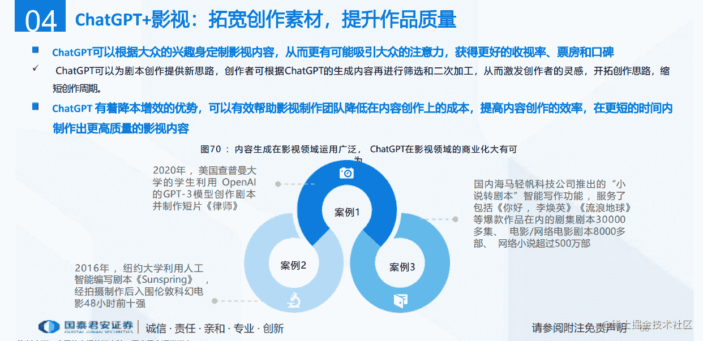

随着GPT-4的加入，AIGC将在影视行业实现更大的突破和助力，带来更多的灵感丰富内容的多样性，提高作品的质量，让人们能够获得更好的体验。

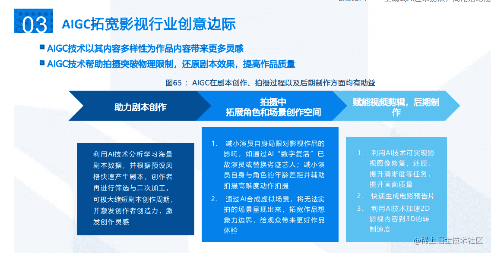

####

#### **ChatGPT****+工业**

ChatGPT可以利用所掌握的技术和知识，在工业领域发挥多种作用，帮助企业实现生产自动化和智能化，提高生产效率和产品质量，同时还可以帮助企业管理人力资源、提升客户满意度和品牌形象，为企业的发展做出贡献。

在工业领域中，ChatGPT的具体用途如下：

+   可以用于客户服务和支持，帮助客户更准确、更快速地解决问题和回答查询，从而提高客户满意度。

+   可以用于预测性维护，分析各种数据集以预测何时可能需要维护，帮助企业减少停机时间和成本。

+   可以用于培训，为员工提供实时的帮助，帮助他们获得新的技能和知识。

+   可以用于质量控制和监测，分析各种数据集以识别生产过程中的缺陷和异常，从而提高产品质量和效率。

+   可以用于供应链管理，提供关于不同运输的状态的实时更新，并帮助企业优化其供应链运营。

**3. 总结和建议**

---

大海因为广阔所以令人心驰神往，星空因为浩大所以令人痴迷留恋。LLM的星辰大海同样令人如痴如醉，相信它会像大海一样取之不尽，有无限的可能性；同时它也像星空一样绚烂神秘，有无穷的韵味。希望你也能在LLM中找到自己的机会，发现属于自己的星辰大海。

### **相关文献**

+   【1】[《2023中国AIGC市场研究报告：ChatG](https://github.com/HeteroCat/HeteroCat-blog/blob/main/%E5%8F%82%E8%80%83%E8%B5%84%E6%96%99/2023%E4%B8%AD%E5%9B%BDAIGC%E5%B8%82%E5%9C%BA%E7%A0%94%E7%A9%B6%E6%8A%A5%E5%91%8A%EF%BC%9AChatGPT%E7%9A%84%E6%8A%80%E6%9C%AF%E6%BC%94%E8%BF%9B%E3%80%81%E5%8F%98%E9%9D%A9%E9%A3%8E%E5%90%91%E4%B8%8E%E6%8A%95%E8%B5%84%E6%9C%BA%E4%BC%9A%E5%88%86%E6%9E%90.pdf)PT的技术演进、变革风向与投资机会分析》

+   【2】[《ChatGPT 研究框架（2023）](https://github.com/HeteroCat/HeteroCat-blog/blob/main/%E5%8F%82%E8%80%83%E8%B5%84%E6%96%99/ChatGPT%20%E7%A0%94%E7%A9%B6%E6%A1%86%E6%9E%B6%EF%BC%882023%EF%BC%89-%E7%94%9F%E6%88%90%E5%BC%8FA%E8%BF%8E%E6%9D%A5%E6%8B%90%E7%82%B9%2C%E5%95%86%E7%94%A8%E8%90%BD%E5%9C%B0%E5%89%8D%E6%99%AF%E5%8F%AF%E6%9C%9F.pdf)-生成式AI迎来拐点,商用落地前景可期》

+   【3】《哈尔滨工业大学：ChatGPT调研报告》

+   【4】[《亚马逊AIGC创新实践大会》](https://www.awsevents.cn/AIGC0309/listDetails.html?s=8197&smid=16974&vep_st=#zbhc)

---

## AI大模型如何在行业实际落地：企业对话场景拥抱大模型之路

采访嘉宾 | 中关村科金·AI 平台能力中心

作者 | 刘燕

大模型构建人机协同的新型生产关系 。

### 1、对话式 AI 产品拥抱大模型

一个大胆的决定

自 2014 年成立以来，中关村科金就选择专注于企业服务赛道提供对话场景服务，聚焦生成式 AI 技术，包括领域大模型、大数据分析、多模态交互三大核心技术。如今基于这三大类核心技术，已形成了一套完备的技术体系，并构建了一个基础的技术底座 — 即生成式的得助对话引擎。

这些底座式的能力都由 AI 平台能力中心来提供支持的。这是一个在内部被定义为偏底层、汇聚“原子能力”的地方。这个能力中心，既要构建前沿的技术能力，又要快速响应前端业务系统的变化，构建标准化的产品组件用以快速落地。

“我们一直在探索对话式 AI 技术在企业服务赛道的创新应用，同时积累数据，比如对话场景的 KnowHow。此外我们一直紧密跟踪大模型的发展趋势，进行相关的技术更新和迭代，比如预训练模型如何在领域里做优化，为企业提供贴合实际应用场景的模型等。” 中关村技术副总裁张杰博士表示。

自 2018 年开始，预训练模型逐渐兴起，起初用的比较多的是判别式模型，例如 BERT 模型。近几年，预训练模型几乎是以爆发式的速度增长，参数规模逐年上涨。尤其是去年 11 月底，ChatGPT 火爆出圈成为革命式的事件，基于 GPT 出色的生成效果，很多传统的 NLP 任务都规划到了生成模型中。从 BERT 到后来的 T5，再到 GPT4，张杰团队观察到， 整个技术发展的趋势，在向一个统一范式的方向发展。

“大模型 + 领域知识”这一路线，核心是为了利用大模型的理解能力，将散落在企业内外部各类数据源中的事实知识和流程知识提取出来，然后再利用大模型的生成能力输出长文本或多轮对话。但是这个方向上一直没有一个创新力强的产品出来。ChatGPT 发布后，让张杰和他的团队眼前一亮。

“以前我们主要用 BERT 技术**体系****解决****实际业务问题，ChatGPT 出来后，我们重新研究了 GPT 整个发展路线，梳**理好整个大模型的技术发展脉络后， 从 AI 技术发展角度研判，生成式大模型可能是未来通向通用性 AI 的一条可行性路线，于是大胆地做了一个决定——在产品中，积极探索应用生成式大模型解决实际业务问题 。”

从传统对话引擎转向大模型对话引擎

“通过新一代的得助对话引擎， 我们正在从传统的对话引擎迈向大模型的对话引擎，用一套对话引擎支持多种业务系统，业务系统会基于行业线进行拆分，在不同的行业线还推出了私有化和 SaaS 化的版本。”中关村科金资深 AI 产品总监曹阳介绍，通过一套技术体系对产品进行能力赋能具有很多优势，以前产品矩阵的底层有几百个定制化模型，运维起来非常麻烦，现在可以统一用一套大模型就搞定了。

于皓介绍， **新一代得助对话引擎的核心能力是：领域 CoT + 领域**大模型 + 领域知识库 + 领域能力套件。通过将领域的 konw-how 转化为领域 CoT，使大模型具有更复杂的业务问题解决能力；通过外挂知识库的形式，把事实性知识的流程性知识都放在领域知识中台内，大模型用来做抽取、调度和生成，然后下游业务系统通过 API 获取结果，以保证业务知识的实时性、可靠性；通过领域能力套件，打通大模型和企业已有系统的融合，建立模型和企业已有业务系统的无缝链接，将大模型的能力充分释放到各个业务系统中。

**在新一代得助对话引擎的设计中，充分考虑到**实际业务情况， 轻量化部署本地化大模型是未来企业的强烈需求，团队研发了本地化大模型的快速优化套件，主要包括领域知识的注入能力、领域 prompt 生成能力、领域指令自主生成能力、领域指令微调能力和领域规范行为对齐能力，可以帮助企业快速构建适合于自身业务场景的大模型，降低大模型在企业的落地门槛。

于皓介绍，在得助对话引擎架构的设计过程中，也充分考虑了 ToB 场景的特性。在 ToB 场景中，企业有很多领域知识，但这种领域知识基本都固化在各个知识库里，如何结合大模型的隐性领域知识和推理能力，与企业已有的固化好的显性知识融合起来，这是目前需要解决的一个大问题。

因此在设计引擎架构时，于皓的算法团队把知识库和大模型的基础推理能力相融合，结合企业固有的知识满足实际业务场景需求。针对解耦合的模式设计了交互式的推理能力，例如针对问答场景，首先要理解问题语义，抽取出问题中涉及到的实体关系，如果问题属于隐形知识范畴，就由大模型直接回答。如果涉及到业务中的显性知识，其可能存在于结构化数据库或者文档库等形式的知识库中，大模型需要利用领域 CoT 和领域能力套件自主性生成查询语句，根据查询语句到知识库里查出相关知识，把知识提炼出来之后，再根据上下文生成对话的形式，将一个复杂的问题做思维链推理，提炼成简单的问题，借助于领域能力组件可以从知识库、业务系统或者互联网等资源检索信息，再借助于大模型的上下文学习能力归纳总结出答案，在这一模式下，重点在于大模型解决问题时的推理合理性、过程可控性和结果的可靠性。

### 2大模型如何在领域落地，打造超级员工

“超级员工”形成的技术路径

在基础大模型能力加持下，得助对话引擎帮助企业构建“超级员工”，需要经历“学、教、用”三步形成路径。

**第一步：学****，**大模型在领域数据上的无监督学习。

大模型就像是一个智商较高、理解能力很强、过目不忘的“文科生”。中关村科金 AI 平台能力中心在这个底子很好的“文科生”基础之上，注入企业的领域知识，如各种培训材料、行业通用知识等，让大模型能够理解领域知识，成为一个具备领域知识的“普通员工”。

**这一步****的重点是让大模型从散落在**各处的数据源中萃取出领域事实性知识。

中关村科金高级算法工程师罗华刚介绍，做到这一步的关键是要“及时动手自制”。ChatGPT 用的数据都是开源的，没有规范的具体领域数据。而如果要应用到领域里，则首先要用自己的领域数据。比如中关村科金积累了多个行业大量的对话数据，把这些高质量对话数据灌到大模型里训练，就可以让模型更符合领域分布，那么，它生成答案就会带有领域的知识，这种是隐性的知识。

对于事实性的动态知识，模型是难以把控的。比如针对具体某个金融产品，客户会询问利率，正确答案是 5%，但是大模型生成的结果可能是 6%。大模型善于理解用户的意图，使生成的回答符合逻辑，但并不能保证事实性。另外，随着时间的推移，这款产品的利率可能会降低，变为 4%，大模型很难及时跟进此变化。

事实性的动态知识尽管也可以通过训练融入大模型，但无法保证输出的正确性。如果要保证正确性，就会让这个模型过度拟合，这不符合训练模型的目的。因此对于事实性的动态知识，非固有的领域性知识，罗华刚团队参考了 GPT-4 提供的插件功能，来保证大模型实时输出的正确性。“我们将它作为插件，领域知识库 / 中台作为它的事实性或动态知识的存储地，大模型负责对给出的问题做语义理解，同时发挥中枢调度的功能，最终生成答案。“

**第二步：****教，从人类反馈**中以小规模有监督学习的方式做微调。

“普通员工”依托专业的产品设计，不断和人类专家进行闭环反馈。基于人类专家的反馈，它能够不断地获得提升，逐步成为“超级员工”。

这一步的技术难点是，如何让大模型学到流程性知识。因为与事实性知识相比，流程性知识更强调连续性和逻辑性。

为了让大模型具备流程性知识，罗华刚介绍，可以采用两种方式。一是无指导学习的方式，让模型自己去体会对话中存在的知识，将对话数据以及对话数据产生的目标（比如，营销场景下坐席与客户的对话数据，最终是否完成了销售任务）设为标签，作为一个监督性的任务进行微调。

第二种是有指导学习的方式，告诉模型怎么做，这具体有两种方法，一是采用思维链的技术，加入逻辑引导，比如针对一小段对话，加入逻辑分析，告诉模型如何分析这通对话，分析顾客的特点、顾客表现出的意愿等，输出一个更优质的对话告诉模型，这样的例子是比较好的，让模型再去学习这样的案例，大模型通过学习一个评判模型来评判一个对话逻辑。另一种方法可以考虑采用强化学习或 GAN 的形式，比如，机器人与机器人之间产生了对话，再去评判这通对话做的怎么样，通过这样不断地来回学习，使模型的能力越来越强。

第三步：用，在特定场景下以机器人或助手的方式应用。

成为具备领域知识的“超级员工”后，企业可以给它分配特定的任务，在具体的场景下进行应用。比如撰写营销文案，自动解答用户的问题，或辅助坐席去回答一些问题等。

**这**一步的关键点是产品设计，如何合理的为人类员工和数字员工分配任务，实现能力互补，并且让数字员工从业绩反馈中持续学习。

曹阳介绍，为“超级员工”分配任务，目前是机器 + 人工结合的方式。基于业务属性，会按照一套通用的框架和流程进行分工，到具体环节会采用单元模式的动态人工介入的方式。

这种方式的核心是单元化产品逻辑，所有的业务单元都会抽象到一个整体的单元，系统会按照固定流程执行，流程中涉及到人工审核或验证环节。人工参与的程度可以根据业务问题的复杂度进行动态调整，简单的业务问题系统会进行自动化处理，复杂的问题交由模型处理后，人工再进行审核。针对不同的业务，也会动态化的控制人工参与度，比如，售前营销沟通场景中业务类型比较重要，且用户画像相对丰富，这个环节会有较强的人工介入，其他场景比较简单，动态控制的要求也会相应地降低。

应用案例解析：AI 落地商业空间更大了

“超级员工”的目标是帮助企业降本增效。目前，中关村科金打造的“超级员工”已在各个场景展开试点。罗华刚向 InfoQ 介绍了两个代表性的应用案例。

外呼机器人，让话术师告别“刀耕火种”时代。

一组应用数据显示，以前在一个新场景构建外呼机器人，大概需要 22-23 周时间，且需要非常熟练的话术师才行。但现在，借助一个构造好的领域大模型，只需大约 1-2 天时间就可以成功交付，能明显降低交付成本，加快交付效率。

**营销文案助手，赋能理财师撰写营销文案，原先 10 分**钟一条营销文案，现在 10 秒即可完成。

当下的财富管理行业面临业务增速较快，但理财师规模和人才增速不足的挑战。理财师的专业要求高，其中，文案生成就是一项刚需工作，如果技能不够，就容易流失很多高净值客户。因此，理财师亟需借助智能助手工具，将一些繁琐的工作，如编写营销话术工作等交给机器完成，这样就能释放出更多精力放在拓展新客户等工作上。

针对理财场景，中关村科金研发了营销文案助手。它发挥大模型的语言理解能力，将产品的介绍文档、行研报告、权威媒体的财经新闻、专家观点等“灌进”大模型，大模型从这些非结构化文档中，抽取出核心观点及关键信息，如新基金产品的发布日期、期限费率、收费政策、风险等级、利好政策、行业趋势等。这些抽取出来的要素，形成了新的领域知识库。

当理财师选择某一客户时，客户的属性就能从 CRM（客户关系管理系统）中关联出来。根据这些客户特有的属性，理财师就能了解其投资偏好。接下来进入营销环节，根据所处的阶段，大模型可以生成相应的营销话术，为保证生成的内容是准确、可控的，理财师最后对生成的内容进行审核和再编辑。

透过实际的落地实践，中关村科金 AI 平台能力中心发现， 拥抱大模型也明显加速了 AI 商业化的进程。

“** 在探索大模型实践的过程中，我们尝试了多个对话应用场景，也和****客户共****创了一****些有****场景代表性的试点项目。”**张杰坦言，“ 使用大模型以后，已有的对话产品中定制化建模的成本降低了，而且之前技术达不到要求的对话场景现在也可以做数智化尝试，AI 落地的商业空间更大了。”

大模型重塑生产关系

未来“超级员工”在企业里所承担的角色，一方面可以完成一些机械、重复的工作，另一方面，可以辅助人工，承担一些创造性的工作，减少员工的工作量。大模型强大的意图理解能力以及泛化性使其完成一些创造性的任务成为可能，这将对企业的生产关系带来重要的变革。

“中**关村科金的愿景是希望通过对话式 A**I 技术，重塑企业的生产关系。现在尽管大模型十分火爆， 但在企业服务赛道，很少有人意识到大模型未来会对企业的生产关系带来很大影响。”张杰表示。

现在的企业生产关系是一个树状的架构，从上往下分别是董事会、职能部门、业务部门，一层一层往下是金字塔式的。现阶段在数字化转型中，企业开始将一些简单的体力劳动、能总结出规律的活动，写成具体的程序，通过自动化校对的方式来实现。也有些企业会训练模型，这些模型会以助手的方式辅助一线员工，员工下面一层也就变成了助手机器人。但整体来看，整个组织结构仍然是树状的，是人 - 人 - 机的架构。

未来，情况可能会发生变化。

张杰表示，“未来大模型带来的启示是，它不但能够替代一些简单的体力劳动，还能替代一些简单的脑力劳动，甚至包括那些能够从日志里总结出经验的脑力劳动。”

在张杰看来，未来企业的组织结构将呈现纺锤形，上层是人类经营者，中间层真正负责干活的是机器人，少数的业务专家会指导机器或与机器协同互补，是人— 机—人的架构。“机器人在其中的角色并不完全是助手。最开始由于技术所限，它以助手的形态呈现；未来在具备自主学习能力后，它能够真正成为独立承担工作的数字员工，而且是成本非常低的员工。”

未来，随着大模型重构企业组织架构、重塑企业生产关系，可以释放出更多的人力，**开展**更具创造性的工作。但不可避免地，重塑生产关系意味着必然有一些人会被替代掉。 张杰认为，从短期来看，大模型带来的影响是，一些不产生价值的、中间的职能岗位，可能会很快将被机器取代掉。长期来看，关于价值判断、规则制定、以及关乎人性和心理的工作，是大模型不能取代的。

### 3巅覆对话场景：下一阶段企业数字化转型的重点

对于企业来说，数字化是一项“必修课”。最近几年，可以明显感受到，数字化转型逐渐往“纵深化”发展。而大模型技术的爆发，有望给企业的数字化转型进程带来“加速度”。

一个显著的变化是，前几年，企业数字化主要针对企业内部的交易数据和核心业务系统，对这些数据通过数据挖掘的方法进行建模，实现降本增效。

随着近些年大模型的高速发展，对话数据成为企业愈发重视的数据资源。无论在现阶段还是未来，无论是企业与外部客户沟通还是企业内部员工的培训和协作，对话都一直是最主要、最自然的交互形式。在这期间，会产生很多对话数据，包括线下营销和线上营销、文字沟通和电话沟通等场景。

企业希望充分利用对话数据、挖掘对话数据的价值，从而更好地服务于数字化的需求。这也是对话式 AI 技术解决方案提供商当下正在思考的问题。

采访中，张杰谈到了他的一个判断：“ 对话数据，将是企业数字化转型下一阶段的重点。过去，企业的数据只是存了下来，并没有进行结构化的表示和挖掘，更遑论提取出智能服务。随着大模型的到来，可以理解这些非结构化数据中蕴含的语义，进而挖掘出其中的智能服务。”

**张杰表示，大模型能解决对话场景下**数字化转型中存在的“最后一公里”的问题。以销售话术复盘场景为例，很多企业都在针对其做数字化转型，此前大都通过规整和挖掘订单、客户标签等数据的方式进行。但往往在“最后一公里”的时候，无法实现特别好的转化效果。

“最后一公里”是指，业务人员与客户在门店、连锁店、呼叫中心等线下和线上销售的场景交互时，通过对话的方式进行，这一环节没法做数字化转型；“最后一公里”的分析和挖掘也很难做到位，比如传统的客户呼叫中心在进行电话营销时，原先只能做简单的关键词质检，无法做更细粒度的分析。

大模型具备的超强语言理解能力，让“最后一公里”的销售过程实现数字化转型成为可能。具体的做法可以是，通过电子工牌或呼叫中心将销售过程录下来，采用 ASR 语音转写技术将录音转成文本；再通过对话文本挖掘出用户的意图；随着对话过程不断进行，大模型可以实时生成流程图谱，给销售提供对话建议，分析潜在的话题引导方向，提升销售人员的营销技能，提高成单概率和用户的留存率。由此，既能帮助企业通过智能对话服务实现降本增效，也能有效提升用户体验以及拓展服务外延。

### 4对话式 AI 及大模型发展技术趋势展望

对话式 AI 下一步重点是流程性问题

张杰认为，对话式 AI 下一步要攻克的一个技术难题是流程性的问题。对话有流程步骤，如何让大模型，基于一个特定的目的，探索出最佳的实践流程，这很关键。

目前，中关村科金 AI 平台能力中心正在对这一问题进行攻坚。让大模型不断从历史对话中总结话术流程，通过不断地总结完善，使其生成的话术流程更有针对性，可以应对不同客户的诉求。这样模型准确度更高，自动化程度更高，智能化程度也会更高。

程序员的归宿不是提示工程

大模型与之前的预训练模型的不同之处之一就是提示学习（Prompt Learning）。 预训练模型需要微调，大模型往往需要提示。

提示学习是 2020 年出现的新概念，主要是为了解决预训练语言模型训练过程的任务和实际业务的任务之间不一致的问题。通过提示语，可以让预训练语言模型理解当前任务的类型，从而可以更好地完成任务。随着 NLP 技术的飞速发展，现在的提示工程已变得更为复杂，提示语通常包含任务指令、任务目标、行为约束、输出规范、资源清单、样例展示和思维能力提示等要素。

于皓的团队将提示学习作为大模型工程化方向上的研究重点，并在多个场景测试效果。团队根据不同的场景设计了自动化封装的 Prompt 工程的方法，一条思路是离散的提示工程，另一种是连续的提示工程，比如用一个模型把对话自动生成向量，隐含提示工程，然后将提示向量融合到大模型向量中解决问题。

关于提示学习的另一焦点话题在于，未来的提示学习工程师可能会比软件工程师多。对此，于皓认为，“Prompt 工程的确在现阶段非常重要，但至于说未来是不是程序员都成为提示工程师，我的观点是，Prompt 工程可能是暂时的一个中间过程。只是说，现在大模型的能力还没有达到基于人工设定的复杂任务目标去自主性进行任务分解，然后根据这些任务转化成一种它可以直接解决的细粒度的自然语言任务。现在大模型需要中间的提示工程师帮助它理解任务，然后转化成它可以直接执行的自然语言任务，这中间是一个适配的过程”。

未来随着大模型的能力向更高层级提升，会覆盖掉现有的** **Prompt 工程。因此，于皓认为， 程序员的归宿不是提示工程，提示工程一定会被大模型的能力覆盖。未来大模型一定具备很强的交互能力，甚至实现人人都是“陪练师”。每个人在日常工作中可能都会有大模型与之交互，在交互的过程中，大模型会不断提升其对领域的认知能力，增强大模型专业能力，逐渐成为 7*24 小时的“超级员工”。

算力难题下，如何选择适合自己的模型

大模型迎来爆发后，很多企业都在争相上车，但一个现实的问题是，大模型背后所需的算力成本极为昂贵。

以 ChatGPT 为例，其训练约需要万卡时的计算量。对于大多数的企业来说，做到这一点不太现实，全球可能达到这一量级的企业都极少。此外，还面临很多需要处理的技术难题，例如，数据质量差，训练过程中模型缩小导致最终训练结果不及预期等问题。

因此，罗华刚认为， **当大多数企业很难付出像 ChatGPT 这样的大模型所需的成**本时，就需要考虑如何将模型调小以满足需求。模型的规模会随着应用场景的复杂程度及数量发生改变，模型越大，提供的能力会越强；而领域越小，它需要的模型规模越小。因此，在企业自有资源允许的条件下，建议选择尽可能大的模型，使得模型的能力更强。在这种情况下，企业可以考虑用一些方法来降低训练成本，进一步细分到具体的任务场景下，采用比如 Self-Instruction 或 LLM+LoRA 技术。

Self-Instruction 是通过大模型的输入、输出来微调模型，比如，有人训练斯坦福的羊驼模型大概只用了 500 美元的成本，通过调用 ChatGPT 的接口生成一系列的 instruction，微调指令和输入、输出，最后自己的模型只有 70 亿参数，相对而言成本降低了 20 倍，用这样一个模型去拟合，最终它的效果可以接近 ChatGPT 的效果。

LoRA 是指在大模型插入一些小模型，微调时，大模型不动，只微调小模型的部分，也可以达到同样的效果。这种方案牺牲了模型的整体能力，提高了在特定任务上的能力，但这样做能够降低训练成本。

如果企业没有自己的大模型，也没有自己的领域大模型，可以考虑部署开源模型，这样也可以节省算力消耗的资源。

未来：领域模型成王者？

大模型混战之际，业界也在讨论和预测大**模型的终局。张杰的判****断是，未****来会呈现**出 基础大模型多家并存、领域模型百花齐放的状态。

“基础大模型，特别是多模态基础大模型，未来应该只有几家公司做，因为做基础大模型需要大量的数据、算力和人才，这些组合资源极少部分企业能够承担得起。因此，未来一定是有数据、有算力、有人才的公司，更可能去构建出基础大模型。基础大模型未来会聚焦在提升多模态能力、挖掘复杂推理能力，以及构建应用生态圈。”

基础大模型如果想用在实际业务中，还有很多方向需要适配，例如在法律、医疗、金融、政务等领域，很多工作流程逻辑复杂，且对数据敏感性、业务可解释性要求高，基础大模型在这些场景无法直接商用。

这就给未来其他企业留下了空间。如何根据实际的业务，将大模型转化成一种具有高效的计算方式的小模型，小模型再根据专业知识做注入、指令微调、思维链提升、对齐等，使其更适配某一领域的规范约束。

作为对话式 AI** **技术解决方案提供商，中关村科金需要思考的是， 如何发挥自身优势，在领域内如何积累数据，如何沉淀领域知识，如何将领域知识注入到大模型上，以此构建自己的技术护城河。此外，在具体应用场景下，思考围绕对话和推理两种能力颠覆已有的产品体验，挖掘新的应用场景。

“可以畅想，未来大模型领域会是一个百花齐放的局面。个别头部企业会去做大模型，其他企业根据大模型的能力提升每个领域的中小模型，中小模型再结合领域的知识，变得更专业化，这是一个大趋势。”张杰如是展望。

采访嘉宾介绍

**于皓**，中科金算法专家，同济大学计算应用技术博士，先后参与机器学习、知识图谱和大模型领域相关项目数十项，具有丰富的项目实战经验；申请国内外技术发明专利 20 多项，获得第十届吴文俊人工智能技术发明一等奖、2019 年上海市科技发明一等奖、第四届中国保险业年度最佳突破奖等数十项奖项。

**罗华刚**，中关村科金高级算法工程师，北京大学计算数学专业硕士，研究方向为运筹优化、知识图谱、自然语言处理等。曾参与建设 HAO 图谱、知识即服务、图谱 CBB 等多项系统，撰写发明专利三十余篇，协助撰写专著《知识中台》，获 2020 年吴文俊人工智能技术发明一等奖、世界人工智能大会卓越人工智能引领者奖 Top30。

一个价值70亿美元的教训！如何避免平台工程变成“大灾难”？

阿里云一年内将分拆上市；58同城被曝裁员，部分比例达50%；ChatGPT推出iOS版，免费还支持语音 ｜ Q资讯

失控的不仅仅是云成本：一年为可观测性狂烧4.5亿，有钱的“大冤种”也扛不住了

涉及数万人、历时三年，国内最大规模的云原生实践是如何打造出来的？