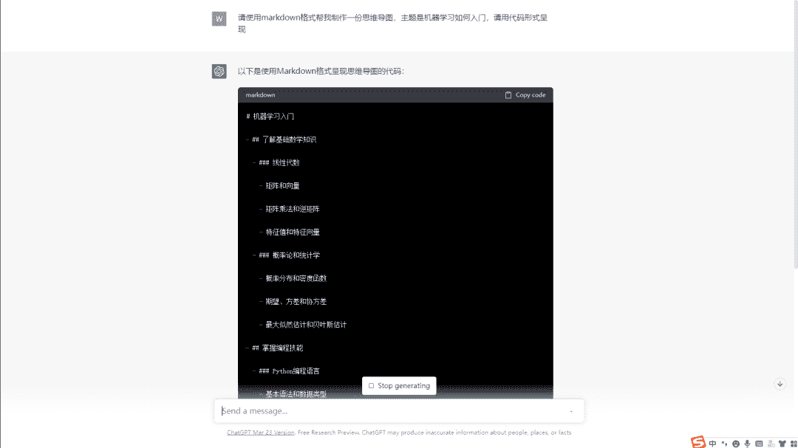
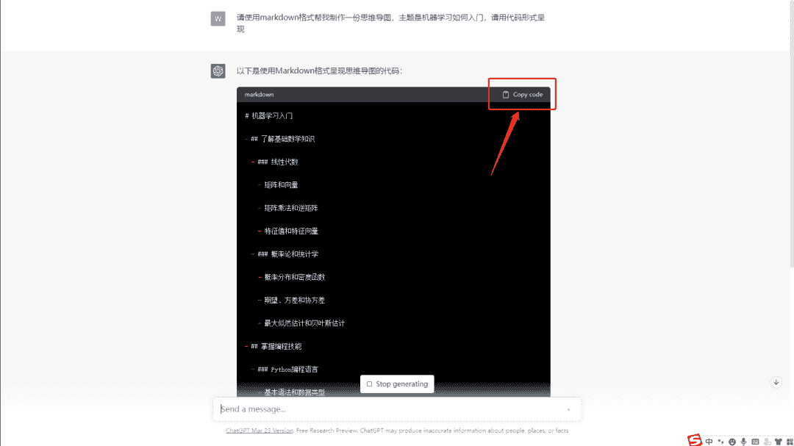
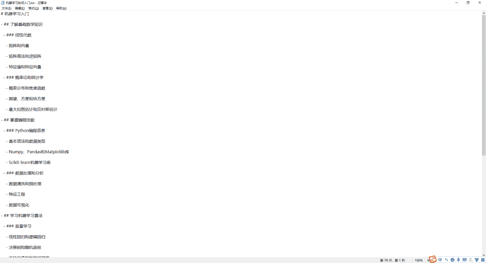
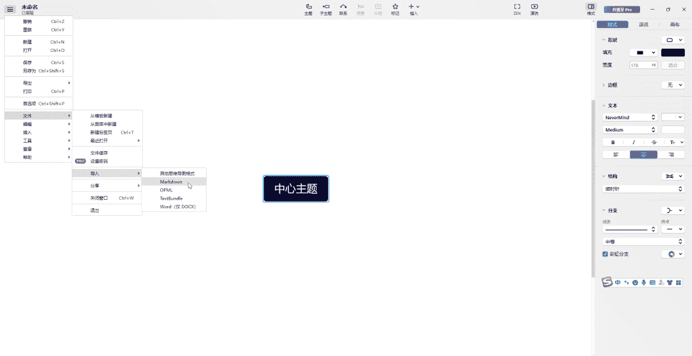
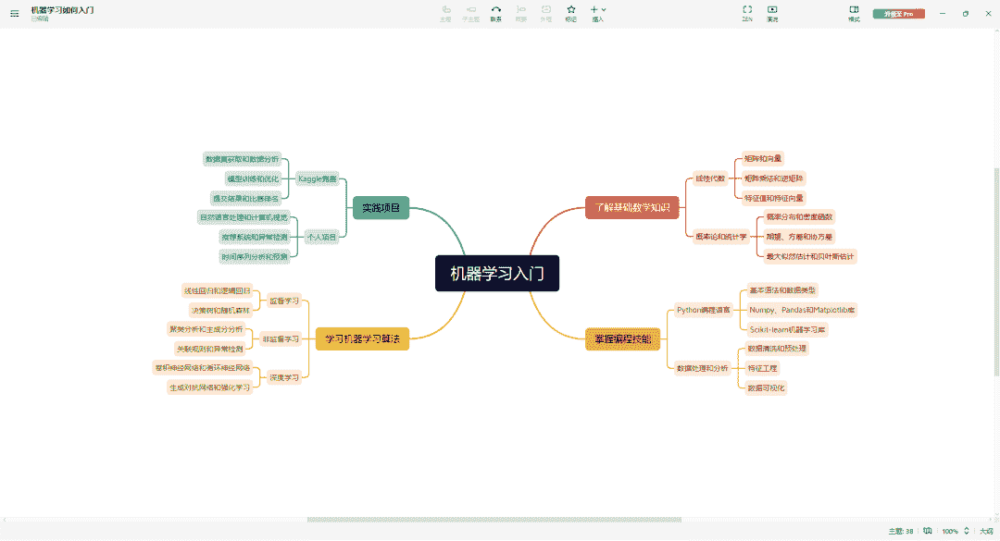
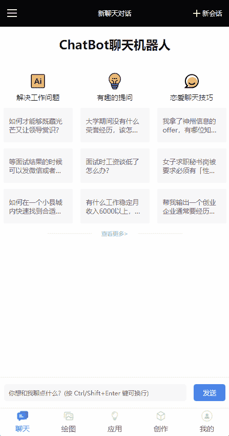
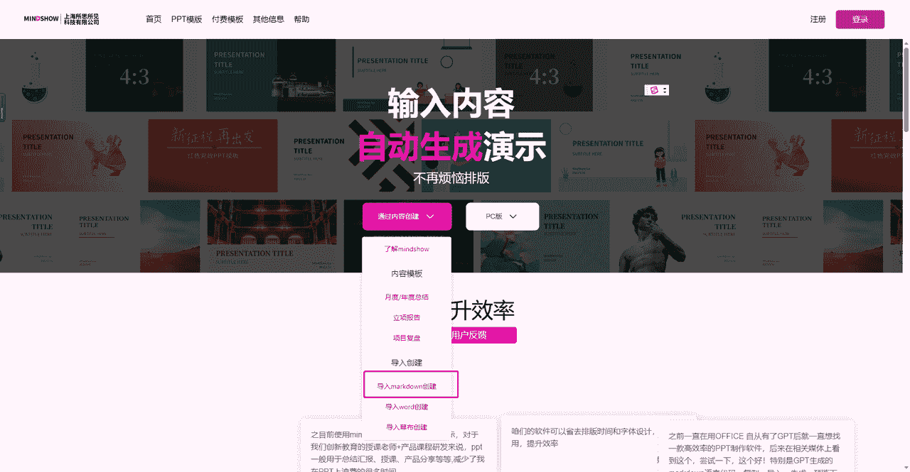
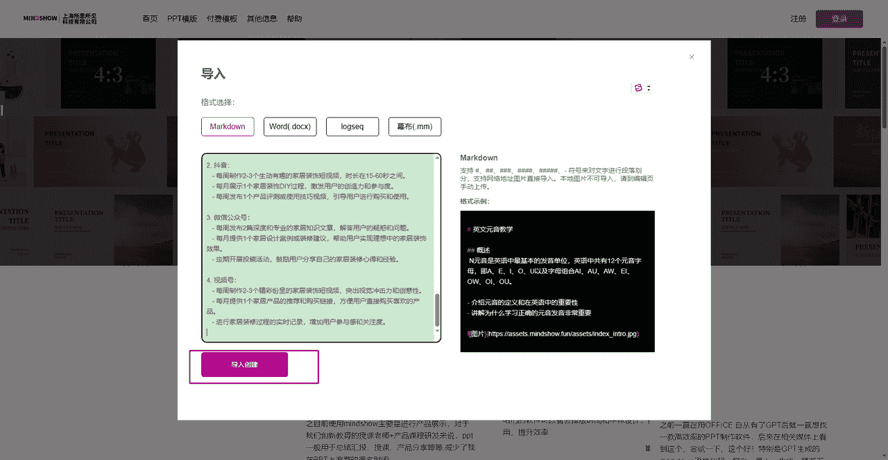
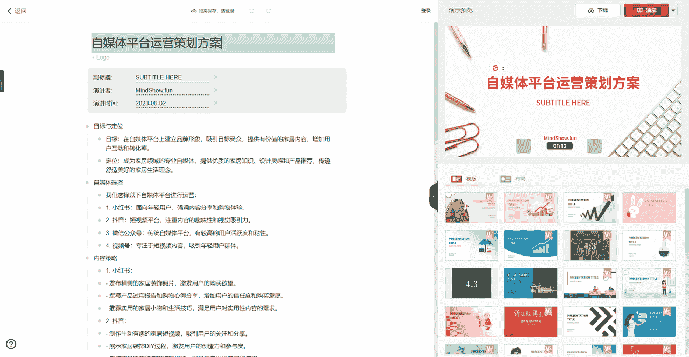
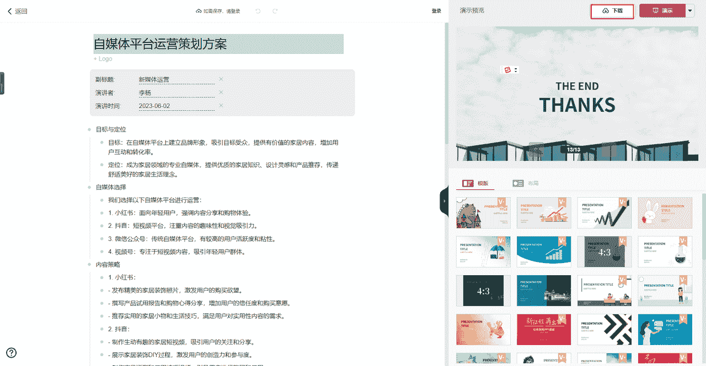

# GPT辅助办公

> 来源：[https://docs.feishu.cn/docx/HSmBd3UacohBKLxdyy0c78dlnQh](https://docs.feishu.cn/docx/HSmBd3UacohBKLxdyy0c78dlnQh)

**AI****生成思维导图**

**AI****快速制作表格**

**AI****快速制作PPT**

**AI****快速制作Word**

**AI****快速制作PDF**

# **AI****生成思维导图**

> 用ChatGPT三分钟做好思维导图

> 1 分钟搞定！ChatGPT + XMind 打造最高效的思维导图

1、首先进入 ChatGPT 的网站，对 ChatGPT 提出你的需求，例如我希望做一个“机器学习如何入门”的思维导图，那么我可以这样说：

“请使用markdown格式帮我制作一份思维导图，主题是机器学习如何入门，请用代码呈现”

注意，“请用代码呈现”这句话必须加上，这样的话，ChatGPT 就会生成 markdown 的语法格式了！如下图所示：



如果你觉得 ChatGPT 回答得不够详细，可以继续输入“请再详细一些”，它就会把内容丰富一下，直到你满意位置。

2、等待 ChatGPT 回答完之后，点击答案框右上角的 Copy code，将答案复制下来。



3、新建一个 txt 文档（取名为：机器学习如何入门.txt），将刚刚复制的文本粘贴到该文档中。



4、保存关闭 txt 文件，将文件后缀名改为 .md 格式，即“机器学习如何入门.md”

5、下载安装 XMind。

6、打开 XMind 软件(https://xmind.cn/)，点击左上角的三个横杠：文件->导入->Markdown，导入我们刚刚保存的“机器学习如何入门.md”。



7、这里我稍微微调了一下，大功告成。就可以看到 ChatGPT 自动生成的思维导图啦！



有了 ChatGPT 帮我们生成思维导图的基础版，你可以继续在上面进行优化！

# **AI****快速制作表格**

最近小编在健身，使用GPT生成了周一到周五的详细健身运动计划及对应的食谱，并用表格输出，供大家参考。



# AI快速制作PPT

使用ChatGPT三分钟快速制作PPT，简单高效，释放大脑！

1、首先进入 ChatGPT 的网站，对 ChatGPT 提出你的需求，例如我希望做一个“家居运营策划方案，那么我可以这样说：

“假如你作为一位家居运营策划案设计师，帮我写一份2000字左右的PPT形式的自媒体平台运营策划方案，自媒体包括📕、抖音、🛰️👸号、视频号等，注意：回复内容要以markdown形式输出，请用代码呈现

注意，“请用代码呈现”这句话必须加上，这样的话，ChatGPT 就会生成 markdown 的语法格式了！如下图所示：

```
# 自媒体平台运营策划方案

## 目标与定位
- 目标：在自媒体平台上建立品牌形象，吸引目标受众，提供有价值的家居内容，增加用户互动和转化率。
- 定位：成为家居领域的专业自媒体，提供优质的家居知识、设计灵感和产品推荐，传递舒适美好的家居生活理念。

## 自媒体选择
我们选择以下自媒体平台进行运营：

1. 小红书：面向年轻用户，强调内容分享和购物体验。
2. 抖音：短视频平台，注重内容的趣味性和视觉吸引力。
3. 微信公众号：传统自媒体平台，有较高的用户活跃度和粘性。
4. 视频号：专注于短视频内容，吸引年轻用户群体。

## 内容策略
1. 小红书：
   - 发布精美的家居装饰照片，激发用户的购买欲望。
   - 撰写产品试用报告和购物心得分享，增加用户的信任度和购买意愿。
   - 推荐实用的家居小物和生活技巧，满足用户对实用性内容的需求。

2. 抖音：
   - 制作生动有趣的家居短视频，吸引用户的关注和分享。
   - 展示家居装饰DIY过程，激发用户的创造力和参与度。
   - 制作产品评测和使用技巧视频，引导用户进行购买和使用。

3. 微信公众号：
   - 发布深度和专业的家居知识文章，解答用户的疑惑和问题。
   - 提供家居设计案例和装修建议，帮助用户实现理想中的家居装饰效果。
   - 开展投稿活动，鼓励用户分享自己的家居装修心得和经验。

4. 视频号：
   - 制作精彩纷呈的家居装饰短视频，突出视觉冲击力和创意性。
   - 提供家居产品的推荐和购买链接，方便用户直接购买喜欢的产品。
   - 进行家居装修过程的实时记录，增加用户参与感和关注度。

## 运营策略
1. 品牌形象
   - 统一的品牌标识和视觉形象，体现舒适、时尚和专业。
   - 在所有自媒体平台上保持一致的品牌声音和风格，提升品牌识别度。

2. 内容策略
   - 量身定制不同平台的内容，以迎合用户特点和平台特色。
   - 提供多样化的内容形式，包括图文、短视频、长视频等，以满足用户多样化的需求。
   - 关注热门话题和流行趋势，将其与家居相关内容相结合，增加曝光和传播效果。

3. 互动与用户参与
   - 鼓励用户互动，如留言、评论、转发等，增加用户参与感和粘性。
   - 定期开展互动活动，如投票、抽奖、答题等，提高用户参与度和活跃度。
   - 回复用户留言和评论，建立良好的用户关系，增加用户忠诚度和口碑传播。

4. 合作与推广
   - 寻找合适的家居品牌合作，推广其产品和服务，增加收入来源。
   - 参与行业活动和展览，增加品牌曝光度和影响力。
   - 运用社交媒体广告和营销手段，提高品牌知名度和用户转化率。

5. 数据分析与优化
   - 定期分析各平台的运营数据，包括用户互动、转化率、留存率等，优化运营策略。
   - 根据用户反馈和数据分析结果，调整内容形式和发布时间，提升用户体验和效果。

以上是我们的自媒体平台运营策划方案，希望能够帮助您在家居领域取得成功。
```

2、如果觉得不够详细，可以继续询问，比如 “详细的执行计划”

```
# 自媒体平台运营策划方案 - 执行计划

## 平台选择与账号注册
- 选择合适的自媒体平台：小红书、抖音、微信公众号、视频号。
- 注册平台账号并完善资料，确保与品牌形象一致。

## 内容策略与创作
1. 小红书：
   - 每周发布2-3篇精美的家居装饰照片，配以引人入胜的文字描述和标签。
   - 每月撰写1篇产品试用报告或购物心得分享，重点推荐品牌合作的产品。
   - 每周发布1篇关于家居小物和生活技巧的推荐文章，提供实用性内容。

2. 抖音：
   - 每周制作2-3个生动有趣的家居装饰短视频，时长在15-60秒之间。
   - 每月展示1个家居装饰DIY过程，激发用户的创造力和参与度。
   - 每周发布1个产品评测或使用技巧视频，引导用户进行购买和使用。

3. 微信公众号：
   - 每周发布2篇深度和专业的家居知识文章，解答用户的疑惑和问题。
   - 每月提供1个家居设计案例或装修建议，帮助用户实现理想中的家居装饰效果。
   - 定期开展投稿活动，鼓励用户分享自己的家居装修心得和经验。

4. 视频号：
   - 每周制作2-3个精彩纷呈的家居装饰短视频，突出视觉冲击力和创意性。
   - 每月提供1个家居产品的推荐和购买链接，方便用户直接购买喜欢的产品。
   - 进行家居装修过程的实时记录，增加用户参与感和关注度。

## 互动与用户参与
- 每天定时回复用户留言和评论，建立良好的用户关系和互动。
- 每周开展1-2次互动活动，如投票、抽奖、答题等，提高用户参与度和活跃度。
- 关注用户的反馈和建议，及时回应并作出相应调整，增加用户忠诚度和口碑传播。

## 合作与推广
- 寻找合适的家居品牌合作，推广其产品和服务，增加收入来源。
- 参与行业内的活动和展览，扩大品牌曝光度和影响力。
- 运用社交媒体广告和营销手段，提高品牌知名度和用户转化率。

## 数据分析与优化
- 定期分析各平台的运营数据，包括用户互动、转化率、留存率等，优化运营策略。
- 根据用户反馈和数据分析结果，调整内容形式和发布时间，提升用户体验和效果。

以上是自媒体平台运营策划方案的详细执行计划。根据计划的内容，我们将逐步实施并不断优化策略，以实现我们的目标和提升品牌影响力。
```

1.  将上面回复内容进行合并

```
# 自媒体平台运营策划方案

## 目标与定位
- 目标：在自媒体平台上建立品牌形象，吸引目标受众，提供有价值的家居内容，增加用户互动和转化率。
- 定位：成为家居领域的专业自媒体，提供优质的家居知识、设计灵感和产品推荐，传递舒适美好的家居生活理念。

## 自媒体选择
我们选择以下自媒体平台进行运营：

1. 小红书：面向年轻用户，强调内容分享和购物体验。
2. 抖音：短视频平台，注重内容的趣味性和视觉吸引力。
3. 微信公众号：传统自媒体平台，有较高的用户活跃度和粘性。
4. 视频号：专注于短视频内容，吸引年轻用户群体。

## 内容策略
1. 小红书：
   - 发布精美的家居装饰照片，激发用户的购买欲望。
   - 撰写产品试用报告和购物心得分享，增加用户的信任度和购买意愿。
   - 推荐实用的家居小物和生活技巧，满足用户对实用性内容的需求。

2. 抖音：
   - 制作生动有趣的家居短视频，吸引用户的关注和分享。
   - 展示家居装饰DIY过程，激发用户的创造力和参与度。
   - 制作产品评测和使用技巧视频，引导用户进行购买和使用。

3. 微信公众号：
   - 发布深度和专业的家居知识文章，解答用户的疑惑和问题。
   - 提供家居设计案例和装修建议，帮助用户实现理想中的家居装饰效果。
   - 开展投稿活动，鼓励用户分享自己的家居装修心得和经验。

4. 视频号：
   - 制作精彩纷呈的家居装饰短视频，突出视觉冲击力和创意性。
   - 提供家居产品的推荐和购买链接，方便用户直接购买喜欢的产品。
   - 进行家居装修过程的实时记录，增加用户参与感和关注度。

## 运营策略
1. 品牌形象
   - 统一的品牌标识和视觉形象，体现舒适、时尚和专业。
   - 在所有自媒体平台上保持一致的品牌声音和风格，提升品牌识别度。

2. 内容策略
   - 量身定制不同平台的内容，以迎合用户特点和平台特色。
   - 提供多样化的内容形式，包括图文、短视频、长视频等，以满足用户多样化的需求。
   - 关注热门话题和流行趋势，将其与家居相关内容相结合，增加曝光和传播效果。

3. 互动与用户参与
   - 鼓励用户互动，如留言、评论、转发等，增加用户参与感和粘性。
   - 定期开展互动活动，如投票、抽奖、答题等，提高用户参与度和活跃度。
   - 回复用户留言和评论，建立良好的用户关系，增加用户忠诚度和口碑传播。

4. 合作与推广
   - 寻找合适的家居品牌合作，推广其产品和服务，增加收入来源。
   - 参与行业活动和展览，增加品牌曝光度和影响力。
   - 运用社交媒体广告和营销手段，提高品牌知名度和用户转化率。

5. 数据分析与优化
   - 定期分析各平台的运营数据，包括用户互动、转化率、留存率等，优化运营策略。
   - 根据用户反馈和数据分析结果，调整内容形式和发布时间，提升用户体验和效果。
  
## 内容执行计划
1. 小红书：
   - 每周发布2-3篇精美的家居装饰照片，配以引人入胜的文字描述和标签。
   - 每月撰写1篇产品试用报告或购物心得分享，重点推荐品牌合作的产品。
   - 每周发布1篇关于家居小物和生活技巧的推荐文章，提供实用性内容。

2. 抖音：
   - 每周制作2-3个生动有趣的家居装饰短视频，时长在15-60秒之间。
   - 每月展示1个家居装饰DIY过程，激发用户的创造力和参与度。
   - 每周发布1个产品评测或使用技巧视频，引导用户进行购买和使用。

3. 微信公众号：
   - 每周发布2篇深度和专业的家居知识文章，解答用户的疑惑和问题。
   - 每月提供1个家居设计案例或装修建议，帮助用户实现理想中的家居装饰效果。
   - 定期开展投稿活动，鼓励用户分享自己的家居装修心得和经验。

4. 视频号：
   - 每周制作2-3个精彩纷呈的家居装饰短视频，突出视觉冲击力和创意性。
   - 每月提供1个家居产品的推荐和购买链接，方便用户直接购买喜欢的产品。
   - 进行家居装修过程的实时记录，增加用户参与感和关注度。

以上是我们的自媒体平台运营策划方案，希望能够帮助您在家居领域取得成功。
```

1.  访问mindshow(https://www.mindshow.fun/#/home), 将上面内容复制，导入到Markdown创建。





选择模板



确认无误，点击“”下载”进行本地下载



以上就是chatgpt+mindshow快速生成PPT方法，生成大纲以后，自己进行细化


[自媒体平台运营策划方案.pptx](https://internal-api-drive-stream.feishu.cn/space/api/box/stream/download/all/YDj3bgSGGoEholxfHHycXigvnCe)

# AI写调研报告