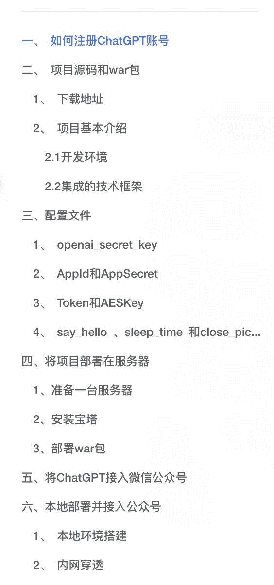

# ✅ChatGPT开发实战

> 来源：[https://docs.feishu.cn/docx/SOdjdQjU3oAKkjx6soJcktrInXg](https://docs.feishu.cn/docx/SOdjdQjU3oAKkjx6soJcktrInXg)

# 使用API进行在线访问和部署

#

# 整合ChatGPT到聊天应用或机器人中

序章

大模型潜能展示 - 使用LangChain+GLM构建本地知识库

原理篇

灵光闪烁：从图灵测试到ChatGPT - AI语言模型的演进之路

文字背后的秘密：从分布式词嵌入到向量数据库的奥义

洞见本质：深入探索注意力机制（上）

洞见本质：深入探索注意力机制（下）

模型构建的艺术：从零到一打造Transformer（上）

模型构建的艺术：从零到一打造Transformer（下）

最强工具：深度解析HuggingFace Transformers的微调与应用

实践篇

实操精华：使用OpenAI GPT-4 API快速构建聊天机器人

技术娴熟：提示工程-设计Prompt优化LLM（上）

技术娴熟：提示工程-设计Prompt优化LLM（下）

框架之力：掌握LangChain-为LLM搭建思维链条

资源互通：在LangChain中有效利用外部数据源

智能代理：在LangChain中创新使用Agent

高效搜索：在LangChain中掌握Qdrant向量数据库

创新实现：使用LangChain构建你的专属AI应用

精细引导：LLM API中的React——如何使用guidance控制LLM

自动服务：AutoGPT/BabyAGI和AgentAPI-让AI成为真正的智能助手