# 01 |  API进行在线访问和部署

> 来源：[https://docs.feishu.cn/docx/D5budwMIDou5CBxRyF8cHLUQnIg](https://docs.feishu.cn/docx/D5budwMIDou5CBxRyF8cHLUQnIg)

在本文中，我们将使用Python编程语言来展示如何调用OpenAI的GPT-3.5模型。在开始之前，请确保您已经注册了OpenAI API并获得了访问凭证。

## 环境准备

### 下载python

方法1：官网

www.python.org

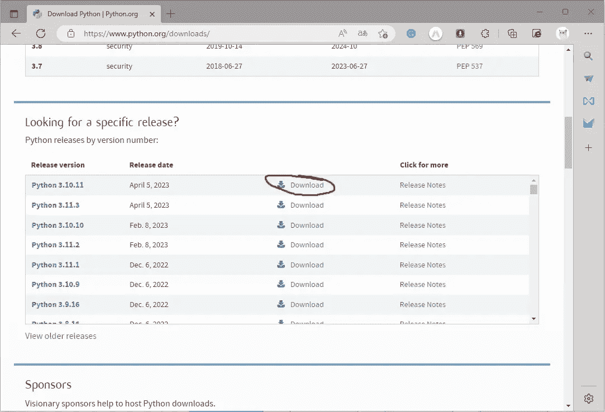

从最开始的开始，先到Python官网下载一个合适版本的Python (我推荐python3.10, python3.8)

下面将以python3.10.11为例子讲解

点开Downloads之后划到最底下下载适合自己系统的版本。

下面展示的是windows Installer 安装。（installer应该没有人不会用吧）

下载好后走完流程。

【注意】如果不是做移动式的环境建议直接 add to PATH

方法2：Conda (推荐)

https://www.anaconda.com/download/


下载好后走流程。

配置并下载啥的我就没啥好说的，网上一抓一大把（人家都有选自带的Python3.9)

方法3：VSCode

没啥可说的。心目中全球第一的程序猿必备东西

https://code.visualstudio.com/Download

下载好后走流程。

打开后安装python插件，一套下来的。

### 环境变量配置

找到anaconda安装位置

首先下载好conda环境，例如我下载在D盘


打开环境变量配置设置

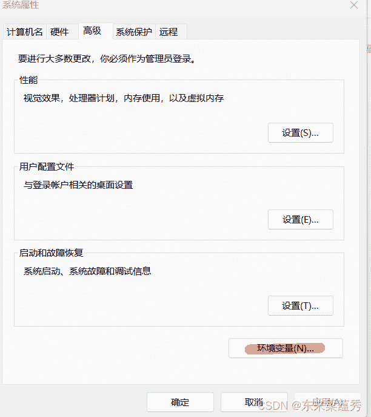

可以按win+S进入搜索框，输入环境变量，编辑环境变量

点击“新建”按钮新建一个变量，输入安装的目录

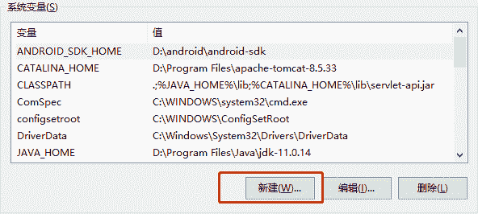

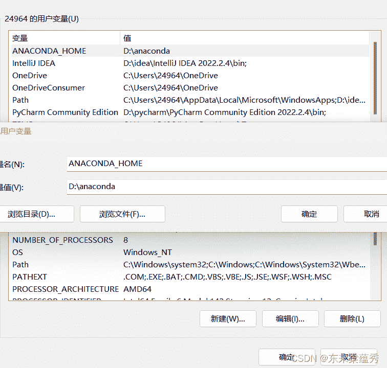

在path中加入环境变量


分析一些，前面建立了一个变量就是初始地址，在path当中使用 %ANACONDA_HOME%就代表D:\anaconda，这样方便在修改下载目录的时候，也要修改path里面内容，我们只需要修改变量名的路径即可

%ANACONDA_HOME% 这里面有python.exe 因此输入后我们在命令框输入python，就可以直接运行python命令行环境

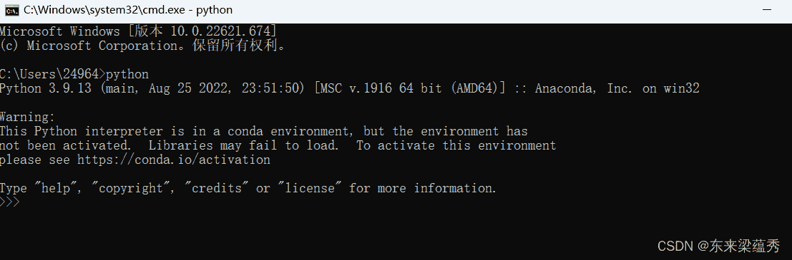

%ANACONDA_HOME%\Scripts 主要是包括conda可执行文件，方便运行

其他的环境变量也类似，因此环境变量的好处就是方便打开指定文件，要不然要切换到此目录才能打开

输入python命令跳入商店问题

win+S 输入 管理应用执行别名 关闭即可

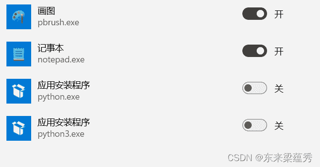

### 安装openai库

安装方法有很多，这里只讲pip 安装方式。因为pip是万能的

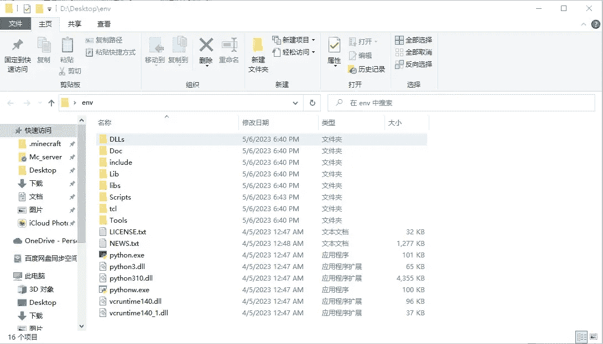

打开你下载的位置并寻找到python.exe

将python.exe 拖入cmd窗口

（回车就会运行，但是我们先把库安装好再说。）

1、首先使用pip show pip 命令查看当前pip版本；

pip show pip

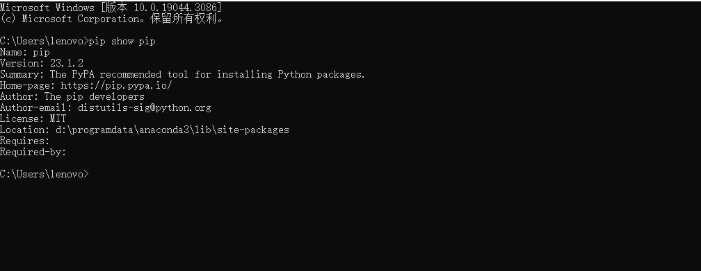

2、升级命令：python -m pip install --upgrade pip；

python -m pip install --upgrade pip

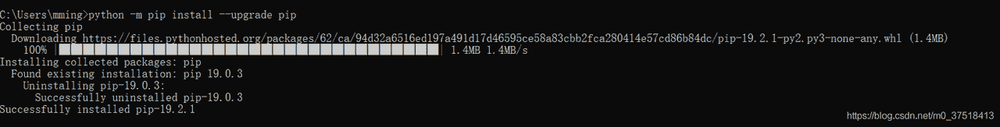

3、验证升级成功，再次使用pip show pip命令查看pip版本。

pip show pip

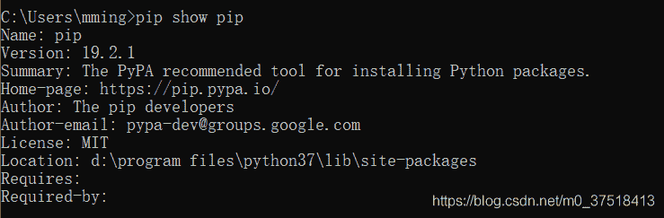

推荐清华源加速：

python -m pip install -i https://pypi.tuna.tsinghua.edu.cn/simple openai


回车后安装

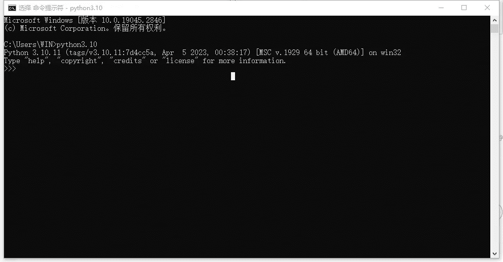

### Python调用openai库

> 详细可以参考Openai官网：https://platform.openai.com/docs/api-reference/authentication

我下面放几个例子：

1.  调用gpt-3.5-turbo-0301模型

```
import openai

openai.api_key  = &#x27;你自己的Key&#x27;

# 一个封装 OpenAI 接口的函数，参数为 Prompt，返回对应结果
def get_completion(prompt, model=&quot;gpt-3.5-turbo-0301&quot;):
    &#x27;&#x27;&#x27;
    prompt: 对应的 prompt
    model: 调用的模型，如果使用ChatGPT，该值取gpt-3.5-turbo，有内测资格的用户可以选择 gpt-4
    &#x27;&#x27;&#x27;
    messages = [{&quot;role&quot;: &quot;system&quot;, &quot;content&quot;: prompt}]
    response = openai.ChatCompletion.create(
        model=model,
        messages=messages,
        temperature=0, # 模型输出的温度系数，控制输出的随机程度。如果为0，就是确切的结果，每次结果是相同的
    )
    # 调用 OpenAI 的 ChatCompletion 接口
    return response.choices[0].message[&quot;content&quot;]


if __name__ == &#x27;__main__&#x27;:
    text = &quot;&quot;&quot;
    你应该提供尽可能清晰、具体的指示，以表达你希望模型执行的任务。\
    这将引导模型朝向所需的输出，并降低收到无关或不正确响应的可能性。\
    不要将写清晰的提示与写简短的提示混淆。\
    在许多情况下，更长的提示可以为模型提供更多的清晰度和上下文信息，从而导致更详细和相关的输出。
    &quot;&quot;&quot;
    # 需要总结的文本内容

    prompt = f&quot;&quot;&quot;把用三个反引号括起来的文本总结成一句话。```{text}```&quot;&quot;&quot;
    # 指令内容，使用 ``` 来分隔指令和待总结的内容
    response = get_completion(prompt)
    print(response)
```

1.  调用DALL·E

```
import openai
msg = input()
openai.api_key = &quot;你自己的api&quot;
response = openai.Image.create(
        prompt = msg,
        n = 1,
        size = &#x27;1024x1024&#x27;
    )
image_url = response[&#x27;data&#x27;][0][&#x27;url&#x27;]
print(image_url)
```

可用模型：

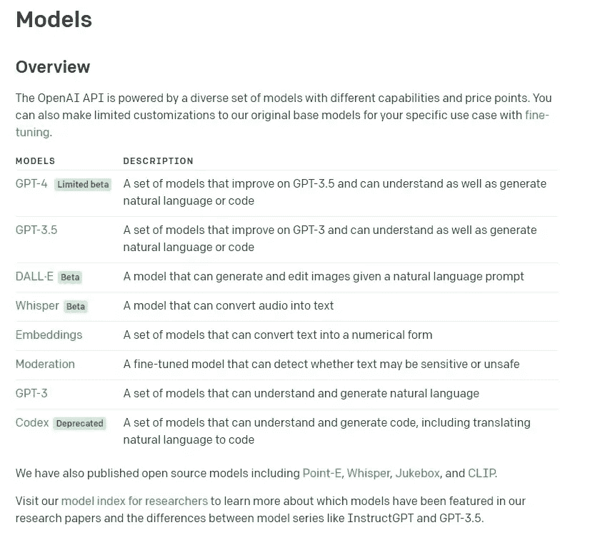

请详见openai的API指南，官方的api感觉一直在变。所以此文章的写法可能不是最新的。