# 04 |  `LangChain`构建本地知识库

> 来源：[https://docs.feishu.cn/docx/PrFWd0vPHoGrCUxbLAycNP4snFf](https://docs.feishu.cn/docx/PrFWd0vPHoGrCUxbLAycNP4snFf)

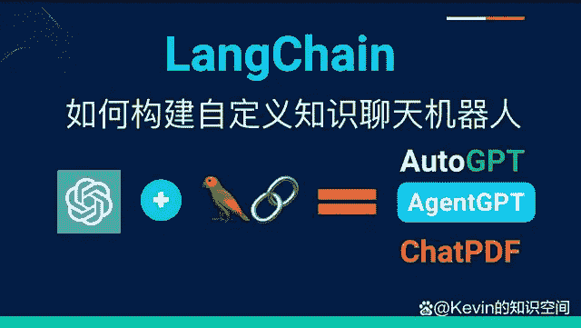

> 项目开源地址: https://github.com/chatchat-space/Langchain-Chatchat

我们知道`Openai`的聊天机器人可以回答用户提出的绝大多数问题,它几乎无所不知，无所不能，但是由于有机器人所学习到的是截止到2021年9月以前的知识，所以当用户询问机器人关于2021年9月以后发送的事情时，它无法给出正确的答案，另外用户向机器人提问的字符串(`prompt`)长度被限制在4096个`token`(`token`可以看作是一种词语单位)。如果用户的`prompt`的长度超过4096个`token`时，机器人通常会抛出一个“异常”提示信息：

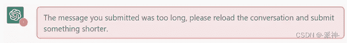

我们想要做的是让像`openai`聊天机器人这样的大型语言模型(`LLMs`)学习特定领域内的知识，这些特定的领域的知识可能是几本电子书，几十个文本文件，或者是关系型数据库,我们想要`LLMs`模型学习用户给定的数据，并且只回答给定数据范围内的相关问题,如果问题超出范围,一律告知用户问题超出范围无法回答,也就是我们要限制`LLMs`模型自由发挥，不能让它随便乱说。能否执行这样的功能呢？

在本文中，我将向您介绍 `LangChain`，并向您展示如何将其与 `OpenAI` 的 `API` 结合使用来创建这些改变游戏规则的工具。希望我能激发你们中的一员提出自己的想法。让我们开始吧！

## 原思路简介

由于目前的确已经有许多类似的、写得很优秀的大佬写的文章了，所以我本文不会过多涉及具体的代码。我更倾向于探讨一下我们怎么用这项“新技术”，来解决之前就有的、而且颇有价值的”老问题“。

首先，最基础的架构我们还是要说一下（免得一段时间以后回顾的时候一脸懵逼，只剩吹牛了）

我们先回顾一下，`Bert`时代的垂直领域问答系统是怎么构建的？

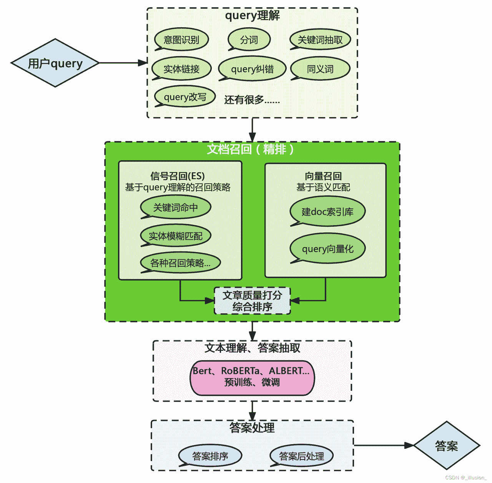

如上图所示，这就是个问答系统的大概面貌了。当然了，还有些其他辅助模块没在这里体现，这里只拿出了最关键的几个部分：

`query`理解：充分理解`query`含义，挖掘`query`信号，给下一轮的`doc`（文档）”粉碎机“提供弹药！

文档召回：这里的召回方式大概可分为2大类，分别是基于`query`理解得到的信号召回，以及向量召回。

信号召回：基于`ES`或其他什么类`ES`自研框架（为什么要自研，还不是为了体现价值orz…）实现，可以简单理解为关键词召回，即从`query`和`doc`中分别找到关键词，然后进行匹配、打分；

向量召回：信号召回显然是基于”字面“的，而向量召回则是基于语义的。将`doc`提前向量化建库，然后`query`再向量化后进行向量检索。

最后，基于以上两路召回的文档得分，再结合一些其他`trick`（如质量打分）进行综合排序，取`topK`进入下一轮大逃杀！

答案抽取：使用预训练好的模型，分别对`topK`文档里的答案进行抽取。对于上一代`Berter`（哦不`NLPer`）而言，主模型都是`Bert`或其徒子徒孙。现在，则是最时髦的`LLM`

答案处理：后处理模块，可将得到的答案再次排序、可做答案融合、也可根据业务需要，进行合理的后处理，最后输出。

## 浪链是什么？

`LangChain`是一个开源框架，允许 `AI` 开发人员将 `GPT-4` 等大型语言模型 (`LLM`) 与外部数据相结合。它以 `Python` 或 `JavaScript` (`TypeScript`) 包的形式提供。

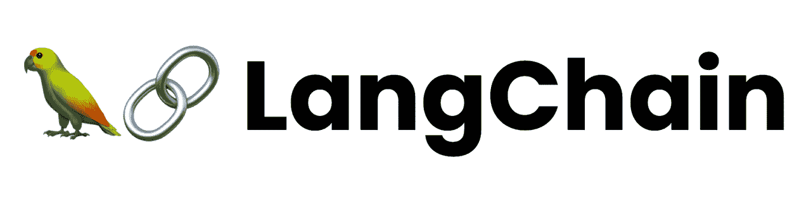

如您所知，`GPT` 模型一直在 2021 年之前接受数据训练，这可能是一个重大限制。虽然这些模型的常识很丰富，但能够将它们连接到自定义数据和计算会打开许多大门。这正是 `LangChain` 所做的。

从本质上讲，它允许您的 `LLM` 在得出答案时参考整个数据库。因此，您现在可以让 `GPT` 模型以报告、文档和网站信息的形式访问最新数据。

最近，`LangChain` 的人气大幅飙升，尤其是在 3 月份推出 `GPT-4` 之后。这要归功于它的多功能性以及与强大的 `LLM` 搭配使用时打开的许多可能性。

`LangChain` 是一种`LLMs`接口框架，它允许用户围绕大型语言模型快速构建应用程序和管道。 它直接与 `OpenAI` 的 `GPT-3` 和 `GPT-3.5` 模型以及 `Hugging Face` 的开源替代品（如 `Google` 的 `flan-t5` 模型）集成。

## LangChain 如何运作？

虽然您可能认为 `LangChain` 听起来很复杂，但实际上它很容易上手。

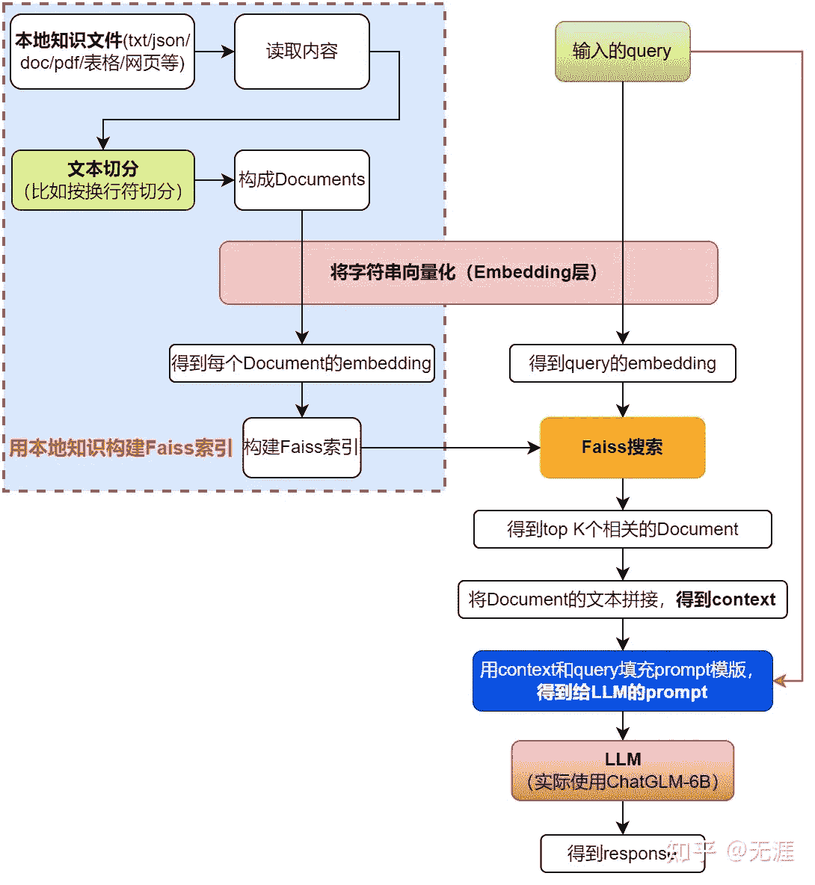

工作原理

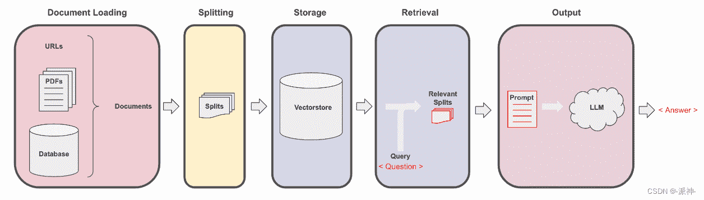

简而言之，`LangChain` 只是将大量数据组合在一起，`LLM` 可以使用尽可能少的计算能力轻松引用这些数据。它的工作原理是获取大量数据源，例如 50 页的 `PDF`，并将其分解为“块”，然后嵌入到 `Vector Store` 中。

现在我们已经有了大型文档的矢量化表示，我们可以将其与 `LLM` 结合使用，以仅检索在创建提示-完成对时需要引用的信息。

当我们在新的聊天机器人中插入提示时，`LangChain` 将查询 `Vector Store` 以获取相关信息。将其视为您文档的迷你 `Google`。检索到相关信息后，我们会将其与提示一起提供给 `LLM` 以生成我们的答案。

## Langchain组成

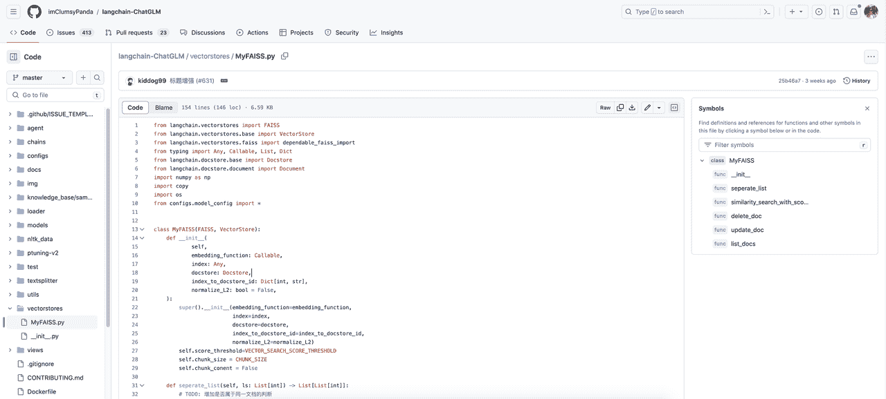

1. `chains`： 工作链路实现，如 `chains/local_doc_qa` 实现了基于本地⽂档的问答实现

1. `configs`：配置文件存储

1. `knowledge_bas/content`：用于存储上传的原始⽂件

1. `loader`： 文档加载器的实现类

1. `models`： `llm`的接⼝类与实现类，针对开源模型提供流式输出⽀持

1. `textsplitter`： 文本切分的实现类

1. `vectorstores`：用于存储向量库⽂件，即本地知识库本体

## LangChain 如何与 OpenAI 的 LLM 合作

`LangChain` 还允许您创建可以执行操作的应用程序——例如上网冲浪、发送电子邮件和完成其他与 `API` 相关的任务。查看`AgentGPT`，这是一个很好的例子。

这有很多可能的用例——这里只是我想到的几个：

+   个人 `AI` 邮件助理

+   人工智能学习伙伴

+   人工智能数据分析

+   定制公司客户服务聊天机器人

+   社交媒体内容创作助理

而这样的例子不胜枚举。我将在以后的文章中介绍正确的构建教程，敬请期待。

## 如何开始使用朗链

`LangChain` 应用程序由 5 个主要组件组成：

+   模型（`LLM` 包装器）

+   提示

+   链条

+   嵌入和向量存储

+   代理商

我将为您提供每一个的概述，以便您可以更深入地了解 `LangChain` 的工作原理。展望未来，您应该能够应用这些概念来开始制作您自己的用例并创建您自己的应用程序。

我将使用来自 `Rabbitmetrics`的简短代码片段来解释所有内容。他提供了有关此主题的精彩教程。这些片段应该可以让您完成所有设置并准备好使用 `LangChain`。

首先，让我们设置环境。您可以 `pip` 安装 3 个您需要的库：

```
pip install -r requirements.txt
python-dotenv==1.0.0
langchain==0.0.137
pinecone-client==2.2.1
```

`Pinecone`是我们将与 `LangChain` 结合使用的 `Vector Store`。有了这些，确保将 `OpenAI`、`Pinecone Environment` 和 `Pinecone API` 的 `API` 密钥存储到环境文件中。您将能够在他们各自的网站上找到此信息。然后我们只需使用以下内容加载该环境文件：

```
# Load environment variables

from dotenv import load_dotenv,find_dotenv
load_dotenv(find_dotenv())
```

现在，我们准备开始了！

### 模型（LLM 包装器）

为了与我们的 `LLM` 交互，我们将为 `OpenAI` 的 `GPT` 模型实例化一个包装器。在这种情况下，我们将使用 `OpenAI` 的 `GPT-3.5-turbo`，因为它最具成本效益。但是，如果您可以访问，请随意使用更强大的 `GPT4`。

要导入这些，我们可以使用以下代码：

```
# import schema for chat messages and ChatOpenAI in order to query chatmodels GPT-3.5-turbo or GPT-4

from langchain.schema import (
  AIMessage,
  HumanMessage,
  SystemMessage
)
from langchain.chat_models import ChatOpenAI


chat = ChatOpenAI(model_name="gpt-3.5-turbo",temperature=0.3)
messages = [
  SystemMessage(content="You are an expert data scientist"),
  HumanMessage(content="Write a Python script that trains a neural network on simulated data ")
]
response=chat(messages)

print(response.content,end='\n')
```

本质上，`SystemMessage` 为 `GPT-3.5-turbo` 模块提供上下文，它将为每个提示完成对引用该模块。`HumanMessage` 指的是您将在 `ChatGPT` 界面中键入的内容——您的提示。

但是使用自定义知识聊天机器人，我们通常会抽象出提示中重复的部分。例如，如果我正在创建一个推文生成器应用程序，我不想一直输入“给我写一条关于...的推文”。其实`AI`写作工具就是这么简单开发出来的！

因此，让我们看看如何使用提示模板将其抽象出来。

### 提示

`LangChain` 提供 `PromptTemplates`，允许您根据用户输入动态更改提示，类似于正则表达式的使用方式。

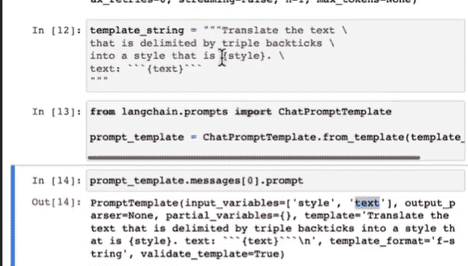

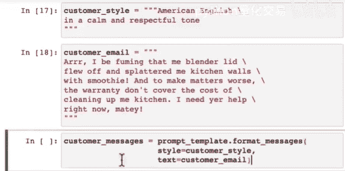

举例2

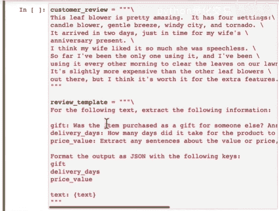

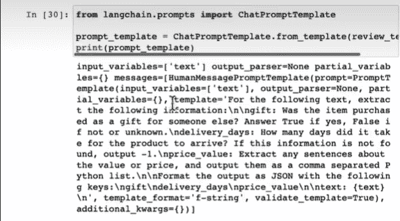

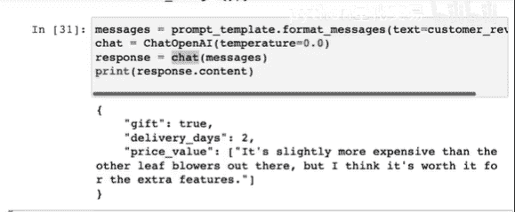

```
# Import prompt and define PromptTemplate

from langchain import PromptTemplate

template = """
You are an expert data scientist with an expertise in building deep learning models.
Explain the concept of {concept} in a couple of lines
"""

prompt = PromptTemplate(
  input_variables=["concept"],
  template=template
)


# Run LLM with PromptTemplate
llm(prompt.format(concept="autoencoder"))
llm(prompt.format(concept="regularization"))
```

您可以以不同的方式改变这些以适应您的用例。如果您熟悉使用 `ChatGPT`，这对您来说应该很舒服。

### 链条

`Chains` 允许您使用简单的 `PromptTemplates` 并在它们之上构建功能。本质上，链就像复合函数，允许您将 `PromptTemplates` 和 `LLM` 集成在一起。

使用前面的包装器和 `PromptTemplates`，我们可以使用采用 `PromptTemplate` 并将其与 `LLM` 组合的单个链运行相同的提示：

```
# Import LLMChain and define chain with language model and prompt as arguments.
from langchain.chains import LLMChain
chain = LLMChain(llm=llm, prompt=prompt)

# Run the chain only specifying the input variable.
print(chain.run("autoencoder"))
```

最重要的是，顾名思义，我们可以将它们链接在一起以创建更大的组合。

例如，我可以从一个链中获取结果并将其传递到另一个链中。在这个片段中，`Rabbitmetrics` 从第一个链中获取完成并将其传递到第二个链中以向 5 岁的孩子解释它。

然后，您可以将这些链组合成一个更大的链并运行它。

```

# Define a second prompt

second_prompt = PromptTemplate(
  input_variables=["ml_concept"],
  template="Turn the concept description of {ml_concept} and explain it to me like I'm five in 500 words",
)
chain_two = LLMChain(llm=llm, prompt=second_prompt)

# Define a sequential chain using the two chains above: the second chain takes the output of the first chain as input

from langchain.chains import SimpleSequentialChain
overall_chain = SimpleSequentialChain(chains=[chain, chain_two], verbose=True)

# Run the chain specifying only the input variable for the first chain.
explanation = overall_chain.run("autoencoder")
print(explanation)
```

使用链，您可以创建大量功能，这就是 `LangChain` 如此多才多艺的原因。但它真正出色的地方在于将它与前面讨论的 `Vector Store` 结合使用。让我们介绍一下那个组件。

### 嵌入和向量存储

这是我们合并 `LangChain` 的自定义数据方面的地方。如前所述，嵌入和向量存储背后的想法是将大数据分成块并存储那些在相关时要查询的数据。

`LangChain` 有一个文本拆分器功能可以做到这一点：

```
# Import utility for splitting up texts and split up the explanation given above into document chunks

from langchain.text_splitter import RecursiveCharacterTextSplitter

text_splitter = RecursiveCharacterTextSplitter(
  chunk_size = 100,
  chunk_overlap  = 0,
)

texts = text_splitter.create_documents([explanation])
```

拆分文本需要两个参数：一个块有多大（`chunk_size`）和每个块重叠多少（`chunk_overlap`）。每个块之间有重叠对于帮助识别相关的相邻块很重要。

这些块中的每一个都可以这样检索：

```
texts[0].page_content
```

在我们有了这些块之后，我们需要将它们变成嵌入。这允许 `Vector Store` 在查询时查找并返回每个块。我们将使用 `OpenAI` 的嵌入模型来执行此操作。


# Import and instantiate OpenAI embeddings

from langchain.embeddings import OpenAIEmbeddings

embeddings = OpenAIEmbeddings(model_name="ada")

# Turn the first text chunk into a vector with the embedding

query_result = embeddings.embed_query(texts[0].page_content)
print(query_result)

最后，我们需要有一个地方来存储这些矢量化嵌入。如前所述，我们将为此使用 `Pinecone`。使用前面环境文件中的 API 密钥，我们可以初始化 `Pinecone` 来存储我们的嵌入。

```
# Import and initialize Pinecone client

import os
import pinecone
from langchain.vectorstores import Pinecone


pinecone.init(
    api_key=os.getenv('PINECONE_API_KEY'),
    environment=os.getenv('PINECONE_ENV')
)

# Upload vectors to Pinecone

index_name = "langchain-quickstart"
search = Pinecone.from_documents(texts, embeddings, index_name=index_name)

# Do a simple vector similarity search

query = "What is magical about an autoencoder?"
result = search.similarity_search(query)

print(result)
```

现在我们可以在我们的松果矢量商店查询相关信息了！剩下要做的就是结合我们学到的知识来创建我们的特定用例——为我们提供专门的 AI“代理”。

## 代理商

代理本质上是一个自主的人工智能，它接受输入并按顺序完成这些输入，直到达到最终目标。这涉及到我们的 AI 使用其他 API 来完成发送电子邮件或做数学题等任务。与我们的 `LLM` + 提示链结合使用，我们可以将合适的 AI 应用串在一起。

现在，这部分的解释会很广泛，所以这里有一个简单的例子，说明如何在 LangChain 中使用 Python 代理来解决一个简单的数学问题。在这种情况下，该代理通过连接我们的 `LLM` 来运行 Python 代码并使用 `NumPy` 找到根源来解决问题：

```
# Import Python REPL tool and instantiate Python agent

from langchain.agents.agent_toolkits import create_python_agent
from langchain.tools.python.tool import PythonREPLTool
from langchain.python import PythonREPL
from langchain.llms.openai import OpenAI

agent_executor = create_python_agent(
    llm=OpenAI(temperature=0, max_tokens=1000),
    tool=PythonREPLTool(),
    verbose=True
)

# Execute the Python agent

agent_executor.run("Find the roots (zeros) if the quadratic function 3 * x**2 + 2*x -1")
```

自定义知识聊天机器人本质上是一个代理，它将查询向量化存储的提示和操作链接在一起，获取结果，并将其与原始问题链接起来！

如果您想阅读更多有关 AI 代理的信息，这是一个很好的资源。

## 其他变化

即使您对 LangChain 的功能有了新的基本了解，我相信此时您的想法还在冒泡。

但到目前为止，我们只看过一个 `OpenAI` 模型，那就是基于文本的 `GPT-3.5-turbo`。`OpenAI` 有一系列模型，您可以将它们与 LangChain 一起使用——包括使用 Dall-E 生成图像。应用我们讨论过的相同概念，我们可以创建 AI Art Generator 代理、Website Builder 代理等等。

花点时间探索 AI 领域，我相信您会开始获得越来越多的想法。

## 结论

我希望您对所有这些新 AI 工具的幕后工作有了更多的了解。了解 LangChain 的工作原理是当今作为程序员的一项宝贵技能，可以为您的 AI 开发开辟可能性。

## ChatGPT|LangChain介绍

> https://mp.weixin.qq.com/s?__biz=MzA3Njk4MjkyNw==&mid=2247485081&idx=1&sn=4afd0376dfc03592fb5a0219e827f888&chksm=9f59b979a82e306fd763b5a1c30f43f30cea6a87562db8ebd2539bd43253b84f850cfdcd41d4&scene=21#wechat_redirect

### 什么是LangChain？

使用 ChatGPT 大家可能都是知道 `prompt`，

（1）想像一下，如果我需要快速读一本书，想通过本书作为 `prompt`，使用 ChatGPT 根据书本中来回答问题，我们需要怎么做？

（2）假设你需要一个问答任务用到 `prompt` A，摘要任务要使用到 `prompt` B，那如何管理这些 `prompt` 呢？因此需要用 LangChain 来管理这些 `prompt`。

LangChain 的出现，简化了我们在使用 ChatGPT 的工程复杂度。

### LangChain中的模块，每个模块如何使用？

#### 前提

运行一下代码，需要 `OPENAI_API_KEY`（OpenAI 申请的 key）,同时统一引入这些库：

```
# 导入LLM包装器
from langchain import OpenAI, ConversationChain
from langchain.agents import initialize_agent
from langchain.agents import load_tools
from langchain.chains import LLMChain
from langchain.prompts import PromptTemplate
```

#### LLM

从语言模型中输出预测结果，和直接使用 `OpenAI` 的接口一样，输入什么就返回什么。

```
llm = OpenAI(model_name="text-davinci-003", temperature=0.9) // 这些都是OpenAI的参数
text = "What would be a good company name for a company that makes colorful socks?"
print(llm(text)) 
// 以上就是打印调用OpenAI接口的返回值，相当于接口的封装，实现的代码可以看看github.com/hwchase17/langchain/llms/openai.py的OpenAIChat
```

```
Cozy Colours Socks.
```

#### Prompt Templates

管理 `LLMs` 的 `Prompts`，就像我们需要管理变量或者模板一样。

```
prompt = PromptTemplate(
    input_variables=["product"],
    template="What is a good name for a company that makes {product}?",
)
// 以上是两个参数，一个输入变量，一个模板字符串，实现的代码可以看看github.com/hwchase17/langchain/prompts
// PromptTemplate实际是基于StringPromptTemplate，可以支持字符串类型的模板，也可以支持文件类型的模板
```

```
What is a good name for a company that makes colorful socks?
```

#### Chains

将 `LLMs` 和 `prompts` 结合起来，前面提到提供了 `OpenAI` 的封装和你需要问的字符串模板，就可以执行获得返回了。

```
from langchain.chains import LLMChain
chain = LLMChain(llm=llm, prompt=prompt) // 通过LLM的llm变量，Prompt Templates的prompt生成LLMChain
chain.run("colorful socks") // 实际这里就变成了实际问题：What is a good name for a company that makes colorful socks？
```

#### Agents

基于用户输入动态地调用 `chains`，`LangChain` 可以将问题拆分为几个步骤，然后每个步骤可以根据提供个 `Agents` 做相关的事情。

```
# 导入一些tools，比如llm-math
# llm-math是langchain里面的能做数学计算的模块
tools = load_tools(["llm-math"], llm=llm)
// 初始化tools，models 和使用的agent
agent = initialize_agent(
    tools, llm, agent="zero-shot-react-description", verbose=True)
text = "12 raised to the 3 power and result raised to 2 power?"
print("input text: ", text)
agent.run(text)
```

```
> Entering new AgentExecutor chain...
 I need to use the calculator for this
Action: Calculator
Action Input: 12^3
Observation: Answer: 1728
Thought: I need to then raise the previous result to the second power
Action: Calculator
Action Input: 1728^2
Observation: Answer: 2985984

Thought: I now know the final answer
Final Answer: 2985984
> Finished chain.
```

#### Memory

就是提供对话的上下文存储，可以使用 `LangChain` 的 `ConversationChain`，在 `LLM` 交互中记录交互的历史状态，并基于历史状态修正模型预测。

```
# ConversationChain用法
llm = OpenAI(temperature=0)
// 将verbose设置为True，以便我们可以看到提示
conversation = ConversationChain(llm=llm, verbose=True)
print("input text: conversation")
conversation.predict(input="Hi there!")
conversation.predict(
  input="I'm doing well! Just having a conversation with an AI.")
```

```
Prompt after formatting:
The following is a friendly conversation between a human and an AI. The AI is talkative and provides lots of specific details from its context. If the AI does not know the answer to a question, it truthfully says it does not know.

Current conversation:

Human: Hi there!
AI:  Hi there! It's nice to meet you. How can I help you today?
Human: I'm doing well! Just having a conversation with an AI.
AI:  That's great! It's always nice to have a conversation with someone new. What would you like to talk about?
```

### 具体代码

如下：

```
# 导入LLM包装器
from langchain import OpenAI, ConversationChain
from langchain.agents import initialize_agent
from langchain.agents import load_tools
from langchain.chains import LLMChain
from langchain.prompts import PromptTemplate
# 初始化包装器，temperature越高结果越随机
llm = OpenAI(temperature=0.9)
# 进行调用
text = "What would be a good company name for a company that makes colorful socks?"
print("input text: ", text)
print(llm(text))

prompt = PromptTemplate(
  input_variables=["product"],
  template="What is a good name for a company that makes {product}?",
)
print("input text: product")
print(prompt.format(product="colorful socks"))

chain = LLMChain(llm=llm, prompt=prompt)
chain.run("colorful socks")

# 导入一些tools，比如llm-math
# llm-math是langchain里面的能做数学计算的模块
tools = load_tools(["llm-math"], llm=llm)
# 初始化tools，models 和使用的agent
agent = initialize_agent(tools,
                         llm,
                         agent="zero-shot-react-description",
                         verbose=True)
text = "12 raised to the 3 power and result raised to 2 power?"
print("input text: ", text)
agent.run(text)

# ConversationChain用法
llm = OpenAI(temperature=0)
# 将verbose设置为True，以便我们可以看到提示
conversation = ConversationChain(llm=llm, verbose=True)
print("input text: conversation")
conversation.predict(input="Hi there!")
conversation.predict(
  input="I'm doing well! Just having a conversation with an AI.")
```

### LangChain架构

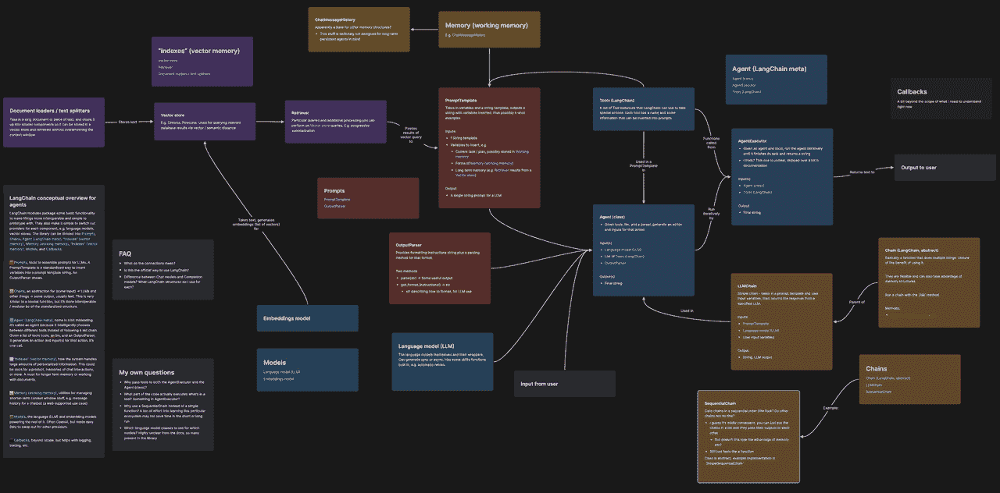

### 参考资料

> https://note.com/npaka/n/n155e66a263a2

> https://www.cnblogs.com/AudreyXu/p/17233964.html

> https://github.com/hwchase17/langchain
