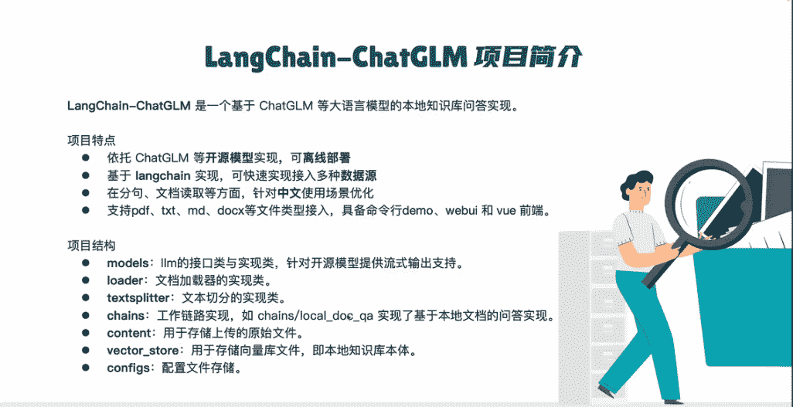
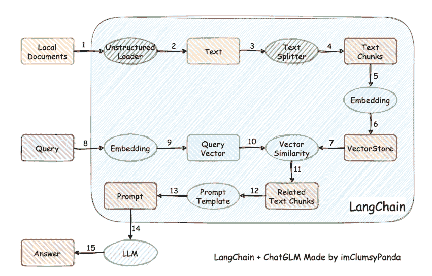
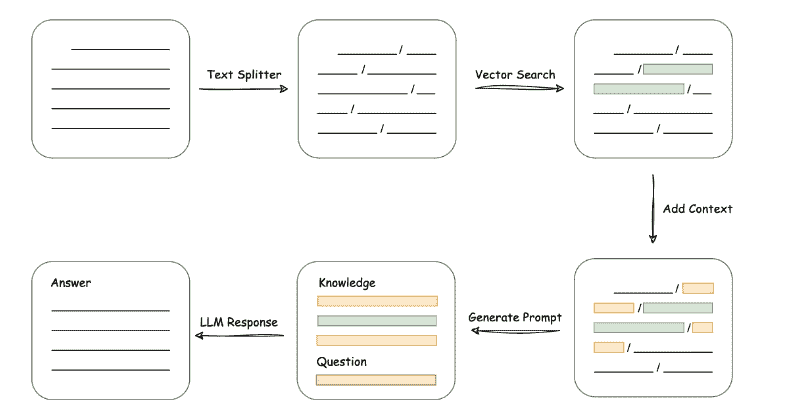
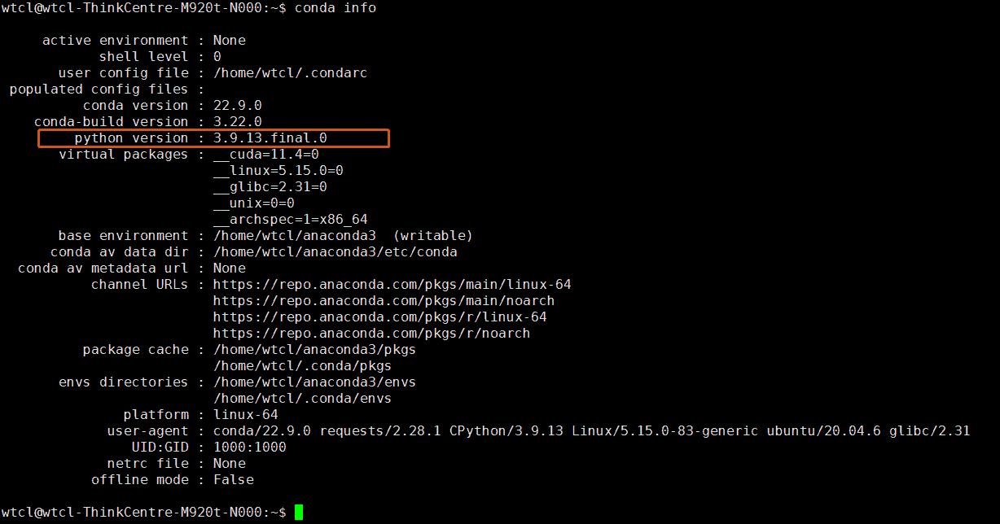
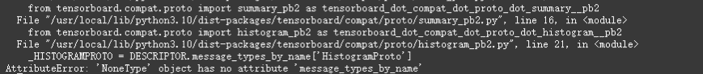
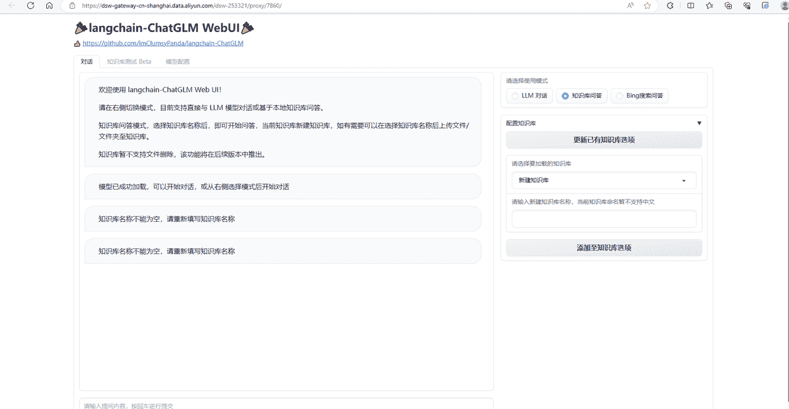
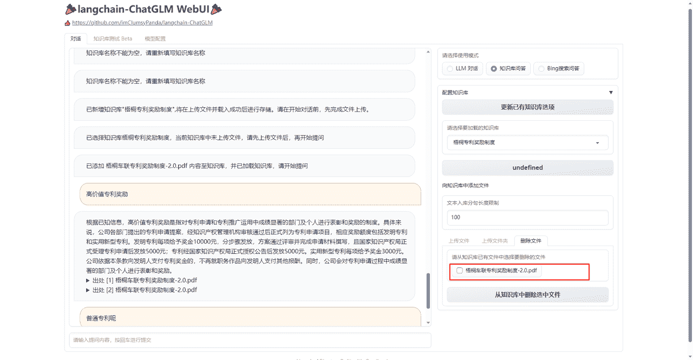
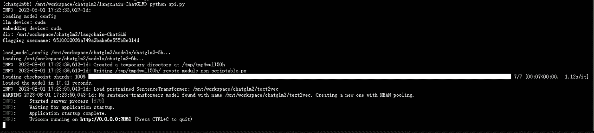
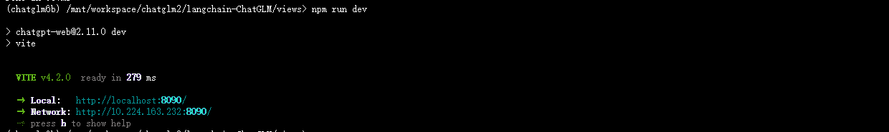

# Langchain-Chatchat构建本地知识库工程部署

> 来源：[https://docs.feishu.cn/docx/X0FndDtMPoVLe7x9lJXchvqCnid](https://docs.feishu.cn/docx/X0FndDtMPoVLe7x9lJXchvqCnid)



LangChain-ChatGLM简介

LangChain-ChatGLM是一个基于ChatGLM等大预言模型的本地知识库问答实现，也就是一种利用 langchain 思想实现的基于本地知识库的问答应用，目标期望建立一套对中文场景与开源模型支持友好、可离线运行的知识库问答解决方案。

项目地址：基于本地知识库的 ChatGLM 等大语言模型应用实现

项目特点：

+   依托ChatGLM等开源模型实现，可离线部署

+   基于langchain实现，可快速实现接入多种数据源

+   在分句、文档读取等方面，针对中文使用场景优化

+   支持PDF、txt、md、docx等文件类型接入，具备命令行demo、webui和vue前端。

项目结构：

+   models：LLM的接口类和实现类，针对开源模型提供流式输出支持。

+   loader：文档加载器的实现类

+   textsplitter：文本切分的实现类

+   chains：工作链路实现，如chains/local_doc_qa实现了基于本地文档的问答实现

+   content：用于存储上传的原始文件

+   vector_store：用于存储向量库文件、即本地知识库本体

+   configs：配置文件存储

项目优化的方向：

1.  模型微调：对LLM和embedding基于专业领域数据进行微调

1.  文档加工：在文本分段后，对每段分别进行总结，基于总结内容语义进行匹配

1.  借助不同模型能力：在text2sql、text2cpyher场景下需要产生代码时，可借助不同模型能力

LangChain 知识库技术原理

目前市面上绝大部分知识库都是 LangChain + LLM + embedding 这一套，实现原理如下图所示，过程包括加载文件 -> 读取文本 -> 文本分割 -> 文本向量化 -> 问句向量化 -> 在文本向量中匹配出与问句向量最相似的top k个 -> 匹配出的文本作为上下文和问题一起添加到 prompt 中 -> 提交给 LLM 生成回答。

> 白话理解：大模型参数量大，训练成本高，周期长。某些场景下很多知识内容可能是天级别的，那为了保证该场景下大模型回答的准确性，可以通过langchain的方式将知识库与大模型结合起来，在使用大模型进行提问时，到知识库中搜索相关内容，通过组合实时的知识内容与问题形成新的prompt，利用大模型的摘要汇总能力，进行问题





从上面就能看出，其核心技术就是向量 embedding，将用户知识库内容经过 embedding 存入向量知识库，然后用户每一次提问也会经过 embedding，利用向量相关性算法（例如余弦算法）找到最匹配的几个知识库片段，将这些知识

```
&quot;&quot;&quot;
已知信息：
{context} 
根据上述已知信息，简洁和专业的来回答用户的问题。如果无法从中得到答案，请说 “根据已知信息无法回答该问题” 或 “没有提供足够的相关信息”，不允许在答案中添加编造成分，答案请使用中文。 
问题是：{question}
&quot;&quot;&quot;
```

更多关于向量 embedding 的内容可以参考我之前写的一篇文章。

ChatGPT 引爆向量数据库赛道

> **项目部署**

+   ** ****conda****安装**

```
#下载安装包：注意miniconda包需选择对应python版本的包
$wget https://repo.anaconda.com/miniconda/Miniconda3-py39_23.5.2-0-Linux-x86_64.sh
#运行安装脚本，并初始化：
$bash Miniconda3-py39_23.5.2-0-Linux-x86_64.sh
#（可在2中完成）初始化终端 Shell，以便运⾏conda。
$source ~/.bashrc
#验证conda
$conda --version
```

+   **创建****虚拟环境**

```
**#使用conda自带的**命令来查看安装Python的版本
$conda info
```



```
**#创建⼀个新的环境（可选）：****
****$****c****onda cre**ate -n Lan**g****c****h**ain-Chatchat python=3.9.13 -y
#该方式创建的环境在默认路径下，可以通过以下方式指定路径：
#conda create --prefix=&quot;D:\\my_python\\envs\\my_py_env&quot; python=3.6.3
#其中&quot;D:\my_python\envs\&quot;是路径名，&quot;my_py_env&quot; 是环境名.

$conda init bash
#激活Langchain-Chatchat环境（可选
$conda activate Langchain-Chatchat

#退出环境
$conda  deactivate

#使用conda管理包
$conda install -n my_py_env package_name 
$conda uninstall -n my_py_env package_name

#删除环境
$conda remove -n my_py_env --all
```

+   **conda**** 添加国内镜像源**

```
#添加清华镜像源（也可设置其他源）
$conda config --add channels https://mirrors.tuna.tsinghua.edu.cn/anaconda/pkgs/main
$conda config --add channels https://mirrors.tuna.tsinghua.edu.cn/anaconda/pkgs/free
$conda config --add channels https://mirrors.tuna.tsinghua.edu.cn/anaconda/pkgs/r
$conda config --add channels https://mirrors.tuna.tsinghua.edu.cn/anaconda/pkgs/pro
$conda config --add channels https://mirrors.tuna.tsinghua.edu.cn/anaconda/pkgs/msys2

#设置搜索时显示通道地址
$conda config --set show_channel_urls yes

#设置完后可查看
$conda info
```

+   **拉取项目****源码**

[github.com](https://github.com/chatchat-space/Langchain-Chatchat)

```
#关闭https代理
$git config --global --unset http.https://github.com.proxy
$git config --global --unset https.https://github.com.proxy
# 拉取仓库
$git clone https://github.com/chatchat-space/Langchain-Chatchat.git
# 进入目录
$cd Langchain-Chatchat
# 安装全部依赖，从国内阿里源下载
$/root/anaconda3/envs/Langchain-Chatchat/bin/python3 -m pip install -r requirements.txt -i https://mirrors.aliyun.com/pypi/simple
```

+   **下载模型至本地**

如需在本地或离线环境下运行本项目，需要首先将项目所需的模[型下载至本地，通常开源](https://huggingface.co/models) LLM 可以从 HuggingFace 下载。

以本项目中默认使用的 LLM 模型 THUDM/chatglm2-6b为例：

下载模型需要先[安装Git LFS](https://docs.github.com/zh/repositories/working-with-files/managing-large-files/installing-git-large-file-storage)(**Git **Large File Storage)，然后运行

```
# 创建待下载模型的文件夹路径 
$cd Langchain-Chatchat
$mkdir models
# 这里我将下载的模型文件放到了本地的/chatglm2/models目录下
$cd models

# 这里我将下载的模型文件放到了本地的 chatglm-6b 目录下
$git lfs version
$git clone https://huggingface.co/THUDM/chatglm2-6b

# 模型文件比较大,20G,可以用下面这个看下下载速度
$sudo apt-get install bwm-ng
$bwm-ng

# 注意：模型有数个bin文件，共十几G大小。下载后需要切换到chatglm2-6b目录下检查模型文件大小。如果没有成功下载，可以使用如下命令来更新模型文件：
$cd /chatglm2/models &amp;&amp; git lfs pull
```

+   **下载 Embedding 模型**

如[需在本地或离线环境下运](https://huggingface.co/models)行本项目，需要首先将项目所需的模型下载至本地， Embedding 模型可以从 HuggingFace 下载。

以本项目中默认使用的 Embedding 模型 moka-ai/m3e-base 为例：

```
#关闭代理
$git config --global --unset http.https://github.com.proxy
$git config --global --unset https.https://github.com.proxy
#进入目录
$ cd langchain-Chatchat
#创建目录
$ mkdir Embedding
#进入目录
$ cd Embedding
#克隆Embedding
$ git lfs clone https://huggingface.co/moka-ai/m3e-base
# 模型需要更新时，可打开模型所在文件夹后拉取最新模型文件/代码
$ git pull
```

使用代理镜像下载

```
$git config --global --unset http.https://github.com.proxy
$git config --global --unset https.https://github.com.proxy
#创建虚拟环境
$git clone https://github.com/git-cloner/aliendao
$conda create -n aliendao python=3.10 -y
$conda activate aliendao
$cd aliendao
$pip install -r requirements.txt -i https://pypi.mirrors.ustc.edu.cn/simple --trusted-host=pypi.mirrors.ustc.edu.cn
$python model_download.py --mirror --repo_id moka-ai/m3e-base
$python model_download.py --mirror --repo_id THUDM/chatglm2-6b
```

+   **参数调整**

模型下载完成后，切回项目$PWD/langchain-ChatGLM，请在 configs/model_config.py 文件中，对embedding_model_dict和llm_model_dict参数进行修改

```
embedding_model_dict = {
    &quot;ernie-tiny&quot;: &quot;nghuyong/ernie-3.0-nano-zh&quot;,
    &quot;ernie-base&quot;: &quot;nghuyong/ernie-3.0-base-zh&quot;,
    &quot;text2vec-base&quot;: &quot;shibing624/text2vec-base-chinese&quot;,
    &quot;text2vec&quot;: &quot;/mnt/workspace/chatglm2/text2vec&quot;,
    &quot;m3e-small&quot;: &quot;moka-ai/m3e-small&quot;,
    &quot;m3e-base&quot;: &quot;moka-ai/m3e-base&quot;,
}
llm_model_dict = {
    ...
    &quot;chatglm2-6b&quot;: {
        &quot;name&quot;: &quot;chatglm2-6b&quot;,
        &quot;pretrained_model_name&quot;: &quot;/mnt/workspace/chatglm2/models/chatglm2-6b&quot;,
        &quot;local_model_path&quot;: None,
        &quot;provides&quot;: &quot;ChatGLM&quot;
    },
    ...
}
# LLM 名称改成 chatglm2-6b
LLM_MODEL = &quot;chatglm2-6b&quot;
```

> **项目启动**

一键**启动**

```
python startup.py --all-webui
```

如果报了这个错：



升级下 protobuf 即可。

```
pip install --upgrade protobuf==3.19.6
```

启动成功！

+   **模型配置**



+   **上传知识库**


+   **基于** ChatGLM2-6B 的知识库问答



VUE** 模式启动**

+   首先需要安装额外的依赖

$ pip install fastapi uvicorn

+   然后运行仓库中的 [api.py](https://github.com/THUDM/ChatGLM-6B/blob/main/api.py)

$ python api.py



+   成功部署 API 后，打开新的终端，执行以下脚本体验基于 VUE 的前端页面

```
# 使用Node.js版本管理工具安装Node.js
# 使用n工具（适用于单个用户）
$ npm install -g n
$ sudo n stable  # 安装最新稳定版本
# 验证安装
$ node -v

#安装pnpm
$ npm install -g pnpm
#验证安装
$ pnpm --version

# 启动 VUE 的前端页面
$ cd views

$ pnpm i
$ npm run dev
```

