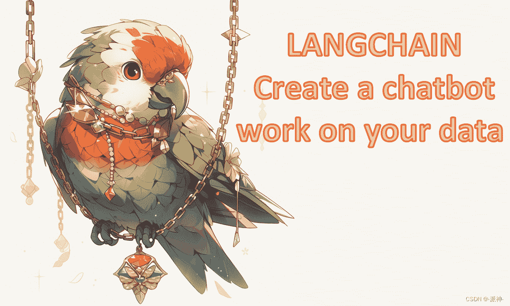
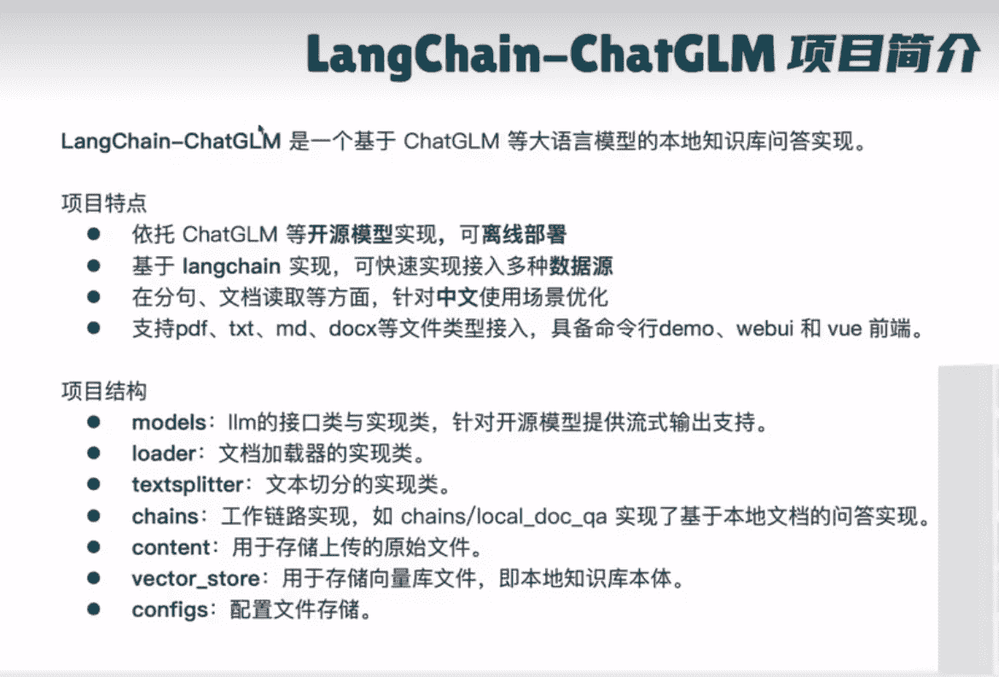
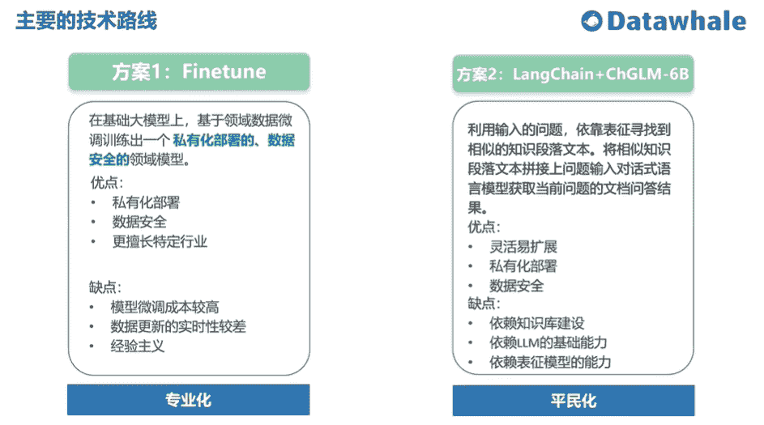
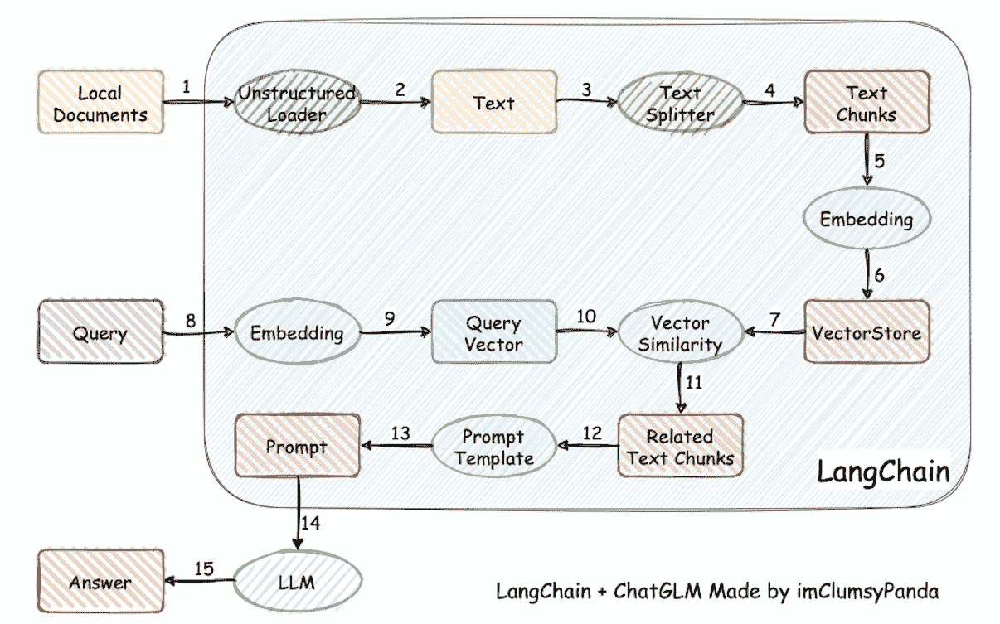
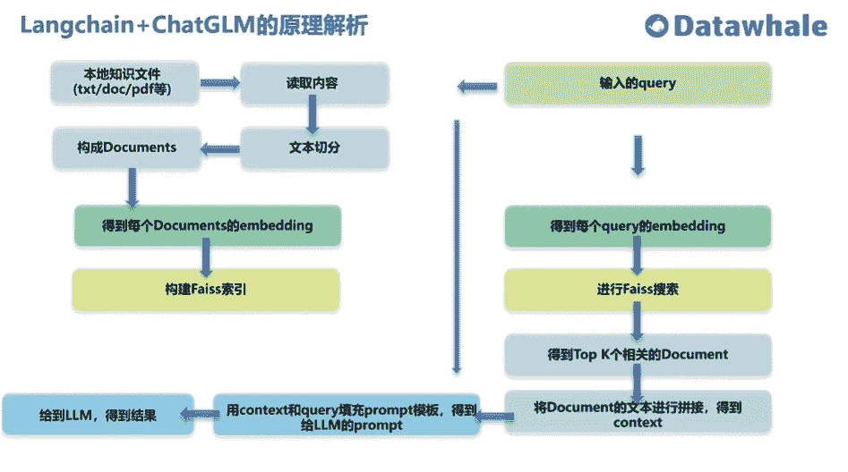
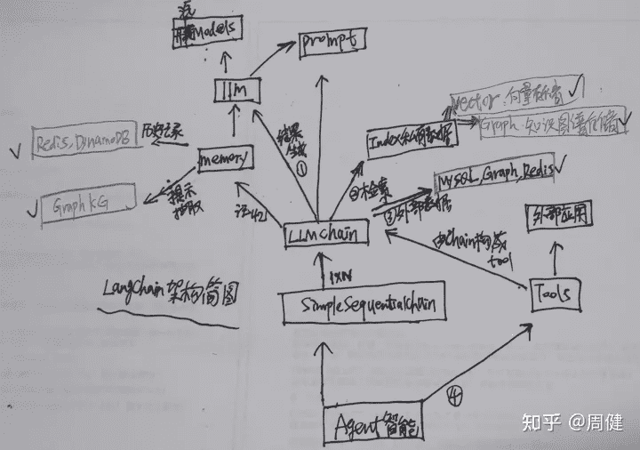
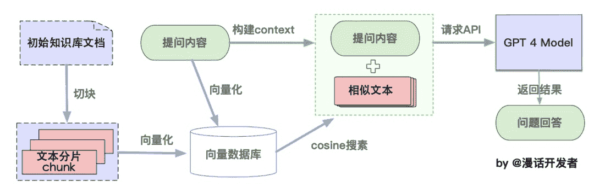
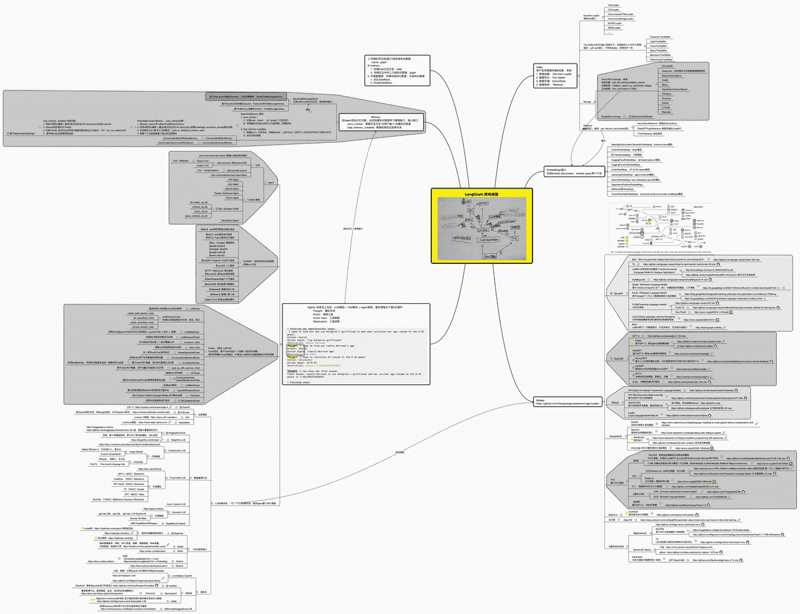

# LangChain + ChatGLM-6B 构建本地知识库代码实现2

> 来源：[https://docs.feishu.cn/docx/W9vrd7AoooMX8dxrShjcG1S0n8d](https://docs.feishu.cn/docx/W9vrd7AoooMX8dxrShjcG1S0n8d)



## LangChain-ChatGLM项目简介





## 本项目实现原理

(与基于文档的问答 大同小异，过程包括：1 加载文档 -> 2 读取文档 -> 3/4文档分割 -> 5/6 文本向量化 -> 8/9 问句向量化 -> 10 在文档向量中匹配出与问句向量最相似的top k个 -> 11/12/13 匹配出的文本作为上下文和问题一起添加到prompt中 -> 14/15提交给LLM生成回答 )





## 项目目标

GitHub上有一个利用 [langchain](https://github.com/hwchase17/langchain?login=from_csdn) 思想实现的基于本地知识库的问答应用：l[angchain-](https://github.com/chatchat-space/langchain-ChatGLM?login=from_csdn)ChatGLM (这是其GitHub地址，当然还有和它类似的但现已支持Vicuna-13b的项目，比如LangChain-ChatGLM-Webui )，目标期望建立一套对中文场景与开源模型支持友好、可离线运行的知识库问答解决方案

## 项目架构

下图中每个部件其实都是一类集合，我们以汽车（人）来类比一个基于LangChain的Agent，核心组件包括：

+   系统发动机（心脏）：开源Models以及其封装的LLMS

+   汽油（血液）：Prompt

+   方向盘（大脑）：Memory

+   前进（创造新应用）：LLMChain

+   听流行音乐（链接千行万业）：Tools

+   播放珍藏光碟（链接垂直私有领域）：Index私有数据

+   开车旅行（开放生态）：Agent智能

下面是一张简图：



草图

## 实现流程



## 项目全景图

整体分为：基础层、能力层、应用层三部分（如果不清晰，点击github浏览）



## 基础层

包括：Models、LLM、Index三层：

### Models层：

吐血整理最近3年左右的模型、详细文档。可以看出各家大模型的演进历史，其中Google、OpenAI、Meta、DeepMind领先优势非常大，国内大厂唯独腾讯缺席。有几个点：

+   目前最主要的几个大模型为： Google的LaMDA、Meta的LLaMa、OpenAI的GPT-4、DeepMind的：Chinchilla

+   另外目前投入应用的智能终端基本都是基于模型的Fine-Tuning或者RLHF技术，并且需要大量的相关行业训练集，典型比如code领域、财经领域BloombergGPT、学术论文编写等，其中在作者最关注的Code细分领域，目前的模型有：

+   OpenAI的Codex

+   DeepMind的AlphaCode

+   Saleforce的CodeGen

Models层的输出包括：

+   文本自动生成

+   embeding向量化输出

+   多模态输出

### LLMS层：

这一层主要强调对models层能力的封装以及服务化输出能力，主要有：

+   各类LLM模型管理平台：强调的模型的种类丰富度以及易用性

+   一体化服务能力产品：强调开箱即用

+   差异化能力：比如聚焦于Promp管理、基于共享资源的模型运行模式等等

### Index层：

对用户私域文本、图片、PDF等各类文档进行存储和检索，这里有两个方案：

+   Vector方案：即对文件先切分为Chunks，在按Chunks分别编码存储并检索

+   KG方案：这部分利用LLM抽取文件中的三元组，将其存储为KG供后续检索

## 能力层

如果基础层提供了最核心的能力，能力层则给这些能力安装上手、脚、脑，让其具有记忆和触发万物的能力，包括：Chains、Memory、Tool三部分

### Chains层：

按照不同的需求抽象并定制化不同的执行逻辑，Chain可以相互嵌套并串行执行，通过这一层，让LLM的能力链接到各行各业比如面向私域数据的load_qa_with_sources_chain; 比如面向SQL数据源的SQLDatabaseChain；再比如能自动生成代码并执行的LLMMathChain等等，这里面比较让人眼前一亮的点有：

+   ConstitutionalChain：对最终结果进行偏见、合规问题处理的逻辑，保证最终的结果符合价值观

+   LLMCheckerChain：能让LLM自动检测自己的输出是否有没有问题的逻辑

### Memory层：

这层主要有两个核心点：

+   对Chains的执行过程中的输入、输出进行记忆并结构化存储，为下一步的交互提供上下文，这部分简单存储在Redis即可

+   根据交互历史构建知识图谱，根据关联信息给出准确结果

### Tools层：

其实Chains层可以根据LLM + Prompt执行一些特定的逻辑，但是如果要用Chain实现所有的逻辑不现实，可以通过Tools层也可以实现，Tools层理解为技能比较合理。典型的比如搜索、维基百科、天气预报、chatGPT服务等等。

## 应用层

有了基础层和能力层，我们可以构建各种各样好玩的，有价值的服务，这里就是Agent

### Agent层

Agent层可以根据Tool和Chain组合出特定的服务来，最终实现以更自然的文本交互形态完成用户特定需求的目标，比如用自然语言的方式实现sql的操作等等。

### 代码示例：**实现一个文档对话机器人**

众所周知，由于ChatGPT训练的数据只更新到 2021 年，因此它不知道互联网最新的知识(除非它调用搜索功能bing)，而利用 “LangChain + ChatGPT的API” 则可以用不到 50 行的代码然后实现一个和既存文档的对话机器人

**假设所有 202**2 年更新的内容都存在于 2022.txt 这个文档中，那么通过如下的代码，就可以让 ChatGPT 来支持回答 2022 年的问题

其中原理也很简单：

1.  对用户的输入/prompt向量化

1.  文档分词

1.  文档分割

1.  文本向量化
向量化了才能进行向量之间相似度的计算

1.  向量化的文本存到向量数据库里

1.  根据用户的输入/prompt去向量数据里寻找答案(答案的判定是基于prompt/输入与文本中相关段落向量的相似性匹配)

1.  最后通过LLM返回答案

```
#!/usr/bin/python
# -*- coding: UTF-8 -*-

import os                            # 导入os模块，用于操作系统相关的操作
import jieba as jb                   # 导入结巴分词库
from langchain.chains import ConversationalRetrievalChain   # 导入用于创建对话检索链的类
from langchain.chat_models import ChatOpenAI                # 导入用于创建ChatOpenAI对象的类
from langchain.document_loaders import DirectoryLoader      # 导入用于加载文件的类
from langchain.embeddings import OpenAIEmbeddings           # 导入用于创建词向量嵌入的类
from langchain.text_splitter import TokenTextSplitter       # 导入用于分割文档的类
from langchain.vectorstores import Chroma                   # 导入用于创建向量数据库的类

# Set the OpenAI API key
os.environ[&#x27;OPENAI_API_KEY&#x27;] = &quot;sk-xxxxxxxxxxxxxxx&quot;  # get api_key from openai official website
openai.api_key = os.getenv(&quot;OPENAI_API_KEY&quot;)

# 初始化函数，用于处理输入的文档
def init():  
    files = [&#x27;2022.txt&#x27;]      # 需要处理的文件列表
    for file in files:        # 遍历每个文件
        with open(f&quot;./data/{file}&quot;, &#x27;r&#x27;, encoding=&#x27;utf-8&#x27;) as f:   # 以读模式打开文件
            data = f.read()   # 读取文件内容

        cut_data = &quot; &quot;.join([w for w in list(jb.cut(data))])       # 对读取的文件内容进行分词处理
        cut_file = f&quot;./data/cut/cut_{file}&quot;      # 定义处理后的文件路径和名称
        with open(cut_file, &#x27;w&#x27;) as f:           # 以写模式打开文件
            f.write(cut_data)                    # 将处理后的内容写入文件

# 新建一个函数用于加载文档
def load_documents(directory):  
    # 创建DirectoryLoader对象，用于加载指定文件夹内的所有.txt文件
    loader = DirectoryLoader(directory, glob=&#x27;**/*.txt&#x27;)  
    docs = loader.load()  # 加载文件
    return docs  # 返回加载的文档

# 新建一个函数用于分割文档
def split_documents(docs):  
    # 创建TokenTextSplitter对象，用于分割文档
    text_splitter = TokenTextSplitter(chunk_size=1000, chunk_overlap=0)  
    docs_texts = text_splitter.split_documents(docs)  # 分割加载的文本
    return docs_texts  # 返回分割后的文本

# 新建一个函数用于创建词嵌入
def create_embeddings(api_key):  
    # 创建OpenAIEmbeddings对象，用于获取OpenAI的词向量
    embeddings = OpenAIEmbeddings(openai_api_key=api_key)  
    return embeddings  # 返回创建的词嵌入

# 新建一个函数用于创建向量数据库
def create_chroma(docs_texts, embeddings, persist_directory):  
    # 使用文档，embeddings和持久化目录创建Chroma对象
    vectordb = Chroma.from_documents(docs_texts, embeddings, persist_directory=persist_directory)  
    vectordb.persist()      # 持久化存储向量数据
    return vectordb         # 返回创建的向量数据库

# load函数，调用上面定义的具有各个职责的函数
def load():
    docs = load_documents(&#x27;./data/cut&#x27;)        # 调用load_documents函数加载文档
    docs_texts = split_documents(docs)         # 调用split_documents函数分割文档
    api_key = os.environ.get(&#x27;OPENAI_API_KEY&#x27;)   # 从环境变量中获取OpenAI的API密钥
    embeddings = create_embeddings(api_key)      # 调用create_embeddings函数创建词嵌入

    # 调用create_chroma函数创建向量数据库
    vectordb = create_chroma(docs_texts, embeddings, &#x27;./data/cut/&#x27;)  

    # 创建ChatOpenAI对象，用于进行聊天对话
    openai_ojb = ChatOpenAI(temperature=0, model_name=&quot;gpt-3.5-turbo&quot;)  

    # 从模型和向量检索器创建ConversationalRetrievalChain对象
    chain = ConversationalRetrievalChain.from_llm(openai_ojb, vectordb.as_retriever())  
    return chain  # 返回该对象

# 调用load函数，获取ConversationalRetrievalChain对象
chain = load()  

# 定义一个函数，根据输入的问题获取答案
def get_ans(question):  
    chat_history = []      # 初始化聊天历史为空列表
    result = chain({       # 调用chain对象获取聊天结果
        &#x27;chat_history&#x27;: chat_history,  # 传入聊天历史
        &#x27;question&#x27;: question,          # 传入问题
    })
    return result[&#x27;answer&#x27;]      # 返回获取的答案

if __name__ == &#x27;__main__&#x27;:       # 如果此脚本作为主程序运行
    s = input(&#x27;please input:&#x27;)   # 获取用户输入
    while s != &#x27;exit&#x27;:      # 如果用户输入的不是&#x27;exit&#x27;
        ans = get_ans(s)    # 调用get_ans函数获取答案
        print(ans)  # 打印答案
        s = input(&#x27;please input:&#x27;)  # 获取用户输入
```

### 代码示例：通过 Google 搜索并返回答案

由于需要借助 Serpapi 来进行实现，而Serpapi 提供了 Google 搜索的API 接口

故先到 Serpapi 官网(https://serpapi.com/)上注册一个用户，并复制他给我们生成 API key，然后设置到环境变量里面去

```
import os
os.environ[&quot;OPENAI_API_KEY&quot;] = &#x27;你的api key&#x27;
os.environ[&quot;SERPAPI_API_KEY&quot;] = &#x27;46c3e3932e86061336a2a06645ed01f88bf78abf9fb8818078ea0ba6afd4e2c0&#x27;
from langchain.agents import load_tools
from langchain.agents import initialize_agent
from langchain.llms import OpenAI
from langchain.agents import AgentType

# 加载 OpenAI 模型
llm = OpenAI(temperature=0,max_tokens=2048) 

 # 加载 serpapi 工具
tools = load_tools([&quot;serpapi&quot;])

# 如果搜索完想再计算一下可以这么写
# tools = load_tools([&#x27;serpapi&#x27;, &#x27;llm-math&#x27;], llm=llm)

# 如果搜索完想再让他再用python的print做点简单的计算，可以这样写
# tools=load_tools([&quot;serpapi&quot;,&quot;python_repl&quot;])

# 工具加载后都需要初始化，verbose 参数为 True，会打印全部的执行详情
agent = initialize_agent(tools, llm, agent=AgentType.ZERO_SHOT_REACT_DESCRIPTION, verbose=True)

# 运行 agent
agent.run(&quot;What&#x27;s the date today? What great events have taken place today in history?&quot;)
```