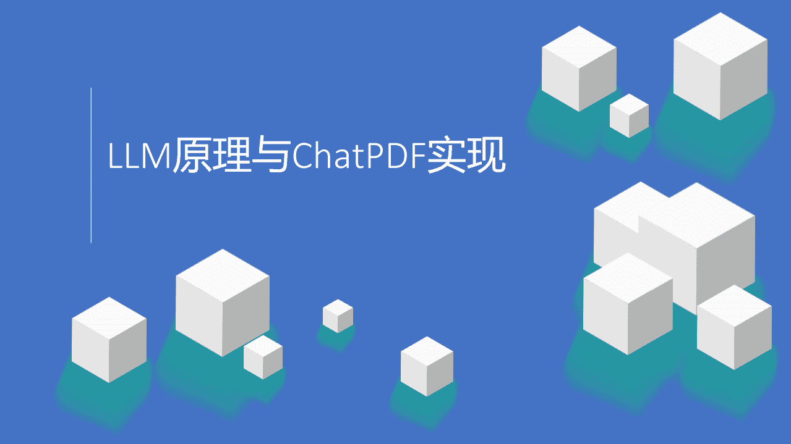

# 05 | 开源大模型构建对话机器人

> 来源：[https://docs.feishu.cn/docx/WiSXd2unIo2PwixhhsMcZd7PnEh](https://docs.feishu.cn/docx/WiSXd2unIo2PwixhhsMcZd7PnEh)

极客时间

[【0608直播】LLM原理与ChatPDF实现.pdf](https://internal-api-drive-stream.feishu.cn/space/api/box/stream/download/all/ZmOtbcQb2ozRs9xr4SJcbSxXnLK)

---

# 本地知识库LLM对话系统（langchain-ChatGLM项目）- 第1集

1）ChatGLM 内测体验：https://chatglm.cn

2）ChatGLM API申请：https://open.bigmodel.cn

3）ChatGLM-6B/ChatGLM2-6B/VisualGLM-6B/WebGLM开源：

---

# 基于Langchain和chatglm-6b构建本地知识库的自动问答应用

[颜鑫-LangChain+ChatGLM基于本地知识库的自动问答.pdf](https://datawhaler.feishu.cn/file/L3D0b6PUUoEnmux5aBUcU6HunHf)

---

**阿里云****云服务器**** ****ECS****部署**

---

**Linux本地部署**

**秋包的Window安装**

---

# 【2023版】ChatGLM-6B + LangChain 与训练及模型微调教程

---

智谱AI 和清华大学 KEG 实验室开源了基于 ChatGLM-6B 的多模态对话模型 VisualGLM-6B来了！

Github 链接：https://github.com/THUDM/VisualGLM-6B

Huggingface 链接：https://huggingface.co/THUDM/visualglm-6b

VisualGLM-6B 是一个开源的，支持图像、中文和英文的多模态对话语言模型，语言模型基于 ChatGLM-6B，具有 62 亿参数；图像部分通过训练 BLIP2-Qformer 构建起视觉模型与语言模型的桥梁，整体模型共78亿参数。

图为部分示例。

---