# 阿里云PAI机器平台免费部署ChatGLM2-6B开源大模型

> 来源：[https://docs.feishu.cn/docx/SZuKdpekeo7jyhxadVccfGG2nfc](https://docs.feishu.cn/docx/SZuKdpekeo7jyhxadVccfGG2nfc)

## 写在前面

本人也只是一个计算机小白，写这篇文章的目的主要是记录自己折腾的过程。若是这篇文章能帮助到其他人部署的话我会非常开心。作者：早夜初雪 https://www.bilibili.com/read/cv24026315/ 出处：bilibili

## 关于ChatGLM-6B

ChatGLM-6B是一个基于GLM-130B模型的人工智能助手，通过GLM模型对语言进行处理，从而生成相应的回复。项目的主要特点是智能化回复和语言理解能力，能够对用户提出的问题和输入的文本内容进行理解和回答，可以理解为本地部署版的、资料更少的ChatGPT。作者：早夜初雪 https://www.bilibili.com/read/cv24026315/ 出处：bilibili

## 关于显卡

首先，确定一下我们是什么显卡。AMD显卡很难使用，我没有AMD显卡，所以我也不知道要如何使用AMD显卡进行部署。即使是NVIDIA显卡，如果显存小于6G也是不能使用的。

作者：早夜初雪 https://www.bilibili.com/read/cv24026315/ 出处：bilibili

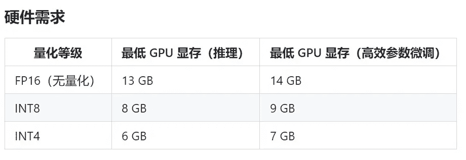

## 系统环境

Ubuntu 20.04.6 LTS

## 申请服务器

> 点击试用，完成注册、实名、领取产品后进入如下页面。

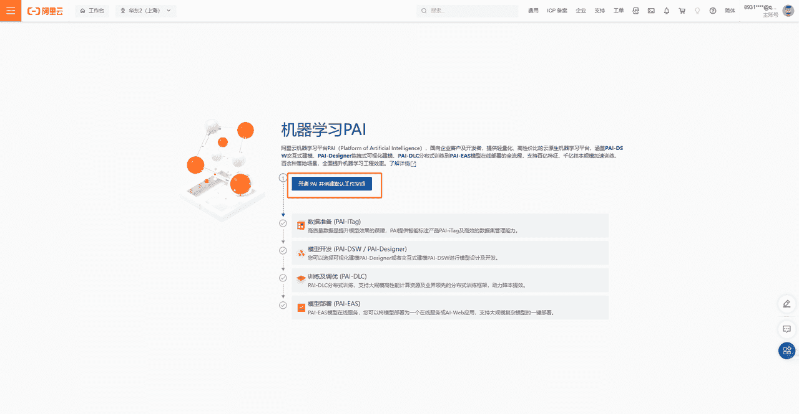

> 创建工作空间并授权

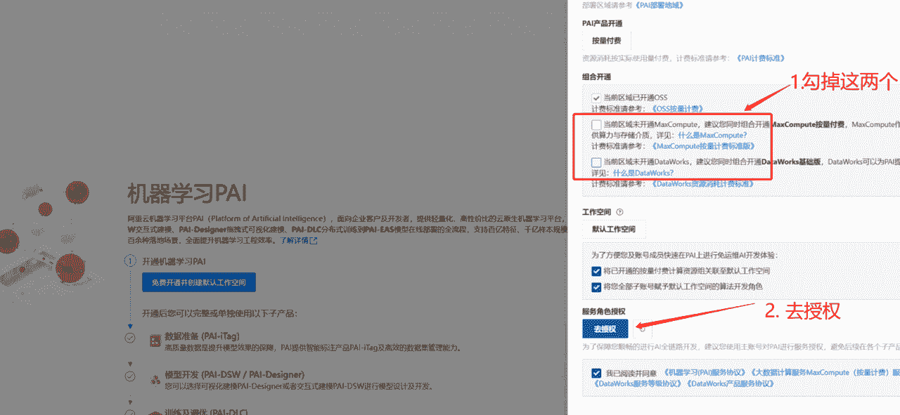

> 对象存储 OSS：阿里云对象存储 OSS（Object Storage Service）是一款海量、安全、低成本、高可靠的云存储服务，提供最高可达 99.995 % 的服务可用性。多种存储类型供选择，全面优化存储成本。

> MaxCompute 是面向分析的企业级 SaaS 模式云数据仓库，以 Serverless 架构提供快速、全托管的在线数据仓库服务，消除了传统数据平台在资源扩展性和弹性方面的限制，最小化用户运维投入，使您可以经济并高效的分析处理海量数据。数以万计的企业正基于 MaxCompute 进行数据计算与分析，将数据高效转换为业务洞察。

> DataWorks基于阿里云ODPS/EMR/CDP等大数据引擎，为数据仓库/数据湖/湖仓一体等解决方案提供统一的全链路大数据开发治理平台。作为阿里巴巴数据中台的建设者，DataWorks从2009年起不断沉淀阿里巴巴大数据建设方法论，同时与数万名政务/金融/零售/互联网/能源/制造等客户携手，助力产业数字化升级。

> 开通PAI工作空间

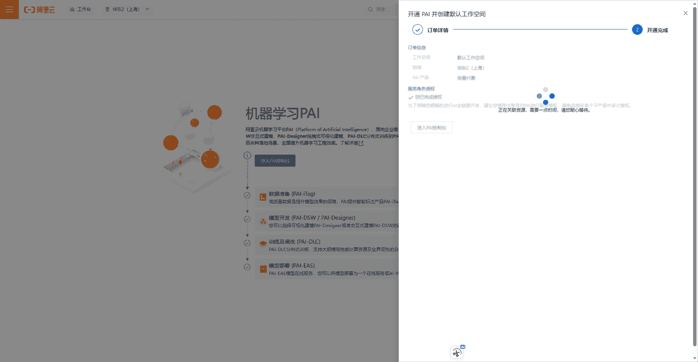

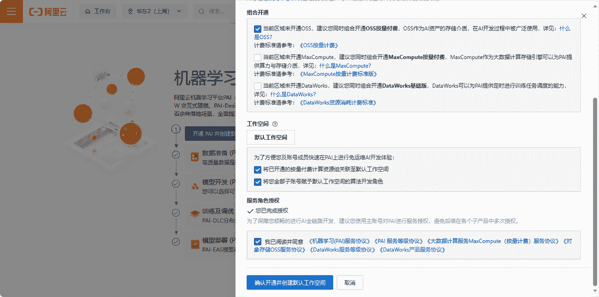

> 授权完成，前往默认工作空间。

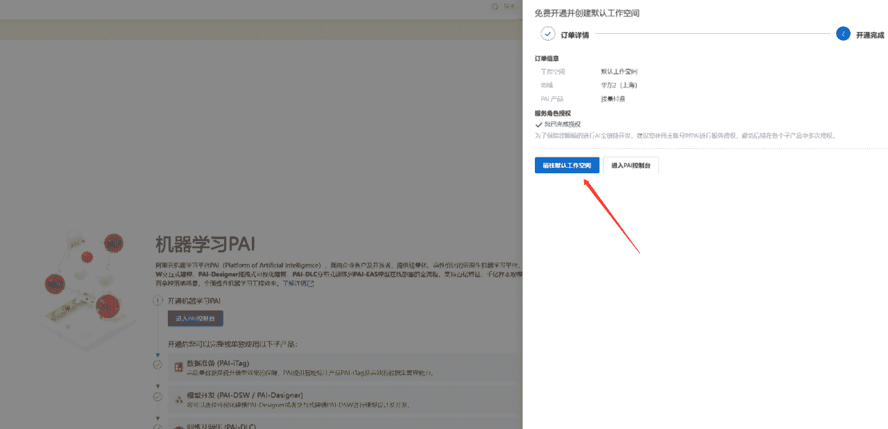

> 创建交互式建模（DWS）实例

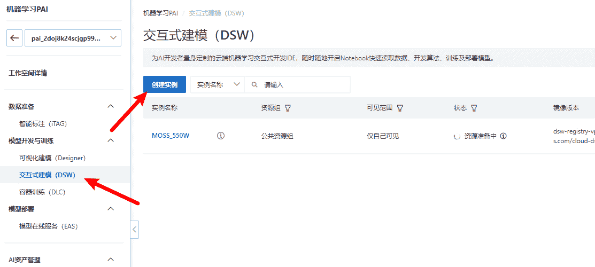

> 输入实例名称，就叫它 `LangchainChat` 吧~，GPU 选择 A10 或者 V100 都行，这俩是支持资源包抵扣的，其他的不支持，这里注意！V100 性能更好，但我们测试使用没必要，就选 A10 就行，A10 显卡每小时消耗6.991计算时，如果不关机持续使用大概可以使用30天。

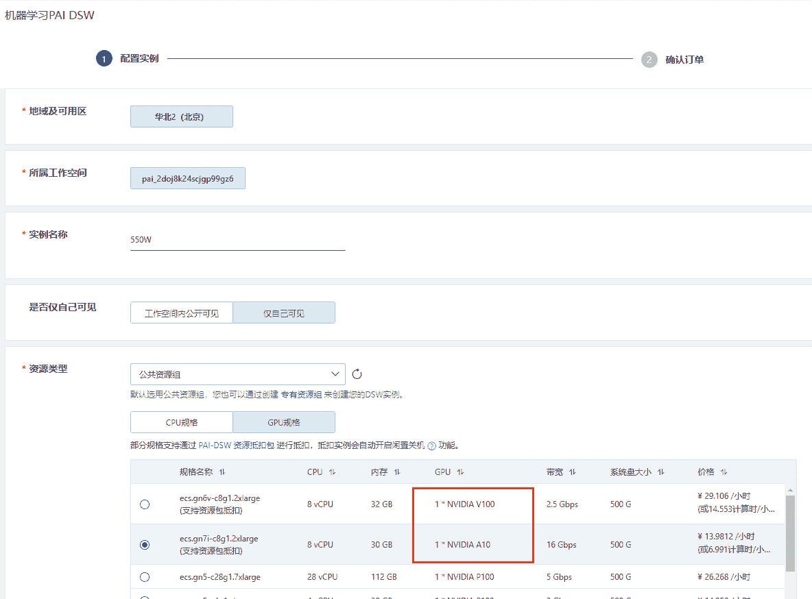

> 数据集是可选的，如果想闲时关机建议使用数据集，可以把数据保存，不然每次关机后启动都得重新部署。


选择镜像 URL，这里选择官方镜像就可以

然后点击下一步，耐心等待实例创建，这个过程还是比较耗时的。

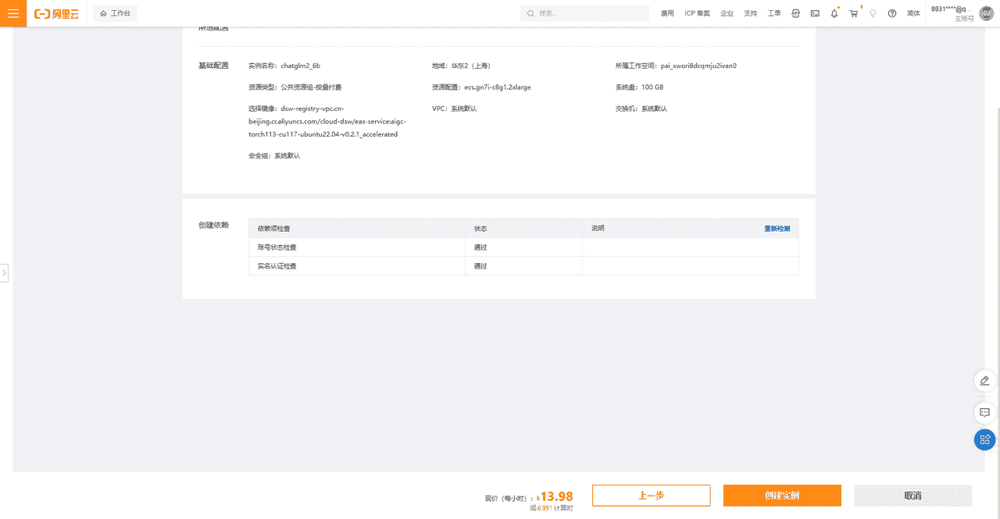

## 部署 ChatGLM

实例创建成功后，点击打开，进入控制台。

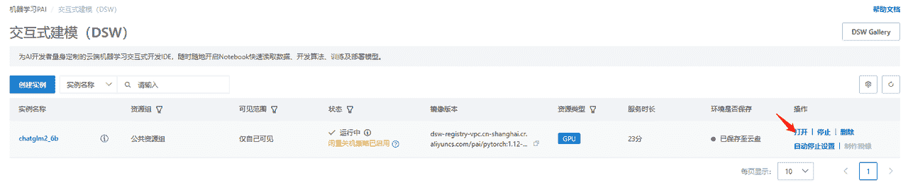

进入下面这个页面后，点击 “Terminal” 进入命令行。

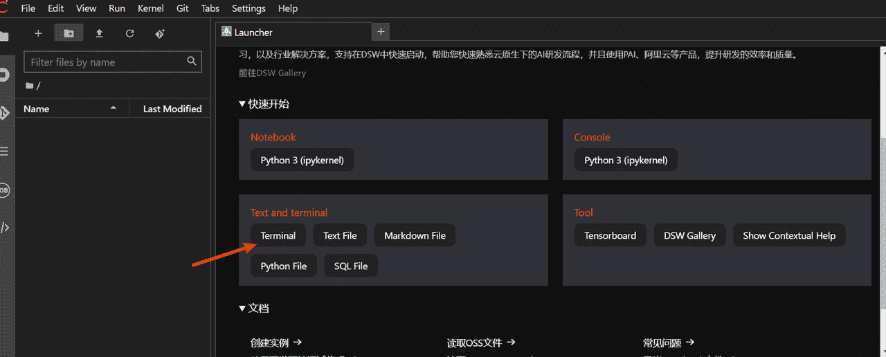

### cuda及PyTorch安装

#### cuda安装

> 首先在安装`cuda`与`cuDNN`之前，系统需要成功安装Nvidia驱动

验证系统内部是否已经安装了`cuda`，打开命令行，输入以下命令：

```
nvcc -V
```

若出现以下输出，则系统内部没有安装`cuda`。

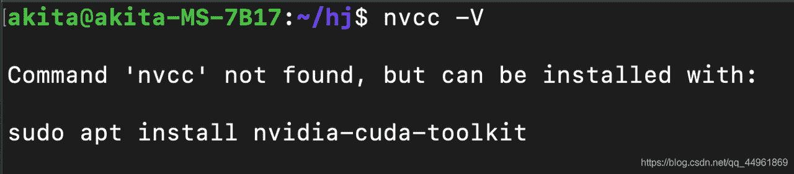

在命令行输入`nvidia-smi`查看显卡驱动版本也就是最高支持的CUDA工具包版本。

```
#我们可以通过以下命令查看自己的cuda及cuda驱动版本
nvidia-smi
#如果nvidia-smi未安装执行下面命令安装
$ubuntu-drivers devices
$sudo ubuntu-drivers autoinstall
$sudo reboot
$nvidia-smi
```

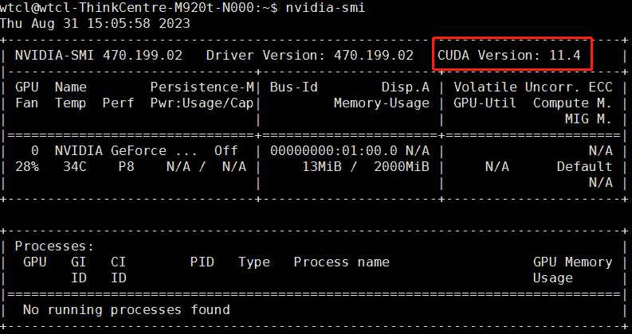

查看到本机可装CUDA版本最高为11.4及以下版本。

在[NVIDIA官网](https://developer.nvidia.com/cuda-toolkit-archive)选择对应版本的CUDA工具包并选择你的机器配置，我们就选择11.3.0版本下载

[Ubuntu下CUDA环境配置_ubuntu cuda_cl965的博客-CSDN博客](https://blog.csdn.net/cl944/article/details/126074827)

[安装CUDA 11.2 和 cuDNN 8.4.0并检查是否安装成功](https://powervision.feishu.cn/wiki/E2VOw1UjAi9ma9kAj2KcjaZtn8g)

验证环境变量是否生效

```
nvcc -V
```

若正常输出`cuda`版本信息则表示成功

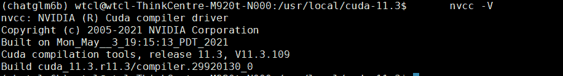

#### PyTorch安装

检查[PyTorch](https://pytorch.org/get-started/previous-versions/)支持的Cuda版本，

```
#使用python进入python命令行
python
import torch
# 查看torch当前版本号
print(torch.__version__) 
##编译当前版本的torch使用的cuda版本号
print(torch.version.cuda)
#查看pytorch和cuda版本是否匹配：如果输出True，则表示可用
print(torch.cuda.is_available())
#查看pytorch 是否可以使用cuda
print(torch.zeros(1).cuda())
```

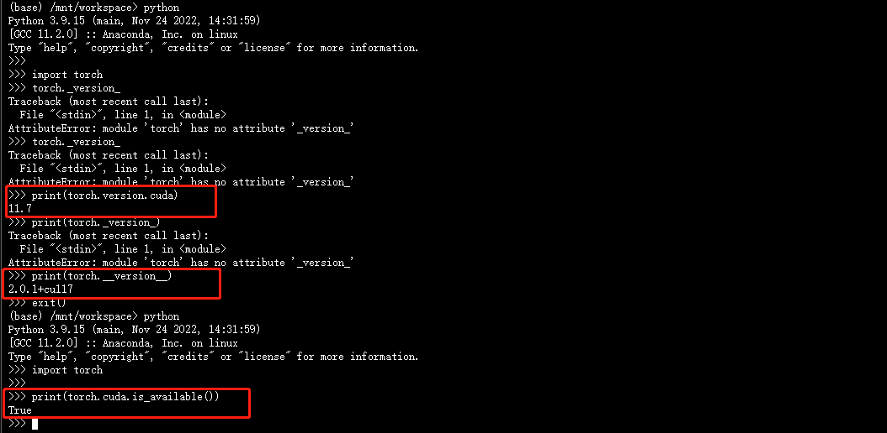

[如果返回False](https://pytorch.org/get-started/previous-versions/)说明版本不匹配，需要到pytorch官网下载`cuda`版本对应的`pytorch`

这里要注意选择你是什么系统，`cuda`是安装了什么版本，然后复制下面红框中的命令到终端就可以安装了。

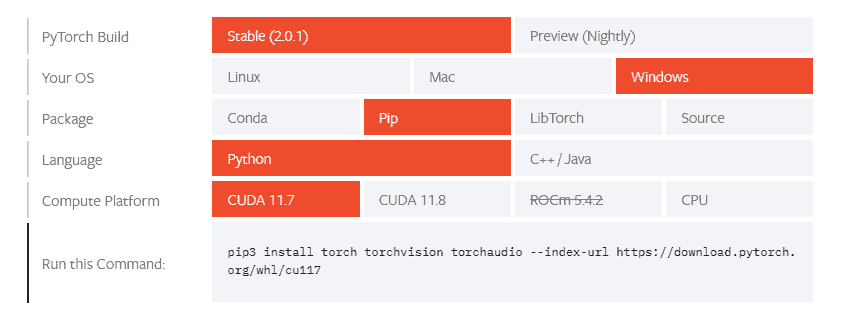

在终端运行下面命令，即可安装成功`pytorch` GPU版本：

```
# 最新版本torch
$pip3 install torch torchvision torchaudio --index-url https://download.pytorch.org/whl/cu117
```

验证`pytorch`是否为GPU版本

```
python
>>>import torch
>>>print(torch.cuda.is_available())
>>>print(torch.zeros(1).cuda())
```

### 安装虚拟环境

> `ChatGLM-6B` 代码中有一些`python3.7`支持的语法，所以要有`python3.7+` 的环境。我们使用`conda`来管理`python`环境

> `conda`分为`anaconda`和`miniconda`。`anaconda`是包含一些常用包的版本，`miniconda`则是精简版.本文中我们将使用`miniconda`

Anaconda 安装

```
# The version of Anaconda may be different depending on when you are installing`
$sudo curl -O https://repo.anaconda.com/miniconda/Miniconda3-latest-Linux-x86_64.sh
wget https://mirrors.tuna.tsinghua.edu.cn/anaconda/archive/Anaconda3-2021.11-Linux-x86_64.sh
$wget https://repo.anaconda.com/archive/Anaconda3-2022.10-Linux-x86_64.sh
$bash Anaconda3-2022.10-Linux-x86_64.sh
$source ~/.bashrc
$conda --version
```

### 虚拟环境使用

```
# 创建虚拟环境
conda create --name chatglm6b python==3.8.10 -y
# 进入虚拟环境
#激活ChatGLM的环境
conda activate chatglm6b 
# 退出当前虚拟环境
conda deactivate
# 查看本地虚拟环境
conda info --env
# 删除虚拟环境
conda remove -n chatglm6b --all

#查看安装了哪些包
conda list

#默认安装（在线下载或缓存文件(.../pkgs/)）
conda install pkg-name

#对虚拟环境中安装额外的包。
#使用命令
conda install -n your_env_name [package]即可安装package到your_env_name中
#使用命令
conda remove -n your_env_name(虚拟环境名称) --all， 即可删除
#删除环境中的某个包，使用命令
conda remove --name your_env_name  package_name
```

### conda虚拟环境加入Jupyter Notebook

[Anaconda+Python+Jupyter环境安装教程+kernel安装](https://powervision.feishu.cn/wiki/QaGZwjgEMiIgCCkaem6ciIEnnVU)

```
#激活ChatGLM的环境
$conda activate chatglm6b 

#首先安装ipykernel
$conda install ipykernel

#在虚拟环境下创建kernel.json文件
#conda install -n 环境名称 ipykernel，比如我的虚拟环境是chatglm6b 
$conda install -n chatglm6b ipykernel


#将环境添加到 Jupyter 的内核列表中。运行以下命令：python -m ipykernel install --user --name your_kernel_name --display-name "Your Kernel Name"
$python -m ipykernel install --user --name chatglm6b --display-name "glm6b"

#打开notebook服务器，在terminal下执行命令行
$jupyter notebook

#jupyter 验证
!import sys; 
print('Python %s on %s\nsys path:\n%s' % (sys.version, sys.platform, sys.path))
```

[现在，你应该能够](https://so.csdn.net/so/search?q=Notebook&spm=1001.2101.3001.7020)在 Jupyter Notebook 或 JupyterLab 中看到你添加的内核。在内核列表中选择你添加的内核，以在该环境中运行代码

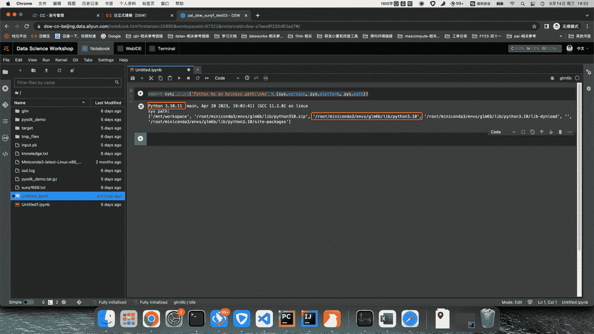

```
#另外删除kernel环境：
jupyter kernelspec remove 环境名称
```

通过这些步骤，你可以向 Conda 添加一个新的内核，并在 Jupyter 中使用该内核来运行代码。请确保在添加内核之前已经安装了 ipykernel 包，并正确地激活了你要添加内核的环境。

## ChatGLM-6B最新版模型环境部署及安装

### 项目地址

资源受限，简单实践就采用相对较小的6B的模型：

github：https://github.com/THUDM/ChatGLM2-6B

r土豪看这个：https://github.com/THUDM/GLM-130B

### 下载项目代码

```
# 更新apt-get库
$sudo apt-get update
# 下载git 以及较大模型文件所依赖的 git-lfs
$sudo apt install git
$sudo apt install git-lfs
# 初始化
$git init
#验证是否安装成功
$git lfs version
# 通过git下载项目代码和模型文件
$mkdir chatglm2

# 源码下载：登录github官方地址下载源码或者直接使用git命令clone：
$cd chatglm2
$git clone https://github.com/THUDM/ChatGLM2-6B

# 相关库安装，在终端下打开ChatGLM-6B安装的目录，然后运行下面命令，安装相关库
cd ChatGLM2-6B
conda install -r requirements.txt -i https://pypi.tuna.tsinghua.edu.cn/simp1e
# featurize平台有时会报依赖冲突，建议默认清华源改为阿里源，或其它源
#pip install -r requirements.txt -i https://mirrors.aliyun.com/pypi/simple
# pip install -r requirements.txt -i https://pypi.mirrors.ustc.edu.cn/simple
```

### 下载LLM模型

```
# 创建待下载模型的文件夹路径 
$mkdir models
# 这里我将下载的模型文件放到了本地的/chatglm2/models目录下
$cd ./chatglm2/models

# 这里我将下载的模型文件放到了本地的 chatglm-6b 目录下
$git clone https://huggingface.co/THUDM/chatglm2-6b

# 模型文件比较大,20G,可以用下面这个看下下载速度
$sudo apt-get install bwm-ng
$bwm-ng

# 注意：模型有数个bin文件，共十几G大小。下载后需要切换到chatglm2-6b目录下检查模型文件大小。如果没有成功下载，可以使用如下命令来更新模型文件：
$cd /chatglm2/models && git lfs pull
```

也可以从[Hugging Face](https://huggingface.co/THUDM/chatglm-6b/tree/main)下载所有文件下来，我们可以在chatglm-6b项目的Files and versions，下载里面的所有文件，并在根目录新建一个名为“model”的文件夹。Hugging Face上的chatglm模型连接为

https://huggingface.co/THUDM/chatglm-6b

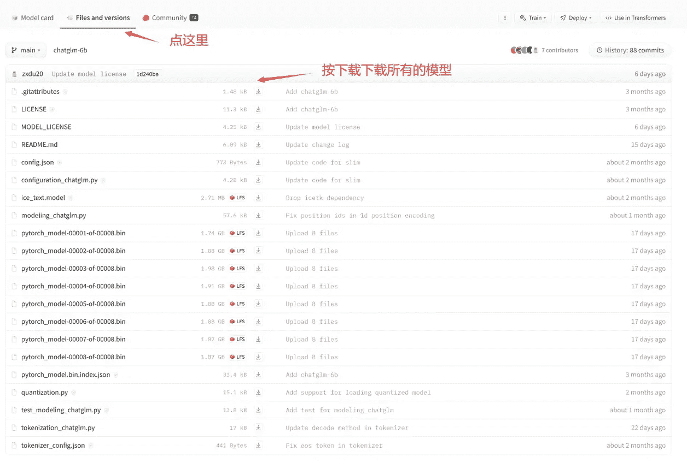

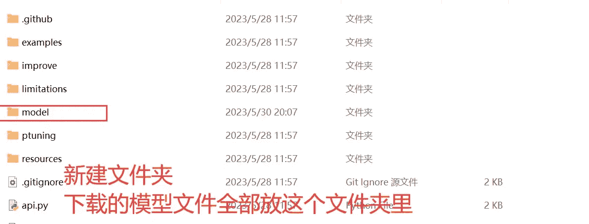

### 下载Embedding模型

```
# 下载 Embedding 模型
$ git clone https://huggingface.co/GanymedeNil/text2vec-large-chinese /your_path/text2vec

# 模型需要更新时，可打开模型所在文件夹后拉取最新模型文件/代码
$ git pull
```

### 测试体验

#### JupyterLab


## 官网样例

```
import os
import torch
from transformers import AutoTokenizer, AutoModel

model_path = "/mnt/workspace/chatglm2/models/chatglm2-6b"
tokenizer = AutoTokenizer.from_pretrained(model_path, trust_remote_code=True)
model = AutoModel.from_pretrained(model_path, trust_remote_code=True).half().cuda()
model = model.eval()
response, history = model.chat(tokenizer, "你好", history=[])
print(response)
```

你好👋!我是人工智能助手 ChatGLM-6B,很高兴见到你,欢迎问我任何问题。

### 2.4.4.2 命令行

```
python cli_demo.py # 在命令提示符中运行
```

### 2.4.4.3 运行 web 演示

在运行之前，需要先修改 `web_demo.py` 文件中的模型地址，具体为第 5 行与第 6 行，具体如下：

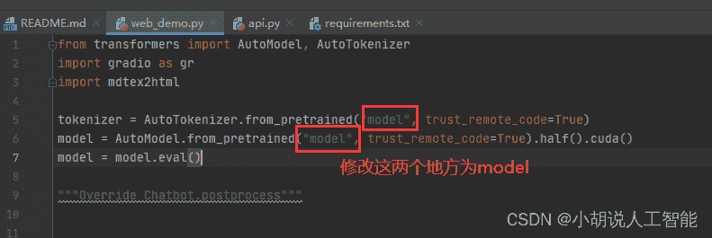

从清华镜像加载

```
# web_demo.py
# 1. 新增 mirror='https://mirrors.tuna.tsinghua.edu.cn/hugging-face-models', 下载模型使用清华源
tokenizer = AutoTokenizer.from_pretrained("THUDM/chatglm-6b", trust_remote_code=True, mirror='https://mirrors.tuna.tsinghua.edu.cn/hugging-face-models')
model = AutoModel.from_pretrained("THUDM/chatglm-6b", trust_remote_code=True, mirror='https://mirrors.tuna.tsinghua.edu.cn/hugging-face-models').half().quantize(4).cuda()
# 2. 增加 server_name 和 server_port 参数
demo.queue().launch(share=True, server_name="0.0.0.0", server_port=7860)
```

从本地加载

```
# 更改一下脚本里面的模型加载路径，改为从本地加载（上面通过 git 在 huggingface 上已经做了下载），hugging face 有时候网络环境不太好
# 修改 web_demo.py 文件
tokenizer = AutoTokenizer.from_pretrained("/mnt/workspace/chatglm2/models/chatglm2-6b", trust_remote_code=True)
model = AutoModel.from_pretrained("/mnt/workspace/chatglm2/models/chatglm2-6b", trust_remote_code=True).half().quantize().cuda()
# 如果想要本地访问，需要修改此处，如需要公网访问，还需要将 web_demo.py 中修改：share=True
demo.queue().launch(share=True, inbrowser=True, server_name='0.0.0.0', server_port=7860)
```

**温馨提示**，根据实际显卡显存，可以更改第 6 行关于 `model` 运行方式：

```
# 6G 显存可以 4 bit 量化
model = AutoModel.from_pretrained("model", trust_remote_code=True).half().quantize(4).cuda()

# 10G 显存可以 8 bit 量化
model = AutoModel.from_pretrained("model", trust_remote_code=True).half().quantize(8).cuda()

# 14G 以上显存可以直接不量化，博主显存为 16G 选择的就是这个
model = AutoModel.from_pretrained("model", trust_remote_code=True).half().cuda()
```

```
# Web 模式启动
# 官方推荐用 Streamlit 启动会更流畅一些，但受限于 PAI 平台没有分配弹性公网，所以还是用老的 gradio 启动吧。

# 安装 gradio 用于启动图形化 web 界面
pip install gradio

# 运行
python web_demo.py
# Running on local URL:
http://127.0.0.1:7860
# 直接点击日志弹出的 url，dsw 会自动进行公网代理的跳转，很丝滑
```


访问界面

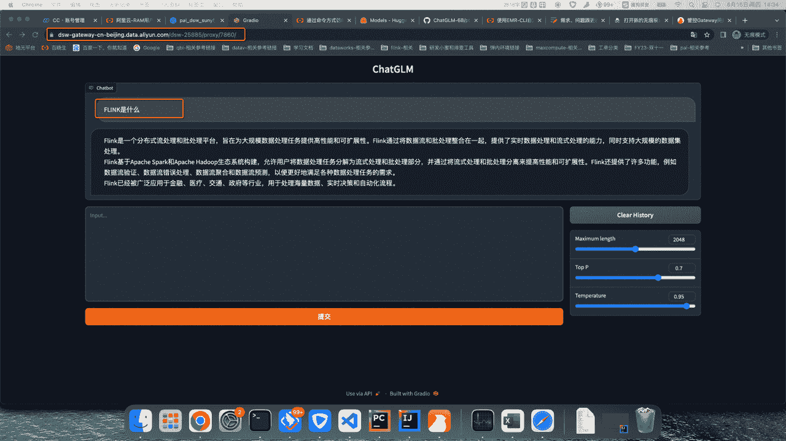

streamlit 方式启动，更加流畅

```
# 修改 web_demo2.py 中 model 位置的代码

# 然后执行启动命令：
streamlit run web_demo2.py

# 运行时模型以 FP16 精度加载，占用 GPU 显存为：13161 MiB
```

> 注意：确保 `transformers` 的版本为 4.30.2，否则会报错：`ImportError: cannot import name 'GenerationConfig' from 'transformers.generation.utils'`。

### 2.4.4.4 作为 API 部署

首先需要安装额外的依赖

```
pip install fastapi uvicorn
```

然后运行仓库中的 `api.py`：

```
python api.py
```

默认部署在本地的 8000 端口，通过 POST 方法进行调用

```
curl -X POST "http://127.0.0.1:8000" \
     -H 'Content-Type: application/json' \
     -d '{"prompt": "你好", "history": []}'
```

得到的返回值为

```
{
  "response": "你好👋！我是人工智能助手 ChatGLM-6B，很高兴见到你，欢迎问我任何问题。",
  "history": [["你好", "你好👋！我是人工智能助手 ChatGLM-6B，很高兴见到你，欢迎问我任何问题。"]],
  "status": 200,
  "time": "2023-03-23 21:38:40"
}
```

## 2.4.5 基于 P-Tuning 微调 ChatGLM2-6B

> ChatGLM2-6B 环境已经有了，接下来开始模型微调，这里我们使用官方的 P-Tuning v2 对 ChatGLM2-6B 模型进行参数微调，P-Tuning v2 将需要微调的参数量减少到原来的 0.1%，再通过模型量化、`Gradient Checkpoint` 等方法，最低只需要 7GB 显存即可运行。

目前我们实现了针对以下高效微调方法的支持：

+   [LoRA](https://link.zhihu.com/?target=https%3A//arxiv.org/abs/2106.09685)：仅微调低秩适应器。

+   [P-Tuning V2](https://link.zhihu.com/?target=https%3A//github.com/THUDM/P-tuning-v2)：仅微调前缀编码器。

+   [Freeze](https://link.zhihu.com/?target=https%3A//arxiv.org/abs/2012.14913)：仅微调后几层的全连接层。

微调代码就在 `THUDM/ChatGLM-6B` 的 `ptuning` 目录下

> **安装依赖**

```
# 运行微调需要 4.27.1 版本的 transformers
pip install transformers==4.27.1
pip install rouge_chinese nltk jieba datasets
```

> **禁用** `W&B`

```
# 禁用 W&B，如果不禁用可能会中断微调训练，以防万一，还是禁了吧
export WANDB_DISABLED=true
```

> **准备数据集**

经过前面的折腾，我们知道格式是 `{“content”:"","summary":""}`（看教程广告数据训练都是这个结构），一个是 input，一个是 output，我们按照这个格式造数据即可（经过 zy 网友指导，这里对于同一个 input 要做到同义句泛化，要使用大量同义句，微调的效果才好）

> **提前准备一下泛化数据**（懒得泛化的，可以直接手写自己的数据 `{“content”:"","summary":""}` 格式大概是这样），Self instruction 这个貌似要单独学习一下，基于 GPT 自动泛化，作为新手这里暂时就手动自己造数据好了

```
cd /mnt/workspace/chatglm2/ChatGLM2-6B/ptuning
mkdir mydata
vim mydata/dev.json
vim mydata/train.json
```

训练数据写入到 `dev.json`（随便一条），`train.json`（全部）

```
{"content": "你叫什么名字？", "summary": "你好，我是小君，很高兴认识你，有什么可以帮你？"}
{"content": "你可以告诉我你的名字吗？", "summary": "你好，我是小君，很高兴认识你，有什么可以帮你？"}
{"content": "你是GPT吗", "summary": "你好，我是小君，很高兴认识你，有什么可以帮你？"}
{"content": "你能告诉我你的名字吗？", "summary": "你好，我是小君，很高兴认识你，有什么可以帮你？"}
{"content": "你是机器人吗？", "summary": "你好，我是小君，很高兴认识你，有什么可以帮你？"}
{"content": "你能告诉我你的名字吗？", "summary": "你好，我是小君，很高兴认识你，有什么可以帮你？"}
{"content": "你知道我叫啥名字吗？", "summary": "你好，我是小君，很高兴认识你，有什么可以帮你？"}
{"content": "介绍一下你自己", "summary": "你好，我是小君，很高兴认识你，有什么可以帮你？"}
{"content": "介绍自己", "summary": "你好，我是小君，很高兴认识你，有什么可以帮你？"}
{"content": "你是ChatGPT吗", "summary": "你好，我是小君，很高兴认识你，有什么可以帮你？"}
{"content": "自我介绍一下", "summary": "你好，我是小君，很高兴认识你，有什么可以帮你？"}
{"content": "你是？", "summary": "你好，我是小君，很高兴认识你，有什么可以帮你？"}
{"content": "你知道我叫啥名字吗？", "summary": "你好，我是小君，很高兴认识你，有什么可以帮你？"}
{"content": "你是谁", "summary": "你好，我是小君，很高兴认识你，有什么可以帮你？"}
{"content": "你是", "summary": "你好，我是小君，很高兴认识你，有什么可以帮你？"}
{"content": "你可以告诉我你的名字吗", "summary": "你好，我是小君，很高兴认识你，有什么可以帮你？"}
{"content": "你是哪位", "summary": "你好，我是小君，很高兴认识你，有什么可以帮你？"}
{"content": "你叫啥", "summary": "你好，我是小君，很高兴认识你，有什么可以帮你？"}
{"content": "你叫什么", "summary": "你好，我是小君，很高兴认识你，有什么可以帮你？"}
{"content": "你是谁", "summary": "你好，我是小君，很高兴认识你，有什么可以帮你？"}
```

这里为了简化，我们使用官方提供的数据集

```
$ cd /mnt/workspace/chatglm2/ChatGLM2-6B/ptuning
# fine-tune 数据集下载
$ wget -O AdvertiseGen.tar.gz https://cloud.tsinghua.edu.cn/f/b3f119a008264b1cabd1/?dl=1
# 解压
$ tar -xzvf AdvertiseGen.tar.gz
```

+   修改 `train.sh` 和 `evaluate.sh` 中的 `train_file`、`validation_file` 和 `test_file` 为你自己的 JSON 格式数据集路径。

+   并将 `prompt_column` 和 `response_column` 改为 JSON 文件中输入文本和输出文本对应的 KEY。

+   可能还需要增大 `max_source_length` 和 `max_target_length` 来匹配你自己的数据集中的最大输入输出长度。

+   并将模型路径 `THUDM/chatglm2-6b` 改为你本地的模型路径。

> 3、**训练**

改一下 `train.sh` 的内容

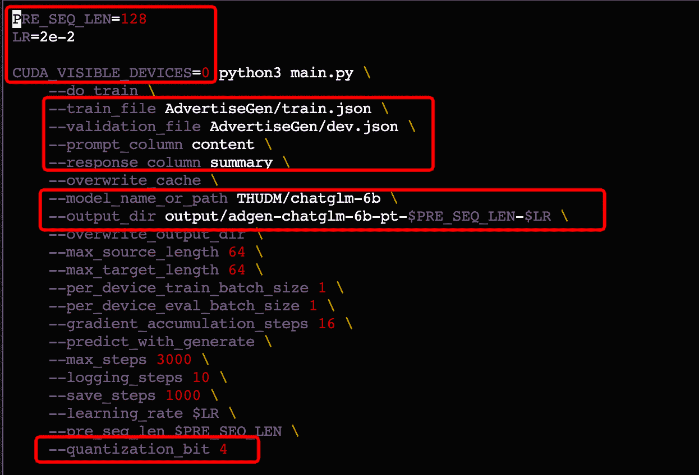

+   **`train.sh` 文件修改**


```bash
PRE_SEQ_LEN=128
LR=2e-2
NUM_GPUS=1
torchrun --standalone --nnodes=1 --nproc-per-node=$NUM_GPUS main.py \
    --do_train \
    --train_file AdvertiseGen/train.json \    #训练文件
    --validation_file AdvertiseGen/dev.json \ #验证文件
    --preprocessing_num_workers 10 \
    --prompt_column content \
    --response_column summary \
    --overwrite_cache \
    --model_name_or_path /mnt/workspace/chatglm2/models/chatglm2-6b \ #修改模型路径
    --output_dir output/adgen-chatglm2-6b-pt-$PRE_SEQ_LEN-$LR \
    --overwrite_output_dir \
    --max_source_length 128 \
    --max_target_length 128 \
    --per_device_train_batch_size 1 \
    --per_device_eval_batch_size 1 \
    --gradient_accumulation_steps 16 \
    --predict_with_generate \
    --max_steps 3000 \
    --logging_steps 10 \
    --save_steps 1000 \
    --learning_rate $LR \
    --pre_seq_len $PRE_SEQ_LEN
    --quantization_bit 4
```

> `train.sh` 中的 `PRE_SEQ_LEN` 和 `LR` 分别是 soft prompt 长度和训练的学习率，可以进行调节以取得最佳的效果。

> `P-Tuning-v2` 方法会冻结全部的模型参数，可通过调整 `quantization_bit` 来改变原始模型的量化等级，`quantization_bit 4` 是 `INT4` 量化版，不加此选项则为 `FP16` 精度加载。

> `CHECKPOINT` 实际就是 `train.sh` 中的 `output_dir`。

### 开始训练

```bash
bash train.sh
```

这个时候才发现和训练数据的大小无关，自定义20条数据一样也是预计11个小时(￣ェ￣;)

`Int4` 量化版运行占用 `GPU` 显存为：`7945 MiB`，3000 个 `steps` 整体需要 4 小时。

运行日志如下

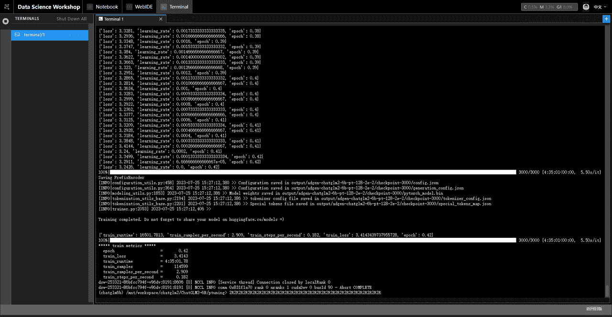

运行完成后，生成的模型位于：

`ChatGLM2-6B/ptuning/output/adgen-chatglm2-6b-pt-128-2e-2/checkpoint-3000` 下

查看模型大小

```bash
du -sh output/
```

模型比较：

`Chatglm2` 的大模型约为 `12G`，而微调模型约为 `7M`。

### 4. 推理

+ `evaluate.sh` 文件修改

依然修改一下 `evaluate.sh`，我需要修改的是 Python 版本和关闭 `quantization_bit`。

```bash
PRE_SEQ_LEN=128
CHECKPOINT=adgen-chatglm2-6b-pt-pt-128-2e-2
STEP=3000
NUM_GPUS=1
torchrun --standalone --nnodes=1 --nproc-per-node=$NUM_GPUS main.py \
    --do_predict \
    --validation_file AdvertiseGen/dev.json \   #验证数据集
    --test_file  AdvertiseGen/dev.json \        #测试数据集
    --overwrite_cache \
    --prompt_column content \
    --response_column summary \
    --model_name_or_path /mnt/workspace/chatglm2/models/chatglm2-6b \ 
    --ptuning_checkpoint ./output/$CHECKPOINT/checkpoint-$STEP \  #./output/$CHECKPOINT/checkpoint-$STEP  \
    --output_dir ./output/$CHECKPOINT \                #./output/$CHECKPOINT \
    --overwrite_output_dir \
    --max_source_length 128 \
    --max_target_length 128 \
    --per_device_eval_batch_size 1 \
    --predict_with_generate \
    --pre_seq_len $PRE_SEQ_LEN
    --quantization_bit 4
```

```bash
bash evaluate.sh
```

执行完成后，会生成评测文件，评测指标为中文 Rouge score 和 BLEU-4。生成的结果保存在 `./output/adgen-chatglm2-6b-pt-128-2e-2/generated_predictions.txt`。我们准备了 5 条推理数据，所以相应的在文件中会有 5 条评测数据，`labels` 是 `dev.json` 中的预测输出，`predict` 是 `ChatGLM2-6B` 生成的结果，对比预测输出和生成结果，评测模型训练的好坏。如果不满意调整训练的参数再次进行训练。

### 5. 模型部署

+ 直接运行代码：

首先载入 `Tokenizer`：

```python
from transformers import AutoTokenizer, AutoModel, AutoConfig

model_path = "/data/work/xiehao/chatglm2-6b-model" #或者远程 “THUDM/chatglm2-6b”
# 载入Tokenizer
#tokenizer = AutoTokenizer.from_pretrained("THUDM/chatglm-6b", trust_remote_code=True)
tokenizer = AutoTokenizer.from_pretrained(model_path, trust_remote_code=True)
```

1. 如果需要加载的是新 Checkpoint（只包含 `PrefixEncoder` 参数）：

```python
# 微调前

#model = AutoModel.from_pretrained(model_path, trust_remote_code=True, device='cuda')

#model = model.eval()

#response, history = model.chat(tokenizer, chat_str, history=[])

#print(response)


# 微调后

#通过AutoConfig读取model_path目录下的config.json的参数信息
#config = AutoConfig.from_pretrained("THUDM/chatglm-6b", trust_remote_code=True, pre_seq_len=128)
#model = AutoModel.from_pretrained("THUDM/chatglm-6b", config=config, trust_remote_code=True)
config = AutoConfig.from_pretrained(model_path, trust_remote_code=True, pre_seq_len=128)
model = AutoModel.from_pretrained(model_path, config=config, trust_remote_code=True)

#prefix_state_dict = torch.load(lora_model_path)
prefix_state_dict = torch.load(os.path.join(CHECKPOINT_PATH, "pytorch_model.bin"))

new_prefix_state_dict = {}
for k, v in prefix_state_dict.items():
    if k.startswith("transformer.prefix_encoder."):
        new_prefix_state_dict[k[len("transformer.prefix_encoder."):]] = v
model.transformer.prefix_encoder.load_state_dict(new_prefix_state_dict)
```

# 注意你可能需要将 `pre_seq_len` 改成你训练时的实际值。如果你是从本地加载模型的话，需要将 `THUDM/chatglm-6b` 改成本地的模型路径（注意不是 `checkpoint` 路径）

1. 如果需要加载的是旧 Checkpoint（包含 `ChatGLM-6B` 以及 `PrefixEncoder` 参数），或者进行的是全参数微调，则直接加载整个 Checkpoint：

```python
model = AutoModel.from_pretrained(CHECKPOINT_PATH, trust_remote_code=True)
```

之后根据需求可以进行量化，也可以直接使用：

```python
# Comment out the following line if you don't use quantization
model = model.quantize(4)
model = model.half().cuda()
model.transformer.prefix_encoder.float()
model = model.eval()
response, history = model.chat(tokenizer, chat_str, history=[])
print(response)
```

+ 也可以直接运行支持加载 [P-Tuning v2 checkpoint](https://github.com/THUDM/ChatGLM-6B/blob/main/ptuning/web_demo.py) 的 web demo

这里我们先修改 `web_demo.sh` 的内容以符合实际情况，将 `pre_seq_len` 改成你训练时的实际值，将 `THUDM/chatglm2-6b` 改成本地的模型路径。

`web_demo.sh` 文件

```bash
PRE_SEQ_LEN=128
  
CUDA_VISIBLE_DEVICES=0 python3 web_demo.py \
    --model_name_or_path /mnt/workspace/chatglm2/models/chatglm2-6b \
    --ptuning_checkpoint output/adgen-chatglm2-6b-pt-128-2e-2/checkpoint-3000 \
    --pre_seq_len $PRE_SEQ_LEN
```

然后再执行

```bash
#如果没有安装gradio需要安装
pip install gradio
#需要安装mdtex2html
pip install mdtex2html

#执行微调模型
bash web_demo.sh
```

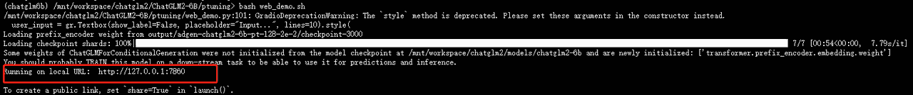

---

# 单卡微调 ChatGLM P-tuning + LoRA

### 硬件环境

单张 `RTX 3090`

### 系统环境

`ubuntu 20.04`

### 相关资源

[THUDM/ChatGLM-6B: ChatGLM-6B: An Open Bilingual Dialogue Language Model | 开源双语对话语言模型](https://github.com/THUDM/ChatGLM-6B)

THUDM/chatglm-6b · Hugging Face

[mymusise/ChatGLM-Tuning: 一种平价的chatgpt实现方案, 基于ChatGLM-6B + LoRA](https://github.com/mymusise/ChatGLM-Tuning)

### 操作流程

#### P-tuning

1. 下载项目和模型

ChatGLM 官方提供了开包即食的 P-tuning 实现

```bash
# 克隆ChatGLM-6B项目
git clone https://github.com/THUDM/ChatGLM-6B.git
cd ChatGLM-6B

# 下载checkpoint
git lfs install
git clone https://huggingface.co/THUDM/chatglm-6b

cd ../ptuning
```

这里以训练对话为例，修改 `ptuning` 目录下的 `train_chat.sh`

```bash
PRE_SEQ_LEN=128 # prefix 长度
LR=1e-2         # 学习率

CHAT_TRAIN_DATA="path/to/train_data.json"        # train 数据 
CHAT_VAL_DATA="path/to/val_data.json"            # val 数据
CHECKPOINT_NAME="output/pt-$PRE_SEQ_LEN-$LR"     # 保存 checkpoint 路径

CUDA_VISIBLE_DEVICES=0 python3 main.py \
    --do_train \
    --train_file $CHAT_TRAIN_DATA \
    --validation_file $CHAT_VAL_DATA \
    --prompt_column prompt \    
    --response_column response \
    --history_column history \
    --overwrite_cache \
    --model_name_or_path ../chatglm-6b \         # 载入 checkpoint 路径
    --output_dir $CHECKPOINT_NAME \
    --overwrite_output_dir \
    --max_source_length 256 \
    --max_target_length 256 \
    --per_device_train_batch_size 1 \
    --per_device_eval_batch_size 1 \
    --gradient_accumulation_steps 16 \
    --predict_with_generate \
    --max_steps 3000 \
    --logging_steps 10 \
    --save_steps 1000 \
    --learning_rate $LR \
    --pre_seq_len $PRE_SEQ_LEN \
    --quantization_bit 4
```

#### 对话数据集

需要注意的是，多轮对话需要提前处理成 `ChatGLM` 的格式，参考 `ChatGLM-6B/ptuning` 对话数据集


```
{&quot;prompt&quot;: &quot;长城h3风扇不转。继电器好的。保险丝好的传感器新的风扇也新的这是为什么。就是继电器缺一个信号线&quot;, &quot;response&quot;: &quot;用电脑能读数据流吗？水温多少&quot;, &quot;history&quot;: []}
{&quot;prompt&quot;: &quot;95&quot;, &quot;response&quot;: &quot;上下水管温差怎么样啊？空气是不是都排干净了呢？&quot;, &quot;history&quot;: [[&quot;长城h3风扇不转。继电器好的。保险丝好的传感器新的风扇也新的这是为什么。就是继电器缺一个信号线&quot;, &quot;用电脑能读数据流吗？水温多少&quot;]]}
{&quot;prompt&quot;: &quot;是的。上下水管都好的&quot;, &quot;response&quot;: &quot;那就要检查线路了，一般风扇继电器是由电脑控制吸合的，如果电路存在断路，或者电脑坏了的话会出现继电器不吸合的情况！&quot;, &quot;history&quot;: [[&quot;长城h3风扇不转。继电器好的。保险丝好的传感器新的风扇也新的这是为什么。就是继电器缺一个信号线&quot;, &quot;用电脑能读数据流吗？水温多少&quot;], [&quot;95&quot;, &quot;上下水管温差怎么样啊？空气是不是都排干净了呢？&quot;]]}
```

训练时需要指定 `--history_column` 为数据中聊天历史的 key（在此例子中是 `history`），将自动把聊天历史拼接。要注意超过输入长度 `max_source_length` 的内容会被截断。

#### 启动训练

```
bash train_chat.sh
```

P-tuning 的显存开销只有 6~7G，训练结束后 prefix checkpoints 会被保存在 `ptuning/output` 文件夹内

#### 加载 checkpoint

修改 `web_demo.sh`

```
PRE_SEQ_LEN=128

CUDA_VISIBLE_DEVICES=0 python3 web_demo.py \
    --model_name_or_path ../chatglm-6b \                                 # model checkpoint
    --ptuning_checkpoint output/pt-self-cog-128-1e-2/checkpoint-3000 \   # prefix checkpoint
    --pre_seq_len $PRE_SEQ_LEN
```

现在就可以正常启动 WebUI 了

```
bash web_demo.sh
```

### 2.5. LangChain + ChatGLM2-6B 构建知识库

[ LangChain + ChatGLM2-6B 构建知识库](https://powervision.feishu.cn/wiki/IFfzwd7clim10tkelsdcFnU2nne)

[LangChain + ChatGLM2-6B 构建本地知识库代码实现](https://powervision.feishu.cn/wiki/UdHjw1RFkiZkFrke7BFchthanSq)

[CHATGLM2-6B 大模型进行 LoRA 微调](https://powervision.feishu.cn/wiki/DUMbwl0MmiNeA6ksElqcWIzxnqg)

> **阿里云 PAI 机器平台免费部署**
