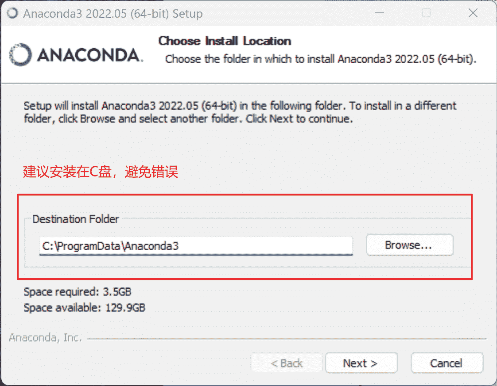
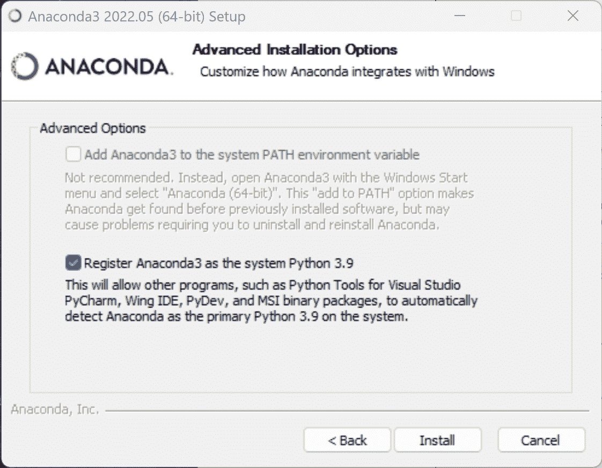
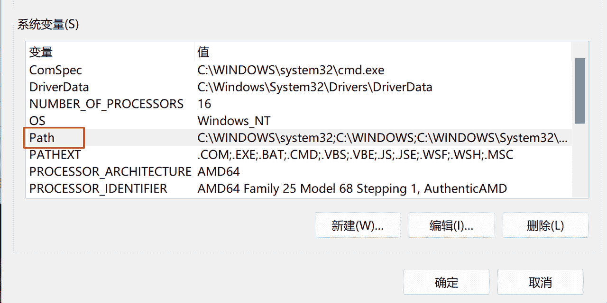
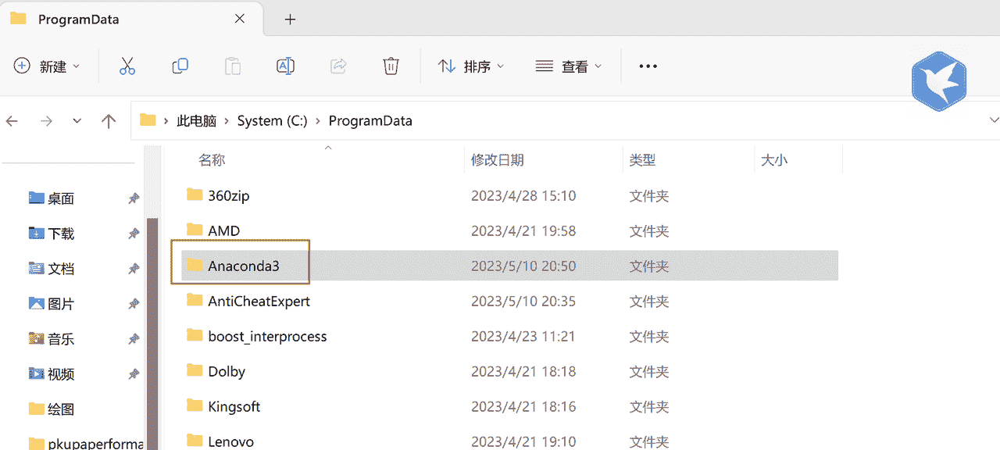
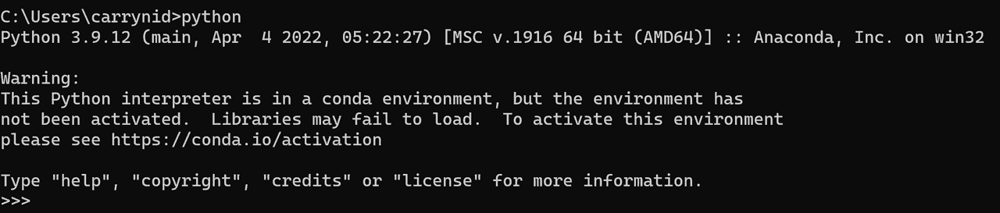
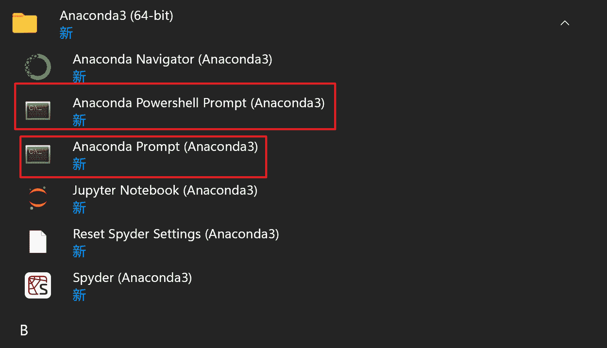
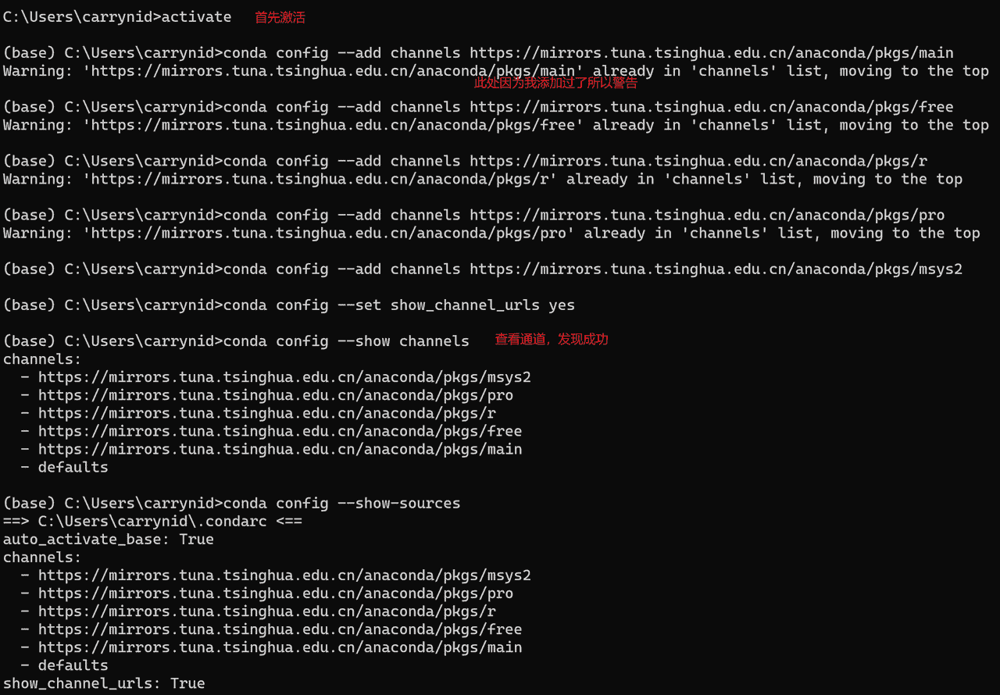
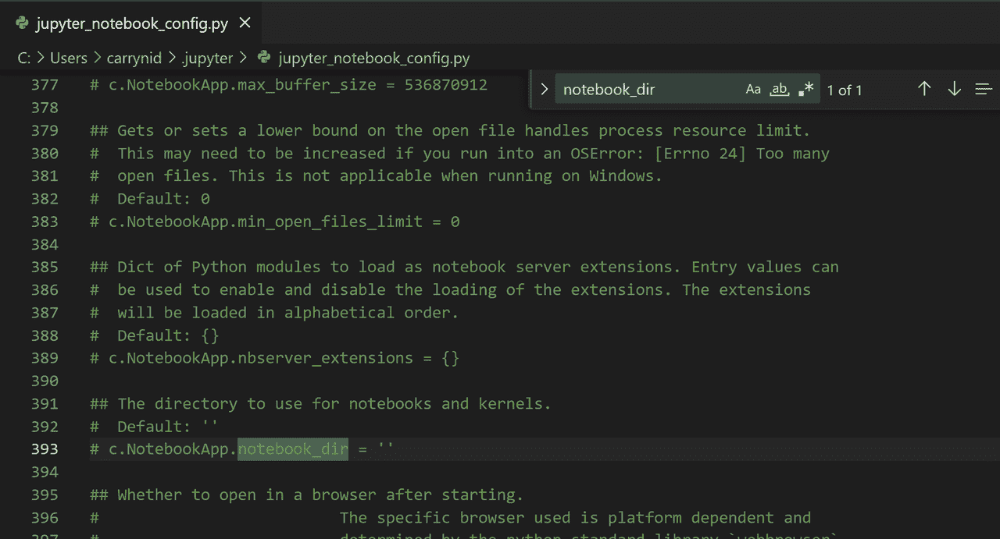
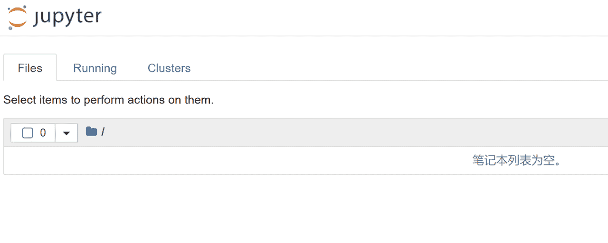
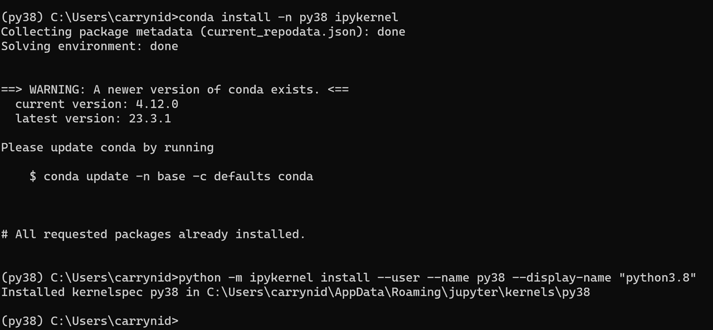

# Anaconda+Python+Jupyter环境安装教程+kernel安装

> 来源：[https://docs.feishu.cn/docx/M9XEdMn7noV767xSpdpcxakZnNe](https://docs.feishu.cn/docx/M9XEdMn7noV767xSpdpcxakZnNe)

# **下载****Anaconda****安装包**

历史版本（最新版本可能安装不了旧版Python）

https://repo.anaconda.com/archive/

# **安装**





安装完成！

# **配置****Anaconda****环境**

我们会发现，虽然安装完了Anaconda但在命令行无法运行，这是因为还没配置环境变量，也就是从电脑的任何一个路径你输入conda都能访问你所安装的anaconda


搜索环境变量



系统变量中，新建以下路径：

> 例如这是我刚才安装的路径：C:\ProgramData\Anaconda3



```
C:\ProgramData\Anaconda3 
C:\ProgramData\Anaconda3\Scripts 
C:\ProgramData\Anaconda\Library\mingw-w64\bin
C:\ProgramData\Anaconda\Library\usr\bin 
C:\ProgramData\Anaconda\Library\bin
```

添加完后是这个样子：

点击确定，一路点回来，共三个确定

# **测试是否安装成功**

如果像下图这样输入conda后，输出一长串则说明安装成功

此时是可以使用conda自带的base环境中的python，不过这个base环境我们一般不使用，而是根据特定场景创建虚拟环境（当然它也是可以用的）。



# **为****anaconda****添加国内源**

首先激活conda环境（如果不想每次都激活，而是默认进入指定环境，参考[4]），默认激活base，在终端输入：

> 也可以进入Anaconda prompt打开，下面两个都可以



```
activate
```

因为anaconda的**服务器在国外，访问速度慢，因此**需要添加国内的镜像源，以下是一些镜像源的操作，我们刚开是安装环境，因此只需要添加Anaconda的清华镜像：

```
#添加镜像源
conda config --add channels https://mirrors.tuna.tsinghua.edu.cn/anaconda/pkgs/main
conda config --add channels https://mirrors.tuna.tsinghua.edu.cn/anaconda/pkgs/free
conda config --add channels https://mirrors.tuna.tsinghua.edu.cn/anaconda/pkgs/r
conda config --add channels https://mirrors.tuna.tsinghua.edu.cn/anaconda/pkgs/pro
conda config --add channels https://mirrors.tuna.tsinghua.edu.cn/anaconda/pkgs/msys2
#显示检索路径
conda config --set show_channel_urls yes
#显示镜像通道
conda config --show channels
# 查看下载源
conda config --show-sources
# 删除源
conda config --remove-key channels
```



# **创建环境**

```
conda create --name 填你环境的名字 python=python版本 
```

例子：创建一个名字为py38的虚拟环境，python版本为python3.8

```
conda create --name py38 python=3.8
```

> 此处大坑，如果不激活base环境直接安装，则会http之类的错误，添加了清华源也没用

如果遇到**An** HTTP error occurred when trying to retrieve this URL.HTTP errors are often intermittent… BUG参考[2][3]

输入命令，再输入'y'确认

这时候就大功告成了，现在我们激活创建的py38环境：

```
#conda activate 虚拟环境名称
conda activate py38
```

平时安装python包可以使用conda，也可以pip（**推荐**）：

```
#conda 安装
conda install xxx
#pip 安装
pip install xxx
#pip 安装 txt的依赖
pip install -r requirements.txt
```

# Jupyter Notebook

## **启动Jupyter**

首先激活环境（或者不激活直接进入prompt），再运行jupyter，这个窗口目前相当于一个后台服务器，如果关闭他的话就无法正常使用网页Jupyter：

```
activate
jupyter notebook
```

复制到浏览器中打开（好像第一次需要复制，后面会自动弹出浏览器打开）：

## **更改默认工作目录**

可以注意到默认是用户目录，但文件存储在这一般不方便，此时我们想在指定Jupyter工作目录作为根目录，首先你想工作的目录文件夹，例如：D:\Jupyter\

再次创建一个CMD，输入以下代码，会生成一个py配置文件，去硬盘中找到他（可以打开方式-记事本打开）：

> activate

> jupyter notebook --generate-config

ctrl+f搜索notebook_dir，更改为你的Jupyetr工作目录，此处为D:\Jupyter，ctrl+s保存。

将：

```
# c.NotebookApp.notebook_dir = &#x27;&#x27;
```

改为：

```
c.NotebookApp.notebook_dir = &#x27;D:\Jupyter&#x27;
```



重新激活环境进入jupyter，发现已经更改成功



## **在jupyter 中使用****conda****中安装的****虚拟环境**

虽然安装成功，但发现新建jupyter时只有一个python3，也就是默认环境，没有我们之前安装的py38

因为确实kernel.json环境，解决方法如下，首先安装ipykernel：

其次，创建kernel文件

```
conda install -n 环境名称 ipykernel
```

最后写入kernel：

```
python -m ipykernel install --user --name 环境名称 --display-name &quot;Python (环境名称)&quot;
```



再次进入，可以看到已经安装成功：