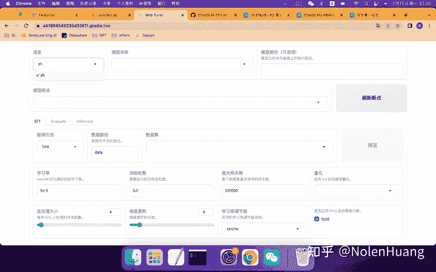
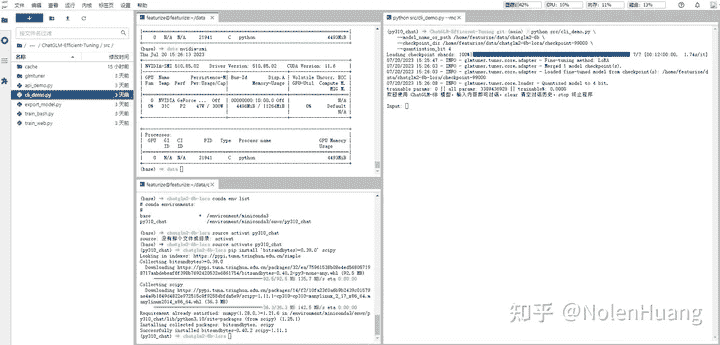
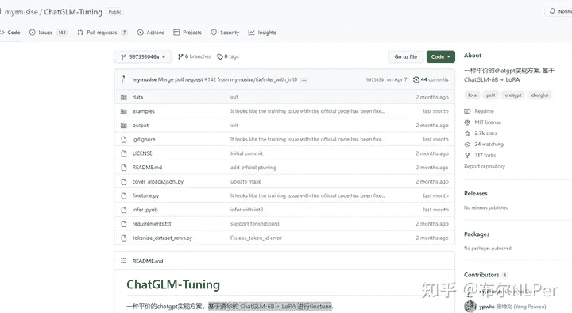

# CHATGLM2-6B大模型进行LoRA 微调

> 来源：https://docs.feishu.cn/docx/SlrJdXWOdo0JEKxW1h4cWhXTnVc

## 前言

CHATGLM2-6B是清华智普开源的大语言模型，Huggingface 开源的 PEFT 大模型高效微调工具包，本文主要介绍对CHATGLM2-6B大模型进行 LoRA 微调，只要你有训练数据，然后本地下载好大模型的`checkpoint`，就可以最少只需 1 行代码就可以微调你自己的 LLM。

### 1.1 硬件需求

> 注：`r` 为LoRA 维数大小，`p` 为前缀词表大小，`l` 为微调层数，`ex/s` 为每秒训练的样本数。`gradient_accumulation_steps` 参数设置为 1。上述结果均来自于单个 Tesla V100 GPU，仅供参考。

### 1.2 微调方法

目前我们实现了针对以下高效微调方法的支持：

+ [LoRA](https://link.zhihu.com/?target=https%3A//arxiv.org/abs/2106.09685)：仅微调低秩适应器。

+ [P-Tuning V2](https://link.zhihu.com/?target=https%3A//github.com/THUDM/P-tuning-v2)：仅微调前缀编码器。

+ [Freeze](https://link.zhihu.com/?target=https%3A//arxiv.org/abs/2012.14913)：仅微调后几层的全连接层。

### 1.3 软件依赖

+ Python 3.8+, PyTorch 2.0.0

+ Transformers, Datasets, Accelerate, TRL, PEFT（最低需要 0.3.0.dev0）

+ protobuf, `cpm_kernels`, `sentencepiece`

+ `jieba`, `rouge_chinese`, `nltk`（用于评估）

+ `gradio`, `mdtex2html`（用于网页端交互）

```
GPU平台：featurize.cn
RTX 3060 / 3090
```

## 一、环境配置

```
#更新git-lfs：
apt-get update
apt-get install git-lfs
#初始化git：
git init 
git lfs install
```

## 二、下载 基于 PEFT 的高效 ChatGLM 微调框架

借助`ChatGLM-Efficient-Tuning`进行微调。这里面使用了`peft`框架。

```
git clone https://github.com/hiyouga/ChatGLM-Efficient-Tuning.git
conda create -n chatglm_etuning python=3.10
conda activate chatglm_etuning
cd ChatGLM-Efficient-Tuning
pip install -r requirements.txt
```

## 三、资源准备

### 3.1 数据来源介绍

部分预置数据集简介：

> 注：BELLE 数据集是由 ChatGPT 产生的数据集，不保证数据准确性，所有类 GPT 模型产生的 self-instruction 数据集均不能保证其准确性。

部分数据集的使用需要确认，我们推荐使用下述命令登录您的 HuggingFace 账户。

```
pip install --upgrade huggingface_hub
huggingface-cli login
```

### 3.2 模型下载【建议下载到本地】

从 Hugging Face Hub 下载模型实现和参数 到本地，后期使用 只需要 从本地下载即可。huggingface（抱抱脸）

```
cd model
git clone https://huggingface.co/THUDM/chatglm2-6b
```

## 四、ChatGLM2-6B 模型微调

### 微调数据集介绍

`dataset_info.json`修改，增加属于自己的数据集内容。

```
  "alpaca_gpt4_zh": {
    "file_name": "alpaca_gpt4_data_zh.json"
  },
```

指令微调数据一般有输入和输出两部分，输入是特定的`content`加上`instruction`，这里我们将二者直接拼在一起，不单独区分；输出则是希望模型的回答。 我们统一使用json的格式在整理数据，可以自定义输出输出的字段名，例如下面的例子中我使用的是 `instruction` 和 `output` 代表模型的输入和输出：

```
[
  {
    "instruction": "保持健康的三个提示。",
    "input": "",
    "output": "以下是保持健康的三个提示：\n\n1. 保持身体活动。每天做适当的身体运动，如散步、跑步或游泳，能促进心血管健康，增强肌肉力量，并有助于减少体重。\n\n2. 均衡饮食。每天食用新鲜的蔬菜、水果、全谷物和脂肪含量低的蛋白质食物，避免高糖、高脂肪和加工食品，以保持健康的饮食习惯。\n\n3. 睡眠充足。睡眠对人体健康至关重要，成年人每天应保证 7-8 小时的睡眠。良好的睡眠有助于减轻压力，促进身体恢复，并提高注意力和记忆力。"
  },
  {
    "instruction": "三原色是什么？",
    "input": "",
    "output": "三原色通常指的是红色、绿色和蓝色（RGB）。它们是通过加色混合原理创建色彩的三种基础颜色。在以发光为基础的显示设备中（如电视、计算机显示器、智能手机和平板电脑显示屏）, 三原色可混合产生大量色彩。其中红色和绿色可以混合生成黄色，红色和蓝色可以混合生成品红色，蓝色和绿色可以混合生成青色。当红色、绿色和蓝色按相等比例混合时，可以产生白色或灰色。\n\n此外，在印刷和绘画中，三原色指的是以颜料为基础的红、黄和蓝颜色（RYB）。这三种颜色用以通过减色混合原理来创建色彩。不过，三原色的具体定义并不唯一，不同的颜色系统可能会采用不同的三原色。"
  },
  ...
]
```

整理好数据后，保存为`alpaca_gpt4_data_zh.json`文件，然后放入目录中的`data/`文件夹中。

### ChatGLM2-6B 模型 单 GPU 微调训练

+ `dataset` 微调数据集的路径，即在 `data/` 地址下的文件夹名称

+ `lora_rank`，设置 LoRA 的秩，推荐为4或8，显存够的话使用8

+ `per_device_train_batch_size` 每块 GPU 上的 batch size，显存不大尽量 1-2

+ `gradient_accumulation_steps` 梯度累加，可以在不提升显存占用的情况下增大 batch size

+ `save_steps` 多少步保存一次

+ `save_total_limit`，保存多少个 `checkpoint`

+ `learning_rate`，学习率

+ `output_dir`，为微调后模型存储的路径地址

+ `model_name_or_path`为我们下载的 `chatglm2-6b` 模型文件的路径

+ `finetuning_type`为微调方式（`p_tuning`、`lora`、`freeze`），

建一个脚本为`train.sh`，内容如下：

```
CUDA_VISIBLE_DEVICES=0 python src/train_bash.py \
    --stage sft \
    --model_name_or_path model/chatglm2-6b \
    --do_train \
    --dataset alpaca_gpt4_zh \
    --dataset_dir ./data \
    --finetuning_type lora \
    --lora_rank 8 \
    --output_dir model/chatglm2-6b-lora \ 
    --per_device_train_batch_size 1 \
    --gradient_accumulation_steps 1 \
    --lr_scheduler_type cosine \
    --logging_steps 10 \
    --save_steps 1000 \
    --learning_rate 5e-5 \
    --num_train_epochs 3.0 \
    --fp16 \
```

我们就可以执行这个脚本进行微调啦

```
bash train.sh
```

训练完之后，可以在`model/chatglm2-6b-lora`中找到 LoRA 的相关模型权重，主要是`adapter_model.bin`和`adapter_config.json`两个文件

模型输出文件：

```
> ls -al

total 14368
drwxrwxr-x  3 guodong.li guodong.li       86 Apr 13 20:00 .
drwxrwxr-x 12 guodong.li guodong.li      206 Apr 13 11:13 ..
-rw-rw-r--  1 guodong.li guodong.li      425 Apr 13 20:00 adapter_config.json
-rw-rw-r--  1 guodong.li guodong.li 14700953 Apr 13 20:00 adapter_model.bin
drwxrwxr-x 13 guodong.li guodong.li     4096 Apr 13 19:15 runs
```

至此，整个训练过程就完成了，接下来使用生成的模型进行推理。

如果发生内存溢出，修改为 int4 微调

```
#进入本项目目录，训练启动命令如下：
CUDA_VISIBLE_DEVICES=0 python src/train_bash.py \
    --stage sft \
    --model_name_or_path model/chatglm2-6b \
    --do_train \
    --dataset alpaca_gpt4_zh \
    --dataset_dir ./data \
    --finetuning_type lora \
    --output_dir model/chatglm2-6b-lora \
    --per_device_train_batch_size 1 \
    --gradient_accumulation_steps 1 \
    --lr_scheduler_type cosine \
    --logging_steps 10 \
    --save_steps 1000 \
    --learning_rate 5e-5 \
    --num_train_epochs 3.0 \
    --fp16 \
    --quantization_bit 4
```

中间可能提示缺失依赖包

```
pip install 'bitsandbytes>=0.39.0' scipy
```

模型评估

```
CUDA_VISIBLE_DEVICES=0 python src/train_bash.py \
    --stage sft \
    --model_name_or_path path_to_your_chatglm_model \
    --do_eval \
    --dataset alpaca_gpt4_en \
    --finetuning_type lora \
    --checkpoint_dir path_to_checkpoint \
    --output_dir path_to_eval_result \
    --per_device_eval_batch_size 8 \
    --max_samples 50 \
    --predict_with_generate
```

模型预测

```
CUDA_VISIBLE_DEVICES=0 python src/train_bash.py \
    --stage sft \
    --model_name_or_path path_to_your_chatglm_model \
    --do_predict \
    --dataset alpaca_gpt4_en \
    --finetuning_type lora \
    --checkpoint_dir path_to_checkpoint \
    --output_dir path_to_predict_result \
    --per_device_eval_batch_size 8 \
    --max_samples 100 \
    --predict_with_generate
```

> If you want to predict the samples with empty responses, please kindly fill the response column with dummy tokens to ensure the sample will not be discarded throughout the preprocessing phase.

#### Web界面调参方式

另外，还有一种可以直接生成`gradio`链接，点解该链接可以通过可视化界面直接进行微调，执行如下代码：

```
 CUDA_VISIBLE_DEVICES=0  
 python src/train_web.py
# 修改`train_web.py`中 `share=True`，即可生成`gradio`的链接
```

界面如下，在这里可以选择自己的微调方式、数据集等等哈，然后开始微调



#### 命令行测试

```
python src/cli_demo.py \
    --model_name_or_path model/chatglm2-6b \  #base model
    --finetuning_type lora \
    --checkpoint_dir model/chatglm2-6b-lora 
```



#### API Demo

```
python src/api_demo.py \
    --model_name_or_path path_to_your_chatglm_model \
    --finetuning_type lora \
    --checkpoint_dir path_to_checkpoint
```

Visit http://localhost:8000/docs for API documentation.

#### Web Demo

```
python src/web_demo.py \
    --model_name_or_path path_to_your_chatglm_model \
    --finetuning_type lora \
    --checkpoint_dir path_to_checkpoint
```

#### 代码加载并进行推理

```
from peft import PeftModel
from transformers import AutoTokenizer, AutoModel
import torch

device = torch.device(1)
# 载入tokenizer 
model_path = "THUDM/chatglm-6b"
tokenizer = AutoTokenizer.from_pretrained(model_path, trust_remote_code=True)

# 加载原始 LLM
model = AutoModel.from_pretrained(model_path, trust_remote_code=True).half().to(device)
response, history = model.chat(tokenizer, "你好", history=[])
print(f'微调前：\n{response}')

# 给原始 LLM 安装上你的 LoRA tool
model = PeftModel.from_pretrained(model, "model/chatglm2_lora").half()
response, history =  model.chat(tokenizer, "你好", history=[])
print(f'微调后: \n{response}')
```

#### 导出微调模型

```
python src/export_model.py \
    --model_name_or_path model/chatglm2-6b \
    --finetuning_type lora \
    --checkpoint_dir model/chatglm2-6b-lora
    --output_dir path_to_expor
```

---

# LORA高效微调ChatGLM

### 项目和环境搭建


# 基于 ChatGLM-6B 与 LoRA 的模型微调

这里项目是来着github上提供好的LORA微调方法：基于清华的 `ChatGLM-6B` + `LoRA` 进行`finetune`。

> `git clone https://github.com/mymusise/ChatGLM-Tuning.git`



## 环境准备

直接用`git`将项目`clone`到自己本地或者云服务器上，环境要求也是根据项目指定的`requirements.txt`文件安装配置环境，这里需要注意的是对GPU的`CUDA`版本要求在`11.6`以上，注意`NVIDIA`驱动和`cuDNN`版本对应安装，之前因为驱动原因踩过不少坑。

## 模型推理

`https://github.com/mymusise/ChatGLM-Tuning/blob/master/infer.ipynb`

新增推理代码`inference.py`：

```
from transformers import AutoModel
import torch

model = AutoModel.from_pretrained("THUDM/chatglm-6b", trust_remote_code=True, load_in_8bit=True, device_map='auto')

from transformers import AutoTokenizer

tokenizer = AutoTokenizer.from_pretrained("THUDM/chatglm-6b", trust_remote_code=True)

from peft import PeftModel

model = PeftModel.from_pretrained(model, "./output/")

import json

instructions = json.load(open("data/alpaca_data.json"))

answers = []
from cover_alpaca2jsonl import format_example

with torch.no_grad():
    for idx, item in enumerate(instructions[:3]):
        feature = format_example(item)
        input_text = feature['context']
        ids = tokenizer.encode(input_text)
        input_ids = torch.LongTensor([ids])
        out = model.generate(
            input_ids=input_ids,
            max_length=150,
            do_sample=False,
            temperature=0
        )
        out_text = tokenizer.decode(out[0])
        answer = out_text.replace(input_text, "").replace("\nEND", "").strip()
        item['infer_answer'] = answer
        print(out_text)
        print(f"### {idx+1}.Answer:\n", item.get('output'), '\n\n')
        answers.append({'index': idx, **item})
```

### 代码解析

这段代码主要是使用预训练的模型来生成一些文本，具体来说，它是从一个`json`文件中读取一些指令，并使用模型来生成相应的答案。下面是对每一行代码的解释：

`from transformers import AutoModel`：从`transformers`库中导入`AutoModel`类。`transformers`是一个深度学习模型库，主要用于自然语言处理（NLP）任务，如文本分类、命名实体识别、问答等。

`import torch`：导入`PyTorch`库，这是一个用于构建和训练深度学习模型的库。

`model = AutoModel.from_pretrained("THUDM/chatglm-6b", trust_remote_code=True, load_in_8bit=True, device_map='auto')`：从预训练模型`"THUDM/chatglm-6b"`加载模型。参数`trust_remote_code=True`表示信任远程代码，`load_in_8bit=True`表示以8位加载模型，`device_map='auto'`表示自动选择设备。

`from transformers import AutoTokenizer`：从`transformers`库中导入`AutoTokenizer`类。这个类用于处理文本数据，包括分词、编码等。

`tokenizer = AutoTokenizer.from_pretrained("THUDM/chatglm-6b", trust_remote_code=True)`：从预训练模型`"THUDM/chatglm-6b"`加载分词器。

`from peft import PeftModel`：从`peft`库中导入`PeftModel`类。这个类可能是一个特定的模型类，但在我知识库的截止日期（2021年9月）之前，没有这个库的信息。

`model = PeftModel.from_pretrained(model, "./output/")`：从预训练模型加载`PeftModel`模型，模型参数保存在`"./output/"`目录下。

`import json`：导入`json`库，用于处理`json`格式的数据。

`instructions = json.load(open("data/alpaca_data.json"))`：从`"data/alpaca_data.json"`文件中加载`json`数据，并赋值给`instructions`。

`answers = []`：初始化一个空列表`answers`，用于存储生成的答案。

`from cover_alpaca2jsonl import format_example`：从`cover_alpaca2jsonl`库中导入`format_example`函数。这个函数可能是用于格式化数据的。

`with torch.no_grad():`：在这个上下文管理器中，`PyTorch`不会计算和存储梯度，这可以提高模型推理速度，减少内存使用。

`for idx, item in enumerate(instructions[:3]):`：遍历`instructions`的前三个元素，`idx`是元素的索引，`item`是元素本身。

`feature = format_example(item)`：使用`format_example`函数处理`item`，返回的结果赋值给`feature`。

`input_text = feature['context']`：从`feature`中获取`'context'`字段的值，赋值给`input_text`。

`ids = tokenizer.encode(input_text)`：使用`tokenizer`对`input_text`进行编码，返回的结果赋值给`ids`。

`input_ids = torch.LongTensor([ids])`：将`ids`转换为`PyTorch`的`LongTensor`类型，并赋值给`input_ids`。

`out = model.generate(input_ids=input_ids, max_length=150, do_sample=False, temperature=0)`：使用模型对`input_ids`进行生成，生成的最大长度为`150`，不进行采样，温度为`0`。返回的结果赋值给`out`。

`out_text = tokenizer.decode(out[0])`：对`out`的第一个元素进行解码，返回的结果赋值给`out_text`。

`answer = out_text.replace(input_text, "").replace("\nEND", "").strip()`：将`out_text`中的`input_text`和`"\nEND"`替换为空，然后去除两端的空白字符，返回的结果赋值给`answer`。

`item['infer_answer'] = answer`：将`answer`赋值给`item`的`'infer_answer'`字段。

`print(out_text)`：打印`out_text`。

`print(f"### {idx+1}.Answer:\n", item.get('output'), '\n\n')`：打印`idx+1`和`item`的`'output'`字段的值。

`answers.append({'index': idx, **item})`：将一个包含`'index'`字段和`item`所有字段的字典添加到`answers`列表中。

## 运行命令

```
CUDA_VISIBLE_DEVICES=0 python inference.py
```

## 运行结果

```
> CUDA_VISIBLE_DEVICES=0 python inference.py

===================================BUG REPORT===================================
Welcome to bitsandbytes. For bug reports, please submit your error trace to: https://github.com/TimDettmers/bitsandbytes/issues
================================================================================
/home/guodong.li/virtual-venv/chatglm-lora-venv-py310-cu117/lib/python3.10/site-packages/bitsandbytes/cuda_setup/main.py:136: UserWarning: WARNING: The following directories listed in your path were found to be non-existent: {PosixPath('/opt/rh/devtoolset-7/root/usr/lib/dyninst'), PosixPath('/opt/rh/devtoolset-9/root/usr/lib/dyninst')}
  warn(msg)
CUDA SETUP: CUDA runtime path found: /usr/local/cuda-11.7/lib64/libcudart.so
CUDA SETUP: Highest compute capability among GPUs detected: 8.0
CUDA SETUP: Detected CUDA version 117
CUDA SETUP: Loading binary /home/guodong.li/virtual-venv/chatglm-lora-venv-py310-cu117/lib/python3.10/site-packages/bitsandbytes/libbitsandbytes_cuda117.so...
Overriding torch_dtype=None with `torch_dtype=torch.float16` due to requirements of `bitsandbytes` to enable model loading in mixed int8. Either pass torch_dtype=torch.float16 or don't pass this argument at all to remove this warning.
Loading checkpoint shards: 100%|██████████████████████████████████████████████████████████████████████████████████████████████████████████████████████| 8/8 [00:11<00:00,  1.39s/it]
The dtype of attention mask (torch.int64) is not bool
Instruction: Give three tips for staying healthy.
Answer: Three tips for staying healthy include: 1) eating a balanced diet, 2) getting regular exercise, and 3) getting enough rest.
### 1.Answer:
 1.Eat a balanced diet and make sure to include plenty of fruits and vegetables.
2. Exercise regularly to keep your body active and strong.
3. Get enough sleep and maintain a consistent sleep schedule.


Instruction: What are the three primary colors?
Answer: The three primary colors are red, blue, and yellow.
### 2.Answer:
 The three primary colors are red, blue, and yellow.


Instruction: Describe the structure of an atom.
Answer: An atom is a small particle of matter that contains a core of positive charge, surrounded by a cloud of negative charge. The positive charge is caused by the presence of an electron cloud, which is surrounded by an electron cloud. The negative charge is caused by the presence of an electron cloud, which is surrounded by an electron cloud. The positive and negative charges are balanced by the presence of an equal number of protons and neutrons.
### 3.Answer:
 An atom is made up of a nucleus, which contains protons and neutrons, surrounded by electrons that travel in orbits around the nucleus. The protons and neutrons have a positive charge, while the electrons have a negative charge, resulting in an overall neutral atom. The number of each particle determines the atomic number and the type of atom.
```

其中：`Answer:` 是模型的输出，`#### Answer:` 是原答案。
