# 安装CUDA 11.3 和 cuDNN 8.9.3并检查是否安装成功

> 来源：[https://docs.feishu.cn/docx/Pt0pd1Y3aoMbqJxcEYgcBIAPnYb](https://docs.feishu.cn/docx/Pt0pd1Y3aoMbqJxcEYgcBIAPnYb)

# 一、前言

正如题目所言，最近笔者需要配置一台机器上的深度学习环境，即CUDA工具包和与之对应的cuDNN库，具体步骤如下。

因为我已经装过了，为了教程演示，首先卸载CUDA工具包，利用其自带的卸载程序：

```
$sudo ./cuda-uninstaller
```

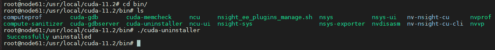

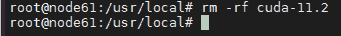

检查本机是否有CUDA工具包，输入nvcc -V:

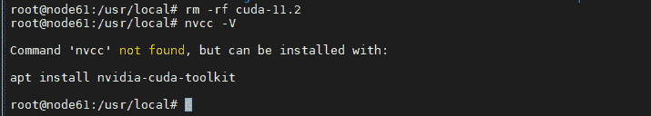

---

# 二、安装CUDA

1.  在命令行输入nvidia-smi查看显卡驱动版本也就是最高支持的CUDA工具包版本。
例如，本机可安装11.2及以下的CUDA工具包：

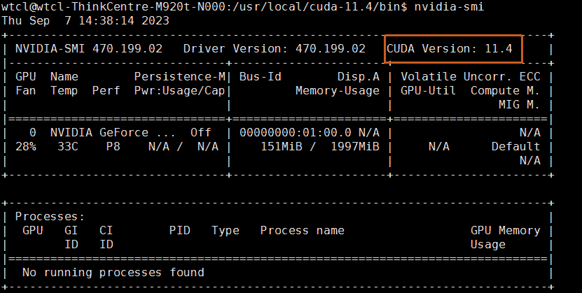

1.  在[nVidia官网](https://developer.nvidia.com/cuda-toolkit-archive)选择对应版本的CUDA工具包并选择你的机器配置，我们就选择11.4.0版本下载

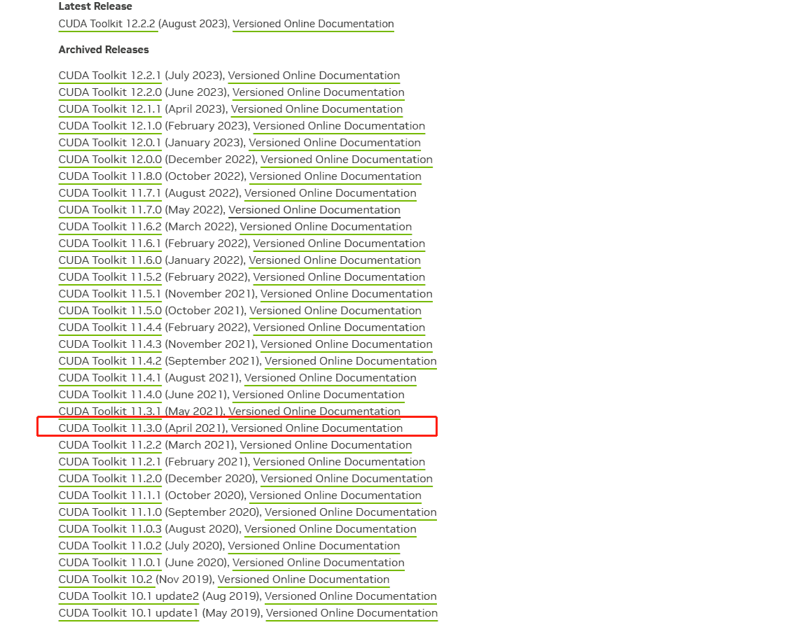

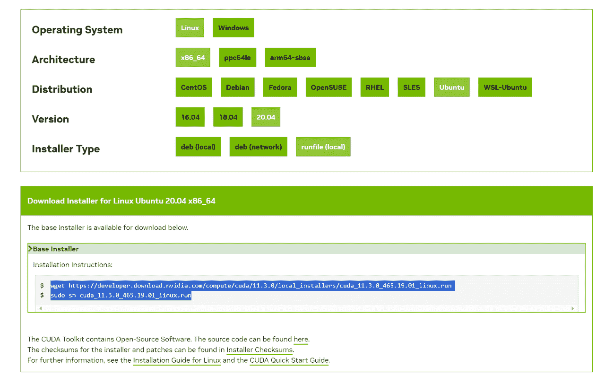

1.  在终端执行如下命令：

```
#进行相关依赖库的安装：
$sudo apt-get install freeglut3-dev build-essential libx11-dev libxmu-dev libxi-dev libgl1-mesa-glx libglu1-mesa libglu1-mesa-dev
#安装Cuda
$wget https://developer.download.nvidia.com/compute/cuda/11.3.0/local_installers/cuda_11.3.0_465.19.01_linux.run
$sudo sh cuda_11.3.0_465.19.01_linux.run
```

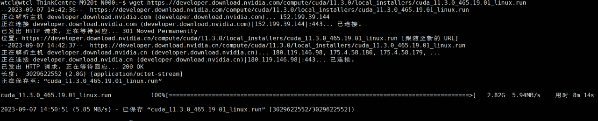

如果出现以下提示，选择continue并在第四步取消安装驱动即可。

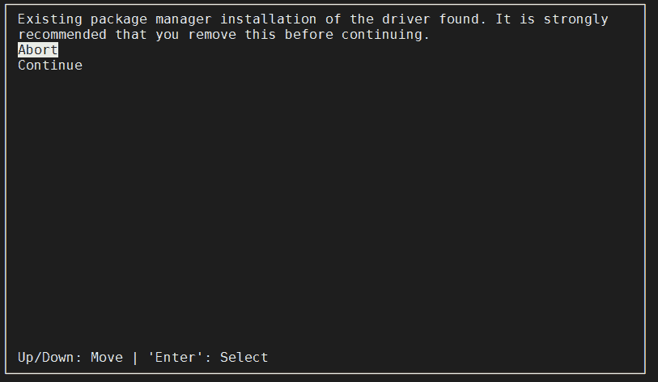

1.  根据提示一步步安装

1.  键入accept确认。👇

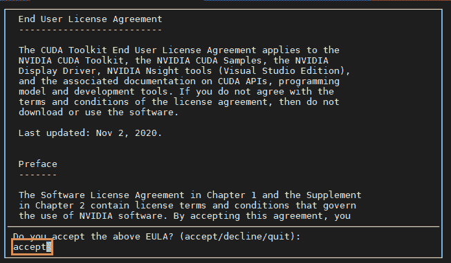

1.  我们已经有驱动了，这里取消安装驱动，上下键和回车键选择。👇

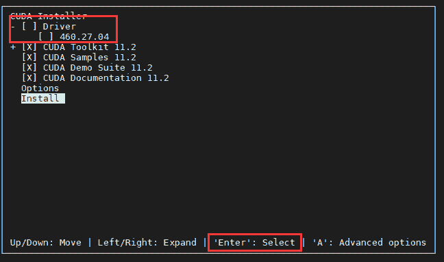

稍作等待，出现以下提示信息就安装好了，可以看到CUDA安装到了/usr/local/cuda-11.2/。

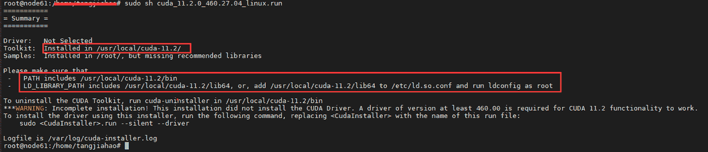

## 添加cuda相关环境变量

装完所有cuda相关的东西 并不算结束 我们要把相关的环境变量添加到 .bashrc 文件中 这样后面pytorch和别的包才能调用cuda框架

打开.bashrc文件 往里面加上cuda相关的环境变量 根据你装的版本把cuda后的数字做相应调整即可

```
export PATH=/usr/local/cuda-11.3/bin:$PATH
export LD_LIBRARY_PATH=/usr/local/cuda-11.3/lib64:$LD_LIBRARY_PATH
export CUDA_HOME=$CUDA_HOME:/usr/local/cuda-11.3
```

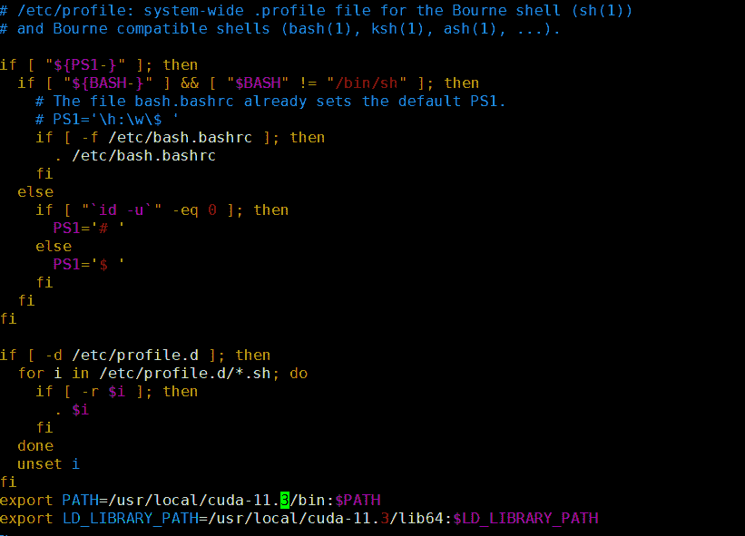

在修改 ~/.bashrc 文件后，新打开的终端会话会自动加载并使用更新后的环境变量。

如果不想新开终端会话，也可以通过执行source ~/.bashrc命令是之生效

检查是否安装完成

使用nvcc -V检查CUDA是否安装完成，出现以下提示代表安装完成。

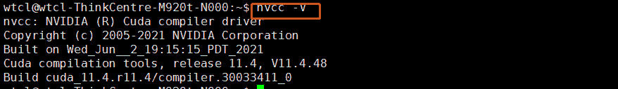

编译并执行CUDA样例程序，出现pass代表CUDA和GPU正常运行：

```
$cd /usr/local/cuda-11.3/samples/1_Utilities/deviceQuery
$sudo make
$./deviceQuery
```

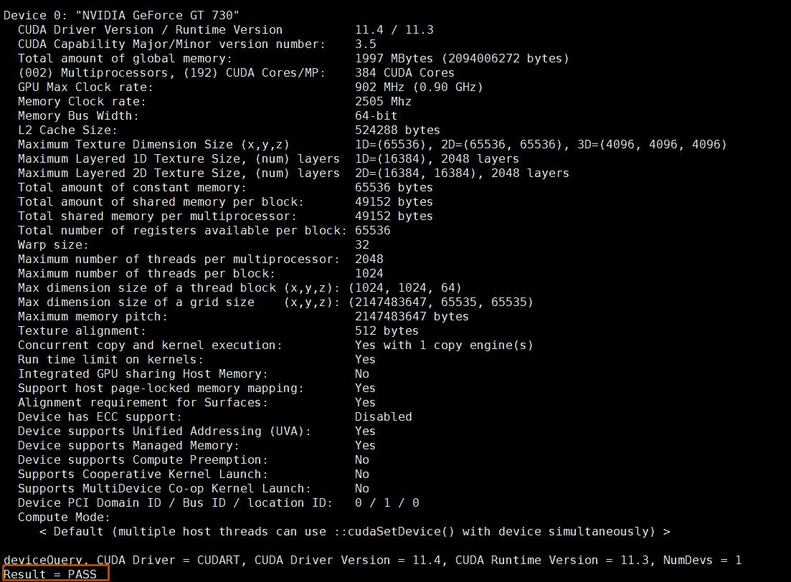

# 三、安装cuDNN

1.  根据安装的CUDA工具包版本在[官网](https://developer.nvidia.com/rdp/cudnn-archive)选择适合版本的cuDNN，本文安装的CUDA版本是11.3，就选择与之对应的cuDNN v8.9.3，选择Local Installer for Linux x86_64 (Tar)。

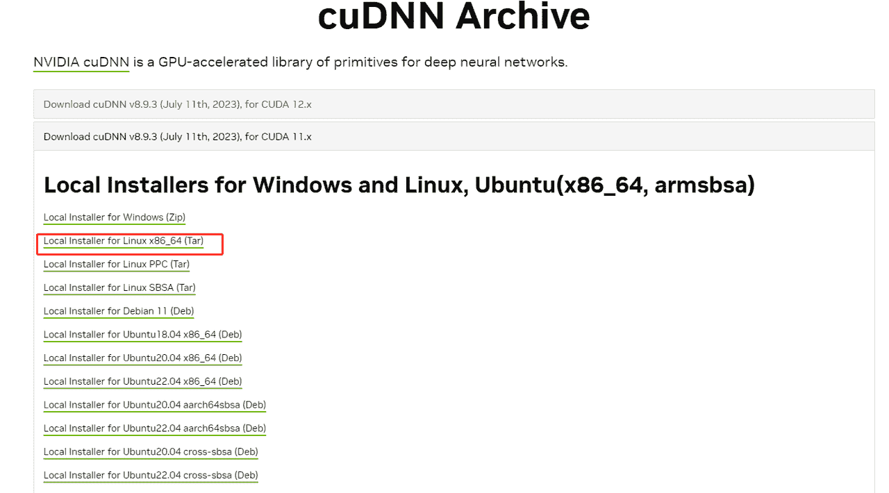

+   复制cuDNN库的链接，使用wget下载或者下载到自己电脑之后再传到服务器上。

```
$wget  https://developer.nvidia.com/downloads/compute/cudnn/secure/8.9.3/local_installers/11.x/cudnn-linux-x86_64-8.9.3.28_cuda11-archive.tar.xz
```

+   我的服务器网速有点慢，所以选择先下到自己电脑再传上去，速度很快啊。

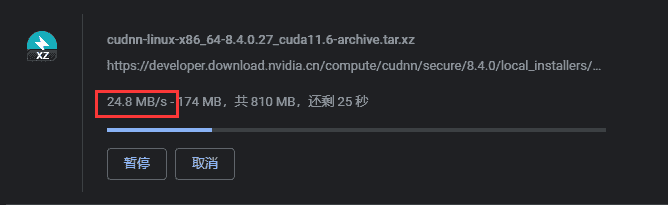

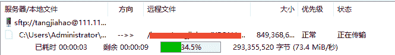

1.  解压cuDNN文件，并进入解压出的文件夹，拷贝文件到/usr/local/cuda-11.2中

```
$tar -xvf  cudnn-linux-x86_64-8.9.3.28_cuda11-archive.tar.xz
$cd cudnn-linux-x86_64-8.9.3.28_cuda11-archive
$sudo cp lib/* /usr/local/cuda-11.3/lib64/
$sudo cp include/* /usr/local/cuda-11.3/include/
$sudo chmod a+r /usr/local/cuda-11.3/lib64/*
$sudo chmod a+r /usr/local/cuda-11.3/include/*
```

1.  查看cuDNN版本，旧版本指令为cat /usr/local/cuda/include/cudnn.h | grep CUDNN_MAJOR -A2，新版本有更新，将cuDNN版本信息单拉了一个文件名为cudnn_version.h，所以新版本查看cuDNN版本的命令为cat /usr/local/cuda/include/cudnn_version.h | grep CUDNN_MAJOR -A 2

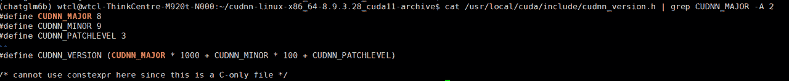

上述教程为这台机器上的所有用户安装了CUDA和cuDNN，我们切一下普通用户查看nvcc -V是否能用。

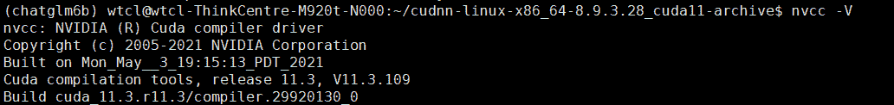

好的，安装完成。

---

# 四、总结

以上就是今天要讲的内容，本文介绍了如何Ubuntu系统下，安装CUDA 11.2 和 cuDNN 8.4.0并检查是否安装成功。

本文提供了简单的手段查看CUDA 和 cuDNN是否安装成功。

如果本文能给你带来帮助的话，点个赞鼓励一下作者吧！

# 五、参考

> [1] CUDA工具包：[https://developer.nvidia.com/](https://developer.nvidia.com/cuda-toolkit-archive)cuda-toolki[t-archive

> [2] cuDNN库：https](https://developer.nvidia.com/rdp/cudnn-archive)://developer.nvidia.com/rdp/cudnn-archive